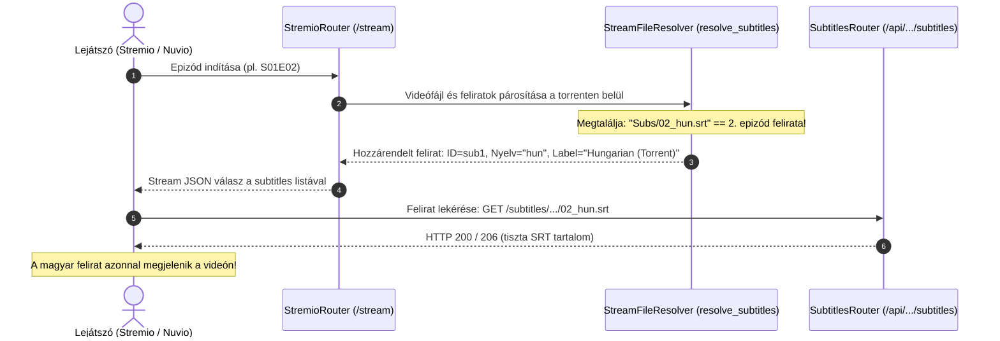
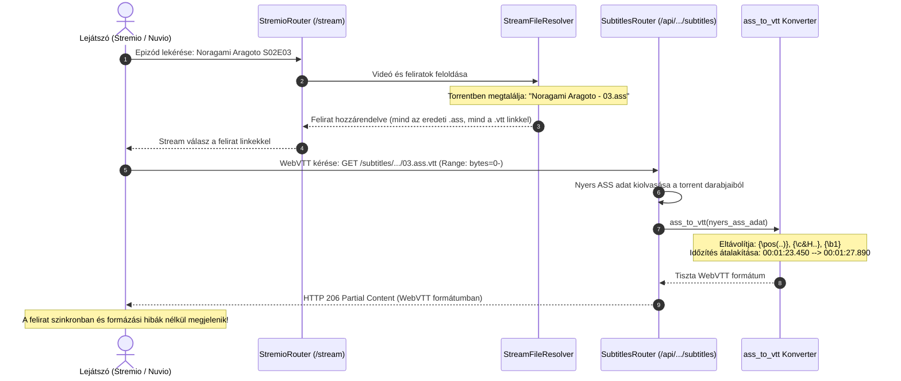

  

Self-hosted streaming szerver, amellyel <b>közvetlenül a torrent oldalakról</b> nézheted a tartalmat várakozás nélkül!

További információkért és útmutatókért látogass el a <a href="https://stremhu.app" target="_blank">https://stremhu.app</a> oldalra!

  &nbsp;
  

  Ha hasznosnak találod a projektet, támogasd egy ⭐-gal, és ha teheted, hívd meg az eredeti készítőt egy kávéra! ☕  
  

> [!IMPORTANT]
> **Fork információk és köszönetnyilvánítás:**
> Ez a repository a hivatalos **[StremHU Source](https://github.com/s4pp1/stremhu-source)** projekt forkja, melynek eredeti készítője és fejlesztője **[s4pp1](https://github.com/s4pp1)**.
> - **Eredeti GitHub repository:** [https://github.com/s4pp1/stremhu-source](https://github.com/s4pp1/stremhu-source)
> - **Hivatalos weboldal & dokumentáció:** [https://stremhu.app](https://stremhu.app)
> - **Hivatalos Docker Hub:** [s4pp1/stremhu-source](https://hub.docker.com/r/s4pp1/stremhu-source)

---

## 💬 Torrent Feliratok Kezelése és Streaming (`feature/torrent-subtitles` branch)

Ez a branch a **torrentben található külső feliratok automatikus felderítését, a videókhoz való intelligens illesztését, közvetlen streamelését, valamint valós idejű WebVTT konverzióját** valósítja meg Stremio és Nuvio kliensek számára.

---

### 🚀 Új funkciók listája ebben a branch-ben

#### 1. Torrentben található feliratok felderítése és nyelvi osztályozása
- **Támogatott formátumok**: `.srt`, `.ass`, `.sub`, `.vtt` kiterjesztésű fájlok automatikus észlelése a letöltött vagy streamelt torrentekben (`is_subtitle`).
- **Nyelvfelismerés (`detect_subtitle_language`)**:
  - Felismeri a fájlnévben szereplő nyelvkódokat (pl. magyar: `.hun.`, `.hu.`, `[HunSub]`; angol: `.eng.`, `.en.`, `[EngSub]`).
  - Érzékeli a kényszerített feliratokat (`Hungarian (Forced)`).
  - Alapértelmezett magyar címkézés: Ha a fájlnévben nincs külön nyelvi utalás (pl. `01.ass` vagy `01.srt`), a hazai trackerek jellegéből adódóan automatikusan magyar feliratként jelöli meg (`Hungarian (Torrent)`).

#### 2. Intelligens felirat-illesztés több fájlos pakkoknál (`resolve_subtitles`)
- **Egyedi videófájl**: Ha a torrentben csak egyetlen videó van (film vagy egyetlen epizód), az összes elérhető feliratfájlt automatikusan hozzárendeli a streamhez.
- **Sorozatpakkok (Season Packs)**: Több videófájlt tartalmazó pakkok esetén a feliratokat pontosan a kiválasztott videóhoz illeszti:
  - Fájlnév törzs (stem) egyezés alapján (pl. `Sorozat_01.mkv` -> `Sorozat_01.hun.srt`).
  - Epizódszám és évad alapján (pl. `Subs/01.srt` vagy `Subs/Sorozat - S02E01.srt` a 2. évad 1. részéhez).
- **Extrák szűrése**: Kizárja az `Extras` és `Menü` mappákban található feliratokat, így azok nem keverednek a valódi epizódok feliratai közé.

#### 3. Felirat Streaming végpont & HTTP Range támogatás
- **Dedikált végpont**: `/api/{user_id}/subtitles/{token}/{filename}`
- **HTTP Range támogatás (`206 Partial Content`)**: A végpont támogatja a darabolt letöltést, így a modern lejátszók (pl. ExoPlayer, VLC, Stremio Web) azonnal, akadozás nélkül képesek beolvasni a feliratot közvetlenül a P2P darabokból.
- **Biztonságos URL kódolás**: A felirat URL-ek a `quote()` függvénnyel kódolódnak, így a szóközöket, ékezeteket és szögletes zárójeleket (`[Group] Title - 01 [1080p].ass`) tartalmazó fájlnevek is hibátlanul elérhetőek.

#### 4. Valós idejű ASS/SSA -> WebVTT konverter (`ass_to_vtt`)
- Az anime és nemzetközi release-ek jelentős része `.ass` (Advanced SubStation Alpha) felirattal érkezik, amelyet a beépített böngészős lejátszók (pl. Nuvio) és okostévék natívan nem tudnak közvetlenül megjeleníteni.
- A beépített konverter a felirat lekérésekor menet közben, a memóriában alakítja át az ASS szkriptet tiszta **WebVTT** formátumra:
  - Eltávolítja a pozicionáló és stíluscímkéket (`\pos(...)`, `\c&H...`, `\b1`, `\i1`).
  - Átalakítja az időbélyegeket WebVTT formátumra (`00:01:23.450 --> 00:01:27.890`).
  - Megtartja a szöveget és a sortöréseket (`\N` -> `\n`).
- A szerver minden `.ass` felirathoz automatikusan felkínálja a virtuális `.vtt` változatot is a lejátszók számára.

#### 5. Stremio & Nuvio Subtitles API integráció
- **Manifest erőforrás regisztráció**: A Stremio manifestben deklarálásra került a `subtitles` erőforrás (`ShortManifestResource.SUBTITLES`).
- **Közvetlen Stremio felirat végpont**: `/subtitles/{media_type}/{stream_id}.json` végpont biztosítása.
- **Stream válasz szintű továbbítás**: A Stremio és Nuvio stream válaszban a `subtitles` tömb közvetlenül tartalmazza a torrent feliratait, így az azonnal megjelenik a lejátszó feliratválasztójában.

---

## 🔄 Hogyan működik a gyakorlatban? (Példák és folyamatábrák)

### 🎬 1. Normál eset: Film vagy sorozatpakk külső `.srt` felirattal

Amikor egy torrentben a videó mellett külön mappa vagy fájl formájában `.srt` feliratok találhatók:

---

### 🎬 2. Kivételes eset (Edge Case): Stílusos `.ass` felirat valós idejű WebVTT konverzióval
**Példa:** *Noragami Aragoto* S02E03, ahol a torrentben külső `.ass` felirat van (`Noragami Aragoto - 03.ass`), amit a Nuvio böngészős lejátszója nem tud közvetlenül renderelni.

---

> [!NOTE]
> A StremHU Source egy szabadidős projekt! Hibajelentéseket és fejlesztési ötleteket szívesen fogadunk kulturáltan a StremHU Discord szerverén!
