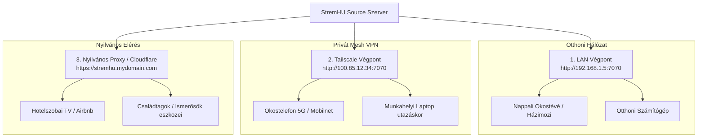

  

Self-hosted streaming szerver, amellyel <b>közvetlenül a torrent oldalakról</b> nézheted a tartalmat várakozás nélkül!

További információkért és útmutatókért látogass el a <a href="https://stremhu.app" target="_blank">https://stremhu.app</a> oldalra!

  &nbsp;
  

  Ha hasznosnak találod a projektet, támogasd egy ⭐-gal, és ha teheted, hívd meg az eredeti készítőt egy kávéra! ☕  
  

> [!IMPORTANT]
> **Fork információk és köszönetnyilvánítás:**
> Ez a repository a hivatalos **[StremHU Source](https://github.com/s4pp1/stremhu-source)** projekt forkja, melynek eredeti készítője és fejlesztője **[s4pp1](https://github.com/s4pp1)**.
> - **Eredeti GitHub repository:** [https://github.com/s4pp1/stremhu-source](https://github.com/s4pp1/stremhu-source)
> - **Hivatalos weboldal & dokumentáció:** [https://stremhu.app](https://stremhu.app)
> - **Hivatalos Docker Hub:** [s4pp1/stremhu-source](https://hub.docker.com/r/s4pp1/stremhu-source)

---

## 🌐 Több Végpontos Manifest Támogatás (`feature/multi-manifest-endpoints` branch)

Ez a branch a **több hálózati végpont (Multi-Manifest Endpoints)** natív kezelését vezeti be, amellyel ugyanaz a StremHU Source szerver egyszerre több különböző hálózaton keresztül (helyi LAN, privát VPN és nyilvános reverse proxy) is elérhetővé válik a Stremio, Nuvio és Kodi kliensek számára.

---

### ❓ Miért van szükség több végpontra?

Az eredeti StremHU Source egyetlen globális szervercímet (`APP_URL`) használ. Ez a gyakorlatban komoly dilemmát okoz:
1. **Ha a helyi IP-címet állítod be (`192.168.1.5`)**: Az otthoni TV tökéletesen és maximális sebességgel működik, de a lakáson kívülről (mobilról mobilneten, laptopról, utazás közben) a szerver teljesen elérhetetlenné válik.
2. **Ha egy nyilvános domaint vagy Cloudflare Tunnelt állítasz be**: Kívülről működik, de az otthoni okostévé is a lassabb internetes kapcsolaton és külső proxyn keresztül streamel, ami feleslegesen terheli az otthoni feltöltési sávszélességet, és a Cloudflare ingyenes csomagjában a videostreamelés korlátozásba vagy tiltásba ütközhet.
3. **Ha Tailscale-t / WireGuardot használsz**: Saját eszközökön remek, de egy hotelszobai okostévére, Apple TV-re vagy rokonok készülékére nem mindig lehet VPN klienst telepíteni.

#### 💡 A megoldás:
A rendszerben **egyszerre több hálózati végpontot** konfigurálhatsz. A webes felületen egyetlen kattintással kiválaszthatod a megfelelő végpontot, és a Stremio / Kodi manifest link automatikusan a kiválasztott hálózat címére mutató közvetlen stream linkeket fog generálni!

---

## 🏗️ Hálózati architektúra és forgatókönyvek

---

### 📋 Példa Setup és Használati Esetek

| Végpont Típus | Példa URL | Ideális Eszközök | Fő Előnyök |
| :--- | :--- | :--- | :--- |
| **1. Otthoni LAN** | `http://192.168.1.5:7070` | Nappali okostévé, helyi PC, TV Box | **Gigabites helyi sebesség**, 0 internet forgalom, nincs pufferelés még nagy bitrátájú 4K HDR esetén sem. |
| **2. Tailscale / VPN** | `http://100.85.12.34:7070` | Saját mobiltelefon, utazó laptop | **Biztonságos P2P titkosítás**, nem igényel portnyitást a routeren, NAT és tűzfal mögül is azonnal kapcsolódik. |
| **3. Nyilvános Proxy / Tunnel** | `https://stremhu.mydomain.com` | Hotel TV, Airbnb streaming stick, barátok | **Univerzális elérhetőség**, olyan eszközökön is működik böngészőből és Stremio-ból, ahol nem telepíthető VPN. |

---

## 🖥️ Felhasználói Felület (UI) Újdonságok

1. **Végpontválasztó (Endpoint Selector Dropdown)**:
   - A felhasználó adatlapján (`/dashboard/users/:userId`) a Stremio és Kodi integrációs kártyákon megjelent egy legördülő választó.
   - Kiválasztva a kívánt végpontot (pl. *Otthoni LAN* vagy *Tailscale*), az `Install` gomb és a vágólapra másolható manifest URL azonnal a megfelelő domainre frissül.
2. **Kodi kiegészítő kártya**:
   - Dedikált beállítási kártya és integrációs link a Kodi kiegészítőhöz az adott végpontra szabva.
3. **Rendszer Dashboard áttekintés**:
   - A rendszer főoldalán megjelenik az aktív hálózati végpontok listája és a hálózati beállítások közvetlen linkje.

---

> [!NOTE]
> A StremHU Source egy szabadidős projekt! Hibajelentéseket és fejlesztési ötleteket szívesen fogadunk kulturáltan a StremHU Discord szerverén!
