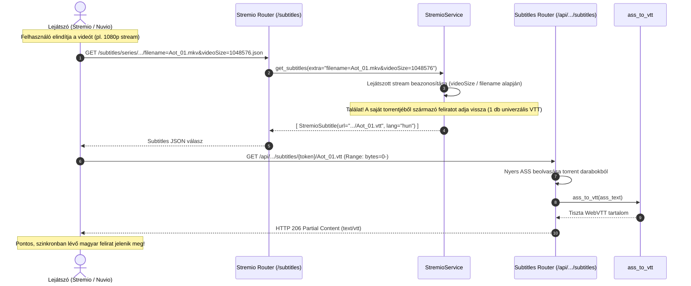
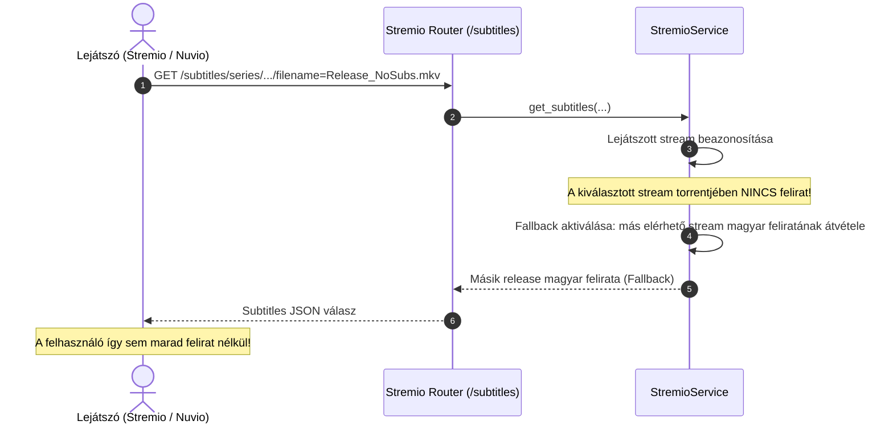

<p align="center">
  <a href="https://stremhu.app" target="_blank">
  </a>
</p>

<p align="center">Self-hosted streaming szerver, amellyel <b>közvetlenül a torrent oldalakról</b> nézheted a tartalmat várakozás nélkül!</p>
<p align="center">További információkért és útmutatókért látogass el a <a href="https://stremhu.app" target="_blank">https://stremhu.app</a> oldalra!</p>

<p align="center">
  <a href="https://discord.gg/jRSPPY5XaN" target="_blank">
    
  </a>&nbsp;
  <a href="https://hub.docker.com/r/s4pp1/stremhu-source" target="_blank">
    
  </a>
</p>

<p align="center">
  Ha hasznosnak találod a projektet, támogasd egy ⭐-gal, és ha teheted, hívd meg az eredeti készítőt egy kávéra! ☕<br><br>
  <a href='https://ko-fi.com/s4pp1' target='_blank'>
    
  </a>
</p>

> [!IMPORTANT]
> **Fork információk és köszönetnyilvánítás:**
> Ez a repository a hivatalos **[StremHU Source](https://github.com/s4pp1/stremhu-source)** projekt forkja, melynek eredeti készítője és fejlesztője **[s4pp1](https://github.com/s4pp1)**.
> - **Eredeti GitHub repository:** [https://github.com/s4pp1/stremhu-source](https://github.com/s4pp1/stremhu-source)
> - **Hivatalos weboldal & dokumentáció:** [https://stremhu.app](https://stremhu.app)
> - **Hivatalos Docker Hub:** [s4pp1/stremhu-source](https://hub.docker.com/r/s4pp1/stremhu-source)

---

## 💬 Torrent Feliratok Kezelése és Streaming (`feature/torrent-subtitles` branch)

Ez a branch a **torrentben található feliratok intelligens felderítését, magyar nyelvre optimalizált szűrését, videóhoz illesztését, közvetlen streamelését, valós idejű WebVTT konverzióját, valamint hibatűrő fallback rendszerét** valósítja meg Stremio és Nuvio kliensek számára.

---

### 📖 User Guide (Felhasználói útmutató)

Mit nyújt ez a branch a lejátszókban (Stremio / Nuvio)?

1. **Univerzális és megbízható lejátszás minden eszközön:**
   - A torrentekben található leggyakoribb feliratok (.srt, .vtt) mellett a stílusos anime feliratok (.ass, .ssa) is gond nélkül működnek a webes felületen (pl. Nuvio web), okostévéken (LG webOS, Samsung Tizen) és mobilokon.
   - Az `.ass` feliratokat a szerver a háttérben valós időben konvertálja át a lejátszók által univerzálisan támogatott **WebVTT** formátumra.
2. **Nincsenek zavaró duplikációk:**
   - Minden felirat pontosan egyszer szerepel a feliratválasztóban (megszűnt a korábbi `.ass` és `.vtt` párhuzamos duplikáció).
3. **Célzott magyar feliratok (Magyar tracker optimalizáció):**
   - Kizárólag a magyar nyelvű feliratok jelennek meg a felületen.
   - Az egyéb idegen nyelvű feliratok (angol, német, francia, spanyol stb.) automatikusan kiszűrésre kerülnek, elkerülve a felesleges felirat-listázást (az idegen nyelvekre a népszerű külső subtitle kiegészítők, pl. OpenSubtitles használatosak).
   - **Ismeretlen feliratok elve:** Ha egy feliratnál nem szerepel nyelvi jelölés (pl. `01.ass`, `Noragami - 01.srt`), a rendszer a magyar trackerek kontextusából fakadóan **magyar feliratként** kezeli, így egyetlen releváns felirat sem vész el.
4. **Pontos videó-illesztés és automatikus Fallback:**
   - A lejátszott videó torrentjéből érkezik a felirat, garantálva, hogy a timing pontosan a nézett videóhoz igazodjon.
   - Ha a kiválasztott videó torrentjében egyáltalán nincs felirat, a rendszer automatikusan biztosítja a többi azonos epizódhoz tartozó torrent magyar feliratát tartalékként (**fallback**).

---

### 🛠️ Developer Handbook (Fejlesztői kézikönyv)

#### 1. Architektúra és modulok áttekintése

```
server/app/modules/
├── torrent_streams/
│   ├── schemas.py              # TorrentStream & TorrentStreamSubtitle összeállítása, VTT átirányítás
│   └── utils/
│       ├── resolver_helpers.py # detect_subtitle_language (nyelvfelismerés, ismeretlen = hun)
│       └── stream_file_resolver.py # resolve_subtitles (epizód-pontos illesztés és szűrés)
├── stremio/
│   ├── router.py               # /subtitles végpont (Request, extra paraméterek átadása)
│   └── service.py              # get_subtitles (lejátszott stream beazonosítása és fallback logika)
└── stream/
    ├── router.py               # /subtitles/{stream_token}/{filename} felirat stream & Range
    └── utils/
        └── subtitles.py        # ass_to_vtt (valós idejű ASS/SSA -> WebVTT konverter)
```

#### 2. Részletes működési szabályok

##### A. Nyelvfelismerés és besorolás (`detect_subtitle_language`)
- **Magyar egyezés:** Regexszel ellenőrzi a `hun`, `hu`, `hungarian`, `magyar`, `hunsub` címkéket.
- **Idegen nyelvű szűrés:** Felismeri az idegen nyelvek 3-betűs kódjait, teljes neveit (`english`, `german`, `french`, stb.) és a standard határolókkal ellátott 2-betűs jelöléseket (`.en.`, `_de.`, `[es]`).
- **Alapértelmezés (Default to Hungarian):** Ha a felirat fájlnevében és elérési útjában nincs idegen nyelvű azonosító (pl. `01.ass`, `ep01.srt`), a rendszer automatikusan `("hun", "Hungarian (Torrent)")`-ként osztályozza.
- A `TorrentStream` csak a `lang == "hun"` feliratokat fogadja be.

##### B. Univerzális WebVTT generálás
- Ha a forrásfájl `.ass` vagy `.ssa`, a `TorrentStreamSubtitle` célneve `.vtt`-re cserélődik, és a URL a `.vtt` kiterjesztésű végpontra mutat.
- A `stream_subtitle` végponton a szerver észleli, hogy a kért kiterjesztés `.vtt`, míg a torrentben lévő fájl `.ass` / `.ssa`, ezért a `ass_to_vtt` függvénnyel a memóriában, streamelve végzi el az átalakítást:
  - Időzítések konvertálása: `0:01:23.45` -> `00:01:23.450 --> 00:01:27.890`.
  - Stíluscímkék és pozicionálók törlése: `{\pos(...)}`, `{\c&H...}`, `{\b1}`, stb.
  - Sortörések konvertálása: `\N` -> `\n`.
- Egy fájlból kizárólag egyetlen univerzális bejegyzés jön létre.

##### C. Epizód-pontos illesztés pakkoknál (`resolve_subtitles`)
- Sorozatpakkok esetén a fájlnév-tisztítás (`clean_video_stem`) mellett kötelező az epizódszám-egyezés ellenőrzése a `SeriesParser` segítségével.
- Ha a felirat neve egy másik epizódot jelöl meg (pl. 2. rész az 1. helyett), a felirat eldobásra kerül, megakadályozva a több epizódot tartalmazó torrentek felirat-összemosódását.

##### D. Lejátszott videó beazonosítása és Fallback stratégia
A Stremio és Nuvio a videó indításakor a `/subtitles/{media_type}/{stream_id}/{extra}.json` végpontot hívja meg:
1. Az `extra` és query paraméterekből kinyerjük a `videoSize` és `filename` értékeket.
2. A `_find_played_stream` metódus megkeresi a pontosan lejátszott `StremioStream`-et.
3. **Ha a lejátszott streamnek van saját torrent-felirata:** kizárólag azt adja vissza, garantálva a tökéletesen időzített feliratot.
4. **Ha a lejátszott streamnek nincs saját felirata:** tartalékként a többi stream magyar feliratait adja vissza.
5. A streamek belső feliratlistáján (`stream.subtitles`) is érvényesül ez: a felirat nélküli streamek megkapják a fallback feliratot, így közvetlen Nuvio lejátszásnál is azonnal elérhető.

##### E. Teljesítmény-optimalizációk (Performance & Caching)
- **In-flight deduplikáció és rövid távú Stream Cache (`StremioService.get_streams`):** Amikor a Stremio párhuzamosan hívja meg a `/stream` és `/subtitles` végpontokat, az egyidejű kérések egyetlen közös `asyncio.Task`-ra várnak (`_ongoing_stream_tasks`), az eredmény pedig 60 másodpercig memóriában gyorsítótárazódik (`_stream_cache`). Így az nCore keresés és torrent-feldolgozás csak egyszer fut le, a lejátszáskor érkező `/subtitles/{extra}` kérés pedig ~0 ms alatt válaszol.
- **`TorrentInfo` memória-gyorsítótár (`_TORRENT_INFO_CACHE`):** Az SQLite-ból betöltött `.torrent` binárisok `libtorrent.torrent_info` és Pydantic fájllista-építése `info_hash` alapján memóriában cache-elt, így nem kell minden kérésnél újra bencode-olni és felépíteni több száz fájlos csomagokat.
- **Rövidzáras (Short-circuit) felirat-illesztés és `@lru_cache`:** A `resolve_subtitles` először gyors string-prefix egyezést vizsgál, és csak tényleges névegyezés esetén hívja meg a költséges `SeriesParser`-t; a `clean_torrent_name` pedig `@lru_cache` gyorsítótárat kapott, kiküszöbölve a több száz feliratot tartalmazó (pl. Netflix VARYG) pakkok felesleges regex-terhelését.

---

### 🔄 Folyamatábrák

#### 🎬 1. Felirat-kiszolgálás a lejátszott videó torrentjéből és WebVTT konverzió



#### 🎬 2. Fallback folyamat (ha a lejátszott torrentben nincs felirat)



---

> [!NOTE]
> A StremHU Source egy szabadidős projekt! Hibajelentéseket és fejlesztési ötleteket szívesen fogadunk kulturáltan a StremHU Discord szerverén!
