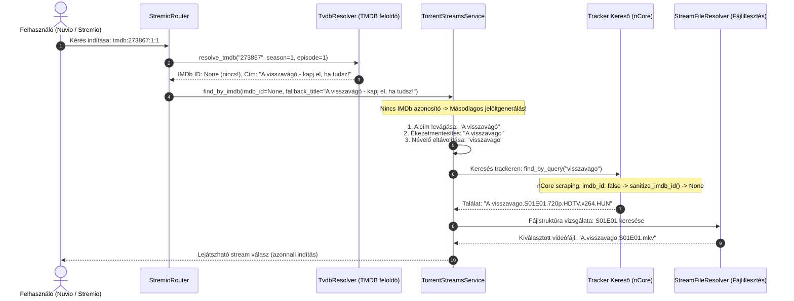
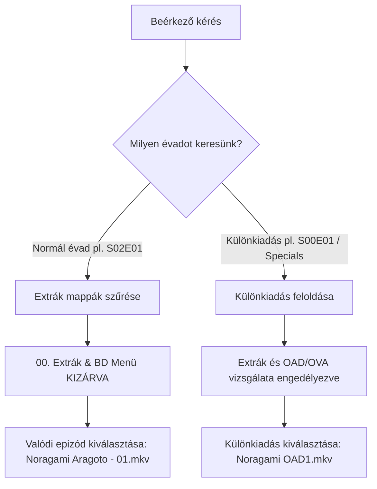

  

Self-hosted streaming szerver, amellyel <b>közvetlenül a torrent oldalakról</b> nézheted a tartalmat várakozás nélkül!

További információkért és útmutatókért látogass el a <a href="https://stremhu.app" target="_blank">https://stremhu.app</a> oldalra!

  &nbsp;
  

  Ha hasznosnak találod a projektet, támogasd egy ⭐-gal, és ha teheted, hívd meg az eredeti készítőt egy kávéra! ☕  
  

> [!IMPORTANT]
> **Fork információk és köszönetnyilvánítás:**
> Ez a repository a hivatalos **[StremHU Source](https://github.com/s4pp1/stremhu-source)** projekt forkja, melynek eredeti készítője és fejlesztője **[s4pp1](https://github.com/s4pp1)**.
> - **Eredeti GitHub repository:** [https://github.com/s4pp1/stremhu-source](https://github.com/s4pp1/stremhu-source)
> - **Hivatalos weboldal & dokumentáció:** [https://stremhu.app](https://stremhu.app)
> - **Hivatalos Docker Hub:** [s4pp1/stremhu-source](https://hub.docker.com/r/s4pp1/stremhu-source)

---

## 🔍 Keresési és Szűrési Továbbfejlesztések (`feature/search-filter-tmdb-tvdb` branch)

Ez a branch a **TMDB azonosítók kezelését**, a **másodlagos többjelöltes szöveges fallback keresést**, az **nCore hibajavítást**, valamint az **Extrák és Különkiadások intelligens szűrését** valósítja meg.

### 🚀 Új funkciók összefoglalása
1. **TMDB Stream ID támogatás**: `tmdb:{id}` és `tmdb:{id}:{season}:{episode}` azonosítók fogadása és feloldása a TheMovieDb API-ból.
2. **Többjelöltes másodlagos szöveges keresés**: Automatikus címfeldolgozás, ékezetmentesítés és névelő-eltávolítás az IMDb azonosító nélküli tartalmak megtalálásához.
3. **nCore Boolean IMDb ID javítás**: Megelőzi a `ValidationError` hibákat, ha az nCore scraping `false` értéket ad vissza IMDb link hiányában.
4. **Extrák és menük szűrése**: Menük (`BD Menü`, `DVD Menu`) és extra mappák (`00. Extrák`) kizárása normál évadoknál, valamint a Specials (0. évad) és OAD/OVA/SP fájlok feloldása.

---

## 🔄 Hogyan működik a gyakorlatban? (End-to-End Workflow & Példák)

### 🎬 Gyakorlati példa 1: *"A visszavágó - kapj el, ha tudsz!"* (Kivételes eset: Magyar műsor IMDb ID nélkül)

Gyakori probléma, hogy a hazai gyártású sorozatoknak, vetélkedőknek vagy reality műsoroknak egyáltalán nincs IMDb adatlapjuk, a trackereken (pl. nCore) ékezet nélkül töltik fel őket, az oldal pedig `imdb_id: false` értéket ad vissza.

#### A folyamat részletei:
1. **A kérés beérkezése**: A Nuvio / Stremio a TheMovieDb alapján küldi a kérést: `tmdb:273867:1:1`.
2. **TMDB metaadat-lekérdezés**: A `TvdbResolver.resolve_tmdb` lekéri a TMDB API-t. Kiderül, hogy a sorozatnak nincs nemzetközi IMDb azonosítója (`imdb_id=None`), de megvan a hivatalos címe: *"A visszavágó - kapj el, ha tudsz!"*.
3. **Másodlagos jelöltgenerálás**: A `TorrentStreamsService` felismeri, hogy nincs IMDb ID, ezért intelligens jelöltlistát állít össze a magyar trackerek keresési sajátosságaihoz igazodva:
   - 1. jelölt: `"A visszavágó"` (kötőjel utáni alcím levágása)
   - 2. jelölt: `"A visszavago"` (ékezetmentesítés, mert a trackereken szinte minden cím ékezet nélkül szerepel)
   - 3. jelölt: `"visszavago"` (kezdő névelő eltávolítása, mivel a szigorú keresők elhasalnak az "A " névelőn)
4. **Tracker lekérdezés & nCore javítás**: A tracker kereső lekérdezi a `"visszavago"` kulcsszót. Az nCore felülete `imdb_id: false` mezőt ad vissza, amit a `sanitize_imdb_id` validátor `None`-ra tisztít, megelőzve az 500-as hibát.
5. **Fájlillesztés és lejátszás**: A megtalált torrentből az 1. évad 1. része sikeresen feloldódik és várakozás nélkül elindul.

---

### 🎬 Gyakorlati példa 2: *Noragami Aragoto* (Extrák mappa kiszűrése vs. Különkiadások megnyitása)

Sok anime kiadás tartalmaz menüfájlokat és extrákat (pl. BDBOX kiadások):
- Mappastruktúra:
  - `00. Extrák/BD Menü/S02/Vol 2.mkv` (2 GB-os BD menü videó)
  - `02. Noragami Aragoto/[ReinForce] Noragami Aragoto - 01 (BDRip).mkv` (Valódi 1. rész)
  - `01. Noragami/[ReinForce] Noragami OAD1 (DVDRip).mkv` (Különkiadás / OVA)

- **Normál 2. évad 1. rész kérésekor (`S02E01`)**: Az `is_extra_folder` azonnal felismeri a `00. Extrák` és `BD Menü` mappákat, így kizárja őket. A lejátszó a valódi epizódot kapja meg a menüvideó helyett.
- **Különkiadás kérésekor (`S00E01` / Specials)**: A feloldó engedélyezi a belépést az extrák közé, a `SeriesParser` felismeri az `OAD1` jelölést, és pontosan a különkiadást adja vissza.

---

### 🎬 Gyakorlati példa 3: *One Piece* (Anime abszolút epizódszámozás feloldása)

A `main` branch-ben bevezetett alap anime feloldási logika működése a Wano arc 1089. részén keresztül:

---

> [!NOTE]
> A StremHU Source egy szabadidős projekt! Hibajelentéseket és fejlesztési ötleteket szívesen fogadunk kulturáltan a StremHU Discord szerverén!
