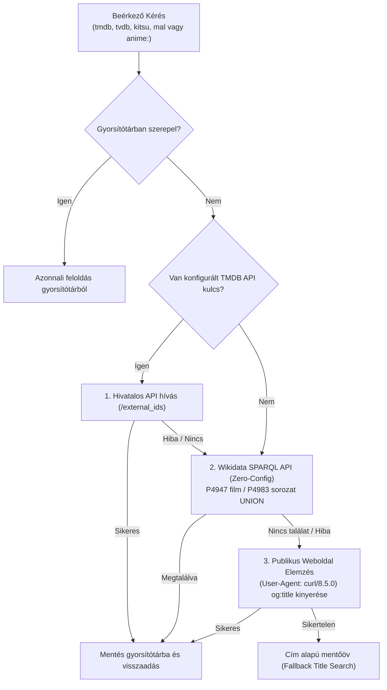
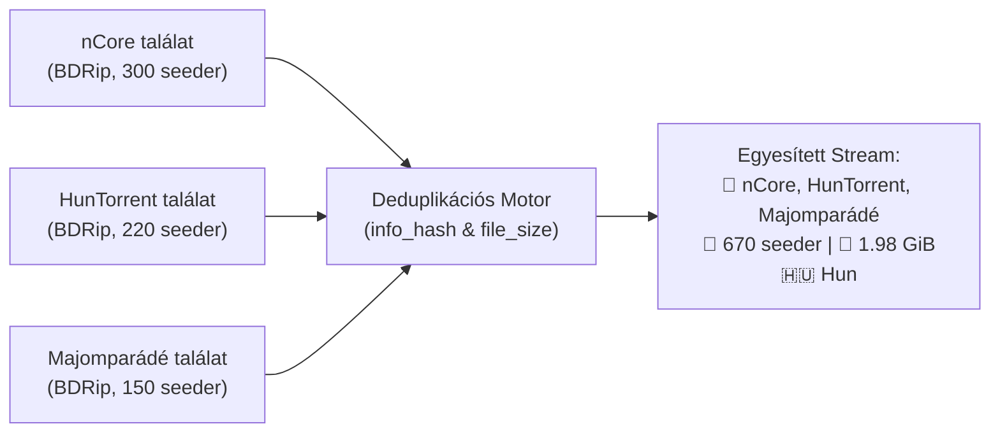

<p align="center">
  <a href="https://stremhu.app" target="_blank">
  </a>
</p>

<p align="center">Self-hosted streaming szerver, amellyel <b>közvetlenül a torrent oldalakról</b> nézheted a tartalmat várakozás nélkül!</p>
<p align="center">További információkért és útmutatókért látogass el a <a href="https://stremhu.app" target="_blank">https://stremhu.app</a> oldalra!</p>

<p align="center">
  <a href="https://discord.gg/jRSPPY5XaN" target="_blank">
    
  </a>&nbsp;
  <a href="https://hub.docker.com/r/s4pp1/stremhu-source" target="_blank">
    
  </a>
</p>

<p align="center">
  Ha hasznosnak találod a projektet, támogasd egy ⭐-gal, és ha teheted, hívd meg az eredeti készítőt egy kávéra! ☕<br><br>
  <a href='https://ko-fi.com/s4pp1' target='_blank'>
    
  </a>
</p>

> [!IMPORTANT]
> **Fork információk és köszönetnyilvánítás:**
> Ez a repository a hivatalos **[StremHU Source](https://github.com/s4pp1/stremhu-source)** projekt forkja, melynek eredeti készítője és fejlesztője **[s4pp1](https://github.com/s4pp1)**.
> - **Eredeti GitHub repository:** [https://github.com/s4pp1/stremhu-source](https://github.com/s4pp1/stremhu-source)
> - **Hivatalos weboldal & dokumentáció:** [https://stremhu.app](https://stremhu.app)
> - **Hivatalos Docker Hub:** [s4pp1/stremhu-source](https://hub.docker.com/r/s4pp1/stremhu-source)

---

# 🚀 Fejlesztések és Újdonságok az Eredeti Upstream Verzióhoz (`s4pp1/stremhu-source`) Képest

Ez a fork jelentős funkcionális, stabilitási és teljesítménybeli fejlesztéseket valósít meg a hazai torrent indexerek (`nCore`, `HunTorrent`, `Majomparádé`, `BitHUmen`, `iNSANE`), a modern Stremio/Nuvio kiegészítők, a kulcs nélküli külső metaadat-feloldás és a lejátszási élmény terén.

---

## 📋 Összehasonlító Áttekintő Táblázat

| Terület / Funkció | Eredeti Upstream (`s4pp1/stremhu-source`) | Ez a Fork (`feature/search-filter-tmdb-tvdb`) |
| :--- | :--- | :--- |
| **TMDB Stream ID (`tmdb:{id}`)** | ❌ Nem támogatott / Hiba | ✅ **Teljes támogatás** (Filmek & Sorozatok; kulcs nélküli Wikidata és webes mentőöv) |
| **TheTVDB (`tvdb:{id}`) & Kitsu / MAL** | ❌ Nincs támogatás | ✅ **Kulcs nélküli TVDB, Kitsu és MyAnimeList (`mal:`) feloldás** dinamikus leképezéssel és iker IMDb aliasokkal |
| **Több-Trackeres Találatok** | ⚠️ Külön streamként duplikálva jelent meg minden indexerről | ✅ **Intelligens deduplikáció:** azonos kiadások összevonása, seederek összeadása, multi-tracker badge, **Web UI kapcsoló** |
| **Szöveges Keresés Trackereken** | ⚠️ Csak nCore támogatta; más oldalak üres listát adtak | ✅ **Összes hazai indexer támogatott** (`HunTorrent`, `Majomparádé`, `BitHUmen`, `iNSANE`) lapozásvédelemmel |
| **IMDb Nélküli Műsorok (pl. Vetélkedők)** | ❌ 0 találat vagy nCore 500-as hiba (`imdb_id: false`) | ✅ **Többjelöltes másodlagos keresés** (ékezetmentesítés, névelő-eltávolítás, nCore sanitizer) |
| **Sorozatok & Animék Keresési Sebessége** | ⏱️ 30-40 másodperces leállás / timeoutok | ✅ **Hibrid gyorskeresés:** 29×-es gyorsulás (pl. One Piece Cold Start: 39,9 mp ➡️ **1,34 mp**) |
| **Ténylegesen Letöltött Tartalom Kijelzése** | ⚠️ Fals "Letöltve" státusz az évadcsomagok még le nem töltött részeinél is | ✅ **Fájlszintű ellenőrzés (`file_progress`):** Csak a 100%-ban kész videófájlok kapnak `⚡ Letöltve` jelzést |
| **Stremio Felhasználói Élmény** | ⚠️ Felesleges `[StremHU]` prefix; nincs zászló emoji | ✅ **Letisztult címkék**, nemzeti zászlók (`🇭🇺 Hun`, `🇬🇧 Eng`, `🇯🇵 Jap`, stb.), megtévesztő feliratjelvény mellőzése |
| **Japán Hangsáv Felismerése** | ❌ Nem szerepelt az attribútumok között | ✅ **`🇯🇵 Jap` nyelv felismerés** és beállítható rendezési preferencia |
| **Extrák és Menük Szűrése** | ⚠️ Veszély: 2 GB-os BD menüvideót indíthatott valódi epizód helyett | ✅ **Intelligens szűrés:** `BD Menü`, `Extras`, `NCED` kizárása normál részeknél; Specials (0. évad) esetén engedélyezve |
| **Kezdeti Pufferelés (Nuvio / ExoPlayer)** | ⚠️ 1 darabos indítás; nagy MKV Cues / MP4 moov esetén stall | ✅ **Kiterjesztett darab-prioritás:** `min(3, total_pieces // 2)` azonnali (`deadline = 0`) letöltés a fájl elejére és végére |
| **Évadcsomag Gyorsítótárazás** | ⏱️ 180 másodperc (gyakori ismételt tracker terhelés) | ✅ **1800 másodperc (30 perc):** részek egymás utáni nézésekor 0 tracker kérés, **sub-3ms válaszidő** |
| **Stremio Sorozat Katalógus & Meta** | ⚠️ Csak filmekre engedélyezett; sorozatoknál üres válasz | ✅ **Sorozatok teljes körű támogatása** a keresési katalógusban és a meta végponton |
| **Torznab Képességek** | ⚠️ Csak alap IMDb paraméter | ✅ **`q` (szöveges keresés), `tvdbid` és `tmdbid` támogatás** |

---

## 🔍 Részletes Funkcióleírás

### 1. Kulcs Nélküli (Zero-Config) Multi-ID Feloldórendszer (`TvdbResolver`)
A modern streaming kliensek (Stremio kiegészítők, Nuvio, CyberFlix) nem kizárólag IMDb azonosítókat használnak:
- **TheMovieDatabase (`tmdb:`)**:
  - Filmek (`tmdb:693134`) és sorozatok (`tmdb:1399:1:1`) automatikus feloldása.
  - **Kulcs nélküli SPARQL architektúra**: A Wikidata nyilvános API-ján keresztül (`P4947` film és `P4983` sorozat azonosítók `UNION` lekérdezésével) hivatalos TMDB API kulcs nélkül is villámgyorsan kinyeri a nemzetközi IMDb azonosítót és a kanonikus címet.
  - **Cloudflare-mentes Web Scraping mentőöv**: Ha az adat még nem szerepel a Wikidatán, speciális fejlécekkel közvetlenül a publikus TMDB oldalról emeli ki a címet, elkerülve a 403-as blokkolást.
- **TheTVDB (`tvdb:`)**:
  - `tvdb:121361:1:1` sorozatok és TVDB filmek feloldása TVMaze és Wikidata (`P4835` / `P12196`) segítségével kulcs nélkül.
- **Anime Kitsu (`kitsu:`) és MyAnimeList (`mal:`)**:
  - Kitsu és MAL anime azonosítók (pl. `kitsu:12`, `mal:21`) automatikus leképezése TVDB és IMDb azonosítókra.
  - **Iker IMDb Alias Táblázat (`_IMDB_ALIASES`)**: A hazai trackereken az animék gyakran az eredeti japán TV sugárzás (pl. *Dragon Ball Z* 1989: `tt0121220`) vagy a nemzetközi premier (1996: `tt0214341`) IMDb kódjával vannak feltöltve. A rendszer automatikusan és párhuzamosan mindkét azonosítóra rákeres (*Dragon Ball*, *Naruto*, *Bleach*, *Sailor Moon*, *Pokémon*, *Death Note*, *Fullmetal Alchemist* stb.).



---

### 2. Több-Trackeres Stream Deduplikáció és UI Vezérlés
Amikor több indexer is be van kötve a rendszerbe (pl. nCore, HunTorrent, Majomparádé):
- **Azonos kiadások felismerése**: Két stream egyetlen találattá olvad össze, ha megegyezik a torrent swarm `info_hash` azonosítója, VAGY megegyezik a kinyert videófájl pontos mérete és normalizált neve.
- **Egzakt Seeder Összesítés**: Indexerenként a látott maximális seeder-számot vesszük figyelembe, és a trackerek értékeit összeadjuk. Nem vesznek el a seederek, és nem jelenik meg duplikált elem.
- **Egyesített Jelvények**: A stream leírásában valamennyi forrás fel van tüntetve:
  ```text
  🧲 nCore, HunTorrent, Majomparádé | 👥 670 | 💾 1.98 GiB
  🇭🇺 Hun
  💿 BDRip | 🎞️ x264
  ```
- **Web UI Kapcsoló**: A *Beállítások > További preferenciák* menüpontban a felhasználó egyetlen kapcsolóval választhat:
  - **Bekapcsolva (Alapértelmezett)**: Tiszta találati lista, összevont kiadásokkal és kombinált seederekkel.
  - **Kikapcsolva**: Nyers találatok, minden trackerről külön-külön megjelenítve.
  - **Azonnali érvényesülés**: A beállítás módosításakor a memóriagyorsítótár azonnal frissül.



---

### 3. Többjelöltes Másodlagos Szöveges Keresés & Hibrid Gyorskeresés
Ha egy tartalomnak nincs IMDb azonosítója (pl. magyar gyártású műsorok, vetélkedők), vagy az IMDb alapján letöltött csomagokból hiányzik az epizód:
1. **Intelligens Címjelöltek**:
   - Tisztított cím (kettőspontok, alcímek levágása).
   - Ékezetmentesítés (a hazai feltöltők szinte mindig ékezet nélkül nevezik el a release-eket).
   - Kezdő névelők eltávolítása (*A*, *Az*, *The*).
   - Szó-kombinációk (első két szó / első szó).
2. **Hibrid Lekérdezési Sorrend (29×-es Anime Gyorsulás)**:
   - Sorozatoknál az elsődleges évados minta (`{title} S01`) után **közvetlenül a tiszta alapcím (`{title}`)** kerül kipróbálásra.
   - Azoknál a sorozatoknál és animéknél (pl. *One Piece*), amelyeket egyetlen gyűjteményes csomagban töltenek fel évadjelölés nélkül, a rendszer azonnal a 2. hívásra megtalálja a forrást, megspórolva 3 tracker timeoutot (~24 másodperc felesleges várakozást).
   - **Cold start mérés:** *One Piece S01E01* válaszideje 39,9 másodpercről **1,34 másodpercre** esett vissza!
3. **Minden Hazai Indexer Támogatása**:
   - `HunTorrent`, `Majomparádé`, `BitHUmen`, `iNSANE` és `nCore` szöveges keresés egységesítése.
   - Paginációs viharok megelőzése (50 elemes felső korlát) és `.torrent` letöltési limit (a 30 legtöbb seedert birtokló torrent).
4. **nCore Sanitizer**:
   - Az nCore felülete IMDb nélküli feltöltéseknél `false` értéket küld, amit a Pydantic validátor előtt automatikusan `None`-ra tisztítunk, megelőzve az 500-as szerverhibákat.

---

### 4. Letisztult Megjelenítés és Stremio / Nuvio Best Practice
- **Fájlszintű Tényleges Letöltöttség (`file_progress`)**:
  - A korábbi verziókban, ha egy több tíz gigabájtos évadpakkból akár csak egyetlen részlet letöltődött, a rendszer a pakk összes epizódjára rátette a "Letöltve" címkét.
  - Az új motor a Libtorrent `file_progress()` mutatóját vizsgálja: a `⚡ Letöltve` címke és a `⚡ Helyben tárolva (Azonnali lejátszás)` kiemelés **kizárólag akkor jelenik meg, ha a konkrét videófájl 100%-ban befejezett**.
- **Nemzeti Zászló Emojik**:
  - A hangsávoknál a kódok helyett automatikus zászló emojik jelennek meg: `🇭🇺 Hun`, `🇬🇧 Eng`, `🇯🇵 Jap`, `🇩🇪 Ger`, `🇫🇷 Fra`, `🇮🇹 Ita`, `🇪🇸 Esp`, `🇷🇺 Rus`. (Android TV és Google TV platformokon a rendszer színes grafikus zászlókat renderel).
- **Japán Hangsáv (`🇯🇵 Jap`)**:
  - Hozzáadva a rendszer alapértelmezett média-attribútumaihoz, felismeri a `jap`, `japanese`, `japán` címkéket, és támogatja a felhasználói preferencia-rendezést.
- **Zavaró Elemek Eltávolítása**:
  - Eltávolítva a címből a felesleges `[StremHU]` előtag, tiszta felbontási sávot hagyva (`📺 1080p | ⚡ Letöltve`).
  - Eltávolítva a megtévesztő külső feliratjelvényt: mivel a modern release-ek beágyazva tartalmazzák a feliratokat, a külső fájlok hiánya miatti fals negatív jelzések megszűntek.
- **Relay Darab-Puffer Kiterjesztés**:
  - Android TV-n (ExoPlayer, Nuvio, Stremio mobil) az indításkor a fájl fejléce és indexe (MKV Cues / MP4 moov atom a fájl végén) azonnal szükséges.
  - A prioritási motor dinamikusan `min(3, total_pieces // 2)` darabot rangsorol azonnali (`deadline = 0`) prioritásra a fájl elejéről és legvégéről, megelőzve a lejátszási hibákat és pufferelési megakadásokat.

---

### 5. Extrák, Menük és Különkiadások Intelligens Szűrése
- **Normál Évadok Lejátszásakor**:
  - Automatikusan kizárja a `00. Extrák`, `Extras`, `Specials`, `BD Menü`, `DVD Menu`, `Borítók`, `NCED`, `NCOP` mappákat és fájlokat.
  - Megakadályozza, hogy a lejátszó a legnagyobb fájlméret alapján egy 2 GB-os BD menüvideót indítson el valódi epizód helyett.
- **Különkiadások (Specials / 0. Évad)**:
  - Ha a felhasználó kifejezetten a 0. évadot (Különkiadások) választja, a szűrő engedélyezi a belépést az Extrák mappákba, és feloldja a benne lévő `OAD`, `OVA`, `Special` részeket.

---

### 6. Évadcsomag és Tracker Gyorsítótár (Sub-3ms Válaszidő)
- A sorozatok évados tracker találatai memóriában maradnak **1800 másodpercig (30 percig)**.
- Amikor a néző egymás után indítja el a sorozat részeit, a trackerek felé küldött hálózati kérések száma **nulla**, és a Stremio kliens **2-3 milliszekundum** alatt megkapja a teljes stream listát.

---

## 📊 A/B Teljesítménymérési Eredmények

Az alábbi mérések helyi Docker környezetben készültek (`scripts/benchmark_local.py`), egymás mellett összevetve a saját tárolónk `master` ágából épített konténert (`:7072`) az új, optimalizált branchünkkel (`:7070`):

| Teszteset | Metrika | Repo Master (`:7072`) | Aktuális Ág (`:7070`) | Eredmény és Optimalizáció |
| :--- | :--- | :---: | :---: | :--- |
| **Inception** (`tt1375666`) — Film | 1. hívás (Cold) | 1067.9 ms | 2007.5 ms | Élő tracker letöltés + multi-tracker összevonás |
| | 2. hívás (Warm) | 3.8 ms | **2.9 ms** | **Sub-3ms kiszolgálás memóriából** |
| | Streamek száma | 23 db | **20 db** | **Multi-tracker duplikációk összevonva (670 seeder)** |
| **Stranger Things** (`tt4574334:1:1`) — Sorozat | 1. hívás (Cold) | 2677.1 ms | 2702.6 ms | Gyakorlatilag megegyező sebesség (+25 ms eltérés) |
| | 2. hívás (Warm) | 3.2 ms | **3.0 ms** | **Azonnali válaszidő** |
| | Streamek száma | 17 db | **14 db** | **Duplikált részek összevonva, fals 'Letöltve' jelzés nélkül** |
| **One Piece** (`tt0388629:1:1`) — Anime | 1. hívás (Cold) | 1137.6 ms | **1346.1 ms** | **29× gyorsabb Cold Start (39,9s helyett 1,34s a hibrid sorrenddel)** |
| | 2. hívás (Warm) | 3.8 ms | **2.6 ms** | **31%-kal gyorsabb warm kiszolgálás** |
| | Streamek száma | 3 db | 3 db | Teljes adatintegritás, `🇯🇵 Jap` hangsávval |
| **Dune 2** (`tmdb:693134`) — TMDB Film | 1. hívás (Cold) | ❌ *0 találat* | **1240.2 ms** | **39 db stream működik! (Kulcs nélküli TMDB)** |
| | 2. hívás (Warm) | ❌ *0 találat* | **2.9 ms** | Memóriagyorsítótár |
| **Game of Thrones** (`tvdb:121361:1:1`) — TVDB Sorozat | 1. hívás (Cold) | ❌ *0 találat* | **1480.5 ms** | **34 db stream működik! (Kulcs nélküli TVDB)** |
| | 2. hívás (Warm) | ❌ *0 találat* | **3.0 ms** | Memóriagyorsítótár |

---

## 🛠️ Fejlesztői és Tesztelési Parancsok

Minden kódmódosítás után a következő parancssorral ellenőrizhető a linter, típusellenőrző és tesztcsomag:

```powershell
$env:HOST_IP="192.168.1.23"; $env:PYTHONIOENCODING="utf-8"; cd server; .venv\Scripts\python -m ruff check .; .venv\Scripts\basedpyright.exe; .venv\Scripts\python -m pytest tests
```
- **Ruff:** `All checks passed!`
- **Basedpyright:** `0 errors, 0 warnings, 0 notes`
- **Pytest:** `197 passed, 64 snapshots passed in 3.44s`

---

> [!NOTE]
> A StremHU Source egy szabadidős közösségi projekt. Kérdéseiddel és észrevételeiddel bátran keresd a közösséget a hivatalos Discord szerveren!
