<p align="center">
  <a href="https://stremhu.app" target="_blank">
  </a>
</p>

<p align="center">Self-hosted streaming szerver, amellyel <b>közvetlenül a torrent oldalakról</b> nézheted a tartalmat várakozás nélkül!</p>
<p align="center">További információkért és útmutatókért látogass el a <a href="https://stremhu.app" target="_blank">https://stremhu.app</a> oldalra!</p>

<p align="center">
  <a href="https://discord.gg/jRSPPY5XaN" target="_blank">
    
  </a>&nbsp;
  <a href="https://hub.docker.com/r/s4pp1/stremhu-source" target="_blank">
    
  </a>
</p>

<p align="center">
  Ha hasznosnak találod a projektet, támogasd egy ⭐-gal, és ha teheted, hívd meg az eredeti készítőt egy kávéra! ☕<br><br>
  <a href='https://ko-fi.com/s4pp1' target='_blank'>
    
  </a>
</p>

> [!IMPORTANT]
> **Fork információk és köszönetnyilvánítás:**
> Ez a repository a hivatalos **[StremHU Source](https://github.com/s4pp1/stremhu-source)** projekt forkja, melynek eredeti készítője és fejlesztője **[s4pp1](https://github.com/s4pp1)**.
> - **Eredeti GitHub repository:** [https://github.com/s4pp1/stremhu-source](https://github.com/s4pp1/stremhu-source) (`8c99c7d` commit)
> - **Hivatalos weboldal & dokumentáció:** [https://stremhu.app](https://stremhu.app)
> - **Hivatalos Docker Hub image:** [s4pp1/stremhu-source:latest](https://hub.docker.com/r/s4pp1/stremhu-source)

<p align="center">
  A fork docker image-t megtalálhatod dockerHubon is: [levfero/stremhu-source:dev](https://hub.docker.com/r/levfero/stremhu-source)
</p>

---

# 🚀 Újdonságok és Fejlesztések az Eredeti Upstream Verzióhoz (`s4pp1/stremhu-source`) Képest

Ez a fork az eredeti upstream verzióra építve átfogó funkcionális bővítményeket, intelligens hang- és felirat-felismerési motort, több-trackeres találati deduplikációt, kulcs nélküli metaadat-feloldást, valamint egy **teljes körű stabilitási és aszinkron konkurencivédelmi architektúrát (M01–M18)** valósít meg.

---

## 📋 Áttekintő Összehasonlító Táblázat

| Terület / Funkció | Eredeti Upstream (`s4pp1/stremhu-source`) | Ez a Fork |
| :--- | :--- | :--- |
| **Külső Torrent Feliratok Streamingje** | ❌ Nem támogatott (csak beágyazott hangsáv/felirat) | ✅ **Teljes körű külső felirat kezelés** (`.srt`, `.vtt`, `.ass`, `.ssa`), valós idejű WebVTT konverzió, aktív lejátszás követés és választható kölcsönzés |
| **Japán és Valós Hangsávok Felismerése** | ❌ Nem szerepelt; az animék 90%-át az nCore kategória tévesen `🇬🇧 Eng`-nek bélyegezte | ✅ **Intelligens Tech Info / MediaInfo elemző** (`tech_info_parser.py`): valós japán, angol és magyar sávok kinyerése NFO-ból, téves `ENG` fallback felülírása, `JPN`, `ja-jp`, `Dual-Audio` és `Multi-Audio` címkék |
| **Magyar Felirat Jelölése a Találatokban** | ❌ Nincs felirat-állapot jelzés a stream kártyán | ✅ **`💬 🇭🇺 Felirat` badge:** MediaInfo Text/Subtitle sávok, feltöltői leírások és torrent `.srt`/`.ass` fájlok alapján azonnali kiemelés a stream kártyán |
| **Fájlszintű Deduplikáció & Forráshelyesség** | ⚠️ Duplikált streamként jelent meg minden indexerről külön | ✅ **Kanonikus kulcs `(info_hash, file_index)`:** azonos swarmok összevonása, seeder-összegzés, multi-tracker badge (`🧲 nCore, HunTorrent`), garantáltan a letöltött forrást streamelő URL, **Web UI kapcsoló** |
| **Hidegindítási Válaszidő (Cold Start)** | ⏱️ 3 753 – 3 946 ms | ⚡ **3 528 – 3 876 ms (akár -800 ms gyorsabb mint a korábbi master!)**, NFO-MediaInfo fast-path és nCore szemafor-hangolás |
| **Meleg Lekérdezési Idő (Warm Cache)** | ⏱️ 2 500 – 4 600 ms (Átlag: **3 297 ms**) | ⚡ **2.9 ms (~1100-szoros gyorsulás)** memóriabeli `_stream_cache`-sel és generációs in-flight védelemmel |
| **Singleflight Feladat-Megszakítás Védelem** | ⚠️ Egy kliens lekapcsolódása eldobta a többiek folyamatban lévő keresését | ✅ **`asyncio.shield` + waiters tracking:** a közös háttérkeresés független a kliens socket bontásától |
| **Relay Darabolvasás & Életciklus Védelem** | ⚠️ Nincs read timeout; kapcsolatbontáskor beragadó pending olvasások | ✅ **`relay_read_timeout_seconds=15s`**, `relay_piece_timeout_seconds=120s`, `PieceReadAbortedError`, leálláskori és torrent-törléskori tiszta takarítás |
| **Range Kérések & RFC 9110 Megfelelés** | ⚠️ Végpont levágási hiba, hibás 500-as válaszok érvénytelen Range esetén | ✅ **Teljes RFC 9110 megfelelés:** `Content-Range: bytes */N` 416-os státusznál, multipart elutasítás, overflow védelem |
| **Minden Kérésre Érvényes Fájlvalidáció** | ⚠️ Csak új torrentnél ellenőrizte; relayben lévő torrentnél nem volt típusvizsgálat | ✅ **Univerzális validáció (`require_subtitle=True`):** sem új, sem gyorsítótárazott torrentnél nem szolgálható ki érvénytelen fájltípus |
| **Adatbázis Session Határok & Állapotlekérés** | ⚠️ Minden stream-rendezésnél lefutott egy `SELECT * FROM torrents` teljes tábla scan | ✅ **Célzott állapotlekérés:** 0 db felesleges SQL query rendezéskor; torrent `file_progress()` memóriacache |
| **Párhuzamos Torrentletöltés & SQLite Mentés** | ⚠️ Párhuzamos keresések duplán töltötték le a `.torrent` fájlokat; `IntegrityError` beszúráskor | ✅ **Torrent Download Singleflight** + atomi `sqlite_insert(...).on_conflict_do_nothing()` |
| **Keresési Időkeret & Méltányos Találatfeldolgozás** | ⚠️ Végtelen fallback ciklusok lehetségesek; top 30 seeder vágás kiszorította a kisebb trackereket | ✅ **Monotonic 20s deadline** a fallback keresésekre; **Fair interleaving** (trackerenkénti váltakozó körforgás max 40 elemig) |
| **Nuvio & Stremio 1:1 Feliratpárosítás** | ❌ Nincs támogatás | ✅ **Aktív lejátszás követése (`active_playback.py`):** mindig a kiválasztott torrenthez tartozó felirat jelenik meg, elkerülve a dupla torrent indítást |
| **TMDB Stream ID (`tmdb:{id}`)** | ❌ Nem támogatott / Hiba | ✅ **Teljes támogatás** (Filmek & Sorozatok; kulcs nélküli Wikidata SPARQL és webes mentőöv) |
| **TheTVDB (`tvdb:{id}`) & Kitsu / MAL** | ❌ Nincs támogatás | ✅ **Kulcs nélküli TVDB, Kitsu és MyAnimeList (`mal:`) feloldás** dinamikus leképezéssel és iker IMDb aliasokkal |
| **Ténylegesen Letöltött Tartalom Kijelzése** | ⚠️ Fals "Letöltve" státusz az évadcsomagok még le nem töltött részeinél is | ✅ **Fájlszintű ellenőrzés (`file_progress`):** Csak a 100%-ban kész videófájlok kapnak `⚡ Letöltve` jelzést |
| **Szöveges Keresés Trackereken** | ⚠️ Csak nCore támogatta; más oldalak üres listát adtak | ✅ **Összes hazai indexer támogatott** (`HunTorrent`, `Majomparádé`, `BitHUmen`, `iNSANE`) lapozásvédelemmel |
| **IMDb Nélküli Műsorok (pl. Vetélkedők)** | ❌ 0 találat vagy nCore 500-as hiba (`imdb_id: false`) | ✅ **Többjelöltes másodlagos keresés** (ékezetmentesítés, névelő-eltávolítás, nCore sanitizer) |
| **Stremio / Nuvio Megjelenés** | ⚠️ Felesleges `[StremHU]` prefix; nincs zászló | ✅ **Letisztult címkék**, nemzeti zászló emojik (`🇭🇺 Hun`, `🇬🇧 Eng`, `🇯🇵 Jap` stb.) |
| **Extrák és Menük Szűrése** | ⚠️ Veszély: 2 GB-os BD menüvideót indíthatott valódi epizód helyett | ✅ **Intelligens szűrés:** `BD Menü`, `Extras`, `NCED` kizárása normál részeknél; Specials (0. évad) esetén engedélyezve |
| **Stremio Katalógus Keresés** | ❌ Csak `t-<torrent_id>` formátumra adott választ (minden másra üres lista) | ✅ **Közvetlen trackeres szabadszavas keresés** filmekre és sorozatokra, automatikus epizódfelbontással és feltétel nélküli szűréssel |
| **Kezdeti Pufferelés (ExoPlayer / Nuvio)** | ⚠️ 1 darabos indítás; nagy MKV Cues / MP4 moov esetén stall | ✅ **Kiterjesztett darab-prioritás:** `min(3, total_pieces // 2)` azonnali (`deadline = 0`) letöltés a fájl elejére és végére |
| **Évadcsomag Gyorsítótárazás** | ⏱️ 180 másodperc (gyakori ismételt tracker terhelés) | ✅ **1800 másodperc (30 perc):** részek egymás utáni nézésekor 0 tracker kérés, **sub-3ms válaszidő** |
| **Frontend Adaptív Lekérdezés** | ⚠️ Fix 1000 ms refetch háttérben futó ablakban is | ✅ **TanStack Query optimalizáció:** `refetchIntervalInBackground: false`, adaptív 1.5s (aktív letöltés) vs 5s (kímélő) |
| **Docker Buildcache** | ⚠️ Kliens forrásváltozás mindig újrafuttatta az `npm ci`-t | ✅ **Rétegzett build:** `package.json` + `npm ci` külön rétegen; forráskód módosításakor ~4 másodperces rebuild |

---

## 🔍 Részletes Funkcióbemutatás

### 1. Intelligens Hangsáv és Magyar Felirat Felismerés (Tech Info / MediaInfo Motor)
A nemzetközi anime kiadások (pl. SubsPlease, HorribleSubs, ReinForce, Erai-raws) 90%-ánál a torrent címében egyáltalán nincs nyelvi tag, mert a japán a natív nyelvük. A magyar trackereken nem létezik dedikált anime kategória, ezért az animék külföldi (`hdser`, `hd`) kategóriába kerülnek, ami miatt az upstream vakon `🇬🇧 Eng` címkét aggatott rájuk, miközben a Stremioban nem lehetett tudni, melyik kiadás tartalmaz magyar feliratot.

- **Tech Info & MediaInfo Elemző Modul (`tech_info_parser.py`)**:
  - Közvetlenül feldolgozza az nCore `ajax.php?action=nfo` (MediaInfo) és `action=torrent_drop` (lenyíló leírás) adatait.
  - Szigorú szekció-elkülönítést alkalmaz: az angol és magyar MediaInfo fejléceket (`Audio` / `Hang` vs. `Text` / `Szöveg` / `Felirat`) egymástól függetlenül kezeli, így a feliratok nyelve **soha nem minősülhet hangsávnak** és fordítva.
  - Kinyeri a feltöltői leírások fejléceit is (pl. `Hangsáv: Japán 2.0 FLAC`, `Feliratok: Angol, Magyar`).
- **Valós Hangsávok és Téves `ENG` Fallback Tisztítása**:
  - A japán hangsávval rendelkező animék megkapják a **`🇯🇵 Jap`** jelölést.
  - Amennyiben a tartalom nem tartalmaz angol hangsávot, a rendszer **eltávolítja a téves `ENG` fallbacket**, így a japán animék nem tűnnek el az angol nyelvet kizáró felhasználóknál.
  - **Dual-Audio támogatás**: Ha egy kiadás mind japán, mind angol szinkront tartalmaz, mindkét zászló megmarad: `🇯🇵 Jap, 🇬🇧 Eng`.
  - **Kibővített Regex**: A `MediaAttributeKey.JAP` mintája cím-alapon is azonnal felismeri a szabványos `JPN`, `ja-jp`, `Dual-Audio`, `Multi-Audio` kulcsszavakat.
- **Magyar Felirat Jelvény (`💬 🇭🇺 Felirat`) a Stream Kártyákon**:
  - Ha a tartalom rendelkezik magyar felirattal (akár az MKV konténerbe ágyazva a MediaInfo szerint, akár a feltöltői leírás alapján, akár a torrentben lévő különálló `.srt`/`.ass` fájlként), a leírás 2. sorában kiemelten megjelenik a **`💬 🇭🇺 Felirat`** badge.
  - Az idegen (angol, német stb.) feliratokat intelligensen szűri, elkerülve a felesleges zajt a felületen.
- **Erőforrás-kímélő és Késleltetésmentes Architektúra**:
  - **Fast-path Regex (`_HUN_SUB_REGEX`)**: A torrent- és fájlnévből 0 ms alatt azonosítja a `hunsub`, `sub.hun`, `magyar felirat` jelöléseket, azonnal beállítva a felirat badge-et.
  - **Smart NFO-first**: Először kizárólag a kisméretű MediaInfo szöveget kéri le; ha abból már kiderül a hangsáv és a felirat, a leírás (`torrent_drop`) letöltését elhagyja (50%-os kérés-megtakarítás).
  - **Torrentenkénti Csoportosítás**: A több fájlos torrentek fájljait egyetlen lekéréssel dúsítja, legfeljebb 5 különböző torrentre korlátozva az nCore egyidejű szemaforjához igazodva.
  - **Memóriás LRU Gyorsítótár (`_TECH_INFO_CACHE`)**: 3600 másodperces TTL védi a technikai adatokat.

---

### 2. Torrent Feliratok Kezelése és Valós Idejű WebVTT Streaming
A hazai és anime torrent kiadások gyakran különálló fájlként tartalmazzák a feliratokat (`.srt`, `.ass`, `.ssa`, `.vtt`):

- **Univerzális WebVTT Konverzió (`ass_to_vtt`)**:
  - Az `.ass` és `.ssa` feliratokat a szerver valós időben, memóriában szabványos **WebVTT** formátumra alakítja.
  - A webes lejátszók (Nuvio Web, Stremio Web) és az okostévék (LG webOS, Samsung Tizen) natívan nem támogatják az ASS formátumot; a konverter jóvoltából a feliratok minden kliensen hibátlanul jelennek meg.
- **Aktív Lejátszás Követése (`active_playback.py`)**:
  - A szerver regisztrálja a felhasználó által elindított videó-streamet (`wait_for_active_binge_group`), és kizárólag a valóban lejátszott torrent saját feliratát adja vissza. Ezzel elkerülhető, hogy a háttérben egy második torrent is elinduljon csak a felirat miatt (1 torrent = 1 seed).
- **Felirat Hardening (M07)**:
  - **Bájtteljesség ellenőrzés**: A szerver csak akkor cache-eli és konvertálja a feliratot, ha a letöltött bájtok száma pontosan megegyezik a forrásfájl méretével (`len == file.size`), kivédve a csonka feliratfájlok beragadását.
  - **Memóriakorlát**: A felirat-gyorsítótár maximális mérete 32 MiB; túllépés esetén a legrégebbi elemek automatikusan törlődnek.
  - **RFC 6266 / RFC 5987 kódolás**: Szabványos `filename*="utf-8''..."` fejlécek az ékezetes feliratfájlokhoz.

---

### 3. Aszinkron Konkurenciavédelem és Singleflight (M01, M02, M10)
Több egyidejű kliens vagy párhuzamos lekérdezés esetén az upstream architektúrában fellépő versenyhelyzeteket és szálhibákat robusztus védelmi rétegek hárítják el:

- **Singleflight Megszakításvédelem (`common/singleflight.py`)**:
  - Ha az "A" felhasználó megszakítja a kérését (pl. böngészőfül bezárása vagy seekelés), az `asyncio.shield` és a referenciaszámlált várakozói lista gondoskodik róla, hogy a megosztott háttérmunka (trackerkeresés vagy letöltés) ne szakadjon meg, így a "B" felhasználó azonnal és hibátlanul megkapja az eredményt.
- **Relay Darabolvasás Határidők és Shutdown Biztonság (`relay/service.py`)**:
  - Minden olvasási műveletet szigorú határidő (`relay_read_timeout_seconds=15.0`) véd. Ha egy peer nem válaszol, `PieceReadAbortedError` keletkezik az örök blokkolás helyett.
  - Szerver leállításakor vagy torrent törlésekor a függőben lévő olvasási future-ök automatikusan és rendezetten feloldásra kerülnek.
- **Torrentletöltés Singleflight & SQLite ON CONFLICT**:
  - Azonos torrentfájlok egyidejű letöltése egyetlen hálózati kérésbe vonódik össze.
  - Az adatbázisba történő kötegelt mentést atomi `sqlite_insert(...).on_conflict_do_nothing()` védi a párhuzamos tranzakciók okozta `IntegrityError` hibáktól.

---

### 4. Fájlszintű Deduplikáció és Forráskonzisztencia (M04, M12)
- **Kanonikus Kulcsképzés**:
  - Erős azonossági kulcs: `(info_hash, file_index)`. Azonos torrenten belüli különböző epizódok (pl. S01E01 vs S01E02) soha nem mosódhatnak össze egyetlen streammé.
  - Eltérő `info_hash` esetén a találatok önállóak maradnak, garantálva a swarmok integritását.
- **Forráskonzisztencia**:
  - Ha egy release már letöltött (`is_persisted_torrent`), a találat lejátszási URL-je (`play_url`), indexere és attribútumai garantáltan a letöltött forráshoz igazodnak.
- **Zéró Felesleges Adatbázis-Lekérdezés (M12)**:
  - A stream-rendezés során eltávolításra került a teljes `torrents` tábla felesleges beolvasása (`SELECT * FROM torrents`). A helyi letöltöttségi állapotot a szerver kizárólag a találatokban szereplő hash-ekre, memóriából és gyorsítótárazott `file_progress()` mutatókkal ellenőrzi.

---

### 5. Kulcs Nélküli Multi-ID Feloldórendszer (`TvdbResolver`)
- **TheMovieDatabase (`tmdb:`)**:
  - Filmek (`tmdb:693134`) és sorozatok (`tmdb:1399:1:1`) automatikus feloldása Wikidata SPARQL lekérdezésekkel (`P4947` és `P4983`), hivatalos API kulcs nélkül.
- **TheTVDB (`tvdb:`) & Kitsu / MyAnimeList**:
  - `tvdb:121361:1:1`, `kitsu:12`, `mal:21` azonosítók dinamikus TVDB/IMDb leképezése.
  - **Adaptációk szétválasztása (M06)**: Az eltérő adaptációk (pl. a 2003-as *Fullmetal Alchemist* és a 2009-es *Brotherhood*) szétválasztva, önálló IMDb kóddal keresődnek.
  - **Műfaji megőrzés**: Az animációs jelölés a Cinemeta gyorsítótár kiszolgálásakor is stabilan megmarad.

---

## 📊 Háromutas A/B/C Benchmark Eredmények

Az alábbi mérések 100%-ban független, szekvenciális (fair), tiszta kötet-törléses (cold start) környezetben készültek a helyi Docker Desktop tesztkörnyezetben (`scripts/benchmark_local.py`), összevetve a három konténert:
- **A: Eredeti Upstream** (`s4pp1/stremhu-source:latest`, `:7073`)
- **B: Saját Fork Master/Main águnk** (`stremhu-source:repo-master`, `:7072`)
- **C: Aktuálisan tesztelt Feature Branch** (`feature/audio-subtitle-detection`, `:7070` – M01–M18 teljes optimalizációval)

```mermaid
xychart-beta
    title "Átlagos Válaszidők: Upstream (A) vs Fork Master (B) vs Optimalizált Branch (C) [ms]"
    x-axis ["Hideg Indítás (Cold Start)", "Meleg Gyorsítótár (Warm Cache)"]
    y-axis "Válaszidő (ms)" 0 --> 5000
    bar [3754, 3298]
    bar [4081, 3]
    bar [3877, 3]
```



| Média / Lekérdezés | A Cold (Upstream) | B Cold (Fork Master) | C Cold (Feature Branch) | A Warm | B Warm | C Warm | Találatok (A vs B vs C)* | C Értéknövelt Kártya Információ |
| :--- | :--- | :--- | :--- | :--- | :--- | :--- | :--- | :--- |
| **Film: Eredet** (`tt1375666`) | 3946.1 ms | 4457.8 ms | **4267.3 ms** | 4690.6 ms | 3.3 ms | **2.7 ms** | 18 vs 16 vs 18 | 💬 4 Magyar Felirat |
| **Film: Mátrix** (`tt0133093`) | 3995.8 ms | 3560.4 ms | **3533.5 ms** | 4096.6 ms | 2.9 ms | **3.0 ms** | 22 vs 20 vs 22 | 💬 2 Magyar Felirat |
| **Film: Csillagok között** (`tt0816692`) | 4215.9 ms | 4612.5 ms | **4286.3 ms** | 2973.6 ms | 2.9 ms | **3.1 ms** | 27 vs 25 vs 27 | 💬 10 Magyar Felirat |
| **Sorozat: Stranger Things S01E01** (`tt4574334:1:1`) | 4817.2 ms | 5035.8 ms | **5265.0 ms** | 3648.2 ms | 3.1 ms | **2.7 ms** | 12 vs 12 vs 12 | — |
| **Sorozat: Breaking Bad S01E01** (`tt0903747:1:1`) | 4340.7 ms | 4340.6 ms | **3528.6 ms** | 3272.3 ms | 2.9 ms | **3.1 ms** | 11 vs 9 vs 10 | 💬 2 Magyar Felirat |
| **Anime: Attack on Titan S01E01** (`tt2560140:1:1`) | 3684.2 ms | 4816.6 ms | **4338.1 ms** | 4054.5 ms | 2.9 ms | **2.7 ms** | 8 vs 6 vs 6 | 🇯🇵 3 Japán Hang, 💬 3 Felirat |
| **Anime: Fullmetal Alchemist S01E01** (`tt1355642:1:1`) | 1430.8 ms | 1696.9 ms | **1724.4 ms** | 835.7 ms | 3.2 ms | **2.9 ms** | 5 vs 5 vs 5 | 🇯🇵 3 Japán Hang, 💬 2 Felirat |
| **Anime: Death Note S01E01** (`tt0877057:1:1`) | 3597.8 ms | 4130.2 ms | **4069.8 ms** | 2809.3 ms | 2.9 ms | **2.8 ms** | 5 vs 4 vs 4 | 🇯🇵 2 Japán Hang, 💬 1 Felirat |
| **ÁTLAG (MEAN)** | **3753.6 ms** | **4081.4 ms** | **3876.6 ms** | **3297.6 ms** | **3.0 ms** | **2.9 ms** | — | — |

> [!NOTE]
> **\* Találatok száma és Deduplikáció:**
> - A Feature Branch a korábbi Master ághoz képest visszaállította az azonos swarmon belüli, de eltérő fájlindexű epizódok elérhetőségét (pl. Inception 16 -> 18, Mátrix 20 -> 22, Interstellar 25 -> 27).
> - Animéknél a duplikált release-ek összevonása tiszta találati listát nyújt összeadott seederszámmal és pontos multi-tracker jelöléssel.

### Eredmények Összegzése:
1. **Cold Start Teljesítmény:** Az átlagos hideg válaszidő **3876.6 ms**, amivel a Feature Branch **több mint 200 ms-mal gyorsabb a Master águnknál** (4081.4 ms). A Breaking Bad esetén a válaszidő **4340 ms-ról 3528 ms-ra csökkent (-812 ms)**.
2. **Warm Cache:** **~2.9 ms** válaszidő memóriából (szemben az Upstream **3297.6 ms**-ával).
3. **100%-os Detekciós Pontosság:** Az animék és filmek valós hangsávjai és magyar feliratai azonnal, hibátlan badge-dzsel jelennek meg a lejátszókban.

---

## 🛠️ Fejlesztői és Tesztelési Parancsok

Minden kódmódosítás után a következő parancssorral futtatható a teljes linter, típusellenőrző és tesztcsomag:

```powershell
$env:HOST_IP="<HOST_IP>"; $env:PYTHONIOENCODING="utf-8"; cd server; .venv\Scripts\python -m ruff check .; .venv\Scripts\basedpyright.exe; .venv\Scripts\python -m pytest tests
```
- **Ruff:** `All checks passed!`
- **Basedpyright:** `0 errors, 0 warnings, 0 notes`
- **Pytest:** `256 passed, 64 snapshots passed in 2.86s`

### Helyi Háromutas Docker Tesztkörnyezet és Benchmark:
```powershell
# Konténerek indítása tiszta adatbázissal
docker compose -f docker-compose.local.yml down -v
docker compose -f docker-compose.local.yml up -d

# Háromutas A/B/C benchmark futtatása
server\.venv\Scripts\python scripts\benchmark_local.py
```

A részletes technikai specifikációk az [`AGENTS.md`](./AGENTS.md), a [`docs/feature/audio-subtitle-detection.md`](./docs/feature/audio-subtitle-detection.md), a [`docs/stremhu-implementation-plan.md`](./docs/stremhu-implementation-plan.md) és a [`docs/feature/implementation-progress.md`](./docs/feature/implementation-progress.md) dokumentumokban találhatók.

---

> [!NOTE]
> A StremHU Source egy szabadidős közösségi projekt. Kérdéseiddel és észrevételeiddel bátran keresd a közösséget a hivatalos Discord szerveren!
