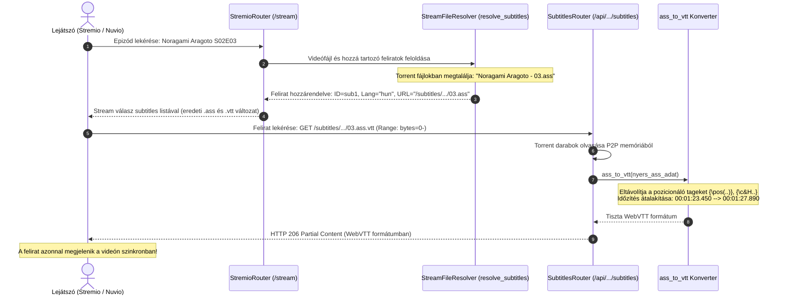
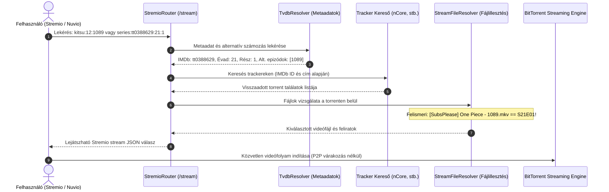

  

Self-hosted streaming szerver, amellyel <b>közvetlenül a torrent oldalakról</b> nézheted a tartalmat várakozás nélkül!

További információkért és útmutatókért látogass el a <a href="https://stremhu.app" target="_blank">https://stremhu.app</a> oldalra!

  &nbsp;
  

  Ha hasznosnak találod a projektet, támogasd egy ⭐-gal, és ha teheted, hívd meg az eredeti készítőt egy kávéra! ☕  
  

> [!IMPORTANT]
> **Fork információk és köszönetnyilvánítás:**
> Ez a repository a hivatalos **[StremHU Source](https://github.com/s4pp1/stremhu-source)** projekt forkja, melynek eredeti készítője és fejlesztője **[s4pp1](https://github.com/s4pp1)**.
> - **Eredeti GitHub repository:** [https://github.com/s4pp1/stremhu-source](https://github.com/s4pp1/stremhu-source)
> - **Hivatalos weboldal & dokumentáció:** [https://stremhu.app](https://stremhu.app)
> - **Hivatalos Docker Hub:** [s4pp1/stremhu-source](https://hub.docker.com/r/s4pp1/stremhu-source)

---

## 💬 Torrent Feliratok Kezelése és Streaming (`feature/torrent-subtitles` branch)

Ez a branch a **torrentben található külső feliratok automatikus felderítését, a videókhoz való illesztését, közvetlen streamelését, valamint valós idejű WebVTT konverzióját** valósítja meg Stremio és Nuvio kliensek számára.

### 🚀 Új funkciók összefoglalása
1. **Torrent feliratok felderítése és illesztése**: `.srt`, `.ass`, `.sub`, `.vtt` fájlok automatikus észlelése, nyelvi címkézés és illesztés a videóhoz.
2. **Közvetlen felirat streaming HTTP Range támogatással**: `/api/{token}/subtitles/...` végpont darabolt, pufferelésmentes kiszolgálással.
3. **Valós idejű ASS/SSA -> WebVTT konverzió**: On-the-fly konverter, amely eltávolítja a formázási címkéket, és WebVTT formátumot biztosít a böngészők és Nuvio számára.
4. **Stremio & Nuvio Subtitles API**: A `subtitles` erőforrás regisztrálása a manifestben és átadása a stream válaszban.

---

## 🔄 Hogyan működik a gyakorlatban? (End-to-End Workflow & Példák)

### 🎬 Gyakorlati példa 1: *Noragami Aragoto* S02E03 (Felirat feloldás és valós idejű WebVTT konverzió)

Az anime pakkokban a feliratok gyakran külső `.ass` (Advanced SubStation Alpha) fájlokban vannak (pl. `Subs/Noragami Aragoto - 03.ass`), amit sok kliens (pl. Nuvio beépített böngészős lejátszója) közvetlenül nem tud lejátszani.

#### A feliratfolyamat lépésről lépésre:
1. **Felirat felderítése a torrentben**: A `StreamFileResolver.resolve_subtitles()` megvizsgálja a torrent fájllistáját. Kiszűri a videófájlhoz tartozó feliratot (epizódszám és fájlnév-stem egyezés alapján: `Noragami Aragoto - 03.ass`), miközben a menük és extrák mappák feliratait elveti.
2. **Nyelvfelismerés**: A `detect_subtitle_language()` felismeri a nyelvet (`hun` / `Hungarian (Torrent)`).
3. **Dupla felirat elérhetőség a kliensnek**: A szerver mind a natív `.ass` formátumot, mind a virtuális `.vtt` kiterjesztést felkínálja a lejátszónak a stream JSON válaszban.
4. **Valós idejű konverzió lekéréskor**: Amikor a lejátszó a WebVTT változatot kéri, az `ass_to_vtt()` a memóriában feldolgozza a párbeszédeket, átalakítja az időbélyegeket, és a `SubtitlesRouter` HTTP Range fejlécekkel darabokban elküldi a lejátszónak.

---

### 🎬 Gyakorlati példa 2: *One Piece* (Anime abszolút epizódszámozás feloldása)

A `main` branch-ben bevezetett alap anime feloldási logika működése a Wano arc 1089. részén keresztül:

---

> [!NOTE]
> A StremHU Source egy szabadidős projekt! Hibajelentéseket és fejlesztési ötleteket szívesen fogadunk kulturáltan a StremHU Discord szerverén!
