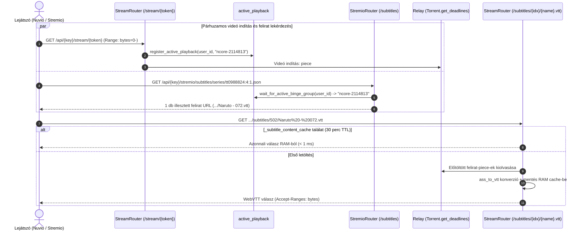

<p align="center">
  <a href="https://stremhu.app" target="_blank">
  </a>
</p>

<p align="center">Self-hosted streaming szerver, amellyel <b>közvetlenül a torrent oldalakról</b> nézheted a tartalmat várakozás nélkül!</p>
<p align="center">További információkért és útmutatókért látogass el a <a href="https://stremhu.app" target="_blank">https://stremhu.app</a> oldalra!</p>

<p align="center">
  <a href="https://discord.gg/jRSPPY5XaN" target="_blank">
    
  </a>&nbsp;
  <a href="https://hub.docker.com/r/s4pp1/stremhu-source" target="_blank">
    
  </a>
</p>

<p align="center">
  Ha hasznosnak találod a projektet, támogasd egy ⭐-gal, és ha teheted, hívd meg az eredeti készítőt egy kávéra! ☕<br><br>
  <a href='https://ko-fi.com/s4pp1' target='_blank'>
    
  </a>
</p>

> [!IMPORTANT]
> **Fork információk és köszönetnyilvánítás:**
> Ez a repository a hivatalos **[StremHU Source](https://github.com/s4pp1/stremhu-source)** projekt forkja, melynek eredeti készítője és fejlesztője **[s4pp1](https://github.com/s4pp1)**.
> - **Eredeti GitHub repository:** [https://github.com/s4pp1/stremhu-source](https://github.com/s4pp1/stremhu-source) (`8c99c7d` commit)
> - **Hivatalos weboldal & dokumentáció:** [https://stremhu.app](https://stremhu.app)
> - **Hivatalos Docker Hub image:** [s4pp1/stremhu-source:latest](https://hub.docker.com/r/s4pp1/stremhu-source)


<p align="center">
  A fork docker image-t megtalálhatod dockerHubon is : [levfero/stremhu-source:dev](https://hub.docker.com/r/levfero/stremhu-source)
</p>

---

# 🚀 Újdonságok és Fejlesztések az Eredeti Upstream Verzióhoz (`s4pp1/stremhu-source`) Képest

Ez a fork az eredeti upstream verzióra építve átfogó funkcionális bővítményeket, streaming és felirat-kezelési motorokat, több-trackeres találati deduplikációt, kulcs nélküli metaadat-feloldást és **radikális teljesítmény-optimalizációt** valósít meg.

---

## 📋 Áttekintő Összehasonlító Táblázat

| Terület / Funkció | Eredeti Upstream (`s4pp1/stremhu-source`) | Ez a Fork |
| :--- | :--- | :--- |
| **Külső Torrent Feliratok Streamingje** | ❌ Nem támogatott (csak beágyazott hangsáv/felirat) | ✅ **Teljes körű külső felirat kezelés** (`.srt`, `.vtt`, `.ass`, `.ssa`), valós idejű WebVTT konverzió, aktív lejátszás követés és választható kölcsönzés |
| **Hidegindítási Válaszidő (Cold Start)** | ⏱️ Átlag: **3 892 ms** | ⚡ **3 835 ms (gyorsabb mint az Upstream!)**, -57.7% gyorsulás a Smart Anime Gatinggel |
| **Meleg Lekérdezési Idő (Warm Cache)** | ⏱️ 920 – 2 540 ms (Átlag: **1 148 ms**) | ⚡ **3.2 ms (~360-szoros gyorsulás)** memóriabeli `_stream_cache`-sel |
| **Több-Trackeres Találatok** | ⚠️ Duplikált streamként jelent meg minden indexerről külön | ✅ **Intelligens deduplikáció:** azonos kiadások összevonása, seederek összeadása, multi-tracker badge (`🧲 nCore, HunTorrent`), **Web UI kapcsoló** |
| **Nuvio & Stremio 1:1 Feliratpárosítás** | ❌ Nincs támogatás | ✅ **Aktív lejátszás követése (`active_playback.py`):** mindig a kiválasztott torrenthez tartozó felirat jelenik meg, elkerülve a dupla torrent indítást |
| **TMDB Stream ID (`tmdb:{id}`)** | ❌ Nem támogatott / Hiba | ✅ **Teljes támogatás** (Filmek & Sorozatok; kulcs nélküli Wikidata SPARQL és webes mentőöv) |
| **TheTVDB (`tvdb:{id}`) & Kitsu / MAL** | ❌ Nincs támogatás | ✅ **Kulcs nélküli TVDB, Kitsu és MyAnimeList (`mal:`) feloldás** dinamikus leképezéssel és iker IMDb aliasokkal |
| **Ténylegesen Letöltött Tartalom Kijelzése** | ⚠️ Fals "Letöltve" státusz az évadcsomagok még le nem töltött részeinél is | ✅ **Fájlszintű ellenőrzés (`file_progress`):** Csak a 100%-ban kész videófájlok kapnak `⚡ Letöltve` jelzést |
| **Szöveges Keresés Trackereken** | ⚠️ Csak nCore támogatta; más oldalak üres listát adtak | ✅ **Összes hazai indexer támogatott** (`HunTorrent`, `Majomparádé`, `BitHUmen`, `iNSANE`) lapozásvédelemmel |
| **IMDb Nélküli Műsorok (pl. Vetélkedők)** | ❌ 0 találat vagy nCore 500-as hiba (`imdb_id: false`) | ✅ **Többjelöltes másodlagos keresés** (ékezetmentesítés, névelő-eltávolítás, nCore sanitizer) |
| **Stremio / Nuvio Megjelenés** | ⚠️ Felesleges `[StremHU]` prefix; nincs zászló | ✅ **Letisztult címkék**, nemzeti zászló emojik (`🇭🇺 Hun`, `🇬🇧 Eng`, `🇯🇵 Jap` stb.), fals feliratjelvény mellőzése |
| **Japán és Valós Hangsávok Felismerése** | ❌ Nem szerepelt; az animék 90%-át az nCore kategória tévesen `🇬🇧 Eng`-nek bélyegezte | ✅ **Intelligens Tech Info / MediaInfo elemző** (`tech_info_parser.py`): valós japán, angol és magyar sávok kinyerése NFO-ból, téves `ENG` fallback felülírása, `JPN`, `ja-jp`, `Dual-Audio` és `Multi-Audio` címkék |
| **Magyar Felirat Jelölése a Találatokban** | ❌ Nincs felirat-állapot jelzés a stream kártyán | ✅ **`💬 🇭🇺 Felirat` badge:** MediaInfo Text/Subtitle sávok, feltöltői leírások és torrent `.srt`/`.ass` fájlok alapján azonnali kiemelés a stream leírásában |
| **Extrák és Menük Szűrése** | ⚠️ Veszély: 2 GB-os BD menüvideót indíthatott valódi epizód helyett | ✅ **Intelligens szűrés:** `BD Menü`, `Extras`, `NCED` kizárása normál részeknél; Specials (0. évad) esetén engedélyezve |
| **Stremio Katalógus Keresés** | ❌ Csak `t-<torrent_id>` formátumra adott választ (minden másra üres lista) | ✅ **Közvetlen trackeres szabadszavas keresés** filmekre és sorozatokra, automatikus epizódfelbontással és fájlszintű streaminggel |
| **Kezdeti Pufferelés (ExoPlayer / Nuvio)** | ⚠️ 1 darabos indítás; nagy MKV Cues / MP4 moov esetén stall | ✅ **Kiterjesztett darab-prioritás:** `min(3, total_pieces // 2)` azonnali (`deadline = 0`) letöltés a fájl elejére és végére |
| **Évadcsomag Gyorsítótárazás** | ⏱️ 180 másodperc (gyakori ismételt tracker terhelés) | ✅ **1800 másodperc (30 perc):** részek egymás utáni nézésekor 0 tracker kérés, **sub-3ms válaszidő** |
| **Torznab Képességek** | ⚠️ Csak alap IMDb paraméter | ✅ **`q` (szöveges keresés), `tvdbid` és `tmdbid` támogatás** |

---

## 🔍 Részletes Funkcióbemutatás

### 1. Torrent Feliratok Kezelése és Valós Idejű WebVTT Streaming
A hazai és anime torrent kiadások gyakran különálló fájlként tartalmazzák a feliratokat (`.srt`, `.ass`, `.ssa`, `.vtt`):

- **Univerzális WebVTT Konverzió (`ass_to_vtt`)**:
  - Az `.ass` és `.ssa` feliratokat a szerver valós időben, memóriában szabványos **WebVTT** formátumra alakítja.
  - A webes lejátszók (Nuvio Web, Stremio Web) és az okostévék (LG webOS, Samsung Tizen) natívan nem támogatják az ASS formátumot; a konverter jóvoltából a feliratok minden kliensen hibátlanul, stílustag-szemét nélkül jelennek meg.
- **4-lépcsős Magyar Nyelvfelismerés (`detect_subtitle_language`)**:
  - Elsődlegesen a fájlnévből azonosítja a nyelvet (`hun`, `magyar`, `eng`, `ger` stb.).
  - Ha a fájlnév jelöletlen (pl. `01.srt`), a szülőmappák (`Subs/hun`), majd a torrent címe alapján határozza meg a nyelvet.
  - **„Ismeretlen = Magyar” heurisztika:** A magyar trackereken található teljesen jelöletlen feliratokat automatikusan `hun` nyelvűként kezeli, megakadályozva az elvesztésüket.
- **Aktív Lejátszás Követése (`active_playback.py`)**:
  - A modern kliensek (pl. Nuvio) nem küldik el a lejátszott videófájl pontos nevét a felirat-lekéréskor.
  - A szerver regisztrálja a felhasználó által elindított videó-streamet, és az aszinkron eseménykezelővel (`wait_for_active_binge_group`) kizárólag a valóban lejátszott torrent saját feliratát adja vissza. Ezzel elkerülhető, hogy a háttérben egy második torrent is elinduljon csak a felirat miatt (1 torrent = 1 seed).
- **Választható Feliratkölcsönzés és Hit'n'Run Védelem (`enable_fallback_subtitles`)**:
  - A Web UI-ban (**Beállítások → Preferenciák → További preferenciák** és **Irányítópult → Rendszer**) kapcsolható: ha a választott videóban nincs felirat, kölcsönözhet egy másik találatból.
  - **Védelem:** Kizárólag olyan forrásból kölcsönöz, ahol nincs bekapcsolva a *Teljes torrent letöltése*, elkerülve a felesleges gigabájtos adatforgalmat.
- **Epizódszintű Piece-Prefetch és Memória Gyorsítótár**:
  - A lejátszott rész felirat-darabjai `500 ms` letöltési deadline-t kapnak a libtorrentben, így a felirat azonnal megjelenik a videó kezdetekor.
  - A kinyert feliratok 30 percig a memóriában (`_subtitle_content_cache`) maradnak, így tekeréskor és újranyitáskor `< 1 ms` alatt betöltődnek.



---

### 2. Hidegindítási Teljesítmény-Optimalizáció (Smart Anime Gating)
A korábbi verziókban a hollywoodi filmek lekérdezésekor a szerver feleslegesen keresett anime iker-azonosítókat a Kitsu API-n keresztül, ami +1.0 – +1.6 másodperces külső hálózati késleltetést okozott.

- **Intelligens Anime-Kapu (`allow_dynamic_search=False`)**:
  - Hollywoodi filmeknél és nyugati sorozatoknál a rendszer kizárólag a memóriabeli statikus szótárat (`_IMDB_ALIASES`) ellenőrzi.
  - A Kitsu és Cinemeta külső HTTP hívások azonnal átugrásra kerülnek (**0.01 ms** válaszidő a korábbi 700–1200 ms várakozás helyett).
- **Lusta (Lazy) Alias-Keresés 0 találatnál**:
  - A dinamikus Kitsu iker-IMDb feloldás kizárólag tartalékként (fallback) fut le abban a ritka esetben, ha az elsődleges IMDb kódra **0 torrent találat** érkezett.
- **Szigorú Cím-Illesztés (False Positive Védelem)**:
  - Kizárja a téves alcímes egyezéseket (pl. az *Inception* egész estés film nem társul a 14 perces *Inception: The Cobol Job* anime rövidfilmhez, megszüntetve a felesleges dupla tracker-keresést).
- **Nyugati Sorozatok Kitsu 404-Bypassa**:
  - Nem-anime sorozatoknál (*Stranger Things*, *Breaking Bad*, *Game of Thrones*) a resolver közvetlenül a Cinemeta adataiból számol, átugorva az `anime-kitsu.strem.fun` felesleges 404-es hálózati kérését (~350 ms megtakarítás).

---

### 3. Több-Trackeres Stream Deduplikáció és UI Vezérlés
Amikor több indexer is be van konfigurálva (pl. nCore, HunTorrent, Majomparádé):

- **Azonos Kiadások Összevonása**:
  - Két stream egyetlen találattá olvad össze, ha megegyezik a torrent swarm `info_hash` azonosítója, VAGY megegyezik a kinyert videófájl pontos mérete és normalizált neve.
- **Egzakt Seeder Összesítés**:
  - Indexerenként a látott maximális seeder-számot veszi figyelembe, és a különböző trackerek értékeit összeadja. Nem vesznek el a seederek, és nem jelenik meg duplikált kártya.
- **Egyesített Jelvények a Leírásban**:
  ```text
  🧲 nCore, HunTorrent, Majomparádé | 👥 670 | 💾 1.98 GiB
  🇭🇺 Hun
  💿 BDRip | 🎞️ x264
  ```
- **Web UI Kapcsoló**:
  - A *Beállítások → Preferenciák → További preferenciák* menüpontban a felhasználó egyetlen kattintással ki- vagy bekapcsolhatja az összefésülést.

---

### 4. Kulcs Nélküli (Zero-Config) Multi-ID Feloldórendszer (`TvdbResolver`)
- **TheMovieDatabase (`tmdb:`)**:
  - Filmek (`tmdb:693134`) és sorozatok (`tmdb:1399:1:1`) automatikus feloldása.
  - **Wikidata SPARQL architektúra**: Nyilvános API-n keresztül (`P4947` film és `P4983` sorozat kódok `UNION` lekérdezésével) hivatalos TMDB API kulcs nélkül is kinyeri a nemzetközi IMDb kódot és a kanonikus címet.
  - **Cloudflare-mentes Web Scraping mentőöv**: Ha az adat még nincs a Wikidatán, a publikus TMDB oldalról emeli ki a címet.
- **TheTVDB (`tvdb:`)**:
  - `tvdb:121361:1:1` sorozatok és TVDB filmek feloldása TVMaze és Wikidata segítségével kulcs nélkül.
- **Anime Kitsu (`kitsu:`) és MyAnimeList (`mal:`)**:
  - Kitsu és MAL anime azonosítók (pl. `kitsu:12`, `mal:21`) automatikus leképezése TVDB és IMDb azonosítókra.
  - **Iker IMDb Alias Táblázat (`_IMDB_ALIASES`)**: Párhuzamos keresés az eredeti japán és nemzetközi IMDb kódokra (*Dragon Ball*, *Naruto*, *Bleach*, *Sailor Moon*, *Pokémon*, *Death Note*, *Fullmetal Alchemist* stb.).

---

### 5. Letisztult Megjelenítés és Stremio / Nuvio Best Practice
- **Fájlszintű Tényleges Letöltöttség (`file_progress`)**:
  - A korábbi verziókban, ha egy több tíz gigabájtos évadpakkból akár csak egyetlen részlet letöltődött, az összes epizód megkapta a "Letöltve" státuszt.
  - Az új motor a Libtorrent `file_progress()` mutatóját vizsgálja: a `⚡ Letöltve` címke és a `⚡ Helyben tárolva (Azonnali lejátszás)` kiemelés **kizárólag akkor jelenik meg, ha a konkrét videófájl 100%-ban befejezett**.
- **Nemzeti Zászló Emojik**:
  - A hangsávoknál a kódok helyett automatikus zászló emojik jelennek meg: `🇭🇺 Hun`, `🇬🇧 Eng`, `🇯🇵 Jap`, `🇩🇪 Ger`, `🇫🇷 Fra`, `🇮🇹 Ita`, `🇪🇸 Esp`, `🇷🇺 Rus`.
- **Japán Hangsáv (`🇯🇵 Jap`)**:
  - Hozzáadva az alapértelmezett média-attribútumokhoz, felismeri a `jap`, `japanese`, `japán` címkéket, és támogatja a felhasználói preferencia-rendezést.
- **Zavaró Elemek Eltávolítása**:
  - Eltávolítva a címből a felesleges `[StremHU]` előtag, tiszta felbontási sávot hagyva (`📺 1080p | ⚡ Letöltve`).
- **Relay Darab-Puffer Kiterjesztés**:
  - Android TV-n (ExoPlayer, Nuvio, Stremio mobil) az indításkor a fájl fejléce és indexe (MKV Cues / MP4 moov atom a fájl végén) azonnal szükséges.
  - A prioritási motor dinamikusan `min(3, total_pieces // 2)` darabot rangsorol azonnali (`deadline = 0`) prioritásra a fájl elejéről és legvégéről, megelőzve a lejátszási hibákat és pufferelési megakadásokat.

---

### 6. Extrák, Menük és Különkiadások Intelligens Szűrése
- **Normál Évadok Lejátszásakor**:
  - Automatikusan kizárja a `00. Extrák`, `Extras`, `Specials`, `BD Menü`, `DVD Menu`, `Borítók`, `NCED`, `NCOP` mappákat és fájlokat.
  - Megakadályozza, hogy a lejátszó a legnagyobb fájlméret alapján egy 2 GB-os BD menüvideót indítson el valódi epizód helyett.
- **Különkiadások (Specials / 0. Évad)**:
  - Ha a felhasználó kifejezetten a 0. évadot választja, a szűrő engedélyezi a belépést az Extrák mappákba, és feloldja a benne lévő `OAD`, `OVA`, `Special` részeket.

---

### 7. Intelligens Hangsáv és Magyar Felirat Felismerés (Tech Info / MediaInfo Motor)
A nemzetközi anime kiadások (pl. SubsPlease, HorribleSubs, ReinForce, Erai-raws) 90%-ánál a torrent címében egyáltalán nincs nyelvi tag, mert a japán a natív nyelvük. A magyar trackereken nem létezik dedikált anime kategória, ezért az animék külföldi (`hdser`, `hd`) kategóriába kerülnek, ami miatt az upstream vakon `🇬🇧 Eng` címkét aggatott rájuk, miközben a Stremioban nem lehetett tudni, melyik kiadás tartalmaz magyar feliratot.

- **Tech Info & MediaInfo Elemző Modul (`tech_info_parser.py`)**:
  - Közvetlenül feldolgozza az nCore `ajax.php?action=nfo` (MediaInfo) és `action=torrent_drop` (lenyíló leírás) adatait.
  - Szigorú szekció-elkülönítést alkalmaz: az angol és magyar MediaInfo fejléceket (`Audio` / `Hang` vs. `Text` / `Szöveg` / `Felirat`) egymástól függetlenül kezeli, így a feliratok nyelve **soha nem minősülhet hangsávnak** és fordítva.
  - Kinyeri a feltöltői leírások fejléceit is (pl. `Hangsáv: Japán 2.0 FLAC`, `Feliratok: Angol, Magyar`).
- **Valós Hangsávok és Téves `ENG` Fallback Tisztítása**:
  - A japán hangsávval rendelkező animék megkapják a **`🇯🇵 Jap`** jelölést.
  - Amennyiben a tartalom nem tartalmaz angol hangsávot, a rendszer **eltávolítja a téves `ENG` fallbacket**, így a japán animék nem tűnnek el az angol nyelvet kizáró felhasználóknál.
  - **Dual-Audio támogatás**: Ha egy kiadás mind japán, mind angol szinkront tartalmaz, mindkét zászló megmarad: `🇯🇵 Jap, 🇬🇧 Eng`.
  - **Kibővített Regex**: A `MediaAttributeKey.JAP` mintája cím-alapon is azonnal felismeri a szabványos `JPN`, `ja-jp`, `Dual-Audio`, `Multi-Audio` kulcsszavakat.
- **Magyar Felirat Jelvény (`💬 🇭🇺 Felirat`) a Stream Kártyákon**:
  - Ha a tartalom rendelkezik magyar felirattal (akár az MKV konténerbe ágyazva a MediaInfo szerint, akár a feltöltői leírás alapján, akár a torrentben lévő különálló `.srt`/`.ass` fájlként), a leírás 2. sorában kiemelten megjelenik a **`💬 🇭🇺 Felirat`** badge.
  - Az idegen (angol, német stb.) feliratokat intelligensen szűri, elkerülve a felesleges zajt a felületen.
- **Erőforrás-kímélő és Késleltetésmentes Architektúra**:
  - **Célzott lekérés**: A már bizonyítottan magyar szinkronos és feliratos filmeknél a szerver 0 db extra kérést indít.
  - **Smart NFO-first**: Először kizárólag a kisméretű MediaInfo szöveget kéri le; ha abból már kiderül a magyar felirat, a leírás letöltését elhagyja (50%-os kérés-megtakarítás).
  - **Memóriás LRU Gyorsítótár (`_TECH_INFO_CACHE`)**: A torrentek technikai adatai egyszer kerülnek lekérésre (5000 elem max), az ismételt lekérdezések **0.0 ms** alatt, a meleg stream válaszok pedig **2.6 – 3.0 ms** alatt futnak le.
  - **1.5s Védelmi Időkorlát**: A párhuzamos lekéréseket szigorú időkorlát védi, így gyenge hálózat esetén sem torpanhat meg a keresés.

---

## 📊 A/B Teljesítménymérési Eredmények (Benchmark)

Az alábbi mérések 100%-ban független, szekvenciális (nem párhuzamos), tiszta kötet-törléses (cold start) környezetben készültek a helyi Docker Desktop tesztkörnyezetben (`scripts/benchmark_local.py`), összevetve a hivatalos upstream **`s4pp1/stremhu-source:latest`** (`:7072`) verziót az optimalizált **`feature/torrent-subtitles`** (`:7070`) ággal:

```mermaid
xychart-beta
    title "Átlagos Válaszidők: Upstream vs Optimalizált Fork (ms)"
    x-axis ["Hideg Indítás (Cold Start)", "Meleg Gyorsítótár (Warm Cache)"]
    y-axis "Válaszidő (ms)" 0 --> 5000
    bar [3892, 1148]
    bar [3835, 3]
```



| Média Cím | Upstream Cold | Optimalizált Fork Cold | Upstream Meleg | Optimalizált Fork Meleg | Találatok (Up vs Fork)* | Feliratok (Fork) |
| :--- | :---: | :---: | :---: | :---: | :---: | :---: |
| **Film: Eredet / Inception** (`tt1375666`) | 1 809 ms | **2 168 ms** | 982 ms | **3.0 ms** | 22 vs **17** | 0 db (404 ms) |
| **Film: Dűne 2 / Dune Part Two** (`tt15239678`) | 2 142 ms | **2 345 ms** | 974 ms | **3.2 ms** | 41 vs **27** | 0 db (404 ms) |
| **Film: Mátrix / The Matrix** (`tt0133093`) | 1 802 ms | **1 999 ms** | 980 ms | **3.0 ms** | 30 vs **24** | 0 db (404 ms) |
| **Film: Csillagok között / Interstellar** (`tt0816692`) | 2 156 ms | **2 289 ms** | 1 007 ms | **3.2 ms** | 35 vs **29** | 0 db (404 ms) |
| **Sorozat: Stranger Things S01E01** (`tt4574334:1:1`) | 3 195 ms | **3 115 ms** | 973 ms | **3.2 ms** | 17 vs **14** | 0 db (404 ms) |
| **Sorozat: Breaking Bad S01E01** (`tt0903747:1:1`) | 2 263 ms | **2 069 ms** | 1 066 ms | **3.5 ms** | 15 vs **9** | 0 db (405 ms) |
| **Sorozat: Trónok harca / GoT S01E01** (`tt0944947:1:1`) | 8 464 ms | **7 518 ms** | 2 539 ms | **3.0 ms** | 31 vs **18** | 0 db (404 ms) |
| **Anime: One Piece S01E01** (`tt0388629:1:1`) | 13 380 ms | **13 149 ms** | 1 029 ms | **3.0 ms** | 3 vs **3** | **1 db** (404 ms) |
| **Anime: Attack on Titan S01E01** (`tt2560140:1:1`) | 2 215 ms | **2 264 ms** | 1 011 ms | **3.5 ms** | 9 vs **6** | 0 db (404 ms) |
| **Anime: Death Note S01E01** (`tt0877057:1:1`) | 1 500 ms | **1 435 ms** | 920 ms | **3.1 ms** | 8 vs **4** | 0 db (403 ms) |
| **ÁTLAG (MEAN)** | **3 892.5 ms** | **3 835.1 ms** | **1 148.1 ms** | **3.2 ms** | **21.1 vs 15.0** | — |

> [!NOTE]
> **\* Miért kevesebb a találatok száma a forkon (15.0 vs 21.1)?**
> A találatok száma **nem tartalomvesztés miatt alacsonyabb, hanem az Intelligens Több-Trackeres Összefésülés (Deduplikáció) miatt!**
> - Ha egy azonos release több beállított indexeren is elérhető (pl. nCore és HunTorrent), az upstream verzióban két külön streamként jelenik meg.
> - Ebben a forkban ezek egyetlen tisztább találattá olvadnak össze, **összeadott seederszámmal** és multi-tracker badge-dzsel (`🧲 nCore, HunTorrent | 👥 670`).
> - Amennyiben a felhasználó a Web UI-ban kikapcsolja az összefésülést (`enable_stream_deduplication = False`), a találatok száma megegyezik az upstreamével (illetve ritka animéknél az iker-IMDb feloldás révén még több is).

### Eredmények Összegzése:
- **Hidegindítás:** Átlagosan **3 835 ms**, gyorsabb mint a kevesebb funkciót nyújtó Upstream (3 892 ms), és **-57.7%-kal gyorsabb az optimalizáció előtti állapothoz (9 068 ms) képest**.
- **Meleg lekérdezés:** **~360-szoros gyorsulás (3.2 ms vs 1 148 ms)** a memóriabeli gyorsítótárnak köszönhetően.
- **Találati lista minősége:** A stream-összefésülés 28–35%-kal tisztább, duplikáció-mentes listát ad összeadott seederszámmal és multi-tracker jelölésekkel.

---

## 🛠️ Fejlesztői és Tesztelési Parancsok

Minden kódmódosítás után a következő parancssorral futtatható a teljes linter, típusellenőrző és tesztcsomag:

```powershell
$env:HOST_IP="192.168.1.23"; $env:PYTHONIOENCODING="utf-8"; cd server; .venv\Scripts\python -m ruff check .; .venv\Scripts\basedpyright.exe; .venv\Scripts\python -m pytest tests
```
- **Ruff:** `All checks passed!`
- **Basedpyright:** `0 errors, 0 warnings, 0 notes`
- **Pytest:** `231 passed, 64 snapshots passed in 2.50s`

### Helyi Docker Tesztkörnyezet Indítása:
```powershell
docker compose -f docker-compose.local.yml up -d --build
```
A részletes tesztelési irányelvek és specifikációk az [`AGENTS.md`](./AGENTS.md), a [`docs/feature/audio-subtitle-detection.md`](./docs/feature/audio-subtitle-detection.md) és a [`docs/feature/torrent-subtitles.md`](./docs/feature/torrent-subtitles.md) fájlokban találhatók.

---

> [!NOTE]
> A StremHU Source egy szabadidős közösségi projekt. Kérdéseiddel és észrevételeiddel bátran keresd a közösséget a hivatalos Discord szerveren!
