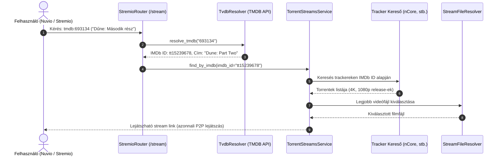
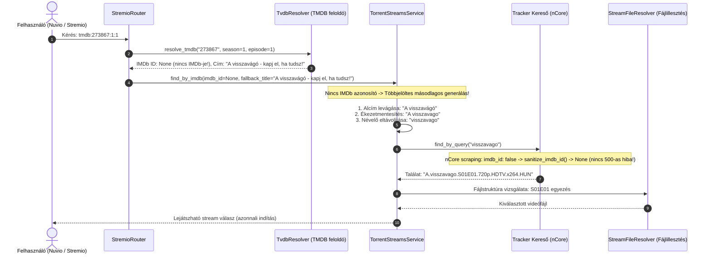
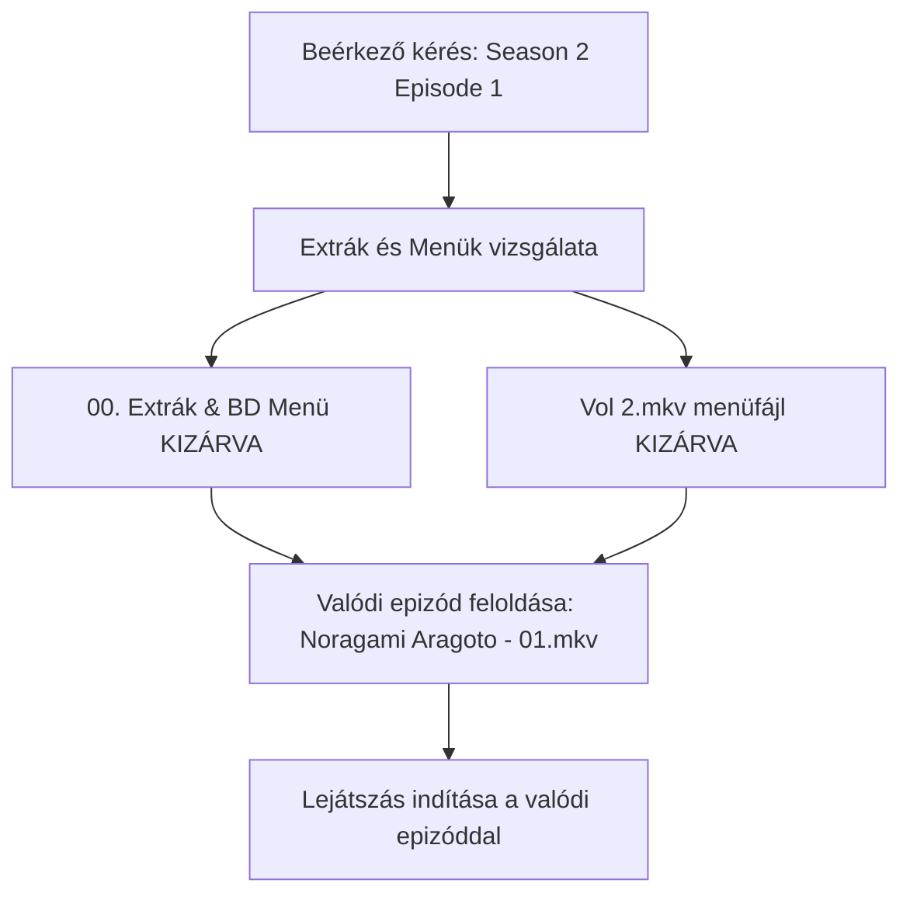

  

Self-hosted streaming szerver, amellyel <b>közvetlenül a torrent oldalakról</b> nézheted a tartalmat várakozás nélkül!

További információkért és útmutatókért látogass el a <a href="https://stremhu.app" target="_blank">https://stremhu.app</a> oldalra!

  &nbsp;
  

  Ha hasznosnak találod a projektet, támogasd egy ⭐-gal, és ha teheted, hívd meg az eredeti készítőt egy kávéra! ☕  
  

> [!IMPORTANT]
> **Fork információk és köszönetnyilvánítás:**
> Ez a repository a hivatalos **[StremHU Source](https://github.com/s4pp1/stremhu-source)** projekt forkja, melynek eredeti készítője és fejlesztője **[s4pp1](https://github.com/s4pp1)**.
> - **Eredeti GitHub repository:** [https://github.com/s4pp1/stremhu-source](https://github.com/s4pp1/stremhu-source)
> - **Hivatalos weboldal & dokumentáció:** [https://stremhu.app](https://stremhu.app)
> - **Hivatalos Docker Hub:** [s4pp1/stremhu-source](https://hub.docker.com/r/s4pp1/stremhu-source)

---

## 🔍 Keresési és Szűrési Továbbfejlesztések (`feature/search-filter-tmdb-tvdb` branch)

Ez a branch a **TMDB azonosítók kezelését**, a **másodlagos többjelöltes szöveges fallback keresést**, az **nCore hibajavítást**, valamint az **Extrák és Menük intelligens szűrését** valósítja meg.

---

### 🚀 Új funkciók listája ebben a branch-ben

#### 1. TMDB Stream ID támogatás (TheMovieDb)
- **Kliens formátumok**: Stremio, Nuvio és modern kiegészítők által küldött TMDB azonosítók feldolgozása:
  - Filmek: `tmdb:{tmdb_id}` (pl. `tmdb:693134`)
  - Sorozatok: `tmdb:{tmdb_id}:{season}:{episode}` (pl. `tmdb:273867:1:1`)
- **API feloldás (`TvdbResolver.resolve_tmdb`)**:
  - Automatikusan lekérdezi a TheMovieDb API-t a film vagy sorozat hivatalos IMDb azonosítójának és kanonikus címének megállapításához.
  - Ha az adott epizódhoz nincs nemzetközi IMDb ID csatolva, a lekérdezett cím automatikusan átadódik a másodlagos szöveges keresőnek.
- **Stremio Series Search Manifest**: A Stremio katalógus keresésben engedélyezve lett a sorozatok keresése TMDB azonosítóval és előtaggal is.

#### 2. Többjelöltes másodlagos szöveges keresés (Fallback Title Search)
Ha egy tartalomnak nincs IMDb azonosítója (pl. hazai gyártású műsorok, vetélkedők), vagy az IMDb ID alapján letöltött torrenttalálatok között hiányzik a kért epizód:
- **Intelligens jelöltgenerálás a hazai trackerek sajátosságaihoz**:
  1. *Alap tisztított cím*: Kettőspontok, gondolatjelek és alcímek levágása.
  2. *Ékezetmentesítés*: A magyar trackerek szinte kivétel nélkül ékezet nélküli címkékkel töltik fel az anyagokat (pl. `visszavago`).
  3. *Névelők eltávolítása*: A kezdő névelők (*A*, *Az*, *The*) eltávolítása, megelőzve, hogy a trackerek szigorú keresőmotorja elvessen egy találatot a névelő miatt.
  4. *Kulcsszavas keresés*: Több szóból álló címeknél az első két szóval, illetve az első önálló szóval való próbálkozás.
- **Címkinyerés meglévő torrentekből**: Ha egy sorozat másik évadának torrentje már beérkezett, a rendszer kinyeri a tiszta sorozatcímet a torrent nevéből, és azzal indít célzott szöveges keresést a hiányzó epizódra.

#### 3. nCore Scraping & Boolean IMDb ID validációs javítás
- Az nCore trackeren, ha egy feltöltéshez nem csatoltak IMDb linket, az oldal adatstruktúrája `false` logikai értéket ad vissza szöveg vagy `None` helyett.
- A modellbe és az nCore scraperbe épített `sanitize_imdb_id` validátor ezt automatikusan `None`-ra tisztítja, megelőzve a Pydantic `ValidationError` miatti 500-as szerverhibákat.

#### 4. Extrák, Menük és Különkiadások (Specials) szűrése
- **Menük és extra mappák kizárása normál évadoknál**:
  - Kiszűri a `00. Extrák`, `Extras`, `Specials`, `BD Menü`, `DVD Menu`, `Borítók`, `NCED`, `NCOP` mappákat és fájlokat normál évadok feloldásakor.
  - Megakadályozza, hogy a lejátszó véletlenül egy 2 GB-os BD menüvideót indítson el valódi epizód helyett.
- **Különkiadások (0. évad) natív támogatása**:
  - Kifejezetten a 0. évad (Specials) kérésekor engedélyezi a belépést az Extrák mappákba.
  - A `SeriesParser` felismeri az `OAD`, `OVA`, `SP`, `Special` részeket (pl. `Noragami OAD1.mkv`).

---

## 🔄 Hogyan működik a gyakorlatban? (Példák és folyamatábrák)

### 🎬 1. Normál eset: Film vagy sorozat indítása TMDB azonosítóval

Amikor a Nuvio vagy Stremio felületén a TheMovieDb katalógusából indítasz el egy filmet vagy sorozatot:

---

### 🎬 2. Kivételes eset (Edge Case 1): Magyar műsor IMDb azonosító nélkül
**Példa:** *"A visszavágó - kapj el, ha tudsz!"* (Magyar sorozat, amelynek nincs IMDb ID-ja, és nCore-on ékezet nélkül szerepel).

#### Mi történik a háttérben?
1. A Nuvio a TMDB alapján küldi a kérést: `tmdb:273867:1:1`.
2. A `TvdbResolver` megállapítja, hogy nincs IMDb ID (`imdb_id=None`), de megvan a cím: *"A visszavágó - kapj el, ha tudsz!"*.
3. A `TorrentStreamsService` több jelöltet képez:
   - *"A visszavágó"* (alcím levágva)
   - *"A visszavago"* (ékezetmentesítve)
   - *"visszavago"* (névelő eltávolítva)
4. A tracker kereső lekérdezi a `"visszavago"` kulcsszót. Az nCore felülete `imdb_id: false` mezőt küld, amit a `sanitize_imdb_id` automatikusan `None`-ra tisztít, így nem dob Pydantic hibát.
5. Megtalálja az `A.visszavago.S01E01.mkv` fájlt és a lejátszás azonnal elindul.

---

### 🎬 3. Kivételes eset (Edge Case 2): Menük és Extrák kizárása szezongyűjteményekből
**Példa:** Olyan torrentpakkok, ahol a gyökérben vagy almappában menüfájlok és bónuszok is találhatók:
- `00. Extrák/BD Menü/S02/Vol 2.mkv` (2 GB-os BD menü videó)
- `02. Noragami Aragoto/[ReinForce] Noragami Aragoto - 01 (BDRip).mkv` (Valódi 2. évad 1. rész)

- **Eredmény**: A lejátszó nem a 2 GB-os menüt játssza le, hanem a valódi epizódot.
- **Különkiadás esetén**: Ha a felhasználó a Specials (0. évad) fület választja, a szűrő engedélyezi az Extrák mappát, és feloldja a benne lévő `OAD1` vagy `Special` részeket.

---

> [!NOTE]
> A StremHU Source egy szabadidős projekt! Hibajelentéseket és fejlesztési ötleteket szívesen fogadunk kulturáltan a StremHU Discord szerverén!
