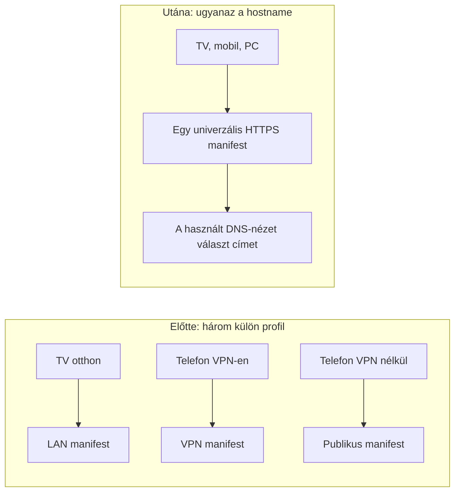
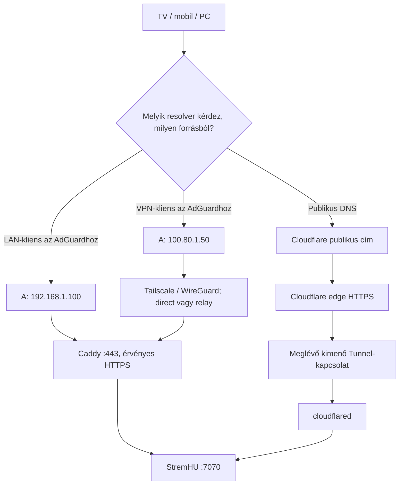
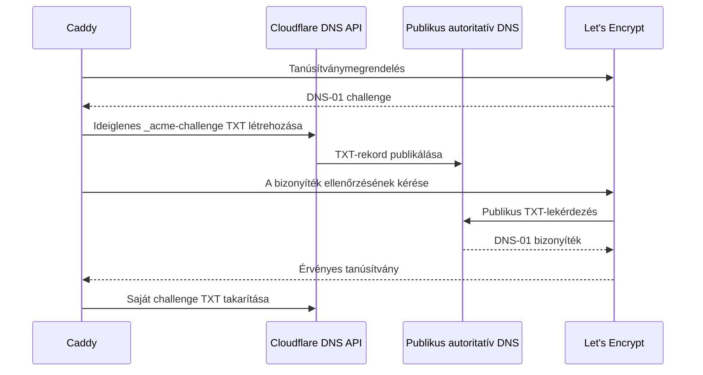

# Egy StremHU-link mindenhová

## Teljes otthoni útmutató: AdGuard Home + Caddy HTTPS + Tailscale + Cloudflare Tunnel

**Célközönség:** már működő, Dockerben vagy CasaOS alatt futó StremHU Source mellé építkező otthoni felhasználók.  
**Platform:** natív Linux Docker Engine; a példák Ubuntu/Debian jellegű környezetre készültek.  
**Dokumentáció ellenőrzésének dátuma:** 2026-10-31.

> **Minden saját hálózati cím, gépnév, domain és kulcs ebben a leírásban példa.** A `stremio.pelda.hu` nem a te szolgáltatásod: saját, általad kezelt domainre kell cserélned. A példa API-kulcs nem hitelesítő adat. A gyártók dokumentációs címei, image-nevei és a megnevezett publikus DNS-szolgáltatások valódi, nyilvános technikai hivatkozások.

Az útmutató nem egyetlen szerver konfigurációjának bemásolható exportja. A lépéseket sorrendben, a saját címeiddel és a megadott tesztkapukkal végezd el. A meglévő StremHU adatbázisát, letöltéseit és image-ét a hálózati megoldás kedvéért nem kell lecserélni.

### Tartalom

- [0. Előkészítés és biztonságos végrehajtási sorrend](#0-előkészítés-és-biztonságos-végrehajtási-sorrend)
- [1. Miért kell három manifest helyett egy?](#1-miért-kell-három-manifest-helyett-egy)
- [2. AdGuard Home: a helyi DNS agya](#2-adguard-home-a-helyi-dns-agya)
- [3. Caddy: megbízható HTTPS a közvetlen útvonalakon](#3-caddy-megbízható-https-a-közvetlen-útvonalakon)
- [4. A split-horizon DNS-szabályok](#4-a-split-horizon-dns-szabályok)
- [5. Tailscale: távoli közvetlen elérés és globális DNS](#5-tailscale-távoli-közvetlen-elérés-és-globális-dns)
- [6. Cloudflare Tunnel: a feltételes publikus útvonal](#6-cloudflare-tunnel-a-feltételes-publikus-útvonal)
- [7. Kliensek és valós életbeli hibaelhárítás](#7-kliensek-és-valós-életbeli-hibaelhárítás)
- [8. Végtesztek: bizonyítsd a tényleges adatútvonalat](#8-végtesztek-bizonyítsd-a-tényleges-adatútvonalat)
- [A. Mentés, visszaállítás és frissítés](#a-mentés-visszaállítás-és-frissítés)
- [B. Tünet–ok–ellenőrzés gyorssegéd](#b-tünetokellenőrzés-gyorssegéd)

---

# 0. Előkészítés és biztonságos végrehajtási sorrend

## 0.1. Írd össze a saját példahelyettesítőidet

| Fogalom | Ebben az útmutatóban | Mire cseréld? |
|---|---|---|
| Otthoni alhálózat | `192.168.1.0/24` | A saját LAN-tartományodra |
| Szerver LAN-címe | `192.168.1.100` | DHCP-foglalással rögzített saját címre |
| Egy tesztkliens LAN-címe | `192.168.1.60` | A saját TV/PC címére |
| Szerver Tailscale-címe | `100.80.1.50` | A `tailscale ip -4` tényleges eredményére |
| Egy távoli tesztkliens VPN-címe | `100.90.2.60` | A kliens valódi Tailscale-címére |
| Tailscale IPv4-tartomány | `100.64.0.0/10` | Ez a szokásos Tailscale-címtartomány, nem egyetlen gép címe |
| Domain/zóna | `pelda.hu` | A saját Cloudflare DNS-zónádra |
| StremHU hostname | `stremio.pelda.hu` | Egy saját, dedikált aldomainre |
| Belső backend | `http://127.0.0.1:7070` | A már működő StremHU helyi elérésére |
| Szemléltető API-kulcs | `abc123_pelda_kulcs` | A saját StremHU-felhasználód kulcsára |
| Példa gépnév | `media-szerver` | Tetszőleges saját névre |

A `100.80.1.50` címet **nem választhatod ki szabadon**: a VPN osztja ki. A példákban ezt írd át a sajátodra. A `/24` 256 címes hálózati tartomány jelölése; ne másold változatlanul, ha például másik alhálózatot használsz.

Négy különböző hitelesítést ne keverj össze:

| Titok | Rendeltetés | Hová kerül? |
|---|---|---|
| StremHU API-kulcs | Felhasználói addon- és streamhozzáférés | Az addon URL-jébe |
| Cloudflare DNS API-token | Caddy tanúsítványának DNS-01 igazolása | Caddy védett `.env` fájljába |
| Cloudflare Tunnel connector token | A `cloudflared` csatlakoztatása a meglévő Tunnelhez | Külön védett `.env` fájlba |
| Tailscale bejelentkezés | A szerver és kliensek felvétele a VPN-be | A Tailscale saját hitelesítési folyamatába |

Ne oszd meg a valódi manifest URL-t képernyőképen: a benne lévő kulcs hozzáférést adhat a szolgáltatásodhoz. A példa kulcs csak azt mutatja, hol lesz a sajátod.

## 0.2. Az első előfeltétel: működő StremHU

Mielőtt DNS-t állítanál, a jelenlegi StremHU-n működjön a bejelentkezés és legalább egy valódi videó. Írd fel:

- a konténer nevét, image-ét és indítási módját;
- a jelenlegi Compose fájl helyét;
- a persistent adatkönyvtárakat és letöltési volume-ot;
- a jelenlegi manifestet és egy elérhető tesztvideót;
- hogy a backend host vagy bridge hálózaton fut-e.

Olvasási ellenőrzések:

```bash
sudo docker ps --format 'table {{.Names}}\t{{.Image}}\t{{.Ports}}'
sudo ss -lntup
curl --noproxy '*' -sS -o /dev/null -w 'HTTP=%{http_code}\n' http://127.0.0.1:7070/
```

Az utolsó `200` csak HTTP-alappróba. Egy SPA tetszőleges, nem létező „health” URL-re is visszaadhat HTML-t. A valódi működés bizonyítéka a manifest JSON és egy működő médiakérés, nem egy kitalált health endpoint.

**Backend-hálózati elágazás:** ha `127.0.0.1:7070` már elérhető a hoston, a minták közvetlenül erre építhetnek. Ha a StremHU csak egy Docker bridge belsejében érhető el, előbb dokumentáltan biztosíts hostról elérhető origint, például a backend meglévő Compose-ában loopbackre kötött `127.0.0.1:7070:7070` publikálással. Ez a meglévő konténer újralétrehozásával járhat: ments, és csak ezt az egy szolgáltatást változtasd. A `127.0.0.1` mindig az éppen érintett hálózati névtér saját gépét jelenti.

A StremHU reverse proxy domainjének beállítása:

```yaml
# Ez csak részlet a MÁR MEGLÉVŐ StremHU szolgáltatásodból.
# Ne cseréld le vele a teljes Compose-odat és ne töröld a volume-jaidat.
environment:
  REVERSE_PROXY_DOMAIN: stremio.pelda.hu
```

A változó értéke hostname, nem `https://` kezdetű URL. Ellenőrizd a saját StremHU-verziód dokumentációját és az általa ténylegesen generált stream/felirat URL-eket. A mintában az alap `/stremio/` végpont HTTPS domainre mutató linkeket ad; a régi `/stremio-lan/` és `/stremio-tailscale/` végpontok ettől eltérhetnek. [StremHU hálózati elérés](https://stremhu.app/source/network-access), [Compose-referencia](https://stremhu.app/source/docker-compose).

> Ha az adott verzió eleve más URL-szerkezetet használ, a későbbi regexet az igazi route-okkal össze kell vetni. Egy másik forkból származó régi Python routerfájl bemásolása nem hálózati beállítás.

## 0.3. Compose: két parancsnév, ugyanaz a feladat

Újabb rendszeren `docker compose`, régebbi CasaOS-telepítésen `docker-compose` lehet elérhető. Ellenőrzés:

```bash
sudo docker compose version
# Ha a fenti nem található:
docker-compose --version
```

A példákban a `dc` shellfüggvény a nálad működő parancs rövidítése. Egy új terminálban ismét definiáld:

```bash
if sudo docker compose version >/dev/null 2>&1; then
  dc() { sudo docker compose "$@"; }
elif command -v docker-compose >/dev/null 2>&1; then
  dc() { sudo docker-compose "$@"; }
else
  printf '%s\n' 'Nincs használható Compose CLI. Előbb ezt telepítsd a Docker dokumentációja szerint.'
fi
```

A minták szándékosan nem tartalmaznak felső szintű `name:` mezőt; a projektnevet `-p` adja meg. Ugyanannak az alkalmazásnak minden műveleténél ugyanazt a projektnevet használd (`media-dns`, `media-https`, illetve `media-tunnel`). `.env`-hez explicit `--env-file` szerepel, így nem a terminál aktuális könyvtárától függ a titkok beolvasása. [Docker Compose telepítési lehetőségek](https://docs.docker.com/compose/install/).

## 0.4. Portleltár és a menedzsmentkapcsolat védelme

| Port | Szerep | Kinek kell elérnie? |
|---|---|---|
| 53 TCP **és** UDP | AdGuard DNS | LAN és jogosult Tailscale-kliensek |
| 3000 TCP | AdGuard admin | Csak megbízható LAN/VPN |
| 443 TCP | Caddy HTTPS | LAN/VPN |
| 443 UDP | Opcionális HTTP/3 | LAN/VPN; a TCP-próbák ettől függetlenek |
| 7070 TCP | Meglévő StremHU origin | Caddy és cloudflared; a meglévő privát adminelérés igénye szerint |
| 80 TCP | Gyakran CasaOS | Meglévő szolgáltatás, nem foglaljuk el Caddyvel |

A sima DNS TCP-változatát sem szabad elfelejteni: nem minden válasz fér UDP-csomagba.

Távolról dolgozva ne állítsd le a Tailscale-t, a Docker démont vagy a hálózati szolgáltatásokat „hátha megjavul” alapon. Legyen numerikus IP-re nyitott második SSH-kapcsolat és visszaállítási terv. A tűzfal meglévő SSH/VPN engedélyeit ne írd felül egy internetről másolt teljes szabálylistával. A DNS/admin portok ne legyenek nyitva az egész internet felé; IPv6-on is ellenőrizd a router/host védelmét.

A szükséges eszközök Ubuntu/Debian rendszeren például:

```bash
sudo apt update
sudo apt install ca-certificates curl dnsutils python3 jq tcpdump iproute2 openssl ripgrep less
```

A példák **nem** igényelnek a média HTTPS-eléréséhez routeres 80/443 porttovábbítást.

## 0.5. Helyes sorrend: ne a család teljes DNS-ével kezdj

1. Mentsd a jelenlegi Compose-okat és adatokat.
2. A Tailscale szerveroldali telepítésével szerezz stabil VPN-címet, **globális DNS-átállítás nélkül**; lásd az 5.1. pontot. Erre a címre a Caddy bind mintájában már szükség lesz.
3. Telepítsd az AdGuardot. A router és a többi kliens DNS-e még ne változzon.
4. Indítsd a Caddyt, szerezz tanúsítványt, tesztelj `--resolve` használatával.
5. Add hozzá az AdGuard szabályokat; tesztelj közvetlen DNS-kérésekkel.
6. Egyetlen tesztkliensen ellenőrizd a VPN/DNS/HTTPS működést.
7. Ezután jöhet a tailnet globális DNS-e és később a router DHCP-je.
8. A publikus Tunnel és adminútvonalak ellenőrzése külön kapu legyen.

**Gyakorlati szabály:** a sikertelen teszt ne vezessen még több hálózati változtatáshoz. Előbb az adott fázist állítsd vissza.

---

# 1. Miért kell három manifest helyett egy?

## 1.1. Az alapprobléma

A manifest egy addon leíró JSON-ja: megmondja a kliensnek, milyen katalógusokat, metaadatokat és stream-erőforrásokat kérhet le. Nem maga a film, hanem a hozzá vezető szolgáltatási belépő.

Külön LAN-, VPN- és publikus addon esetén a felhasználó három változatot tart fenn. A tévén másik kell, mint a telefonon; egy régi telepített addon ráadásul továbbra is a saját korábbi linkjeit generálhatja. A hibák ilyenkor gyakran egyszerűen rossz profilválasztásból erednek.



Az univerzális addon:

```text
https://stremio.pelda.hu/api/{KEY}/stremio/manifest.json
```

Példa a kulcs helyére, kizárólag szemléltetésként:

```text
https://stremio.pelda.hu/api/abc123_pelda_kulcs/stremio/manifest.json
```

A manifestből kapott **videó- és felirat-URL-eknek is** ugyanerre a hostname-re kell mutatniuk. Ha egy stream JSON közvetlen külső IP-t vagy másik domaint ad, annak az útját ez a DNS-szabály nem vezérli.

## 1.2. A három út egy rajzon



A DNS hétköznapi hasonlattal egy útbaigazító. Ugyanazt az üzletnevet kérdezed meg, de az otthoni információs pult a helyi bejáratot, a VPN-es pult a privát folyosót, a nyilvános telefonkönyv a publikus recepciót mondja meg.

**Fontos pontosítás:** ez nem olyan algoritmus, amely stopperrel megméri a három utat, majd mindig a leggyorsabbat választja. A megfelelő DNS-környezet beállítása alapján kapod a kívánt közvetlen utat. Otthon bekapcsolt Tailscale DNS esetén a telefon a VPN-címet is kaphatja; ezt az 5.6. és a 7. fejezet kezeli.

## 1.3. Mi történik egy lejátszás alatt?

```mermaid
sequenceDiagram
  autonumber
  participant K as Kliens
  participant D as A kliens DNS-resolvere
  participant A as AdGuard Home
  participant C as Caddy
  participant E as Cloudflare edge / Tunnel
  participant S as StremHU
  K->>D: stremio.pelda.hu A / AAAA / HTTPS
  alt A resolver az otthoni AdGuardot használja
    D->>A: Lekérdezés LAN- vagy VPN-forrásból
    A-->>D: LAN- vagy VPN-cím; AAAA/HTTPS/SVCB üres
    D-->>K: A kiválasztott privát IPv4-cím
    K->>C: HTTPS GET manifest, majd stream JSON
    C->>S: HTTP a helyi backendhez
    S-->>C: JSON-válaszok
    C-->>K: HTTPS JSON-válaszok
    K->>C: HTTPS GET videó, Range: bytes=0-1024
    C->>S: Ugyanaz a Range-kérés
    S-->>C: 206 és a kért videóbájtok
    C-->>K: HTTPS 206, kért videóbájtok
  else Publikus DNS-t használó kliens
    D-->>K: Cloudflare publikus cím
    K->>E: HTTPS GET engedélyezett addon-útvonal
    E->>S: cloudflared helyi origin-kapcsolata
    S-->>E: Válasz a Tunnelen keresztül
    E-->>K: HTTPS-válasz
  end
```

A videó nem a DNS-szerveren folyik át. A DNS csak címet ad; a médiabájtokat a HTTPS-kapcsolat viszi.

## 1.4. A Cloudflare-ág feltétele

A publikus videoút technikai működése nem jelent korlátlan, ingyenes videós CDN-jogosultságot. A Cloudflare jelenlegi routing dokumentációja külön felhívja a figyelmet, hogy Free/Pro/Business csomagoknál videóhoz/nagy fájlokhoz megfelelő, külön erre szolgáló fizetős szolgáltatás szükséges lehet. **A publikus videós fallbacket csak a saját termékedre és felhasználásodra ellenőrzött feltételekkel használd.** Ha ezek nem teljesülnek, a távoli videózáshoz maradjon a Tailscale; a Tunnel ága nem tekinthető garantált videós megoldásnak. [Cloudflare routing és videós feltételek](https://developers.cloudflare.com/tunnel/concepts/routing/).

---

# 2. AdGuard Home: a helyi DNS agya

## 2.1. Mi ez, és miért kell?

Az AdGuard Home DNS-kérdéseket fogad és továbbít; helyi szabályokkal címet írhat át, reklám-/követő domaineket szűrhet, és a kérdező kliens IP-jét figyelembe veheti. Ebben az architektúrában a legfontosabb feladata a **klienshez igazodó címadás**.

A telepítés önmagában még semmit nem változtat a tévéd feloldásán. A kliensnek ténylegesen az AdGuardot kell DNS-ként használnia. Ezért marad a router átállítása a tesztek utánra.

## 2.2. Kritikus Docker-tanulság: ebben a receptben host networkinget használunk

A bridge hálózatban a konténer egy külön, például `172.17.x.x` hálózatban él. A publikált portot elérő forgalom a hoston NAT-/proxy-szabályokon haladhat át. Egyes utak — különösen VPN és továbbítási szabályok kombinációja — a forrást a Docker gateway, például `172.17.0.1` címére fordíthatják.

```text
Szükséges információ:
192.168.1.60 → AdGuard    vagy    100.90.2.60 → AdGuard

Hibásan maszkolt eset:
172.17.0.1 → AdGuard
```

Az utóbbi esetben az AdGuard már nem tudja megmondani, LAN- vagy VPN-kliens kérdezett-e.

> **Mérnöki pontosítás:** nem igaz, hogy minden Docker bridge konfiguráció minden csomagnál elveszíti a kliens-IP-t. Szabályos DNAT mellett a forrás megmaradhat. A gond a tényleges továbbítási/SNAT/proxy út, amely környezetfüggő. **Ez az útmutató ezért következetesen `network_mode: host`-ot ír elő a kliens-IP-alapú AdGuard-mintához**, nem a NAT eredeti kliensét próbálja szabályból visszatalálni.

Host networkinggel a DNS-socket közvetlenül a Linux host hálózatán hallgat. Ez a megoldás a LAN-cím megőrzésére is alkalmas, de valódi LAN- és VPN-klienssel ellenőrizni kell. A hálózati izoláció csökken, ezért a listenerek és a tűzfal tudatos kezelése fontos. [AdGuard hivatalos Docker útmutató, kliens-IP](https://adguard-dns.io/kb/adguard-home/docker/), [Docker host driver](https://docs.docker.com/engine/network/drivers/host/).

A `172.17.0.0/16` hozzáadása a LAN/VPN átírási szabályaihoz nem javítás: a kliens eredeti hálózati helyzete ettől nem áll helyre.

## 2.3. Előbb a portütközéseket nézd meg

```bash
sudo ss -lntup '( sport = :53 or sport = :3000 or sport = :80 or sport = :443 )'
```

- Másik Pi-hole/AdGuard/BIND/dnsmasq esetén ne indíts mellé azonos porton új DNS-szervert.
- A CasaOS `:80` és később a Caddy `:443` maradjon szabad a saját szolgáltatásának.
- Az AdGuard webes felülete **3000** legyen, ne a varázslóban felajánlott 80.
- Ebben a mintában az AdGuard saját HTTPS/DoH/DoT szolgáltatása és DHCP-szervere nincs bekapcsolva.

### Ubuntu `systemd-resolved` esetén

Előbb olvasd ki:

```bash
systemctl is-active systemd-resolved
resolvectl status
readlink -f /etc/resolv.conf
```

Ha az 53-as portot a `127.0.0.53` stub foglalja, a stubot ki kell kapcsolni. **Az alábbi minta csak a szokásos, systemd-resolved által kezelt Ubuntu-ágra vonatkozik.** Ha más DNS-kezelő, meglévő Tailscale-fájl vagy egyedi resolverlánc van, ne írj rá változatlanul: előbb készíts a saját állapotodhoz illeszkedő tervet.

```bash
sudo install -d -m 700 /root/dns-before-adguard
sudo test ! -e /etc/systemd/resolved.conf.d/90-adguard-home.conf
sudo cp -a /etc/resolv.conf /root/dns-before-adguard/resolv.conf
sudo cp -a /etc/systemd/resolved.conf /root/dns-before-adguard/resolved.conf
sudo install -d /etc/systemd/resolved.conf.d
sudo tee /etc/systemd/resolved.conf.d/90-adguard-home.conf >/dev/null <<'CONF'
[Resolve]
DNS=1.1.1.1 9.9.9.9
DNSStubListener=no
CONF
sudo ln -sfn /run/systemd/resolve/resolv.conf /etc/resolv.conf
sudo systemctl restart systemd-resolved
```

Itt a publikus resolverek **ideiglenes bootstrapot** adnak, amíg az AdGuard nincs tesztelve; ez nem a kliensek végleges DHCP-beállítása. Ellenőrizd újra a portot és egy publikus név feloldását. Ne másold a `127.0.0.1` DNS-címet a rendszerbe úgy, hogy azon még semmi nem figyel.

## 2.4. Könyvtár és image rögzítése

A példa minden új szolgáltatást az `/opt/stremio-network` alá tesz; CasaOS is használhat bind mountot ide. Ne válassz olyan üres könyvtárat „adatlemeznek”, amely mögül a valós lemez lecsatolódhat.

```bash
sudo install -d -m 700 /opt/stremio-network/adguard
sudo install -d -m 700 /opt/stremio-network/adguard/conf /opt/stremio-network/adguard/work
sudo docker pull adguard/adguardhome:latest
sudo sh -c 'umask 077; docker image inspect adguard/adguardhome:latest --format "ADGUARD_IMAGE={{index .RepoDigests 0}}" > /opt/stremio-network/adguard/.env'
```

A `latest` itt a kiválasztott kiadás letöltésére szolgál. A `.env` a letöltött tartalom **digestjét** rögzíti; az indítás nem vált észrevétlenül másik kiadásra. Ez nem helyettesít image-eredet-/sérülékenységvizsgálatot vagy a későbbi tervezett frissítést.

## 2.5. AdGuard Compose

A root tulajdonú fájlokat például `sudoedit /opt/stremio-network/adguard/docker-compose.yml` paranccsal szerkesztheted. A következő kódblokkot fájltartalomként mentsd, ne önálló shellparancsként futtasd.

Mentsd `/opt/stremio-network/adguard/docker-compose.yml` néven:

```yaml
services:
  adguard:
    image: "${ADGUARD_IMAGE:?Elobb_rogzitsd_az_AdGuard_image_digestjet}"
    container_name: adguard-home
    network_mode: host
    restart: unless-stopped
    volumes:
      - /opt/stremio-network/adguard/conf:/opt/adguardhome/conf
      - /opt/stremio-network/adguard/work:/opt/adguardhome/work
```

**Nincs `ports:` blokk.** Host módban a portmapping nem vesz részt a forgalomban. A konténer a valóban beállított saját portjain figyel.

Indítás:

```bash
dc --env-file /opt/stremio-network/adguard/.env -p media-dns -f /opt/stremio-network/adguard/docker-compose.yml config --quiet
dc --env-file /opt/stremio-network/adguard/.env -p media-dns -f /opt/stremio-network/adguard/docker-compose.yml up -d
sudo docker exec adguard-home /opt/adguardhome/AdGuardHome --version
```

CasaOS importáláskor ellenőrizd, hogy a felület nem cserélte-e vissza bridge módra és nem adott-e hozzá portmappinget. A rejtett `.env` kezelését is ellenőrizd; ha a GUI nem tölti be, ezt az appot a fenti CLI-projekttel kezeld, ne hozz létre második példányt ugyanazokra a portokra.

## 2.6. Első beállítás a böngészőben

1. LAN-ról `http://192.168.1.100:3000`, VPN-ről a tényleges VPN-cím és `:3000`.
2. Webes admin cím: megfelelő privát interfész vagy az összes interfész; **port 3000**.
3. DNS-port: **53**, LAN/VPN-ről elérhető bindcímmel. A host/listenerek tényleges állapotát ellenőrizd, ne csak a UI feliratát.
4. Hozz létre saját, egyedi adminjelszót; a példa leírás nem ad alapértelmezett jelszót.
5. Ne kapcsold be az AdGuard DHCP-jét, ha a router marad a DHCP-szerver.
6. Ne kapcsold be az AdGuard HTTPS szolgáltatását a Caddy számára fenntartott 443-on.

Upstreamként például két, általad választott DNS-over-HTTPS szolgáltató adható meg:

```text
https://dns.quad9.net/dns-query
https://cloudflare-dns.com/dns-query
```

Ezek valódi nyilvános szolgáltatások, nem személyes adatok. Bootstrap DNS-nek például `1.1.1.1` és `9.9.9.9` használható, hogy az upstream DoH-hostnevek feloldása ne az AdGuardon keresztül önmagába visszatérő kör legyen. DNSSEC a válaszok hitelesítését segíti; nem maga titkosítja a DNS-forgalmat.

Kezdetben kevés, ismert szűrőlistával indulj. Egy túl agresszív lista megfoghat szükséges szolgáltatóneveket; több millió szabály betöltése sem feltétlenül azonnali.

Alappróba:

```bash
dig @192.168.1.100 example.com A +noall +comments +answer
dig +tcp @192.168.1.100 example.com A +noall +comments +answer
sudo ss -lntup '( sport = :53 or sport = :3000 )'
```

**Tesztkapu:** működik az admin, UDP és TCP DNS, a CasaOS nem sérült; a család router-DNS-e még változatlan. [AdGuard első lépések](https://adguard-dns.io/kb/adguard-home/getting-started/).

---

# 3. Caddy: megbízható HTTPS a közvetlen útvonalakon

## 3.1. Miért kell második HTTPS-végpont?

A publikus kérés TLS-kapcsolata a Cloudflare edge-nél végződik. Amikor a DNS közvetlenül `192.168.1.100` vagy `100.80.1.50` címet ad, a Cloudflare egyáltalán nincs a kérés útjában. A szerveren kell olyan HTTPS-végpont, amely ugyanarra a **domainnévre** érvényes tanúsítványt mutat.

A Caddy ezt automatikus tanúsítványkezeléssel és reverse proxyzással oldja meg. A kliens URL-je `https://stremio.pelda.hu/...` marad; csak a hozzá kapcsolódó IP változik. Nem kell a tanúsítványba a privát IP-t beleírni.

Sok addon-/webes kliensnél követelmény vagy kompatibilitási elvárás a megbízható HTTPS. Nem minden Stremio/Android verzió tilt feltétlenül minden LAN HTTP-videót, de egy ismeretlen önaláírt cert nem univerzális megoldás. A cél a tanúsítványhiba és a vegyes HTTP/HTTPS utak elkerülése.

A Caddy csak a helyi backenddel beszél egyszerű HTTP-n. A két pont közötti loopback kapcsolat nem utazik ki a LAN-ra; a kliens–Caddy kapcsolat HTTPS, VPN esetén ezen felül WireGuard is védi.

## 3.2. DNS-01 a portnyitás helyett

A hitelesítésszolgáltatónak azt kell bizonyítani, hogy rendelkezel a domain fölött.

- **HTTP-01:** kívülről elérhető HTTP-kihívás, rendszerint 80-as porttal. A CasaOS gyakran már használja a host 80-as portját; CGNAT mellett a bejövő elérés külön akadály.
- **DNS-01:** ideiglenes TXT-rekord a domain DNS-zónájában. Nem igényel a szerverre mutató publikus A-rekordot és nem kell hozzá 80-as porttovábbítás.

A 80-as hostport ütközése és a router bejövő portnyitása két külön kérdés; a DNS-01 mindkét nehézséget megkerüli. A meglévő Tunnel CNAME rekordját nem kell lecserélni.



## 3.3. DNS-token minimális jogokkal

Cloudflare → profil → API Tokens → Create Custom Token:

- Név: például `Caddy DNS01 otthoni media`.
- `Zone → DNS → Edit`.
- `Zone → Zone → Read`.
- Zone Resources: `Include → Specific zone →` a **saját** zónád.
- Ne adj Tunnel-admin vagy teljes account-jogot a Caddynek.
- Ne használj Global API Key-t.

Ez a token a TXT bizonyításhoz kell, nem a Tunnel indításához. [Cloudflare Caddy DNS-modul jogosultságai](https://github.com/caddy-dns/cloudflare).

## 3.4. Megfelelő Caddy-image és védett `.env`

A sima Caddy-image nem feltétlenül tartalmazza a Cloudflare DNS-modult. Egy nyilvános, dokumentált modulbuild például a `ghcr.io/caddybuilds/caddy-cloudflare`; egyedi image esetén a kiadóban is megbízol, nemcsak a Caddy projektben. Ellenőrizd a projektet, architektúrát és kiadást, majd rögzíts digestet. [A példában használt build dokumentációja](https://github.com/CaddyBuilds/caddy-cloudflare).

```bash
sudo install -d -m 700 /opt/stremio-network/caddy
sudo install -d -m 700 /opt/stremio-network/caddy/data /opt/stremio-network/caddy/config
sudo docker pull ghcr.io/caddybuilds/caddy-cloudflare:latest
sudo sh -c 'umask 077; docker image inspect ghcr.io/caddybuilds/caddy-cloudflare:latest --format "CADDY_IMAGE={{index .RepoDigests 0}}" > /opt/stremio-network/caddy/.env'
```

A tokent ne illeszd parancssori argumentumba vagy Compose-szövegbe. Az alábbi helyben, rejtett bevitellel fűzi hozzá a már létrehozott `.env`-hez:

```bash
sudo bash -c '
  umask 077
  read -r -s -p "Cloudflare DNS API-token: " cf_dns_token
  printf "\n" >&2
  test -n "$cf_dns_token" || exit 1
  printf "CLOUDFLARE_API_TOKEN=%s\n" "$cf_dns_token" >> /opt/stremio-network/caddy/.env
  unset cf_dns_token
  chmod 600 /opt/stremio-network/caddy/.env
'
```

Ezt a hozzáfűzést egyszer végezd; tokenrotációnál a korábbi értéket védetten cseréld, ne gyűjts azonos nevű sorokat. A Docker-admin a konténer környezeti változóit láthatja. A `.env` elrejtése vagy Git-ignore-ja nem helyettesíti a 0600 jogosultságot és a titkosított backupot.

### Opcionális, csak olvasási API-előellenőrzés

A token saját `verify` végpontja az aktív állapotot ellenőrzi; ez **önmagában nem bizonyít DNS-írási jogosultságot**. Az alábbi próba az aktív tokent és a célzóna olvashatóságát vizsgálja úgy, hogy nem írja ki a tokent vagy az API teljes válaszát:

```bash
sudo python3 - <<'PY'
import json
from pathlib import Path
from urllib.parse import urlencode
from urllib.request import Request, urlopen
from urllib.error import HTTPError, URLError

zone_name = 'pelda.hu'  # Csereld a sajat zonadra.
values = dict(line.split('=', 1) for line in
              Path('/opt/stremio-network/caddy/.env').read_text().splitlines()
              if line and not line.startswith('#') and '=' in line)
token = values['CLOUDFLARE_API_TOKEN']
def get_api(path):
    request = Request('https://api.cloudflare.com/client/v4/' + path,
                      headers={'Authorization': 'Bearer ' + token})
    with urlopen(request, timeout=20) as response:
        return json.load(response)
try:
    verified = get_api('user/tokens/verify')
    assert verified.get('success') and verified['result']['status'] == 'active'
    zones = get_api('zones?' + urlencode({'name': zone_name}))
    assert zones.get('success') and len(zones['result']) == 1
    print('Token aktiv; a megadott zona olvashato. DNS-iras meg nincs tesztelve.')
except HTTPError as error:
    raise SystemExit('Cloudflare HTTP hiba: ' + str(error.code))
except (URLError, AssertionError, KeyError):
    raise SystemExit('A token vagy a zonaellenorzes nem sikerult; ne inditsd tovabb a telepitest.')
PY
```

A DNS-írási jogosultságot a token Dashboardban látható scope-jával, majd a Caddy tényleges TXT-létrehozásával és sikeres tanúsítványigénylésével igazold. A próbához nem kell meglévő DNS-rekordot átírni vagy törölni. A fenti `.env` parser az itt létrehozott egyszerű, idézőjel nélküli tokenértékkel működik; más `.env` formátumhoz teljes értékű parser szükséges.

## 3.5. Teljes Caddyfile

Mentsd `/opt/stremio-network/caddy/Caddyfile` néven, a **saját** címeiddel:

```caddyfile
{
    auto_https disable_redirects
    admin off
    persist_config off
}

stremio.pelda.hu {
    bind 127.0.0.1 192.168.1.100 100.80.1.50

    tls {
        issuer acme {
            dir https://acme-v02.api.letsencrypt.org/directory
            dns cloudflare {env.CLOUDFLARE_API_TOKEN}
            resolvers 1.1.1.1:53 9.9.9.9:53
        }
    }

    reverse_proxy 127.0.0.1:7070 {
        flush_interval -1
    }
}
```

Mit miért állítunk?

- `auto_https disable_redirects`: a Caddy nem akar külön HTTP→HTTPS átirányító szervert a CasaOS 80-as portján. A HTTPS-tanúsítványkezelés megmarad.
- `bind`: csak a megadott loopback/LAN/VPN címeken hallgat. A Tailscale-címnek már léteznie kell. Új IP vagy bootkori késlekedés bindhibát okozhat; ilyenkor a logot nézd, ne nyiss ki automatikusan új publikus listenert.
- `admin off`: nincs hálózati admin API. A módosított konfigurációt később a Caddy saját, ellenőrzött újraindításával alkalmazod.
- `persist_config off`: a feloldott konfigurációt és benne potenciálisan a tokent nem menti autosave JSON-ba.
- Explicit ACME issuer: Let's Encrypt DNS-01, publikus resolverekkel ellenőrzött TXT. A tanúsítvány-megújításhoz később is kell működő DNS-token.
- `flush_interval -1`: alacsony késleltetésű flush, a proxy nem gyűjt külön válaszpuffert. Ez nem varázsol sávszélességet és nem helyettesíti a backend Range-kezelését; a kliens korai bontásakor a backend-kérés megszakítási viselkedését is befolyásolja.
- Nem kapcsolunk be URL-es access logot: a streamútban API-kulcs és token lehet. Hibakereséskor is titokmentesíts.

[Globális Caddy opciók](https://caddyserver.com/docs/caddyfile/options), [reverse proxy streaming viselkedése](https://caddyserver.com/docs/caddyfile/directives/reverse_proxy).

## 3.6. Caddy Compose és indítás

`/opt/stremio-network/caddy/docker-compose.yml`:

```yaml
services:
  caddy:
    image: "${CADDY_IMAGE:?Elobb_rogzitsd_a_Caddy_image_digestjet}"
    container_name: stremio-caddy
    network_mode: host
    restart: unless-stopped
    environment:
      CLOUDFLARE_API_TOKEN: "${CLOUDFLARE_API_TOKEN:?Hianyzik_a_DNS_token}"
    volumes:
      - /opt/stremio-network/caddy/Caddyfile:/etc/caddy/Caddyfile:ro
      - /opt/stremio-network/caddy/data:/data
      - /opt/stremio-network/caddy/config:/config
```

Ellenőrzés, még a szolgáltatás indítása előtt:

```bash
dc --env-file /opt/stremio-network/caddy/.env -p media-https -f /opt/stremio-network/caddy/docker-compose.yml config --quiet
dc --env-file /opt/stremio-network/caddy/.env -p media-https -f /opt/stremio-network/caddy/docker-compose.yml run --rm --no-deps caddy caddy list-modules --versions
dc --env-file /opt/stremio-network/caddy/.env -p media-https -f /opt/stremio-network/caddy/docker-compose.yml run --rm --no-deps caddy caddy validate --config /etc/caddy/Caddyfile --adapter caddyfile
```

A modullistában legyen **`dns.providers.cloudflare`**. Ne írd ki a teljes, interpolált `docker compose config` tartalmát: benne lehet a token. A `--quiet` csak a helyességet ellenőrzi.

```bash
dc --env-file /opt/stremio-network/caddy/.env -p media-https -f /opt/stremio-network/caddy/docker-compose.yml up -d
sudo docker logs stremio-caddy --tail 50
```

Az igénylés pár másodperctől hosszabb időig tarthat. Sikerjelzés például `certificate obtained successfully`. A pontos logformátum kiadásonként eltérhet. Hibánál ne próbálkozz gyors, végtelen újraigényléssel: tokenjog, publikus TXT-terjedés, rendszeróra, CA-elérés és portütközés legyen ellenőrizve.

## 3.7. Először DNS-átállítás nélkül tesztelj

Egy kulcs nélküli gyökérkérés is mutatja, hogy a közvetlen TLS-kapcsolat felépül-e; az alkalmazás státusza ettől még verziófüggő:

```bash
curl --noproxy '*' --resolve stremio.pelda.hu:443:192.168.1.100 \
  --max-time 15 -sS -o /dev/null \
  -w 'HTTP=%{http_code} peer=%{remote_ip} TLS=%{ssl_verify_result}\n' \
  https://stremio.pelda.hu/
```

Távoli Tailscale-kliensről ugyanez a VPN-címmel:

```bash
curl --noproxy '*' --resolve stremio.pelda.hu:443:100.80.1.50 \
  --max-time 15 -sS -o /dev/null \
  -w 'HTTP=%{http_code} peer=%{remote_ip} TLS=%{ssl_verify_result}\n' \
  https://stremio.pelda.hu/
```

A `--resolve` csak e curl-hívás DNS-válaszát helyettesíti, a hostname/SNI és a tanúsítványellenőrzés megmarad. **Ne használj `-k` kapcsolót.** Ettől még a rendszer DNS-e nincs tesztelve; a normál végtesztben majd elhagyjuk a `--resolve` opciót.

**Mielőtt a DNS-t élesíted**, a 8.2–8.6. tesztjeit is futtasd le ezzel a kényszerített feloldással. A 8.2. segédfüggvényének létrehozása után LAN-teszthez `DNS_ARGS=(--resolve stremio.pelda.hu:443:192.168.1.100)`, távoli VPN-teszthez `DNS_ARGS=(--resolve stremio.pelda.hu:443:100.80.1.50)` legyen. Mindkét esetben valódi kliensről ellenőrizd a manifestet és a médiát; utána `DNS_ARGS=()` állítja vissza a normál feloldást.

**Tesztkapu:** érvényes TLS a valódi LAN/VPN címhez, működő manifest és tényleges Range-próba. Eddig még nem kellett a teljes háztartás DNS-ét megváltoztatni.

# 4. A split-horizon DNS-szabályok

## 4.1. Ugyanaz a név, másik bejárat

Képzeld el, hogy egy épülethez három bejárat vezet. Az épület neve ugyanaz, de a portás a helyzetedhez illő címet mondja: a helyben tartózkodónak a belső bejáratot, a VPN-es vendégnek a védett folyosót, másnak a nyilvános recepciót. A DNS a portás: **nevet fordít címre; a kapcsolatot már a kliens hozza létre.**

A split-horizon azt jelenti, hogy ugyanarra a DNS-névre különböző hálózati környezetekben eltérő választ adunk. Itt az AdGuard a **DNS-kérés forráscíme** alapján választ. Nem a TV földrajzi helyét és nem a leggyorsabb adatkapcsolatot méri.

## 4.2. Előbb mentés és ütközésvizsgálat

Az AdGuard felületén:

1. A **Filters → Custom filtering rules** teljes tartalmát mentsd el privát fájlba.
2. A **Filters → DNS rewrites** meglévő bejegyzéseit is dokumentáld. A menüpontok neve verziónként eltérhet.
3. Keress a célhostname-re, a fölérendelt domainre, általános engedélyező szabályra és kliensenként kikapcsolt szűrésre. A globális DNS rewrite és a kliensspecifikus szűrő átírása ne versenyezzen ugyanarra a névre.
4. A kliensbeállításokban legyen engedélyezve a DNS-szűrés és a saját szabályok alkalmazása. Ellenőrizd a Query Log tényleges eredményét; a konfigurációs sor jelenléte önmagában kevés.
5. Egy új, még nem használt hostname-hez nincs szükség általános DNS rewrite-ra. A `.lan` rewrite-okat ne töröld, és a meglévő szabálylistát ne cseréld le erre a négy sorra: **hozzáfűzni kell**.

A teljes AdGuard `conf` könyvtárról konzisztens mentést készíts az A függelék szerint. A futó program YAML-ját ne szerkeszd kézzel: leállításkor felülírhatja. Kezdőként a webes szabályfelület a kiszámíthatóbb út.

## 4.3. A négy szabály

**Filters → Custom filtering rules**, a meglévő tartalom végére:

```text
|stremio.pelda.hu|$client=192.168.1.0/24,dnstype=A,dnsrewrite=NOERROR;A;192.168.1.100
|stremio.pelda.hu|$client=100.64.0.0/10,dnstype=A,dnsrewrite=NOERROR;A;100.80.1.50
|stremio.pelda.hu|$client=192.168.1.0/24|100.64.0.0/10,dnstype=AAAA,dnsrewrite=NOERROR;;
|stremio.pelda.hu|$client=192.168.1.0/24|100.64.0.0/10,dnstype=HTTPS|SVCB,dnsrewrite=NOERROR;;
```

Mentsd a szabályokat. A mintát a telepített AdGuard Home verzióval és a Query Loggal is ellenőrizd. Az AdGuard DNS-szűrési nyelvét használd, ne böngészős reklámblokkoló szabályokból indulj ki. [Hivatalos szintaxis, `client`, `dnstype`, `dnsrewrite`](https://adguard-dns.io/kb/general/dns-filtering-syntax/)

| Rész | Jelentés |
|---|---|
| `|stremio.pelda.hu|` | Pontosan ez a DNS-név; nem a teljes `pelda.hu` zóna |
| `client=192.168.1.0/24` | A LAN IPv4-forrásból érkező kérések |
| `client=100.64.0.0/10` | A Tailscale IPv4-forrásból érkező kérések |
| `dnstype=A` | Csak az IPv4-címet kérő DNS-kérdés |
| `dnsrewrite=NOERROR;A;…` | Sikeres válasz a megadott IPv4-címmel |
| `dnstype=AAAA` | IPv6-cím kérdezése, DNS-típus: 28 |
| `dnstype=HTTPS\|SVCB` | HTTPS típus: **65**, SVCB típus: **64**; a szabályban a függőleges vonal alternatívákat választ el |
| `dnsrewrite=NOERROR;;` | Sikeres, de az adott típushoz üres válasz: NODATA, nem NXDOMAIN |

Miért nem elég az A rekord? Ha ugyanahhoz a névhez a kliens nyilvános AAAA címet vagy HTTPS/SVCB szolgáltatásrekordban IPv4/IPv6 hintet kap, más útvonalat is választhat. A belső forrásoknak ezeket nem adjuk tovább. Az A rekord megmarad, így a név működik IPv4-en. A típusazonosítókat az [IANA DNS-regisztere](https://www.iana.org/assignments/dns-parameters/dns-parameters.xhtml) tartja nyilván. Az üres HTTPS-rekord **nem kapcsolja ki a HTTPS titkosítást**: a böngésző/kliens a hagyományos A + TLS útvonalon kapcsolódik.

A négy szabály nem érinti az `_acme-challenge.stremio.pelda.hu` TXT rekordot, más hostneveket vagy a publikus Cloudflare DNS-zónát. Ezért a DNS-01 megújítás működhet tovább.

**Határ:** ezek IPv4-forrású DNS-kérésekre vonatkoznak. Ha egy kliens IPv6-on kérdezi az AdGuardot, nem illeszkedik a két IPv4-tartományra. Ne találj ki hozzá általános `::/0` átírást: külön LAN IPv6-prefix és valódi mérés kell. Ugyanígy a saját külső DoH/DoT resolvert használó alkalmazás kikerülheti az AdGuardot. A router és a kliensek DNS-beállításai a rendszer részei.

## 4.4. DNS-tesztek valódi forrásokból

Ezeket **egy otthoni PC-n**, annak LAN-címéről futtasd:

```bash
dig @192.168.1.100 stremio.pelda.hu A +noall +comments +answer
dig @192.168.1.100 stremio.pelda.hu AAAA +noall +comments +answer
dig @192.168.1.100 stremio.pelda.hu TYPE65 +noall +comments +answer
dig @192.168.1.100 stremio.pelda.hu TYPE64 +noall +comments +answer
dig +tcp @192.168.1.100 stremio.pelda.hu A +noall +comments +answer
```

Egy **másik, távoli Tailscale-kliensen**, például másik hálózaton lévő laptopon:

```bash
dig @100.80.1.50 stremio.pelda.hu A +noall +comments +answer
dig @100.80.1.50 stremio.pelda.hu AAAA +noall +comments +answer
dig @100.80.1.50 stremio.pelda.hu TYPE65 +noall +comments +answer
dig @100.80.1.50 stremio.pelda.hu TYPE64 +noall +comments +answer
dig +tcp @100.80.1.50 stremio.pelda.hu A +noall +comments +answer
```

| Forrás | A válasz | AAAA, HTTPS, SVCB |
|---|---|---|
| Otthoni LAN-kliens | `192.168.1.100` | `status: NOERROR`, az ANSWER szakaszban nincs ilyen rekord |
| Távoli Tailscale-kliens | `100.80.1.50` | `status: NOERROR`, az ANSWER szakaszban nincs ilyen rekord |

Az üres `dig +short` nem különbözteti meg a NODATA, NXDOMAIN és időtúllépés esetét, ezért itt a státuszt is kiírjuk. Régebbi `dig` esetén a `TYPE65` és `TYPE64` jelölés használható a rekordnevek helyett.

A szerveren futó kiegészítő teszt:

```bash
dig -b 192.168.1.100 @192.168.1.100 stremio.pelda.hu A
```

Ez a LAN-szabály alkalmazását vizsgálja a szerver saját címével, **nem helyettesít valódi távoli LAN-kliensmérést**. A `127.0.0.1` forrás nem tartozik a fenti két tartományhoz, tehát a localhostos teszt más választ adhat.

A Query Logban a távoli DNS-kérés klienscíme például `100.90.2.60` legyen; ne Docker gateway. A csomagszintű ellenőrzéshez a szerveren, a kliens új `dig` kérése közben:

```bash
sudo timeout 15 tcpdump -ni tailscale0 -nn -c 8 \
  'host 100.90.2.60 and port 53'
```

Egy DNS-válasz csak akkor tekinthető bizonyítottnak, ha a forrás, a kérdezett típus, a válasz és az AdGuardban megjelenő kliens is a várakozásnak megfelelő.

**Tesztkapu:** mindkét forrásból A + AAAA + HTTPS + SVCB rendben; UDP és TCP működik; a meglévő rewrite-ok változatlanok. Sikertelen próba esetén állítsd vissza a szabálymentést, és még ne állítsd át a háztartás DNS-ét.

# 5. Tailscale: távoli közvetlen elérés és globális DNS

## 5.1. Mi ez, és hogyan telepítsd?

A Tailscale a gépeidet egy titkosított privát hálózatba, egy **tailnetbe** kapcsolja. Az adatcsatorna WireGuard-alapú. A szerver nem igényel nyilvános IPv4-címet vagy bejövő routeres portnyitást. A kapcsolat lehet közvetlen, kedvezőtlen NAT/tűzfal mellett pedig közvetített, például DERP-en keresztüli. A közvetítés is titkosított, de nagy videónál a sebesség korlátozó tényező lehet. [Kapcsolattípusok](https://tailscale.com/docs/reference/connection-types)

**Friss, még Tailscale nélküli Linux szerveren** kövesd a [hivatalos Linux-telepítést](https://tailscale.com/docs/install/linux). A telepítő letöltése és megtekintése külön lépés:

```bash
curl -fsSL https://tailscale.com/install.sh -o /tmp/tailscale-install.sh
less /tmp/tailscale-install.sh
sudo sh /tmp/tailscale-install.sh
sudo tailscale up --accept-dns=false
tailscale ip -4
tailscale status
```

A böngészőben jelentkeztesd be a szervert. Írd fel a kiosztott IPv4-címet, és minden példában helyettesítsd vele a `100.80.1.50` értéket. A szervernek ezt a címét már a 3. fejezet Caddy-indításakor ismernie kell.

A szerveren az `--accept-dns=false` kezdetben megakadályozza, hogy a még el sem indított saját DNS-étől függjön. A VPN és a távoli elérés ettől működik. Később is megtartható ez a szerveroldali kivétel: az otthoni gépnek legyen működő helyi resolver- és upstream/bootstrap-konfigurációja; ne keletkezzen önmagába visszaforduló DNS-lánc.

**Már működő Tailscale esetén ne futtasd újra vakon a telepítőt vagy a `tailscale up` parancsot.** Előbb vizsgáld meg a jelenlegi beállításokat; egyetlen preferenciához a `tailscale set --accept-dns=…` való. Ne használj `--reset` kapcsolót. A meglévő subnet routing, exit node és hozzáférési szabályok független beállítások. [CLI-dokumentáció](https://tailscale.com/docs/reference/tailscale-cli)

A telefonra, PC-re és TV-re a platformhoz való hivatalos Tailscale-alkalmazást telepítsd; jelentkeztesd be ugyanabba a tailnetbe. Családi hozzáféréshez felhasználói megosztást és jogosultságokat használj, ne közösen közzétett bejelentkezési adatot.

## 5.2. Először közvetlen IP-teszt, aztán DNS

A távoli laptopon:

```bash
tailscale ping 100.80.1.50
dig @100.80.1.50 stremio.pelda.hu A
curl --noproxy '*' --resolve stremio.pelda.hu:443:100.80.1.50 \
  --max-time 15 -sS -o /dev/null \
  -w 'HTTP=%{http_code} peer=%{remote_ip} TLS=%{ssl_verify_result}\n' \
  https://stremio.pelda.hu/
```

A tailnet hozzáférési szabályainak engedniük kell az adott kliens → szerver **53/UDP, 53/TCP és 443/TCP** kapcsolatokat. A 443/UDP HTTP/3-hoz használható, az alapteszt TCP-vel is működik. Az AdGuard 3000-es adminportját nem szükséges minden VPN-kliensnek elérhetővé tenni.

Ez a szerver eléréséhez nem kíván exit node-ot. A teljes internetforgalom otthoni átvezetése és a DNS-kérések otthoni kiszolgálása két külön dolog.

## 5.3. Miért globális AdGuard DNS ebben az architektúrában?

A domainre korlátozott Split DNS csak a kiválasztott neveket küldené az AdGuardnak. Itt tudatosan **globális nameserverként** használjuk, mert így távol is:

- érvényesül az AdGuard DNS-szintű szűrése az azt használó alkalmazásokra;
- feloldódhatnak az otthoni egyéni nevek;
- ugyanaz a StremHU név a VPN-címet kapja.

Ez továbbra is split-horizon **válaszadás**: a Tailscale DNS-szabályozása globális, az AdGuard válasza pedig forrásfüggő. A két fogalmat ne keverd össze.

**Következmény:** ha a telefon ezt a globális DNS-t használja, és az otthoni DNS-szerver vagy annak VPN-elérése kiesik, az általános névfeloldás is sérülhet. A Cloudflare Tunnel ettől még működhet, de a kliens nem feltétlenül tudja feloldani. Ez nem automatikus DNS-failover. Az alkalmazás saját DoH-je pedig a szűrést is megkerülheti.

## 5.4. Pontos Admin Console-lépések

Előbb olvasd ki, mi van most beállítva; ne hozz létre második azonos bejegyzést:

1. Tailscale Admin Console → **DNS**.
2. Írd fel a meglévő nameservereket, a korlátozott domaineket, az **Override DNS servers** állapotát és a MagicDNS állapotát.
3. Ha a `100.80.1.50` már globális nameserver, ellenőrizd, ne add hozzá újra.
4. Új telepítésben **Add nameserver → Custom**, cím: `100.80.1.50`.
5. Ehhez a megoldáshoz a **Restrict to domain / Split DNS** korlátozást ne kapcsold be ezen a bejegyzésen.
6. Csak a közvetlen DNS- és HTTPS-tesztek után engedélyezd az **Override DNS servers** beállítást, ha minden érintett kliensnek az otthoni DNS-t kell használnia.
7. A klienseken ellenőrizd a **Use Tailscale DNS settings** opciót. A szerver saját `accept-dns=false` kivétele külön maradhat.
8. Ne adj mellé nyilvános DNS-t „tartaléknak”, ha determinisztikus átírást és szűrést szeretnél. A resolver választása nem kötelezően sorrendi.

Az elnevezések változhatnak; a globális és korlátozott nameserver közti különbség a lényeg. [Tailscale DNS működése](https://tailscale.com/docs/reference/dns-in-tailscale)

Linux kliensen:

```bash
tailscale dns status --all
resolvectl status
getent ahostsv4 stremio.pelda.hu
dig stremio.pelda.hu A
```

A `tailscale dns status` újabb klienseken érhető el; hiányában az operációs rendszer resolverállapota és a tényleges kérés a mérvadó. A `/etc/resolv.conf` fájlban látható `100.100.100.100` a Tailscale helyi DNS-proxyja lehet, nem bizonyítja önmagában, mely upstream szervert használja. A `dig @100.80.1.50 …` direkt teszt; a `getent` és az alapértelmezett `curl` a rendszerintegrációt vizsgálja.

## 5.5. A `.lan` nevek: névfeloldás és elérés különválasztva

Ha például a saját, már meglévő `ha.lan` rewrite `192.168.1.100` címet ad vissza, attól a távoli telefon még nem kap automatikusan útvonalat a LAN-ba. A névfeloldáson túl szükség van valamelyikre:

- már működő, jogosultságokkal védett Tailscale **subnet routerre** az otthoni tartományhoz;
- vagy olyan külön névre, amely közvetlenül a szerver VPN-címére mutat, és az adott szolgáltatás azon ténylegesen figyel;
- vagy az adott szolgáltatás saját távoli hozzáférésére.

A subnet routing külön hálózati változtatás: nem szükséges magához a StremHU megoldáshoz, mert itt a StremHU Tailscale-címet kap. Ne hirdess automatikusan teljes LAN-t, és ne változtass IP-forwardingot pusztán egy DNS-recept kedvéért. A `.lan` globális DNS-függőségét akkor is dokumentáld, ha az útvonal már korábban elkészült.

## 5.6. Otthon aktív Tailscale: melyik IP győz?

Ha az otthon ülő TV a globális Tailscale DNS-en keresztül kérdez, az AdGuard VPN-forrást lát, tehát `100.80.1.50` címet adhat. **A LAN fizikailag jelenléte nem írja felül automatikusan ezt a döntést.** A Tailscale kapcsolat akár közvetlen helyi UDP-adatúton is működhet, de az alkalmazás célcíme akkor is a VPN-cím.

A helyhez kötött TV-n egyszerű megoldás:

1. A router DHCP-je a LAN AdGuard-címet adja.
2. A TV-n a **Use Tailscale DNS settings** legyen kikapcsolva, ha az adott kliens ezt támogatja.
3. A VPN bekapcsolva maradhat más célra; a StremHU DNS-válasz LAN-cím legyen.
4. Ellenőrizd ténylegesen a lejátszást és a szerveroldali kapcsolatot.

Mozgó eszközön ez nem univerzális, egyszeri kapcsoló: otthon helyi DNS-t, távol pedig VPN-es DNS-t kell használnia. Választhatsz kézi profilt vagy külön ellenőrzött hálózatfüggő automatizálást. Otthoni DNS-preferenciáért ne kapcsold le a szerver távoli menedzsmentjét. A kliens saját VPN- és DNS-képességeit mindig ellenőrizd.

# 6. Cloudflare Tunnel: a feltételes publikus útvonal

## 6.1. Mi ez, és miért nincs routeres porttovábbítás?

A `cloudflared` a szerverről **kifelé** épít titkosított kapcsolatot a Cloudflare hálózatához. A publikus kliens a Cloudflare HTTPS-végpontjához kapcsolódik; az kérésként továbbítja az engedélyezett forgalmat az alagúton át a belső `7070`-es backendnek. CGNAT mögött is működhet.

Nincs szükség a routeren 80/443/7070 porttovábbításra. Ettől az alkalmazás még interneten elérhetővé válik az engedélyezett útvonalakon: a Tunnel nem helyettesíti az alkalmazás API-kulcsát, frissítéseit és jogosultságkezelését. A Caddy LAN/VPN tanúsítványa és a Cloudflare publikus tanúsítványa külön végpontokhoz tartozik.

**Szolgáltatási feltétel:** a Cloudflare aktuális szabályai szerint videó/nagy fájl továbbításához megfelelő szolgáltatás szükséges. A normál Free/Pro/Business webes csomagot ne kezeld korlátlan videós CDN-ként. Ha a használatod nincs lefedve, a publikus videófallback helyett Tailscale-t vagy megfelelő másik szolgáltatást válassz. Egy általános csomagváltásról ne feltételezd automatikusan, hogy feljogosít a videóforgalomra. [Cloudflare routing és használati korlátok](https://developers.cloudflare.com/tunnel/concepts/routing/)

## 6.2. Tunnel létrehozása és connector indítása

Előfeltétel: saját domain és a zóna szabályosan működő Cloudflare DNS-kezelése. Egy meglévő domain nameserver-váltása önálló feladat: a meglévő levelezési, DNSSEC- és egyéb rekordokat előbb fel kell mérni. Ehhez a recepthez ne töröld a zóna korábbi rekordjait.

A Cloudflare Dashboardban a **Zero Trust → Networks / Connectors → Cloudflare Tunnels** környékén hozz létre egy Cloudflared típusú Tunnelt. A felület elnevezése változhat. Adj neki saját nevet; a Docker connector utasításában kapott **Tunnel token** külön titok. Nem azonos a Caddy DNS API-tokenével. [Hivatalos kezdőlépések](https://developers.cloudflare.com/tunnel/get-started/)

A host hálózatú connector az alábbi példában eléri a szerver `127.0.0.1:7070` címét. Bridge hálózatú connectorban a `localhost` magát a connectort jelentené.

```bash
sudo install -d -m 700 /opt/stremio-network/cloudflared
sudo docker pull cloudflare/cloudflared:latest
sudo sh -c 'umask 077; docker image inspect cloudflare/cloudflared:latest --format "CLOUDFLARED_IMAGE={{index .RepoDigests 0}}" > /opt/stremio-network/cloudflared/.env'
sudo bash -c 'read -r -s -p "Tunnel connector token: " tunnel_token; printf "\n"; printf "TUNNEL_TOKEN=%s\n" "$tunnel_token" >> /opt/stremio-network/cloudflared/.env; unset tunnel_token'
sudo chmod 600 /opt/stremio-network/cloudflared/.env
```

A tokenbevitelt egyszer végezd el; ne halmozz ugyanilyen nevű sorokat a fájlban. A teljes `.env` tartalmát ne másold hibajegybe. A gép Docker-adminisztrátora a konténer környezetét olvashatja; a Docker-hozzáférés eleve magas jogosultság.

`/opt/stremio-network/cloudflared/docker-compose.yml`:

```yaml
services:
  cloudflared:
    image: ${CLOUDFLARED_IMAGE:?Add meg a rogzitett cloudflared image-et}
    container_name: stremio-cloudflared
    network_mode: host
    restart: unless-stopped
    command: tunnel --no-autoupdate run
    environment:
      TUNNEL_TOKEN: ${TUNNEL_TOKEN:?Add meg a Tunnel connector tokent}
```

Indítás:

```bash
dc --env-file /opt/stremio-network/cloudflared/.env -p media-tunnel \
  -f /opt/stremio-network/cloudflared/docker-compose.yml config --quiet
dc --env-file /opt/stremio-network/cloudflared/.env -p media-tunnel \
  -f /opt/stremio-network/cloudflared/docker-compose.yml up -d
dc --env-file /opt/stremio-network/cloudflared/.env -p media-tunnel \
  -f /opt/stremio-network/cloudflared/docker-compose.yml logs --tail 50 cloudflared
```

A token támogatott átadási módja a `TUNNEL_TOKEN` környezeti változó. [Connector futtatási paraméterei](https://developers.cloudflare.com/cloudflare-one/networks/connectors/cloudflare-tunnel/configure-tunnels/run-parameters/)

## 6.3. Published Application Route: pontos hostname, szűk Path

A Tunnelhez hozz létre **Published application / Public hostname** útvonalat:

| Mező | Érték |
|---|---|
| Hostname | `stremio.pelda.hu` |
| Path | Az alábbi teljes regex, egy sorban |
| Service type | HTTP |
| Origin URL | `http://127.0.0.1:7070` |

Ha a már működő origin `http://localhost:7070`, előbb vizsgáld meg annak működését; egy regexjavítás kedvéért nem kell más mezőt átírni. Az új példában a `127.0.0.1` egyértelműen IPv4-loopbacket jelent.

**A végleges, Go-kompatibilis Path regex:**

```regex
^/(logo\.png|api/[^/]+/(stremio(-[A-Za-z0-9_-]+)?/(manifest\.json|(catalog|meta|stream|subtitles)/[^/]+/[^/]+(/[^/]+)?\.json)|stream/[^/]+|subtitles/[^/]+(/[^/]+)?))$
```

A Dashboard Path mezőjébe a regexet másold, nem a Markdown kódblokk jelölőit. YAML idézőjelkezelésével csak helyileg kezelt konfiguráció esetén kell külön foglalkozni. A Cloudflare Path minta Go-regexként értelmezett; ezért nincs benne lookbehind vagy más nem támogatott PCRE-kiterjesztés. [Helyileg kezelt Tunnel ingress és Path](https://developers.cloudflare.com/tunnel/features/locally-managed-tunnels/configuration-file/)

Mentés előtt:

1. Ments képernyőképet vagy titokmentes leírást az eredeti route-ról: hostname, Path, origin, sorrend és speciális origin beállítások.
2. Az új hostname DNS-rekordját a Dashboard szabályosan hozza létre. Ne cseréld a Tunnel rekordját a szerver LAN- vagy Tailscale-címére a publikus zónában.
3. Ha már létezik a hostname, előbb ellenőrizd az ütköző rekordot; ne törölj más szolgáltatást találomra.
4. Ugyanarra a hostname-re ne maradjon későbbi, minden útvonalat engedő route. A nem illeszkedő kérések legyenek elutasítva; helyileg kezelt ingressnél a végső catch-all például `http_status:404`.
5. Más hostname-ek és originok, például egy külön TV-s addon, maradjanak változatlanok.
6. Olyan interaktív Access-bejelentkezést ne kapcsolj a médiaszolgáltatás elé, amelyet a Stremio/Nuvio kliens nem tud végrehajtani. A hozzáférési modellt előbb teszteld.

## 6.4. Mit enged és mit tilt?

| Rész | Megengedett példa | Miért kell? |
|---|---|---|
| `logo\.png` | `/logo.png` | Addonlogó |
| `api/[^/]+` | `/api/abc123_pelda_kulcs` | Egyetlen, nem üres API-kulcs útvonalszegmens |
| `stremio(-…)?` | `stremio`, `stremio-lan`, `stremio-tailscale` | Univerzális és kompatibilitási addon-prefixek |
| `manifest\.json` | `…/stremio/manifest.json` | Addonleíró |
| `(catalog\|meta\|stream\|subtitles)/…` | `…/stremio/meta/movie/ID.json` | Stremio JSON-erőforrások |
| Opcionális harmadik erőforrásszegmens | `…/catalog/movie/ID/search=pelda.json` | Keresés/extra paraméterek |
| `stream/[^/]+` | `…/stream/PELDA_TOKEN.sig` | A tényleges médiastream tokenes URL-je |
| `subtitles/[^/]+(/[^/]+)?` | `…/subtitles/PELDA_TOKEN.sig/Felirat.vtt` | Feliratfájl tokennel, opcionális fájlnévvel |
| `^` és `$` | A teljes útvonalra illeszkedés | Ne legyen utána tetszőleges adminútvonal |

A feliratnak két szintje van: a Stremio **felirat-JSON**, amely fájl-URL-eket sorol fel, és maga az **SRT/VTT fájl**. A mintának mindkettőt engednie kell. A fájlnév URL-kódolt szóközt is tartalmazhat; a tényleges alkalmazásverzió által visszaadott URL-lel tesztelj.

Ezek nem illeszkednek: `/`, `/admin`, `/configure`, `/api/auth/login`, `/api/users`, `/api/system/settings`, `/api/monitoring/health`. Az alkalmazás adminfelületét belső hálózaton/VPN-en külön kezeld, ne lazítsd miatta ezt a publikus mintát.

**A regex nem API-kulcsellenőrzés.** A `[^/]+` alak bármilyen nem üres szegmenst elfogad; a kulcs érvényességét és a token jogosultságát a StremHU-nak kell ellenőriznie. A regex az útvonal szerkezetét korlátozza, nem teljes webalkalmazás-tűzfal és nem audit minden URL-normalizálási lehetőségre. Verzióváltás után a visszaadott URL-eket újra ellenőrizni kell.

## 6.5. A 27 tesztesetes ellenőrzés

Az alábbi **13 engedélyezett + 14 tiltott**, teljesen szintetikus eset reprodukálható regressziós minta. A Python-próba az itt használt közös regex-részhalmazt ellenőrzi; a valódi Cloudflare-beállítást és az alkalmazás HTTP-válaszát nem helyettesíti.

```python
import re

pattern = re.compile(
    r'^/(logo\.png|api/[^/]+/(stremio(-[A-Za-z0-9_-]+)?/'
    r'(manifest\.json|(catalog|meta|stream|subtitles)/[^/]+/[^/]+'
    r'(/[^/]+)?\.json)|stream/[^/]+|subtitles/[^/]+(/[^/]+)?))$'
)
allowed = [
    '/logo.png',
    '/api/KEY/stremio/manifest.json',
    '/api/KEY/stremio/catalog/movie/ID.json',
    '/api/KEY/stremio/catalog/movie/ID/search=pelda.json',
    '/api/KEY/stremio/meta/series/ID.json',
    '/api/KEY/stremio/stream/movie/ID.json',
    '/api/KEY/stremio/subtitles/movie/ID.json',
    '/api/KEY/stremio/subtitles/movie/ID/extra.json',
    '/api/KEY/stream/TOKEN.sig',
    '/api/KEY/subtitles/TOKEN.sig',
    '/api/KEY/subtitles/TOKEN.sig/Felirat%20hu.vtt',
    '/api/KEY/stremio-lan/manifest.json',
    '/api/KEY/stremio-tailscale/stream/movie/ID.json',
]
blocked = [
    '/', '/admin', '/assets/app.js', '/api/auth/login',
    '/api/users', '/api/system/settings', '/api/monitoring/health',
    '/api/KEY/stremio/configure', '/api/KEY/stremio/admin',
    '/api/KEY/stremio-admin/settings', '/api/KEY/stream/TOKEN/extra',
    '/logo.png/admin', '/manifest.json', '/catalog/movie/ID.json',
]
for path in allowed:
    assert pattern.fullmatch(path), ('Vart engedelyezes:', path)
for path in blocked:
    assert not pattern.fullmatch(path), ('Vart tiltas:', path)
print(f'{len(allowed) + len(blocked)}/27 teszt sikeres')
```

A Go-motorral való helyi ellenőrzéshez ugyanezeket a sorokat a Go `regexp.MatchString` függvényével is lefuttathatod. Ez a konkrét minta Go-szintaxissal is összeegyeztethető; a 27 eset azonban nem kimerítő biztonsági bizonyítás. A 8. fejezetben a tényleges publikus felirat- és tiltási tesztek következnek.

## 6.6. Miért a Dashboardban szerkesztünk?

A Cloudflare távolról kezelt Tunnel konfigurációs API-ja teljes konfigurációfrissítést kínál. Ne feltételezz önálló, egyetlen Path mezőt módosító PATCH műveletet, és ne küldj kézzel összerakott teljes konfigurációt egy route kedvéért. Elveszhet a sorrend, más addon vagy az origin speciális beállítása. [Konfigurációfrissítő API](https://developers.cloudflare.com/api/resources/zero_trust/subresources/tunnels/subresources/cloudflared/subresources/configurations/methods/update/)

A kezdőbarát eljárás itt a célzott Dashboard-szerkesztés, előtte mentéssel, utána HTTP-tesztekkel. A Caddy zónaszintű DNS-tokenjének ettől nem kell Tunnel-szerkesztési jogosultságot adni.

# 7. Kliensek és valós életbeli hibaelhárítás

## 7.1. Egyetlen addon telepítése

Az összes lejátszón ugyanaz a HTTPS manifest legyen:

```text
https://stremio.pelda.hu/api/abc123_pelda_kulcs/stremio/manifest.json
```

A saját kulcsoddal az URL hozzáférést biztosíthat a szolgáltatásodhoz: kezeld jelszóként. Ne publikáld screenshoton, fórumban vagy naplócsomagban. A manifestet a saját StremHU felületéről vedd át; a kézzel gépelt címben könnyű eltéveszteni a kulcsot vagy az útvonalat.

Stremio/Nuvio esetén az alkalmazás verziójának megfelelő **Add addon / Install from URL** művelettel telepítsd. Egyes TV-klienseknél telefonos/böngészős fiókszinkron segíthet; ellenőrizd, hogy ugyanahhoz a fiókhoz tartoznak-e. A korábbi három addonváltozatot csak az új sikeres próbája után távolítsd el, hogy ne jelenjen meg három egyforma találat.

A lejátszó támogatása, a videókodek, a hangsáv és a feliratformátum külön kérdés: a helyes DNS és a 206 válasz nem garantálja például egy adott TV hardveres kodektámogatását.

## 7.2. Android TV / Xiaomi Box: „Unable to resolve host”

**Jellegzetes tünet:** a Tailscale bekapcsolásakor a Nuvio/Stremio minden addonra ezt vagy hasonló hibát jelez:

```text
Unable to resolve host: No address associated with hostname
```

Ha minden szolgáltatás névfeloldása sérül, ne azonnal a StremHU manifestet vagy a Tunnel-regexet módosítsd. Először a rendszer DNS-ét vizsgáld.

### Mi történhet a háttérben?

Az Android **Privát DNS / Private DNS** funkciója titkosított DNS-over-TLS kapcsolatot használhat, tipikusan TCP 853-on. Szigorúan megadott külső szolgáltató esetén a rendszer ehhez ragaszkodhat. Ha a resolver a VPN aktív útvonalain/tűzfalán át nem érhető el, vagy az Android és a VPN DNS-kezelése összeakad, időtúllépés és általános feloldási hiba következhet.

Ez **lehetséges ok, nem minden Android TV kötelező működése**. A külső DoT teljesen jól is működhet VPN mellett. Más ok lehet a tailnet jogosultsági szabálya, az elérhetetlen otthoni DNS, hibás óra/TLS vagy egy alkalmazás saját resolvere. Az Android dokumentációja is megköveteli, hogy a beállított privát DNS VPN-en belül és kívül is elérhető legyen. [Android Private DNS követelmények](https://developer.android.com/reference/android/app/admin/DevicePolicyManager)

### Ellenőrzött javítási sorrend

1. Egy másik Tailscale-kliensről vizsgáld meg: működik-e az AdGuard `100.80.1.50:53` elérése UDP-n és TCP-n?
2. A TV-n **Beállítások → Hálózat / Internet → Privát DNS** környékén jegyezd fel a jelenlegi módot és szolgáltatót.
3. Diagnosztikához állítsd **Ki / Off** állapotra. A „Ki” itt a külön Android DoT-réteget kapcsolja ki, a Tailscale titkosított VPN-kapcsolatát nem.
4. Távoli használathoz a Tailscale alkalmazás **Use Tailscale DNS settings** opciója legyen bekapcsolva. Otthoni, LAN-prioritású fix TV-n az 5.6. fejezet szerinti eltérő profilt használd.
5. Indítsd újra a lejátszó alkalmazást, és próbálj egy általános addonműveletet, majd a StremHU manifestet és egy videót.
6. Ha nem javult meg, állítsd vissza a korábbi Private DNS állapotot, és vizsgáld tovább a DNS-elérést. Ne lazítsd találomra a Tunnel-szűrést.

Ha a TV nem kínál menüpontot, párosított, helyi ADB-hozzáféréssel:

```bash
# Előbb írd fel mindkét régi értéket; az eredmény lehet például null is.
adb shell settings get global private_dns_mode
adb shell settings get global private_dns_specifier

# Diagnosztikai átállítás:
adb shell settings put global private_dns_mode off
adb shell settings get global private_dns_mode
```

A visszaállításnál a felírt módot (`off`, `opportunistic`, `hostname`) és szükség esetén a korábbi szolgáltatónevet állítsd vissza. Ha korábban az érték nem létezett (`null`), ne a `null` szöveget írd be, hanem az adott kulcsot töröld:

```bash
# Csak akkor, ha eredetileg valóban nem volt ilyen beállítás:
adb shell settings delete global private_dns_mode
```

Az ADB-t ne tedd nyilvánosan elérhetővé. Diagnosztika után a fejlesztői/hálózati hibakeresést kapcsold ki, ha nincs rá szükséged. A gyártói Android-változatok miatt minden módosítást olvass vissza.

## 7.3. Router DHCP: miért nincs másodlagos nyilvános DNS?

A router LAN/DHCP oldalán a klienseknek kiosztott DNS legyen:

```text
Elsődleges DNS: 192.168.1.100
Másodlagos DNS: üres
```

Ha a router két mezőt követel, ellenőrizd a gyártói működést. Ne írj be automatikusan nyilvános címet. Egy kliens nem köteles kizárólag az „elsődleges” szervert használni: párhuzamosan kérdezhet vagy más választást tehet. A nyilvános resolver a Cloudflare-címet adja, ezért véletlenszerű publikus útvonal és szűrésmegkerülés jelentkezhet.

Egyes szolgáltatói routerek — például bizonyos Sagemcom modellek — külön kezelik a **WAN DNS**, a LAN DHCP által kiosztott DNS és a saját DNS-proxy beállítását. Nem elég a WAN DNS-mezőjét átírni. Ha a kliens továbbra is a routert kérdezi, a router pedig továbbít az AdGuardnak, az AdGuard esetleg csak a router forráscímét látja. Ettől a LAN-szabály működhet, de az egyedi kliensstatisztika elvész.

Lépések:

1. Exportáld/fotózd le a router eredeti DHCP/DNS-beállításait.
2. Legyen DHCP-foglalás vagy megfelelő statikus cím a DNS-szervernek.
3. Előbb egy PC-n állítsd be kézzel az AdGuardot és tesztelj.
4. Csak utána állítsd át a DHCP által kiosztott DNS-t.
5. Újítsd meg a kliens DHCP-bérletét, vagy csatlakoztasd újra a hálózathoz; ellenőrizd a ténylegesen kapott resolvert.
6. Vizsgáld meg az IPv6 **RDNSS/DHCPv6 DNS** beállításokat is. Egy külön IPv6-os külső resolver megkerülheti az IPv4-es DHCP DNS-t.
7. Ha a szolgáltatói router nem engedi a kívánt beállítást, maradhat kliensenkénti konfiguráció vagy saját router. Ne indíts ugyanarra a LAN-ra ellenőrizetlenül második DHCP-szervert.

Az AdGuard kiesése ekkor hálózati szintű DNS-kiesést okozhat. Valódi magas rendelkezésre álláshoz második, **azonos helyi szabályokat ismerő** DNS kell; egy tetszőleges nyilvános DNS nem egyenértékű tartalék.

## 7.4. Cache, IPv6, DoH, DERP és más korlátok

| Jelenség | Következmény | Érdemi ellenőrzés |
|---|---|---|
| DNS-cache | Régi Cloudflare/LAN/VPN cím maradhat | Rendszerresolver és új kapcsolat tesztje; szükség esetén célzott cache-ürítés |
| Alkalmazáscache | Addon JSON vagy stream URL megmaradhat | App teljes bezárása/újranyitása, friss stream JSON |
| Már nyitott videókapcsolat | DNS-váltás után is a régi úton mehet | Leállítás és új lejátszás; új socket vizsgálata |
| Private DNS / saját DoH | AdGuard megkerülése vagy elérési ütközés | Kliens DNS-beállítás és Query Log együtt |
| IPv6 DNS-forrás | A négy IPv4-kliensszabály nem illeszkedik | Valódi forráscím, AAAA/HTTPS válasz, RDNSS |
| Tailscale DERP / relay | A titkosítás megmarad, de az átviteli sebesség gyengülhet | `tailscale ping`, aktív `tailscale status`, valódi lejátszás |
| Otthoni feltöltési sebesség | Távoli stream nem lehet gyorsabb a kiszolgáló kapcsolatánál | Tartós átviteli mérés, videó bitrátája |
| Egyező távoli és otthoni LAN-tartomány | Subnet routingnál címütközés | Útvonaltábla; a közvetlen Tailscale-cím ezt megkerüli |
| Cloudflare termék/szabályzat | Publikus videó nem feltétlenül engedélyezett | Aktuális feltételek és szolgáltatás ellenőrzése |

Linuxon a `resolvectl flush-caches` csak a systemd-resolved cache-ét üríti, nem a TV alkalmazásáét. Windowsnál `ipconfig /flushdns` használható. Android TV-n a hálózati újracsatlakozás és az alkalmazás újranyitása segíthet; a gyári visszaállítás nem első DNS-hibaelhárítási lépés.

# 8. Végtesztek: bizonyítsd a tényleges adatútvonalat

## 8.1. Három külön profil, három külön bizonyíték

| Tesztprofil | DNS-környezet | Várt cél | Szükséges bizonyíték |
|---|---|---|---|
| LAN | Valódi otthoni kliens, helyi AdGuard DNS | `192.168.1.100:443` | Normál resolver, curl peer, LAN-interfész/szerver socket |
| Távoli VPN | Másik hálózaton lévő valódi Tailscale-kliens | `100.80.1.50:443` | Normál resolver, curl peer, VPN-forrás, Tailscale direct/relay állapot |
| Publikus | Külön mobil VPN nélkül vagy izolált publikus DNS | Cloudflare edge IP | Publikus feloldás, curl peer, Cloudflare IP-tartomány, `CF-Ray`/edge fejléc |

Ezek **nem előre megígért eredmények**, hanem a saját telepítésed elfogadási feltételei. A szerver saját LAN-címére indított kérés nem bizonyít otthoni TV-tesztet. A `tailscale0` csomag önmagában nem bizonyít közvetlen P2P-t, mert relay esetén is ott jelenhet meg a dekapszulált forgalom.

A teszteket előbb manifesttel, majd ugyanazzal a **ténylegesen elérhető médiafájllal** futtasd. Ne egy lejárt/letöltetlen streamtoken hibáját minősítsd proxyhibának.

## 8.2. Privát tesztmunkakönyvtár és URL-bevitel

A válasz JSON-okban kulcs és aláírt token lehet. A következő Bash munkamenet saját, védett ideiglenes mappát használ. Ne oszd meg a nyers fájlokat.

```bash
umask 077
TEST_DIR=$(mktemp -d)
DNS_ARGS=()
read -r -s -p 'A sajat teljes HTTPS manifest URL: ' MANIFEST_URL
printf '\n'

# Az URL stdin konfiguracioban megy a curlhoz, nem annak parancssori argumentumaban.
# Csak szabalyos, URL-kodolt HTTPS cimeket adj meg.
fetch_url() {
  case "$1" in
    https://*) ;;
    *) printf 'Csak HTTPS URL engedelyezett\n' >&2; return 2 ;;
  esac
  case "$1" in
    *'"'*|*'\'*|*$'\n'*|*$'\r'*)
      printf 'Ervenytelen URL-karakter; URL-kodolas szukseges\n' >&2
      return 2 ;;
  esac
  local target_url=$1
  shift
  printf 'url = "%s"\n' "$target_url" |
    curl --config - --noproxy '*' --proto '=https' \
      --connect-timeout 15 --max-time 120 -sS \
      "${DNS_ARGS[@]}" "$@"
}
```

A példák Bashhoz készültek, nem PowerShellhez. Ne kapcsold be a `set -x` nyomkövetést; az URL-t ekkor kiírhatná a shell. A rejtett beviteltől a hitelesítő adat még a memóriában és a helyi JSON-fájlokban jelen lesz.

Gyors, kizárólag példaadatot tartalmazó normál DNS-es próba:

```bash
curl --noproxy '*' --max-time 20 -sS -o /dev/null \
  -w 'HTTP=%{http_code} peer=%{remote_ip} TLS=%{ssl_verify_result}\n' \
  'https://stremio.pelda.hu/api/abc123_pelda_kulcs/stremio/manifest.json'
```

A további éles tesztekhez a fenti rejtett bevitelű változót használd.

## 8.3. Manifest, catalog, meta, stream JSON

Normál rendszer-DNS-sel, `--resolve` nélkül:

```bash
fetch_url "$MANIFEST_URL" \
  -D "$TEST_DIR/manifest.headers" -o "$TEST_DIR/manifest.json" \
  -w 'manifest HTTP=%{http_code} peer=%{remote_ip} TLS=%{ssl_verify_result}\n'
jq -e '(.id | type == "string") and (.resources | type == "array")' \
  "$TEST_DIR/manifest.json" >/dev/null
jq -r '.catalogs[]? | [.type, .id] | @tsv' "$TEST_DIR/manifest.json"
```

Elfogadás: curl sikeres kilépés, HTTP 200, TLS=0, érvényes manifest és a profilhoz illő peer IP. A `TLS=0` önmagában sikertelen hálózati kérés mellett nem elég; mindig a curl kilépési kódját is nézd.

A katalógus típusát és azonosítóját **a saját manifestből** vedd; ne másik verzió kitalált ID-jét másold. A következő útvonalak szerkezeti példák, az `ID` és a `FILM_ID` helyére az alkalmazásod tényleges azonosítója kell:

```text
/api/abc123_pelda_kulcs/stremio/catalog/movie/ID.json
/api/abc123_pelda_kulcs/stremio/meta/movie/FILM_ID.json
/api/abc123_pelda_kulcs/stremio/stream/movie/FILM_ID.json
/api/abc123_pelda_kulcs/stremio/subtitles/movie/FILM_ID.json
```

Kérd le a teljes catalog, meta és stream URL-t külön-külön, ugyanazzal a segédfüggvénnyel:

```bash
read -r -s -p 'A sajat teljes catalog HTTPS URL: ' CATALOG_URL
printf '\n'
fetch_url "$CATALOG_URL" -D "$TEST_DIR/catalog.headers" -o "$TEST_DIR/catalog.json" \
  -w 'catalog HTTP=%{http_code} peer=%{remote_ip} TLS=%{ssl_verify_result}\n'
jq -e '.metas | type == "array"' "$TEST_DIR/catalog.json" >/dev/null
jq '.metas | length' "$TEST_DIR/catalog.json"

read -r -s -p 'A sajat teljes meta HTTPS URL: ' META_URL
printf '\n'
fetch_url "$META_URL" -D "$TEST_DIR/meta.headers" -o "$TEST_DIR/meta.json" \
  -w 'meta HTTP=%{http_code} peer=%{remote_ip} TLS=%{ssl_verify_result}\n'
jq -e '.meta | type == "object"' "$TEST_DIR/meta.json" >/dev/null

read -r -s -p 'A sajat teljes stream JSON HTTPS URL: ' STREAM_JSON_URL
printf '\n'
fetch_url "$STREAM_JSON_URL" \
  -D "$TEST_DIR/stream-json.headers" -o "$TEST_DIR/stream.json" \
  -w 'stream-json HTTP=%{http_code} peer=%{remote_ip} TLS=%{ssl_verify_result}\n'
jq -e '.streams | type == "array"' "$TEST_DIR/stream.json" >/dev/null
```

Catalognál a `.metas` lista, metánál a `.meta` objektum, streamnél a `.streams` lista a fontos. A **HTTP 200 üres katalógussal csak az endpoint elérhetőségét** bizonyítja. A tartalomteszthez válassz elérhető filmet/epizódot, és jegyezd fel, volt-e nem üres találat.

## 8.4. A stream URL valóban ugyanarra a hostname-re mutat?

A split-horizon csak a célzott hostname-re hat. Ha a stream JSON IP-címet, másik domaint, `http://` címet vagy külső szolgáltatót ad vissza, az eltérő adatútvonalat jelenthet.

Az URL-ek teljes kiírása nélkül készíthetsz hostriportot:

```bash
python3 - "$TEST_DIR/stream.json" <<'PY'
import json, sys
from urllib.parse import urlsplit
with open(sys.argv[1]) as f:
    document = json.load(f)
for index, stream in enumerate(document.get('streams', [])):
    for field in ('url', 'externalUrl'):
        value = stream.get(field)
        if value:
            u = urlsplit(value)
            print(index, field, 'scheme=', u.scheme, 'host=', u.hostname,
                  'port=', u.port or ('443' if u.scheme == 'https' else 'egyeb'))
PY
```

A kiválasztott, közvetlenül lejátszható `url` mező elvárt hostja `stremio.pelda.hu`, sémája `https`. A hostriportot is nézd át megosztás előtt, mert más addon külső szolgáltatóneveket tartalmazhat.

Egy kiválasztott stream bevitele manuálisan, vagy az első URL-lel rendelkező elem kiolvasása:

```bash
STREAM_URL=$(jq -er 'first(.streams[] | .url? | select(type == "string" and length > 0))' \
  "$TEST_DIR/stream.json")
```

Ez nem feltétlenül a filmhez legjobb stream: szükség esetén válassz másik elemet a JSON-ból. `externalUrl`, `infoHash` vagy más lejátszási mód esetén a teszteljárást is az adott típushoz kell igazítani.

**Átirányítások:** az első Range-próbában szándékosan nincs `-L`. Ha 301/302/307/308 érkezik, a `Location` fejlécben lévő célhostot és sémát ellenőrizd privátban. A fejléc maga tokent tartalmazhat. Más hostname/IP felé történő redirectet ne minősíts univerzális útvonaltesztnek. Csak ellenőrzött cél esetén kövesd; minden ugrás új adatútnak számít.

## 8.5. Valódi HTTP Range/206 és pontos bájtszám

```bash
fetch_url "$STREAM_URL" \
  -H 'Accept-Encoding: identity' \
  --range 0-1024 --max-filesize 1048576 \
  -D "$TEST_DIR/range.headers" -o "$TEST_DIR/range.bin" \
  -w 'video HTTP=%{http_code} peer=%{remote_ip} TLS=%{ssl_verify_result} bytes=%{size_download}\n'
wc -c < "$TEST_DIR/range.bin"
```

A kért intervallum mindkét vége beleszámít: `1024 - 0 + 1 = 1025` bájt. A fájl legyen ennél nagyobb; túl rövid fájlnál más válasz is helyes lehet. A `--max-filesize` és az időlimit védi a tesztet attól, hogy egy Range-et figyelmen kívül hagyó szerverről véletlenül teljes filmet tölts le.

A releváns fejlécek titkos URL-ek kiírása nélkül:

```bash
python3 - "$TEST_DIR/range.headers" <<'PY'
import sys
wanted = {'content-range', 'content-length', 'accept-ranges', 'content-type',
          'server', 'cf-ray'}
with open(sys.argv[1], errors='replace') as f:
    for line in f:
        if line.startswith('HTTP/') or line.split(':', 1)[0].lower() in wanted:
            print(line.rstrip())
PY
```

**Elvárt eredmény, nem előre lefuttatott mérés:**

```text
video HTTP=206 peer=<a profil szerinti IP> TLS=0 bytes=1025
1025
Content-Range: bytes 0-1024/<a valós teljes fájlméret>
Content-Length: 1025
```

Az `Accept-Ranges: bytes` önmagában nem bizonyíték; a tényleges GET 206, a Content-Range és a fogadott bájtszám együtt számít. A Content-Length bizonyos átviteli módoknál hiányozhat; ilyenkor a Content-Range és a tényleges méret legyen helyes. A TLS-tanúsítványt a curl normálisan ellenőrzi, `-k` nélkül.

Ismételd meg egy későbbi intervallummal is, például `--range 1048576-1049599`: ekkor 1024 bájt és a hozzá illő Content-Range várható, amennyiben a fájl elég nagy. Ezután a lejátszóban is teszteld az előre-hátra tekerést. A sikeres 206 forráskódból vagy egy HEAD-kérésből nem állapítható meg.

Tanúsítvány dátuma és SAN mezője külön, például LAN-útvonalon:

```bash
openssl s_client -connect 192.168.1.100:443 -servername stremio.pelda.hu \
  -verify_hostname stremio.pelda.hu -verify_return_error </dev/null 2>/dev/null |
  openssl x509 -noout -issuer -subject -dates -ext subjectAltName
```

Az OpenSSL-dátumriport kiegészítő ellenőrzés; a pipeline utolsó parancsának sikerét ne keverd a teljes TLS-lánc ellenőrzésével. A tényleges curl-teszt sikeres kilépése és TLS-ellenőrzése maradjon kötelező.

## 8.6. Felirat: JSON és tényleges SRT/VTT

1. Egy feliratos film/epizód tényleges Stremio felirat-JSON végpontját kérd le.
2. Ellenőrizd a HTTP 200 és `.subtitles` lista meglétét.
3. Válassz egy valódi feliratot a lista `url` mezőjéből.
4. Vizsgáld meg a visszaadott sémát és hostname-et is.
5. Kérd le a tokenes fájlt, és — ha az alkalmazás támogatja — az opcionális fájlnévvel ellátott változatot is.

Szerkezeti példák:

```text
https://stremio.pelda.hu/api/abc123_pelda_kulcs/subtitles/PELDA_TOKEN.sig
https://stremio.pelda.hu/api/abc123_pelda_kulcs/subtitles/PELDA_TOKEN.sig/Felirat%20hu.vtt
```

A felirat-JSON konkrét lekérdezése:

```bash
read -r -s -p 'A sajat teljes subtitles JSON HTTPS URL: ' SUBTITLE_JSON_URL
printf '\n'
fetch_url "$SUBTITLE_JSON_URL" -D "$TEST_DIR/subtitles-json.headers" \
  -o "$TEST_DIR/subtitles.json" \
  -w 'subtitles-json HTTP=%{http_code} peer=%{remote_ip} TLS=%{ssl_verify_result}\n'
jq -e '.subtitles | type == "array"' "$TEST_DIR/subtitles.json" >/dev/null
jq '.subtitles | length' "$TEST_DIR/subtitles.json"
```

Ne találj ki tokent és ne alakítsd át a kriptográfiai tartalmát. A fájlnév opcionális részét az alkalmazás tényleges URL-jéből vedd; ha SRT a fájl, ne állítsd róla a `.vtt` kiterjesztés alapján, hogy konvertálódott.

Üres feliratlista esetén keress felirattal biztosan rendelkező tartalmat. Ha nincs elérhető felirat, a fájlteszt eredménye „nem tesztelt”, nem automatikus siker.

A két URL rejtett bevitele és lekérése:

```bash
read -r -s -p 'Tokenes felirat HTTPS URL: ' SUBTITLE_URL
printf '\n'
read -r -s -p 'Ugyanez tamogatott fajlnevvel: ' SUBTITLE_NAMED_URL
printf '\n'
fetch_url "$SUBTITLE_URL" -D "$TEST_DIR/subtitle.headers" \
  -o "$TEST_DIR/subtitle.raw" \
  -w 'subtitle HTTP=%{http_code} peer=%{remote_ip} TLS=%{ssl_verify_result} bytes=%{size_download}\n'
fetch_url "$SUBTITLE_NAMED_URL" -D "$TEST_DIR/subtitle-named.headers" \
  -o "$TEST_DIR/subtitle-named.raw" \
  -w 'subtitle-named HTTP=%{http_code} peer=%{remote_ip} TLS=%{ssl_verify_result} bytes=%{size_download}\n'
sha256sum "$TEST_DIR/subtitle.raw" "$TEST_DIR/subtitle-named.raw"
```

Elfogadás: 200, nem üres valódi szöveges felirat, helyes időzítések, helyes peer/TLS. Ugyanazon fájlt kiszolgáló két URL esetén azonos hash várható. Az SRT jellemző időzítése `00:00:01,000 --> 00:00:03,000`, a VTT-é `00:00:01.000 --> 00:00:03.000`, VTT-nél gyakran `WEBVTT` fejléc is van. Egy HTML hibafelület HTTP 200-zal nem feliratsiker. A TV-n a magyar karaktereket és az időzítést is nézd meg.

## 8.7. Publikus teszt saját belső DNS megkerülésével

A legegyszerűbb egy **külön telefon mobilneten, kikapcsolt kliens-VPN-nel**. Ez ne az egyetlen távoli menedzsmentcsatornád legyen. Az otthoni router és a szerver DNS-ét emiatt nem kell módosítani.

CLI-s alternatíva: a curl kéréseihez külön publikus DoH feloldás. Ez a beállítás csak az alábbi tesztfolyamatra vonatkozik, a rendszerresolverre nem:

```bash
curl --help all | rg -- '--doh-url'
DNS_ARGS=(--doh-url https://1.1.1.1/dns-query)
```

Ehhez DoH-t támogató curl és elérhető publikus DoH endpoint kell. A numerikus DoH-host elkerüli, hogy először annak a nevét kelljen a belső DNS-sel feloldani. Ha az adott curl/platform nem támogatja, használj külön valódi publikus klienst; ne kapcsold ki a TLS-ellenőrzést. [curl DoH](https://curl.se/docs/manpage.html#--doh-url)

**Ebben a munkamenetben ismételd meg a manifest, catalog, meta, stream JSON, Range és felirat minden kérését.** A segédfüggvény minden curl-hívása megkapja a publikus DoH-paramétert. Ne használj mellette `--resolve`, `--connect-to`, `-k` vagy `--doh-insecure` kapcsolót.

Minden mérési sorban legyen peer IP. Ellenőrizd, hogy az a [Cloudflare közzétett IP-tartományainak](https://www.cloudflare.com/ips/) egyikébe esik. A válaszban a `server: cloudflare` és a `CF-Ray` kiegészítő bizonyíték. **Egy fejléc önmagában nem bizonyít útvonalat**; a publikus feloldás + peer IP + IP-tartomány + edge fejlécek együtt adják az érdemi bizonyítékot.

## 8.8. Publikus tiltási és másik addon regressziós teszt

A publikus DNS-profil maradjon aktív. A tiltandó URL-ek nem tartalmaznak kulcsot:

```bash
for blocked_path in / /admin /api/auth/login /api/users \
  /api/system/settings /configure /api/monitoring/health; do
  printf '%s ' "$blocked_path"
  fetch_url "https://stremio.pelda.hu$blocked_path" \
    -o /dev/null \
    -w 'HTTP=%{http_code} peer=%{remote_ip} TLS=%{ssl_verify_result}\n'
done
```

A normál cél az ingress catch-all **404**, az alkalmazás adminoldalának kiszolgálása nélkül. A Cloudflare védelmi rétege adhat más elutasítást, de 200, loginoldalra redirect vagy admin HTML nem elfogadható. Bizonytalan esetben nézd meg privátban a választ, a route-sorrendet és az azonos hostname-re illeszkedő egyéb route-okat. Más, legitim szolgáltatást ne módosíts a teszt kedvéért.

Ha van másik addonod, például TV2Play, a saját, **már működő** manifestjét is ellenőrizd publikus profillal:

```bash
read -r -s -p 'Masik addon mar mukodo HTTPS manifest URL-je: ' OTHER_MANIFEST_URL
printf '\n'
fetch_url "$OTHER_MANIFEST_URL" -o "$TEST_DIR/other-addon.json" \
  -w 'masik-addon HTTP=%{http_code} peer=%{remote_ip} TLS=%{ssl_verify_result}\n'
jq -e '.id and .resources' "$TEST_DIR/other-addon.json" >/dev/null
```

Ha nincs másik addon, ez a sor **nem alkalmazható**, nem sikertelen. Ha van, az eredeti HTTP 200 működésnek meg kell maradnia. Ne hozz létre TV2Play szolgáltatást pusztán az útmutató teljességéért.

Visszatérés a normál rendszer-DNS-hez ugyanebben a Bash munkamenetben:

```bash
DNS_ARGS=()
```

## 8.9. Szerveroldali útvonalbizonyítás

**Aktív lejátszás közben** a szerveren:

```bash
sudo ss -tnp '( sport = :443 )'
sudo ss -tnp '( sport = :7070 or dport = :7070 )'
```

LAN esetén a Caddy `192.168.1.100:443` socketjének párja a LAN-kliens címe legyen. VPN esetén a `100.80.1.50:443` párja a távoli VPN-kliens, például `100.90.2.60`. A StremHU backend felé ettől még loopbackes kapcsolat lesz: az a proxy és a backend közötti szakasz.

A LAN-interfész nevét ne találd ki; az `ip -br address` vagy `ip route get 192.168.1.60` mutatja. Az alábbi `enp2s0` **interfésznév-példa**, cseréld a sajátodra:

```bash
sudo timeout 20 tcpdump -ni enp2s0 -nn -c 30 \
  'host 192.168.1.60 and tcp port 443'
sudo timeout 20 tcpdump -ni tailscale0 -nn -c 30 \
  'host 100.90.2.60 and tcp port 443'
```

Ne használj `-A` vagy `-X` payloadkiírást; a cél a címek és portok igazolása. A capture sem nyilvános: saját klienscímeket tartalmaz.

A curl alaptesztek TCP-sek; HTTP/3-as alkalmazásforgalomnál UDP 443 is megjelenhet. Ilyenkor UDP socketet/csomagot is vizsgálj:

```bash
sudo ss -unp '( sport = :443 )'
```

**P2P vagy relay?** Az aktív távoli kliensről:

```bash
tailscale ping 100.80.1.50
tailscale status
```

A kezdeti relay kapcsolat később directté válhat. A `direct` állapotot az adott peer mellett, az adatfolyam idején keresd; relay/DERP esetén ezt írd le, ne állíts P2P-sikert. A VPN-célcím és a `tailscale0` csomag csak a VPN-es elérést bizonyítja. [Tailscale kapcsolattípusok](https://tailscale.com/docs/reference/connection-types)

**Publikus út:** az edge→connector szakasz már meglévő Tunnel-kapcsolaton érkezik. A szerveren nem feltétlenül jelenik meg a mobil eredeti IP-je önálló bejövő :443 kapcsolatként. A connector a `7070` backendhez kapcsolódik, Caddyt megkerülve. Párosítsd időben:

- a kliens publikus DNS + Cloudflare peer + edge fejléc bizonyítékát;
- a szerver loopback `7070` forgalmát a publikus kérés alatt;
- a connector működő kapcsolatát és naplóit.

Ehhez segíthet egy rövid, payload nélküli mérés:

```bash
sudo timeout 20 tcpdump -ni lo -nn -c 30 'tcp port 7070'
sudo docker logs --since 2m stremio-cloudflared
```

A loopbackforgalom önmagában nem választja szét a Caddy és a connector kéréseit. A tiszta próba alatt ne fusson párhuzamos lejátszás; a kliens oldali bizonyíték nélkül ne következtess Cloudflare-útra.

A próba végén a védett munkakönyvtárat saját döntésed szerint töröld vagy titkosítva őrizd meg. A shellváltozókból is eltávolíthatod a hitelesítő URL-eket:

```bash
unset MANIFEST_URL CATALOG_URL META_URL STREAM_JSON_URL STREAM_URL
unset SUBTITLE_JSON_URL SUBTITLE_URL SUBTITLE_NAMED_URL OTHER_MANIFEST_URL
```

## 8.10. Android TV / Nuvio / Stremio kézi elfogadási lista

Mindhárom kliensalkalmazásnál külön jegyezd fel a verziót. Ugyanazt az egy manifestet használd.

- [ ] Egyetlen addon telepítve; a régi LAN/VPN/publikus változatok nem dupláznak.
- [ ] Katalógus betölt és egy tényleges film/epizód metaoldala megnyílik.
- [ ] Streamlista nem üres, kiválasztott videó elindul.
- [ ] Előre és hátra tekerés, szünet és folytatás működik.
- [ ] Magyar felirat kiválasztható, megjelenik; ékezet és szinkron rendben.
- [ ] LAN-on a valódi TV-kapcsolat a Caddy LAN-címére érkezik.
- [ ] Otthon aktív Tailscale mellett dokumentált, mely DNS-profilt használja és mely cél-IP-re megy.
- [ ] Másik hálózaton VPN-nel a Caddy VPN-címe a cél; direct vagy relay állapot feljegyezve.
- [ ] Mobilneten, VPN nélkül a megengedett publikus funkciók működnek; Cloudflare peer igazolva.
- [ ] Hálózatváltás után új kapcsolatot indítva működik; az éppen futó stream megszakadásmentes átadása nincs megígérve.
- [ ] Minden más addon névfeloldása is működik a TV-n.
- [ ] A publikus admin/config tiltás és az esetleges másik addon regressziója rendben.

### Kitölthető eredménylap

| Funkció | LAN | Távoli Tailscale | Publikus Cloudflare |
|---|---|---|---|
| A / AAAA / HTTPS / SVCB válasz | mérendő | mérendő | publikus DNS ellenőrzendő |
| Manifest 200, érvényes TLS | mérendő | mérendő | mérendő |
| Catalog nem üres / meta 200 | mérendő | mérendő | mérendő |
| Stream JSON, helyes URL-host | mérendő | mérendő | mérendő |
| Range 206, 1025 bájt, helyes Content-Range | mérendő | mérendő | mérendő, ha szolgáltatásilag megengedett |
| Felirat JSON + tényleges fájl | mérendő | mérendő | mérendő |
| Tényleges cél-IP / interfész | mérendő | mérendő | mérendő |
| Közvetlen P2P | nem alkalmazható | külön mérendő | nem alkalmazható |
| Adminútvonalak tiltva | belső jogosultság szerint | belső jogosultság szerint | kötelező |
| TV/app valódi lejátszás | mérendő | mérendő | mérendő, ha alkalmazható |

Minden cella legyen **sikeres**, **sikertelen**, **nem tesztelt** vagy **nem alkalmazható**, rövid bizonyítékkal. Az útmutató nem tartalmaz más felhasználó rendszeréből átemelt, a te telepítésedre érvényesnek látszó teszteredményt.

# A. Mentés, visszaállítás és frissítés

## A.1. Mit kell megőrizni?

| Összetevő | Mentendő | Miért fontos? |
|---|---|---|
| StremHU | Meglévő Compose, beállítások, konzisztens alkalmazásadatbázis, image-verzió | Kulcsok, felhasználók és a működő kiindulópont |
| AdGuard | Compose, image-digest, `conf`, saját szabályok és rewrite-ok; szükség szerint `work` | A hálózati DNS működésének helyreállítása |
| Caddy | Compose, Caddyfile, védett `.env`, `data`, `config` | DNS-token, ACME-fiók, tanúsítvány és privát kulcs |
| Tailscale | DNS-beállítások, jogosultságok, gépnevek és címek dokumentációja | Új beléptetésnél változhat cím vagy jogosultság |
| Cloudflare | Route-mezők, sorrend, originbeállítások, DNS-rekordok dokumentációja | Egy Path módosításakor se vesszen el másik szolgáltatás |
| cloudflared | Compose, image-digest, védett connector token | Az alagút újraindíthatósága |
| Router | DHCP/DNS és IPv6 DNS eredeti állapota, export ha támogatott | DNS-kiesésnél gyors kliensoldali visszaállítás |

A mentés legyen titkosított, másik eszközön is megőrzött és visszaállítási próbával ellenőrzött. A `.gitignore` önmagában nem védi a tokent. Nyilvános repositoryba csak titokmentes sablon menjen. A tanúsítvány privát kulcsa is titok.

Futó SQLite adatbázist ne egyszerű fájlmásolással ments a WAL-társak figyelmen kívül hagyásával: alkalmazásoldali exportot, SQLite online backupot vagy szabályos rövid leállítást használj. Egy konzisztenciaellenőrzés és egy külön gépes visszaállítási próba más-más dolgot bizonyít.

## A.2. Konkrét AdGuard konfigurációmentés

A következő eljárás az **itt bemutatott**, `/opt/stremio-network/adguard` elrendezéshez készült. Már meglévő CasaOS-adatkönyvtárnál a tényleges volume-okat használd, és ne hozz létre második AdGuardot. A mentés rövid DNS-kieséssel jár: lehetőleg még a teljes háztartás átállítása előtt vagy helyi karbantartáskor végezd.

```bash
BACKUP_DIR="/root/stremio-network-backup/$(date -u +%Y%m%dT%H%M%SZ)"
sudo install -d -m 700 "$BACKUP_DIR"
dc --env-file /opt/stremio-network/adguard/.env -p media-dns \
  -f /opt/stremio-network/adguard/docker-compose.yml stop adguard
sudo cp -a /opt/stremio-network/adguard/. "$BACKUP_DIR/"
dc --env-file /opt/stremio-network/adguard/.env -p media-dns \
  -f /opt/stremio-network/adguard/docker-compose.yml start adguard
sudo test -s "$BACKUP_DIR/conf/AdGuardHome.yaml"
sudo cmp /opt/stremio-network/adguard/docker-compose.yml "$BACKUP_DIR/docker-compose.yml"
sudo cmp /opt/stremio-network/adguard/.env "$BACKUP_DIR/.env"
dig @192.168.1.100 stremio.pelda.hu A
```

Minden lépés kilépési állapotát ellenőrizd. Ha a másolás sikertelen, akkor is indítsd vissza az AdGuardot a változatlan konfigurációjával. A konfiguráció YAML-érvényességét a telepített verzió saját `AdGuardHome --check-config` funkciójával is ellenőrizheted; a pontos kapcsolókat előbb az adott image `--help` kimenetéből vedd. Titkos YAML-t ne tölts fel online ellenőrzőhöz.

## A.3. Automatikus biztosíték kockázatos DNS-szabályteszthez

Ha már ez a háztartás DNS-e, ne csak az SSH-kapcsolat túlélésére alapozz. Legyen helyi konzol vagy más működő elérés. Egy systemd-s Ubuntu gépen a következő példa **10 perc múlva visszaállítja a mentett AdGuard `conf` könyvtárat**, hacsak a sikeres tesztek után nem állítod le a timert.

Előfeltétel: az A.2. mentés elkészült és az AdGuard újra működik. A mentés óta senki ne végezzen más AdGuard-konfigurációmódosítást, mert a visszaállítás azt is felülírná. Ez a biztosíték **nem** router-, DNS-daemon- vagy Tailscale-migráció rollbackje.

A korábban definiált `dc` függvény nem érhető el önálló systemd folyamatban; a script ezért saját maga választja ki a Compose CLI-t:

```bash
sudo tee "$BACKUP_DIR/rollback-adguard.sh" >/dev/null <<'SH'
#!/usr/bin/env bash
set -euo pipefail
backup_dir=$(cd -- "$(dirname -- "$0")" && pwd)
app_dir=/opt/stremio-network/adguard
if docker compose version >/dev/null 2>&1; then
  compose=(docker compose)
else
  compose=(/usr/bin/docker-compose)
fi
"${compose[@]}" --env-file "$app_dir/.env" -p media-dns -f "$app_dir/docker-compose.yml" stop adguard
cp -a "$app_dir/conf" "$backup_dir/conf-before-rollback"
cp -a "$backup_dir/conf/." "$app_dir/conf/"
"${compose[@]}" --env-file "$app_dir/.env" -p media-dns -f "$app_dir/docker-compose.yml" start adguard
logger -t stremio-dns-rollback 'AdGuard konfiguracio visszaallitva a karbantartasi mentesbol'
SH
sudo chmod 700 "$BACKUP_DIR/rollback-adguard.sh"
sudo bash -n "$BACKUP_DIR/rollback-adguard.sh"
sudo systemd-run --unit=stremio-dns-rollback --on-active=10min \
  /bin/bash "$BACKUP_DIR/rollback-adguard.sh"
sudo systemctl is-active stremio-dns-rollback.timer
sudo systemctl list-timers stremio-dns-rollback.timer --no-pager
```

**Csak akkor módosíts szabályt, ha a timer aktív és a határideje látszik.** Ha nem fér bele a tesztelés, ne halogasd védelem nélkül: állj vissza, és tervezz új ablakot. A transient timer a kapcsolat megszakadását túléli, a gép újraindítását nem; a karbantartás alatt ne rebootolj.

A mentett konfigurációban lévő rewrite-ok és szabályok a YAML-lel együtt kerülnek vissza. A csak négy új szabályt érintő gyors kézi rollback a webes felületen az eredeti teljes szabálylista visszaillesztése; a timer teljes `conf`-visszaállítása ennél szélesebb, ezért fontos a kizárólagos karbantartási ablak.

Ha **az összes** előírt A/AAAA/HTTPS/SVCB, valódi távoli DNS, normál HTTPS/206 és regressziós teszt sikeres:

```bash
sudo systemctl stop stremio-dns-rollback.timer
sudo systemctl is-active stremio-dns-rollback.timer
sudo journalctl -u stremio-dns-rollback.service --no-pager -n 20
```

A timer legyen `inactive` (ennek ellenőrzése szándékosan nem nulla kilépési kódot adhat); ellenőrizd, hogy közben nem indult-e el a rollback service. Már elindult visszaállítást ne szakíts félbe. Kritikus hibánál a scriptet a timer helyett kézzel is elindíthatod, **egyszer**, miután meggyőződtél róla, hogy nem fut párhuzamos visszaállítás.

## A.4. Visszaállítási sorrend hiba esetén

| Hiba | Első visszaállítás | Amit ne tegyél |
|---|---|---|
| Hibás négy AdGuard-szabály | Korábbi saját szabálylista / ellenőrzött AdGuard-mentés | Ne töröld a többi rewrite-ot |
| Új globális Tailscale DNS elérhetetlen | A felírt korábbi DNS-konfiguráció és érintett klienspreferencia | Ne állítsd le a szerver Tailscale szolgáltatását |
| Router DHCP DNS átállítás hibás | Korábbi DHCP DNS és bérletmegújítás | Ne indíts párhuzamos DHCP-t |
| Caddy nem működik | Előbb vond vissza az oda irányító új DNS-szabályt, utána az új Caddy indítását | Ne hagyd a klienseket halott HTTPS-címre irányítva |
| Új Tunnel Path blokkolja a feliratot | Kizárólag az eredeti Path visszaállítása, majd ismételt HTTP-teszt | Ne tegyél ki teljes `/api` vagy adminútvonalat |
| Másik szolgáltatás sérült | Az utolsó, pontosan körülhatárolt módosítás visszavonása | Ne végezz Docker daemon restartot vagy tömeges újratelepítést |

A DNS rollback után a cache-ek és nyitott kapcsolatok miatt késhet a látható változás. Ezért új DNS-kérés és új lejátszási kapcsolat kell.

Ha a 2. fejezetben a systemd-resolved stubot módosítottad és az AdGuard telepítését teljesen visszavonod, a korábbi, mentett resolverállapothoz térj vissza. Előbb legyen működő másik DNS; az 53-as porton ne indíts egymással ütköző szolgáltatásokat. A korábbi `/etc/resolv.conf` symlink/fájl típusát is őrizd meg, ne csak a szövegét.

## A.5. Frissítési stratégia

A digestre rögzített image ismételhető telepítést ad, de **nem frissül magától**. Időnként:

1. Olvasd el az adott projekt változásjegyzékét és a StremHU útvonalmódosításait.
2. Készíts ellenőrzött mentést, őrizd meg a régi image-referenciát.
3. Töltsd le az új verziót, ellenőrizd a Caddy DNS-modulját és a Compose szintaxisát.
4. Egyszerre csak egy komponenst frissíts.
5. Futtasd a hozzá tartozó DNS/HTTPS/Range/felirat/regressziós teszteket.
6. Adatmigrációt végző verziónál a régi image önmagában nem mindig elég a rollbackhez: az adatmentés és a projekt kompatibilitási útmutatója is kell.

A DNS API-token lejárata vagy visszavonása nem feltétlenül állítja le azonnal a HTTPS-t: a már kiadott tanúsítvány a lejáratáig élhet. A későbbi megújítás viszont elbukhat. Figyeld a megújítási hibákat és a lejáratot, ne csak a konténer `Up` állapotát.

# B. Tünet–ok–ellenőrzés gyorssegéd

| Tünet | Lehetséges ok | Következő érdemi lépés |
|---|---|---|
| AdGuard nem indul | 53 vagy 3000 foglalt | `ss -lntup`, konténernapló; ne kapcsolj le más szolgáltatást találomra |
| Minden VPN-kliens Docker IP-ként látszik | NAT/proxy a DNS-adatúton | Host networking, valódi forrás-IP és csomagmérés ellenőrzése |
| VPN-kliens LAN-címet kap | Nem a várt resolver/forrás, cache vagy szabályütközés | Direkt `dig`, Query Log, rendszerresolver összevetése |
| LAN-kliens Cloudflare-címet kap | Külső másodlagos DNS, Private DNS/DoH, IPv6 DNS vagy cache | DHCP/RDNSS és a kliens tényleges resolverének vizsgálata |
| Üres AAAA válasz | Lehet szándékos NODATA | `status: NOERROR` és működő A rekord ellenőrzése |
| NXDOMAIN | Rossz név vagy nem kívánt blokkolás | Ne keverd az üres, sikeres AAAA-válasszal |
| Caddy nem tud bindolni | 443 foglalt, vagy a bindolt VPN-cím még nincs a gépen | `ss`, `ip -br address`, Tailscale készenlét; ne vedd el más szolgáltatás portját |
| Tanúsítványkérés sikertelen | Hibás token/scope, DNS-propagáció, hálózati hiba, CAA/ACME limit | Caddy titokmentes log, zóna és TXT ellenőrzése; ne töröld a Tunnel CNAME-jét |
| HTTPS névhiba | IP-URL, rossz hostname vagy tanúsítvány | Domainnévvel kérj, helyes SNI; ne használd a `-k` kapcsolót javításként |
| Cloudflare 502 | A connector nem éri el a backendet | Connector hálózati módja, localhost jelentése, tényleges 7070 figyelés |
| Cloudflare Tunnel kapcsolat hiányzik | Connector nem csatlakozik / hitelesítés vagy kifelé irányuló hálózat hibás | Connector státusz és log; ne nyiss befelé routerportot |
| Csak a felirat 404 | Hiányzó `/subtitles`, lejárt token vagy nem támogatott fájlnév | JSON URL, lokális backend és publikus regex összevetése |
| Stream 200 a kért 206 helyett | Nem valódi média-URL vagy Range nem támogatott | Content-Type, redirect, backend GET és pontos bájtmérés |
| Stream 416 | A kért tartomány kívül esik a fájlon | Valós teljes fájlméret és Range újraválasztása |
| Stream 401/403 | Kulcs/token jogosultság, lejárat vagy edge-védelem | Ne adminroute megnyitásával javítsd; alkalmazás- és edge-hibát különíts el |
| Catalog 200, de üres | Nincs találat/tartalom vagy verziófüggő catalog ID | Manifestből vett ID és ténylegesen elérhető tartalom |
| Adminoldal publikus | Átfedő engedő route vagy túl tág Path | Célzott route-visszaállítás és tiltási tesztek |
| Tailscale bekapcsolása minden addon DNS-ét elrontja | Private DNS ütközés vagy globális resolver elérhetetlen | Direkt DNS UDP/TCP, majd feljegyzett, visszavonható Android Off-próba |
| VPN-en akadozó nagy film | DERP/relay, feltöltési korlát, bitráta vagy kliensdekódolás | Aktív peer kapcsolattípus és lejátszóadatok; ne a DNS-t tekintsd sebességmérőnek |
| Hálózatváltás után régi út marad | Cache/nyitott socket | Új névfeloldás és új kapcsolat; nincs automatikus stream-handover |

## B.1. Megosztható hibajegy minimális tartalma

Oszd meg a programverziókat, az érintett tesztprofilt, az A/AAAA/HTTPS/SVCB státuszát, a HTTP-kódot, a Range kezdő/végpontját, a fogadott bájtszámot és hogy a peer **LAN / Tailscale / Cloudflare** tartományba esett-e. A nyers IP-ket, saját domaint, felhasználói azonosítókat, teljes URL-t, kulcsot, `Location` fejlécet és tokent anonimizáld. Ne mellékeld a `.env` fájlt vagy a Docker teljes környezeti dumpját.

A jó hibajegy megkülönbözteti ezeket: **helyes DNS → elérhető IP → érvényes TLS → megfelelő HTTP-végpont → valódi médiatartalom → helyes lejátszás**. Ha valamelyik szint nem igazolt, azt „nem tesztelt”-ként jelöld.

---

**A kész rendszer célja:** egyetlen HTTPS manifest, forrásfüggő DNS-válasz és három külön ellenőrizhető adatút. A közvetlen otthoni és VPN-es elérés a Caddyt használja; a publikus, szolgáltatási feltételeknek megfelelő út a Cloudflare Tunnelt. A működést a tényleges DNS-, TLS-, Range- és klienspróbák igazolják, nem pusztán a konfiguráció kinézete.
