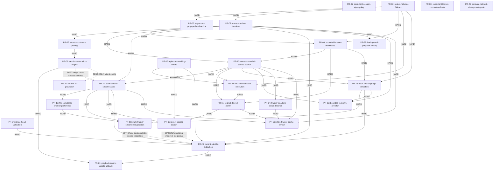
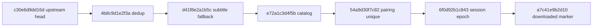

# StremHU Source: Upstream PR Split Implementation Plan

<!-- doc-nav:start -->
**Navigáció:** [Dokumentáció](README.md) · [AI-index](AI-INDEX.md)

> **Státusz: planning-only.** A rögzített snapshotok auditja és jövőbeli végrehajtási terv. Nem végrehajtott PR-szétbontás; a jövőbeli PR-ok különálló zöld állapota nincs előre bizonyítva.

**Kapcsolódó:** [Stream-performance végrehajtási állapot](feature/stream-performance.md#execution-status) · [Stabilitási végrehajtási állapot](feature/stability-and-optimization.md#execution-status)

<details>
<summary>Fejezetek / közvetlen ugrás</summary>


- [1. Executive Summary](#doc-01)

- [2. Evidence & Verified Repository Snapshot](#doc-02)

- [3. Git Divergence and Upstream-Only Changes](#doc-03)

- [4. Full Commit / File / Symbol / Hunk Inventory](#doc-04)

- [5. Cross-Feature Coupling Analysis](#doc-05)

- [6. PR Dependency DAG (Mermaid)](#doc-06)

- [7. PR Decomposition Principles and Exceptions](#doc-07)

- [8. Ordered PR Roadmap](#doc-08)

- [9. Detailed PR Implementation Runbooks](#doc-09)

- [10. Alembic Migration Ledger and Rebase Protocol](#doc-10)

- [11. Git Branching, Transplant and PR Update Strategy](#doc-11)

- [12. Test/CI Matrix and Current Baseline Results](#doc-12)

- [13. Merge Sequence, Stacked-PR Rules and Post-Merge Checks](#doc-13)

- [14. Risks, Rollback and Fork Reconciliation](#doc-14)

- [15. Change Coverage Matrix and Reconciliation](#doc-15)

- [16. Open Questions / Unverified Facts / Blockers](#doc-16)

- [17. Final Self-Audit and Definition of Done](#doc-17)


</details>

<!-- doc-nav:end -->

<!-- doc-anchor:doc-01 -->
<a id="doc-01"></a>
## 1. Executive Summary


**26 koherens PR javasolt.** A biztonsági javítások, a közös erőforrás-élettartam, az önálló parser, az új funkciók és a méréshez kötött optimalizálások külön review-egységet alkotnak. A szám nem a régi branchszámokból származik: egy nagy forkfeature több független javításra bomlik, a ténylegesen közös lifecycle és Session-ownership részek viszont együtt maradnak.

**VERIFIED:** az auditpár upstream `f3ffff3` ↔ fork `863c156`; 1662 módosított fájl, +2 279 620 / −1168 sor. A `server/app`, `server/alembic`, `client/src` rész 154 fájl, +10 923 / −1134; a `server/tests`-szel 214 fájl, +24 138 / −1147. A két evidence-könyvtár 1342 fájlban 2 235 217 hozzáadott sort tartalmaz: a teljes hozzáadás 98,05%-a (a prompt kb. 98,5%-os értéke helyett a tényleges numstat alapján).

**Döntések (INFERRED, végrehajtandó terv):** Relay/Subtitle szétválasztásnál a korai PR-07-ből a teljes felirat-hívási ágat kihagyjuk, és a baseline videóprioritást őrizzük; PR-20 építi vissza. Torznab előtt a tényleges resolver PR-14 beolvad: nincs hiányzó resolver vagy dummy interfész. A dedupban ugyanazon swarm trackerbecsléseinek összegzését konzervatív max becslésre javítjuk (PR-18). A file completion/marker önálló PR-17. A subtitle extraction (PR-20) és az aktív lejátszás szerinti borrowing (PR-21) külön, mindkettő teljes működéssel érkezik.

**Alembic:** hat eredeti fork-revision változatlan történeti forrás. Upstream célra új revisionazonosítókat generálunk, eltérő névtérrel, kezdetben `c30e6d9dd16d` parenttel; az egymás utáni integrációnál mindig a tényleges head a parent. A fork telepítéseinek migrációs történetét nem írjuk át. Az összes migrációs PR előtt külön maintainerdöntés és fork-sync átmeneti terv kell.

Első hullám: PR-01, PR-02, PR-04, PR-08, PR-13; PR-03 a logging után, PR-05 a kulcskezelés után. A konkrét topologikus merge-sorrend a 13. fejezetben; PR-07 a bootstrap PR-05 elé kerül. Az önálló ágak párhuzamosan előkészíthetők. A meglévőként említett Relay-branchnév helyett új `owned-runtime-shutdown` nevet használunk.

**Aktuális bizonyíték:** helyi Dockerben mindkét snapshot Ruff és basedpyright PASS; baseline 157 pytest/64 snapshot PASS, fork 842 pytest/64 snapshot PASS (19 figyelmeztetés). Frontend futtatás és teljesítmény-/élő kliensmérés most NOT_RUN. A részletes végrehajtási kapuk nem azonosak az audit előfeltételeivel; a régi BLOCKED refállapot feloldódott.

<!-- doc-anchor:doc-02 -->
<a id="doc-02"></a>
## 2. Evidence & Verified Repository Snapshot


**MOSTANI AUDIT, VERIFIED — 2026-11-11 22:24:52 +01:00:** a 3.1 szerinti ellenőrzés sikeres. Az aktív ág `main`, HEAD/main = `863c1567eb1b9b8013d436be2bb4ab60806da501`. A munkafa három dokumentációs változást tartalmazott a korábbi jelentésből; ezeket ugyanennek a feladatnak a részeként írtuk tovább. Alkalmazandó szabály a gyökér AGENTS, további AGENTS.md-t a célzott fájlinventory nem talált. Helyi upstream-main ág nem előfeltétel a felhasználó pontosítása szerint.

| Adat | Ellenőrzött érték |
|---|---|
| UpstreamBaseSha / B | `f3ffff3a5d65088b509f17a2eaef21d8a644eaf8` |
| MainSha / M | `863c1567eb1b9b8013d436be2bb4ab60806da501` |
| refs/audit/pr9-stability | `fe86bba20a54e0f8091fd75d5d84a6c6ed97ba34` |
| refs/audit/pr11-stream-performance | `24c62c47c342b9f66ab30964de6d2d68152c097c` |
| Merge-base | B, a main őse |
| Upstream/fork-only | 0 / 84 |
| Eredetfeltárás kibővített commituniója | 214 commit; ebből 84 az audit fork-története, 130 részletes ref-only előzmény |
| Upstream migration graph | 4 revision; egy head: `c30e6d9dd16d` |
| Fork migration graph | 10 revision; egy head: `a7c41e9b2d10` |
| Remote-kontextus | Csak `origin` remote létezik; a mostani audit nem használt fetch-et |
| Régi Relay-branchnév | Helyi ref hiányzik; origin remote-tracking ref B-n áll. A feladat előzetes állítása itt részben eltért |

Az itt és a manifestekben használt **M** minden fájl konkrét, teljes SHA-jú tartalmi forrása. A `Cnnn` az alábbi commitjegyzékben teljes SHA-ra feloldott eredet, nem alternatív diffbaseline. Fájl/szimbólum hivatkozás a rögzített M állapotára vonatkozik; új upstream szimbólumot külön NEW jelzés jelöl.

**Forrásból ellenőrzött technológia:** Docker node:24-bookworm-slim és python:3.12-slim-bookworm; Hypercorn indítás `server/app/run.py`; libtorrent 2.1.1, FastAPI 0.162.2, SQLAlchemy 2.1.8, Alembic 1.20.1; kliens Node 24, React 19.3.1, Vite 8.3.6, TypeScript 6.0.3. A Ruff target-version py310 linterbeállítás, nem runtime-verzió. `requirements.txt` tartalmazza pytest/Ruff/basedpyright függőségeket; a product Dockerfile a `server` könyvtárat másolja. A termék-entrypoint indítása automatikus alkalmazás-/DB-műveletet okozhat, ezért a tesztkonténerben Pythonra cseréltük.

**Helyi snapshot contribution-szabályok:** GPLv3 LICENSE, kliens GPL-3.0-only; külön CONTRIBUTING és gyökér PR-template nem található a snapshot fájllistájában. A commitüzenetek nem egységes nyelvűek, nincs forrásból igazolt kötelező conventional-commit policy. PR Check `main` célra client/server/workflow pathszűrővel indul. Backend CI Python 3.12 + Ruff→basedpyright→pytest; client CI Node24 + npm ci, ESLint/tsc/Prettier és build. A `npm run test --if-present` a jelenlegi package.json mellett kihagyja a teszteket: nincs test script, ezért a frontend PR-okhoz explicit Vitest kapu szükséges.

**Dokumentáció:** a README/AI-INDEX/sablon szabályai szerinti front matter, doc-nav, explicit anchorok; csak ez a terv és a két regisztráció változik. A feature-eredet általános `8c99c7d` baseline-ja nem az itteni auditbaseline. Ez az objektum helyben elérhető, de nem erre készült a leltár.

Minősítések: **VERIFIED** = olvasott Git/forrás/tényleges futás; **INFERRED** = ebből tervezett, még nem transzplantált működés; **UNVERIFIED** = további validálás kell; **BLOCKED** = ismert végrehajtási kapu miatt most nem szabad továbblépni. A PR-fejezetek döntései INFERRED-ek; az M-beli szimbólumok és a tesztlétezés VERIFIED, a leendő PR zöldsége UNVERIFIED.

<!-- doc-anchor:doc-03 -->
<a id="doc-03"></a>
## 3. Git Divergence and Upstream-Only Changes


A rögzített összehasonlítás parancsai (ténylegesen lefutottak):

```powershell
$UpstreamBaseSha = 'f3ffff3a5d65088b509f17a2eaef21d8a644eaf8'
$MainSha = '863c1567eb1b9b8013d436be2bb4ab60806da501'
git merge-base $UpstreamBaseSha $MainSha
git rev-list --left-right --count "$UpstreamBaseSha...$MainSha"
git diff --shortstat $UpstreamBaseSha $MainSha
git diff --check $UpstreamBaseSha $MainSha
```

**VERIFIED:** merge-base B, 0/84 divergencia. Nincs upstream-only commit, így a snapshot-diffben nincs külön megőrzendő upstream-only patchlista. Ettől még a baseline már tartalmazza a `99e76e6eb91c07daaa91dd0d9e5e5e06f7a03d1d` (#292) encryption/uTP beállításait és az `f3ffff3` függőségfrissítéseit: régi forkpatch alkalmazása nem törölheti őket. A #292 tízfájlos patchét, köztük az encryption/uTP tesztjét ellenőriztük. A `863c156` első szülőhöz mért tree-diffje üres (exit 0).

`cf068de0419fb5dc8330376047078aaa24c601bc` (#12) és `863c1567eb1b9b8013d436be2bb4ab60806da501` az upstream tartalom/előzmény integrációja: EXCLUDED (upstream content/history), nem upstreambe újra beküldendő forkfeature. A `84ee1f65...` és `9dad9ef2...` squash csak történeti összefoglaló; transzplantációs egységként nem használható.

**Snapshot diff-check: FAIL (exit 2).** 28 whitespace-diagnosztika meglévő docs/kód/teszt fájlokon (trailing whitespace vagy üres EOF sor), többek között a három korai boolean migration, common/singleflight.py és ncore.py. Nem automatikusan javítottuk. Minden későbbi PR csak a saját átvitt hunkjain tisztítsa a whitespace-t, és saját cél-diffjén kötelező exit 0. Ez nem pytest- vagy runtime-hiba; az audit folytatható, build/kiadás viszont ebből nem következik.

A különböző baseline-ok: most B↔M inventory; jövőbeli PR diff = akkor ellenőrzött TargetSha↔feature; teljesítmény = A/B/C + ugyanazon C előtte/utána. A jövőbeli upstream frissítését nem hajtottuk végre és az itteni számokat nem írjuk át vele.

<!-- doc-anchor:doc-04 -->
<a id="doc-04"></a>
## 4. Full Commit / File / Symbol / Hunk Inventory


A leltár Git numstat/name-status és nulla kontextusú diffhunkok alapján, Python AST-val kigyűjtött deklarációkkal/importokkal és célzott teljes hívásilánc-olvasással készült. A tesztfájlokat az alkalmazott szerződéshez kapcsoltuk; tesztlétezés nem helyettesíti a különálló transzplantált PR tesztjét. A teljes 214 kódfájl egyedi manifestje a 15. fejezetben; a nem kódbeli tömeg könyvtáranként, darabszámmal szerepel.

Vegyes fájlnál a 9. és 15. fejezetben szereplő szimbólumcsoportok a bontási egységek. A sorokból **ki kell vonni az ugyanazon fájl más soraihoz rendelt részeket**: az általános osztály-/tesztfájl sor nem engedély a későbbi egység átemelésére. Az összefüggő diffhunk (különösen config/model/import) nem mindig PR-atom: ilyenkor kötelező MANUAL szerkesztés. Az alábbi hunk-regiszter az eredeti snapshotot azonosítja, nem azt állítja, hogy egy hunk mindig egy PR.

### Teljes commitjegyzék és eredet

`main` jelölés = B..M történet; `ref-only` = részletes PR-09/11 refen elérhető, M-ben nem saját commitként szereplő eredet. A manifestekben a forrásfájlhoz kötött összes C-azonosító megtalálható; a commit vegyes volta miatt semelyik nem automatikus cherry-pick engedély.

| ID | Full SHA | History | Subject | Content disposition |
|---|---|---|---|---|

| C001 | `863c1567eb1b9b8013d436be2bb4ab60806da501` | main | Merge upstream s4pp1/stremhu-source main (f3ffff3): ancestry only | EXCLUDED: upstream content/history |

| C002 | `cf068de0419fb5dc8330376047078aaa24c601bc` | main | Upstream-szinkron: s4pp1/stremhu-source main (f3ffff3) (#12) | EXCLUDED: upstream content/history |

| C003 | `9dad9ef2e80574f3f7f5cb1030e99a34108a6a20` | main | Streamgyorsítás: SP01–SP10, mért kapukkal (#11) | PR-01, PR-02, PR-04, PR-05, PR-06, PR-07, PR-08, PR-09, PR-10, PR-11, PR-13, PR-14, PR-15, PR-16, PR-17, PR-18, PR-20, PR-21, PR-22, PR-23, PR-24, PR-25, PR-26; vegyes patch: csak manifest szerinti hunk |

| C004 | `24c62c47c342b9f66ab30964de6d2d68152c097c` | ref-only | docs(readme): stream-performance results (SP01-SP10) | PR-26; vegyes patch: csak manifest szerinti hunk |

| C005 | `18846cd44d4fb8f63a85d527053c92d7f22fde7f` | ref-only | docs(stream-performance): final status before the PR to main | EXCLUDED: docs/evidence/tooling vagy merge/history; nincs saját új végső kódegység |

| C006 | `75e5b5babbc6f8d5f8c0ceb2d3177d339294247a` | ref-only | docs(stream-performance): SP09 closed without change by user decision | EXCLUDED: docs/evidence/tooling vagy merge/history; nincs saját új végső kódegység |

| C007 | `ecab4616098453e30fc8ce0afcbd43ee1bb769fa` | ref-only | docs(stream-performance): SP01 closed without change after sp01-probe-v1 | EXCLUDED: docs/evidence/tooling vagy merge/history; nincs saját új végső kódegység |

| C008 | `23cbaaa9980b6fdc8d301d1463b38a4be3f2d0d9` | ref-only | docs(stream-performance): register sp01-probe-v1 (SP01 read-ahead window) | EXCLUDED: docs/evidence/tooling vagy merge/history; nincs saját új végső kódegység |

| C009 | `e624e9360db181728ad5a755bdf034d4818d8b1b` | ref-only | docs(stream-performance): SP10 closed without change after gsp10-v2 FAIL | EXCLUDED: docs/evidence/tooling vagy merge/history; nincs saját új végső kódegység |

| C010 | `cc8d0166510f0e37c8d7b02300b534fcab07f0d7` | ref-only | docs(stream-performance): status and upstream diff matrix after the night's gates | EXCLUDED: docs/evidence/tooling vagy merge/history; nincs saját új végső kódegység |

| C011 | `9120e0d9c21abcecc3d94dc8b9db36241f94a8e2` | ref-only | docs(stream-performance): Docker check of the stale tracker cache default | EXCLUDED: docs/evidence/tooling vagy merge/history; nincs saját új végső kódegység |

| C012 | `8157b515c81b9409054379e4c831cf568becab4a` | ref-only | feat(search): serve a stale tracker list at once by default (gsp07-v2 PASS) | PR-01, PR-06, PR-07, PR-10, PR-20, PR-22, PR-23, PR-24, PR-25; vegyes patch: csak manifest szerinti hunk |

| C013 | `591448c545c024031a920f01a0fbe7cbab25915c` | ref-only | merge: SP07 stale tracker cache with background refresh (gsp07-v2 PASS) | EXCLUDED: docs/evidence/tooling vagy merge/history; nincs saját új végső kódegység |

| C014 | `774ae7016e1939d7c1c67b2dba6eed302c119eed` | ref-only | docs(stream-performance): gsp07-v2 PASS (stale tracker cache with background refresh) | EXCLUDED: docs/evidence/tooling vagy merge/history; nincs saját új végső kódegység |

| C015 | `e14f73371b377d97cb282f4c8c11924352a032e4` | ref-only | docs(stream-performance): Docker check of the playback history default | EXCLUDED: docs/evidence/tooling vagy merge/history; nincs saját új végső kódegység |

| C016 | `f183b3c4531079a460edfd0fe79bcc6d33642d18` | ref-only | feat(stream): playback history off the response path by default (gsp03-v1 PASS:C3) | PR-01, PR-04, PR-06, PR-07, PR-10, PR-20, PR-22, PR-23, PR-24, PR-25; vegyes patch: csak manifest szerinti hunk |

| C017 | `c6fb704826080b8e0d6a008a76cbaebe0121d465` | ref-only | merge: SP03 playback history off the response path (gsp03-v1 PASS:C3) | EXCLUDED: docs/evidence/tooling vagy merge/history; nincs saját új végső kódegység |

| C018 | `f7f3e1d3d3a12075a11f85123f79edfe6a97ac58` | ref-only | docs(stream-performance): gsp03-v1 PASS:C3 (playback history off the response path) | EXCLUDED: docs/evidence/tooling vagy merge/history; nincs saját új végső kódegység |

| C019 | `9546991a0b6e53a836de575baefde53b3544f93a` | ref-only | docs(stream-performance): register gsp03-v1 (SP03 playback history gate) | EXCLUDED: docs/evidence/tooling vagy merge/history; nincs saját új végső kódegység |

| C020 | `d8aae3758e85cb146838f235e0b203cc752c3320` | ref-only | docs(stream-performance): register gsp07-v2 (gsp07-v1 plan, runner infra retry) | EXCLUDED: docs/evidence/tooling vagy merge/history; nincs saját új végső kódegység |

| C021 | `348f2b77e7df945bd6a308336580c7c684b87325` | ref-only | test(stream-performance): retry an H2 run once on a Docker infrastructure failure | EXCLUDED: docs/evidence/tooling vagy merge/history; nincs saját új végső kódegység |

| C022 | `1ec2c7ea21684c9883b68e6d1ee2433164788305` | ref-only | docs(stream-performance): gsp07-v1 FAIL (one run lost to a Docker error) | EXCLUDED: docs/evidence/tooling vagy merge/history; nincs saját új végső kódegység |

| C023 | `e0bd7097fcfbbb37f80c5de0defa5f972af776cf` | ref-only | test(stream-performance): retry an H1 run once on a Docker infrastructure failure | EXCLUDED: docs/evidence/tooling vagy merge/history; nincs saját új végső kódegység |

| C024 | `40904df219d3f74560791087003757d97e49155f` | ref-only | docs(stream-performance): register gsp07-v1 gate (SP07 stale tracker cache) | EXCLUDED: docs/evidence/tooling vagy merge/history; nincs saját új végső kódegység |

| C025 | `06b790d14f7c83b2f4699ea34994f73104b164e6` | ref-only | docs(stream-performance): Docker check of the Tech Info prefetch default | EXCLUDED: docs/evidence/tooling vagy merge/history; nincs saját új végső kódegység |

| C026 | `d645d308696dc785e0d75c9a6b0dfee8f6cdc77c` | ref-only | feat(search): Tech Info prefetch on by default (gsp06-v2 PASS) | PR-01, PR-06, PR-07, PR-10, PR-16, PR-20, PR-22, PR-23, PR-24, PR-25; vegyes patch: csak manifest szerinti hunk |

| C027 | `9dca8c56a4e96c9aa535ce69fb06e3e1eb2d6c6a` | ref-only | docs(stream-performance): gsp06-v2 PASS (SP06/b Tech Info prefetch) | EXCLUDED: docs/evidence/tooling vagy merge/history; nincs saját új végső kódegység |

| C028 | `f5e841076ebc2bc194290ed9dcce107df41e07fe` | ref-only | docs(stream-performance): gsp07 draft records the torznab always-fresh decision | EXCLUDED: docs/evidence/tooling vagy merge/history; nincs saját új végső kódegység |

| C029 | `c121aefd9e86fd9c9a7dcc77d06f3ee4ffa7c79a` | ref-only | docs(stream-performance): gsp07 draft ready for registration | EXCLUDED: docs/evidence/tooling vagy merge/history; nincs saját új végső kódegység |

| C030 | `6468894bebf397c48c7b8639947f2eb5a69a923a` | ref-only | test(stream-performance): opt-in GSP07 hard checks in the H2 decide rule | EXCLUDED: docs/evidence/tooling vagy merge/history; nincs saját új végső kódegység |

| C031 | `f84dc3797285178a5854563a7908e899b7f29793` | ref-only | Merge feature/stream-performance (27eda92) into the SP07 branch | EXCLUDED: docs/evidence/tooling vagy merge/history; nincs saját új végső kódegység |

| C032 | `aae6dbe007157adeede7c232228f97d11eadedbe` | ref-only | docs(stream-performance): UX decision - torznab always gets a fresh tracker list under SP07 | EXCLUDED: docs/evidence/tooling vagy merge/history; nincs saját új végső kódegység |

| C033 | `27eda927d10493d0fdf740efcd57bde75a7316a7` | ref-only | docs(stream-performance): register gsp06-v2 gate (torrent-identity source check) | EXCLUDED: docs/evidence/tooling vagy merge/history; nincs saját új végső kódegység |

| C034 | `97b29316144ef61cceac7e93382bdb6ff62aac88` | ref-only | test(stream-performance): torrent-identity source digest for the H2 gates | EXCLUDED: docs/evidence/tooling vagy merge/history; nincs saját új végső kódegység |

| C035 | `f2afcbaed223f1cae7657589892c82777eea75ab` | ref-only | docs(stream-performance): gsp06-v1 FAIL (identical-source check conflated attributes) | EXCLUDED: docs/evidence/tooling vagy merge/history; nincs saját új végső kódegység |

| C036 | `dc0785062c219079428926ae0e888757605faa1b` | ref-only | test(stream-performance): H2 harness GSP07 support and gsp07 draft gate | EXCLUDED: docs/evidence/tooling vagy merge/history; nincs saját új végső kódegység |

| C037 | `1af09cbd12bb6783f7286569e82d4c30c6ea02ed` | ref-only | feat(indexers): SP07 stale tracker IMDb cache behind a switch (default off) | PR-01, PR-02, PR-05, PR-06, PR-07, PR-10, PR-11, PR-14, PR-15, PR-16, PR-17, PR-18, PR-20, PR-21, PR-22, PR-23, PR-24, PR-25; vegyes patch: csak manifest szerinti hunk |

| C038 | `7032eb9381b4f931a24de4df5ddb86e6914b42ee` | ref-only | test(stream-performance): GSP03 range-series harness and unregistered gate draft | EXCLUDED: docs/evidence/tooling vagy merge/history; nincs saját új végső kódegység |

| C039 | `f1950480cfda0dea9c2add30ddd4b205869038a1` | ref-only | perf(stream): SP03 playback history behind playback_history_background (default off) | PR-01, PR-04, PR-06, PR-07, PR-10, PR-20, PR-22, PR-23, PR-24, PR-25; vegyes patch: csak manifest szerinti hunk |

| C040 | `ec674fa13ace9f3f86858a3d7b919e18de41dacf` | ref-only | perf(stream): write playback history once, off the response path (SP03 candidate) | PR-04, PR-05, PR-06, PR-07, PR-11, PR-14, PR-20, PR-21, PR-22, PR-23, PR-25; vegyes patch: csak manifest szerinti hunk |

| C041 | `adf4d33582d447d1f5b1cb2b1b33d08ca52cd848` | ref-only | docs(stream-performance): register gsp06-v1 gate (SP06/b Tech Info prefetch) | EXCLUDED: docs/evidence/tooling vagy merge/history; nincs saját új végső kódegység |

| C042 | `34c12453a6aa7082ed1c1d0d97bfea01277dd60c` | ref-only | test(stream-performance): H2 harness --warm-delay | EXCLUDED: docs/evidence/tooling vagy merge/history; nincs saját új végső kódegység |

| C043 | `622d802180ca1753e3d3b78ee88154af3a0719fb` | ref-only | Merge GSP06 harness wiring and the H2 'default' policy | EXCLUDED: docs/evidence/tooling vagy merge/history; nincs saját új végső kódegység |

| C044 | `2595eaf4d02eb4c5a3a9365de37314785539fd82` | ref-only | feat(search): tracker circuit breaker on by default (gsp05-v1 PASS) | PR-01, PR-06, PR-07, PR-10, PR-20, PR-22, PR-23, PR-24, PR-25; vegyes patch: csak manifest szerinti hunk |

| C045 | `14d0ed48fa2eb1918047373e3650448fdcc17143` | ref-only | test(stream-performance): H2 harness 'default' policy (the image's own settings) | EXCLUDED: docs/evidence/tooling vagy merge/history; nincs saját új végső kódegység |

| C046 | `fd742486def0b3a81d122d9da36bb25bd53ad520` | ref-only | docs(stream-performance): gsp05-v1 PASS (SP05/b breaker) | EXCLUDED: docs/evidence/tooling vagy merge/history; nincs saját új végső kódegység |

| C047 | `a70728ba3acc60a44442219737e61d96774f9a71` | ref-only | test(stream-performance): GSP06 harness wiring and draft gate | EXCLUDED: docs/evidence/tooling vagy merge/history; nincs saját új végső kódegység |

| C048 | `aef513c84401988955dafa48482c4975ce2c63a3` | ref-only | docs(stream-performance): register gsp05-v1 gate (SP05/b breaker) | EXCLUDED: docs/evidence/tooling vagy merge/history; nincs saját új végső kódegység |

| C049 | `e61ab390c1ace840d21eff571df0f667ce4b0d26` | ref-only | Merge SP06/b Tech Info prefetch | EXCLUDED: docs/evidence/tooling vagy merge/history; nincs saját új végső kódegység |

| C050 | `a998d45437f8344730ee2e894b037c30f8b4756b` | ref-only | Merge SP05/b tracker circuit breaker and H2 search harness | EXCLUDED: docs/evidence/tooling vagy merge/history; nincs saját új végső kódegység |

| C051 | `5c14f1ef29c5e6e398d0b6e3696577081683b99e` | ref-only | feat(relay): upstream-like start is the default (gsp02-v4 PASS:C2) | PR-01, PR-06, PR-07, PR-08, PR-10, PR-13, PR-14, PR-15, PR-20, PR-22, PR-23, PR-24, PR-25; vegyes patch: csak manifest szerinti hunk |

| C052 | `ef2bc99dcbae178466a112d64563205b6759f5ba` | ref-only | docs(stream-performance): gsp02-v4 PASS:C2 and pb1-v1 reference recorded | EXCLUDED: docs/evidence/tooling vagy merge/history; nincs saját új végső kódegység |

| C053 | `25889783b71791d6caf47b51edcecb4a248e5d4a` | ref-only | docs(stream-performance): register pb1-v1 descriptive reference (8/60 Mbit/s) | EXCLUDED: docs/evidence/tooling vagy merge/history; nincs saját új végső kódegység |

| C054 | `4ab0171402c978b81d743e3f26f7cc3ec9ab6007` | ref-only | test(stream-performance): H2 search harness and unregistered GSP05 draft | EXCLUDED: docs/evidence/tooling vagy merge/history; nincs saját új végső kódegység |

| C055 | `be55892097d6f7eb5ddfcdc2a5d46f2ce17d8bee` | ref-only | feat(indexers): SP05/b tracker circuit breaker behind a switch | PR-01, PR-06, PR-07, PR-10, PR-11, PR-20, PR-22, PR-23, PR-24, PR-25; vegyes patch: csak manifest szerinti hunk |

| C056 | `6b8cc22123137670bb46b67c2b08814807cdf612` | ref-only | feat(search): Tech Info prefetch behind a switch (SP06/b) | PR-01, PR-02, PR-05, PR-06, PR-07, PR-09, PR-10, PR-11, PR-14, PR-15, PR-16, PR-17, PR-18, PR-20, PR-21, PR-22, PR-23, PR-24, PR-25; vegyes patch: csak manifest szerinti hunk |

| C057 | `8c04f920037df090e4909f8edd2c2005df90d7a7` | ref-only | docs(stream-performance): UX frame Q5 decided - SP07 hard TTL 24 h | EXCLUDED: docs/evidence/tooling vagy merge/history; nincs saját új végső kódegység |

| C058 | `c082b043a8186fc61eada7ad1d092e941ccbd2a6` | ref-only | test(stream-performance): H3 latency proxy for remote-viewer measurements | EXCLUDED: docs/evidence/tooling vagy merge/history; nincs saját új végső kódegység |

| C059 | `1c8dfd5a799dea749f7c67ae601990fd23471337` | ref-only | docs(stream-performance): register gsp02-v4 gate protocol | EXCLUDED: docs/evidence/tooling vagy merge/history; nincs saját új végső kódegység |

| C060 | `edb1588310e31412fb24387a150cb415b3cf517d` | ref-only | test(stream-performance): bootstrap/Holm gate decider; app-frame traceback count | EXCLUDED: docs/evidence/tooling vagy merge/history; nincs saját új végső kódegység |

| C061 | `c3d60358ec9a5906ae8cee9828a402244597ed38` | ref-only | feat(relay): startfocus readahead candidate | PR-01, PR-06, PR-07, PR-08, PR-10, PR-20, PR-22, PR-23, PR-24, PR-25; vegyes patch: csak manifest szerinti hunk |

| C062 | `a08458945b8f978dce22fd69afad680d23a86b67` | ref-only | docs(stream-performance): gsp02-v3 FAIL recorded; start/seek trade-off quantified | EXCLUDED: docs/evidence/tooling vagy merge/history; nincs saját új végső kódegység |

| C063 | `82f2cf46c1c074dbc144c950d1cb609dbe4ac534` | ref-only | docs(stream-performance): register gsp02-v3 gate protocol | EXCLUDED: docs/evidence/tooling vagy merge/history; nincs saját új végső kódegység |

| C064 | `8d13d4ddfcd1cf0692bdd6cf9280fa88c3a96301` | ref-only | feat(relay): focus readahead candidate (gsp02-v3) | PR-01, PR-06, PR-07, PR-08, PR-10, PR-20, PR-22, PR-23, PR-24, PR-25; vegyes patch: csak manifest szerinti hunk |

| C065 | `881b799acdad02ec1963b1ef6a553945ff768e23` | ref-only | docs(stream-performance): seek diagnosis after gsp02-v2 | EXCLUDED: docs/evidence/tooling vagy merge/history; nincs saját új végső kódegység |

| C066 | `f88a0ae39fc695ac70e38f064e2e5daf486205b5` | ref-only | test(stream-performance): seek timing marks and opt-in diag log capture | EXCLUDED: docs/evidence/tooling vagy merge/history; nincs saját új végső kódegység |

| C067 | `e566298d054e156c1caac5b949e6b649ecae3c4d` | ref-only | docs(stream-performance): gsp02-v2 FAIL recorded; policies stay legacy | EXCLUDED: docs/evidence/tooling vagy merge/history; nincs saját új végső kódegység |

| C068 | `70dc12e3928756672ae0d2ced1facafbcf1d8fdc` | ref-only | docs(stream-performance): register gsp02-v2 gate protocol | EXCLUDED: docs/evidence/tooling vagy merge/history; nincs saját új végső kódegység |

| C069 | `e4ad95724ea117513210a3edb43ed40b042910a6` | ref-only | feat(relay): upstream-like start and readahead candidates (gsp02-v2 C2) | PR-01, PR-06, PR-07, PR-08, PR-10, PR-20, PR-22, PR-23, PR-24, PR-25; vegyes patch: csak manifest szerinti hunk |

| C070 | `492efc1873aa679fabc7de8797de023874669d28` | ref-only | docs(stream-performance): gsp02-v1 FAIL recorded; start policy stays legacy | EXCLUDED: docs/evidence/tooling vagy merge/history; nincs saját új végső kódegység |

| C071 | `5af2df1f4bca96ad4bdd7c1874108607a89cfe9d` | ref-only | test(stream-performance): gate decision script; traceback diagnostic | EXCLUDED: docs/evidence/tooling vagy merge/history; nincs saját új végső kódegység |

| C072 | `14e5beeb2a3a3aaf903c96bd9a1f8c5c133a6dec` | ref-only | docs(stream-performance): register gsp02-v1 gate protocol | EXCLUDED: docs/evidence/tooling vagy merge/history; nincs saját új végső kódegység |

| C073 | `f8cc0f269ba21dd4f7d960fab4d7a664538f77d6` | ref-only | docs(stream-performance): pb0-v2 baseline results; new item SP10 | EXCLUDED: docs/evidence/tooling vagy merge/history; nincs saját új végső kódegység |

| C074 | `b794167084cb53befc774109cfe51ea5b1243f02` | ref-only | feat(relay): graded start and byte-based readahead behind switches (SP02/SP01) | PR-01, PR-06, PR-07, PR-08, PR-10, PR-20, PR-22, PR-23, PR-24, PR-25; vegyes patch: csak manifest szerinti hunk |

| C075 | `cd4b0ad02c37c8a8fe3c9a9b2cbb83a8ae36a01a` | ref-only | fix(ncore): a failed Tech Info lookup is not cached as empty (SP06/a) | PR-09, PR-15, PR-16, PR-23; vegyes patch: csak manifest szerinti hunk |

| C076 | `40d166e36b119e58acea790521288304b3398211` | ref-only | refactor(indexers): one per-tracker search timeout helper (SP05/a) | PR-10, PR-11, PR-24, PR-25; vegyes patch: csak manifest szerinti hunk |

| C077 | `58b62356d7754b85d47ccc187e7fda1337d55267` | ref-only | docs(stream-performance): record the user's UX/SLO frame (2026-11-09) | EXCLUDED: docs/evidence/tooling vagy merge/history; nincs saját új végső kódegység |

| C078 | `3e9546d466afb595b77c23a9a4d85273a9bd810c` | ref-only | docs(stream-performance): register pb0-v2 playback baseline protocol | EXCLUDED: docs/evidence/tooling vagy merge/history; nincs saját új végső kódegység |

| C079 | `b10c15c2c5518ddfafe0435bf26935904cd84483` | ref-only | test(stream-performance): fix seed shutdown statistics; record aborted pb0-v1 | EXCLUDED: docs/evidence/tooling vagy merge/history; nincs saját új végső kódegység |

| C080 | `0660729fc563e829b39bde82ce8c62fea8251290` | ref-only | docs(stream-performance): register pb0-v1 playback baseline protocol | EXCLUDED: docs/evidence/tooling vagy merge/history; nincs saját új végső kódegység |

| C081 | `89f9cb70d9ec230ba94ba2ba162c1aa58f9c14bc` | ref-only | docs(stream-performance): G0 libtorrent probe evidence; repoint to reworded main | EXCLUDED: docs/evidence/tooling vagy merge/history; nincs saját új végső kódegység |

| C082 | `af653d899dcb73a980da358b12bb18eba3b264fa` | ref-only | test(stream-performance): H1 playback harness and G0 libtorrent probe | EXCLUDED: docs/evidence/tooling vagy merge/history; nincs saját új végső kódegység |

| C083 | `f8118a84e223c962ad5c89091719b48d5bae57b0` | ref-only | docs(stream-performance): implementation plan for stream speed work | EXCLUDED: docs/evidence/tooling vagy merge/history; nincs saját új végső kódegység |

| C084 | `0515d989c764bb4103d6f7286d703b98ec859ce6` | main | feat(stremio): make the downloaded marker a user preference (#10) | PR-06, PR-10, PR-11, PR-14, PR-16, PR-17, PR-18, PR-19, PR-20, PR-21, PR-23, PR-25, PR-26; vegyes patch: csak manifest szerinti hunk |

| C085 | `84ee1f65ad89a07771d0d536789c6692815c4061` | main | Stabilitás és optimalizálás: CR01–CR19 audit, 0–31. munkacsomag (#9) | PR-01, PR-02, PR-03, PR-04, PR-05, PR-06, PR-07, PR-08, PR-09, PR-10, PR-11, PR-12, PR-13, PR-14, PR-15, PR-16, PR-17, PR-18, PR-19, PR-20, PR-21, PR-22, PR-23, PR-24, PR-25, PR-26; vegyes patch: csak manifest szerinti hunk |

| C086 | `fe86bba20a54e0f8091fd75d5d84a6c6ed97ba34` | ref-only | fix: address the MR review findings (config errors, key length, notices) | PR-01, PR-06, PR-07, PR-10, PR-11, PR-13, PR-14, PR-17, PR-18, PR-19, PR-20, PR-21, PR-22, PR-23, PR-24, PR-25, PR-26; vegyes patch: csak manifest szerinti hunk |

| C087 | `2a087a8e20ca3501e0f7a086193637e4c1d09ca1` | ref-only | fix(stremio): catalog toggle works without reinstalling; one subtitle setting | PR-11, PR-14, PR-17, PR-18, PR-19, PR-20, PR-21; vegyes patch: csak manifest szerinti hunk |

| C088 | `528797b773233905d5c7855e36e8a59d62118986` | ref-only | fix(config): plug & play SESSION_SECRET and a hermetic TVDB alias test | PR-01, PR-06, PR-07, PR-10, PR-13, PR-14, PR-15, PR-20, PR-22, PR-23, PR-24, PR-25, PR-26; vegyes patch: csak manifest szerinti hunk |

| C089 | `c0395483fe1983cfec1b1d98afd21df561dda087` | ref-only | docs: point the 26a notes to the landed 26b redirect path | EXCLUDED: docs/evidence/tooling vagy merge/history; nincs saját új végső kódegység |

| C090 | `cf352ca0fd451922806fbe713255dd4ec924747a` | ref-only | docs(readme): CR15 (25, 26a, 26b, 27) landed; 688 pytest | PR-26; vegyes patch: csak manifest szerinti hunk |

| C091 | `7c52974c716b8a87ab802474a3402503c3b5e4cf` | ref-only | docs: land packet 27 (CR15/c search admission, deadline and byte budget) on the v6 tree | EXCLUDED: docs/evidence/tooling vagy merge/history; nincs saját új végső kódegység |

| C092 | `dbca19affbe20933a14638275a48dbb5c3ebf711` | ref-only | wip(cr15c): tighten pending/batch budget to 32/16 MiB (pre-gate diagnostic) | PR-01, PR-06, PR-07, PR-10, PR-20, PR-22, PR-23, PR-24, PR-25; vegyes patch: csak manifest szerinti hunk |

| C093 | `e94ea82ce29cc0d9edff99c1ff826a582a8980e0` | ref-only | wip(cr15c): SLO values and byte-bounded search work (packet 27 candidate) | PR-01, PR-06, PR-07, PR-10, PR-11, PR-15, PR-20, PR-22, PR-23, PR-24, PR-25; vegyes patch: csak manifest szerinti hunk |

| C094 | `f112541ded25282d1ae451b98405332f7a155714` | ref-only | wip(cr15c): bounded search admission, batch and deadline (packet 27 draft) | PR-01, PR-06, PR-07, PR-10, PR-11, PR-14, PR-15, PR-16, PR-17, PR-18, PR-19, PR-20, PR-22, PR-23, PR-24, PR-25; vegyes patch: csak manifest szerinti hunk |

| C095 | `a44377a8340c53665989fa5ea10bc4b3f49bd1f5` | ref-only | docs: land packet 26b (CR15/b bounded redirects and download host rule) on the v6 tree | EXCLUDED: docs/evidence/tooling vagy merge/history; nincs saját új végső kódegység |

| C096 | `c30129afce8dc021b2cb22c84412228bf0235a32` | ref-only | wip(cr15b): restrict bounded downloads to the tracker's own domain | PR-02, PR-07, PR-09, PR-14, PR-15, PR-16, PR-19, PR-23; vegyes patch: csak manifest szerinti hunk |

| C097 | `c1a7d1644f5ae515dc824925c3ff0da041920b6d` | ref-only | wip(cr15b): follow bounded-download redirects without reading their bodies | PR-02, PR-07, PR-09, PR-15, PR-16, PR-23; vegyes patch: csak manifest szerinti hunk |

| C098 | `92edd841ce114ded6ef878951280e8afd2abc66d` | ref-only | docs: land packet 26a (CR15/b indexer cookie scope) on the v6 tree | EXCLUDED: docs/evidence/tooling vagy merge/history; nincs saját új végső kódegység |

| C099 | `1d85af9be7523111db82b277fbd20c1d109de34f` | ref-only | wip(cr15b): bind restored indexer cookies to the indexer host | PR-02, PR-07, PR-09, PR-15, PR-16, PR-23; vegyes patch: csak manifest szerinti hunk |

| C100 | `ca11c6e68054dd1cc52b110a30ba49c4b82e0a84` | ref-only | docs: land packet 25 (CR15/a bounded torrent download) after the v6 gate PASS | EXCLUDED: docs/evidence/tooling vagy merge/history; nincs saját új végső kódegység |

| C101 | `b1adf150cca9e58a11971a2015bda9db364fc327` | ref-only | wip(cr15a): pin glibc mmap/trim thresholds at glibc's dynamic maximum | EXCLUDED: docs/evidence/tooling vagy merge/history; nincs saját új végső kódegység |

| C102 | `a90410bb13aaf8e5588a283e1456bc15714fb4b4` | ref-only | wip(cr15a): release the read body without the cyclic GC | PR-02, PR-07, PR-09, PR-15, PR-16, PR-23; vegyes patch: csak manifest szerinti hunk |

| C103 | `9975a68c880e29765e7438e5e82580e3808441f1` | ref-only | wip(cr15a): read identity bodies through httpx's own aread() | PR-02, PR-07, PR-09, PR-15, PR-16, PR-23; vegyes patch: csak manifest szerinti hunk |

| C104 | `b5db094b6c4ef3f6b8f1169c062fcd8daead7245` | ref-only | wip(cr15a): collect bounded-download chunks and join once | PR-02, PR-07, PR-09, PR-15, PR-16, PR-23; vegyes patch: csak manifest szerinti hunk |

| C105 | `248491ed65d38b29b8839cac86b5ca2c3a427b0d` | ref-only | wip(cr15a): confirm 48 MiB torrent download cap (user decision) | PR-01, PR-06, PR-07, PR-10, PR-20, PR-22, PR-23, PR-24, PR-25; vegyes patch: csak manifest szerinti hunk |

| C106 | `2662babaefd8e69729fae32c825328eeab034a9b` | ref-only | wip(cr15a): bound indexer torrent downloads by decoded body size | PR-01, PR-02, PR-06, PR-07, PR-09, PR-10, PR-15, PR-16, PR-20, PR-22, PR-23, PR-24, PR-25; vegyes patch: csak manifest szerinti hunk |

| C107 | `269c493071b133e9b700015c62f3e749111a92d4` | ref-only | docs: record the 26b normal v6 gate PASS on the v6 runtime | EXCLUDED: docs/evidence/tooling vagy merge/history; nincs saját új végső kódegység |

| C108 | `7e8637da485d4fc48193ae1e2f12f5791cf87e2f` | ref-only | docs: record the 26a origin v5, 26b redirect v6 and 27 v4 gate PASS on the v6 runtime | EXCLUDED: docs/evidence/tooling vagy merge/history; nincs saját új végső kódegység |

| C109 | `29138bd245634414fd3741a9ac16f079981603d3` | ref-only | docs: CR15a v6 candidate (glibc thresholds in the image) approved; gates running | EXCLUDED: docs/evidence/tooling vagy merge/history; nincs saját új végső kódegység |

| C110 | `e262d4483751671fcf32bdce474909e4fb7e17da` | ref-only | docs: record the CR15a v5 gate FAIL (c1 page faults) and the 26b normal v5 PASS | EXCLUDED: docs/evidence/tooling vagy merge/history; nincs saját új végső kódegység |

| C111 | `5f43cd9d4186f99fdbd8f4fb1f11e2a0b780046c` | ref-only | docs: record the packet 27 v3 gate PASS on the CR15a v5 tree | EXCLUDED: docs/evidence/tooling vagy merge/history; nincs saját új végső kódegység |

| C112 | `d3ec72229fe4e13341b5d64e1bd9edc4a42e8d65` | ref-only | docs: diagnose the CR15a v4 FAIL; v5 candidate and chain re-gates running | EXCLUDED: docs/evidence/tooling vagy merge/history; nincs saját új végső kódegység |

| C113 | `301cfbcfe3da5bccf005e5afa84b1569d657d733` | ref-only | docs: record the CR15a v4 gate FAIL (many-files retained anon) | EXCLUDED: docs/evidence/tooling vagy merge/history; nincs saját új végső kódegység |

| C114 | `79317e40783b3142d4cd72478438836575140f9d` | ref-only | docs: record the 26b v4 normal gate PASS on the CR15a v3 tree | EXCLUDED: docs/evidence/tooling vagy merge/history; nincs saját új végső kódegység |

| C115 | `ce1844ba4a193e98933526bd8852e702b46bfde1` | ref-only | docs: record CR15a v3 gate FAIL and its diagnosis; rewrite README | PR-26; vegyes patch: csak manifest szerinti hunk |

| C116 | `70de8a6401c2e95e9187a1c36f0caa7c8dd21ddc` | ref-only | feat(relay-ui): memoize torrent rows (CR04, packet 29) | PR-12; vegyes patch: csak manifest szerinti hunk |

| C117 | `ba968fa0214f602b804fae6bef9cb81aecb39029` | ref-only | docs: record CR15a v2 gate FAIL; v3 gate running | EXCLUDED: docs/evidence/tooling vagy merge/history; nincs saját új végső kódegység |

| C118 | `5cdb279d389d48ffd6b2409af2fc04d7b15dc73f` | ref-only | docs: fix the packet 27 UX/SLO frame before its gate (user decision) | EXCLUDED: docs/evidence/tooling vagy merge/history; nincs saját új végső kódegység |

| C119 | `dbba69a3558aa02f2495b3ba8331f5d66b980d9a` | ref-only | docs: record the packet 27 burst baseline (burst27-v3) | EXCLUDED: docs/evidence/tooling vagy merge/history; nincs saját új végső kódegység |

| C120 | `6c1bfce4cf7247dfc118dc8c3e5c909a88f481ee` | ref-only | docs: close packet 30 (G03 gzip) as INVALID without change | EXCLUDED: docs/evidence/tooling vagy merge/history; nincs saját új végső kódegység |

| C121 | `3c7582d610265d5db9380181cf0855683d56bf11` | ref-only | docs: close packet 24 by product decision; record CR15a v1 gate FAIL | EXCLUDED: docs/evidence/tooling vagy merge/history; nincs saját új végső kódegység |

| C122 | `9670472a7ea534a3c584fbecad4bd4580128fa95` | ref-only | feat(subtitles): cooperative ASS->VTT decode and conversion (CR13/c, packet 31) | PR-07, PR-20, PR-21; vegyes patch: csak manifest szerinti hunk |

| C123 | `8bffc5623962354f66b3feeeac7561b3c7f75730` | ref-only | docs: close packet 28 G02 with post-CR17 control (NO_CHANGE) | EXCLUDED: docs/evidence/tooling vagy merge/history; nincs saját új végső kódegység |

| C124 | `cea82c4abbf0f103517e3357c5319ab0cafffdae` | ref-only | docs: record packet 31 G13-convert gate (OFFLOAD_CANDIDATE) | EXCLUDED: docs/evidence/tooling vagy merge/history; nincs saját új végső kódegység |

| C125 | `aaa9ee5e647f0f48cfcb1ff6c8b5c9143ee82553` | ref-only | feat(relay-ui): label per-torrent connection limit as a base value (packet 23) | PR-08; vegyes patch: csak manifest szerinti hunk |

| C126 | `e1392ed1c153a371a2e8f129290b6f68e9276372` | ref-only | docs: record packet 22b gate PASS and packet 22 completion | EXCLUDED: docs/evidence/tooling vagy merge/history; nincs saját új végső kódegység |

| C127 | `f7cdb1a2936f4caff643eb53f77b346384f5fd1e` | ref-only | feat(cr17d): owned shared search with gated isolated reads (packet 22+22b) | PR-02, PR-10, PR-11, PR-13, PR-14, PR-15, PR-19, PR-23, PR-24, PR-25; vegyes patch: csak manifest szerinti hunk |

| C128 | `e7ce21929f51e4f4a233b54a8c3e758cd32d8373` | ref-only | docs: record packet 22 runtime gate FAIL (memory) and pool diagnostic | EXCLUDED: docs/evidence/tooling vagy merge/history; nincs saját új végső kódegység |

| C129 | `d1da34c5e1ee82a490454cc8c551060dce96c4f9` | ref-only | feat(cr17c): Session-free shared search results (packet 21b) | PR-10, PR-11, PR-13, PR-14, PR-15, PR-16, PR-17, PR-18, PR-19, PR-20, PR-21, PR-23, PR-25; vegyes patch: csak manifest szerinti hunk |

| C130 | `7212315c48e37a8f0cac43d77810788cdf68fadd` | ref-only | docs: record packet 22 local preparation status | EXCLUDED: docs/evidence/tooling vagy merge/history; nincs saját új végső kódegység |

| C131 | `7be4378faead4bb44efefe5f83b0576c46b06674` | ref-only | docs: record packet 20 V6/V7 outcome and packet 21b runtime gate FAIL | EXCLUDED: docs/evidence/tooling vagy merge/history; nincs saját új végső kódegység |

| C132 | `050cb33718353d16cbeeaca6ca41a0d9d7d45d6d` | ref-only | Fix background drain completion callback starvation | PR-07; vegyes patch: csak manifest szerinti hunk |

| C133 | `c41eefadf7e91bfeba5cc960b74e7954c2d4a7fe` | ref-only | Implement audited stability milestones through CR17 cleanup | PR-01, PR-02, PR-03, PR-04, PR-05, PR-06, PR-07, PR-08, PR-09, PR-10, PR-11, PR-12, PR-13, PR-14, PR-15, PR-16, PR-17, PR-18, PR-19, PR-20, PR-21, PR-22, PR-23, PR-24, PR-25; vegyes patch: csak manifest szerinti hunk |

| C134 | `d2f0d1e5446c26ca56cf611f91e9264aabf9e19b` | ref-only | docs: implement structured documentation catalog, AI-index, and archive prior plans | PR-26; vegyes patch: csak manifest szerinti hunk |

| C135 | `d9554c4324b432dd023307c9bf29e0aab4da3747` | ref-only | docs: add comprehensive security, stability and optimization audit and implementation plan (CR01-CR19) | EXCLUDED: docs/evidence/tooling vagy merge/history; nincs saját új végső kódegység |

| C136 | `2615596f7cd181454dc5ae3e1ec9e4d215e3b154` | main | docs: add universal setup guide for split-horizon DNS (#8) | PR-26; vegyes patch: csak manifest szerinti hunk |

| C137 | `d16365da365a910d1056d734c6f2c787b70061bc` | main | Feature/audio subtitle detection (#7) | PR-01, PR-02, PR-04, PR-05, PR-06, PR-07, PR-08, PR-09, PR-10, PR-11, PR-12, PR-13, PR-14, PR-15, PR-16, PR-17, PR-18, PR-19, PR-20, PR-21, PR-22, PR-23, PR-24, PR-25, PR-26; vegyes patch: csak manifest szerinti hunk |

| C138 | `89de404c6886e3bcc5bd4ea12899faead7207d1b` | main | Merge pull request #6 from Levfero/feature/stremio-catalog-search | EXCLUDED: docs/evidence/tooling vagy merge/history; nincs saját új végső kódegység |

| C139 | `e401d4a46e970ace06aebf93bb3e90e87badd41b` | main | fix(client): remove unnecessary nullish coalescing and fix prettier formatting | PR-17, PR-18, PR-19, PR-21; vegyes patch: csak manifest szerinti hunk |

| C140 | `3094aac8e5979d94a1c3145fd1823716d79deb6c` | main | feat(catalog): add enable_catalog_search user preference with UI switch | PR-06, PR-11, PR-14, PR-17, PR-18, PR-19, PR-20, PR-21; vegyes patch: csak manifest szerinti hunk |

| C141 | `2e4dfc37b62d2ee8db56be6181e43b479be49681` | main | Merge pull request #5 from Levfero/feature/stremio-catalog-search | EXCLUDED: docs/evidence/tooling vagy merge/history; nincs saját új végső kódegység |

| C142 | `20331b285da722fbc11f3713279878842fc1475d` | main | feat(catalog): separate movies and series categories with Metahub poster support | PR-02, PR-07, PR-09, PR-10, PR-11, PR-14, PR-15, PR-16, PR-17, PR-18, PR-19, PR-20, PR-23, PR-25; vegyes patch: csak manifest szerinti hunk |

| C143 | `616536d4ea8eeb93ab695ca6bc0da9fcb0236e54` | main | feat(catalog): sort catalog search results strictly by seeders descending | PR-10, PR-11, PR-15, PR-19, PR-23, PR-25; vegyes patch: csak manifest szerinti hunk |

| C144 | `790da0586806a6eee2cf4f58dd449682c1257a05` | main | feat(catalog): restore direct text search for movie and series catalogs with episode parsing | PR-10, PR-11, PR-13, PR-14, PR-15, PR-16, PR-17, PR-18, PR-19, PR-20, PR-21, PR-23, PR-25, PR-26; vegyes patch: csak manifest szerinti hunk |

| C145 | `d985de5fc8eb13c84ddfe8acd23dfe9ee3b4bffe` | main | docs: add comprehensive decision trees for API metadata resolution and smart gating listing pipeline | EXCLUDED: docs/evidence/tooling vagy merge/history; nincs saját új végső kódegység |

| C146 | `1c96fabeb1db087cf25f811e1267781517b17d6f` | main | docs: add explanatory note clarifying that fewer stream counts are due to multi-tracker deduplication | PR-26; vegyes patch: csak manifest szerinti hunk |

| C147 | `31c24e90d5adcdaaf363ddcaf5c136b9426b04c5` | main | docs: clean up MR description to focus strictly on upstream vs current PR comparison | EXCLUDED: docs/evidence/tooling vagy merge/history; nincs saját új végső kódegység |

| C148 | `fcaf54dc2558959e6d26ab88fa3472a4bbba1aba` | main | docs: update benchmark results with freshly measured sequential data across all documentation and MR description | PR-26; vegyes patch: csak manifest szerinti hunk |

| C149 | `6a56fb30ef1125e0c00a8a3d091eec52ff7be946` | main | docs: add UPSTREAM_MR_DESCRIPTION for PR submission to s4pp1/stremhu-source | EXCLUDED: docs/evidence/tooling vagy merge/history; nincs saját új végső kódegység |

| C150 | `2eda8bcd12d985687a8f9a18638459a2962349c6` | main | Update README with fork Docker image information | PR-26; vegyes patch: csak manifest szerinti hunk |

| C151 | `9d7b157cd0d60018a767e00c78e351e5c9b4b78f` | main | Merge pull request #4 from Levfero/feature/torrent-subtitles | EXCLUDED: docs/evidence/tooling vagy merge/history; nincs saját új végső kódegység |

| C152 | `7af7d94180e3ac34419464f1ef2fd4373d473d1a` | main | style(client): format subtitle-settings and schemas with Prettier | PR-17, PR-18, PR-19, PR-21; vegyes patch: csak manifest szerinti hunk |

| C153 | `eb725dc0f6bab4b9c7b14dc3f28ab91c274cfd4e` | main | docs: overhaul README with comprehensive feature comparison and benchmark results against upstream | PR-26; vegyes patch: csak manifest szerinti hunk |

| C154 | `4a74c16f5640248422d1c77d79ef032851b474ce` | main | perf(resolver): add smart anime gating and lazy alias lookup to slash cold start latency | PR-10, PR-11, PR-13, PR-14, PR-15, PR-17, PR-18, PR-19, PR-20, PR-21; vegyes patch: csak manifest szerinti hunk |

| C155 | `16b7f2110957f0072773dcbf27b70742dd8dc430` | main | fix(subtitles): resolve language false-positives, concurrency race conditions, and streaming robustness | PR-07, PR-08, PR-13, PR-20, PR-21; vegyes patch: csak manifest szerinti hunk |

| C156 | `e24ddaa50a61d3d86dff43b3af764e818f1cc11d` | main | fix: resolve ESLint type assertions and enable stremio cache across streams and subtitles | PR-11, PR-14, PR-17, PR-18, PR-19, PR-20, PR-21; vegyes patch: csak manifest szerinti hunk |

| C157 | `f33d835b08a59a04db718d4acd6fb18b086f4c57` | main | merge: sync feature/torrent-subtitles with main and resolve conflicts | EXCLUDED: docs/evidence/tooling vagy merge/history; nincs saját új végső kódegység |

| C158 | `8273117b8f60d426328594624c7ca9b4d7c6f4b7` | main | Merge pull request #3 from Levfero/feature/search-filter-tmdb-tvdb | EXCLUDED: docs/evidence/tooling vagy merge/history; nincs saját új végső kódegység |

| C159 | `cc72f7ea435e6420c981debfd0d73ecb9ff72175` | main | fix(client): resolve ESLint unnecessary-condition warnings in other-preferences | PR-17, PR-18, PR-19, PR-21; vegyes patch: csak manifest szerinti hunk |

| C160 | `85baeebe5df4bd2fe26733bf7dfed7f1079b53a0` | main | docs: add comprehensive feature summary and comparison against upstream to README | PR-26; vegyes patch: csak manifest szerinti hunk |

| C161 | `dbd500cf0fa42ac05fd4d8d1a4dd907ddfe2316f` | main | feat: add user-configurable toggle for multi-tracker stream deduplication in UI and optimize hybrid search | PR-06, PR-10, PR-11, PR-14, PR-16, PR-17, PR-18, PR-19, PR-20, PR-21, PR-23, PR-25; vegyes patch: csak manifest szerinti hunk |

| C162 | `89dad83dfd93aa078d2d42de60502de27df186c7` | main | feat: audit optimizations with exact seeder math, file-level progress, and japanese language support | PR-07, PR-08, PR-10, PR-12, PR-13, PR-14, PR-15, PR-16, PR-17, PR-18, PR-23, PR-25; vegyes patch: csak manifest szerinti hunk |

| C163 | `f6c4dbc79b964add109cf438c577b25b734020f7` | main | refactor(streams): remove misleading subtitle badge from stream descriptions | PR-10, PR-13, PR-14, PR-16, PR-17, PR-18, PR-19, PR-20, PR-23, PR-25; vegyes patch: csak manifest szerinti hunk |

| C164 | `2484496b90ee03b26b153df4a40b428359488c0b` | main | feat(streams): multi-tracker deduplication, badge and boundary prefetch optimizations | PR-07, PR-08, PR-10, PR-11, PR-13, PR-14, PR-16, PR-17, PR-18, PR-19, PR-20, PR-23, PR-25; vegyes patch: csak manifest szerinti hunk |

| C165 | `1357cee173bf0d7cd6b51677b7c43afcc6b39485` | main | feat(search): multi-id search optimization, MAL/TVDB Wikidata resolution, title fallback and Torznab tvdbid/tmdbid expansion | PR-02, PR-10, PR-11, PR-13, PR-14, PR-15, PR-16, PR-17, PR-18, PR-19, PR-20, PR-21, PR-23, PR-25; vegyes patch: csak manifest szerinti hunk |

| C166 | `d164dfb1fb321c001a6d3a1261de62f8c7b01f57` | main | perf(search): optimize TMDB resolution, multi-tracker text search, query caching, and stream isolation | PR-02, PR-07, PR-09, PR-10, PR-11, PR-13, PR-14, PR-15, PR-16, PR-17, PR-18, PR-19, PR-20, PR-23, PR-25; vegyes patch: csak manifest szerinti hunk |

| C167 | `536dc9f3269183fe7971883f0a1d8f78e9228b53` | main | chore: merge main into feature/search-filter-tmdb-tvdb and add branch docs | EXCLUDED: docs/evidence/tooling vagy merge/history; nincs saját új végső kódegység |

| C168 | `e98748b90338045fe2043e82345f35f1cf5d2359` | main | merge: sync feature/torrent-subtitles with main and add feature docs | EXCLUDED: docs/evidence/tooling vagy merge/history; nincs saját új végső kódegység |

| C169 | `dd1df5d3e0ccbe59e4ae3e385c55e045ca52df6a` | main | Merge pull request #2 from Levfero/feature/anime-tvdb-kitsu-support | EXCLUDED: docs/evidence/tooling vagy merge/history; nincs saját új végső kódegység |

| C170 | `297a51351823a92dd76ec4b3dd14900f280a0c87` | main | fix(types): resolve all basedpyright type check errors | PR-10, PR-11, PR-13, PR-14, PR-15; vegyes patch: csak manifest szerinti hunk |

| C171 | `4d7a94f9620df174f3c5e34d4386f1a160402227` | main | Merge branch 'feature/anime-tvdb-kitsu-support' of [URL] into feature/anime-tvdb-kitsu-support | EXCLUDED: docs/evidence/tooling vagy merge/history; nincs saját új végső kódegység |

| C172 | `ee3580a59a70e52b5f564a69157741a769872c9d` | main | style: fix ruff import sorting and remove unused imports | PR-10, PR-11, PR-13, PR-14, PR-15, PR-16, PR-17, PR-18, PR-23, PR-25; vegyes patch: csak manifest szerinti hunk |

| C173 | `1211f4e6079c4a0949b7ac9cd430e2c99f05bf8b` | main | Merge branch 'main' into feature/anime-tvdb-kitsu-support | EXCLUDED: docs/evidence/tooling vagy merge/history; nincs saját új végső kódegység |

| C174 | `a230f09f79dcebe490a732fb4eeeab308e6b32a5` | main | perf(anime): parallelize tracker search, add tracker/info caching, batch SQLite inserts, tighter piece deadlines and docs | PR-07, PR-08, PR-10, PR-11, PR-13, PR-14, PR-15, PR-16, PR-17, PR-18, PR-19, PR-20, PR-21, PR-23, PR-25, PR-26; vegyes patch: csak manifest szerinti hunk |

| C175 | `9aade4e073f8d95c40697098aa8ebabd8b5686df` | main | feat(subtitles): add GUI fallback subtitle toggle, active playback matching, piece prefetch and memory cache | PR-04, PR-06, PR-07, PR-08, PR-11, PR-13, PR-14, PR-17, PR-18, PR-19, PR-20, PR-21, PR-22, PR-26; vegyes patch: csak manifest szerinti hunk |

| C176 | `d1fe11c7735e1618210e251e2e3ba10443c72d03` | main | perf(subtitles): add stream cache, in-flight deduplication, TorrentInfo cache, and short-circuit subtitle matching | PR-10, PR-11, PR-13, PR-14, PR-16, PR-17, PR-18, PR-19, PR-20, PR-21, PR-26; vegyes patch: csak manifest szerinti hunk |

| C177 | `02134abe5d63fe4f45d1ff053e4fafa99d18da12` | main | feat(subtitles): deduplicate subtitles, enforce universal WebVTT, Hungarian-only filtering, and stream fallback | PR-10, PR-11, PR-13, PR-14, PR-16, PR-17, PR-18, PR-19, PR-20, PR-21, PR-26; vegyes patch: csak manifest szerinti hunk |

| C178 | `1f477131917e79d2e32db5740d32f7988f1c4465` | main | docs: streamline README to focus strictly on subtitles extraction, streaming, and WebVTT conversion | PR-26; vegyes patch: csak manifest szerinti hunk |

| C179 | `b1b553a079d1e9dfda58e3595af3c634ca957bd1` | main | docs: streamline README to focus strictly on search, filter, TMDB, and relevant edge cases | PR-26; vegyes patch: csak manifest szerinti hunk |

| C180 | `e81574f14769c55b4dc8fed74b7969c4047a0e60` | main | docs: add Noragami S02E03 subtitle workflow and One Piece diagrams to README | PR-26; vegyes patch: csak manifest szerinti hunk |

| C181 | `6d5703b345f9ab55acd00187765bed3f6179a3eb` | main | docs: add mermaid diagrams and workflows for A visszavago, Noragami extras, and One Piece | PR-26; vegyes patch: csak manifest szerinti hunk |

| C182 | `51de64852faf81e3e4bd610919dea353db21998e` | main | Merge branch 'main' into feature/torrent-subtitles | EXCLUDED: docs/evidence/tooling vagy merge/history; nincs saját új végső kódegység |

| C183 | `a0e4c51f54f0204e74dfc64c3e8afc898a9ea37c` | main | Merge branch 'main' into feature/search-filter-tmdb-tvdb | EXCLUDED: docs/evidence/tooling vagy merge/history; nincs saját új végső kódegység |

| C184 | `4b992088a78b032c8853659ebeb194b17f9136b8` | main | docs: add fork attribution and end-to-end anime workflow walkthrough to README | PR-26; vegyes patch: csak manifest szerinti hunk |

| C185 | `f0ca4aee19aff6319d6d46367c1dc263b964909b` | main | docs: add end-to-end anime request workflow and One Piece example to README | PR-26; vegyes patch: csak manifest szerinti hunk |

| C186 | `114cda6b831d786991539d6051575705aacf95b8` | main | merge: sync with main branch and resolve imports | EXCLUDED: docs/evidence/tooling vagy merge/history; nincs saját új végső kódegység |

| C187 | `83ebe6874bc4889eac40e04034fb328977e9ace2` | main | style: fix imports in tvdb_resolver, torrent_streams, and tests | PR-10, PR-13, PR-14, PR-15, PR-16, PR-17, PR-18, PR-23, PR-25; vegyes patch: csak manifest szerinti hunk |

| C188 | `03ea777921aacef24531dd1ff1eba9c1c171002d` | main | style: fix imports in tvdb_resolver, torrent_streams, and tests | PR-10, PR-13, PR-14, PR-15, PR-16, PR-17, PR-18, PR-23, PR-25; vegyes patch: csak manifest szerinti hunk |

| C189 | `2168cdda6db54ae2aec292248d52142dc622253d` | main | docs: document torrent subtitles extraction, streaming, and VTT conversion in README | PR-26; vegyes patch: csak manifest szerinti hunk |

| C190 | `f0e450f4ca08cb7a515b7a0a03a2c362351d0fdf` | main | Merge branch 'main' into feature/torrent-subtitles | EXCLUDED: docs/evidence/tooling vagy merge/history; nincs saját új végső kódegység |

| C191 | `8fa3f5dd1fa568e51bdca85fc5a39e82db5e2cd1` | main | docs: document TMDB, fallback title search, ncore fix, and extras filtering in README | PR-26; vegyes patch: csak manifest szerinti hunk |

| C192 | `33244e5d8d96b573de2befb04304762d1bb21189` | main | Merge branch 'main' into feature/search-filter-tmdb-tvdb | EXCLUDED: docs/evidence/tooling vagy merge/history; nincs saját új végső kódegység |

| C193 | `c8e63d3fee99682de183e1228ad004ffc02b9bd6` | main | docs: add fork attribution and anime/TVDB/Kitsu feature documentation to README | PR-26; vegyes patch: csak manifest szerinti hunk |

| C194 | `ad2a219978b9cf3ee17b4b829c6879c3705f1ad0` | main | feat(search-filters): add TMDB support, fallback title search, ncore validation fix, and extras filtering | PR-10, PR-11, PR-13, PR-14, PR-15, PR-16, PR-17, PR-18, PR-19, PR-20, PR-21, PR-23, PR-25; vegyes patch: csak manifest szerinti hunk |

| C195 | `e51713ac0f426a228a01739da6ee0f71e2441762` | main | feat(subtitles): add torrent subtitle detection, streaming endpoint, VTT conversion and Stremio subtitles resource | PR-07, PR-10, PR-11, PR-13, PR-14, PR-16, PR-17, PR-18, PR-19, PR-20, PR-21; vegyes patch: csak manifest szerinti hunk |

| C196 | `dc1592cc35c33fdb852c6b0fce14fee8409e379f` | main | Merge pull request #1 from Levfero/feature/anime-tvdb-kitsu-support | EXCLUDED: docs/evidence/tooling vagy merge/history; nincs saját új végső kódegység |

| C197 | `39d7dabb7c4d039e65e222704aeb95260b512fb1` | main | fix(anime): do not poison cache with negative results on transient resolution failures | PR-14; vegyes patch: csak manifest szerinti hunk |

| C198 | `ea743e9a5fc957d0b6d087d03761f0b1943778b0` | main | refactor(stremio): remove multi-manifest routes and keep branch purely anime focused | PR-14, PR-19, PR-20; vegyes patch: csak manifest szerinti hunk |

| C199 | `1371606b6dd54ecf8c05002bb0655745931bfbff` | main | perf(anime): parallelize metadata resolution, bound cache memory and optimize file matching | PR-05, PR-06, PR-07, PR-10, PR-11, PR-13, PR-14, PR-15, PR-16, PR-17, PR-18, PR-19, PR-20, PR-21, PR-22, PR-23, PR-25; vegyes patch: csak manifest szerinti hunk |

| C200 | `a3d22655ba099d8d190b3a6ee5c8fec5561dcb4f` | main | feat(stremio): support lan and tailscale manifest endpoints | PR-14, PR-19, PR-20; vegyes patch: csak manifest szerinti hunk |

| C201 | `e6a2a2e312821d81a007843761a7f67497a6690f` | main | test: assert on TorrentStream.torrent_id and seeders directly | PR-10, PR-13, PR-14, PR-15; vegyes patch: csak manifest szerinti hunk |

| C202 | `ea2699f05b4414a4b45c9dc3078cd2a06b865719` | main | test: mock synchronous torrents_service.get_torrents with MagicMock | PR-10, PR-13, PR-14, PR-15; vegyes patch: csak manifest szerinti hunk |

| C203 | `d27693a806984cb4ab7a396633f04b89a228586f` | main | test: use MagicMock for synchronous preferences_service.get_list | PR-10, PR-13, PR-14, PR-15; vegyes patch: csak manifest szerinti hunk |

| C204 | `9c7113ad3cab36422faf43d2dd852805bf4b65e9` | main | fix(torrent_streams): use (indexer_id, torrent_id) as deduplication key and fix test assertion | PR-10, PR-13, PR-14, PR-15, PR-16, PR-17, PR-18, PR-23, PR-25; vegyes patch: csak manifest szerinti hunk |

| C205 | `841e002eefe5538371f29892588a20d9724dc89c` | main | test: fix positional args for create_torrent_source | PR-10, PR-13, PR-14, PR-15; vegyes patch: csak manifest szerinti hunk |

| C206 | `b543654b3aecf65094ec7c97d8d48afba096d585` | main | test: use create_torrent_source helper in test_find_by_imdb_searches_alternate_imdb_ids | PR-10, PR-13, PR-14, PR-15; vegyes patch: csak manifest szerinti hunk |

| C207 | `4b477e7bfefcac68dfba194ec83b7641fbe2c9d6` | main | feat(resolver): add alternate/split IMDb ID resolution for anime (Dragon Ball Z tt0121220 <-> tt0214341) | PR-10, PR-11, PR-13, PR-14, PR-15, PR-16, PR-17, PR-18, PR-19, PR-20, PR-21, PR-23, PR-25; vegyes patch: csak manifest szerinti hunk |

| C208 | `7a0e78e42a34b7eb0af89fc2728adbf43a9e2075` | main | fix(resolver): parse torrent root with allow_standalone_episode=False and restrict early optimization | PR-13, PR-20; vegyes patch: csak manifest szerinti hunk |

| C209 | `088aabe51d71097ade840109c7497a59ff0e6f6a` | main | fix(series_parser): extract all regex groups in _extract_seasons for ordinal seasons | PR-13; vegyes patch: csak manifest szerinti hunk |

| C210 | `68198ddefd3bb947b7b0e9f2f26ffd321dd181fd` | main | feat(parser): add support for anime Round (R2) and ordinal season (2nd Season) patterns | PR-10, PR-13, PR-14, PR-15; vegyes patch: csak manifest szerinti hunk |

| C211 | `fb3004fb48a234248c98fa5ae05110151de6b891` | main | docs: untrack local PR documentation and add to .gitignore | EXCLUDED: docs/evidence/tooling vagy merge/history; nincs saját új végső kódegység |

| C212 | `d72c0680c9eab65b15ce5631cd064058b911eca4` | main | fix(anime): prevent cross-season matching and isolate kitsu alt_seasons for multi-season anime | PR-10, PR-13, PR-14, PR-15, PR-20; vegyes patch: csak manifest szerinti hunk |

| C213 | `15853952691ce57f70b10dc39d7d0a72334d61c3` | main | perf(stremio): HTTP connection pooling, series-level caching és lazy fallback optimalizáció | PR-10, PR-11, PR-13, PR-14, PR-15, PR-16, PR-17, PR-18, PR-19, PR-20, PR-21, PR-23, PR-25; vegyes patch: csak manifest szerinti hunk |

| C214 | `5575a615a4e76b26ef42a91e55af25dd6511280b` | main |  TVDB és Kitsu anime támogatás és epizód feloldás | PR-01, PR-02, PR-06, PR-07, PR-09, PR-10, PR-11, PR-13, PR-14, PR-15, PR-16, PR-17, PR-18, PR-19, PR-20, PR-21, PR-22, PR-23, PR-24, PR-25; vegyes patch: csak manifest szerinti hunk |


### Kódfájl- és hunkregiszter

Az `@@` lokátorok a `git diff --unified=0 B M` tényleges kimenetei; a hozzájuk tartozó szimbólumszintű átvitel a 9/15. fejezet. A historylista fájlszintű proveniencia: a pontos végső tartalom minden esetben M. A két squash mögötti részletes módosításokat ezért a C-azonosítókhoz tartozó teljes SHA-val kell megnyitni, nem a squash egészét pickelni.

| File | Operation | +/− | Source history | Snapshot hunk locators |
|---|---|---|---|---|

| `client/src/features/change-password/change-password-dialog.tsx` | M | +8/−1 | C085, C133 | @@ -0,0 +1,2 @@; @@ -21 +23 @@ import { parseApiError } from '@/shared/lib/utils'; @@ -35,0 +38,4 @@ export function ChangePasswordDialog(; @@ -65,0 +72 @@ export function ChangePasswordDialog( |

| `client/src/features/change-password/session-revocation.test.tsx` | A | +178/−0 | C084, C085, C133 | @@ -0,0 +1,178 @@ |

| `client/src/features/preference-form/preference-form.tsx` | M | +3/−5 | C159 | @@ -170,5 +170,3 @@ export const PreferenceForm = withForm({ |

| `client/src/features/subtitle-settings/subtitle-settings.tsx` | A | +131/−0 | C152, C175 | @@ -0,0 +1,131 @@ |

| `client/src/routes/_protected/dashboard/users/$userId/preferences/$preferenceId/index.tsx` | M | +8/−6 | C156 | @@ -53,0 +54,7 @@ function RouteComponent() {; @@ -55,6 +62 @@ function RouteComponent() { |

| `client/src/routes/_protected/dashboard/users/$userId/preferences/create/index.tsx` | M | +6/−4 | C156 | @@ -61,0 +62,5 @@ function RouteComponent() {; @@ -63,4 +68 @@ function RouteComponent() { |

| `client/src/routes/_protected/relay/settings/-features/connection.tsx` | M | +11/−4 | C085, C125 | @@ -14 +14,6 @@ import {; @@ -99,3 +104 @@ export function Connection() {; @@ -113,0 +117,4 @@ export function Connection() { |

| `client/src/routes/_protected/relay/torrents/-components/torrent.tsx` | M | +7/−2 | C085, C116 | @@ -18 +18 @@ import type { JSX, MouseEventHandler } from 'react'; @@ -63 +63 @@ function TorrentDetail(props: TorrentDetailProps) {; @@ -255,0 +256,5 @@ export function Torrent(props: TorrentProps) { |

| `client/src/routes/_protected/relay/torrents/-features/torrents.test.tsx` | A | +92/−0 | C085, C116 | @@ -0,0 +1,92 @@ |

| `client/src/routes/_protected/settings/preferences/$preferenceId/index.tsx` | M | +6/−4 | C156 | @@ -52,0 +53,5 @@ function RouteComponent() {; @@ -54,4 +59 @@ function RouteComponent() { |

| `client/src/routes/_protected/settings/preferences/-features/other-preferences.test.tsx` | A | +97/−0 | C084 | @@ -0,0 +1,97 @@ |

| `client/src/routes/_protected/settings/preferences/-features/other-preferences.tsx` | M | +100/−0 | C084, C085, C087, C139, C140, C159, C161, C175 | @@ -5,0 +6 @@ import { SmartFilterSettings } from '@/features/smart-filter/smart-filter-settin; @@ -14,0 +16 @@ import { RadioGroup, RadioGroupItem } from '@/shared/components/ui/radio-group'; @@ -19,0 +22,2 @@ import {; @@ -20,0 +25 @@ import {; @@ -28,0 +34 @@ export const validatorSchema = z.object({; @@ -30,0 +37,2 @@ export const validatorSchema = z.object({; @@ -44,0 +53 @@ export function OtherPreferences() {; @@ -46,0 +56,2 @@ export function OtherPreferences() {; @@ -123,0 +135,87 @@ export function OtherPreferences() {; @@ -131,0 +230,2 @@ export function OtherPreferences() { |

| `client/src/routes/_protected/settings/preferences/create/index.tsx` | M | +6/−4 | C156 | @@ -47,0 +48,5 @@ function RouteComponent() {; @@ -49,4 +54 @@ function RouteComponent() { |

| `client/src/shared/lib/source/source-client.ts` | M | +16/−0 | C002, C084, C140, C161, C175 | @@ -201,0 +202 @@ export interface MeUpdateRequest {; @@ -203,0 +205,3 @@ export interface MeUpdateRequest {; @@ -371,0 +376 @@ export interface UserResponse {; @@ -373,0 +379,3 @@ export interface UserResponse {; @@ -543,0 +552 @@ export interface UserCreateRequest {; @@ -546,0 +556,3 @@ export interface UserCreateRequest {; @@ -557,0 +570 @@ export interface UserUpdateRequest {; @@ -559,0 +573,3 @@ export interface UserUpdateRequest { |

| `client/src/shared/queries/me.ts` | M | +5/−1 | C085, C133 | @@ -64 +64,5 @@ export function useUpdateMe() { |

| `client/src/shared/queries/playbacks.ts` | M | +6/−1 | C137 | @@ -11 +11,6 @@ export const getPlaybacks = queryOptions({ |

| `client/src/shared/queries/torrents.ts` | M | +9/−1 | C137 | @@ -16 +16,9 @@ export const getTorrents = queryOptions({ |

| `client/src/shared/queries/users.ts` | M | +6/−1 | C085, C133 | @@ -109 +109,6 @@ export function useUserUpdate() { |

| `client/src/shared/schemas.ts` | M | +4/−0 | C084, C140, C152, C161, C175 | @@ -4,0 +5 @@ export const enableSmartFilterSchema = z.boolean(); @@ -6,0 +8,3 @@ export const smartFilterGroupingPreferenceIdSchema = z.string().nullable() |

| `server/alembic/env.py` | M | +27/−13 | C085, C133 | @@ -24,2 +24,2 @@ alembic_config = context.config; @@ -48,0 +49 @@ def run_migrations_online() -> None:; @@ -50,0 +52,23 @@ def run_migrations_online() -> None:; @@ -53 +77 @@ def run_migrations_online() -> None:; @@ -56,10 +79,0 @@ def run_migrations_online() -> None: |

| `server/alembic/versions/4b8c9d1e2f3a_add_enable_stream_deduplication_to_users.py` | A | +37/−0 | C161 | @@ -0,0 +1,37 @@ |

| `server/alembic/versions/54a9d30f7c82_unique_pairing_codes.py` | A | +32/−0 | C085, C133 | @@ -0,0 +1,32 @@ |

| `server/alembic/versions/6f0d92b1c843_user_session_epoch.py` | A | +26/−0 | C085, C133 | @@ -0,0 +1,26 @@ |

| `server/alembic/versions/a7c41e9b2d10_add_enable_downloaded_marker_to_users.py` | A | +36/−0 | C084 | @@ -0,0 +1,36 @@ |

| `server/alembic/versions/d41f8e2a1b5c_add_enable_fallback_subtitles_to_users.py` | A | +37/−0 | C175 | @@ -0,0 +1,37 @@ |

| `server/alembic/versions/e72a1c3d4f5b_add_enable_catalog_search_to_users.py` | A | +37/−0 | C139, C140 | @@ -0,0 +1,37 @@ |

| `server/app/api.py` | M | +5/−1 | C195, C198, C200 | @@ -15 +15,4 @@ from app.modules.relay_settings.router import router as relay_settings_router; @@ -60,0 +64 @@ api_router.include_router(stream_router) |

| `server/app/boot/setup.py` | M | +2/−0 | C085, C133 | @@ -22,0 +23,2 @@ def run_migrations(): |

| `server/app/common/async_utils.py` | M | +59/−3 | C085, C132, C133 | @@ -2,2 +2,4 @@ import asyncio; @@ -5,0 +8,36 @@ _background_tasks: set[asyncio.Task[Any]] = set(); @@ -16 +54,19 @@ def fire_and_forget(coroutine: Coroutine[Any, Any, Any]) -> None: |

| `server/app/common/auth_rate_limit.py` | A | +111/−0 | C085, C133 | @@ -0,0 +1,111 @@ |

| `server/app/common/commit_actions.py` | A | +109/−0 | C085, C133 | @@ -0,0 +1,109 @@ |

| `server/app/common/database.py` | M | +45/−11 | C085, C127, C133 | @@ -1,0 +2 @@ import importlib; @@ -13,0 +15 @@ from sqlalchemy.types import DateTime, TypeDecorator; @@ -60 +62 @@ connect_args = {"check_same_thread": False, "timeout": 10.0}; @@ -80,5 +82,7 @@ def db_session() -> Generator[Session, None, None]:; @@ -85,0 +90 @@ def db_session() -> Generator[Session, None, None]:; @@ -93,5 +98,7 @@ def isolated_db_session() -> Generator[Session, None, None]:; @@ -98,0 +106 @@ def isolated_db_session() -> Generator[Session, None, None]:; @@ -101,0 +110,26 @@ def isolated_db_session() -> Generator[Session, None, None]: |

| `server/app/common/lifecycle.py` | A | +20/−0 | C085, C133 | @@ -0,0 +1,20 @@ |

| `server/app/common/log_safety.py` | A | +80/−0 | C085, C133 | @@ -0,0 +1,80 @@ |

| `server/app/common/logger.py` | M | +2/−0 | C085, C133 | @@ -6,0 +7 @@ from rich.logging import RichHandler; @@ -34,0 +36 @@ def setup_logger(): |

| `server/app/common/schemas/internal.py` | M | +3/−1 | C214 | @@ -1 +1 @@; @@ -6,0 +7,2 @@ class SeriesInfo(BaseModel): |

| `server/app/common/sensitive_responses.py` | A | +48/−0 | C085, C133 | @@ -0,0 +1,48 @@ |

| `server/app/common/session_origin.py` | A | +129/−0 | C085, C133 | @@ -0,0 +1,129 @@ |

| `server/app/common/singleflight.py` | A | +151/−0 | C085, C094, C133, C137 | @@ -0,0 +1,151 @@ |

| `server/app/common/torrent_info.py` | M | +10/−0 | C195 | @@ -4,0 +5,7 @@ from pydantic import BaseModel; @@ -14,0 +22,2 @@ class TorrentFileInfo(BaseModel):; @@ -57,0 +67 @@ def parse_torrent_info(torrent: bytes / libtorrent.torrent_info) -> TorrentInfo: |

| `server/app/common/validators.py` | M | +38/−0 | C085, C133 | @@ -1,0 +2,38 @@ import re |

| `server/app/config.py` | M | +214/−6 | C003, C012, C016, C026, C037, C039, C044, C051, C055, C056, C061, C064, C069, C074, C085, C086, C088, C092, C093, C094, C105, C106, C133, C137, C214 | @@ -0,0 +1 @@; @@ -1,0 +3,2 @@ import ipaddress; @@ -4,0 +8 @@ from pathlib import Path; @@ -10 +14 @@ from rich.console import Console; @@ -17,0 +22,83 @@ class NodeEnv(str, Enum):; @@ -25,0 +113 @@ class Config(BaseSettings):; @@ -31 +119,5 @@ class Config(BaseSettings):; @@ -36,0 +129 @@ class Config(BaseSettings):; @@ -38,0 +132,101 @@ class Config(BaseSettings):; @@ -94 +288 @@ class Config(BaseSettings):; @@ -99 +293 @@ class Config(BaseSettings):; @@ -112,0 +307,14 @@ class Config(BaseSettings):; @@ -114 +322 @@ try:; @@ -120 +328 @@ except ValidationError as e: |

| `server/app/exceptions.py` | M | +19/−0 | C085, C094, C133 | @@ -4,0 +5 @@ from fastapi.responses import JSONResponse; @@ -27,0 +29,18 @@ def setup_exception_handlers(app: FastAPI): |

| `server/app/main.py` | M | +181/−34 | C003, C037, C040, C056, C085, C133, C137, C199 | @@ -2,0 +3 @@ import json; @@ -3,0 +5 @@ from contextlib import asynccontextmanager; @@ -12,0 +15,6 @@ from app.api import api_router; @@ -13,0 +22,2 @@ from app.common.logger import logger; @@ -16,0 +27 @@ from app.exceptions import setup_exception_handlers; @@ -17,0 +29,9 @@ from app.modules.indexer_definitions.dependencies import get_indexer_definitions; @@ -18,0 +39 @@ from app.modules.network.background_tasks import verify_self_connection; @@ -20,0 +42,13 @@ from app.modules.relay.dependencies import get_relay_service; @@ -24,0 +59 @@ from app.modules.torrents.background_tasks import (; @@ -31,19 +66,11 @@ setproctitle("stremhu-source"); @@ -51 +77,0 @@ async def lifespan(app: FastAPI):; @@ -53,2 +79,15 @@ async def lifespan(app: FastAPI):; @@ -56,2 +95,24 @@ async def lifespan(app: FastAPI):; @@ -59 +120,21 @@ async def lifespan(app: FastAPI):; @@ -61 +142,7 @@ async def lifespan(app: FastAPI):; @@ -63,3 +150,47 @@ async def lifespan(app: FastAPI):; @@ -67 +198,7 @@ async def lifespan(app: FastAPI):; @@ -69,3 +206,7 @@ async def lifespan(app: FastAPI):; @@ -97,0 +239,2 @@ setup_exception_handlers(app); @@ -110 +253,3 @@ app.add_middleware(; @@ -112,0 +258,2 @@ app.add_middleware( |

| `server/app/modules/attribute_exclusions/dependencies.py` | M | +1/−1 | C085, C133 | @@ -17 +17 @@ def get_attribute_exclusions_service( |

| `server/app/modules/attribute_exclusions/service.py` | M | +3/−0 | C085, C133 | @@ -2,0 +3 @@ from fastapi import HTTPException, status; @@ -24,0 +26 @@ class AttributeExclusionsService:; @@ -49,0 +52 @@ class AttributeExclusionsService: |

| `server/app/modules/attributes/dependencies.py` | M | +1/−1 | C085, C133 | @@ -17 +17 @@ def get_attributes_service( |

| `server/app/modules/attributes/repository.py` | M | +3/−1 | C085, C133 | @@ -2,0 +3 @@ from sqlalchemy.orm import Session; @@ -37 +38,2 @@ class AttributesRepository: |

| `server/app/modules/auth/bootstrap.py` | A | +95/−0 | C085, C133 | @@ -0,0 +1,95 @@ |

| `server/app/modules/auth/dependencies.py` | M | +20/−21 | C085, C133 | @@ -6,0 +7 @@ from app.common.database import get_db; @@ -19 +20 @@ def get_auth_service(; @@ -23,0 +25,15 @@ def get_auth_service(; @@ -33,2 +49,2 @@ class SessionGuard:; @@ -40,8 +55,0 @@ class SessionGuard:; @@ -63,10 +71 @@ class OptionalSessionGuard: |

| `server/app/modules/auth/router.py` | M | +16/−23 | C085, C133 | @@ -3 +3 @@ from typing import Annotated; @@ -4,0 +5,3 @@ from fastapi import APIRouter, Depends, HTTPException, Request, status; @@ -8,2 +10,0 @@ from app.modules.auth.service import AuthService; @@ -12,2 +12,0 @@ from app.modules.users.schemas.api import UserResponse; @@ -26,18 +25,8 @@ def register(; @@ -52,0 +42 @@ def login(; @@ -54,0 +45 @@ def login(; @@ -55,0 +47 @@ def login(; @@ -56,0 +49 @@ def login( |

| `server/app/modules/indexer_accounts/dependencies.py` | M | +1/−1 | C085, C133 | @@ -25 +25 @@ def get_indexer_accounts_service( |

| `server/app/modules/indexer_accounts/schemas.py` | M | +53/−1 | C085, C129 | @@ -3 +3 @@ import datetime; @@ -4,0 +5,2 @@ from pydantic import BaseModel; @@ -7,0 +10,50 @@ from app.modules.indexer_definitions.schemas.internal import IndexerDefinition |

| `server/app/modules/indexer_accounts/service.py` | M | +9/−2 | C085, C133 | @@ -2,0 +3 @@ from fastapi import HTTPException, status; @@ -29 +30,3 @@ class IndexerAccountsService:; @@ -47 +50,4 @@ class IndexerAccountsService:; @@ -54,0 +61 @@ class IndexerAccountsService: |

| `server/app/modules/indexer_definitions/base_indexer_definition.py` | M | +280/−41 | C003, C056, C085, C096, C097, C099, C102, C103, C104, C106, C133, C137, C142, C166, C214 | @@ -3,0 +4,2 @@ from abc import ABC, abstractmethod; @@ -8,0 +11,4 @@ import pyotp; @@ -13,0 +20,2 @@ from app.modules.indexer_definitions.exceptions import (; @@ -41,0 +50,25 @@ _DEFAULT_HEADERS = {; @@ -49,0 +83,100 @@ class IndexerClient(httpx.AsyncClient):; @@ -52 +185 @@ class IndexerClient(httpx.AsyncClient):; @@ -63 +196 @@ class IndexerClient(httpx.AsyncClient):; @@ -86 +219,2 @@ class BaseIndexerDefinition(ABC):; @@ -100 +234 @@ class BaseIndexerDefinition(ABC):; @@ -103 +237,31 @@ class BaseIndexerDefinition(ABC):; @@ -104,0 +269 @@ class BaseIndexerDefinition(ABC):; @@ -157,0 +323,9 @@ class BaseIndexerDefinition(ABC):; @@ -205,0 +380,2 @@ class BaseIndexerDefinition(ABC):; @@ -212 +388 @@ class BaseIndexerDefinition(ABC):; @@ -232,5 +408,7 @@ class BaseIndexerDefinition(ABC):; @@ -238 +416,4 @@ class BaseIndexerDefinition(ABC):; @@ -242 +423 @@ class BaseIndexerDefinition(ABC):; @@ -249 +430 @@ class BaseIndexerDefinition(ABC):; @@ -256,0 +438,16 @@ class BaseIndexerDefinition(ABC):; @@ -264,2 +461,2 @@ class BaseIndexerDefinition(ABC):; @@ -269 +466,3 @@ class BaseIndexerDefinition(ABC):; @@ -273,5 +472,3 @@ class BaseIndexerDefinition(ABC):; @@ -284,2 +481,2 @@ class BaseIndexerDefinition(ABC):; @@ -309,2 +506,42 @@ class BaseIndexerDefinition(ABC):; @@ -319,3 +556,2 @@ class BaseIndexerDefinition(ABC):; @@ -323,4 +559 @@ class BaseIndexerDefinition(ABC):; @@ -329,7 +562,9 @@ class BaseIndexerDefinition(ABC):; @@ -339 +574,5 @@ class BaseIndexerDefinition(ABC): |

| `server/app/modules/indexer_definitions/exceptions.py` | M | +18/−0 | C003, C075, C085, C096, C106 | @@ -22,0 +23,18 @@ class AuthenticationOtherException(IndexerDefinitionException): |

| `server/app/modules/indexer_definitions/integrations/bithumen.py` | M | +13/−7 | C142, C166 | @@ -135,6 +135,4 @@ class BithumenIndexerDefinition(BaseIndexerDefinition):; @@ -160 +158 @@ class BithumenIndexerDefinition(BaseIndexerDefinition):; @@ -184,0 +183,8 @@ class BithumenIndexerDefinition(BaseIndexerDefinition): |

| `server/app/modules/indexer_definitions/integrations/huntorrent.py` | M | +8/−0 | C142, C166 | @@ -233,0 +234,8 @@ class HunTorrentIndexerDefinition(BaseIndexerDefinition): |

| `server/app/modules/indexer_definitions/integrations/insane.py` | M | +13/−7 | C142, C166 | @@ -163,6 +163,4 @@ class InsaneIndexerDefinition(BaseIndexerDefinition):; @@ -179 +177 @@ class InsaneIndexerDefinition(BaseIndexerDefinition):; @@ -193,0 +192,8 @@ class InsaneIndexerDefinition(BaseIndexerDefinition): |

| `server/app/modules/indexer_definitions/integrations/majomparade.py` | M | +8/−0 | C142, C166 | @@ -207,0 +208,8 @@ class MajomparadeIndexerDefinition(BaseIndexerDefinition): |

| `server/app/modules/indexer_definitions/integrations/ncore.py` | M | +138/−10 | C003, C056, C075, C085, C133, C137, C142, C194, C214 | @@ -5,0 +6 @@; @@ -10,0 +12 @@ from selectolax.lexbor import LexborHTMLParser; @@ -13,0 +16 @@ from app.modules.indexer_definitions.base_indexer_definition import (; @@ -24,0 +28,27 @@ from app.modules.media_attributes.constants import MediaAttributeKey; @@ -41,0 +72,4 @@ class NcoreIndexerDefinition(BaseIndexerDefinition):; @@ -87,0 +122,19 @@ class NcoreIndexerDefinition(BaseIndexerDefinition):; @@ -89,0 +143,22 @@ class NcoreIndexerDefinition(BaseIndexerDefinition):; @@ -92,9 +167 @@ class NcoreIndexerDefinition(BaseIndexerDefinition):; @@ -116,0 +184,6 @@ class NcoreIndexerDefinition(BaseIndexerDefinition):; @@ -119 +192 @@ class NcoreIndexerDefinition(BaseIndexerDefinition):; @@ -204,0 +278,55 @@ class NcoreIndexerDefinition(BaseIndexerDefinition): |

| `server/app/modules/indexer_definitions/schemas/internal.py` | M | +12/−1 | C194 | @@ -1 +1,3 @@; @@ -51,0 +54,9 @@ class IndexerDefinitionTorrent(BaseModel): |

| `server/app/modules/indexer_definitions/service.py` | M | +35/−5 | C085, C133 | @@ -0,0 +1,2 @@; @@ -4,0 +7,2 @@ from sqlalchemy.orm import Session; @@ -23,0 +28 @@ class IndexerDefinitionsService:; @@ -56,3 +61,18 @@ class IndexerDefinitionsService:; @@ -60,2 +80,10 @@ class IndexerDefinitionsService:; @@ -126,0 +155,2 @@ class IndexerDefinitionsService: |

| `server/app/modules/indexers/dependencies.py` | M | +9/−1 | C085, C127, C133 | @@ -0,0 +1 @@; @@ -8,0 +10 @@ from app.modules.indexer_definitions.dependencies import get_indexer_definitions; @@ -27,0 +30,6 @@ def create_indexers_service(db: Session) -> IndexersService:; @@ -29 +37 @@ def get_indexers_service( |

| `server/app/modules/indexers/schemas/internal.py` | M | +3/−3 | C085, C129 | @@ -3 +3 @@ from pydantic import BaseModel, ConfigDict; @@ -15 +15 @@ class IndexerTorrent(BaseModel):; @@ -17 +17 @@ class IndexerTorrent(BaseModel): |

| `server/app/modules/indexers/search.py` | A | +695/−0 | C003, C037, C055, C076, C085, C127 | @@ -0,0 +1,695 @@ |

| `server/app/modules/indexers/service.py` | M | +25/−158 | C085, C127, C129, C133, C137, C142, C164, C166, C170, C174, C214 | @@ -4,0 +5,2 @@ from fastapi import HTTPException, status; @@ -24 +26 @@ from app.modules.indexers.schemas.internal import (; @@ -42,0 +45 @@ class IndexersService:; @@ -51 +54 @@ class IndexersService:; @@ -71 +74 @@ class IndexersService:; @@ -82,0 +86 @@ class IndexersService:; @@ -100 +104 @@ class IndexersService:; @@ -144,0 +149 @@ class IndexersService:; @@ -152,56 +157 @@ class IndexersService:; @@ -214,27 +164 @@ class IndexersService:; @@ -246,27 +170 @@ class IndexersService:; @@ -274,28 +172,6 @@ class IndexersService:; @@ -309,8 +185 @@ class IndexersService:; @@ -319 +188 @@ class IndexersService:; @@ -322 +191 @@ class IndexersService:; @@ -337 +206 @@ class IndexersService:; @@ -370 +239 @@ class IndexersService:; @@ -379,4 +248,2 @@ class IndexersService: |

| `server/app/modules/kodi/dependencies.py` | M | +1/−1 | C085, C133 | @@ -22 +22 @@ def get_kodi_service( |

| `server/app/modules/me/router.py` | M | +6/−2 | C085, C133 | @@ -3 +3 @@ from typing import Annotated; @@ -46,0 +47 @@ def update(; @@ -54 +55,4 @@ def update( |

| `server/app/modules/me/schemas/api.py` | M | +8/−0 | C084, C140, C161, C175 | @@ -18,0 +19,2 @@ class MeUpdateRequest(BaseModel):; @@ -24,0 +27,6 @@ class MeUpdateRequest(BaseModel): |

| `server/app/modules/media_attributes/constants.py` | M | +1/−0 | C162 | @@ -12,0 +13 @@ class MediaAttributeKey: |

| `server/app/modules/media_attributes/dependencies.py` | M | +1/−1 | C085, C133 | @@ -24 +24 @@ def get_media_attributes_service( |

| `server/app/modules/media_attributes/parser.py` | M | +9/−11 | C174, C176 | @@ -2,0 +3 @@ from collections import defaultdict; @@ -28,0 +30,5 @@ for attribute in DEFAULT_ATTRIBUTES:; @@ -47,6 +53 @@ def parse_torrent_name(; @@ -72,0 +74 @@ def parse_torrent_name(; @@ -75,4 +76,0 @@ def clean_torrent_name(name: str) -> str:; @@ -80 +78 @@ def clean_torrent_name(name: str) -> str: |

| `server/app/modules/media_attributes/seeds.py` | M | +7/−0 | C137, C162 | @@ -20,0 +21,7 @@ DEFAULT_ATTRIBUTES = [ |

| `server/app/modules/media_attributes/service.py` | M | +3/−0 | C085, C133 | @@ -2,0 +3 @@ import pydash; @@ -75,0 +77,2 @@ class MediaAttributesService: |

| `server/app/modules/media_attributes/tech_info_cache.py` | A | +173/−0 | C003, C056 | @@ -0,0 +1,173 @@ |

| `server/app/modules/media_attributes/tech_info_parser.py` | A | +137/−0 | C137 | @@ -0,0 +1,137 @@ |

| `server/app/modules/network/background_tasks.py` | M | +5/−5 | C085, C133 | @@ -5,0 +6 @@ from app.common.database import db_session; @@ -56 +57 @@ async def verify_self_connection() -> None:; @@ -67,2 +68,2 @@ async def run_network_ip_sync() -> None:; @@ -80,2 +81 @@ async def run_check_ssl_certificate() -> None: |

| `server/app/modules/network/ddns/providers/duckdns.py` | M | +6/−4 | C085, C133 | @@ -2,0 +3 @@ import httpx; @@ -45,2 +46,3 @@ class DuckDnsProvider(BaseDDNSProvider):; @@ -49,2 +51,2 @@ class DuckDnsProvider(BaseDDNSProvider): |

| `server/app/modules/network/ddns/providers/myaddr.py` | M | +6/−4 | C085, C133 | @@ -2,0 +3 @@ import httpx; @@ -42,2 +43,3 @@ class MyAddrProvider(BaseDDNSProvider):; @@ -46,2 +48,2 @@ class MyAddrProvider(BaseDDNSProvider): |

| `server/app/modules/network/ddns/service.py` | M | +2/−1 | C085, C133 | @@ -2,0 +3 @@ import httpx; @@ -49 +50 @@ class DDNSService: |

| `server/app/modules/network/dependencies.py` | M | +1/−1 | C085, C133 | @@ -30 +30 @@ def get_network_service( |

| `server/app/modules/network/service.py` | M | +50/−18 | C085, C133 | @@ -7,0 +8,2 @@ from cryptography import x509; @@ -28,0 +31,19 @@ _active_setup_task: asyncio.Task / None = None; @@ -43,0 +65,13 @@ class NetworkService:; @@ -65 +99 @@ class NetworkService:; @@ -117 +151 @@ class NetworkService:; @@ -123 +157 @@ class NetworkService:; @@ -131 +165 @@ class NetworkService:; @@ -135 +169 @@ class NetworkService:; @@ -216 +250 @@ class NetworkService:; @@ -220 +254 @@ class NetworkService:; @@ -276 +310 @@ class NetworkService:; @@ -308 +342 @@ class NetworkService:; @@ -313,2 +347,2 @@ class NetworkService:; @@ -317 +351 @@ class NetworkService:; @@ -352 +386 @@ class NetworkService:; @@ -358,4 +392,2 @@ class NetworkService:; @@ -365 +397 @@ class NetworkService: |

| `server/app/modules/network/ssl/service.py` | M | +56/−30 | C085, C133 | @@ -3,0 +4 @@ import ipaddress; @@ -5,0 +7 @@ from typing import cast; @@ -15,0 +18 @@ from josepy import jwk; @@ -26,0 +30,9 @@ from app.modules.network.ssl.schemas import (; @@ -30,2 +42,5 @@ async def wait_for_dns_propagation(; @@ -33,4 +48,3 @@ async def wait_for_dns_propagation(; @@ -38,3 +52 @@ async def wait_for_dns_propagation(; @@ -42,12 +54,8 @@ async def wait_for_dns_propagation(; @@ -55,3 +63,12 @@ async def wait_for_dns_propagation(; @@ -98,4 +115,2 @@ class SslService:; @@ -161,0 +177,11 @@ class SslService:; @@ -203 +229 @@ class SslService:; @@ -314 +340 @@ class SslService: |

| `server/app/modules/pairings/dependencies.py` | M | +1/−1 | C085, C133 | @@ -18 +18 @@ def get_pairings_service( |

| `server/app/modules/pairings/enums.py` | M | +7/−0 | C085, C133 | @@ -7,0 +8,7 @@ class PairingStatusEnum(str, Enum): |

| `server/app/modules/pairings/models.py` | M | +2/−0 | C085, C133 | @@ -20,0 +21 @@ class PairingModel(Base):; @@ -25,0 +27 @@ class PairingModel(Base): |

| `server/app/modules/pairings/repository.py` | M | +30/−3 | C085, C133 | @@ -1,0 +2,2 @@ import datetime; @@ -2,0 +5,3 @@ import datetime; @@ -4,0 +10 @@ from sqlalchemy.orm import Session; @@ -14,0 +21,21 @@ class PairingsRepository:; @@ -27,3 +54,3 @@ class PairingsRepository: |

| `server/app/modules/pairings/router.py` | M | +10/−1 | C085, C133 | @@ -3 +3 @@ from typing import Annotated; @@ -4,0 +5,5 @@ from fastapi import APIRouter, Depends; @@ -24,0 +30 @@ def init(; @@ -27,0 +34 @@ def init(; @@ -40,0 +48 @@ def status(; @@ -55,0 +64 @@ def verify( |

| `server/app/modules/pairings/service.py` | M | +68/−77 | C085, C133 | @@ -2 +2,2 @@ import datetime; @@ -3,0 +5 @@ import uuid; @@ -5,0 +8 @@ from fastapi import HTTPException, status; @@ -8,2 +11 @@ from app.common.schemas.internal import Success; @@ -15,7 +17,2 @@ from app.modules.users.models import UserModel; @@ -23,6 +19,0 @@ class PairingsService:; @@ -30,2 +21,2 @@ class PairingsService:; @@ -33,7 +23,0 @@ class PairingsService:; @@ -41,5 +25,3 @@ class PairingsService:; @@ -47,8 +28,0 @@ class PairingsService:; @@ -56,9 +30,5 @@ class PairingsService:; @@ -66,7 +36,21 @@ class PairingsService:; @@ -73,0 +58,9 @@ class PairingsService:; @@ -76,0 +70,17 @@ class PairingsService:; @@ -78,21 +88,3 @@ class PairingsService:; @@ -101,2 +93 @@ class PairingsService: |

| `server/app/modules/playback_histories/dependencies.py` | M | +1/−1 | C085, C133 | @@ -17 +17 @@ def get_playback_histories_service( |

| `server/app/modules/preference_definitions/service.py` | M | +12/−2 | C085, C133 | @@ -3,0 +4 @@ from fastapi import HTTPException; @@ -21,0 +23,2 @@ class PreferenceDefinitionsService:; @@ -26 +29,3 @@ class PreferenceDefinitionsService:; @@ -46,0 +52,2 @@ class PreferenceDefinitionsService:; @@ -60 +67 @@ class PreferenceDefinitionsService:; @@ -63,0 +71,2 @@ class PreferenceDefinitionsService:; @@ -67,0 +77 @@ class PreferenceDefinitionsService: |

| `server/app/modules/preferences/dependencies.py` | M | +1/−1 | C085, C133 | @@ -19 +19 @@ def get_preferences_service( |

| `server/app/modules/preferences/repository.py` | M | +3/−1 | C085, C133 | @@ -6,0 +7 @@ from sqlalchemy.orm import Session, contains_eager, with_polymorphic; @@ -133 +134,2 @@ class PreferencesRepository: |

| `server/app/modules/relay/entities.py` | M | +355/−55 | C003, C051, C061, C064, C069, C074, C085, C133, C137, C155, C164, C174, C175 | @@ -3,0 +4 @@ import asyncio; @@ -17,0 +19 @@ from fastapi import Request; @@ -23,0 +26,3 @@ from app.common.torrent_info import TorrentFileInfo, TorrentInfo; @@ -34,0 +40 @@ class Torrent:; @@ -41,0 +48 @@ class Torrent:; @@ -57 +64,2 @@ class Torrent:; @@ -83,9 +91 @@ class Torrent:; @@ -94,0 +95 @@ class Torrent:; @@ -98,0 +100,4 @@ class Torrent:; @@ -123,0 +129,9 @@ class Torrent:; @@ -131 +145,7 @@ class Torrent:; @@ -135,0 +156,12 @@ class Torrent:; @@ -137 +169 @@ class Torrent:; @@ -139,36 +171,8 @@ class Torrent:; @@ -176 +180,7 @@ class Torrent:; @@ -178 +188,114 @@ class Torrent:; @@ -179,0 +303 @@ class Torrent:; @@ -180,0 +305 @@ class Torrent:; @@ -181,0 +307 @@ class Torrent:; @@ -182,0 +309,50 @@ class Torrent:; @@ -184 +360 @@ class Torrent:; @@ -186,0 +363,61 @@ class Torrent:; @@ -194,0 +432 @@ class File:; @@ -203,0 +442,2 @@ class File:; @@ -206,0 +447,47 @@ class File:; @@ -217,0 +505 @@ class File:; @@ -229 +517 @@ class File:; @@ -319,0 +608 @@ class Stream:; @@ -321 +610 @@ class Stream:; @@ -325,0 +615 @@ class Stream:; @@ -326,0 +617,7 @@ class Stream:; @@ -368 +665,2 @@ class Stream:; @@ -369,0 +668,2 @@ class Stream:; @@ -372 +672 @@ class Stream: |

| `server/app/modules/relay/service.py` | M | +312/−50 | C002, C085, C133, C137, C162 | @@ -1,0 +2,2 @@ import asyncio; @@ -2,0 +5 @@ from collections.abc import Callable; @@ -6,0 +10 @@ from fastapi import HTTPException; @@ -7,0 +12 @@ from app.common.logger import logger; @@ -48,0 +54,16 @@ def encryption_settings(mode: RelayEncryptionEnum) -> "libtorrent.settings_pack"; @@ -52,0 +74,6 @@ class RelayService:; @@ -86,0 +114 @@ class RelayService:; @@ -92,5 +119,0 @@ class RelayService:; @@ -101 +124,35 @@ class RelayService:; @@ -106,0 +164,2 @@ class RelayService:; @@ -108 +167 @@ class RelayService:; @@ -110,0 +170,7 @@ class RelayService:; @@ -127 +193 @@ class RelayService:; @@ -149,4 +215,4 @@ class RelayService:; @@ -167,0 +234,24 @@ class RelayService:; @@ -200,0 +291,2 @@ class RelayService:; @@ -209,0 +302 @@ class RelayService:; @@ -212,0 +306,42 @@ class RelayService:; @@ -220,10 +355,12 @@ class RelayService:; @@ -244,3 +380,0 @@ class RelayService:; @@ -247,0 +382,5 @@ class RelayService:; @@ -260,0 +400,2 @@ class RelayService:; @@ -280 +420,0 @@ class RelayService:; @@ -295 +435,3 @@ class RelayService:; @@ -310,0 +453,24 @@ class RelayService:; @@ -338 +504,3 @@ class RelayService:; @@ -347,6 +515,92 @@ class RelayService:; @@ -354,0 +609,2 @@ class RelayService:; @@ -360,0 +617,2 @@ class RelayService:; @@ -369 +627 @@ class RelayService:; @@ -371,2 +629,4 @@ class RelayService:; @@ -374 +634 @@ class RelayService:; @@ -376 +636,4 @@ class RelayService:; @@ -378 +641 @@ class RelayService:; @@ -379,0 +643,2 @@ class RelayService:; @@ -381,0 +647 @@ class RelayService:; @@ -383 +649 @@ class RelayService:; @@ -406 +672 @@ class RelayService:; @@ -415,3 +681 @@ class RelayService:; @@ -421,3 +685 @@ class RelayService:; @@ -425,2 +687,2 @@ class RelayService: |

| `server/app/modules/relay_settings/dependencies.py` | M | +1/−1 | C085, C133 | @@ -21 +21 @@ def get_relay_settings_service( |

| `server/app/modules/roles/dependencies.py` | M | +1/−1 | C085, C133 | @@ -14 +14 @@ def create_roles_service(db: Session) -> RolesService: |

| `server/app/modules/roles/service.py` | M | +3/−1 | C085, C133 | @@ -2,0 +3 @@ from sqlalchemy.orm import Session; @@ -43 +44,2 @@ class RolesService: |

| `server/app/modules/settings/dependencies.py` | M | +1/−1 | C085, C133 | @@ -18 +18 @@ def get_settings_service( |

| `server/app/modules/settings/service.py` | M | +3/−0 | C085, C133 | @@ -2,0 +3 @@ from pydantic import TypeAdapter; @@ -33,0 +35 @@ class SettingsService:; @@ -85,0 +88 @@ class SettingsService: |

| `server/app/modules/stream/active_playback.py` | A | +132/−0 | C085, C133, C155, C175 | @@ -0,0 +1,132 @@ |

| `server/app/modules/stream/dependencies.py` | M | +1/−1 | C085, C133 | @@ -38 +38 @@ def get_stream_service( |

| `server/app/modules/stream/router.py` | M | +427/−5 | C085, C122, C133, C137, C155, C175, C195 | @@ -3 +3,2 @@ from __future__ import annotations; @@ -4,0 +6 @@ from typing import Annotated; @@ -15,0 +18 @@ from fastapi.responses import StreamingResponse; @@ -16,0 +20,3 @@ from app.common.database import isolated_db_session; @@ -17,0 +24 @@ from app.common.schemas.internal import ImdbInfo; @@ -26,0 +34,4 @@ from app.modules.relay.dependencies import get_relay_service; @@ -31,0 +43,6 @@ from app.modules.stream.schemas import StreamToken; @@ -37,0 +55,5 @@ router = APIRouter(; @@ -58 +80 @@ async def stream(; @@ -73,2 +95,2 @@ async def stream(; @@ -77 +98,0 @@ async def stream(; @@ -78,0 +100,10 @@ async def stream(; @@ -140,0 +172,391 @@ async def stream( |

| `server/app/modules/stream/service.py` | M | +219/−65 | C003, C016, C039, C040, C085, C133, C137, C175 | @@ -1 +1,2 @@; @@ -4,0 +6 @@ from fastapi import HTTPException; @@ -6,0 +9 @@ from app.common.keyed_lock import KeyedLock; @@ -8,0 +12 @@ from app.common.schemas.internal import ImdbInfo; @@ -35,0 +40,77 @@ playback_history_lock = KeyedLock(); @@ -57,0 +139 @@ class StreamService:; @@ -64 +146 @@ class StreamService:; @@ -71 +153 @@ class StreamService:; @@ -91 +173 @@ class StreamService:; @@ -98 +180 @@ class StreamService:; @@ -101,0 +184 @@ class StreamService:; @@ -109 +192,8 @@ class StreamService:; @@ -124,18 +214 @@ class StreamService:; @@ -143,4 +216,28 @@ class StreamService:; @@ -151,0 +249 @@ class StreamService:; @@ -153 +251 @@ class StreamService:; @@ -163,0 +262 @@ class StreamService:; @@ -169,2 +268,5 @@ class StreamService:; @@ -177,6 +279 @@ class StreamService:; @@ -184,2 +280,0 @@ class StreamService:; @@ -187,3 +282,12 @@ class StreamService:; @@ -191 +294,0 @@ class StreamService:; @@ -193,3 +296,6 @@ class StreamService:; @@ -197,3 +302,0 @@ class StreamService:; @@ -201,5 +304,8 @@ class StreamService:; @@ -207,7 +312,0 @@ class StreamService:; @@ -215 +314,5 @@ class StreamService:; @@ -216,0 +320,8 @@ class StreamService:; @@ -218,3 +329,3 @@ class StreamService:; @@ -221,0 +333,43 @@ class StreamService: |

| `server/app/modules/stream/utils/subtitles.py` | A | +126/−0 | C085, C122, C155, C195 | @@ -0,0 +1,126 @@ |

| `server/app/modules/stremio/cache.py` | A | +73/−0 | C085, C133 | @@ -0,0 +1,73 @@ |

| `server/app/modules/stremio/catalogs_service.py` | M | +137/−16 | C085, C094, C129, C133, C137, C140, C142, C143, C144, C166 | @@ -1 +0,0 @@; @@ -2,0 +2,2 @@ import asyncio; @@ -3,0 +5 @@ from app.common.logger import logger; @@ -7,0 +10 @@ from app.modules.stremio.enums import (; @@ -17 +20,4 @@ from app.modules.torrent_files.isolated_service import IsolatedTorrentFilesServi; @@ -19,0 +26,4 @@ from app.modules.torrent_source_provider.service import TorrentSourceProviderSer; @@ -37,0 +48 @@ class StremioCatalogsService:; @@ -39 +50,6 @@ class StremioCatalogsService:; @@ -43,2 +59,19 @@ class StremioCatalogsService:; @@ -46 +79,23 @@ class StremioCatalogsService:; @@ -48,2 +103,42 @@ class StremioCatalogsService:; @@ -51 +146,3 @@ class StremioCatalogsService:; @@ -56 +153,5 @@ class StremioCatalogsService:; @@ -61,0 +163,3 @@ class StremioCatalogsService:; @@ -63 +167,4 @@ class StremioCatalogsService:; @@ -66,0 +174,9 @@ class StremioCatalogsService:; @@ -70,0 +187 @@ class StremioCatalogsService:; @@ -80,4 +197,2 @@ class StremioCatalogsService:; @@ -100 +215,7 @@ class StremioCatalogsService: |

| `server/app/modules/stremio/dependencies.py` | M | +8/−4 | C085, C127, C133, C214 | @@ -32 +32 @@ def create_stremio_catalogs_service(; @@ -43 +43 @@ def get_stremio_catalogs_service(; @@ -61 +61 @@ def get_stremio_service(; @@ -68 +68,5 @@ def get_parsed_stream_id( |

| `server/app/modules/stremio/enums.py` | M | +6/−0 | C165, C194, C214 | @@ -8,0 +9 @@ class ContentType(str, Enum):; @@ -41,0 +43,4 @@ class StreamIdType(str, Enum):; @@ -46,0 +52 @@ class MediaType(str, Enum): |

| `server/app/modules/stremio/router.py` | M | +41/−6 | C085, C086, C140, C166, C177, C194, C195, C198, C199, C200 | @@ -3 +3 @@ from typing import Annotated; @@ -5,0 +6 @@ from fastapi.responses import RedirectResponse; @@ -23,0 +25 @@ from app.modules.stremio.schemas import (; @@ -41 +43 @@ def manifest(; @@ -43 +45,2 @@ def manifest(; @@ -68,0 +72 @@ async def streams(; @@ -72,0 +77,28 @@ async def streams(; @@ -83 +115 @@ async def catalog(; @@ -87,0 +120 @@ async def catalog(; @@ -102 +135 @@ async def catalog_with_extra(; @@ -107,0 +141 @@ async def catalog_with_extra(; @@ -123 +157 @@ async def meta(; @@ -128,0 +163 @@ async def meta( |

| `server/app/modules/stremio/schemas.py` | M | +232/−19 | C084, C085, C129, C133, C137, C142, C144, C163, C164, C165, C166, C194, C195, C214 | @@ -5 +5 @@ from pathlib import Path; @@ -8 +8 @@ import humanize; @@ -12 +12,3 @@ from pydash import compact; @@ -26 +28 @@ from app.modules.stremio.enums import (; @@ -30,0 +33,4 @@ if TYPE_CHECKING:; @@ -142,0 +149,12 @@ class BehaviorHints(BaseModel):; @@ -152,0 +171 @@ class StremioStream(BaseModel):; @@ -156 +175,5 @@ class StremioStream(BaseModel):; @@ -157,0 +181,15 @@ class StremioStream(BaseModel):; @@ -160,2 +198,9 @@ class StremioStream(BaseModel):; @@ -162,0 +208 @@ class StremioStream(BaseModel):; @@ -179,0 +226,2 @@ class StremioStream(BaseModel):; @@ -182,2 +230,12 @@ class StremioStream(BaseModel):; @@ -192,0 +251,11 @@ class StremioStream(BaseModel):; @@ -201,0 +271,9 @@ class StremioStream(BaseModel):; @@ -215,0 +294,2 @@ class StremioStream(BaseModel):; @@ -219,0 +300 @@ class StremioStream(BaseModel):; @@ -237,4 +318 @@ class StremioStream(BaseModel):; @@ -246,0 +325,2 @@ class StremioStream(BaseModel):; @@ -248 +328,9 @@ class StremioStream(BaseModel):; @@ -256,0 +345,14 @@ class StremioStream(BaseModel):; @@ -260,0 +363 @@ class StremioStream(BaseModel):; @@ -316,0 +420,10 @@ class StremioStreams(BaseModel):; @@ -391 +504,4 @@ class MetaPreview(BaseMeta):; @@ -392,0 +509,5 @@ class MetaPreview(BaseMeta):; @@ -398 +519,2 @@ class MetaPreview(BaseMeta):; @@ -399,0 +522,2 @@ class MetaPreview(BaseMeta):; @@ -419 +543,3 @@ class MetaDetail(BaseMeta):; @@ -420,0 +547,44 @@ class MetaDetail(BaseMeta):; @@ -426 +596,2 @@ class MetaDetail(BaseMeta):; @@ -427,0 +599,4 @@ class MetaDetail(BaseMeta):; @@ -473,0 +649 @@ class TorrentStreamId(BaseModel):; @@ -476 +652,38 @@ class TorrentStreamId(BaseModel): |

| `server/app/modules/stremio/service.py` | M | +510/−15 | C084, C085, C086, C087, C133, C137, C140, C144, C154, C156, C161, C165, C174, C175, C176, C177, C194, C195, C199, C207, C213, C214 | @@ -2,0 +3 @@ import re; @@ -3,0 +5,5 @@ import re; @@ -5,0 +12,2 @@ from app.modules.settings.service import SettingsService; @@ -15,0 +24,3 @@ from app.modules.stremio.schemas import (; @@ -21,0 +33,2 @@ from app.modules.stremio.schemas import (; @@ -22,0 +36 @@ from app.modules.stremio.schemas import (; @@ -23,0 +38 @@ from app.modules.stremio.schemas import (; @@ -26,0 +42,25 @@ from app.modules.users.models import UserModel; @@ -32,0 +73 @@ class StremioService:; @@ -35,0 +77 @@ class StremioService:; @@ -37 +79,3 @@ class StremioService:; @@ -53,0 +98,4 @@ class StremioService:; @@ -65,0 +114,18 @@ class StremioService:; @@ -73,4 +139,13 @@ class StremioService:; @@ -78,2 +152,0 @@ class StremioService:; @@ -94 +167,30 @@ class StremioService:; @@ -99,0 +202 @@ class StremioService:; @@ -101,0 +205,3 @@ class StremioService:; @@ -103 +209,4 @@ class StremioService:; @@ -107,5 +216,122 @@ class StremioService:; @@ -112,0 +339,98 @@ class StremioService:; @@ -113,0 +438 @@ class StremioService:; @@ -115 +440,5 @@ class StremioService:; @@ -118,0 +448,16 @@ class StremioService:; @@ -128,0 +474,150 @@ class StremioService: |

| `server/app/modules/stremio/tvdb_resolver.py` | A | +1062/−0 | C085, C133, C137, C154, C162, C165, C166, C170, C172, C174, C187, C188, C194, C197, C199, C207, C212, C213, C214 | @@ -0,0 +1,1062 @@ |

| `server/app/modules/stremio/utils.py` | M | +199/−5 | C085, C133, C144, C165, C170, C194, C199, C214 | @@ -3,0 +4 @@ from app.common.schemas.internal import SeriesInfo; @@ -7,0 +9,2 @@ from app.modules.stremio.schemas import (; @@ -10,0 +14 @@ from app.modules.stremio.schemas import (; @@ -11,0 +16 @@ from app.modules.stremio.schemas import (; @@ -14,0 +20,7 @@ from app.modules.stremio.schemas import (; @@ -20,0 +33,5 @@ def parse_stream_id(value: str) -> StreamId:; @@ -21,0 +39,3 @@ def parse_stream_id(value: str) -> StreamId:; @@ -35,0 +56,3 @@ def parse_stream_id(value: str) -> StreamId:; @@ -46,0 +70,165 @@ def parse_stream_id(value: str) -> StreamId:; @@ -52 +240 @@ def parse_stream_id(value: str) -> StreamId:; @@ -54 +242,4 @@ def parse_stream_id(value: str) -> StreamId:; @@ -56 +247 @@ def parse_stream_id(value: str) -> StreamId:; @@ -58 +249,4 @@ def parse_stream_id(value: str) -> StreamId:; @@ -60 +254 @@ def parse_stream_id(value: str) -> StreamId: |

| `server/app/modules/system/dependencies.py` | M | +1/−1 | C085, C133 | @@ -26 +26 @@ def get_system_service( |

| `server/app/modules/system_preference_definitions/service.py` | M | +7/−2 | C085, C133 | @@ -2,0 +3 @@ from fastapi import HTTPException; @@ -76 +77 @@ class SystemPreferenceDefinitionsService:; @@ -79,0 +81,2 @@ class SystemPreferenceDefinitionsService:; @@ -130 +133,3 @@ class SystemPreferenceDefinitionsService: |

| `server/app/modules/torrent_files/dependencies.py` | M | +1/−1 | C085, C133 | @@ -18 +18 @@ def get_torrent_files_service( |

| `server/app/modules/torrent_files/isolated_service.py` | M | +69/−6 | C085, C127, C133, C137, C174 | @@ -1,2 +0,0 @@; @@ -5,2 +3,2 @@ from fastapi import HTTPException; @@ -10 +8,5 @@ from app.modules.torrent_files.repository import TorrentFilesRepository; @@ -20 +22 @@ class IsolatedTorrentFilesService:; @@ -30,0 +33,12 @@ class IsolatedTorrentFilesService:; @@ -58,0 +73,49 @@ class IsolatedTorrentFilesService: |

| `server/app/modules/torrent_files/models.py` | M | +46/−3 | C085, C093, C172, C174, C176 | @@ -1,0 +2 @@ import datetime; @@ -9,0 +11 @@ from app.common.torrent_info import TorrentInfo, parse_torrent_info; @@ -13,0 +16,33 @@ from app.modules.torrents.models import TorrentModel; @@ -62,0 +98 @@ class TorrentFileModel(Base):; @@ -67,2 +103,7 @@ class TorrentFileModel(Base):; @@ -73 +114,3 @@ class TorrentFileModel(Base): |

| `server/app/modules/torrent_files/repository.py` | M | +29/−0 | C137, C174 | @@ -3,0 +4 @@ from sqlalchemy import and_, false, or_; @@ -20,0 +22,28 @@ class TorrentFilesRepository: |

| `server/app/modules/torrent_files/schemas.py` | M | +28/−1 | C085, C129 | @@ -1 +1,28 @@ |

| `server/app/modules/torrent_source_provider/dependencies.py` | M | +8/−15 | C003, C056, C085, C127 | @@ -1,7 +1,3 @@; @@ -11,5 +7,2 @@ from app.modules.torrent_source_provider.service import TorrentSourceProviderSer; @@ -17,3 +10,3 @@ def create_torrent_source_provider_service(db: Session) -> TorrentSourceProvider |

| `server/app/modules/torrent_source_provider/schemas.py` | M | +5/−5 | C085, C129 | @@ -4 +4 @@ from app.modules.indexers.schemas.internal import IndexerTorrent; @@ -8,3 +8,3 @@ class TorrentSource(BaseModel):; @@ -13 +13 @@ class TorrentSource(BaseModel): |

| `server/app/modules/torrent_source_provider/service.py` | M | +497/−104 | C003, C037, C056, C085, C093, C094, C127, C129, C133, C137, C142, C143, C166, C172, C174, C214 | @@ -2,2 +2,4 @@ import asyncio; @@ -4,0 +7 @@ from typing import cast, overload; @@ -5,0 +9 @@ from app.common.keyed_lock import KeyedLock; @@ -6,0 +11,3 @@ from app.common.logger import logger; @@ -8 +15,3 @@ from app.modules.indexers.schemas.internal import IndexerTorrent; @@ -12,2 +21 @@ from app.modules.torrent_files.models import TorrentFileModel; @@ -17,5 +25,98 @@ _torrent_provider_locks = KeyedLock(); @@ -27,2 +128 @@ class TorrentSourceProviderService:; @@ -29,0 +130 @@ class TorrentSourceProviderService:; @@ -32 +132,0 @@ class TorrentSourceProviderService:; @@ -33,0 +134,10 @@ class TorrentSourceProviderService:; @@ -37,0 +148 @@ class TorrentSourceProviderService:; @@ -39,4 +150,91 @@ class TorrentSourceProviderService:; @@ -44,2 +242,20 @@ class TorrentSourceProviderService:; @@ -47,3 +263,48 @@ class TorrentSourceProviderService:; @@ -51 +312 @@ class TorrentSourceProviderService:; @@ -54,5 +315,10 @@ class TorrentSourceProviderService:; @@ -59,0 +326 @@ class TorrentSourceProviderService:; @@ -62 +329,3 @@ class TorrentSourceProviderService:; @@ -64 +333 @@ class TorrentSourceProviderService:; @@ -66 +335,2 @@ class TorrentSourceProviderService:; @@ -68,4 +338,7 @@ class TorrentSourceProviderService:; @@ -73,6 +346,28 @@ class TorrentSourceProviderService:; @@ -80 +375 @@ class TorrentSourceProviderService:; @@ -83,0 +379 @@ class TorrentSourceProviderService:; @@ -87 +383 @@ class TorrentSourceProviderService:; @@ -88,0 +385 @@ class TorrentSourceProviderService:; @@ -91 +388 @@ class TorrentSourceProviderService:; @@ -98,20 +395,5 @@ class TorrentSourceProviderService:; @@ -118,0 +401 @@ class TorrentSourceProviderService:; @@ -150,3 +433,2 @@ class TorrentSourceProviderService:; @@ -155 +437 @@ class TorrentSourceProviderService:; @@ -157 +439 @@ class TorrentSourceProviderService:; @@ -165,2 +447,3 @@ class TorrentSourceProviderService:; @@ -170,14 +453,13 @@ class TorrentSourceProviderService:; @@ -218 +500,120 @@ class TorrentSourceProviderService:; @@ -220,11 +621,2 @@ class TorrentSourceProviderService:; @@ -231,0 +624 @@ class TorrentSourceProviderService:; @@ -233 +626 @@ class TorrentSourceProviderService:; @@ -238,6 +631,4 @@ class TorrentSourceProviderService:; @@ -249,0 +641,2 @@ class TorrentSourceProviderService: |

| `server/app/modules/torrent_streams/dependencies.py` | M | +7/−2 | C085, C127, C133, C137 | @@ -6,0 +7,3 @@ from app.common.database import get_db; @@ -19 +22 @@ def create_torrent_streams_service(; @@ -22,0 +26 @@ def create_torrent_streams_service(; @@ -29,0 +34 @@ def create_torrent_streams_service(; @@ -34 +39 @@ def get_torrent_streams_service( |

| `server/app/modules/torrent_streams/schemas.py` | M | +136/−12 | C085, C129, C137, C144, C163, C164, C177, C195, C214 | @@ -1,0 +2,2 @@ import uuid; @@ -7,2 +9 @@ from app.common.schemas.internal import SeriesInfo; @@ -14,2 +15,5 @@ from app.modules.stream.utils.stream_token import generate_stream_token; @@ -19,0 +24,16 @@ from app.modules.users.models import UserModel; @@ -27 +47 @@ class TorrentStream(BaseModel):; @@ -36,2 +56,6 @@ class TorrentStream(BaseModel):; @@ -43 +67 @@ class TorrentStream(BaseModel):; @@ -45,0 +70 @@ class TorrentStream(BaseModel):; @@ -57,0 +83,4 @@ class TorrentStream(BaseModel):; @@ -63 +92 @@ class TorrentStream(BaseModel):; @@ -66,0 +96,39 @@ class TorrentStream(BaseModel):; @@ -78,0 +147,2 @@ class TorrentStream(BaseModel):; @@ -136 +206 @@ class TorrentStream(BaseModel):; @@ -141 +211,3 @@ class TorrentStream(BaseModel):; @@ -157,0 +230,41 @@ class TorrentStream(BaseModel):; @@ -168,0 +282,7 @@ class TorrentStream(BaseModel):; @@ -172 +292 @@ class TorrentStream(BaseModel):; @@ -182,0 +303,2 @@ class TorrentStream(BaseModel):; @@ -183,0 +306,2 @@ class TorrentStream(BaseModel): |

| `server/app/modules/torrent_streams/service.py` | M | +738/−40 | C003, C037, C056, C084, C085, C094, C129, C133, C137, C144, C161, C162, C163, C164, C165, C166, C172, C187, C188, C194, C199, C204, C207, C213, C214 | @@ -1,0 +2,5 @@ import asyncio; @@ -5,0 +11,3 @@ from sqlalchemy.orm import Session; @@ -7 +15,12 @@ from app.common.schemas.internal import SeriesInfo; @@ -11,0 +31 @@ from app.modules.torrent_source_provider.service import (; @@ -16 +36 @@ from app.modules.torrent_streams.schemas import (; @@ -19,0 +40,18 @@ from app.modules.users.models import UserModel; @@ -28,0 +67 @@ class TorrentStreamsService:; @@ -34,0 +74,72 @@ class TorrentStreamsService:; @@ -39 +150 @@ class TorrentStreamsService:; @@ -40,0 +152,3 @@ class TorrentStreamsService:; @@ -42,17 +156,11 @@ class TorrentStreamsService:; @@ -60,2 +168,156 @@ class TorrentStreamsService:; @@ -66,0 +329,6 @@ class TorrentStreamsService:; @@ -72 +340 @@ class TorrentStreamsService:; @@ -77 +345 @@ class TorrentStreamsService:; @@ -89,2 +357,2 @@ class TorrentStreamsService:; @@ -92,0 +361,2 @@ class TorrentStreamsService:; @@ -94 +364 @@ class TorrentStreamsService:; @@ -100,0 +371 @@ class TorrentStreamsService:; @@ -112 +383 @@ class TorrentStreamsService:; @@ -114 +385 @@ class TorrentStreamsService:; @@ -118,0 +390 @@ class TorrentStreamsService:; @@ -119,0 +392,225 @@ class TorrentStreamsService:; @@ -128,2 +625,4 @@ class TorrentStreamsService:; @@ -198,0 +698,56 @@ class TorrentStreamsService:; @@ -204,6 +759,7 @@ class TorrentStreamsService:; @@ -211,2 +766,0 @@ class TorrentStreamsService:; @@ -233 +787,3 @@ class TorrentStreamsService:; @@ -249,0 +806,82 @@ class TorrentStreamsService:; @@ -251,0 +890,60 @@ class TorrentStreamsService: |

| `server/app/modules/torrent_streams/utils/resolver_helpers.py` | M | +115/−2 | C155, C176, C177, C194, C195, C214 | @@ -23,0 +24,3 @@ def is_video(filename: str) -> bool:; @@ -25,2 +28,2 @@ def is_sample(name: str) -> bool:; @@ -32,0 +36,110 @@ def is_sample_or_trash(name: str) -> bool: |

| `server/app/modules/torrent_streams/utils/series_parser.py` | M | +141/−48 | C194, C209, C210, C213, C214 | @@ -27,0 +28,21 @@ class SeriesParser:; @@ -41,2 +62,3 @@ class SeriesParser:; @@ -44,0 +67,12 @@ class SeriesParser:; @@ -46,0 +81 @@ class SeriesParser:; @@ -57,2 +92,2 @@ class SeriesParser:; @@ -61,4 +96,4 @@ class SeriesParser:; @@ -70,2 +105,4 @@ class SeriesParser:; @@ -74 +111 @@ class SeriesParser:; @@ -79 +116 @@ class SeriesParser:; @@ -85 +122,3 @@ class SeriesParser:; @@ -93 +132 @@ class SeriesParser:; @@ -96,2 +135,4 @@ class SeriesParser:; @@ -99,2 +140,4 @@ class SeriesParser:; @@ -102,3 +145,3 @@ class SeriesParser:; @@ -106,2 +149,13 @@ class SeriesParser:; @@ -114,0 +169,2 @@ class SeriesParser:; @@ -121,0 +178,6 @@ class SeriesParser:; @@ -126,18 +188,31 @@ class SeriesParser:; @@ -157,0 +233,17 @@ class SeriesParser:; @@ -167 +259 @@ class SeriesParser:; @@ -185,0 +278,2 @@ class SeriesParser:; @@ -187,6 +281,5 @@ class SeriesParser: |

| `server/app/modules/torrent_streams/utils/stream_file_resolver.py` | M | +339/−42 | C155, C176, C177, C194, C195, C199, C208, C212, C213, C214 | @@ -2,0 +3 @@ from __future__ import annotations; @@ -6,2 +7,11 @@ from app.common.schemas.internal import SeriesInfo; @@ -9,0 +20,5 @@ from app.modules.torrent_streams.utils.series_parser import SeriesParser; @@ -27,0 +43 @@ class StreamFileResolver:; @@ -30,0 +47 @@ class StreamFileResolver:; @@ -35,0 +53,15 @@ class StreamFileResolver:; @@ -75,0 +108,6 @@ class StreamFileResolver:; @@ -84,0 +123,4 @@ class StreamFileResolver:; @@ -95,6 +137,5 @@ class StreamFileResolver:; @@ -106,10 +147,40 @@ class StreamFileResolver:; @@ -117 +188,2 @@ class StreamFileResolver:; @@ -118,0 +191,7 @@ class StreamFileResolver:; @@ -120 +199 @@ class StreamFileResolver:; @@ -123 +202,4 @@ class StreamFileResolver:; @@ -127 +209 @@ class StreamFileResolver:; @@ -129,7 +211,53 @@ class StreamFileResolver:; @@ -137 +265 @@ class StreamFileResolver:; @@ -148 +276,3 @@ class StreamFileResolver:; @@ -150,2 +280,42 @@ class StreamFileResolver:; @@ -153,8 +323,4 @@ class StreamFileResolver:; @@ -165 +330,0 @@ class StreamFileResolver:; @@ -181,0 +347,132 @@ class StreamFileResolver: |

| `server/app/modules/torrents/background_tasks.py` | M | +17/−13 | C085, C133 | @@ -0,0 +1,2 @@; @@ -4,0 +7 @@ from app.modules.torrents.dependencies import create_torrents_service; @@ -8,9 +10,0 @@ from app.modules.torrents.service import TorrentsService; @@ -21 +15 @@ def _get_bg_service(db) -> TorrentsService:; @@ -23 +17,11 @@ def register_persisted_torrents_callbacks() -> None:; @@ -31,2 +35,2 @@ def restore_torrents() -> None: |

| `server/app/modules/torrents/dependencies.py` | M | +1/−1 | C085, C133 | @@ -36 +36 @@ def get_torrents_service( |

| `server/app/modules/torrents/repository.py` | M | +29/−2 | C085, C133 | @@ -3 +3 @@ import datetime; @@ -5,0 +6,2 @@ from sqlalchemy.orm import Session; @@ -6,0 +9 @@ from app.modules.playback_histories.models import PlaybackHistoryModel; @@ -8 +11 @@ from app.modules.torrents.models import TorrentModel; @@ -17,0 +21,24 @@ class TorrentRepository: |

| `server/app/modules/torrents/resume_writer.py` | A | +235/−0 | C085, C133 | @@ -0,0 +1,235 @@ |

| `server/app/modules/torrents/router.py` | M | +3/−3 | C085, C133 | @@ -28 +28 @@ def get_list(; @@ -30,2 +30,2 @@ def get_list( |

| `server/app/modules/torrents/schemas/api.py` | M | +27/−1 | C085, C133 | @@ -7 +7,2 @@ from app.modules.indexer_definitions.schemas.api import IndexerDefinitionRespons; @@ -29,0 +31,25 @@ class TorrentResponse(BaseModel): |

| `server/app/modules/torrents/schemas/internal.py` | M | +19/−0 | C085, C133 | @@ -0,0 +1,2 @@; @@ -17,0 +20,17 @@ class TorrentWithRelay(NamedTuple): |

| `server/app/modules/torrents/service.py` | M | +23/−1 | C085, C133, C162 | @@ -7,0 +8 @@ from app.modules.indexer_definitions.service import IndexerDefinitionsService; @@ -13 +14,5 @@ from app.modules.torrents.repository import TorrentRepository; @@ -72,0 +78,5 @@ class TorrentsService:; @@ -99,0 +110,12 @@ class TorrentsService: |

| `server/app/modules/torznab/constants.py` | M | +7/−5 | C165 | @@ -42,0 +43,2 @@ class TorznabAttrName:; @@ -64,3 +66,3 @@ UNIMPLEMENTED_FUNCTIONS = frozenset(; @@ -69 +71 @@ TV_SEARCH_AVAILABLE = True; @@ -72 +74 @@ MOVIE_SEARCH_AVAILABLE = True |

| `server/app/modules/torznab/dependencies.py` | M | +2/−2 | C085, C127, C133 | @@ -21 +21 @@ def create_torznab_service(db: Session) -> TorznabService:; @@ -30 +30 @@ def get_torznab_service( |

| `server/app/modules/torznab/query.py` | M | +32/−0 | C165 | @@ -29,0 +30,2 @@ class TorznabQuery:; @@ -130,0 +133,28 @@ def _parse_imdb_id(values: dict[str, str]) -> str / None:; @@ -230,0 +261,2 @@ def parse_torznab_query(request: Request) -> TorznabQuery: |

| `server/app/modules/torznab/router.py` | M | +2/−2 | C085, C133 | @@ -1 +0,0 @@; @@ -5,0 +5 @@ from fastapi import APIRouter, Depends, Request, Response; @@ -33 +33 @@ async def torznab_api( |

| `server/app/modules/torznab/service.py` | M | +79/−8 | C003, C037, C085, C133, C165 | @@ -0,0 +1 @@; @@ -2,0 +4 @@ from urllib.parse import parse_qsl, urlencode; @@ -5,0 +8 @@ from app.modules.settings.service import SettingsService; @@ -53,0 +57 @@ class TorznabService:; @@ -56,0 +61 @@ class TorznabService:; @@ -73 +78,26 @@ class TorznabService:; @@ -82,4 +112,47 @@ class TorznabService:; @@ -205,3 +278 @@ class TorznabService: |

| `server/app/modules/user_preference_definitions/dependencies.py` | M | +1/−1 | C085, C133 | @@ -34 +34 @@ def get_user_preference_definitions_service( |

| `server/app/modules/user_preference_definitions/service.py` | M | +9/−3 | C085, C133 | @@ -2,0 +3 @@ from fastapi import HTTPException; @@ -65 +66 @@ class UserPreferenceDefinitionsService:; @@ -70 +71 @@ class UserPreferenceDefinitionsService:; @@ -74,0 +76,2 @@ class UserPreferenceDefinitionsService:; @@ -90,0 +94 @@ class UserPreferenceDefinitionsService:; @@ -134 +138,3 @@ class UserPreferenceDefinitionsService: |

| `server/app/modules/users/dependencies.py` | M | +1/−1 | C085, C133 | @@ -33 +33 @@ def get_users_service( |

| `server/app/modules/users/models.py` | M | +27/−0 | C084, C085, C133, C140, C161, C175 | @@ -48,0 +49,2 @@ class UserModel(Base):; @@ -74,0 +77,6 @@ class UserModel(Base):; @@ -89,0 +98,19 @@ class UserModel(Base): |

| `server/app/modules/users/repository.py` | M | +10/−0 | C085, C133 | @@ -0,0 +1 @@; @@ -21,0 +23,9 @@ class UsersRepository: |

| `server/app/modules/users/schemas/api.py` | M | +4/−0 | C084, C140, C161, C175 | @@ -41,0 +42 @@ class UserResponse(BaseModel):; @@ -43,0 +45,3 @@ class UserResponse(BaseModel): |

| `server/app/modules/users/schemas/internal.py` | M | +24/−0 | C084, C140, C161, C175 | @@ -14,0 +15,4 @@ class BaseUser(BaseModel):; @@ -21,0 +26,12 @@ class BaseUser(BaseModel):; @@ -44,0 +61,2 @@ class UserUpdate(BaseModel):; @@ -51,0 +70,6 @@ class UserUpdate(BaseModel): |

| `server/app/modules/users/service.py` | M | +15/−2 | C084, C085, C133, C140, C161 | @@ -6,0 +7 @@ from fastapi import HTTPException, status; @@ -63,0 +65,3 @@ class UsersService:; @@ -96,0 +101 @@ class UsersService:; @@ -132 +137,6 @@ class UsersService:; @@ -137 +147,3 @@ class UsersService:; @@ -147,0 +160 @@ class UsersService: |

| `server/app/run.py` | M | +2/−1 | C085, C133 | @@ -10,0 +11 @@ from app.boot.setup import run_migrations, setup_directories; @@ -64 +65 @@ def start_server(): |

| `server/app/scheduler.py` | M | +115/−7 | C085, C133 | @@ -0,0 +1,9 @@; @@ -2,0 +12 @@ from apscheduler.schedulers.asyncio import AsyncIOScheduler; @@ -12,0 +23,98 @@ from app.modules.torrent_files.background_tasks import (; @@ -14 +122 @@ from app.modules.torrent_files.background_tasks import (; @@ -17 +125 @@ def setup_scheduler() -> AsyncIOScheduler:; @@ -20 +128 @@ def setup_scheduler() -> AsyncIOScheduler:; @@ -30 +138 @@ def setup_scheduler() -> AsyncIOScheduler:; @@ -40 +148 @@ def setup_scheduler() -> AsyncIOScheduler:; @@ -50 +158 @@ def setup_scheduler() -> AsyncIOScheduler:; @@ -59 +167 @@ def setup_scheduler() -> AsyncIOScheduler: |

| `server/tests/__snapshots__/test_torznab_xml.ambr` | M | +1/−1 | C165 | @@ -5 +5 @@ |

| `server/tests/conftest.py` | M | +40/−0 | C085, C133 | @@ -1,0 +2,9 @@ import importlib; @@ -6,0 +16,31 @@ def pytest_configure(config): |

| `server/tests/helpers.py` | M | +19/−3 | C085, C129, C164 | @@ -11,0 +12 @@ from app.modules.indexer_accounts.models import IndexerAccountModel; @@ -16,0 +18 @@ from app.modules.torrent_files.models import TorrentFileModel; @@ -171,0 +174,2 @@ def create_torrent_source(; @@ -175 +179 @@ def create_torrent_source(; @@ -185 +189 @@ def create_torrent_source(; @@ -192 +196 @@ def create_torrent_source(; @@ -193,0 +198,12 @@ def create_torrent_source( |

| `server/tests/test_active_playback_registry.py` | A | +152/−0 | C085, C133 | @@ -0,0 +1,152 @@ |

| `server/tests/test_async_dns_wait.py` | A | +109/−0 | C085, C133 | @@ -0,0 +1,109 @@ |

| `server/tests/test_audio_subtitle_detection.py` | A | +338/−0 | C003, C026, C085, C129, C137 | @@ -0,0 +1,338 @@ |

| `server/tests/test_auth_configuration.py` | A | +230/−0 | C085, C086, C088, C133 | @@ -0,0 +1,230 @@ |

| `server/tests/test_auth_rate_limits.py` | A | +167/−0 | C085, C133 | @@ -0,0 +1,167 @@ |

| `server/tests/test_background_drain.py` | A | +40/−0 | C085, C132 | @@ -0,0 +1,40 @@ |

| `server/tests/test_cache_and_db_concurrency.py` | A | +159/−0 | C137 | @@ -0,0 +1,159 @@ |

| `server/tests/test_catalog_rejection_regression.py` | A | +24/−0 | C137 | @@ -0,0 +1,24 @@ |

| `server/tests/test_downloaded_marker.py` | A | +309/−0 | C084 | @@ -0,0 +1,309 @@ |

| `server/tests/test_extras_and_resolver.py` | A | +410/−0 | C165, C166, C194 | @@ -0,0 +1,410 @@ |

| `server/tests/test_filter_torrent_streams.py` | M | +5/−3 | C085, C129 | @@ -3,0 +4 @@ from app.modules.indexer_accounts.models import IndexerAccountModel; @@ -37,0 +39 @@ def test_is_torrent_stream_excluded():; @@ -40 +42 @@ def test_is_torrent_stream_excluded():; @@ -80 +82 @@ def test_is_torrent_stream_excluded():; @@ -88 +90 @@ def test_is_torrent_stream_excluded(): |

| `server/tests/test_first_admin_registration.py` | A | +216/−0 | C085, C133 | @@ -0,0 +1,216 @@ |

| `server/tests/test_indexer_bounded_download.py` | A | +254/−0 | C085, C096, C102, C103, C106 | @@ -0,0 +1,254 @@ |

| `server/tests/test_indexer_bounded_redirects.py` | A | +74/−0 | C085, C097 | @@ -0,0 +1,74 @@ |

| `server/tests/test_indexer_breaker.py` | A | +531/−0 | C003, C044, C055 | @@ -0,0 +1,531 @@ |

| `server/tests/test_indexer_cache_swr.py` | A | +557/−0 | C003, C012, C037 | @@ -0,0 +1,557 @@ |

| `server/tests/test_indexer_cookie_scope.py` | A | +73/−0 | C085, C099 | @@ -0,0 +1,73 @@ |

| `server/tests/test_indexer_download_hosts.py` | A | +89/−0 | C085, C096 | @@ -0,0 +1,89 @@ |

| `server/tests/test_indexer_relogin.py` | A | +169/−0 | C085, C133 | @@ -0,0 +1,169 @@ |

| `server/tests/test_indexer_search_timeout.py` | A | +107/−0 | C003, C076 | @@ -0,0 +1,107 @@ |

| `server/tests/test_lifespan_cleanup.py` | A | +742/−0 | C003, C039, C085, C133 | @@ -0,0 +1,742 @@ |

| `server/tests/test_log_redaction.py` | A | +337/−0 | C085, C096, C133 | @@ -0,0 +1,337 @@ |

| `server/tests/test_numeric_media_ids.py` | A | +76/−0 | C085, C133 | @@ -0,0 +1,76 @@ |

| `server/tests/test_pairing_concurrency.py` | A | +93/−0 | C085, C133 | @@ -0,0 +1,93 @@ |

| `server/tests/test_pairing_migration.py` | A | +129/−0 | C085, C133 | @@ -0,0 +1,129 @@ |

| `server/tests/test_pairing_state_machine.py` | A | +127/−0 | C085, C133 | @@ -0,0 +1,127 @@ |

| `server/tests/test_playback_history_recording.py` | A | +317/−0 | C003, C016, C039, C040 | @@ -0,0 +1,317 @@ |

| `server/tests/test_range_and_file_validation.py` | A | +102/−0 | C085, C133, C137 | @@ -0,0 +1,102 @@ |

| `server/tests/test_relay_alert_bridge.py` | A | +89/−0 | C085, C133 | @@ -0,0 +1,89 @@ |

| `server/tests/test_relay_connection_policy.py` | A | +155/−0 | C085, C133 | @@ -0,0 +1,155 @@ |

| `server/tests/test_relay_pending_piece_requests.py` | M | +84/−1 | C137 | @@ -7 +7,2 @@ import pytest; @@ -13,0 +15,82 @@ KEY = (INFO_HASH, PIECE_INDEX) |

| `server/tests/test_relay_resume_shutdown.py` | A | +215/−0 | C085, C133 | @@ -0,0 +1,215 @@ |

| `server/tests/test_relay_start_and_readahead_policy.py` | A | +293/−0 | C003, C051, C061, C064, C069, C074 | @@ -0,0 +1,293 @@ |

| `server/tests/test_resume_writer.py` | A | +352/−0 | C085, C133 | @@ -0,0 +1,352 @@ |

| `server/tests/test_search_admission.py` | A | +389/−0 | C085, C093, C094 | @@ -0,0 +1,389 @@ |

| `server/tests/test_search_resource_ownership.py` | A | +259/−0 | C085, C127, C129 | @@ -0,0 +1,259 @@ |

| `server/tests/test_sensitive_cache_headers.py` | A | +209/−0 | C085, C133 | @@ -0,0 +1,209 @@ |

| `server/tests/test_session_epoch_migration.py` | A | +89/−0 | C084, C085, C133 | @@ -0,0 +1,89 @@ |

| `server/tests/test_session_origin_policy.py` | A | +282/−0 | C085, C133 | @@ -0,0 +1,282 @@ |

| `server/tests/test_session_revocation.py` | A | +195/−0 | C085, C133 | @@ -0,0 +1,195 @@ |

| `server/tests/test_singleflight.py` | A | +142/−0 | C137 | @@ -0,0 +1,142 @@ |

| `server/tests/test_stream_cache_state.py` | A | +107/−0 | C085, C133 | @@ -0,0 +1,107 @@ |

| `server/tests/test_stream_cache_write_invalidation.py` | A | +452/−0 | C085, C127, C133 | @@ -0,0 +1,452 @@ |

| `server/tests/test_stream_optimizations.py` | A | +613/−0 | C085, C129, C137, C161, C162, C163, C164 | @@ -0,0 +1,613 @@ |

| `server/tests/test_stremio_catalog_search.py` | A | +439/−0 | C085, C086, C087, C129, C140, C142, C144 | @@ -0,0 +1,439 @@ |

| `server/tests/test_subtitle_cooperative.py` | A | +80/−0 | C085, C122 | @@ -0,0 +1,80 @@ |

| `server/tests/test_subtitle_hardening.py` | A | +60/−0 | C137 | @@ -0,0 +1,60 @@ |

| `server/tests/test_subtitles.py` | A | +847/−0 | C085, C086, C129, C133, C155, C175, C176, C177, C195 | @@ -0,0 +1,847 @@ |

| `server/tests/test_tech_info_failures.py` | A | +85/−0 | C003, C056, C075 | @@ -0,0 +1,85 @@ |

| `server/tests/test_tech_info_prefetch.py` | A | +475/−0 | C003, C026, C056 | @@ -0,0 +1,475 @@ |

| `server/tests/test_torrent_info_cache_bound.py` | A | +48/−0 | C085, C093 | @@ -0,0 +1,48 @@ |

| `server/tests/test_torrent_list_projection.py` | A | +160/−0 | C085, C133 | @@ -0,0 +1,160 @@ |

| `server/tests/test_torznab_query.py` | M | +14/−0 | C165 | @@ -154,0 +155,14 @@ def test_blank_query_is_dropped(): |

| `server/tests/test_torznab_router.py` | M | +2/−2 | C003, C037 | @@ -42,2 +42,2 @@ class FakeTorrentSourceProviderService: |

| `server/tests/test_torznab_search.py` | M | +18/−1 | C003, C037, C165 | @@ -45 +45 @@ class FakeTorrentSourceProviderService:; @@ -46,0 +47,7 @@ class FakeTorrentSourceProviderService:; @@ -145,0 +153,10 @@ def test_tv_search_feed(series_client: TestClient, snapshot: SnapshotAssertion): |

| `server/tests/test_torznab_xml.py` | M | +2/−2 | C003, C037 | @@ -29,2 +29,2 @@ class FakeTorrentSourceProviderService: |

| `server/tests/test_tvdb_streams.py` | A | +1064/−0 | C003, C051, C085, C088, C127, C129, C144, C154, C162, C170, C172, C174, C187, C188, C194, C199, C201, C202, C203, C204, C205, C206, C207, C210, C212, C213, C214 | @@ -0,0 +1,1064 @@ |

<!-- doc-anchor:doc-05 -->
<a id="doc-05"></a>
## 5. Cross-Feature Coupling Analysis


### Ellenőrzött hívási láncok és a választott határok

| Type | Forrás/hívás/contract (M, VERIFIED) | Tervezett következmény (INFERRED) |
|---|---|---|
| HARD | relay/entities.py `Torrent.get_deadlines` → `_set_matched_subtitle_priorities` → `File.get_matched_subtitle_pieces` → `StreamFileResolver.resolve_subtitles` → `detect_subtitle_language` | PR-07/08 nem emel át ebből sem importot, sem hívást, sem cache-mezőt; PR-20 az egész működő láncot adja hozzá |
| HARD | torznab/service.py `TorznabService.search` → `resolve_tvdb`/`resolve_tmdb`/`get_alternate_imdb_ids` | Resolver-first PR-14 → PR-15; nem létezik resolver nélküli teljes ID-paritás |
| HARD | source provider `_shared_search` → `_SourceSearch` → `IndexerSearchService`/`IsolatedTorrentFilesService.find_snapshots`; refs és snapshotok a Session zárása előtt épülnek | PR-10 együtt viszi a producer/result/consumer/DI szerződést; ORM objektumot nem adhat vissza shared task |
| HARD | `Singleflight.aclose` → `await_owned_task`; relogin/HTTP close/scheduler/resume writer közös drain-sorrendje | PR-07 a valós relogin és relay fogyasztóval ad shared lifecycle-t; nincs pusztán jövőbeli feature-nek készült foundation |
| HARD | torrent_streams/service.py `_mark_persisted_torrent_streams` → relay `file_progress()`/`is_file_downloaded` | PR-17 együtt viszi a file-state számítást és a marker/rank flaget, nem csak UI-t |
| SOFT | session_origin.py `_policy_key` importálja a későbbi `stream_cache_state.global_epoch`-ot | PR-06-ban teljes cache-réteg nélkül saját rövid Sessiones origin-load; PR-11 adja a cache-t és commit-invalidation integrációt |
| SOFT | StremioService egy fájlban kezeli resolver/cache/catalog/subtitles megjelenítést | Külön metódus-/mezőcsoportok a manifestben; korai manifest csak a ténylegesen meglévő resource-okat hirdeti |
| ACCIDENTAL | config.py, main.py, users model/schema, source-client.ts több feature mezőit együtt tartalmazza | Mező/import/startup-close szintű MANUAL transzplantáció; a közös hunk nem lehet whole-file restore |
| OPTIONAL | SP01/SP02 window/graded/focus/startfocus/legacy kapcsolók | EXCLUDED; a baseline 1+1 start és upstream readahead képlete marad; nincs új előny bizonyítva upstreamhez képest |
| MIGRATION | Az eredeti hat revision egy lineáris láncba fűzi az egyébként független userflag/security változásokat | Nem funkcionális HARD edge; új upstream revisionök, minden merge után új tényleges head, külön fork-kompatibilitási döntés |
| TEST-ONLY | test_subtitles.py, test_tvdb_streams.py, test_stream_optimizations.py, test_log_redaction.py és shared conftest több feature-t importál | Név szerint szeletelt tesztek/fixture-k. Hiányzó feature miatt nem skip/xfail, hanem a teszt későbbi cél-PR-hoz tartozik |
| TEST-ONLY | client/vitest.config.ts több frontend PR tesztjeinek közös React/jsdom/alias beállítása | Az első frontend fogyasztó létrehozza; másik PR merge után megőrzi. Ez nem runtime függés a session feature-re |

**Seederhelyesség, VERIFIED:** `_deduplicate_torrent_streams` a `(hash,file_index)` csoportban indexerenként maxot tárol, majd `sum(idx_seeders.values())` értéket jelenít meg. Ez ugyanazon swarm egyedi peereinek számát nem bizonyítja. PR-18 tervezett max-becslése szándékos eltérés az M-től, külön új teszttel és UI szöveggel.

**Subtitle lifecycle, VERIFIED/INFERRED:** a `stream_subtitle` cache-hit előtt is saját authot végez, majd ugyanazt a `prepare_for_stream` útvonalat és `(indexer_id,torrent_id)` lockot használja. A Relay hash-indexelt torrentregisztere létező handle-t keres. A kívánt invariáns: ugyanarra a hashre a párhuzamos video+subtitle lekérés nem hoz létre második live native handle-t, és a hitelesítés elutasítása nem regisztrál playback intentet. Ez nem állítja, hogy minden indexerbejegyzés egyetlen DB-sor, vagy hogy több tracker account seedkötelezettsége megszűnik. A két külön trackerazonosítóval érkező ugyanazon hash concurrency-esetét új tesztnek kell bizonyítania.

**Nem teljesült hipotézisek:** `get_local_ip_certificate` továbbra is a nyilvános local certificate szolgáltatást próbálja, csak hibaágban generál fallback kulcsot. Nincs forrásalap a „LOCAL már egyedi kulcsot használ” állításhoz. A TechInfoMetadata csak `audio_languages` és `has_hungarian_sub` adatot ad, codec/formátum detektálását nem. CR02 WAL és CR03 gzip döntéseihez nem társul új, átviendő runtime-optimalizáció.

### HARD élek bizonyítéka

A DAG élei az alábbi konkrét contractokra utalnak; ahol csak időzítés vagy közös fájl köti a részeket, az nem HARD él.

- **PR-02 → PR-03:** ssl/service.py → network_error_fields import.

- **PR-07 → PR-05:** main.lifespan bootstrap backfill → owned_to_thread: a DB munka off-loop és cancellation után is bevárt.

- **PR-05 → PR-06:** BootstrapService/CommittedUserSnapshot és auth/router közös first-admin út; erre épül az epoch.

- **PR-02 → PR-07:** network/service.py és runtime hálózati wrapper → log_safety helper.

- **PR-02 → PR-09:** IndexerClient/BaseIndexerDefinition safe exception wrappers.

- **PR-07 → PR-09:** bounded request session retry → relogin Singleflight és owned credential worker.

- **PR-07 → PR-10:** Singleflight/AdmissionGate/owned_to_thread/await_owned_task; shared task drain.

- **PR-09 → PR-10:** forráskeresés byte budgetje csak korlátos egyedi .torrent bodyval értelmezhető.

- **PR-07 → PR-11:** Stremio stream Singleflight lifecycle és owned thread join.

- **PR-10 → PR-11:** a source singleflight epoch-fencing az owned _SourceSearch kulcsain és snapshoton működik.

- **PR-02 → PR-14:** TvdbResolver és Stremio fallback log_safety imports.

- **PR-10 → PR-14:** TorrentStreams/source pipeline Session nélküli result típusai.

- **PR-13 → PR-14:** SeriesInfo alternate_episodes/alternate_seasons és StreamFileResolver matching.

- **PR-09 → PR-15:** adapterek közös BaseIndexerDefinition/IndexerClient contractja.

- **PR-10 → PR-15:** query media_type továbbítás IndexerSearchService/_SourceSearch útvonalon.

- **PR-14 → PR-15:** TorznabService resolve_tvdb/resolve_tmdb/get_alternate_imdb_ids.

- **PR-02 → PR-16:** Tech Info hiba-wrapper → network_error_fields.

- **PR-09 → PR-16:** nCore technikai leírás a bounded/credential-scoped adapteren keresztül.

- **PR-10 → PR-16:** enrichment Session nélküli TorrentStream/snapshot bemeneten.

- **PR-11 → PR-17:** enable_downloaded_marker bekerül a cache keybe és commit invalidációba.

- **PR-11 → PR-18:** enable_stream_deduplication cache key és commit invalidáció.

- **PR-16 → PR-18:** has_hungarian_sub/nyelvi megjelenítési alapadat a TorrentStream és Stremio builderben.

- **PR-17 → PR-18:** canonical letöltött source URL/rank választás valós file-state szerint.

- **PR-11 → PR-19:** enable_catalog_search user változásának post-commit érvényesülése.

- **PR-13 → PR-19:** SeriesParser R2/ordinal és movie/series safeguards.

- **PR-15 → PR-19:** az öt tracker find_by_query(media_type) contractja.

- **PR-04 → PR-20:** parse_range_header és Range/HEAD reprezentációkezelés.

- **PR-07 → PR-20:** File.stream raise_errors/owned prepare lock és natív piece olvasási hibautak.

- **PR-11 → PR-20:** Stremio get_streams és get_subtitles közös, generációval védett eredménye.

- **PR-13 → PR-20:** StreamFileResolver video kiválasztásra épülő subtitle matching.

- **PR-16 → PR-20:** has_hungarian_sub és stream nyelvi megjelenítés közös alapja.

- **PR-06 → PR-21:** registry auth/session guardja és userflag UI auth contractja.

- **PR-20 → PR-21:** StremioSubtitle és saját torrentfelirat végpontjára épül a fallback.

- **PR-07 → PR-22:** fire_and_forget/owned_to_thread/drain és main cleanup sorrend.

- **PR-07 → PR-23:** TechInfoPrefetcher close → await_owned_task és lifespan HTTP előtti drain.

- **PR-10 → PR-23:** _SourceSearch._prefetch_tech_info a shared trackerfázis után.

- **PR-16 → PR-23:** TechInfoSource/get_cached/store/fetch_metadata és enrichment alapréteg.

- **PR-10 → PR-24:** három IndexerSearchService keresőművelet _with_indexer_timeout wrapperrel.

- **PR-07 → PR-25:** háttér-refresh cancellation/join és lifespan tulajdonos.

- **PR-10 → PR-25:** SourceSearchResult és allow_stale provider/API contract.

- **PR-11 → PR-25:** stream_cache_state epoch és invalidáció utáni late-result fencing.

- **PR-15 → PR-25:** Torznab mindkét IMDb útjának frissességi szerződése.

- **PR-24 → PR-25:** _ImdbCacheRefresher ugyanazt a breaker/timeout útvonalat használja.

<!-- doc-anchor:doc-06 -->
<a id="doc-06"></a>
## 6. PR Dependency DAG (Mermaid)




A migrációs sorosítás külön integrációs protokoll: a javasolt 05→06→17→18→19→21 DB-sorrend nem funkcionális függés a dedup/catalog/fallback között. Az új parent mindig az akkor már beolvasztott head; a kezdeti külön ágak közös B parentje nem jelent elfogadott multi-head végállapotot.

**Statikus DAG-ellenőrzés:** a 13. fejezet konkrét sorrendjében minden HARD előfeltétel megelőzi a fogyasztóját; a bootstrap worker-owner miatt 07 megelőzi 05-öt. A migration/soft/test-only élek is ebbe az irányba mutatnak. A PR-sorszám azonosító, nem önmagában merge-sorrend; kör nincs. A diagram nem bizonyítja a még el nem készített különálló PR runtime-helyességét.

<!-- doc-anchor:doc-07 -->
<a id="doc-07"></a>
## 7. PR Decomposition Principles and Exceptions


1. Minden PR minimális teljes viselkedést ad a deklarált, már beolvasztott előfeltételeken. Minden új mezőhöz ugyanabban a PR-ban ORM/API/TypeScript/UI/default/migration/test tartozik, ha releváns.
2. Nem pickeljük a #9/#11 squashokat. Az atomi részletes commitok is csak eredetbizonyítékok: az új baseline és a vegyes dokumentáció miatt az alapmódszer MANUAL/PARTIAL_PATCH. FULL_FILE kizárólag a manifest szerint önálló új levélfájlra, és csak az akkori upstream névütközésének ellenőrzése után.
3. Közös hunk/import nem HARD edge. A részletes szimbólumhatárok és az `excluded_hunks` oszlop megakadályozza a másik feature becsempészését. Nincs pass/stub/dummy/hiányzó feliratmotorra vagy resolverre hívás.
4. Runtime lifecycle PR-07 nagyobb egy szokásos bugfixnél, mert final resume, writer, alert pump, worker join és producer-stop csak együtt ad igazolható erőforrás-tulajdonlást. A shared Session keresési refaktor külön PR-10, a felhasználói funkcióktól leválasztva.
5. A parser PR-13 fogyasztóval (video matching) önálló; a Tech Info tiszta parser a valódi enrichmenttel együtt PR-16. A playback registry csak PR-21-ben kerül be, ahol tényleges subtitle fogyasztója van.
6. A marker, dedup, catalog és fallback saját schema/UI PR; sorrendjüket a migration parent nem fagyasztja be örökre. Ha valamelyik elutasított, a többi új, tényleges upstream parenttel továbbvihető.
7. A default-váltó optimalizációkhoz a meglévő fork gate csak történeti bizonyíték. Új célbaseline-on reprodukálható kapu kell; elfogadásig az upstream PR defaultja az addigi viselkedést őrizze, a jelölt opt-in lehet. A végső bekapcsolást ugyanazon PR-ban külön commit és megismételt kapu indokolja.
8. Minden PR része a saját NEW `docs/feature/<slug>.md` rövid fejlesztői referencia: cél, M/B eredet, upstream diffmátrix, invariánsok, teszt/mérés, korlát és aktuális cél-SHA. Ez most tervezett fájl, nem létrehozott implementációs dokumentum. A nagy fork audit/evidence/index katalógust nem visszük upstreambe.

### Munkafázisok és stop/go

| Phase | Kimenet | Go / stop |
|---|---|---|
| 0: snapshot/környezet | B/M/refek, 0/84, migration head és két izolált Docker suite | Most teljesült; új futáskor változó SHA/tiltott környezet STOP |
| 1: inventory | 1662 fájl; 214 egyedi kódfájl + excluded könyvtárak; commit és hunk mapping | Nincs néma kimaradás; új snapshot esetén nem használható változatlanul |
| 2: DAG/PR-határok | 26 runbook, explicit hard/soft/migration/test-only élek | Kör vagy hiányzó szimbólum STOP |
| 3: bugfix/foundation | PR-01–12, a független parser PR-13 is előkészíthető | Minden önálló diff + célzott/full teszt zöld; runtime PR-nál helyi funkcionális kapu |
| 4: indexer/parser/resolver | PR-13–16, resolver a Torznab előtt | Fixture contract és natív/type/import ellenőrzés; élő login külön engedély nélkül nem indul |
| 5: DB/UI | PR-05/06 biztonsági schema korábban; PR-17/18/19 és később 21 user flag | Migration kompatibilitási döntés + egy head + fresh/existing up/down/reup; különben STOP |
| 6: playback/subtitles | PR-20/21, PR-22 history, PR-23/24/25 feltételes optimalizáció | Handle reuse/concurrency/cancel, API/Range/HEAD, shutdown és teljesítménykapuk |
| 7: docs/regression/sync | PR-26 és az egyes PR-okkal együtt érkező referencia; végső gráf és fork transition | Full regression + scope + migration ledger friss; fork-sync nem automatikus merge |

A biztonsági migrációk a függőségi értékük miatt a szokásos DB/UI fázis előtt jönnek. PR-26 korán írható, későn zárható a végleges merge-elt capability-listával. A fázisok nem helyettesítik az egyedi runbookokat.

<!-- doc-anchor:doc-08 -->
<a id="doc-08"></a>
## 8. Ordered PR Roadmap


A Files érték egyedi meglévő forrásfájlt számol, a NEW tesztet/referenciát külön jelzi a runbook. Estimated diff = a manifesthez tartozó **teljes snapshotfájl-diff felső tájékoztató mérete**; vegyes fájlt több PR is érint, ezért az oszlop **nem összeadható és nem végső PR-becslés**. Szimbólumszintű transzplantáció/new teszt/migration miatt a tényleges méret RESOLVE_AT_EXECUTION; nem osztottuk el önkényesen a teljes diffet.

| # | PR title | Exact branch | Prerequisite PRs | Risk / HARD count | Files | Estimated diff | Migration | Priority |
|---|---|---|---|---|---|---|---|---|

| PR-01 | Persist a strong installation-specific session signing key | `upstream/feature/persistent-session-signing-key` | nincs | medium / 0 | 4 | source upper +490/−9; final UNVERIFIED | NOT REQUIRED | P1 |

| PR-02 | Redact network failures and sensitive request targets | `upstream/feature/redact-network-failures` | nincs | medium / 0 | 13 | source upper +918/−101; final UNVERIFIED | NOT REQUIRED | P1 |

| PR-03 | Bound asynchronous DNS propagation waits | `upstream/feature/async-dns-propagation-deadline` | PR-02 | medium / 1 | 2 | source upper +165/−30; final UNVERIFIED | NOT REQUIRED | P1 |

| PR-04 | Handle byte ranges and HEAD requests consistently | `upstream/feature/range-head-validation` | nincs | medium / 0 | 2 | source upper +321/−65; final UNVERIFIED | NOT REQUIRED | P1 |

| PR-07 | Own asynchronous work through relay shutdown | `upstream/feature/owned-runtime-shutdown` | PR-02 | high / 1 | 25 | source upper +4527/−308; final UNVERIFIED | NOT REQUIRED | P1 |

| PR-05 | Make first-admin registration and pairing atomic | `upstream/feature/atomic-bootstrap-pairing` | PR-07 | high / 1 | 17 | source upper +1351/−151; final UNVERIFIED | NEW upstream revision | P1 |

| PR-06 | Revoke password sessions and enforce browser origins | `upstream/feature/session-revocation-origins` | PR-05 | high / 1 | 22 | source upper +1813/−91; final UNVERIFIED | NEW upstream revision | P1 |

| PR-08 | Apply per-torrent connection limits consistently | `upstream/feature/consistent-torrent-connection-limits` | nincs | medium / 0 | 4 | source upper +833/−109; final UNVERIFIED | NOT REQUIRED | P1 |

| PR-09 | Bound indexer downloads and credential scope | `upstream/feature/bounded-indexer-downloads` | PR-02, PR-07 | high / 2 | 6 | source upper +788/−41; final UNVERIFIED | NOT REQUIRED | P1 |

| PR-10 | Isolate shared search results and bound search admission | `upstream/feature/owned-bounded-source-search` | PR-07, PR-09 | high / 2 | 47 | source upper +4767/−419; final UNVERIFIED | NOT REQUIRED | P1 |

| PR-11 | Invalidate stream caches only after committed writes | `upstream/feature/transactional-stream-cache` | PR-07, PR-10 | high / 2 | 25 | source upper +3290/−359; final UNVERIFIED | NOT REQUIRED | P1 |

| PR-12 | Project torrent lists without loading resume blobs | `upstream/feature/torrent-list-projection` | nincs | medium / 0 | 11 | source upper +391/−11; final UNVERIFIED | NOT REQUIRED | P2 |

| PR-13 | Match anime episodes without selecting extras | `upstream/feature/episode-matching-extras` | nincs | medium / 0 | 8 | source upper +3055/−105; final UNVERIFIED | NOT REQUIRED | P2 |

| PR-14 | Resolve TVDB Kitsu MAL and TMDB stream identifiers | `upstream/feature/multi-id-metadata-resolution` | PR-02, PR-10, PR-13 | high / 3 | 16 | source upper +5522/−125; final UNVERIFIED | NOT REQUIRED | P2 |

| PR-15 | Add text search and Torznab TVDB TMDB parity | `upstream/feature/torznab-text-id-parity` | PR-09, PR-10, PR-14 | medium / 3 | 20 | source upper +2529/−193; final UNVERIFIED | NOT REQUIRED | P2 |

| PR-16 | Enrich stream languages from technical metadata | `upstream/feature/tech-info-language-detection` | PR-02, PR-09, PR-10 | medium / 3 | 15 | source upper +3242/−133; final UNVERIFIED | NOT REQUIRED | P2 |

| PR-17 | Mark only completed files and expose a marker preference | `upstream/feature/file-completion-marker-preference` | PR-11 | medium / 1 | 18 | source upper +3205/−137; final UNVERIFIED | NEW upstream revision | P2 |

| PR-18 | Deduplicate streams without double-counting swarm seeders | `upstream/feature/multi-tracker-stream-deduplication` | PR-11, PR-16, PR-17 | high / 3 | 14 | source upper +2458/−97; final UNVERIFIED | NEW upstream revision | P2 |

| PR-19 | Search movie and series catalogs directly by title | `upstream/feature/direct-catalog-search` | PR-11, PR-13, PR-15 | medium / 3 | 18 | source upper +2667/−60; final UNVERIFIED | NEW upstream revision | P2 |

| PR-20 | Serve authenticated torrent subtitles as WebVTT | `upstream/feature/torrent-subtitle-extraction` | PR-04, PR-07, PR-11, PR-13, PR-16 | high / 5 | 19 | source upper +4033/−228; final UNVERIFIED | NOT REQUIRED | P2 |

| PR-21 | Match subtitle fallback to authenticated playback intent | `upstream/feature/playback-aware-subtitle-fallback` | PR-06, PR-20 | high / 2 | 15 | source upper +2600/−54; final UNVERIFIED | NEW upstream revision | P2 |

| PR-22 | Record playback history once outside response preparation | `upstream/feature/background-playback-history` | PR-07 | medium / 1 | 4 | source upper +931/−105; final UNVERIFIED | NOT REQUIRED | P3 (gate) |

| PR-23 | Prefetch technical metadata with bounded owned tasks | `upstream/feature/bounded-tech-info-prefetch` | PR-07, PR-10, PR-16 | medium / 3 | 8 | source upper +2696/−235; final UNVERIFIED | NOT REQUIRED | P3 (gate) |

| PR-24 | Share tracker deadlines and skip unreachable trackers | `upstream/feature/tracker-deadline-circuit-breaker` | PR-10 | medium / 1 | 4 | source upper +1547/−6; final UNVERIFIED | NOT REQUIRED | P3 (gate) |

| PR-25 | Serve stale tracker caches with bounded refresh | `upstream/feature/stale-tracker-cache-refresh` | PR-07, PR-10, PR-11, PR-15, PR-24 | high / 5 | 7 | source upper +2961/−192; final UNVERIFIED | NOT REQUIRED | P3 (gate) |

| PR-26 | Document portable split-horizon deployment patterns | `upstream/feature/portable-network-deployment-guide` | nincs | low / 0 | 2 | source upper +2059/−3; final UNVERIFIED | NOT REQUIRED | P2 docs |


Önállóan előkészíthető gyökerek: 01, 02, 04, 08, 12, 13, 26. A többi a deklarált előfeltételek mellett készíthető elő; stacked branch nem jelent önállóan merge-elhető upstream PR-t. Runtime/API/DB kockázat, tesztelhetőség és merge-költség a következő runbookokban külön értékelve.

<!-- doc-anchor:doc-09 -->
<a id="doc-09"></a>
## 9. Detailed PR Implementation Runbooks


**KÉSŐBBI IMPLEMENTÁCIÓ, MOST NEM FUTTATOTT PARANCSOK.** Az alábbi blokkok a 11–12. fejezet preflightját és `Invoke-BackendGate` függvényét használják. Minden Git natív kilépési kódot ellenőrizni kell. A forrást csak a fix M-ből olvassuk, az új feature ág mindig az akkor ellenőrzött TargetSha-ból indul.

Minden manifestben a `source_sha=M` a 2. fejezet teljes SHA-ját jelenti; az eredet C-azonosítóit a 4. fejezet teljes SHA-ra oldja. `ADD` shared fájlnál: ha a korábbi PR már létrehozta, csak a saját további hunk MODIFY. A NEW teszt/ref fájlok még nem léteznek. Migrációs forrásfájlt nem restore-olunk: új upstream revision készül a 10. fejezet szerint. Az adott PR összes többi funkciója kifejezetten kívül marad, az `excluded_hunks` a konkrét párhuzamos csoportokat jelöli.

<!-- doc-anchor:pr-01 -->
<a id="pr-01"></a>
### PR-01: Persist a strong installation-specific session signing key

**Azonosítás és érték.** `fix` · branch `upstream/feature/persistent-session-signing-key` · prioritás P1 · HARD: nincs. A nyilvános alapértelmezett aláírókulcs helyett telepítésenként tartós kulcs kell. A hiányzó beállítás első induláskor atomikusan generálódjon; explicit gyenge vagy hibás tárolt kulcs titokmentesen állítsa meg az indulást.

**Scope és önálló végállapot.** Config.load_config, secret-file kizárólagos létrehozás, párhuzamos első indulás, minimum 32 karakter, .env.example útmutatás. Meglévő erős explicit kulcs elsőbbsége; fájlt ne írjunk felül hibánál. Más PR alább megjelölt hunkjai kívül maradnak. A feature csak a felsorolt, már upstreambe merge-elt előfeltételekkel tekinthető önállónak.

**Pontos fájlmanifest és commit/hunk mapping.** A forrásmező M mellett fájlszintű történeti C-hivatkozásokat ad; ezekből csak az itt megnevezett szimbólumok kerülnek át. A `MANUAL` metódusokból az excluded ágak/importok is kikerülnek, nem marad hiányzó hívás.

| path | operation | source_sha / origin | symbols/hunks | transfer | excluded_hunks | tests |
|---|---|---|---|---|---|---|

| `server/app/config.py` | MODIFY | M; C003, C012, C016, C026, C037, C039, C044, C051, C055, C056, C061, C064, C069, C074, C085, C086, C088, C092, C093, C094, C105, C106, C133, C137, C214 | load_config, load_or_create_session_secret, _load_or_create_session_secret, _notice/_notice_once; Config.session_secret/session_secret_file és validátor; repr/error hiding | MANUAL | PR-06, PR-07, PR-10, PR-20, PR-22, PR-23, PR-24, PR-25, EXCLUDED: a §15 azonos fájlra felsorolt többi konkrét szimbólumcsoportja | server/tests/test_auth_configuration.py |

| `server/.env.example` | MODIFY | M; C085, C088 | SESSION_SECRET magyarázat; SESSION_SECRET_FILE útmutatás | PARTIAL_PATCH | nincs; előfeltétel/baseline tartalma megőrzendő | server/tests/test_auth_configuration.py |

| `server/tests/test_auth_configuration.py` | ADD | M; C085, C086, C088, C133 | test_weak_explicit_signing_key_is_rejected_without_disclosure, test_missing_or_public_default_key_uses_one_persisted_generated_key, test_explicit_strong_key_wins_and_creates_no_key_file, test_corrupt_key_file_is_reported_and_never_overwritten, test_unusable_key_location_is_a_clear_configuration_error, test_public_default_warning_is_printed_once_per_process_tree, test_concurrent_first_start_agrees_on_one_generated_key, test_dotenv_is_never_opened_in_isolated_loader, test_actual_session_middleware_survives_restart_and_rejects_other_key, test_stream_token_uses_configured_key_and_existing_salt, test_app_import_has_no_dotenv_fallback_with_missing_secret, test_real_login_and_session_with_disposable_database | MANUAL | nincs; előfeltétel/baseline tartalma megőrzendő | server/tests/test_auth_configuration.py |

| `server/tests/conftest.py` | MODIFY | M; C085, C133 | dotenv tiltás és véletlen fixture SESSION_SECRET importok előtt; pytest_configure | MANUAL | PR-05: a §15 azonos fájlra felsorolt többi konkrét szimbólumcsoportja | server/tests/conftest.py |

| `docs/feature/persistent-session-signing-key.md` | ADD (NEW) | új szerkesztés M/B evidence alapján | cél, diffmátrix, invariánsok, kapuk, korlátok | MANUAL | más feature/nyers evidence | link/anchor/fence/scope ellenőrzés |


**Decoupling és kézi editlista.** A config.py egyetlen importhunkja későbbi policy-ket is tartalmaz: csak a secret/load_dotenv mezőket és validátorokat vedd át; ne kerüljön bele origin-, relay-, keresési vagy feliratkonfiguráció. A conftest elejére kerüljön a dotenv-tiltás és futásidejű fixture-kulcs, a pairing fixture még ne.

**Adatbázis, API és frontend.** Database migration: NOT REQUIRED. A manifesten kívüli API mező/default nem adható hozzá; a meglévő válaszséma és auth megőrzendő.

**Későbbi Git-runbook.** Előbb a 11. fejezet cél-upstream preflightja: az új SHA és minden HARD merge-előfeltétel legyen ellenőrzött. Az alábbi source olvasás nem helyettesíti a kézi editlistát.

```powershell
# KESOBBI IMPLEMENTACIO; nem az audit resze
$UpstreamBaseSha = 'f3ffff3a5d65088b509f17a2eaef21d8a644eaf8'
$MainSha = '863c1567eb1b9b8013d436be2bb4ab60806da501'
$FeatureBranch = 'upstream/feature/persistent-session-signing-key'
$TargetOutput = git rev-parse --verify refs/remotes/upstream/main
if ($LASTEXITCODE -ne 0) { throw 'Target ref unresolved; STOP.' }
$TargetSha = $TargetOutput.Trim()
if (git status --porcelain=v1) { throw 'Munkafa nem tiszta; STOP, nincs stash/reset.' }
git switch -c $FeatureBranch $TargetSha
if ($LASTEXITCODE -ne 0) { throw 'Branch letrehozasa sikertelen; STOP.' }
$ReviewFiles = @(

    'server/.env.example'

    'server/app/config.py'

    'server/tests/conftest.py'

    'server/tests/test_auth_configuration.py'

)
git diff --unified=8 $UpstreamBaseSha $MainSha -- $ReviewFiles
if ($LASTEXITCODE -ne 0) { throw 'Forrasdiff olvasasa sikertelen.' }

# MANUAL/PARTIAL_PATCH: a manifest szimbolumai az uj target kontextusaba.
# A tobbi PR hunkjait es az uj upstream modositasait ne ird felul.
# Ird meg a NEW tesztet es a feature-referenciat a fenti acceptance szerint.

git diff --check
if ($LASTEXITCODE -ne 0) { throw 'Whitespace hiba; STOP.' }

$FocusedTests = @('tests/test_auth_configuration.py')
Invoke-BackendGate -FocusedTests $FocusedTests

$StagePaths = @(

    'server/.env.example'

    'server/app/config.py'

    'server/tests/conftest.py'

    'server/tests/test_auth_configuration.py'

    'docs/feature/persistent-session-signing-key.md'

)

# Itt minden relevans kapu tenylegesen zolddel zarult; kulonben STOP.
# A vedett helyi fajlok ignore-vedelmet ellenorizd a §11 szerint.
git add -- $StagePaths
if ($LASTEXITCODE -ne 0) { throw 'Celzott staging sikertelen.' }
git diff --cached --name-status
if ($LASTEXITCODE -ne 0) { throw 'Index scope nem olvashato.' }
git diff --cached --check
if ($LASTEXITCODE -ne 0) { throw 'Index whitespace hiba.' }
git diff --stat "$TargetSha...HEAD"
if ($LASTEXITCODE -ne 0) { throw 'Commitelt elozmeny scope hibas.' }
# A staged diffet is vizsgald: a fenti ...HEAD meg nem tartalmazza az uj commitot.
git diff --cached
if ($LASTEXITCODE -ne 0) { throw 'Staged diff nem olvashato.' }
git commit -m 'fix: persistent-session-signing-key'
if ($LASTEXITCODE -ne 0) { throw 'Commit sikertelen.' }
git diff --check "$TargetSha...HEAD"
if ($LASTEXITCODE -ne 0) { throw 'Vegso PR diff hiba; nincs push.' }
git push -u origin $FeatureBranch
if ($LASTEXITCODE -ne 0) { throw 'Origin push sikertelen.' }
```

**Várt kimenet és megállás.** Branch csak a pontos néven, TargetSha-ból; a forrásdiff M/B, a végső PR-diff TargetSha/HEAD. Nincs más feature, védett helyi fájl vagy elveszett upstream-hunk. Minden kapuparancs exit 0. Konfliktus, hiányzó dependency, több Alembic head, nem futtatott kötelező check vagy hibás acceptance esetén STOP, nincs commit/push/PR. A PR base az eredeti `s4pp1/stremhu-source` `main`; push kizárólag a fork originjára, soha upstream remote-ra. PR-nyitás későbbi engedélyezett végrehajtási lépés, most nincs.

**Tesztek és acceptance.** Meglévő fókusz: `server/tests/test_auth_configuration.py`. A vegyes tesztfájlokból csak az e PR-hoz rendelt tesztek és a hozzájuk szükséges működő fixture kerülnek át. Új teszt a manifest NEW soraiban. Két párhuzamos indítás egy kulcsban egyezik; restart után a cookie érvényes; másik telepítés elutasítja. Hibás fájl nem változik, hibaüzenetben nincs kulcs vagy input. StreamToken meglévő saltját tartsd meg. Backendnél a focused után teljes pytest, Ruff/type, import/syntax libtorrent-kompatibilis környezetben; frontendnél Vitest + lint + format-check + TS/build; schema esetén a migration gate is kötelező. Sikertelen gate után nincs build/kiadás. Auditban a különálló PR még nem futott.

**Kockázat, review és rollback.** Runtime/regresszió: medium; API/DB: nincs DB schema-változás; a meglévő válaszcontract őrzendő. Async/torrent lifecycle: nincs új tulajdonolatlan háttértask. Review/merge-költség: közepes, célzott hunk-review. Tesztelhetőség: determinista fixture/contract vagy statikus docs ellenőrzés. A korábbi binárisra váltás csak erős explicit, megtartott kulccsal; a generált fájl és az adatkötet megőrzendő. Kulcsváltás minden aláírt sessiont/token érvényességet érint. Nem hálózati sérülékenység-demó: a default és a validátor forrásból igazolt; tényleges deployment-kitettség nincs mérve.

**Review/merge utáni lépés.** A reviewer az acceptance előtt-után különbségét, a manifesten kívüli hunkok hiányát és a tényleges teszteredményt értékelje. Merge után az új cél-SHA és az érintett contract is rögzítendő; minden fogyasztó új célbase-re igazítandó és teljes diff/gate újraellenőrzendő. A tartós referencia státusza csak a tényleges implementáció/teszt után változhat.


<!-- doc-anchor:pr-02 -->
<a id="pr-02"></a>
### PR-02: Redact network failures and sensitive request targets

**Azonosítás és érték.** `fix` · branch `upstream/feature/redact-network-failures` · prioritás P1 · HARD: nincs. Hálózati exceptionök és access logok tartalmazhatnak URL-t vagy hitelesítő adatot. Kontrollált kind/status összefoglaló és request-target nélküli Hypercorn access formátum szükséges.

**Scope és önálló végállapot.** SensitiveNetworkLogFilter, network_error_fields, safe_endpoint_label; már létező hálózati hívók és Alembic loggerkonfiguráció; SQLAlchemy hide_parameters=True. Más PR alább megjelölt hunkjai kívül maradnak. A feature csak a felsorolt, már upstreambe merge-elt előfeltételekkel tekinthető önállónak.

**Pontos fájlmanifest és commit/hunk mapping.** A forrásmező M mellett fájlszintű történeti C-hivatkozásokat ad; ezekből csak az itt megnevezett szimbólumok kerülnek át. A `MANUAL` metódusokból az excluded ágak/importok is kikerülnek, nem marad hiányzó hívás.

| path | operation | source_sha / origin | symbols/hunks | transfer | excluded_hunks | tests |
|---|---|---|---|---|---|---|

| `server/app/common/log_safety.py` | ADD | M; C085, C133 | NetworkErrorSummary, network_error_fields, safe_endpoint_label, _replace_exception_record, SensitiveNetworkLogFilter | FULL_FILE | nincs; előfeltétel/baseline tartalma megőrzendő | server/tests/test_log_redaction.py |

| `server/app/common/logger.py` | MODIFY | M; C085, C133 | IgnoreHypercornDisconnectErrorFilter, setup_logger | PARTIAL_PATCH | nincs; előfeltétel/baseline tartalma megőrzendő | server/tests/test_log_redaction.py |

| `server/app/run.py` | MODIFY | M; C085, C133 | start_server | PARTIAL_PATCH | nincs; előfeltétel/baseline tartalma megőrzendő | server/tests/test_log_redaction.py |

| `server/app/boot/setup.py` | MODIFY | M; C085, C133 | setup_directories, run_migrations | PARTIAL_PATCH | nincs; előfeltétel/baseline tartalma megőrzendő | server/tests/test_log_redaction.py |

| `server/app/modules/network/ddns/providers/duckdns.py` | MODIFY | M; C085, C133 | DuckDnsProvider | PARTIAL_PATCH | nincs; előfeltétel/baseline tartalma megőrzendő | server/tests/test_log_redaction.py |

| `server/app/modules/network/ddns/providers/myaddr.py` | MODIFY | M; C085, C133 | MyAddrProvider | PARTIAL_PATCH | nincs; előfeltétel/baseline tartalma megőrzendő | server/tests/test_log_redaction.py |

| `server/app/modules/network/ddns/service.py` | MODIFY | M; C085, C133 | DDNSService | PARTIAL_PATCH | nincs; előfeltétel/baseline tartalma megőrzendő | server/tests/test_log_redaction.py |

| `server/app/common/database.py` | MODIFY | M; C085, C127, C133 | create_engine(hide_parameters=True) | MANUAL | PR-10, PR-11: a §15 azonos fájlra felsorolt többi konkrét szimbólumcsoportja | server/tests/test_log_redaction.py |

| `server/app/modules/indexer_definitions/base_indexer_definition.py` | MODIFY | M; C003, C056, C085, C096, C097, C099, C102, C103, C104, C106, C133, C137, C142, C166, C214 | már létező login/details/download/search/hit-and-run naplóburkolás | MANUAL | PR-07, PR-09, PR-15, PR-16, PR-23: a §15 azonos fájlra felsorolt többi konkrét szimbólumcsoportja | server/tests/test_log_redaction.py |

| `server/app/modules/network/service.py` | MODIFY | M; C085, C133 | network error safe burkolás | MANUAL | PR-07, PR-11: a §15 azonos fájlra felsorolt többi konkrét szimbólumcsoportja | server/tests/test_log_redaction.py |

| `server/app/modules/torznab/service.py` | MODIFY | M; C003, C037, C085, C133, C165 | _to_feed_items hibák safe logger | MANUAL | PR-15, PR-25: a §15 azonos fájlra felsorolt többi konkrét szimbólumcsoportja | server/tests/test_log_redaction.py |

| `server/alembic/env.py` | MODIFY | M; C085, C133 | configure_logger attribútum; safe logging megőrzése | MANUAL | PR-05: a §15 azonos fájlra felsorolt többi konkrét szimbólumcsoportja | server/tests/test_log_redaction.py |

| `server/tests/test_log_redaction.py` | ADD | M; C085, C096, C133 | test_download_error_and_wrapped_traceback_are_safe, test_ddns_error_chain_does_not_reemit_token, test_real_hypercorn_access_formatter_has_no_request_target, test_actual_rich_handler_drops_library_url_and_exception_records, test_real_rich_handler_sanitizes_unhandled_network_error_chain, test_network_handler_chain_budget_does_not_expose_uninspected_tail, test_acme_public_error_and_cleanup_chain_does_not_reemit_network_data, test_prefetch_and_fallback_error_wrappers_keep_search_result_without_secret, test_metadata_mapping_wrappers_do_not_reemit_network_exception, test_tech_enrichment_error_wrapper_does_not_render_remote_data, test_scheduled_network_wrapper_does_not_attach_sensitive_traceback, test_catalog_error_wrapper_preserves_empty_result_without_remote_data, test_torznab_item_error_wrapper_does_not_render_source_or_exception | MANUAL | PR-14, PR-16, PR-19, PR-15: a §15 azonos fájlra felsorolt többi konkrét szimbólumcsoportja | server/tests/test_log_redaction.py |

| `docs/feature/redact-network-failures.md` | ADD (NEW) | új szerkesztés M/B evidence alapján | cél, diffmátrix, invariánsok, kapuk, korlátok | MANUAL | más feature/nyers evidence | link/anchor/fence/scope ellenőrzés |


**Decoupling és kézi editlista.** A későbbi resolver/catalog/felirat/prefetch loghívások csak a fogyasztó PR-jával kerüljenek be. A test_log_redaction.py azon eseteit vidd most, amelyek már létező upstream komponensre épülnek; a többit a fogyasztóhoz. Nincs üres tesztstub.

**Adatbázis, API és frontend.** Database migration: NOT REQUIRED. A manifesten kívüli API mező/default nem adható hozzá; a meglévő válaszséma és auth megőrzendő.

**Későbbi Git-runbook.** Előbb a 11. fejezet cél-upstream preflightja: az új SHA és minden HARD merge-előfeltétel legyen ellenőrzött. Az alábbi source olvasás nem helyettesíti a kézi editlistát.

```powershell
# KESOBBI IMPLEMENTACIO; nem az audit resze
$UpstreamBaseSha = 'f3ffff3a5d65088b509f17a2eaef21d8a644eaf8'
$MainSha = '863c1567eb1b9b8013d436be2bb4ab60806da501'
$FeatureBranch = 'upstream/feature/redact-network-failures'
$TargetOutput = git rev-parse --verify refs/remotes/upstream/main
if ($LASTEXITCODE -ne 0) { throw 'Target ref unresolved; STOP.' }
$TargetSha = $TargetOutput.Trim()
if (git status --porcelain=v1) { throw 'Munkafa nem tiszta; STOP, nincs stash/reset.' }
git switch -c $FeatureBranch $TargetSha
if ($LASTEXITCODE -ne 0) { throw 'Branch letrehozasa sikertelen; STOP.' }
$ReviewFiles = @(

    'server/alembic/env.py'

    'server/app/boot/setup.py'

    'server/app/common/database.py'

    'server/app/common/log_safety.py'

    'server/app/common/logger.py'

    'server/app/modules/indexer_definitions/base_indexer_definition.py'

    'server/app/modules/network/ddns/providers/duckdns.py'

    'server/app/modules/network/ddns/providers/myaddr.py'

    'server/app/modules/network/ddns/service.py'

    'server/app/modules/network/service.py'

    'server/app/modules/torznab/service.py'

    'server/app/run.py'

    'server/tests/test_log_redaction.py'

)
git diff --unified=8 $UpstreamBaseSha $MainSha -- $ReviewFiles
if ($LASTEXITCODE -ne 0) { throw 'Forrasdiff olvasasa sikertelen.' }

$WholeFiles = @('server/app/common/log_safety.py')

# Minden WholeFiles pathon elobb ellenorizd: nincs uj upstream fajl/utkozes.
git restore --source=$MainSha -- $WholeFiles
if ($LASTEXITCODE -ne 0) { throw 'Uj level-fajl atvetele sikertelen.' }

# MANUAL/PARTIAL_PATCH: a manifest szimbolumai az uj target kontextusaba.
# A tobbi PR hunkjait es az uj upstream modositasait ne ird felul.
# Ird meg a NEW tesztet es a feature-referenciat a fenti acceptance szerint.

git diff --check
if ($LASTEXITCODE -ne 0) { throw 'Whitespace hiba; STOP.' }

$FocusedTests = @('tests/test_log_redaction.py')
Invoke-BackendGate -FocusedTests $FocusedTests

$StagePaths = @(

    'server/alembic/env.py'

    'server/app/boot/setup.py'

    'server/app/common/database.py'

    'server/app/common/log_safety.py'

    'server/app/common/logger.py'

    'server/app/modules/indexer_definitions/base_indexer_definition.py'

    'server/app/modules/network/ddns/providers/duckdns.py'

    'server/app/modules/network/ddns/providers/myaddr.py'

    'server/app/modules/network/ddns/service.py'

    'server/app/modules/network/service.py'

    'server/app/modules/torznab/service.py'

    'server/app/run.py'

    'server/tests/test_log_redaction.py'

    'docs/feature/redact-network-failures.md'

)

# Itt minden relevans kapu tenylegesen zolddel zarult; kulonben STOP.
# A vedett helyi fajlok ignore-vedelmet ellenorizd a §11 szerint.
git add -- $StagePaths
if ($LASTEXITCODE -ne 0) { throw 'Celzott staging sikertelen.' }
git diff --cached --name-status
if ($LASTEXITCODE -ne 0) { throw 'Index scope nem olvashato.' }
git diff --cached --check
if ($LASTEXITCODE -ne 0) { throw 'Index whitespace hiba.' }
git diff --stat "$TargetSha...HEAD"
if ($LASTEXITCODE -ne 0) { throw 'Commitelt elozmeny scope hibas.' }
# A staged diffet is vizsgald: a fenti ...HEAD meg nem tartalmazza az uj commitot.
git diff --cached
if ($LASTEXITCODE -ne 0) { throw 'Staged diff nem olvashato.' }
git commit -m 'fix: redact-network-failures'
if ($LASTEXITCODE -ne 0) { throw 'Commit sikertelen.' }
git diff --check "$TargetSha...HEAD"
if ($LASTEXITCODE -ne 0) { throw 'Vegso PR diff hiba; nincs push.' }
git push -u origin $FeatureBranch
if ($LASTEXITCODE -ne 0) { throw 'Origin push sikertelen.' }
```

**Várt kimenet és megállás.** Branch csak a pontos néven, TargetSha-ból; a forrásdiff M/B, a végső PR-diff TargetSha/HEAD. Nincs más feature, védett helyi fájl vagy elveszett upstream-hunk. Minden kapuparancs exit 0. Konfliktus, hiányzó dependency, több Alembic head, nem futtatott kötelező check vagy hibás acceptance esetén STOP, nincs commit/push/PR. A PR base az eredeti `s4pp1/stremhu-source` `main`; push kizárólag a fork originjára, soha upstream remote-ra. PR-nyitás későbbi engedélyezett végrehajtási lépés, most nincs.

**Tesztek és acceptance.** Meglévő fókusz: `server/tests/test_log_redaction.py`. A vegyes tesztfájlokból csak az e PR-hoz rendelt tesztek és a hozzájuk szükséges működő fixture kerülnek át. Új teszt a manifest NEW soraiban. Valós Rich és Hypercorn formatter fixtureben az URL, query, cookie és exception-chain szövege nem jelenik meg; művelet és hibatípus továbbra is diagnosztizálható. Alembic nem írhatja felül a safe handlerláncot. Backendnél a focused után teljes pytest, Ruff/type, import/syntax libtorrent-kompatibilis környezetben; frontendnél Vitest + lint + format-check + TS/build; schema esetén a migration gate is kötelező. Sikertelen gate után nincs build/kiadás. Auditban a különálló PR még nem futott.

**Kockázat, review és rollback.** Runtime/regresszió: medium; API/DB: nincs DB schema-változás; a meglévő válaszcontract őrzendő. Async/torrent lifecycle: nincs új tulajdonolatlan háttértask. Review/merge-költség: közepes, célzott hunk-review. Tesztelhetőség: determinista fixture/contract vagy statikus docs ellenőrzés. Kódrevert lehetséges, de a korábbi naplókat nem tisztítja meg. Ne kapcsolj vissza nyers URL- vagy exceptionnaplózást a rollback automatizálásaként.

**Review/merge utáni lépés.** A reviewer az acceptance előtt-után különbségét, a manifesten kívüli hunkok hiányát és a tényleges teszteredményt értékelje. Merge után az új cél-SHA és az érintett contract is rögzítendő; minden fogyasztó új célbase-re igazítandó és teljes diff/gate újraellenőrzendő. A tartós referencia státusza csak a tényleges implementáció/teszt után változhat.


<!-- doc-anchor:pr-03 -->
<a id="pr-03"></a>
### PR-03: Bound asynchronous DNS propagation waits

**Azonosítás és érték.** `fix` · branch `upstream/feature/async-dns-propagation-deadline` · prioritás P1 · HARD: PR-02. A DNS TXT ellenőrzés ne blokkolja az event loopot, és lookup+sleep együtt egy monoton határidőt kövessen.

**Scope és önálló végállapot.** resolve_txt_async, wait_for_dns_propagation és self-signed fallback IP SAN helyessége; ACME publikus hibaburkolás. Más PR alább megjelölt hunkjai kívül maradnak. A feature csak a felsorolt, már upstreambe merge-elt előfeltételekkel tekinthető önállónak.

**Pontos fájlmanifest és commit/hunk mapping.** A forrásmező M mellett fájlszintű történeti C-hivatkozásokat ad; ezekből csak az itt megnevezett szimbólumok kerülnek át. A `MANUAL` metódusokból az excluded ágak/importok is kikerülnek, nem marad hiányzó hívás.

| path | operation | source_sha / origin | symbols/hunks | transfer | excluded_hunks | tests |
|---|---|---|---|---|---|---|

| `server/app/modules/network/ssl/service.py` | MODIFY | M; C085, C133 | resolve_txt_async, wait_for_dns_propagation, SslService | PARTIAL_PATCH | nincs; előfeltétel/baseline tartalma megőrzendő | server/tests/test_async_dns_wait.py |

| `server/tests/test_async_dns_wait.py` | ADD | M; C085, C133 | test_async_txt_wrapper_keeps_resolvers_and_txt_segments, test_retry_noanswer_and_success_use_one_monotonic_deadline, test_sleep_is_clamped_and_no_lookup_starts_after_deadline, test_answer_at_deadline_is_not_accepted, test_lookup_deadline_and_cancel_wait_for_async_resolver_cleanup | MANUAL | nincs; előfeltétel/baseline tartalma megőrzendő | server/tests/test_async_dns_wait.py |

| `docs/feature/async-dns-propagation-deadline.md` | ADD (NEW) | új szerkesztés M/B evidence alapján | cél, diffmátrix, invariánsok, kapuk, korlátok | MANUAL | más feature/nyers evidence | link/anchor/fence/scope ellenőrzés |


**Decoupling és kézi editlista.** Az ssl/service.py owned_to_thread nélküli DNS-része önálló. A network/service.py általános ownership-refaktor a PR-07-é. A get_local_ip_certificate nyilvános tanúsítványútját tartsd meg: a fork nem váltott egyedi LOCAL kulcsra.

**Adatbázis, API és frontend.** Database migration: NOT REQUIRED. A manifesten kívüli API mező/default nem adható hozzá; a meglévő válaszséma és auth megőrzendő.

**Későbbi Git-runbook.** Előbb a 11. fejezet cél-upstream preflightja: az új SHA és minden HARD merge-előfeltétel legyen ellenőrzött. Az alábbi source olvasás nem helyettesíti a kézi editlistát.

```powershell
# KESOBBI IMPLEMENTACIO; nem az audit resze
$UpstreamBaseSha = 'f3ffff3a5d65088b509f17a2eaef21d8a644eaf8'
$MainSha = '863c1567eb1b9b8013d436be2bb4ab60806da501'
$FeatureBranch = 'upstream/feature/async-dns-propagation-deadline'
$TargetOutput = git rev-parse --verify refs/remotes/upstream/main
if ($LASTEXITCODE -ne 0) { throw 'Target ref unresolved; STOP.' }
$TargetSha = $TargetOutput.Trim()
if (git status --porcelain=v1) { throw 'Munkafa nem tiszta; STOP, nincs stash/reset.' }
git switch -c $FeatureBranch $TargetSha
if ($LASTEXITCODE -ne 0) { throw 'Branch letrehozasa sikertelen; STOP.' }
$ReviewFiles = @(

    'server/app/modules/network/ssl/service.py'

    'server/tests/test_async_dns_wait.py'

)
git diff --unified=8 $UpstreamBaseSha $MainSha -- $ReviewFiles
if ($LASTEXITCODE -ne 0) { throw 'Forrasdiff olvasasa sikertelen.' }

# MANUAL/PARTIAL_PATCH: a manifest szimbolumai az uj target kontextusaba.
# A tobbi PR hunkjait es az uj upstream modositasait ne ird felul.
# Ird meg a NEW tesztet es a feature-referenciat a fenti acceptance szerint.

git diff --check
if ($LASTEXITCODE -ne 0) { throw 'Whitespace hiba; STOP.' }

$FocusedTests = @('tests/test_async_dns_wait.py')
Invoke-BackendGate -FocusedTests $FocusedTests

$StagePaths = @(

    'server/app/modules/network/ssl/service.py'

    'server/tests/test_async_dns_wait.py'

    'docs/feature/async-dns-propagation-deadline.md'

)

# Itt minden relevans kapu tenylegesen zolddel zarult; kulonben STOP.
# A vedett helyi fajlok ignore-vedelmet ellenorizd a §11 szerint.
git add -- $StagePaths
if ($LASTEXITCODE -ne 0) { throw 'Celzott staging sikertelen.' }
git diff --cached --name-status
if ($LASTEXITCODE -ne 0) { throw 'Index scope nem olvashato.' }
git diff --cached --check
if ($LASTEXITCODE -ne 0) { throw 'Index whitespace hiba.' }
git diff --stat "$TargetSha...HEAD"
if ($LASTEXITCODE -ne 0) { throw 'Commitelt elozmeny scope hibas.' }
# A staged diffet is vizsgald: a fenti ...HEAD meg nem tartalmazza az uj commitot.
git diff --cached
if ($LASTEXITCODE -ne 0) { throw 'Staged diff nem olvashato.' }
git commit -m 'fix: async-dns-propagation-deadline'
if ($LASTEXITCODE -ne 0) { throw 'Commit sikertelen.' }
git diff --check "$TargetSha...HEAD"
if ($LASTEXITCODE -ne 0) { throw 'Vegso PR diff hiba; nincs push.' }
git push -u origin $FeatureBranch
if ($LASTEXITCODE -ne 0) { throw 'Origin push sikertelen.' }
```

**Várt kimenet és megállás.** Branch csak a pontos néven, TargetSha-ból; a forrásdiff M/B, a végső PR-diff TargetSha/HEAD. Nincs más feature, védett helyi fájl vagy elveszett upstream-hunk. Minden kapuparancs exit 0. Konfliktus, hiányzó dependency, több Alembic head, nem futtatott kötelező check vagy hibás acceptance esetén STOP, nincs commit/push/PR. A PR base az eredeti `s4pp1/stremhu-source` `main`; push kizárólag a fork originjára, soha upstream remote-ra. PR-nyitás későbbi engedélyezett végrehajtási lépés, most nincs.

**Tesztek és acceptance.** Meglévő fókusz: `server/tests/test_async_dns_wait.py`. A vegyes tesztfájlokból csak az e PR-hoz rendelt tesztek és a hozzájuk szükséges működő fixture kerülnek át. Új teszt a manifest NEW soraiban. Határidő után nincs új lookup/sleep; cancellation bevárja az async resolver cleanupját; NoAnswer után retry. A fallback tanúsítvány IPAddress SAN-t tartalmaz. Kliensek TLS-bizalma külön kézi kompatibilitási kapu. Backendnél a focused után teljes pytest, Ruff/type, import/syntax libtorrent-kompatibilis környezetben; frontendnél Vitest + lint + format-check + TS/build; schema esetén a migration gate is kötelező. Sikertelen gate után nincs build/kiadás. Auditban a különálló PR még nem futott.

**Kockázat, review és rollback.** Runtime/regresszió: medium; API/DB: nincs DB schema-változás; a meglévő válaszcontract őrzendő. Async/torrent lifecycle: nincs új tulajdonolatlan háttértask. Review/merge-költség: közepes, célzott hunk-review. Tesztelhetőség: determinista fixture/contract vagy statikus docs ellenőrzés. DNS-segéd revertelhető; kiadott tanúsítványok vagy kliens trust-store automatikus átírása nincs. LOCAL defaultváltás külön, későbbi maintainerdöntés.

**Review/merge utáni lépés.** A reviewer az acceptance előtt-után különbségét, a manifesten kívüli hunkok hiányát és a tényleges teszteredményt értékelje. Merge után az új cél-SHA és az érintett contract is rögzítendő; minden fogyasztó új célbase-re igazítandó és teljes diff/gate újraellenőrzendő. A tartós referencia státusza csak a tényleges implementáció/teszt után változhat.


<!-- doc-anchor:pr-04 -->
<a id="pr-04"></a>
### PR-04: Handle byte ranges and HEAD requests consistently

**Azonosítás és érték.** `fix` · branch `upstream/feature/range-head-validation` · prioritás P1 · HARD: nincs. Hibás, túl nagy vagy suffix Range kiszámítható választ adjon, és ugyanaz a típusellenőrzés érvényesüljön új és már futó torrentnél.

**Scope és önálló végállapot.** parse_range_header, capped ASCII számolvasás, 416 Content-Range; videó GET/HEAD szerződés. A felirat-specifikus ág később csatlakozik. Más PR alább megjelölt hunkjai kívül maradnak. A feature csak a felsorolt, már upstreambe merge-elt előfeltételekkel tekinthető önállónak.

**Pontos fájlmanifest és commit/hunk mapping.** A forrásmező M mellett fájlszintű történeti C-hivatkozásokat ad; ezekből csak az itt megnevezett szimbólumok kerülnek át. A `MANUAL` metódusokból az excluded ágak/importok is kikerülnek, nem marad hiányzó hívás.

| path | operation | source_sha / origin | symbols/hunks | transfer | excluded_hunks | tests |
|---|---|---|---|---|---|---|

| `server/app/modules/stream/service.py` | MODIFY | M; C003, C016, C039, C040, C085, C133, C137, C175 | parse_range_header/_range_not_satisfiable/_parse_ascii_uint_capped; videó-validáció | MANUAL | PR-07, PR-20, PR-22: a §15 azonos fájlra felsorolt többi konkrét szimbólumcsoportja | server/tests/test_range_and_file_validation.py |

| `server/tests/test_range_and_file_validation.py` | ADD | M; C085, C133, C137 | test_parse_range_header_rfc9110_matrix, test_validate_file_type, test_range_malformed_or_unsatisfiable_numbers_are_controlled, test_long_meaningful_range_numbers_saturate, test_range_zero_and_one_byte_files | MANUAL | PR-20: a §15 azonos fájlra felsorolt többi konkrét szimbólumcsoportja | server/tests/test_range_and_file_validation.py |

| `docs/feature/range-head-validation.md` | ADD (NEW) | új szerkesztés M/B evidence alapján | cél, diffmátrix, invariánsok, kapuk, korlátok | MANUAL | más feature/nyers evidence | link/anchor/fence/scope ellenőrzés |


**Decoupling és kézi editlista.** A stream/service.py-ból csak Range/helper és videó-validáció kerül át. require_subtitle paraméter, File.is_subtitle és subtitles_router csak PR-20-ban; a korai validate_file_type ne hivatkozzon hiányzó mezőre.

**Adatbázis, API és frontend.** Database migration: NOT REQUIRED. A manifesten kívüli API mező/default nem adható hozzá; a meglévő válaszséma és auth megőrzendő.

**Későbbi Git-runbook.** Előbb a 11. fejezet cél-upstream preflightja: az új SHA és minden HARD merge-előfeltétel legyen ellenőrzött. Az alábbi source olvasás nem helyettesíti a kézi editlistát.

```powershell
# KESOBBI IMPLEMENTACIO; nem az audit resze
$UpstreamBaseSha = 'f3ffff3a5d65088b509f17a2eaef21d8a644eaf8'
$MainSha = '863c1567eb1b9b8013d436be2bb4ab60806da501'
$FeatureBranch = 'upstream/feature/range-head-validation'
$TargetOutput = git rev-parse --verify refs/remotes/upstream/main
if ($LASTEXITCODE -ne 0) { throw 'Target ref unresolved; STOP.' }
$TargetSha = $TargetOutput.Trim()
if (git status --porcelain=v1) { throw 'Munkafa nem tiszta; STOP, nincs stash/reset.' }
git switch -c $FeatureBranch $TargetSha
if ($LASTEXITCODE -ne 0) { throw 'Branch letrehozasa sikertelen; STOP.' }
$ReviewFiles = @(

    'server/app/modules/stream/service.py'

    'server/tests/test_range_and_file_validation.py'

)
git diff --unified=8 $UpstreamBaseSha $MainSha -- $ReviewFiles
if ($LASTEXITCODE -ne 0) { throw 'Forrasdiff olvasasa sikertelen.' }

# MANUAL/PARTIAL_PATCH: a manifest szimbolumai az uj target kontextusaba.
# A tobbi PR hunkjait es az uj upstream modositasait ne ird felul.
# Ird meg a NEW tesztet es a feature-referenciat a fenti acceptance szerint.

git diff --check
if ($LASTEXITCODE -ne 0) { throw 'Whitespace hiba; STOP.' }

$FocusedTests = @('tests/test_range_and_file_validation.py')
Invoke-BackendGate -FocusedTests $FocusedTests

$StagePaths = @(

    'server/app/modules/stream/service.py'

    'server/tests/test_range_and_file_validation.py'

    'docs/feature/range-head-validation.md'

)

# Itt minden relevans kapu tenylegesen zolddel zarult; kulonben STOP.
# A vedett helyi fajlok ignore-vedelmet ellenorizd a §11 szerint.
git add -- $StagePaths
if ($LASTEXITCODE -ne 0) { throw 'Celzott staging sikertelen.' }
git diff --cached --name-status
if ($LASTEXITCODE -ne 0) { throw 'Index scope nem olvashato.' }
git diff --cached --check
if ($LASTEXITCODE -ne 0) { throw 'Index whitespace hiba.' }
git diff --stat "$TargetSha...HEAD"
if ($LASTEXITCODE -ne 0) { throw 'Commitelt elozmeny scope hibas.' }
# A staged diffet is vizsgald: a fenti ...HEAD meg nem tartalmazza az uj commitot.
git diff --cached
if ($LASTEXITCODE -ne 0) { throw 'Staged diff nem olvashato.' }
git commit -m 'fix: range-head-validation'
if ($LASTEXITCODE -ne 0) { throw 'Commit sikertelen.' }
git diff --check "$TargetSha...HEAD"
if ($LASTEXITCODE -ne 0) { throw 'Vegso PR diff hiba; nincs push.' }
git push -u origin $FeatureBranch
if ($LASTEXITCODE -ne 0) { throw 'Origin push sikertelen.' }
```

**Várt kimenet és megállás.** Branch csak a pontos néven, TargetSha-ból; a forrásdiff M/B, a végső PR-diff TargetSha/HEAD. Nincs más feature, védett helyi fájl vagy elveszett upstream-hunk. Minden kapuparancs exit 0. Konfliktus, hiányzó dependency, több Alembic head, nem futtatott kötelező check vagy hibás acceptance esetén STOP, nincs commit/push/PR. A PR base az eredeti `s4pp1/stremhu-source` `main`; push kizárólag a fork originjára, soha upstream remote-ra. PR-nyitás későbbi engedélyezett végrehajtási lépés, most nincs.

**Tesztek és acceptance.** Meglévő fókusz: `server/tests/test_range_and_file_validation.py`. A vegyes tesztfájlokból csak az e PR-hoz rendelt tesztek és a hozzájuk szükséges működő fixture kerülnek át. Új teszt a manifest NEW soraiban. 0/1 bájtos fájl, open/suffix/closed tartomány, negatív/non-ASCII/többtartomány/óriási számok mátrixa kontrollált 200/206/416. HEAD törzs nélkül a GET reprezentációjának megfelelő fejléceket ad; torrentet nem indít feleslegesen. Backendnél a focused után teljes pytest, Ruff/type, import/syntax libtorrent-kompatibilis környezetben; frontendnél Vitest + lint + format-check + TS/build; schema esetén a migration gate is kötelező. Sikertelen gate után nincs build/kiadás. Auditban a különálló PR még nem futott.

**Kockázat, review és rollback.** Runtime/regresszió: medium; API/DB: nincs DB schema-változás; a meglévő válaszcontract őrzendő. Async/torrent lifecycle: nincs új tulajdonolatlan háttértask. Review/merge-költség: közepes, célzott hunk-review. Tesztelhetőség: determinista fixture/contract vagy statikus docs ellenőrzés. Kódrevert lehetséges; nincs schema. A korábbi hibás tartománykezelés visszatérését regressziónak kell tekinteni.

**Review/merge utáni lépés.** A reviewer az acceptance előtt-után különbségét, a manifesten kívüli hunkok hiányát és a tényleges teszteredményt értékelje. Merge után az új cél-SHA és az érintett contract is rögzítendő; minden fogyasztó új célbase-re igazítandó és teljes diff/gate újraellenőrzendő. A tartós referencia státusza csak a tényleges implementáció/teszt után változhat.


<!-- doc-anchor:pr-05 -->
<a id="pr-05"></a>
### PR-05: Make first-admin registration and pairing atomic

**Azonosítás és érték.** `fix` · branch `upstream/feature/atomic-bootstrap-pairing` · prioritás P1 · HARD: PR-07. Párhuzamos kezdeti regisztrációból pontosan egy admin jöhessen létre; a pairing-kódok legyenek egyediek és egyszer kapcsolhatók felhasználóhoz, korlátos auth-terheléssel.

**Scope és önálló végállapot.** AuthRateLimiter, BootstrapService tartós settings-marker, pairing CAS/unique index, kontrollált lock hiba, korlátos kódgenerálás és poll. Pairing migration a korábbi átmeneti kódokat törli. Más PR alább megjelölt hunkjai kívül maradnak. A feature csak a felsorolt, már upstreambe merge-elt előfeltételekkel tekinthető önállónak.

**Pontos fájlmanifest és commit/hunk mapping.** A forrásmező M mellett fájlszintű történeti C-hivatkozásokat ad; ezekből csak az itt megnevezett szimbólumok kerülnek át. A `MANUAL` metódusokból az excluded ágak/importok is kikerülnek, nem marad hiányzó hívás.

| path | operation | source_sha / origin | symbols/hunks | transfer | excluded_hunks | tests |
|---|---|---|---|---|---|---|

| `server/app/common/auth_rate_limit.py` | ADD | M; C085, C133 | RatePolicy, _Bucket, AuthRateLimiter, transport_peer, admit_login, admit_pair_init, admit_pair_verify, admit_pair_status, admit_bootstrap | FULL_FILE | nincs; előfeltétel/baseline tartalma megőrzendő | server/tests/test_auth_rate_limits.py, server/tests/test_first_admin_registration.py, server/tests/test_pairing_concurrency.py |

| `server/app/modules/auth/bootstrap.py` | ADD | M; C085, C133 | CommittedUserSnapshot, _disabled, _has_users, _sqlite_code, initialize_bootstrap_state, BootstrapService | MANUAL | PR-06: a §15 azonos fájlra felsorolt többi konkrét szimbólumcsoportja | server/tests/test_auth_rate_limits.py, server/tests/test_first_admin_registration.py, server/tests/test_pairing_concurrency.py |

| `server/app/modules/pairings/enums.py` | MODIFY | M; C085, C133 | PairingStatusEnum, LinkResult | PARTIAL_PATCH | nincs; előfeltétel/baseline tartalma megőrzendő | server/tests/test_auth_rate_limits.py, server/tests/test_first_admin_registration.py, server/tests/test_pairing_concurrency.py |

| `server/app/modules/pairings/models.py` | MODIFY | M; C085, C133 | PairingModel | PARTIAL_PATCH | nincs; előfeltétel/baseline tartalma megőrzendő | server/tests/test_auth_rate_limits.py, server/tests/test_first_admin_registration.py, server/tests/test_pairing_concurrency.py |

| `server/app/modules/pairings/repository.py` | MODIFY | M; C085, C133 | PairingsRepository | PARTIAL_PATCH | nincs; előfeltétel/baseline tartalma megőrzendő | server/tests/test_auth_rate_limits.py, server/tests/test_first_admin_registration.py, server/tests/test_pairing_concurrency.py |

| `server/app/modules/pairings/router.py` | MODIFY | M; C085, C133 | init, status, verify | PARTIAL_PATCH | nincs; előfeltétel/baseline tartalma megőrzendő | server/tests/test_auth_rate_limits.py, server/tests/test_first_admin_registration.py, server/tests/test_pairing_concurrency.py |

| `server/app/modules/pairings/service.py` | MODIFY | M; C085, C133 | _secure_user_code, _unavailable, _is_lock_error, PairingsService | PARTIAL_PATCH | nincs; előfeltétel/baseline tartalma megőrzendő | server/tests/test_auth_rate_limits.py, server/tests/test_first_admin_registration.py, server/tests/test_pairing_concurrency.py |

| `server/app/main.py` | MODIFY | M; C003, C037, C040, C056, C085, C133, C137, C199 | initialize_bootstrap_state startup bekötés | MANUAL | PR-06, PR-07, PR-11, PR-14, PR-21, PR-22, PR-23, PR-25: a §15 azonos fájlra felsorolt többi konkrét szimbólumcsoportja | server/tests/test_auth_rate_limits.py, server/tests/test_first_admin_registration.py, server/tests/test_pairing_concurrency.py |

| `server/app/modules/auth/router.py` | MODIFY | M; C085, C133 | register BootstrapService és admit_bootstrap; login admit_login | MANUAL | PR-06: a §15 azonos fájlra felsorolt többi konkrét szimbólumcsoportja | server/tests/test_auth_rate_limits.py, server/tests/test_first_admin_registration.py, server/tests/test_pairing_concurrency.py |

| `server/alembic/versions/54a9d30f7c82_unique_pairing_codes.py` | ADD | M; C085, C133 | revision/down_revision/upgrade/downgrade; új upstream revision a ledger szerint | MANUAL → új upstream revision | nincs; előfeltétel/baseline tartalma megőrzendő | server/tests/test_auth_rate_limits.py, server/tests/test_first_admin_registration.py, server/tests/test_pairing_concurrency.py |

| `server/alembic/env.py` | MODIFY | M; C085, C133 | run_migrations_online SQLite FK OFF/commit/rollback/finally FK ON; batch migration biztonság | MANUAL | PR-02: a §15 azonos fájlra felsorolt többi konkrét szimbólumcsoportja | server/tests/test_auth_rate_limits.py, server/tests/test_first_admin_registration.py, server/tests/test_pairing_concurrency.py |

| `server/tests/test_auth_rate_limits.py` | ADD | M; C085, C133 | test_burst_refill_and_retry_after_boundary, test_capacity_never_evicts_a_depleted_identity, test_multi_scope_failure_does_not_spend_other_scope_or_allocate_keys, test_real_threads_share_one_burst, test_cancellation_does_not_refund_an_admitted_token, test_login_source_limit_ignores_spoofed_forwarded_headers, test_login_account_limit_survives_transport_changes, test_init_and_device_poll_have_separate_scopes, test_verify_limit_requires_auth_and_is_per_user | MANUAL | nincs; előfeltétel/baseline tartalma megőrzendő | server/tests/test_auth_rate_limits.py |

| `server/tests/test_first_admin_registration.py` | ADD | M; C085, C133 | test_ten_simultaneous_first_admin_calls_commit_exactly_one, test_failed_bootstrap_leaves_no_marker_user_or_session, test_existing_user_without_marker_cannot_reopen_bootstrap, test_marker_survives_all_users_being_deleted, test_unrelated_integrity_failure_is_not_a_marker_conflict, test_committed_snapshot_materializes_nested_role_before_session_closes, test_startup_backfill_closes_legacy_bootstrap_without_changing_user_data, test_hash_holds_no_writer_lock_and_transaction_rechecks_user_count, test_writer_lock_timeout_is_controlled_and_no_session_is_issued, test_successful_registration_issues_session_after_committed_snapshot | MANUAL | nincs; előfeltétel/baseline tartalma megőrzendő | server/tests/test_first_admin_registration.py |

| `server/tests/test_pairing_concurrency.py` | ADD | M; C085, C133 | test_parallel_init_collision_has_two_unique_results, test_parallel_verify_never_overwrites_the_winner, test_lock_error_stops_at_first_attempt_with_controlled_503 | MANUAL | nincs; előfeltétel/baseline tartalma megőrzendő | server/tests/test_pairing_concurrency.py |

| `server/tests/test_pairing_migration.py` | ADD | M; C085, C133 | test_fresh_upgrade_and_single_head, test_existing_duplicates_backup_upgrade_downgrade_and_users_unchanged, test_failed_unique_index_upgrade_restores_rows_indexes_head_and_fk, test_programmatic_boot_migration_preserves_safe_logging_handlers | MANUAL | nincs; előfeltétel/baseline tartalma megőrzendő | server/tests/test_pairing_migration.py |

| `server/tests/test_pairing_state_machine.py` | ADD | M; C085, C133 | test_bounded_generation_in_a_full_code_space, test_link_is_once_idempotent_and_poll_is_retryable, test_expiry_boundary_poll_verify_and_candidate_reuse, test_verify_rejects_non_ascii_or_wrong_length, test_device_unique_failure_is_not_retried_and_rolls_back, test_public_device_poll_and_authenticated_verify_http | MANUAL | nincs; előfeltétel/baseline tartalma megőrzendő | server/tests/test_pairing_state_machine.py |

| `server/tests/conftest.py` | MODIFY | M; C085, C133 | isolated_auth_admission és pairing_engine saját tmp DB | MANUAL | PR-01: a §15 azonos fájlra felsorolt többi konkrét szimbólumcsoportja | server/tests/conftest.py |

| `docs/feature/atomic-bootstrap-pairing.md` | ADD (NEW) | új szerkesztés M/B evidence alapján | cél, diffmátrix, invariánsok, kapuk, korlátok | MANUAL | más feature/nyers evidence | link/anchor/fence/scope ellenőrzés |


**Decoupling és kézi editlista.** Bootstrap snapshot és login/register most csak user_id-t ad a cookie-ba; session_epoch mező/import/hívás PR-06-ban érkezik. browser_origin_dependency és cache imports szintén PR-06/11. A bootstrap visszaadott DTO-ját commit előtt materializáld, cookie csak sikeres commit után. A main.lifespan bootstrap backfill owned_to_thread hívása miatt PR-07 valódi HARD előfeltétel; PR-01 tartós kulcsa ajánlott korábbi merge, nem rejtett runtime import.

**Adatbázis, API és frontend.** Database migration: REQUIRED — az előző manifestben megnevezett fork-migráció a tartalmi forrás; új upstream revision és parent a 10. fejezet szerint, target SHA RESOLVE_AT_EXECUTION. A defaultokat és az up/down hatást a ledger rögzíti. A manifesten kívüli API mező/default nem adható hozzá; a meglévő válaszséma és auth megőrzendő.

**Későbbi Git-runbook.** Előbb a 11. fejezet cél-upstream preflightja: az új SHA és minden HARD merge-előfeltétel legyen ellenőrzött. Az alábbi source olvasás nem helyettesíti a kézi editlistát.

```powershell
# KESOBBI IMPLEMENTACIO; nem az audit resze
$UpstreamBaseSha = 'f3ffff3a5d65088b509f17a2eaef21d8a644eaf8'
$MainSha = '863c1567eb1b9b8013d436be2bb4ab60806da501'
$FeatureBranch = 'upstream/feature/atomic-bootstrap-pairing'
$TargetOutput = git rev-parse --verify refs/remotes/upstream/main
if ($LASTEXITCODE -ne 0) { throw 'Target ref unresolved; STOP.' }
$TargetSha = $TargetOutput.Trim()
if (git status --porcelain=v1) { throw 'Munkafa nem tiszta; STOP, nincs stash/reset.' }
git switch -c $FeatureBranch $TargetSha
if ($LASTEXITCODE -ne 0) { throw 'Branch letrehozasa sikertelen; STOP.' }
$ReviewFiles = @(

    'server/alembic/env.py'

    'server/alembic/versions/54a9d30f7c82_unique_pairing_codes.py'

    'server/app/common/auth_rate_limit.py'

    'server/app/main.py'

    'server/app/modules/auth/bootstrap.py'

    'server/app/modules/auth/router.py'

    'server/app/modules/pairings/enums.py'

    'server/app/modules/pairings/models.py'

    'server/app/modules/pairings/repository.py'

    'server/app/modules/pairings/router.py'

    'server/app/modules/pairings/service.py'

    'server/tests/conftest.py'

    'server/tests/test_auth_rate_limits.py'

    'server/tests/test_first_admin_registration.py'

    'server/tests/test_pairing_concurrency.py'

    'server/tests/test_pairing_migration.py'

    'server/tests/test_pairing_state_machine.py'

)
git diff --unified=8 $UpstreamBaseSha $MainSha -- $ReviewFiles
if ($LASTEXITCODE -ne 0) { throw 'Forrasdiff olvasasa sikertelen.' }

$WholeFiles = @('server/app/common/auth_rate_limit.py')

# Minden WholeFiles pathon elobb ellenorizd: nincs uj upstream fajl/utkozes.
git restore --source=$MainSha -- $WholeFiles
if ($LASTEXITCODE -ne 0) { throw 'Uj level-fajl atvetele sikertelen.' }

# MANUAL/PARTIAL_PATCH: a manifest szimbolumai az uj target kontextusaba.
# A tobbi PR hunkjait es az uj upstream modositasait ne ird felul.
# Ird meg a NEW tesztet es a feature-referenciat a fenti acceptance szerint.

$Py = (Resolve-Path 'server/.venv/Scripts/python.exe').Path
Push-Location server
try {
    & $Py -B -m alembic heads
    if ($LASTEXITCODE -ne 0) { throw 'Migration head olvasasa sikertelen.' }
    # Egy head es schema-kompatibilitasi dontes utan uj, nem autogenerate revision.
    & $Py -B -m alembic revision -m 'atomic-bootstrap-pairing'
    if ($LASTEXITCODE -ne 0) { throw 'Revision generalasa sikertelen.' }
} finally { Pop-Location }
$NewMigrations = @(git ls-files --others --exclude-standard -- server/alembic/versions)
if ($LASTEXITCODE -ne 0 -or $NewMigrations.Count -ne 1) { throw 'Pontosan egy uj migration path kell.' }
$MigrationPath = $NewMigrations[0]
# A ledger szerinti upgrade/downgrade/default es az ellenorzott aktualis parent kerul bele.
# A forkon publikalt revisiont/parentet nem irjuk at.

git diff --check
if ($LASTEXITCODE -ne 0) { throw 'Whitespace hiba; STOP.' }

$FocusedTests = @('tests/test_auth_rate_limits.py', 'tests/test_first_admin_registration.py', 'tests/test_pairing_concurrency.py', 'tests/test_pairing_migration.py', 'tests/test_pairing_state_machine.py')
Invoke-BackendGate -FocusedTests $FocusedTests

# MIGRATION: a targeted teszt fixture OLD/NEW revisionje az uj target/head legyen; up/down/reup es FK/schema ellenorzes §10 szerint.

$StagePaths = @(

    'server/alembic/env.py'

    'server/app/common/auth_rate_limit.py'

    'server/app/main.py'

    'server/app/modules/auth/bootstrap.py'

    'server/app/modules/auth/router.py'

    'server/app/modules/pairings/enums.py'

    'server/app/modules/pairings/models.py'

    'server/app/modules/pairings/repository.py'

    'server/app/modules/pairings/router.py'

    'server/app/modules/pairings/service.py'

    'server/tests/conftest.py'

    'server/tests/test_auth_rate_limits.py'

    'server/tests/test_first_admin_registration.py'

    'server/tests/test_pairing_concurrency.py'

    'server/tests/test_pairing_migration.py'

    'server/tests/test_pairing_state_machine.py'

    'docs/feature/atomic-bootstrap-pairing.md'

)

$StagePaths += $MigrationPath

# Itt minden relevans kapu tenylegesen zolddel zarult; kulonben STOP.
# A vedett helyi fajlok ignore-vedelmet ellenorizd a §11 szerint.
git add -- $StagePaths
if ($LASTEXITCODE -ne 0) { throw 'Celzott staging sikertelen.' }
git diff --cached --name-status
if ($LASTEXITCODE -ne 0) { throw 'Index scope nem olvashato.' }
git diff --cached --check
if ($LASTEXITCODE -ne 0) { throw 'Index whitespace hiba.' }
git diff --stat "$TargetSha...HEAD"
if ($LASTEXITCODE -ne 0) { throw 'Commitelt elozmeny scope hibas.' }
# A staged diffet is vizsgald: a fenti ...HEAD meg nem tartalmazza az uj commitot.
git diff --cached
if ($LASTEXITCODE -ne 0) { throw 'Staged diff nem olvashato.' }
git commit -m 'fix: atomic-bootstrap-pairing'
if ($LASTEXITCODE -ne 0) { throw 'Commit sikertelen.' }
git diff --check "$TargetSha...HEAD"
if ($LASTEXITCODE -ne 0) { throw 'Vegso PR diff hiba; nincs push.' }
git push -u origin $FeatureBranch
if ($LASTEXITCODE -ne 0) { throw 'Origin push sikertelen.' }
```

**Várt kimenet és megállás.** Branch csak a pontos néven, TargetSha-ból; a forrásdiff M/B, a végső PR-diff TargetSha/HEAD. Nincs más feature, védett helyi fájl vagy elveszett upstream-hunk. Minden kapuparancs exit 0. Konfliktus, hiányzó dependency, több Alembic head, nem futtatott kötelező check vagy hibás acceptance esetén STOP, nincs commit/push/PR. A PR base az eredeti `s4pp1/stremhu-source` `main`; push kizárólag a fork originjára, soha upstream remote-ra. PR-nyitás későbbi engedélyezett végrehajtási lépés, most nincs.

**Tesztek és acceptance.** Meglévő fókusz: `server/tests/test_auth_rate_limits.py`, `server/tests/test_first_admin_registration.py`, `server/tests/test_pairing_concurrency.py`, `server/tests/test_pairing_migration.py`, `server/tests/test_pairing_state_machine.py`. A vegyes tesztfájlokból csak az e PR-hoz rendelt tesztek és a hozzájuk szükséges működő fixture kerülnek át. Új teszt a manifest NEW soraiban. Tíz külön kapcsolatos első-admin versenyből egy commit; a marker felhasználótörlés után is zár. Pairing winner nem írható felül; collision retry véges; lockhiba 503/Retry-After; 429 csak megbízható transport identity alapján. Migráció nem módosít users adatot. Backendnél a focused után teljes pytest, Ruff/type, import/syntax libtorrent-kompatibilis környezetben; frontendnél Vitest + lint + format-check + TS/build; schema esetén a migration gate is kötelező. Sikertelen gate után nincs build/kiadás. Auditban a különálló PR még nem futott.

**Kockázat, review és rollback.** Runtime/regresszió: high; API/DB: additív schema vagy átmeneti adatok törlése, ledger és backup kötelező. Async/torrent lifecycle: nincs új tulajdonolatlan háttértask. Review/merge-költség: magas, megosztott fájlok és sorrendfüggő hunkok miatt. Tesztelhetőség: determinista fixture/contract vagy statikus docs ellenőrzés. Pending pairingek törlése nem visszafordítható; eszközök újrapárosítása kell. Bootstrap markert bináris rollbackkor se töröld, ne nyisd újra a regisztrációt.

**Review/merge utáni lépés.** A reviewer az acceptance előtt-után különbségét, a manifesten kívüli hunkok hiányát és a tényleges teszteredményt értékelje. Merge után az új cél-SHA és Alembic head is rögzítendő; minden fogyasztó új célbase-re igazítandó és teljes diff/gate újraellenőrzendő. A tartós referencia státusza csak a tényleges implementáció/teszt után változhat.


<!-- doc-anchor:pr-06 -->
<a id="pr-06"></a>
### PR-06: Revoke password sessions and enforce browser origins

**Azonosítás és érték.** `fix` · branch `upstream/feature/session-revocation-origins` · prioritás P1 · HARD: PR-05. Jelszócsere a célfelhasználó régi aláírt sessionjeit érvénytelenítse, a böngészős írások csak konfigurált originről történjenek, az authválaszok ne cache-elődjenek.

**Scope és önálló végállapot.** session_epoch atomikus SQL növelés, friss role/session guard, login cookie reset, Origin/Fetch-Site ellenőrzés, cookie flags, SensitiveResponsePolicy auth ágai és saját jelszócsere utáni kliens-cache ürítés. Más PR alább megjelölt hunkjai kívül maradnak. A feature csak a felsorolt, már upstreambe merge-elt előfeltételekkel tekinthető önállónak.

**Pontos fájlmanifest és commit/hunk mapping.** A forrásmező M mellett fájlszintű történeti C-hivatkozásokat ad; ezekből csak az itt megnevezett szimbólumok kerülnek át. A `MANUAL` metódusokból az excluded ágak/importok is kikerülnek, nem marad hiányzó hívás.

| path | operation | source_sha / origin | symbols/hunks | transfer | excluded_hunks | tests |
|---|---|---|---|---|---|---|

| `server/app/modules/auth/bootstrap.py` | ADD | M; C085, C133 | CommittedUserSnapshot.session_epoch és materializálása; a PR-05 után hozzáadandó | MANUAL | PR-05: a §15 azonos fájlra felsorolt többi konkrét szimbólumcsoportja | server/tests/test_sensitive_cache_headers.py, server/tests/test_session_epoch_migration.py, server/tests/test_session_origin_policy.py |

| `server/app/common/session_origin.py` | ADD | M; C085, C133 | clear_origin_cache, _policy_key, _denied, _request_origin, _configured_origins, _cached_origins, _trusted_origins, require_browser_origin, browser_origin_dependency | FULL_FILE | nincs; előfeltétel/baseline tartalma megőrzendő | server/tests/test_sensitive_cache_headers.py, server/tests/test_session_epoch_migration.py, server/tests/test_session_origin_policy.py |

| `server/app/common/sensitive_responses.py` | ADD | M; C085, C133 | is_sensitive_response_path, SensitiveResponsePolicy | FULL_FILE | nincs; előfeltétel/baseline tartalma megőrzendő | server/tests/test_sensitive_cache_headers.py, server/tests/test_session_epoch_migration.py, server/tests/test_session_origin_policy.py |

| `server/app/modules/users/repository.py` | MODIFY | M; C085, C133 | UsersRepository | PARTIAL_PATCH | nincs; előfeltétel/baseline tartalma megőrzendő | server/tests/test_sensitive_cache_headers.py, server/tests/test_session_epoch_migration.py, server/tests/test_session_origin_policy.py |

| `server/app/modules/auth/dependencies.py` | MODIFY | M; C085, C133 | _session_user, SessionGuard/OptionalSessionGuard epoch/origin ellenőrzés | MANUAL | PR-10: a §15 azonos fájlra felsorolt többi konkrét szimbólumcsoportja | server/tests/test_sensitive_cache_headers.py, server/tests/test_session_epoch_migration.py, server/tests/test_session_origin_policy.py |

| `server/app/config.py` | MODIFY | M; C003, C012, C016, C026, C037, C039, C044, C051, C055, C056, C061, C064, C069, C074, C085, C086, C088, C092, C093, C094, C105, C106, C133, C137, C214 | Config.session_allowed_origins és validate_session_allowed_origins | MANUAL | PR-01, PR-07, PR-10, PR-20, PR-22, PR-23, PR-24, PR-25, EXCLUDED: a §15 azonos fájlra felsorolt többi konkrét szimbólumcsoportja | server/tests/test_sensitive_cache_headers.py, server/tests/test_session_epoch_migration.py, server/tests/test_session_origin_policy.py |

| `server/app/common/validators.py` | MODIFY | M; C085, C133 | normalize_browser_origin | MANUAL | PR-14: a §15 azonos fájlra felsorolt többi konkrét szimbólumcsoportja | server/tests/test_sensitive_cache_headers.py, server/tests/test_session_epoch_migration.py, server/tests/test_session_origin_policy.py |

| `server/app/main.py` | MODIFY | M; C003, C037, C040, C056, C085, C133, C137, C199 | SessionMiddleware cookie flag-ek; SensitiveResponsePolicy; clear_origin_cache | MANUAL | PR-05, PR-07, PR-11, PR-14, PR-21, PR-22, PR-23, PR-25: a §15 azonos fájlra felsorolt többi konkrét szimbólumcsoportja | server/tests/test_sensitive_cache_headers.py, server/tests/test_session_epoch_migration.py, server/tests/test_session_origin_policy.py |

| `server/app/modules/auth/router.py` | MODIFY | M; C085, C133 | browser_origin_dependency; session.clear és session_epoch register/login cookie | MANUAL | PR-05: a §15 azonos fájlra felsorolt többi konkrét szimbólumcsoportja | server/tests/test_sensitive_cache_headers.py, server/tests/test_session_epoch_migration.py, server/tests/test_session_origin_policy.py |

| `server/app/modules/me/router.py` | MODIFY | M; C085, C133 | update saját jelszó után req.session.clear | MANUAL | PR-10: a §15 azonos fájlra felsorolt többi konkrét szimbólumcsoportja | server/tests/test_sensitive_cache_headers.py, server/tests/test_session_epoch_migration.py, server/tests/test_session_origin_policy.py |

| `server/app/modules/users/service.py` | MODIFY | M; C084, C085, C133, C140, C161 | password change -> bump_session_epoch és refresh | MANUAL | PR-11: a §15 azonos fájlra felsorolt többi konkrét szimbólumcsoportja | server/tests/test_sensitive_cache_headers.py, server/tests/test_session_epoch_migration.py, server/tests/test_session_origin_policy.py |

| `server/app/modules/users/models.py` | MODIFY | M; C084, C085, C133, C140, C161, C175 | session_epoch (csak belső ORM, nem publikus response); models.py releváns create/update/response default mező | MANUAL | PR-17, PR-18, PR-19, PR-21: a §15 azonos fájlra felsorolt többi konkrét szimbólumcsoportja | server/tests/test_sensitive_cache_headers.py, server/tests/test_session_epoch_migration.py, server/tests/test_session_origin_policy.py |

| `server/alembic/versions/6f0d92b1c843_user_session_epoch.py` | ADD | M; C085, C133 | revision/down_revision/upgrade/downgrade; új upstream revision a ledger szerint | MANUAL → új upstream revision | nincs; előfeltétel/baseline tartalma megőrzendő | server/tests/test_sensitive_cache_headers.py, server/tests/test_session_epoch_migration.py, server/tests/test_session_origin_policy.py |

| `server/tests/test_session_epoch_migration.py` | ADD | M; C084, C085, C133 | test_additive_epoch_upgrade_backup_downgrade_and_reupgrade, test_failed_epoch_upgrade_keeps_previous_head_and_foreign_keys | MANUAL | nincs; előfeltétel/baseline tartalma megőrzendő | server/tests/test_session_epoch_migration.py |

| `server/tests/test_session_origin_policy.py` | ADD | M; C085, C133 | test_configured_origin_normalizes_host_and_default_port, test_foreign_null_or_malformed_origin_is_denied_even_with_spoofed_headers, test_duplicate_origins_and_cross_site_metadata_cannot_bypass_policy, test_native_and_safe_requests_do_not_open_a_database_session, test_reverse_proxy_and_explicit_alternate_origins_come_only_from_configuration, test_unavailable_policy_fails_closed_without_error_values, test_config_allowlist_requires_explicit_https_origins_and_hides_inputs, test_origin_parser_preserves_scheme_port_and_ipv6, test_real_signed_session_mutations_cookie_flags_and_error_cache_policy, test_register_checks_origin_before_expensive_hash_and_public_pair_init_stays_open, test_warm_policy_reads_network_once_and_only_global_changes_expire_it, test_real_network_commit_changes_origin_and_rollback_keeps_previous_policy, test_old_origin_load_cannot_poison_new_generation, test_invalidated_policy_failure_does_not_fall_back_to_stale_origin, test_async_dependency_warm_path_and_cancelled_cold_load_owner | MANUAL | PR-11: a §15 azonos fájlra felsorolt többi konkrét szimbólumcsoportja | server/tests/test_session_origin_policy.py |

| `server/tests/test_session_revocation.py` | ADD | M; C085, C133 | test_own_password_revokes_both_sessions_but_preserves_other_user_and_api_key, test_admin_password_change_revokes_only_target, test_profile_changes_keep_sessions_and_roles_are_fresh, test_local_logout_does_not_revoke_copied_cookie, test_legacy_and_invalid_epochs_are_rejected_and_cleared, test_password_and_epoch_rollback_together_on_commit_failure, test_explicit_password_rolls_back_with_later_validation_failure, test_sql_increment_preserves_both_revocations_with_stale_identity_maps, test_login_replaces_all_previous_session_fields | MANUAL | nincs; előfeltétel/baseline tartalma megőrzendő | server/tests/test_session_revocation.py |

| `server/tests/test_sensitive_cache_headers.py` | ADD | M; C085, C133 | test_response_start_policy_including_unhandled_errors, test_policy_leaves_other_responses_unchanged, test_real_subtitle_cache_hit_reauthenticates_after_key_rotation, test_real_sensitive_router_errors_have_policy, test_cold_subtitle_paths_preserve_body_range_head_and_policy, test_subtitle_collection_failure_has_safe_log_and_no_store | MANUAL | PR-20: a §15 azonos fájlra felsorolt többi konkrét szimbólumcsoportja | server/tests/test_sensitive_cache_headers.py |

| `client/src/features/change-password/change-password-dialog.tsx` | MODIFY | M; C085, C133 | schema, ChangePasswordDialog, dialogsStore, queryClient, navigate, isSelf, dialogConfig, form, message, handleSubmit, handleClose | PARTIAL_PATCH | nincs; előfeltétel/baseline tartalma megőrzendő | server/tests/test_sensitive_cache_headers.py, server/tests/test_session_epoch_migration.py, server/tests/test_session_origin_policy.py |

| `client/src/features/change-password/session-revocation.test.tsx` | ADD | M; C084, C085, C133 | me, setup, client, Wrapper, user, id, dialog | FULL_FILE | nincs; előfeltétel/baseline tartalma megőrzendő | client/src/features/change-password/session-revocation.test.tsx |

| `client/src/shared/queries/me.ts` | MODIFY | M; C085, C133 | getMe, response, useRegenerateApiKey, queryClient, me, useUpdateMe, getMeAttributes, getMeAttributeExclusions, useAddAttributeToExclusion, useRemoveAttributeFromExclusion, getMePreferences, getMePreference, getMePreferenceDefinitions, useCreateMePreference, getMePreferenceDefinition, useUpdateMePreference, useReorderMePreference, useDeleteMePreference | PARTIAL_PATCH | nincs; előfeltétel/baseline tartalma megőrzendő | server/tests/test_sensitive_cache_headers.py, server/tests/test_session_epoch_migration.py, server/tests/test_session_origin_policy.py |

| `client/src/shared/queries/users.ts` | MODIFY | M; C085, C133 | getUsers, users, getUser, user, useAddUser, queryClient, useUserDelete, useRegenerateUserToken, isSelf, useUserUpdate, me, getUserAttributes, response, getUserAttributeExclusions, useUserAddAttributeToExclusion, useUserRemoveAttributeFromExclusion, getUserPreferences, getUserPreference, getUserPreferenceDefinitions, useCreateUserPreferenceDefinition, getUserPreferenceDefinition, useUpdateUserPreference, useReorderUserPreference, useDeleteUserPreference | PARTIAL_PATCH | nincs; előfeltétel/baseline tartalma megőrzendő | server/tests/test_sensitive_cache_headers.py, server/tests/test_session_epoch_migration.py, server/tests/test_session_origin_policy.py |

| `client/vitest.config.ts` | ADD | M; C085, C133 | React/jsdom/alias/maxWorkers=1 tesztinfrastruktúra; első fogyasztó ADD, később már csak megőrzés | MANUAL | PR-12, PR-17: a §15 azonos fájlra felsorolt többi konkrét szimbólumcsoportja | server/tests/test_sensitive_cache_headers.py, server/tests/test_session_epoch_migration.py, server/tests/test_session_origin_policy.py |

| `docs/feature/session-revocation-origins.md` | ADD (NEW) | új szerkesztés M/B evidence alapján | cél, diffmátrix, invariánsok, kapuk, korlátok | MANUAL | más feature/nyers evidence | link/anchor/fence/scope ellenőrzés |

| `.github/workflows/reusable-client-test-build.yaml` | MODIFY (NEW amendment) | M: meglévő workflow | explicit Vitest lépés `npx --no-install vitest run`; a jelenlegi opcionális test script ezt nem futtatja | MANUAL | meglévő Node24/build/lint/type check megőrzendő | workflow statikus + frontend gate |


**Decoupling és kézi editlista.** A session_origin._policy_key stream_cache_state importja ACCIDENTAL. PR-11 előtt hagyd el az origin-cache teljes gyorsító rétegét: a már meglévő _configured_origins rövid saját Sessionben, async route-on a forrásban látható cancellation-safe worker-joinnal töltődjön minden releváns írásnál. Így nincs guessed Host fallback és nincs függés a későbbi cache-től. PR-11 adja vissza a generációs cache-t. Subtitle path policy PR-20-ban bővül.

**Adatbázis, API és frontend.** Database migration: REQUIRED — az előző manifestben megnevezett fork-migráció a tartalmi forrás; új upstream revision és parent a 10. fejezet szerint, target SHA RESOLVE_AT_EXECUTION. A defaultokat és az up/down hatást a ledger rögzíti. A manifesten kívüli API mező/default nem adható hozzá; a meglévő válaszséma és auth megőrzendő.

**Későbbi Git-runbook.** Előbb a 11. fejezet cél-upstream preflightja: az új SHA és minden HARD merge-előfeltétel legyen ellenőrzött. Az alábbi source olvasás nem helyettesíti a kézi editlistát.

```powershell
# KESOBBI IMPLEMENTACIO; nem az audit resze
$UpstreamBaseSha = 'f3ffff3a5d65088b509f17a2eaef21d8a644eaf8'
$MainSha = '863c1567eb1b9b8013d436be2bb4ab60806da501'
$FeatureBranch = 'upstream/feature/session-revocation-origins'
$TargetOutput = git rev-parse --verify refs/remotes/upstream/main
if ($LASTEXITCODE -ne 0) { throw 'Target ref unresolved; STOP.' }
$TargetSha = $TargetOutput.Trim()
if (git status --porcelain=v1) { throw 'Munkafa nem tiszta; STOP, nincs stash/reset.' }
git switch -c $FeatureBranch $TargetSha
if ($LASTEXITCODE -ne 0) { throw 'Branch letrehozasa sikertelen; STOP.' }
$ReviewFiles = @(

    'client/src/features/change-password/change-password-dialog.tsx'

    'client/src/features/change-password/session-revocation.test.tsx'

    'client/src/shared/queries/me.ts'

    'client/src/shared/queries/users.ts'

    'client/vitest.config.ts'

    'server/alembic/versions/6f0d92b1c843_user_session_epoch.py'

    'server/app/common/sensitive_responses.py'

    'server/app/common/session_origin.py'

    'server/app/common/validators.py'

    'server/app/config.py'

    'server/app/main.py'

    'server/app/modules/auth/bootstrap.py'

    'server/app/modules/auth/dependencies.py'

    'server/app/modules/auth/router.py'

    'server/app/modules/me/router.py'

    'server/app/modules/users/models.py'

    'server/app/modules/users/repository.py'

    'server/app/modules/users/service.py'

    'server/tests/test_sensitive_cache_headers.py'

    'server/tests/test_session_epoch_migration.py'

    'server/tests/test_session_origin_policy.py'

    'server/tests/test_session_revocation.py'

)
git diff --unified=8 $UpstreamBaseSha $MainSha -- $ReviewFiles
if ($LASTEXITCODE -ne 0) { throw 'Forrasdiff olvasasa sikertelen.' }

$WholeFiles = @('server/app/common/session_origin.py', 'server/app/common/sensitive_responses.py', 'client/src/features/change-password/session-revocation.test.tsx')

# Minden WholeFiles pathon elobb ellenorizd: nincs uj upstream fajl/utkozes.
git restore --source=$MainSha -- $WholeFiles
if ($LASTEXITCODE -ne 0) { throw 'Uj level-fajl atvetele sikertelen.' }

# MANUAL/PARTIAL_PATCH: a manifest szimbolumai az uj target kontextusaba.
# A tobbi PR hunkjait es az uj upstream modositasait ne ird felul.
# Ird meg a NEW tesztet es a feature-referenciat a fenti acceptance szerint.

$Py = (Resolve-Path 'server/.venv/Scripts/python.exe').Path
Push-Location server
try {
    & $Py -B -m alembic heads
    if ($LASTEXITCODE -ne 0) { throw 'Migration head olvasasa sikertelen.' }
    # Egy head es schema-kompatibilitasi dontes utan uj, nem autogenerate revision.
    & $Py -B -m alembic revision -m 'session-revocation-origins'
    if ($LASTEXITCODE -ne 0) { throw 'Revision generalasa sikertelen.' }
} finally { Pop-Location }
$NewMigrations = @(git ls-files --others --exclude-standard -- server/alembic/versions)
if ($LASTEXITCODE -ne 0 -or $NewMigrations.Count -ne 1) { throw 'Pontosan egy uj migration path kell.' }
$MigrationPath = $NewMigrations[0]
# A ledger szerinti upgrade/downgrade/default es az ellenorzott aktualis parent kerul bele.
# A forkon publikalt revisiont/parentet nem irjuk at.

git diff --check
if ($LASTEXITCODE -ne 0) { throw 'Whitespace hiba; STOP.' }

$FocusedTests = @('tests/test_sensitive_cache_headers.py', 'tests/test_session_epoch_migration.py', 'tests/test_session_origin_policy.py', 'tests/test_session_revocation.py')
Invoke-BackendGate -FocusedTests $FocusedTests

Invoke-FrontendGate
# A §12 szerinti Node24 Docker/CI gate; sikertelenseg eseten STOP commit elott.

# MIGRATION: a targeted teszt fixture OLD/NEW revisionje az uj target/head legyen; up/down/reup es FK/schema ellenorzes §10 szerint.

$StagePaths = @(

    'client/src/features/change-password/change-password-dialog.tsx'

    'client/src/features/change-password/session-revocation.test.tsx'

    'client/src/shared/queries/me.ts'

    'client/src/shared/queries/users.ts'

    'client/vitest.config.ts'

    'server/app/common/sensitive_responses.py'

    'server/app/common/session_origin.py'

    'server/app/common/validators.py'

    'server/app/config.py'

    'server/app/main.py'

    'server/app/modules/auth/bootstrap.py'

    'server/app/modules/auth/dependencies.py'

    'server/app/modules/auth/router.py'

    'server/app/modules/me/router.py'

    'server/app/modules/users/models.py'

    'server/app/modules/users/repository.py'

    'server/app/modules/users/service.py'

    'server/tests/test_sensitive_cache_headers.py'

    'server/tests/test_session_epoch_migration.py'

    'server/tests/test_session_origin_policy.py'

    'server/tests/test_session_revocation.py'

    'docs/feature/session-revocation-origins.md'

    '.github/workflows/reusable-client-test-build.yaml'

)

$StagePaths += $MigrationPath

# Itt minden relevans kapu tenylegesen zolddel zarult; kulonben STOP.
# A vedett helyi fajlok ignore-vedelmet ellenorizd a §11 szerint.
git add -- $StagePaths
if ($LASTEXITCODE -ne 0) { throw 'Celzott staging sikertelen.' }
git diff --cached --name-status
if ($LASTEXITCODE -ne 0) { throw 'Index scope nem olvashato.' }
git diff --cached --check
if ($LASTEXITCODE -ne 0) { throw 'Index whitespace hiba.' }
git diff --stat "$TargetSha...HEAD"
if ($LASTEXITCODE -ne 0) { throw 'Commitelt elozmeny scope hibas.' }
# A staged diffet is vizsgald: a fenti ...HEAD meg nem tartalmazza az uj commitot.
git diff --cached
if ($LASTEXITCODE -ne 0) { throw 'Staged diff nem olvashato.' }
git commit -m 'fix: session-revocation-origins'
if ($LASTEXITCODE -ne 0) { throw 'Commit sikertelen.' }
git diff --check "$TargetSha...HEAD"
if ($LASTEXITCODE -ne 0) { throw 'Vegso PR diff hiba; nincs push.' }
git push -u origin $FeatureBranch
if ($LASTEXITCODE -ne 0) { throw 'Origin push sikertelen.' }
```

**Várt kimenet és megállás.** Branch csak a pontos néven, TargetSha-ból; a forrásdiff M/B, a végső PR-diff TargetSha/HEAD. Nincs más feature, védett helyi fájl vagy elveszett upstream-hunk. Minden kapuparancs exit 0. Konfliktus, hiányzó dependency, több Alembic head, nem futtatott kötelező check vagy hibás acceptance esetén STOP, nincs commit/push/PR. A PR base az eredeti `s4pp1/stremhu-source` `main`; push kizárólag a fork originjára, soha upstream remote-ra. PR-nyitás későbbi engedélyezett végrehajtási lépés, most nincs.

**Tesztek és acceptance.** Meglévő fókusz: `server/tests/test_sensitive_cache_headers.py`, `server/tests/test_session_epoch_migration.py`, `server/tests/test_session_origin_policy.py`, `server/tests/test_session_revocation.py`. A vegyes tesztfájlokból csak az e PR-hoz rendelt tesztek és a hozzájuk szükséges működő fixture kerülnek át. Új teszt a manifest NEW soraiban. Saját/admin jelszócsere, stale ORM-példányok két növelése, rollback és másik user izoláció. Régi/hibás epoch cookie törlődik; API-kulcs változatlan. Null/duplicate/cross-site origin tiltott, natív Origin nélküli JSON kliens megmarad. Hibák is no-store. Backendnél a focused után teljes pytest, Ruff/type, import/syntax libtorrent-kompatibilis környezetben; frontendnél Vitest + lint + format-check + TS/build; schema esetén a migration gate is kötelező. Sikertelen gate után nincs build/kiadás. Auditban a különálló PR még nem futott.

**Kockázat, review és rollback.** Runtime/regresszió: high; API/DB: additív schema vagy átmeneti adatok törlése, ledger és backup kötelező. Async/torrent lifecycle: nincs új tulajdonolatlan háttértask. Review/merge-költség: magas, megosztott fájlok és sorrendfüggő hunkok miatt. Tesztelhetőség: determinista fixture/contract vagy statikus docs ellenőrzés. Epoch oszlop eldobása önmagában nem biztonságos rollback: régi kód ignorálja az epocht. Bináris visszaállításkor a cookie-aláírókulcs szabályozott rotációja és új login kell; DB backup és user/key ellenőrzés kötelező.

**Review/merge utáni lépés.** A reviewer az acceptance előtt-után különbségét, a manifesten kívüli hunkok hiányát és a tényleges teszteredményt értékelje. Merge után az új cél-SHA és Alembic head is rögzítendő; minden fogyasztó új célbase-re igazítandó és teljes diff/gate újraellenőrzendő. A tartós referencia státusza csak a tényleges implementáció/teszt után változhat.


<!-- doc-anchor:pr-07 -->
<a id="pr-07"></a>
### PR-07: Own asynchronous work through relay shutdown

**Azonosítás és érték.** `fix` · branch `upstream/feature/owned-runtime-shutdown` · prioritás P1 · HARD: PR-02. Leállás és cancellation ne zárjon DB/native erőforrást még futó worker alatt; darabolvasásnak legyen véges hibautja és közös várakozó-kezelése.

**Scope és önálló végállapot.** await_owned_task/owned_to_thread, background drain, Singleflight lifecycle, relogin deduplikáció, ManagedScheduler, stopping policy, native alert FD pump, resume writer és final-resume acknowledgement. A meglévő működő relogin fogyasztó indokolja a shared Singleflight foundationt. Más PR alább megjelölt hunkjai kívül maradnak. A feature csak a felsorolt, már upstreambe merge-elt előfeltételekkel tekinthető önállónak.

**Pontos fájlmanifest és commit/hunk mapping.** A forrásmező M mellett fájlszintű történeti C-hivatkozásokat ad; ezekből csak az itt megnevezett szimbólumok kerülnek át. A `MANUAL` metódusokból az excluded ágak/importok is kikerülnek, nem marad hiányzó hívás.

| path | operation | source_sha / origin | symbols/hunks | transfer | excluded_hunks | tests |
|---|---|---|---|---|---|---|

| `server/app/common/async_utils.py` | MODIFY | M; C085, C132, C133 | await_owned_task, owned_to_thread, fire_and_forget, drain_background_tasks | PARTIAL_PATCH | nincs; előfeltétel/baseline tartalma megőrzendő | server/tests/test_background_drain.py, server/tests/test_indexer_relogin.py, server/tests/test_lifespan_cleanup.py |

| `server/app/common/lifecycle.py` | ADD | M; C085, C133 | StoppingPolicy | FULL_FILE | nincs; előfeltétel/baseline tartalma megőrzendő | server/tests/test_background_drain.py, server/tests/test_indexer_relogin.py, server/tests/test_lifespan_cleanup.py |

| `server/app/scheduler.py` | MODIFY | M; C085, C133 | ScheduledWorkError, ManagedScheduler, setup_scheduler | PARTIAL_PATCH | nincs; előfeltétel/baseline tartalma megőrzendő | server/tests/test_background_drain.py, server/tests/test_indexer_relogin.py, server/tests/test_lifespan_cleanup.py |

| `server/app/modules/torrents/resume_writer.py` | ADD | M; C085, C133 | ResumeEnvelope, ResumeWriterStats, save_resume_batch, ResumeWriter | FULL_FILE | nincs; előfeltétel/baseline tartalma megőrzendő | server/tests/test_background_drain.py, server/tests/test_indexer_relogin.py, server/tests/test_lifespan_cleanup.py |

| `server/app/modules/torrents/background_tasks.py` | MODIFY | M; C085, C133 | _get_bg_service, register_persisted_torrents_callbacks, restore_torrents | PARTIAL_PATCH | nincs; előfeltétel/baseline tartalma megőrzendő | server/tests/test_background_drain.py, server/tests/test_indexer_relogin.py, server/tests/test_lifespan_cleanup.py |

| `server/app/modules/network/background_tasks.py` | MODIFY | M; C085, C133 | wait_for_port, verify_self_connection, run_network_ip_sync, run_check_ssl_certificate | PARTIAL_PATCH | nincs; előfeltétel/baseline tartalma megőrzendő | server/tests/test_background_drain.py, server/tests/test_indexer_relogin.py, server/tests/test_lifespan_cleanup.py |

| `server/app/config.py` | MODIFY | M; C003, C012, C016, C026, C037, C039, C044, C051, C055, C056, C061, C064, C069, C074, C085, C086, C088, C092, C093, C094, C105, C106, C133, C137, C214 | Config.relay_piece_timeout_seconds/relay_read_timeout_seconds | MANUAL | PR-01, PR-06, PR-10, PR-20, PR-22, PR-23, PR-24, PR-25, EXCLUDED: a §15 azonos fájlra felsorolt többi konkrét szimbólumcsoportja | server/tests/test_background_drain.py, server/tests/test_indexer_relogin.py, server/tests/test_lifespan_cleanup.py |

| `server/app/common/singleflight.py` | ADD | M; C085, C094, C133, C137 | SearchStoppingError, Singleflight minden metódusa admission nélkül; await_owned_task close | MANUAL | PR-10: a §15 azonos fájlra felsorolt többi konkrét szimbólumcsoportja | server/tests/test_background_drain.py, server/tests/test_indexer_relogin.py, server/tests/test_lifespan_cleanup.py |

| `server/app/exceptions.py` | MODIFY | M; C085, C094, C133 | search_stopping_handler és regisztráció | MANUAL | PR-10: a §15 azonos fájlra felsorolt többi konkrét szimbólumcsoportja | server/tests/test_background_drain.py, server/tests/test_indexer_relogin.py, server/tests/test_lifespan_cleanup.py |

| `server/app/main.py` | MODIFY | M; C003, C037, C040, C056, C085, C133, C137, C199 | _cancel_producers; lifespan acquisition/cleanup/watchdog; scheduler, relay, writer, definitions, background-drain; StoppingPolicy | MANUAL | PR-05, PR-06, PR-11, PR-14, PR-21, PR-22, PR-23, PR-25: a §15 azonos fájlra felsorolt többi konkrét szimbólumcsoportja | server/tests/test_background_drain.py, server/tests/test_indexer_relogin.py, server/tests/test_lifespan_cleanup.py |

| `server/app/modules/indexer_definitions/base_indexer_definition.py` | MODIFY | M; C003, C056, C085, C096, C097, C099, C102, C103, C104, C106, C133, C137, C142, C166, C214 | _login_singleflight init; relogin/stop_admission/close_logins/close; owned credential worker | MANUAL | PR-02, PR-09, PR-15, PR-16, PR-23: a §15 azonos fájlra felsorolt többi konkrét szimbólumcsoportja | server/tests/test_background_drain.py, server/tests/test_indexer_relogin.py, server/tests/test_lifespan_cleanup.py |

| `server/app/modules/indexer_definitions/service.py` | MODIFY | M; C085, C133 | _close_task; stop_admission/close_logins/_close_definitions/close_all | MANUAL | PR-11: a §15 azonos fájlra felsorolt többi konkrét szimbólumcsoportja | server/tests/test_background_drain.py, server/tests/test_indexer_relogin.py, server/tests/test_lifespan_cleanup.py |

| `server/app/modules/network/service.py` | MODIFY | M; C085, C133 | close_network_setup; owned_to_thread DB hívások; _schedule_restart/owned setup task | MANUAL | PR-02, PR-11: a §15 azonos fájlra felsorolt többi konkrét szimbólumcsoportja | server/tests/test_background_drain.py, server/tests/test_indexer_relogin.py, server/tests/test_lifespan_cleanup.py |

| `server/app/modules/relay/entities.py` | MODIFY | M; C003, C051, C061, C064, C069, C074, C085, C133, C137, C155, C164, C174, C175 | File.stream(raise_errors), Stream.start/_stream PieceReadAbortedError hiba és cancellation cleanup; torrent info_hash a lifecycle ownerhez | MANUAL | PR-08, PR-20, EXCLUDED: a §15 azonos fájlra felsorolt többi konkrét szimbólumcsoportja | server/tests/test_background_drain.py, server/tests/test_indexer_relogin.py, server/tests/test_lifespan_cleanup.py |

| `server/app/modules/relay/service.py` | MODIFY | M; C002, C085, C133, C137, C162 | PieceReadAbortedError/ResumeSaveResult; alert FD pump; piece task timeout/cancel; final resume/native release | MANUAL | PR-08, PR-17: a §15 azonos fájlra felsorolt többi konkrét szimbólumcsoportja | server/tests/test_background_drain.py, server/tests/test_indexer_relogin.py, server/tests/test_lifespan_cleanup.py |

| `server/app/modules/stream/router.py` | MODIFY | M; C085, C122, C133, C137, C155, C175, C195 | stream owned_to_thread a saját isolated_db_session élettartamán belül | MANUAL | PR-20, PR-21: a §15 azonos fájlra felsorolt többi konkrét szimbólumcsoportja | server/tests/test_background_drain.py, server/tests/test_indexer_relogin.py, server/tests/test_lifespan_cleanup.py |

| `server/app/modules/stream/service.py` | MODIFY | M; C003, C016, C039, C040, C085, C133, C137, C175 | prepare_for_stream/_create_torrent owned thread/Session és lock ownership | MANUAL | PR-04, PR-20, PR-22: a §15 azonos fájlra felsorolt többi konkrét szimbólumcsoportja | server/tests/test_background_drain.py, server/tests/test_indexer_relogin.py, server/tests/test_lifespan_cleanup.py |

| `server/tests/test_background_drain.py` | ADD | M; C085, C132 | test_drain_yields_to_queued_completion_callbacks | MANUAL | nincs; előfeltétel/baseline tartalma megőrzendő | server/tests/test_background_drain.py |

| `server/tests/test_lifespan_cleanup.py` | ADD | M; C003, C039, C085, C133 | test_one_adapter_close_failure_does_not_skip_other_adapters_or_log_its_text, test_singleflight_close_latches_admission_and_awaits_shared_cleanup, test_cancelling_a_close_waiter_does_not_abandon_the_shared_cleanup, test_cancel_all_remains_a_reusable_wave_operation_until_aclose, test_owned_thread_cancellation_waits_for_real_completion_and_keeps_loop_live, test_owned_thread_preserves_each_callers_context_and_keyword_arguments, test_cancelled_stream_preparation_keeps_its_lock_and_session_until_db_work_finishes, test_cancelled_owned_worker_failure_is_consumed_without_replacing_cancellation, test_search_stopping_maps_to_safe_503_and_sensitive_no_store, test_producer_failure_is_partial_while_other_producers_are_still_awaited, test_scheduler_close_waits_for_sync_job_session_owner, test_scheduled_error_is_reported_without_remote_exception_text, test_repeated_lifespan_gets_fresh_resources_and_stopping_requests_cannot_recreate_them, test_startup_failure_closes_already_acquired_resources, test_adapter_failure_keeps_all_later_cleanup_stages_and_reports_partial, test_final_snapshot_deadline_is_reported_while_accepted_data_still_drains, test_cancelled_lifespan_owner_waits_for_remaining_cleanup, test_lifespan_drains_a_pending_playback_history_write_before_later_stages, test_background_cleanup_is_drained_without_treating_waiter_cancel_as_worker_stop, test_network_restart_is_one_owned_task_and_stops_with_network_setup | MANUAL | nincs; előfeltétel/baseline tartalma megőrzendő | server/tests/test_lifespan_cleanup.py |

| `server/tests/test_relay_alert_bridge.py` | ADD | M; C085, C133 | test_native_alert_bridge_never_calls_python_notify, test_alert_channel_failure_aborts_waiters_and_still_releases_native | MANUAL | nincs; előfeltétel/baseline tartalma megőrzendő | server/tests/test_relay_alert_bridge.py |

| `server/tests/test_relay_pending_piece_requests.py` | MODIFY | M; C137 | test_missing_read_alert_times_out_and_cleans_up, test_torrent_cancellation_and_shutdown_clean_up_waiters, test_cancel_other_torrent_does_not_affect_waiter, test_late_alert_after_abort_is_harmless, test_retry_series_has_total_deadline, test_concurrent_waiters_share_same_task_and_deduplicate, test_subsequent_request_starts_new_task_after_first_finishes, test_cancellation_of_one_waiter_does_not_cancel_task_for_others, test_retry_on_file_not_found_error | PARTIAL_PATCH | nincs; előfeltétel/baseline tartalma megőrzendő | server/tests/test_relay_pending_piece_requests.py |

| `server/tests/test_relay_resume_shutdown.py` | ADD | M; C085, C133 | test_final_snapshot_is_acknowledged_only_after_callback_acceptance, test_final_snapshot_drains_previous_request_then_requires_a_new_ack, test_old_alert_deadline_cannot_be_mistaken_for_final_ack, test_final_snapshot_failure_is_explicit_and_never_logs_sensitive_text, test_native_release_is_idempotent_detaches_notify_and_runs_final_reference_off_loop, test_pinned_native_final_alert_reaches_writer_before_native_is_released | MANUAL | nincs; előfeltétel/baseline tartalma megőrzendő | server/tests/test_relay_resume_shutdown.py |

| `server/tests/test_resume_writer.py` | ADD | M; C085, C133 | test_burst_keeps_latest_state_and_writes_bounded_batches_off_loop, test_capacity_counts_inflight_bytes_and_distinct_hashes, test_newer_pending_update_survives_old_failed_inflight_retry, test_write_failure_has_one_retry_and_safe_visible_result, test_cancelling_close_waits_for_real_thread_completion_and_drain, test_not_started_oversized_and_wrong_thread_admission_are_explicit, test_idle_worker_releases_completed_payloads_before_close, test_real_batch_owns_its_session_rolls_back_and_keeps_first_hash_match, test_callback_registration_is_removable_and_lifespan_does_not_duplicate, test_lifespan_always_unregisters_and_drains_its_writer | MANUAL | nincs; előfeltétel/baseline tartalma megőrzendő | server/tests/test_resume_writer.py |

| `server/tests/test_singleflight.py` | ADD | M; C137 | test_singleflight_deduplicates_concurrent_calls, test_singleflight_waiter_cancellation_does_not_abort_shared_task, test_singleflight_joiner_cancellation_does_not_abort_creator, test_singleflight_all_waiters_cancelled_cleans_up_safely, test_singleflight_error_propagates_and_resets, test_singleflight_different_keys_run_in_parallel | MANUAL | nincs; előfeltétel/baseline tartalma megőrzendő | server/tests/test_singleflight.py |

| `server/tests/test_indexer_relogin.py` | ADD | M; C085, C133 | test_relogin_deduplicates_and_survives_either_waiter_cancel, test_relogin_error_reaches_waiters_and_next_wave_retries, test_all_cancelled_waiters_late_failure_is_consumed, test_close_awaits_login_cancellation_before_closing_http_client, test_authorized_retry_releases_single_slot_semaphore_during_login | MANUAL | nincs; előfeltétel/baseline tartalma megőrzendő | server/tests/test_indexer_relogin.py |

| `docs/feature/owned-runtime-shutdown.md` | ADD (NEW) | új szerkesztés M/B evidence alapján | cél, diffmátrix, invariánsok, kapuk, korlátok | MANUAL | más feature/nyers evidence | link/anchor/fence/scope ellenőrzés |

| `server/tests/test_relay_priority_queue_bound.py` | ADD (NEW) | új regressziós eset | NEW: flood ugyanarra/külön hashre, kapacitás, stop és drain | MANUAL | implementációt tükröző teszt helyett viselkedés | focused/full gate |


**Decoupling és kézi editlista.** A main.lifespan csak az ebben a PR-ban létező tulajdonosokat zárja. Ne vedd át tvdb_resolver, stream/source-search, active-playback, tech-prefetch, SWR vagy background-history importjait és close hívásait. Ezeket a későbbi fogyasztó PR adja hozzá. entities.py-ból a feliratimportokat, _set_matched_subtitle_priorities hívást/metódust, File._matched_subtitle_pieces-t és get_matched_subtitle_pieces-t teljesen hagyd ki. A baseline videóprioritás marad.

**Adatbázis, API és frontend.** Database migration: NOT REQUIRED. A manifesten kívüli API mező/default nem adható hozzá; a meglévő válaszséma és auth megőrzendő.

**Későbbi Git-runbook.** Előbb a 11. fejezet cél-upstream preflightja: az új SHA és minden HARD merge-előfeltétel legyen ellenőrzött. Az alábbi source olvasás nem helyettesíti a kézi editlistát.

```powershell
# KESOBBI IMPLEMENTACIO; nem az audit resze
$UpstreamBaseSha = 'f3ffff3a5d65088b509f17a2eaef21d8a644eaf8'
$MainSha = '863c1567eb1b9b8013d436be2bb4ab60806da501'
$FeatureBranch = 'upstream/feature/owned-runtime-shutdown'
$TargetOutput = git rev-parse --verify refs/remotes/upstream/main
if ($LASTEXITCODE -ne 0) { throw 'Target ref unresolved; STOP.' }
$TargetSha = $TargetOutput.Trim()
if (git status --porcelain=v1) { throw 'Munkafa nem tiszta; STOP, nincs stash/reset.' }
git switch -c $FeatureBranch $TargetSha
if ($LASTEXITCODE -ne 0) { throw 'Branch letrehozasa sikertelen; STOP.' }
$ReviewFiles = @(

    'server/app/common/async_utils.py'

    'server/app/common/lifecycle.py'

    'server/app/common/singleflight.py'

    'server/app/config.py'

    'server/app/exceptions.py'

    'server/app/main.py'

    'server/app/modules/indexer_definitions/base_indexer_definition.py'

    'server/app/modules/indexer_definitions/service.py'

    'server/app/modules/network/background_tasks.py'

    'server/app/modules/network/service.py'

    'server/app/modules/relay/entities.py'

    'server/app/modules/relay/service.py'

    'server/app/modules/stream/router.py'

    'server/app/modules/stream/service.py'

    'server/app/modules/torrents/background_tasks.py'

    'server/app/modules/torrents/resume_writer.py'

    'server/app/scheduler.py'

    'server/tests/test_background_drain.py'

    'server/tests/test_indexer_relogin.py'

    'server/tests/test_lifespan_cleanup.py'

    'server/tests/test_relay_alert_bridge.py'

    'server/tests/test_relay_pending_piece_requests.py'

    'server/tests/test_relay_resume_shutdown.py'

    'server/tests/test_resume_writer.py'

    'server/tests/test_singleflight.py'

)
git diff --unified=8 $UpstreamBaseSha $MainSha -- $ReviewFiles
if ($LASTEXITCODE -ne 0) { throw 'Forrasdiff olvasasa sikertelen.' }

$WholeFiles = @('server/app/common/lifecycle.py', 'server/app/modules/torrents/resume_writer.py')

# Minden WholeFiles pathon elobb ellenorizd: nincs uj upstream fajl/utkozes.
git restore --source=$MainSha -- $WholeFiles
if ($LASTEXITCODE -ne 0) { throw 'Uj level-fajl atvetele sikertelen.' }

# MANUAL/PARTIAL_PATCH: a manifest szimbolumai az uj target kontextusaba.
# A tobbi PR hunkjait es az uj upstream modositasait ne ird felul.
# Ird meg a NEW tesztet es a feature-referenciat a fenti acceptance szerint.

git diff --check
if ($LASTEXITCODE -ne 0) { throw 'Whitespace hiba; STOP.' }

$FocusedTests = @('tests/test_background_drain.py', 'tests/test_indexer_relogin.py', 'tests/test_lifespan_cleanup.py', 'tests/test_relay_alert_bridge.py', 'tests/test_relay_pending_piece_requests.py', 'tests/test_relay_resume_shutdown.py', 'tests/test_resume_writer.py', 'tests/test_singleflight.py', 'tests/test_relay_priority_queue_bound.py')
Invoke-BackendGate -FocusedTests $FocusedTests

$StagePaths = @(

    'server/app/common/async_utils.py'

    'server/app/common/lifecycle.py'

    'server/app/common/singleflight.py'

    'server/app/config.py'

    'server/app/exceptions.py'

    'server/app/main.py'

    'server/app/modules/indexer_definitions/base_indexer_definition.py'

    'server/app/modules/indexer_definitions/service.py'

    'server/app/modules/network/background_tasks.py'

    'server/app/modules/network/service.py'

    'server/app/modules/relay/entities.py'

    'server/app/modules/relay/service.py'

    'server/app/modules/stream/router.py'

    'server/app/modules/stream/service.py'

    'server/app/modules/torrents/background_tasks.py'

    'server/app/modules/torrents/resume_writer.py'

    'server/app/scheduler.py'

    'server/tests/test_background_drain.py'

    'server/tests/test_indexer_relogin.py'

    'server/tests/test_lifespan_cleanup.py'

    'server/tests/test_relay_alert_bridge.py'

    'server/tests/test_relay_pending_piece_requests.py'

    'server/tests/test_relay_resume_shutdown.py'

    'server/tests/test_resume_writer.py'

    'server/tests/test_singleflight.py'

    'docs/feature/owned-runtime-shutdown.md'

    'server/tests/test_relay_priority_queue_bound.py'

)

# Itt minden relevans kapu tenylegesen zolddel zarult; kulonben STOP.
# A vedett helyi fajlok ignore-vedelmet ellenorizd a §11 szerint.
git add -- $StagePaths
if ($LASTEXITCODE -ne 0) { throw 'Celzott staging sikertelen.' }
git diff --cached --name-status
if ($LASTEXITCODE -ne 0) { throw 'Index scope nem olvashato.' }
git diff --cached --check
if ($LASTEXITCODE -ne 0) { throw 'Index whitespace hiba.' }
git diff --stat "$TargetSha...HEAD"
if ($LASTEXITCODE -ne 0) { throw 'Commitelt elozmeny scope hibas.' }
# A staged diffet is vizsgald: a fenti ...HEAD meg nem tartalmazza az uj commitot.
git diff --cached
if ($LASTEXITCODE -ne 0) { throw 'Staged diff nem olvashato.' }
git commit -m 'fix: owned-runtime-shutdown'
if ($LASTEXITCODE -ne 0) { throw 'Commit sikertelen.' }
git diff --check "$TargetSha...HEAD"
if ($LASTEXITCODE -ne 0) { throw 'Vegso PR diff hiba; nincs push.' }
git push -u origin $FeatureBranch
if ($LASTEXITCODE -ne 0) { throw 'Origin push sikertelen.' }
```

**Várt kimenet és megállás.** Branch csak a pontos néven, TargetSha-ból; a forrásdiff M/B, a végső PR-diff TargetSha/HEAD. Nincs más feature, védett helyi fájl vagy elveszett upstream-hunk. Minden kapuparancs exit 0. Konfliktus, hiányzó dependency, több Alembic head, nem futtatott kötelező check vagy hibás acceptance esetén STOP, nincs commit/push/PR. A PR base az eredeti `s4pp1/stremhu-source` `main`; push kizárólag a fork originjára, soha upstream remote-ra. PR-nyitás későbbi engedélyezett végrehajtási lépés, most nincs.

**Tesztek és acceptance.** Meglévő fókusz: `server/tests/test_background_drain.py`, `server/tests/test_indexer_relogin.py`, `server/tests/test_lifespan_cleanup.py`, `server/tests/test_relay_alert_bridge.py`, `server/tests/test_relay_pending_piece_requests.py`, `server/tests/test_relay_resume_shutdown.py`, `server/tests/test_resume_writer.py`, `server/tests/test_singleflight.py`. A vegyes tesztfájlokból csak az e PR-hoz rendelt tesztek és a hozzájuk szükséges működő fixture kerülnek át. Új teszt a manifest NEW soraiban. Azonos piece várakozók közül egy cancellation nem öli a másikat; eltávolítás/timeout minden future-t lezár. Native alert hiba stop-admissiont okoz. Resume 8 MiB/1024 hash keret pending+inflight együtt, frissebb adat túléli a retryt. Final ack csak elfogadott writer payload után; ismételt startup/close és startuphiba után nincs bent maradt task/fd. Relogin hibája fan-out és új hullám retry. Backendnél a focused után teljes pytest, Ruff/type, import/syntax libtorrent-kompatibilis környezetben; frontendnél Vitest + lint + format-check + TS/build; schema esetén a migration gate is kötelező. Sikertelen gate után nincs build/kiadás. Auditban a különálló PR még nem futott.

**Kockázat, review és rollback.** Runtime/regresszió: high; API/DB: nincs DB schema-változás; a meglévő válaszcontract őrzendő. Async/torrent lifecycle: közvetlenül érintett, cancellation és shutdown guard kötelező. Review/merge-költség: magas, megosztott fájlok és sorrendfüggő hunkok miatt. Tesztelhetőség: determinista fixture/contract vagy statikus docs ellenőrzés. A priority_update_queue a forkban nincs méretre korlátozva. NEW terv: 4096 függő egyedi hash kapacitás, hash-coalescing, teli queue esetén full-rescan szükségjelző; a consumer drain után az összes aktuális torrent prioritását újraértékeli, így frissítés nem veszhet el. Flood/stop/drain teszt és memória/latency kapu kell. A 30 s watchdog részleges állapotot jelez; nem hagyja magára a futó szálat. A config relay timeout mezői ide tartoznak. encryption_settings és enable_utp baseline-kódja kötelezően megőrzendő; sem #9 squash, sem teljes relay fájl nem vehető át vakon.

**Review/merge utáni lépés.** A reviewer az acceptance előtt-után különbségét, a manifesten kívüli hunkok hiányát és a tényleges teszteredményt értékelje. Merge után az új cél-SHA és az érintett contract is rögzítendő; minden fogyasztó új célbase-re igazítandó és teljes diff/gate újraellenőrzendő. A tartós referencia státusza csak a tényleges implementáció/teszt után változhat.


<!-- doc-anchor:pr-08 -->
<a id="pr-08"></a>
### PR-08: Apply per-torrent connection limits consistently

**Azonosítás és érték.** `fix` · branch `upstream/feature/consistent-torrent-connection-limits` · prioritás P1 · HARD: nincs. Aktív és háttér torrent kapcsolatlimitjét a prioritáskezelő és a settings update ugyanazzal a szabállyal alkalmazza.

**Scope és önálló végállapot.** apply_torrent_connection_policy, RLock, torrent/handle ownership és utoljára alkalmazott limit cache; UI leírás az alapértékről. Más PR alább megjelölt hunkjai kívül maradnak. A feature csak a felsorolt, már upstreambe merge-elt előfeltételekkel tekinthető önállónak.

**Pontos fájlmanifest és commit/hunk mapping.** A forrásmező M mellett fájlszintű történeti C-hivatkozásokat ad; ezekből csak az itt megnevezett szimbólumok kerülnek át. A `MANUAL` metódusokból az excluded ágak/importok is kikerülnek, nem marad hiányzó hívás.

| path | operation | source_sha / origin | symbols/hunks | transfer | excluded_hunks | tests |
|---|---|---|---|---|---|---|

| `server/app/modules/relay/entities.py` | MODIFY | M; C003, C051, C061, C064, C069, C074, C085, C133, C137, C155, C164, C174, C175 | _last_applied_limit/_last_applied_handle; priority_manager apply_torrent_connection_policy | MANUAL | PR-07, PR-20, EXCLUDED: a §15 azonos fájlra felsorolt többi konkrét szimbólumcsoportja | server/tests/test_relay_connection_policy.py |

| `server/app/modules/relay/service.py` | MODIFY | M; C002, C085, C133, C137, C162 | apply_torrent_connection_policy/update_settings/_connection_policy_lock/add/delete torrent policy részek | MANUAL | PR-07, PR-17: a §15 azonos fájlra felsorolt többi konkrét szimbólumcsoportja | server/tests/test_relay_connection_policy.py |

| `server/tests/test_relay_connection_policy.py` | ADD | M; C085, C133 | test_settings_and_priority_use_same_effective_legacy_policy, test_invalid_removed_and_replacement_handle_do_not_reuse_applied_state, test_partial_native_failure_invalidates_tracking_and_can_return_to_old_target, test_concurrent_priority_snapshot_cannot_overwrite_newer_settings, test_new_native_handle_uses_current_policy_after_add_race | MANUAL | nincs; előfeltétel/baseline tartalma megőrzendő | server/tests/test_relay_connection_policy.py |

| `client/src/routes/_protected/relay/settings/-features/connection.tsx` | MODIFY | M; C085, C125 | schema, Connection, setting, form, message | PARTIAL_PATCH | nincs; előfeltétel/baseline tartalma megőrzendő | server/tests/test_relay_connection_policy.py |

| `docs/feature/consistent-torrent-connection-limits.md` | ADD (NEW) | új szerkesztés M/B evidence alapján | cél, diffmátrix, invariánsok, kapuk, korlátok | MANUAL | más feature/nyers evidence | link/anchor/fence/scope ellenőrzés |


**Decoupling és kézi editlista.** Csak connection-policy mezők/hívások és UI szöveg; native shutdown PR-07, file downloaded PR-17, subtitles PR-20, SP01/SP02 policy-k EXCLUDED. Az upstream encryption/uTP ágak változatlanul érvényesülnek.

**Adatbázis, API és frontend.** Database migration: NOT REQUIRED. A manifesten kívüli API mező/default nem adható hozzá; a meglévő válaszséma és auth megőrzendő.

**Későbbi Git-runbook.** Előbb a 11. fejezet cél-upstream preflightja: az új SHA és minden HARD merge-előfeltétel legyen ellenőrzött. Az alábbi source olvasás nem helyettesíti a kézi editlistát.

```powershell
# KESOBBI IMPLEMENTACIO; nem az audit resze
$UpstreamBaseSha = 'f3ffff3a5d65088b509f17a2eaef21d8a644eaf8'
$MainSha = '863c1567eb1b9b8013d436be2bb4ab60806da501'
$FeatureBranch = 'upstream/feature/consistent-torrent-connection-limits'
$TargetOutput = git rev-parse --verify refs/remotes/upstream/main
if ($LASTEXITCODE -ne 0) { throw 'Target ref unresolved; STOP.' }
$TargetSha = $TargetOutput.Trim()
if (git status --porcelain=v1) { throw 'Munkafa nem tiszta; STOP, nincs stash/reset.' }
git switch -c $FeatureBranch $TargetSha
if ($LASTEXITCODE -ne 0) { throw 'Branch letrehozasa sikertelen; STOP.' }
$ReviewFiles = @(

    'client/src/routes/_protected/relay/settings/-features/connection.tsx'

    'server/app/modules/relay/entities.py'

    'server/app/modules/relay/service.py'

    'server/tests/test_relay_connection_policy.py'

)
git diff --unified=8 $UpstreamBaseSha $MainSha -- $ReviewFiles
if ($LASTEXITCODE -ne 0) { throw 'Forrasdiff olvasasa sikertelen.' }

# MANUAL/PARTIAL_PATCH: a manifest szimbolumai az uj target kontextusaba.
# A tobbi PR hunkjait es az uj upstream modositasait ne ird felul.
# Ird meg a NEW tesztet es a feature-referenciat a fenti acceptance szerint.

git diff --check
if ($LASTEXITCODE -ne 0) { throw 'Whitespace hiba; STOP.' }

$FocusedTests = @('tests/test_relay_connection_policy.py')
Invoke-BackendGate -FocusedTests $FocusedTests

Invoke-FrontendGate -TextOnly
# A §12 szerinti Node24 Docker/CI gate; sikertelenseg eseten STOP commit elott.

$StagePaths = @(

    'client/src/routes/_protected/relay/settings/-features/connection.tsx'

    'server/app/modules/relay/entities.py'

    'server/app/modules/relay/service.py'

    'server/tests/test_relay_connection_policy.py'

    'docs/feature/consistent-torrent-connection-limits.md'

)

# Itt minden relevans kapu tenylegesen zolddel zarult; kulonben STOP.
# A vedett helyi fajlok ignore-vedelmet ellenorizd a §11 szerint.
git add -- $StagePaths
if ($LASTEXITCODE -ne 0) { throw 'Celzott staging sikertelen.' }
git diff --cached --name-status
if ($LASTEXITCODE -ne 0) { throw 'Index scope nem olvashato.' }
git diff --cached --check
if ($LASTEXITCODE -ne 0) { throw 'Index whitespace hiba.' }
git diff --stat "$TargetSha...HEAD"
if ($LASTEXITCODE -ne 0) { throw 'Commitelt elozmeny scope hibas.' }
# A staged diffet is vizsgald: a fenti ...HEAD meg nem tartalmazza az uj commitot.
git diff --cached
if ($LASTEXITCODE -ne 0) { throw 'Staged diff nem olvashato.' }
git commit -m 'fix: consistent-torrent-connection-limits'
if ($LASTEXITCODE -ne 0) { throw 'Commit sikertelen.' }
git diff --check "$TargetSha...HEAD"
if ($LASTEXITCODE -ne 0) { throw 'Vegso PR diff hiba; nincs push.' }
git push -u origin $FeatureBranch
if ($LASTEXITCODE -ne 0) { throw 'Origin push sikertelen.' }
```

**Várt kimenet és megállás.** Branch csak a pontos néven, TargetSha-ból; a forrásdiff M/B, a végső PR-diff TargetSha/HEAD. Nincs más feature, védett helyi fájl vagy elveszett upstream-hunk. Minden kapuparancs exit 0. Konfliktus, hiányzó dependency, több Alembic head, nem futtatott kötelező check vagy hibás acceptance esetén STOP, nincs commit/push/PR. A PR base az eredeti `s4pp1/stremhu-source` `main`; push kizárólag a fork originjára, soha upstream remote-ra. PR-nyitás későbbi engedélyezett végrehajtási lépés, most nincs.

**Tesztek és acceptance.** Meglévő fókusz: `server/tests/test_relay_connection_policy.py`. A vegyes tesztfájlokból csak az e PR-hoz rendelt tesztek és a hozzájuk szükséges működő fixture kerülnek át. Új teszt a manifest NEW soraiban. Aktív torrent max(base,50), háttér base; sikertelen native hívás után újrapróba; leváltott/érvénytelen handle ne kapjon policyt; párhuzamos update/delete nem tartja életben a rossz handle-t. Settings ugyanazt a hatást adja, mint priority tick. Backendnél a focused után teljes pytest, Ruff/type, import/syntax libtorrent-kompatibilis környezetben; frontendnél Vitest + lint + format-check + TS/build; schema esetén a migration gate is kötelező. Sikertelen gate után nincs build/kiadás. Auditban a különálló PR még nem futott.

**Kockázat, review és rollback.** Runtime/regresszió: medium; API/DB: nincs DB schema-változás; a meglévő válaszcontract őrzendő. Async/torrent lifecycle: közvetlenül érintett, cancellation és shutdown guard kötelező. Review/merge-költség: közepes, célzott hunk-review. Tesztelhetőség: determinista fixture és valós helyi Docker suite; új baseline mérés szükséges az optimalizálási állításhoz. Schema nincs; kód és UI visszaállítható. Az 50-es aktív padló termékpolicy: maintainernek külön el kell fogadnia, A/B/C erőforrásmérés nélkül ne ígérj jobb lejátszást.

**Review/merge utáni lépés.** A reviewer az acceptance előtt-után különbségét, a manifesten kívüli hunkok hiányát és a tényleges teszteredményt értékelje. Merge után az új cél-SHA és az érintett contract is rögzítendő; minden fogyasztó új célbase-re igazítandó és teljes diff/gate újraellenőrzendő. A tartós referencia státusza csak a tényleges implementáció/teszt után változhat.


<!-- doc-anchor:pr-09 -->
<a id="pr-09"></a>
### PR-09: Bound indexer downloads and credential scope

**Azonosítás és érték.** `fix` · branch `upstream/feature/bounded-indexer-downloads` · prioritás P1 · HARD: PR-02, PR-07. A .torrent törzs dekódolt mérete, redirectútja és cookie-hatóköre legyen korlátos; a semaphore teljes törzsolvasásig éljen.

**Scope és önálló végállapot.** IndexerClient.get_bounded/_CappedStream, 48 MiB dekódolt korlát, legfeljebb 10 redirect, saját domain/aldomain és HTTPS szabály, tárolt cookie-k domain/secure attribútumai. Más PR alább megjelölt hunkjai kívül maradnak. A feature csak a felsorolt, már upstreambe merge-elt előfeltételekkel tekinthető önállónak.

**Pontos fájlmanifest és commit/hunk mapping.** A forrásmező M mellett fájlszintű történeti C-hivatkozásokat ad; ezekből csak az itt megnevezett szimbólumok kerülnek át. A `MANUAL` metódusokból az excluded ágak/importok is kikerülnek, nem marad hiányzó hívás.

| path | operation | source_sha / origin | symbols/hunks | transfer | excluded_hunks | tests |
|---|---|---|---|---|---|---|

| `server/app/modules/indexer_definitions/base_indexer_definition.py` | MODIFY | M; C003, C056, C085, C096, C097, C099, C102, C103, C104, C106, C133, C137, C142, C166, C214 | _CappedStream; IndexerClient.get_bounded/redirect/host policy; _restore_cookies; download_torrent limit | MANUAL | PR-02, PR-07, PR-15, PR-16, PR-23: a §15 azonos fájlra felsorolt többi konkrét szimbólumcsoportja | server/tests/test_indexer_bounded_download.py, server/tests/test_indexer_bounded_redirects.py, server/tests/test_indexer_cookie_scope.py |

| `server/app/modules/indexer_definitions/exceptions.py` | MODIFY | M; C003, C075, C085, C096, C106 | IndexerResponseTooLargeException/IndexerDownloadHostNotAllowedException | MANUAL | PR-16: a §15 azonos fájlra felsorolt többi konkrét szimbólumcsoportja | server/tests/test_indexer_bounded_download.py, server/tests/test_indexer_bounded_redirects.py, server/tests/test_indexer_cookie_scope.py |

| `server/tests/test_indexer_bounded_download.py` | ADD | M; C085, C096, C102, C103, C106 | test_body_within_limit_is_returned_decoded, test_oversized_identity_body_stops_reading_and_closes_stream, test_declared_oversized_length_is_rejected_before_body_read, test_compression_bomb_is_bounded_by_decoded_size, test_download_torrent_maps_oversize_to_adapter_error, test_semaphore_is_held_for_the_whole_bounded_body_read, test_session_error_on_bounded_download_relogs_once_and_keeps_redirect_history, test_identity_body_keeps_the_original_response_and_redirect_history, test_bounded_body_is_released_without_the_cyclic_gc | MANUAL | nincs; előfeltétel/baseline tartalma megőrzendő | server/tests/test_indexer_bounded_download.py |

| `server/tests/test_indexer_bounded_redirects.py` | ADD | M; C085, C097 | test_redirect_bodies_are_closed_unread_and_history_is_kept, test_redirect_loop_stops_after_ten_hops, test_cookie_set_on_a_redirect_reaches_the_next_hop | MANUAL | nincs; előfeltétel/baseline tartalma megőrzendő | server/tests/test_indexer_bounded_redirects.py |

| `server/tests/test_indexer_cookie_scope.py` | ADD | M; C085, C099 | test_restored_cookies_only_reach_the_indexer_host_over_https, test_restored_cookies_are_not_forwarded_on_foreign_redirect | MANUAL | nincs; előfeltétel/baseline tartalma megőrzendő | server/tests/test_indexer_cookie_scope.py |

| `server/tests/test_indexer_download_hosts.py` | ADD | M; C085, C096 | test_own_domain_subdomain_and_port_are_allowed, test_foreign_lookalike_downgrade_and_ip_targets_are_never_contacted, test_redirect_off_the_tracker_domain_stops_before_the_hop, test_redirect_to_a_subdomain_is_followed | MANUAL | nincs; előfeltétel/baseline tartalma megőrzendő | server/tests/test_indexer_download_hosts.py |

| `docs/feature/bounded-indexer-downloads.md` | ADD (NEW) | új szerkesztés M/B evidence alapján | cél, diffmátrix, invariánsok, kapuk, korlátok | MANUAL | más feature/nyers evidence | link/anchor/fence/scope ellenőrzés |


**Decoupling és kézi editlista.** BaseIndexerDefinition régi keresőágait őrizd meg; szöveges keresés PR-15, tech-info PR-16/23. A relogin shared taskot a PR-07 adja, itt csak a bounded-request retry csatlakozik hozzá. Dockerfile glibc allocator ENV változásait ne vedd át: külön upstream mérés híján EXCLUDED.

**Adatbázis, API és frontend.** Database migration: NOT REQUIRED. A manifesten kívüli API mező/default nem adható hozzá; a meglévő válaszséma és auth megőrzendő.

**Későbbi Git-runbook.** Előbb a 11. fejezet cél-upstream preflightja: az új SHA és minden HARD merge-előfeltétel legyen ellenőrzött. Az alábbi source olvasás nem helyettesíti a kézi editlistát.

```powershell
# KESOBBI IMPLEMENTACIO; nem az audit resze
$UpstreamBaseSha = 'f3ffff3a5d65088b509f17a2eaef21d8a644eaf8'
$MainSha = '863c1567eb1b9b8013d436be2bb4ab60806da501'
$FeatureBranch = 'upstream/feature/bounded-indexer-downloads'
$TargetOutput = git rev-parse --verify refs/remotes/upstream/main
if ($LASTEXITCODE -ne 0) { throw 'Target ref unresolved; STOP.' }
$TargetSha = $TargetOutput.Trim()
if (git status --porcelain=v1) { throw 'Munkafa nem tiszta; STOP, nincs stash/reset.' }
git switch -c $FeatureBranch $TargetSha
if ($LASTEXITCODE -ne 0) { throw 'Branch letrehozasa sikertelen; STOP.' }
$ReviewFiles = @(

    'server/app/modules/indexer_definitions/base_indexer_definition.py'

    'server/app/modules/indexer_definitions/exceptions.py'

    'server/tests/test_indexer_bounded_download.py'

    'server/tests/test_indexer_bounded_redirects.py'

    'server/tests/test_indexer_cookie_scope.py'

    'server/tests/test_indexer_download_hosts.py'

)
git diff --unified=8 $UpstreamBaseSha $MainSha -- $ReviewFiles
if ($LASTEXITCODE -ne 0) { throw 'Forrasdiff olvasasa sikertelen.' }

# MANUAL/PARTIAL_PATCH: a manifest szimbolumai az uj target kontextusaba.
# A tobbi PR hunkjait es az uj upstream modositasait ne ird felul.
# Ird meg a NEW tesztet es a feature-referenciat a fenti acceptance szerint.

git diff --check
if ($LASTEXITCODE -ne 0) { throw 'Whitespace hiba; STOP.' }

$FocusedTests = @('tests/test_indexer_bounded_download.py', 'tests/test_indexer_bounded_redirects.py', 'tests/test_indexer_cookie_scope.py', 'tests/test_indexer_download_hosts.py')
Invoke-BackendGate -FocusedTests $FocusedTests

$StagePaths = @(

    'server/app/modules/indexer_definitions/base_indexer_definition.py'

    'server/app/modules/indexer_definitions/exceptions.py'

    'server/tests/test_indexer_bounded_download.py'

    'server/tests/test_indexer_bounded_redirects.py'

    'server/tests/test_indexer_cookie_scope.py'

    'server/tests/test_indexer_download_hosts.py'

    'docs/feature/bounded-indexer-downloads.md'

)

# Itt minden relevans kapu tenylegesen zolddel zarult; kulonben STOP.
# A vedett helyi fajlok ignore-vedelmet ellenorizd a §11 szerint.
git add -- $StagePaths
if ($LASTEXITCODE -ne 0) { throw 'Celzott staging sikertelen.' }
git diff --cached --name-status
if ($LASTEXITCODE -ne 0) { throw 'Index scope nem olvashato.' }
git diff --cached --check
if ($LASTEXITCODE -ne 0) { throw 'Index whitespace hiba.' }
git diff --stat "$TargetSha...HEAD"
if ($LASTEXITCODE -ne 0) { throw 'Commitelt elozmeny scope hibas.' }
# A staged diffet is vizsgald: a fenti ...HEAD meg nem tartalmazza az uj commitot.
git diff --cached
if ($LASTEXITCODE -ne 0) { throw 'Staged diff nem olvashato.' }
git commit -m 'fix: bounded-indexer-downloads'
if ($LASTEXITCODE -ne 0) { throw 'Commit sikertelen.' }
git diff --check "$TargetSha...HEAD"
if ($LASTEXITCODE -ne 0) { throw 'Vegso PR diff hiba; nincs push.' }
git push -u origin $FeatureBranch
if ($LASTEXITCODE -ne 0) { throw 'Origin push sikertelen.' }
```

**Várt kimenet és megállás.** Branch csak a pontos néven, TargetSha-ból; a forrásdiff M/B, a végső PR-diff TargetSha/HEAD. Nincs más feature, védett helyi fájl vagy elveszett upstream-hunk. Minden kapuparancs exit 0. Konfliktus, hiányzó dependency, több Alembic head, nem futtatott kötelező check vagy hibás acceptance esetén STOP, nincs commit/push/PR. A PR base az eredeti `s4pp1/stremhu-source` `main`; push kizárólag a fork originjára, soha upstream remote-ra. PR-nyitás későbbi engedélyezett végrehajtási lépés, most nincs.

**Tesztek és acceptance.** Meglévő fókusz: `server/tests/test_indexer_bounded_download.py`, `server/tests/test_indexer_bounded_redirects.py`, `server/tests/test_indexer_cookie_scope.py`, `server/tests/test_indexer_download_hosts.py`. A vegyes tesztfájlokból csak az e PR-hoz rendelt tesztek és a hozzájuk szükséges működő fixture kerülnek át. Új teszt a manifest NEW soraiban. Content-Length nélküli, tömörített túlméret, lassú stream, session-error retry, redirect-body olvasás nélkül, tízhopos loopstop; tiltott cél nem érhető el még egyetlen HTTP hívással sem. Cookie nem jut idegen domainre vagy HTTP downgrade-re. Backendnél a focused után teljes pytest, Ruff/type, import/syntax libtorrent-kompatibilis környezetben; frontendnél Vitest + lint + format-check + TS/build; schema esetén a migration gate is kötelező. Sikertelen gate után nincs build/kiadás. Auditban a különálló PR még nem futott.

**Kockázat, review és rollback.** Runtime/regresszió: high; API/DB: nincs DB schema-változás; a meglévő válaszcontract őrzendő. Async/torrent lifecycle: közvetlenül érintett, cancellation és shutdown guard kötelező. Review/merge-költség: közepes, célzott hunk-review. Tesztelhetőség: determinista fixture és valós helyi Docker suite; új baseline mérés szükséges az optimalizálási állításhoz. Schema nincs; a limit konfigurációval növelhető ellenőrzött igénynél. Privát tracker kompatibilitását fixture bizonyítja automatikusan, élő login most nem engedélyezett.

**Review/merge utáni lépés.** A reviewer az acceptance előtt-után különbségét, a manifesten kívüli hunkok hiányát és a tényleges teszteredményt értékelje. Merge után az új cél-SHA és az érintett contract is rögzítendő; minden fogyasztó új célbase-re igazítandó és teljes diff/gate újraellenőrzendő. A tartós referencia státusza csak a tényleges implementáció/teszt után változhat.


<!-- doc-anchor:pr-10 -->
<a id="pr-10"></a>
### PR-10: Isolate shared search results and bound search admission

**Azonosítás és érték.** `refactor` · branch `upstream/feature/owned-bounded-source-search` · prioritás P1 · HARD: PR-07, PR-09. Megosztott keresési task ne tartsa meg a request mutable Sessionjét vagy ORM-eredményét. A párhuzamosság és letöltött függő bájtok ne nőjenek korlátlanul.

**Scope és önálló végállapot.** IndexerAccountRef/IndexerDefinitionRef/TorrentFileSnapshot, IndexerSearchService és _SourceSearch, saját rövid olvasás/írás, scoped DI, process admission 12, deadline 15 s, pending 32 MiB/batch 16 MiB, súlyozott TorrentInfo cache. Más PR alább megjelölt hunkjai kívül maradnak. A feature csak a felsorolt, már upstreambe merge-elt előfeltételekkel tekinthető önállónak.

**Pontos fájlmanifest és commit/hunk mapping.** A forrásmező M mellett fájlszintű történeti C-hivatkozásokat ad; ezekből csak az itt megnevezett szimbólumok kerülnek át. A `MANUAL` metódusokból az excluded ágak/importok is kikerülnek, nem marad hiányzó hívás.

| path | operation | source_sha / origin | symbols/hunks | transfer | excluded_hunks | tests |
|---|---|---|---|---|---|---|

| `server/app/modules/indexer_accounts/schemas.py` | MODIFY | M; C085, C129 | IndexerDefinitionRef, IndexerAccountRef, IndexerAccountBase, IndexerAccountCreate, IndexerAccount, IndexerAccountUpdate | PARTIAL_PATCH | nincs; előfeltétel/baseline tartalma megőrzendő | server/tests/test_cache_and_db_concurrency.py, server/tests/test_filter_torrent_streams.py, server/tests/test_search_admission.py |

| `server/app/modules/indexers/schemas/internal.py` | MODIFY | M; C085, C129 | IndexerLogin, IndexerTorrent, DownloadedTorrentFile, IndexerFindTorrentsResult, IndexerCleanupInfo | PARTIAL_PATCH | nincs; előfeltétel/baseline tartalma megőrzendő | server/tests/test_cache_and_db_concurrency.py, server/tests/test_filter_torrent_streams.py, server/tests/test_search_admission.py |

| `server/app/modules/torrent_files/isolated_service.py` | MODIFY | M; C085, C127, C133, C137, C174 | IsolatedTorrentFilesService | PARTIAL_PATCH | nincs; előfeltétel/baseline tartalma megőrzendő | server/tests/test_cache_and_db_concurrency.py, server/tests/test_filter_torrent_streams.py, server/tests/test_search_admission.py |

| `server/app/modules/torrent_files/models.py` | MODIFY | M; C085, C093, C172, C174, C176 | _weight, _cache_torrent_info, TorrentFileModel | PARTIAL_PATCH | nincs; előfeltétel/baseline tartalma megőrzendő | server/tests/test_cache_and_db_concurrency.py, server/tests/test_filter_torrent_streams.py, server/tests/test_search_admission.py |

| `server/app/modules/torrent_files/repository.py` | MODIFY | M; C137, C174 | TorrentFilesRepository | PARTIAL_PATCH | nincs; előfeltétel/baseline tartalma megőrzendő | server/tests/test_cache_and_db_concurrency.py, server/tests/test_filter_torrent_streams.py, server/tests/test_search_admission.py |

| `server/app/modules/torrent_files/schemas.py` | MODIFY | M; C085, C129 | TorrentFileSnapshot, TorrentFileIdentifier, TorrentFilesFilter | PARTIAL_PATCH | nincs; előfeltétel/baseline tartalma megőrzendő | server/tests/test_cache_and_db_concurrency.py, server/tests/test_filter_torrent_streams.py, server/tests/test_search_admission.py |

| `server/app/modules/torrent_source_provider/dependencies.py` | MODIFY | M; C003, C056, C085, C127 | create_torrent_source_provider_service | PARTIAL_PATCH | nincs; előfeltétel/baseline tartalma megőrzendő | server/tests/test_cache_and_db_concurrency.py, server/tests/test_filter_torrent_streams.py, server/tests/test_search_admission.py |

| `server/app/modules/torrent_source_provider/schemas.py` | MODIFY | M; C085, C129 | TorrentSource | PARTIAL_PATCH | nincs; előfeltétel/baseline tartalma megőrzendő | server/tests/test_cache_and_db_concurrency.py, server/tests/test_filter_torrent_streams.py, server/tests/test_search_admission.py |

| `server/app/modules/indexers/dependencies.py` | MODIFY | M; C085, C127, C133 | create_indexers_service, get_indexer_search_service, get_indexers_service | PARTIAL_PATCH | nincs; előfeltétel/baseline tartalma megőrzendő | server/tests/test_cache_and_db_concurrency.py, server/tests/test_filter_torrent_streams.py, server/tests/test_search_admission.py |

| `server/app/modules/attribute_exclusions/dependencies.py` | MODIFY | M; C085, C133 | create_attribute_exclusions_service, get_attribute_exclusions_service; Depends(get_db, scope="function") | PARTIAL_PATCH | nincs; előfeltétel/baseline tartalma megőrzendő | server/tests/test_cache_and_db_concurrency.py, server/tests/test_filter_torrent_streams.py, server/tests/test_search_admission.py |

| `server/app/modules/attributes/dependencies.py` | MODIFY | M; C085, C133 | create_attributes_service, get_attributes_service; Depends(get_db, scope="function") | PARTIAL_PATCH | nincs; előfeltétel/baseline tartalma megőrzendő | server/tests/test_cache_and_db_concurrency.py, server/tests/test_filter_torrent_streams.py, server/tests/test_search_admission.py |

| `server/app/modules/auth/dependencies.py` | MODIFY | M; C085, C133 | create_auth_service, get_auth_service, _session_user, SessionGuard, OptionalSessionGuard, ApiKeyGuard; Depends(get_db, scope="function") | MANUAL | PR-06, PR-10: a §15 azonos fájlra felsorolt többi konkrét szimbólumcsoportja | server/tests/test_cache_and_db_concurrency.py, server/tests/test_filter_torrent_streams.py, server/tests/test_search_admission.py |

| `server/app/modules/auth/dependencies.py` | MODIFY | M; C085, C133 | get_auth_service scope="function" | MANUAL | PR-10, PR-06: a §15 azonos fájlra felsorolt többi konkrét szimbólumcsoportja | server/tests/test_cache_and_db_concurrency.py, server/tests/test_filter_torrent_streams.py, server/tests/test_search_admission.py |

| `server/app/modules/indexer_accounts/dependencies.py` | MODIFY | M; C085, C133 | create_indexer_accounts_service, get_indexer_accounts_service; Depends(get_db, scope="function") | PARTIAL_PATCH | nincs; előfeltétel/baseline tartalma megőrzendő | server/tests/test_cache_and_db_concurrency.py, server/tests/test_filter_torrent_streams.py, server/tests/test_search_admission.py |

| `server/app/modules/kodi/dependencies.py` | MODIFY | M; C085, C133 | create_kodi_service, get_kodi_service; Depends(get_db, scope="function") | PARTIAL_PATCH | nincs; előfeltétel/baseline tartalma megőrzendő | server/tests/test_cache_and_db_concurrency.py, server/tests/test_filter_torrent_streams.py, server/tests/test_search_admission.py |

| `server/app/modules/media_attributes/dependencies.py` | MODIFY | M; C085, C133 | create_media_attributes_service, get_media_attributes_service; Depends(get_db, scope="function") | PARTIAL_PATCH | nincs; előfeltétel/baseline tartalma megőrzendő | server/tests/test_cache_and_db_concurrency.py, server/tests/test_filter_torrent_streams.py, server/tests/test_search_admission.py |

| `server/app/modules/network/dependencies.py` | MODIFY | M; C085, C133 | create_network_service, get_network_service; Depends(get_db, scope="function") | PARTIAL_PATCH | nincs; előfeltétel/baseline tartalma megőrzendő | server/tests/test_cache_and_db_concurrency.py, server/tests/test_filter_torrent_streams.py, server/tests/test_search_admission.py |

| `server/app/modules/pairings/dependencies.py` | MODIFY | M; C085, C133 | create_pairings_service, get_pairings_service; Depends(get_db, scope="function") | PARTIAL_PATCH | nincs; előfeltétel/baseline tartalma megőrzendő | server/tests/test_cache_and_db_concurrency.py, server/tests/test_filter_torrent_streams.py, server/tests/test_search_admission.py |

| `server/app/modules/playback_histories/dependencies.py` | MODIFY | M; C085, C133 | create_playback_histories_service, get_playback_histories_service; Depends(get_db, scope="function") | PARTIAL_PATCH | nincs; előfeltétel/baseline tartalma megőrzendő | server/tests/test_cache_and_db_concurrency.py, server/tests/test_filter_torrent_streams.py, server/tests/test_search_admission.py |

| `server/app/modules/preferences/dependencies.py` | MODIFY | M; C085, C133 | create_preferences_service, get_preferences_service; Depends(get_db, scope="function") | PARTIAL_PATCH | nincs; előfeltétel/baseline tartalma megőrzendő | server/tests/test_cache_and_db_concurrency.py, server/tests/test_filter_torrent_streams.py, server/tests/test_search_admission.py |

| `server/app/modules/relay_settings/dependencies.py` | MODIFY | M; C085, C133 | create_relay_settings_service, get_relay_settings_service; Depends(get_db, scope="function") | PARTIAL_PATCH | nincs; előfeltétel/baseline tartalma megőrzendő | server/tests/test_cache_and_db_concurrency.py, server/tests/test_filter_torrent_streams.py, server/tests/test_search_admission.py |

| `server/app/modules/roles/dependencies.py` | MODIFY | M; C085, C133 | create_roles_service, get_roles_service; Depends(get_db, scope="function") | PARTIAL_PATCH | nincs; előfeltétel/baseline tartalma megőrzendő | server/tests/test_cache_and_db_concurrency.py, server/tests/test_filter_torrent_streams.py, server/tests/test_search_admission.py |

| `server/app/modules/settings/dependencies.py` | MODIFY | M; C085, C133 | create_settings_service, get_settings_service; Depends(get_db, scope="function") | PARTIAL_PATCH | nincs; előfeltétel/baseline tartalma megőrzendő | server/tests/test_cache_and_db_concurrency.py, server/tests/test_filter_torrent_streams.py, server/tests/test_search_admission.py |

| `server/app/modules/stream/dependencies.py` | MODIFY | M; C085, C133 | create_stream_service, get_stream_service, get_parsed_stream_token; Depends(get_db, scope="function") | PARTIAL_PATCH | nincs; előfeltétel/baseline tartalma megőrzendő | server/tests/test_cache_and_db_concurrency.py, server/tests/test_filter_torrent_streams.py, server/tests/test_search_admission.py |

| `server/app/modules/stremio/dependencies.py` | MODIFY | M; C085, C127, C133, C214 | create_stremio_catalogs_service, get_stremio_catalogs_service, create_stremio_service, get_stremio_service, get_parsed_stream_id, get_parsed_catalog_id, get_parsed_extra; Depends(get_db, scope="function") | MANUAL | PR-10, PR-14, PR-19: a §15 azonos fájlra felsorolt többi konkrét szimbólumcsoportja | server/tests/test_cache_and_db_concurrency.py, server/tests/test_filter_torrent_streams.py, server/tests/test_search_admission.py |

| `server/app/modules/stremio/dependencies.py` | MODIFY | M; C085, C127, C133, C214 | Depends(get_db, scope="function") | MANUAL | PR-10, PR-14, PR-19: a §15 azonos fájlra felsorolt többi konkrét szimbólumcsoportja | server/tests/test_cache_and_db_concurrency.py, server/tests/test_filter_torrent_streams.py, server/tests/test_search_admission.py |

| `server/app/modules/system/dependencies.py` | MODIFY | M; C085, C133 | create_system_service, get_system_service; Depends(get_db, scope="function") | PARTIAL_PATCH | nincs; előfeltétel/baseline tartalma megőrzendő | server/tests/test_cache_and_db_concurrency.py, server/tests/test_filter_torrent_streams.py, server/tests/test_search_admission.py |

| `server/app/modules/torrent_files/dependencies.py` | MODIFY | M; C085, C133 | create_torrent_files_service, get_torrent_files_service, create_isolated_torrent_files_service, get_isolated_torrent_files_service; Depends(get_db, scope="function") | PARTIAL_PATCH | nincs; előfeltétel/baseline tartalma megőrzendő | server/tests/test_cache_and_db_concurrency.py, server/tests/test_filter_torrent_streams.py, server/tests/test_search_admission.py |

| `server/app/modules/torrents/dependencies.py` | MODIFY | M; C085, C133 | create_torrents_service, get_torrents_service; Depends(get_db, scope="function") | PARTIAL_PATCH | nincs; előfeltétel/baseline tartalma megőrzendő | server/tests/test_cache_and_db_concurrency.py, server/tests/test_filter_torrent_streams.py, server/tests/test_search_admission.py |

| `server/app/modules/torznab/dependencies.py` | MODIFY | M; C085, C127, C133 | create_torznab_service, get_torznab_service, extract_api_key, require_torznab_user; Depends(get_db, scope="function") | MANUAL | PR-10, PR-15: a §15 azonos fájlra felsorolt többi konkrét szimbólumcsoportja | server/tests/test_cache_and_db_concurrency.py, server/tests/test_filter_torrent_streams.py, server/tests/test_search_admission.py |

| `server/app/modules/torznab/dependencies.py` | MODIFY | M; C085, C127, C133 | scope="function" | MANUAL | PR-10, PR-15: a §15 azonos fájlra felsorolt többi konkrét szimbólumcsoportja | server/tests/test_cache_and_db_concurrency.py, server/tests/test_filter_torrent_streams.py, server/tests/test_search_admission.py |

| `server/app/modules/user_preference_definitions/dependencies.py` | MODIFY | M; C085, C133 | create_user_preference_definitions_service, get_user_preference_definitions_service; Depends(get_db, scope="function") | PARTIAL_PATCH | nincs; előfeltétel/baseline tartalma megőrzendő | server/tests/test_cache_and_db_concurrency.py, server/tests/test_filter_torrent_streams.py, server/tests/test_search_admission.py |

| `server/app/modules/users/dependencies.py` | MODIFY | M; C085, C133 | create_users_service, get_users_service; Depends(get_db, scope="function") | PARTIAL_PATCH | nincs; előfeltétel/baseline tartalma megőrzendő | server/tests/test_cache_and_db_concurrency.py, server/tests/test_filter_torrent_streams.py, server/tests/test_search_admission.py |

| `server/app/config.py` | MODIFY | M; C003, C012, C016, C026, C037, C039, C044, C051, C055, C056, C061, C064, C069, C074, C085, C086, C088, C092, C093, C094, C105, C106, C133, C137, C214 | Config.source_search_*; torrent_info_cache_max_files | MANUAL | PR-01, PR-06, PR-07, PR-20, PR-22, PR-23, PR-24, PR-25, EXCLUDED: a §15 azonos fájlra felsorolt többi konkrét szimbólumcsoportja | server/tests/test_cache_and_db_concurrency.py, server/tests/test_filter_torrent_streams.py, server/tests/test_search_admission.py |

| `server/app/common/database.py` | MODIFY | M; C085, C127, C133 | shared_read_session; _SHARED_READ_SLOTS/_shared_read_holder | MANUAL | PR-02, PR-11: a §15 azonos fájlra felsorolt többi konkrét szimbólumcsoportja | server/tests/test_cache_and_db_concurrency.py, server/tests/test_filter_torrent_streams.py, server/tests/test_search_admission.py |

| `server/app/common/singleflight.py` | ADD | M; C085, C094, C133, C137 | AdmissionGate, SearchOverloadedError, _Lease/_release_after; run(admission=...) lease elszámolás | MANUAL | PR-07: a §15 azonos fájlra felsorolt többi konkrét szimbólumcsoportja | server/tests/test_cache_and_db_concurrency.py, server/tests/test_filter_torrent_streams.py, server/tests/test_search_admission.py |

| `server/app/exceptions.py` | MODIFY | M; C085, C094, C133 | search_overloaded_handler és regisztráció | MANUAL | PR-07: a §15 azonos fájlra felsorolt többi konkrét szimbólumcsoportja | server/tests/test_cache_and_db_concurrency.py, server/tests/test_filter_torrent_streams.py, server/tests/test_search_admission.py |

| `server/app/modules/indexers/search.py` | ADD | M; C003, C037, C055, C076, C085, C127 | IndexerSearchService saját account-ref Session olvasások; find_by_imdb_id/find_by_query/get_torrent_by_torrent_id/download_torrent; alap IMDb/query TTL cache | MANUAL | PR-11, PR-24, PR-25: a §15 azonos fájlra felsorolt többi konkrét szimbólumcsoportja | server/tests/test_cache_and_db_concurrency.py, server/tests/test_filter_torrent_streams.py, server/tests/test_search_admission.py |

| `server/app/modules/indexers/service.py` | MODIFY | M; C085, C127, C129, C133, C137, C142, C164, C166, C170, C174, C214 | keresési metódusok delegálása IndexerSearchService-nek és import átirányítás | MANUAL | PR-11: a §15 azonos fájlra felsorolt többi konkrét szimbólumcsoportja | server/tests/test_cache_and_db_concurrency.py, server/tests/test_filter_torrent_streams.py, server/tests/test_search_admission.py |

| `server/app/modules/torrent_source_provider/service.py` | MODIFY | M; C003, C037, C056, C085, C093, C094, C127, C129, C133, C137, C142, C143, C166, C172, C174, C214 | _SourceSearch; _PendingBudget; singleflight/admission/deadline/byte budget; _sync_torrent_files/_download_and_store/_find_snapshots/_store_snapshots/_download_torrent_bytes; open/close_source_searches | MANUAL | PR-11, PR-15, PR-23, PR-25: a §15 azonos fájlra felsorolt többi konkrét szimbólumcsoportja | server/tests/test_cache_and_db_concurrency.py, server/tests/test_filter_torrent_streams.py, server/tests/test_search_admission.py |

| `server/app/modules/torrent_streams/service.py` | MODIFY | M; C003, C037, C056, C084, C085, C094, C129, C133, C137, C144, C161, C162, C163, C164, C165, C166, C172, C187, C188, C194, C199, C204, C207, C213, C214 | snapshot/alap stream pipeline DB értékek és owned_to_thread app_url; batch keresési integráció | MANUAL | PR-14, PR-16, PR-17, PR-18, PR-23, PR-25: a §15 azonos fájlra felsorolt többi konkrét szimbólumcsoportja | server/tests/test_cache_and_db_concurrency.py, server/tests/test_filter_torrent_streams.py, server/tests/test_search_admission.py |

| `server/app/modules/torrent_streams/schemas.py` | MODIFY | M; C085, C129, C137, C144, C163, C164, C177, C195, C214 | TorrentFileSnapshot és IndexerAccountRef type integráció | MANUAL | PR-13, PR-16, PR-17, PR-18, PR-20: a §15 azonos fájlra felsorolt többi konkrét szimbólumcsoportja | server/tests/test_cache_and_db_concurrency.py, server/tests/test_filter_torrent_streams.py, server/tests/test_search_admission.py |

| `server/app/modules/me/router.py` | MODIFY | M; C085, C133 | scope="function" DI | MANUAL | PR-06: a §15 azonos fájlra felsorolt többi konkrét szimbólumcsoportja | server/tests/test_cache_and_db_concurrency.py, server/tests/test_filter_torrent_streams.py, server/tests/test_search_admission.py |

| `server/tests/test_search_admission.py` | ADD | M; C085, C093, C094 | test_admission_gate_counts_leases_and_rejects_release_without_lease, test_new_key_over_the_limit_fails_fast_and_joiner_takes_no_slot, test_cancelled_waiter_keeps_the_lease_until_owned_thread_work_finishes, test_failed_task_releases_its_lease, test_overload_maps_to_fast_503_without_caching, test_provider_admits_unique_searches_through_the_shared_gate, test_downloads_pass_the_per_indexer_gate_and_store_in_byte_bounded_batches_in_order, test_pending_budget_bounds_bytes_and_concurrent_searches_never_deadlock, test_cancelled_search_returns_its_pending_bytes_to_the_budget, test_deadline_returns_stored_results_and_a_partial_error, test_search_stage_deadline_yields_empty_partial_result, test_arrival_right_after_completion_is_not_rejected, test_multi_id_stream_search_never_drops_overload_silently | MANUAL | nincs; előfeltétel/baseline tartalma megőrzendő | server/tests/test_search_admission.py |

| `server/tests/test_search_resource_ownership.py` | ADD | M; C085, C127, C129 | test_search_service_reads_account_refs_in_its_own_session, test_shared_reads_open_one_extra_connection_at_a_time, test_shared_read_fails_fast_when_nested_and_releases_on_error, test_joiner_reads_shared_sources_after_owner_request_closed, test_cancelled_owner_leaves_no_request_session_work_or_checkout, test_kodi_indexer_payload_from_ref_matches_orm | MANUAL | nincs; előfeltétel/baseline tartalma megőrzendő | server/tests/test_search_resource_ownership.py |

| `server/tests/test_torrent_info_cache_bound.py` | ADD | M; C085, C093 | test_oldest_entries_leave_when_the_file_budget_is_exceeded, test_an_entry_larger_than_the_budget_is_not_cached_and_keeps_the_rest, test_reinserting_the_same_hash_does_not_double_count, test_external_clear_resets_the_accounting | MANUAL | nincs; előfeltétel/baseline tartalma megőrzendő | server/tests/test_torrent_info_cache_bound.py |

| `server/tests/test_filter_torrent_streams.py` | MODIFY | M; C085, C129 | snapshot/IndexerAccountRef mock megőrzése az exclude filterben | PARTIAL_PATCH | nincs; előfeltétel/baseline tartalma megőrzendő | server/tests/test_filter_torrent_streams.py |

| `server/tests/helpers.py` | MODIFY | M; C085, C129, C164 | create_torrent_source/make_account_ref Session nélküli fixture típusok | PARTIAL_PATCH | nincs; előfeltétel/baseline tartalma megőrzendő | server/tests/helpers.py |

| `server/tests/test_cache_and_db_concurrency.py` | ADD | M; C137 | test_torrent_files_repository_create_many_ignore_duplicates | MANUAL | PR-11: a §15 azonos fájlra felsorolt többi konkrét szimbólumcsoportja | server/tests/test_cache_and_db_concurrency.py |

| `server/tests/test_tvdb_streams.py` | ADD | M; C003, C051, C085, C088, C127, C129, C144, C154, C162, C170, C172, C174, C187, C188, C194, C199, C201, C202, C203, C204, C205, C206, C207, C210, C212, C213, C214 | test_batch_torrent_download_and_save_single_transaction | MANUAL | PR-13, PR-15, EXCLUDED, PR-14: a §15 azonos fájlra felsorolt többi konkrét szimbólumcsoportja | server/tests/test_tvdb_streams.py |

| `docs/feature/owned-bounded-source-search.md` | ADD (NEW) | új szerkesztés M/B evidence alapján | cél, diffmátrix, invariánsok, kapuk, korlátok | MANUAL | más feature/nyers evidence | link/anchor/fence/scope ellenőrzés |


**Decoupling és kézi editlista.** stream_cache_state epoch import/kulcs PR-11, Tech Info startup PR-23, breaker helper PR-24, SWR/SourceSearchResult.stale PR-25. A korai keresőben ezek a teljes kódágak maradjanak ki, ne dummy státusz helyettesítse őket. A meglévő IMDb és torrent-ID eredményséma maradjon; query media_type továbbítása később bővül.

**Adatbázis, API és frontend.** Database migration: NOT REQUIRED. A manifesten kívüli API mező/default nem adható hozzá; a meglévő válaszséma és auth megőrzendő.

**Későbbi Git-runbook.** Előbb a 11. fejezet cél-upstream preflightja: az új SHA és minden HARD merge-előfeltétel legyen ellenőrzött. Az alábbi source olvasás nem helyettesíti a kézi editlistát.

```powershell
# KESOBBI IMPLEMENTACIO; nem az audit resze
$UpstreamBaseSha = 'f3ffff3a5d65088b509f17a2eaef21d8a644eaf8'
$MainSha = '863c1567eb1b9b8013d436be2bb4ab60806da501'
$FeatureBranch = 'upstream/feature/owned-bounded-source-search'
$TargetOutput = git rev-parse --verify refs/remotes/upstream/main
if ($LASTEXITCODE -ne 0) { throw 'Target ref unresolved; STOP.' }
$TargetSha = $TargetOutput.Trim()
if (git status --porcelain=v1) { throw 'Munkafa nem tiszta; STOP, nincs stash/reset.' }
git switch -c $FeatureBranch $TargetSha
if ($LASTEXITCODE -ne 0) { throw 'Branch letrehozasa sikertelen; STOP.' }
$ReviewFiles = @(

    'server/app/common/database.py'

    'server/app/common/singleflight.py'

    'server/app/config.py'

    'server/app/exceptions.py'

    'server/app/modules/attribute_exclusions/dependencies.py'

    'server/app/modules/attributes/dependencies.py'

    'server/app/modules/auth/dependencies.py'

    'server/app/modules/indexer_accounts/dependencies.py'

    'server/app/modules/indexer_accounts/schemas.py'

    'server/app/modules/indexers/dependencies.py'

    'server/app/modules/indexers/schemas/internal.py'

    'server/app/modules/indexers/search.py'

    'server/app/modules/indexers/service.py'

    'server/app/modules/kodi/dependencies.py'

    'server/app/modules/me/router.py'

    'server/app/modules/media_attributes/dependencies.py'

    'server/app/modules/network/dependencies.py'

    'server/app/modules/pairings/dependencies.py'

    'server/app/modules/playback_histories/dependencies.py'

    'server/app/modules/preferences/dependencies.py'

    'server/app/modules/relay_settings/dependencies.py'

    'server/app/modules/roles/dependencies.py'

    'server/app/modules/settings/dependencies.py'

    'server/app/modules/stream/dependencies.py'

    'server/app/modules/stremio/dependencies.py'

    'server/app/modules/system/dependencies.py'

    'server/app/modules/torrent_files/dependencies.py'

    'server/app/modules/torrent_files/isolated_service.py'

    'server/app/modules/torrent_files/models.py'

    'server/app/modules/torrent_files/repository.py'

    'server/app/modules/torrent_files/schemas.py'

    'server/app/modules/torrent_source_provider/dependencies.py'

    'server/app/modules/torrent_source_provider/schemas.py'

    'server/app/modules/torrent_source_provider/service.py'

    'server/app/modules/torrent_streams/schemas.py'

    'server/app/modules/torrent_streams/service.py'

    'server/app/modules/torrents/dependencies.py'

    'server/app/modules/torznab/dependencies.py'

    'server/app/modules/user_preference_definitions/dependencies.py'

    'server/app/modules/users/dependencies.py'

    'server/tests/helpers.py'

    'server/tests/test_cache_and_db_concurrency.py'

    'server/tests/test_filter_torrent_streams.py'

    'server/tests/test_search_admission.py'

    'server/tests/test_search_resource_ownership.py'

    'server/tests/test_torrent_info_cache_bound.py'

    'server/tests/test_tvdb_streams.py'

)
git diff --unified=8 $UpstreamBaseSha $MainSha -- $ReviewFiles
if ($LASTEXITCODE -ne 0) { throw 'Forrasdiff olvasasa sikertelen.' }

# MANUAL/PARTIAL_PATCH: a manifest szimbolumai az uj target kontextusaba.
# A tobbi PR hunkjait es az uj upstream modositasait ne ird felul.
# Ird meg a NEW tesztet es a feature-referenciat a fenti acceptance szerint.

git diff --check
if ($LASTEXITCODE -ne 0) { throw 'Whitespace hiba; STOP.' }

$FocusedTests = @('tests/test_cache_and_db_concurrency.py', 'tests/test_filter_torrent_streams.py', 'tests/test_search_admission.py', 'tests/test_search_resource_ownership.py', 'tests/test_torrent_info_cache_bound.py', 'tests/test_tvdb_streams.py')
Invoke-BackendGate -FocusedTests $FocusedTests

$StagePaths = @(

    'server/app/common/database.py'

    'server/app/common/singleflight.py'

    'server/app/config.py'

    'server/app/exceptions.py'

    'server/app/modules/attribute_exclusions/dependencies.py'

    'server/app/modules/attributes/dependencies.py'

    'server/app/modules/auth/dependencies.py'

    'server/app/modules/indexer_accounts/dependencies.py'

    'server/app/modules/indexer_accounts/schemas.py'

    'server/app/modules/indexers/dependencies.py'

    'server/app/modules/indexers/schemas/internal.py'

    'server/app/modules/indexers/search.py'

    'server/app/modules/indexers/service.py'

    'server/app/modules/kodi/dependencies.py'

    'server/app/modules/me/router.py'

    'server/app/modules/media_attributes/dependencies.py'

    'server/app/modules/network/dependencies.py'

    'server/app/modules/pairings/dependencies.py'

    'server/app/modules/playback_histories/dependencies.py'

    'server/app/modules/preferences/dependencies.py'

    'server/app/modules/relay_settings/dependencies.py'

    'server/app/modules/roles/dependencies.py'

    'server/app/modules/settings/dependencies.py'

    'server/app/modules/stream/dependencies.py'

    'server/app/modules/stremio/dependencies.py'

    'server/app/modules/system/dependencies.py'

    'server/app/modules/torrent_files/dependencies.py'

    'server/app/modules/torrent_files/isolated_service.py'

    'server/app/modules/torrent_files/models.py'

    'server/app/modules/torrent_files/repository.py'

    'server/app/modules/torrent_files/schemas.py'

    'server/app/modules/torrent_source_provider/dependencies.py'

    'server/app/modules/torrent_source_provider/schemas.py'

    'server/app/modules/torrent_source_provider/service.py'

    'server/app/modules/torrent_streams/schemas.py'

    'server/app/modules/torrent_streams/service.py'

    'server/app/modules/torrents/dependencies.py'

    'server/app/modules/torznab/dependencies.py'

    'server/app/modules/user_preference_definitions/dependencies.py'

    'server/app/modules/users/dependencies.py'

    'server/tests/helpers.py'

    'server/tests/test_cache_and_db_concurrency.py'

    'server/tests/test_filter_torrent_streams.py'

    'server/tests/test_search_admission.py'

    'server/tests/test_search_resource_ownership.py'

    'server/tests/test_torrent_info_cache_bound.py'

    'server/tests/test_tvdb_streams.py'

    'docs/feature/owned-bounded-source-search.md'

)

# Itt minden relevans kapu tenylegesen zolddel zarult; kulonben STOP.
# A vedett helyi fajlok ignore-vedelmet ellenorizd a §11 szerint.
git add -- $StagePaths
if ($LASTEXITCODE -ne 0) { throw 'Celzott staging sikertelen.' }
git diff --cached --name-status
if ($LASTEXITCODE -ne 0) { throw 'Index scope nem olvashato.' }
git diff --cached --check
if ($LASTEXITCODE -ne 0) { throw 'Index whitespace hiba.' }
git diff --stat "$TargetSha...HEAD"
if ($LASTEXITCODE -ne 0) { throw 'Commitelt elozmeny scope hibas.' }
# A staged diffet is vizsgald: a fenti ...HEAD meg nem tartalmazza az uj commitot.
git diff --cached
if ($LASTEXITCODE -ne 0) { throw 'Staged diff nem olvashato.' }
git commit -m 'refactor: owned-bounded-source-search'
if ($LASTEXITCODE -ne 0) { throw 'Commit sikertelen.' }
git diff --check "$TargetSha...HEAD"
if ($LASTEXITCODE -ne 0) { throw 'Vegso PR diff hiba; nincs push.' }
git push -u origin $FeatureBranch
if ($LASTEXITCODE -ne 0) { throw 'Origin push sikertelen.' }
```

**Várt kimenet és megállás.** Branch csak a pontos néven, TargetSha-ból; a forrásdiff M/B, a végső PR-diff TargetSha/HEAD. Nincs más feature, védett helyi fájl vagy elveszett upstream-hunk. Minden kapuparancs exit 0. Konfliktus, hiányzó dependency, több Alembic head, nem futtatott kötelező check vagy hibás acceptance esetén STOP, nincs commit/push/PR. A PR base az eredeti `s4pp1/stremhu-source` `main`; push kizárólag a fork originjára, soha upstream remote-ra. PR-nyitás későbbi engedélyezett végrehajtási lépés, most nincs.

**Tesztek és acceptance.** Meglévő fókusz: `server/tests/test_cache_and_db_concurrency.py`, `server/tests/test_filter_torrent_streams.py`, `server/tests/test_search_admission.py`, `server/tests/test_search_resource_ownership.py`, `server/tests/test_torrent_info_cache_bound.py`, `server/tests/test_tvdb_streams.py`. A vegyes tesztfájlokból csak az e PR-hoz rendelt tesztek és a hozzájuk szükséges működő fixture kerülnek át. Új teszt a manifest NEW soraiban. Owner request Session lezárása után joiner még használható snapshotot kap; cancellation bevárja valódi worker végét; nincs ORM a shared resultban. Egy extra olvasó kapcsolat; nested read gyors hibát ad. Teli admission kontrollált 503, csatlakozó nem foglal slotot. Deadline után letöltés nem indul, függő mentés drainelődik. Backendnél a focused után teljes pytest, Ruff/type, import/syntax libtorrent-kompatibilis környezetben; frontendnél Vitest + lint + format-check + TS/build; schema esetén a migration gate is kötelező. Sikertelen gate után nincs build/kiadás. Auditban a különálló PR még nem futott.

**Kockázat, review és rollback.** Runtime/regresszió: high; API/DB: nincs DB schema-változás; a meglévő válaszcontract őrzendő. Async/torrent lifecycle: közvetlenül érintett, cancellation és shutdown guard kötelező. Review/merge-költség: magas, megosztott fájlok és sorrendfüggő hunkok miatt. Tesztelhetőség: determinista fixture és valós helyi Docker suite; új baseline mérés szükséges az optimalizálási állításhoz. Nem kemény 32 MiB memóriaígéret: a kód csak új letöltés indításakor nézi a pending küszöböt, folyamatban lévő törzsek túlléphetik. A 48 MiB egyedi fájl a 16 MiB batchküszöböt is átlépheti. Ezt mérni és a megengedett overshootot specifikálni kell. QueuePool/SQL/allokáció regresszió kapu kötelező. Az ownership-problémát nem oldja meg önmagában a to_thread vagy frozen Pydantic külső objektum: a beágyazott TorrentInfo mutációt is szerződés szerint tiltani/tesztelni kell.

**Review/merge utáni lépés.** A reviewer az acceptance előtt-után különbségét, a manifesten kívüli hunkok hiányát és a tényleges teszteredményt értékelje. Merge után az új cél-SHA és az érintett contract is rögzítendő; minden fogyasztó új célbase-re igazítandó és teljes diff/gate újraellenőrzendő. A tartós referencia státusza csak a tényleges implementáció/teszt után változhat.


<!-- doc-anchor:pr-11 -->
<a id="pr-11"></a>
### PR-11: Invalidate stream caches only after committed writes

**Azonosítás és érték.** `fix` · branch `upstream/feature/transactional-stream-cache` · prioritás P1 · HARD: PR-07, PR-10. Beállításváltozás után ne maradjon régi streamválasz; rollback ne ürítse feleslegesen a cache-t; régi in-flight eredmény ne írhassa vissza a stale adatot.

**Scope és önálló végállapot.** StreamCacheState TTL/kapacitás/thread lock/global+user generáció, stream Singleflight, commit_actions/savepoint kezelés, minden tényleges writer scope és provider-kulcs fencing. Böngésző-origin cache generációs bekötése. Más PR alább megjelölt hunkjai kívül maradnak. A feature csak a felsorolt, már upstreambe merge-elt előfeltételekkel tekinthető önállónak.

**Pontos fájlmanifest és commit/hunk mapping.** A forrásmező M mellett fájlszintű történeti C-hivatkozásokat ad; ezekből csak az itt megnevezett szimbólumok kerülnek át. A `MANUAL` metódusokból az excluded ágak/importok is kikerülnek, nem marad hiányzó hívás.

| path | operation | source_sha / origin | symbols/hunks | transfer | excluded_hunks | tests |
|---|---|---|---|---|---|---|

| `server/app/common/commit_actions.py` | ADD | M; C085, C133 | _SavepointScope, mark_stream_cache_dirty, _snapshot_savepoint_scope, _note_successful_savepoint, _restore_rolled_back_savepoint, _discard_outer_rollback, discard_commit_actions, _invalidate_scope, drain_commit_actions, commit_session | FULL_FILE | nincs; előfeltétel/baseline tartalma megőrzendő | server/tests/test_cache_and_db_concurrency.py, server/tests/test_session_origin_policy.py, server/tests/test_stream_cache_state.py |

| `server/app/modules/stremio/cache.py` | ADD | M; C085, C133 | StreamCacheState | FULL_FILE | nincs; előfeltétel/baseline tartalma megőrzendő | server/tests/test_cache_and_db_concurrency.py, server/tests/test_session_origin_policy.py, server/tests/test_stream_cache_state.py |

| `server/app/modules/attribute_exclusions/service.py` | MODIFY | M; C085, C133 | AttributeExclusionsService | PARTIAL_PATCH | nincs; előfeltétel/baseline tartalma megőrzendő | server/tests/test_cache_and_db_concurrency.py, server/tests/test_session_origin_policy.py, server/tests/test_stream_cache_state.py |

| `server/app/modules/attributes/repository.py` | MODIFY | M; C085, C133 | AttributesRepository | PARTIAL_PATCH | nincs; előfeltétel/baseline tartalma megőrzendő | server/tests/test_cache_and_db_concurrency.py, server/tests/test_session_origin_policy.py, server/tests/test_stream_cache_state.py |

| `server/app/modules/indexer_accounts/service.py` | MODIFY | M; C085, C133 | IndexerAccountsService | PARTIAL_PATCH | nincs; előfeltétel/baseline tartalma megőrzendő | server/tests/test_cache_and_db_concurrency.py, server/tests/test_session_origin_policy.py, server/tests/test_stream_cache_state.py |

| `server/app/modules/media_attributes/service.py` | MODIFY | M; C085, C133 | MediaAttributesService | PARTIAL_PATCH | nincs; előfeltétel/baseline tartalma megőrzendő | server/tests/test_cache_and_db_concurrency.py, server/tests/test_session_origin_policy.py, server/tests/test_stream_cache_state.py |

| `server/app/modules/preferences/repository.py` | MODIFY | M; C085, C133 | PreferencesRepository | PARTIAL_PATCH | nincs; előfeltétel/baseline tartalma megőrzendő | server/tests/test_cache_and_db_concurrency.py, server/tests/test_session_origin_policy.py, server/tests/test_stream_cache_state.py |

| `server/app/modules/preference_definitions/service.py` | MODIFY | M; C085, C133 | PreferenceDefinitionsService | PARTIAL_PATCH | nincs; előfeltétel/baseline tartalma megőrzendő | server/tests/test_cache_and_db_concurrency.py, server/tests/test_session_origin_policy.py, server/tests/test_stream_cache_state.py |

| `server/app/modules/roles/service.py` | MODIFY | M; C085, C133 | RolesService | PARTIAL_PATCH | nincs; előfeltétel/baseline tartalma megőrzendő | server/tests/test_cache_and_db_concurrency.py, server/tests/test_session_origin_policy.py, server/tests/test_stream_cache_state.py |

| `server/app/modules/settings/service.py` | MODIFY | M; C085, C133 | SettingsService | PARTIAL_PATCH | nincs; előfeltétel/baseline tartalma megőrzendő | server/tests/test_cache_and_db_concurrency.py, server/tests/test_session_origin_policy.py, server/tests/test_stream_cache_state.py |

| `server/app/modules/system_preference_definitions/service.py` | MODIFY | M; C085, C133 | SystemPreferenceDefinitionsService | PARTIAL_PATCH | nincs; előfeltétel/baseline tartalma megőrzendő | server/tests/test_cache_and_db_concurrency.py, server/tests/test_session_origin_policy.py, server/tests/test_stream_cache_state.py |

| `server/app/modules/user_preference_definitions/service.py` | MODIFY | M; C085, C133 | UserPreferenceDefinitionsService | PARTIAL_PATCH | nincs; előfeltétel/baseline tartalma megőrzendő | server/tests/test_cache_and_db_concurrency.py, server/tests/test_session_origin_policy.py, server/tests/test_stream_cache_state.py |

| `server/app/common/database.py` | MODIFY | M; C085, C127, C133 | db_session/isolated_db_session: commit_session/discard_commit_actions, BaseException rollback | MANUAL | PR-02, PR-10: a §15 azonos fájlra felsorolt többi konkrét szimbólumcsoportja | server/tests/test_cache_and_db_concurrency.py, server/tests/test_session_origin_policy.py, server/tests/test_stream_cache_state.py |

| `server/app/main.py` | MODIFY | M; C003, C037, C040, C056, C085, C133, C137, C199 | open/close_stream_searches, invalidate_stream_cache a lifespanban; source generáció és origin-cache invalidáció integráció | MANUAL | PR-05, PR-06, PR-07, PR-14, PR-21, PR-22, PR-23, PR-25: a §15 azonos fájlra felsorolt többi konkrét szimbólumcsoportja | server/tests/test_cache_and_db_concurrency.py, server/tests/test_session_origin_policy.py, server/tests/test_stream_cache_state.py |

| `server/app/modules/indexer_definitions/service.py` | MODIFY | M; C085, C133 | sync_to_db mark_stream_cache_dirty | MANUAL | PR-07: a §15 azonos fájlra felsorolt többi konkrét szimbólumcsoportja | server/tests/test_cache_and_db_concurrency.py, server/tests/test_session_origin_policy.py, server/tests/test_stream_cache_state.py |

| `server/app/modules/indexers/search.py` | ADD | M; C003, C037, C055, C076, C085, C127 | stream_cache_state generáció a search kulcsokban | MANUAL | PR-10, PR-24, PR-25: a §15 azonos fájlra felsorolt többi konkrét szimbólumcsoportja | server/tests/test_cache_and_db_concurrency.py, server/tests/test_session_origin_policy.py, server/tests/test_stream_cache_state.py |

| `server/app/modules/indexers/service.py` | MODIFY | M; C085, C127, C129, C133, C137, C142, C164, C166, C170, C174, C214 | writer mark_stream_cache_dirty és invalidálási integráció | MANUAL | PR-10: a §15 azonos fájlra felsorolt többi konkrét szimbólumcsoportja | server/tests/test_cache_and_db_concurrency.py, server/tests/test_session_origin_policy.py, server/tests/test_stream_cache_state.py |

| `server/app/modules/network/service.py` | MODIFY | M; C085, C133 | settings commit utáni origin-cache generációs integráció | MANUAL | PR-02, PR-07: a §15 azonos fájlra felsorolt többi konkrét szimbólumcsoportja | server/tests/test_cache_and_db_concurrency.py, server/tests/test_session_origin_policy.py, server/tests/test_stream_cache_state.py |

| `server/app/modules/torrent_source_provider/service.py` | MODIFY | M; C003, C037, C056, C085, C093, C094, C127, C129, C133, C137, C142, C143, C166, C172, C174, C214 | stream_cache_state epoch a source singleflight kulcsban | MANUAL | PR-10, PR-15, PR-23, PR-25: a §15 azonos fájlra felsorolt többi konkrét szimbólumcsoportja | server/tests/test_cache_and_db_concurrency.py, server/tests/test_session_origin_policy.py, server/tests/test_stream_cache_state.py |

| `server/app/modules/stremio/service.py` | MODIFY | M; C084, C085, C086, C087, C133, C137, C140, C144, C154, C156, C161, C165, C174, C175, C176, C177, C194, C195, C199, C207, C213, C214 | open/close_stream_searches/get_user_cache_generation/invalidate_stream_cache; get_streams cache/Singleflight | MANUAL | PR-14, PR-17, PR-18, PR-19, PR-20, PR-21: a §15 azonos fájlra felsorolt többi konkrét szimbólumcsoportja | server/tests/test_cache_and_db_concurrency.py, server/tests/test_session_origin_policy.py, server/tests/test_stream_cache_state.py |

| `server/app/modules/users/service.py` | MODIFY | M; C084, C085, C133, C140, C161 | create/update/delete/regenerate_api_key mark_stream_cache_dirty | MANUAL | PR-06: a §15 azonos fájlra felsorolt többi konkrét szimbólumcsoportja | server/tests/test_cache_and_db_concurrency.py, server/tests/test_session_origin_policy.py, server/tests/test_stream_cache_state.py |

| `server/tests/test_session_origin_policy.py` | ADD | M; C085, C133 | test_warm_policy_reads_network_once_and_only_global_changes_expire_it/test_real_network_commit_changes_origin_and_rollback_keeps_previous_policy/test_old_origin_load_cannot_poison_new_generation/test_invalidated_policy_failure_does_not_fall_back_to_stale_origin | MANUAL | PR-06: a §15 azonos fájlra felsorolt többi konkrét szimbólumcsoportja | server/tests/test_session_origin_policy.py |

| `server/tests/test_stream_cache_state.py` | ADD | M; C085, C133 | test_global_epoch_never_reaccepts_a_pre_reset_revision, test_user_scope_ttl_and_entry_capacity, test_worker_thread_compare_put_rejects_revision_invalidated_before_write, test_new_revision_does_not_join_old_fetch_or_accept_its_result | MANUAL | nincs; előfeltétel/baseline tartalma megőrzendő | server/tests/test_stream_cache_state.py |

| `server/tests/test_stream_cache_write_invalidation.py` | ADD | M; C085, C127, C133 | test_successful_outer_commit_invalidates_only_target_user, test_outer_rollback_keeps_cache_and_database_unchanged, test_savepoint_actions_wait_for_outer_commit_and_rollback_restores_scope, test_failed_commit_discards_queued_actions, test_post_commit_invalidation_failure_uses_safe_global_fallback, test_coalesced_global_scope_and_read_only_commit, test_indexer_create_update_delete_are_post_commit_global_changes, test_user_key_rotation_and_delete_retire_the_target_scope, test_actual_app_engine_hides_sensitive_sql_parameters, test_system_network_and_global_preference_writes_invalidate_all, test_commit_and_invalidation_finish_before_success_body_is_visible, test_committed_global_change_fences_underlying_provider_join, test_real_http_commit_fences_an_inflight_stream_cache_write, test_http_commit_failure_cannot_emit_success_or_invalidate_cache, test_real_user_preference_exclusion_grouping_write_endpoints_refresh_cache | MANUAL | nincs; előfeltétel/baseline tartalma megőrzendő | server/tests/test_stream_cache_write_invalidation.py |

| `server/tests/test_cache_and_db_concurrency.py` | ADD | M; C137 | test_user_stream_cache_invalidation_and_generations/test_stream_service_respects_cache_invalidation | MANUAL | PR-10: a §15 azonos fájlra felsorolt többi konkrét szimbólumcsoportja | server/tests/test_cache_and_db_concurrency.py |

| `docs/feature/transactional-stream-cache.md` | ADD (NEW) | új szerkesztés M/B evidence alapján | cél, diffmátrix, invariánsok, kapuk, korlátok | MANUAL | más feature/nyers evidence | link/anchor/fence/scope ellenőrzés |


**Decoupling és kézi editlista.** A stream cache kulcsába most csak a már létező upstream smart-filter/user/API-key/id adatok kerülnek; downloaded/dedup/catalog/subtitle flaget a saját PR-ja adja hozzá. StremioService.get_subtitles és resolver ágak itt nincsenek. Origin cache csak ha PR-06 már beolvadt; különben a PR-06 utáni integrációs hunkként halaszd, nem HARD függőség.

**Adatbázis, API és frontend.** Database migration: NOT REQUIRED. A manifesten kívüli API mező/default nem adható hozzá; a meglévő válaszséma és auth megőrzendő.

**Későbbi Git-runbook.** Előbb a 11. fejezet cél-upstream preflightja: az új SHA és minden HARD merge-előfeltétel legyen ellenőrzött. Az alábbi source olvasás nem helyettesíti a kézi editlistát.

```powershell
# KESOBBI IMPLEMENTACIO; nem az audit resze
$UpstreamBaseSha = 'f3ffff3a5d65088b509f17a2eaef21d8a644eaf8'
$MainSha = '863c1567eb1b9b8013d436be2bb4ab60806da501'
$FeatureBranch = 'upstream/feature/transactional-stream-cache'
$TargetOutput = git rev-parse --verify refs/remotes/upstream/main
if ($LASTEXITCODE -ne 0) { throw 'Target ref unresolved; STOP.' }
$TargetSha = $TargetOutput.Trim()
if (git status --porcelain=v1) { throw 'Munkafa nem tiszta; STOP, nincs stash/reset.' }
git switch -c $FeatureBranch $TargetSha
if ($LASTEXITCODE -ne 0) { throw 'Branch letrehozasa sikertelen; STOP.' }
$ReviewFiles = @(

    'server/app/common/commit_actions.py'

    'server/app/common/database.py'

    'server/app/main.py'

    'server/app/modules/attribute_exclusions/service.py'

    'server/app/modules/attributes/repository.py'

    'server/app/modules/indexer_accounts/service.py'

    'server/app/modules/indexer_definitions/service.py'

    'server/app/modules/indexers/search.py'

    'server/app/modules/indexers/service.py'

    'server/app/modules/media_attributes/service.py'

    'server/app/modules/network/service.py'

    'server/app/modules/preference_definitions/service.py'

    'server/app/modules/preferences/repository.py'

    'server/app/modules/roles/service.py'

    'server/app/modules/settings/service.py'

    'server/app/modules/stremio/cache.py'

    'server/app/modules/stremio/service.py'

    'server/app/modules/system_preference_definitions/service.py'

    'server/app/modules/torrent_source_provider/service.py'

    'server/app/modules/user_preference_definitions/service.py'

    'server/app/modules/users/service.py'

    'server/tests/test_cache_and_db_concurrency.py'

    'server/tests/test_session_origin_policy.py'

    'server/tests/test_stream_cache_state.py'

    'server/tests/test_stream_cache_write_invalidation.py'

)
git diff --unified=8 $UpstreamBaseSha $MainSha -- $ReviewFiles
if ($LASTEXITCODE -ne 0) { throw 'Forrasdiff olvasasa sikertelen.' }

$WholeFiles = @('server/app/common/commit_actions.py', 'server/app/modules/stremio/cache.py')

# Minden WholeFiles pathon elobb ellenorizd: nincs uj upstream fajl/utkozes.
git restore --source=$MainSha -- $WholeFiles
if ($LASTEXITCODE -ne 0) { throw 'Uj level-fajl atvetele sikertelen.' }

# MANUAL/PARTIAL_PATCH: a manifest szimbolumai az uj target kontextusaba.
# A tobbi PR hunkjait es az uj upstream modositasait ne ird felul.
# Ird meg a NEW tesztet es a feature-referenciat a fenti acceptance szerint.

git diff --check
if ($LASTEXITCODE -ne 0) { throw 'Whitespace hiba; STOP.' }

$FocusedTests = @('tests/test_cache_and_db_concurrency.py', 'tests/test_session_origin_policy.py', 'tests/test_stream_cache_state.py', 'tests/test_stream_cache_write_invalidation.py')
Invoke-BackendGate -FocusedTests $FocusedTests

$StagePaths = @(

    'server/app/common/commit_actions.py'

    'server/app/common/database.py'

    'server/app/main.py'

    'server/app/modules/attribute_exclusions/service.py'

    'server/app/modules/attributes/repository.py'

    'server/app/modules/indexer_accounts/service.py'

    'server/app/modules/indexer_definitions/service.py'

    'server/app/modules/indexers/search.py'

    'server/app/modules/indexers/service.py'

    'server/app/modules/media_attributes/service.py'

    'server/app/modules/network/service.py'

    'server/app/modules/preference_definitions/service.py'

    'server/app/modules/preferences/repository.py'

    'server/app/modules/roles/service.py'

    'server/app/modules/settings/service.py'

    'server/app/modules/stremio/cache.py'

    'server/app/modules/stremio/service.py'

    'server/app/modules/system_preference_definitions/service.py'

    'server/app/modules/torrent_source_provider/service.py'

    'server/app/modules/user_preference_definitions/service.py'

    'server/app/modules/users/service.py'

    'server/tests/test_cache_and_db_concurrency.py'

    'server/tests/test_session_origin_policy.py'

    'server/tests/test_stream_cache_state.py'

    'server/tests/test_stream_cache_write_invalidation.py'

    'docs/feature/transactional-stream-cache.md'

)

# Itt minden relevans kapu tenylegesen zolddel zarult; kulonben STOP.
# A vedett helyi fajlok ignore-vedelmet ellenorizd a §11 szerint.
git add -- $StagePaths
if ($LASTEXITCODE -ne 0) { throw 'Celzott staging sikertelen.' }
git diff --cached --name-status
if ($LASTEXITCODE -ne 0) { throw 'Index scope nem olvashato.' }
git diff --cached --check
if ($LASTEXITCODE -ne 0) { throw 'Index whitespace hiba.' }
git diff --stat "$TargetSha...HEAD"
if ($LASTEXITCODE -ne 0) { throw 'Commitelt elozmeny scope hibas.' }
# A staged diffet is vizsgald: a fenti ...HEAD meg nem tartalmazza az uj commitot.
git diff --cached
if ($LASTEXITCODE -ne 0) { throw 'Staged diff nem olvashato.' }
git commit -m 'fix: transactional-stream-cache'
if ($LASTEXITCODE -ne 0) { throw 'Commit sikertelen.' }
git diff --check "$TargetSha...HEAD"
if ($LASTEXITCODE -ne 0) { throw 'Vegso PR diff hiba; nincs push.' }
git push -u origin $FeatureBranch
if ($LASTEXITCODE -ne 0) { throw 'Origin push sikertelen.' }
```

**Várt kimenet és megállás.** Branch csak a pontos néven, TargetSha-ból; a forrásdiff M/B, a végső PR-diff TargetSha/HEAD. Nincs más feature, védett helyi fájl vagy elveszett upstream-hunk. Minden kapuparancs exit 0. Konfliktus, hiányzó dependency, több Alembic head, nem futtatott kötelező check vagy hibás acceptance esetén STOP, nincs commit/push/PR. A PR base az eredeti `s4pp1/stremhu-source` `main`; push kizárólag a fork originjára, soha upstream remote-ra. PR-nyitás későbbi engedélyezett végrehajtási lépés, most nincs.

**Tesztek és acceptance.** Meglévő fókusz: `server/tests/test_cache_and_db_concurrency.py`, `server/tests/test_session_origin_policy.py`, `server/tests/test_stream_cache_state.py`, `server/tests/test_stream_cache_write_invalidation.py`. A vegyes tesztfájlokból csak az e PR-hoz rendelt tesztek és a hozzájuk szükséges működő fixture kerülnek át. Új teszt a manifest NEW soraiban. Outer commit után, success body előtt történik invalidáció; savepoint rollback visszaállítja a dirty scope-ot; failed commit nem invalidál. Régi generáció sem compare-puttal, sem source singleflight joinnal nem léphet át. Több user izolált; global settings mindet fence-eli. Backendnél a focused után teljes pytest, Ruff/type, import/syntax libtorrent-kompatibilis környezetben; frontendnél Vitest + lint + format-check + TS/build; schema esetén a migration gate is kötelező. Sikertelen gate után nincs build/kiadás. Auditban a különálló PR még nem futott.

**Kockázat, review és rollback.** Runtime/regresszió: high; API/DB: nincs DB schema-változás; a meglévő válaszcontract őrzendő. Async/torrent lifecycle: közvetlenül érintett, cancellation és shutdown guard kötelező. Review/merge-költség: magas, megosztott fájlok és sorrendfüggő hunkok miatt. Tesztelhetőség: determinista fixture és valós helyi Docker suite; új baseline mérés szükséges az optimalizálási állításhoz. A post-commit invalidáció hibája már sikeres DB commit: globális fallback, majd titokmentes hiba. Nem szabad adatbázis rollbackként jelenteni. Cache reset biztonságos rollback, revisiont ne nullázd úgy, hogy régi task újra elfogadható legyen.

**Review/merge utáni lépés.** A reviewer az acceptance előtt-után különbségét, a manifesten kívüli hunkok hiányát és a tényleges teszteredményt értékelje. Merge után az új cél-SHA és az érintett contract is rögzítendő; minden fogyasztó új célbase-re igazítandó és teljes diff/gate újraellenőrzendő. A tartós referencia státusza csak a tényleges implementáció/teszt után változhat.


<!-- doc-anchor:pr-12 -->
<a id="pr-12"></a>
### PR-12: Project torrent lists without loading resume blobs

**Azonosítás és érték.** `perf` · branch `upstream/feature/torrent-list-projection` · prioritás P2 · HARD: nincs. A relay listázás ne materializálja a torrent/resume BLOB-okat; a kliens ne renderelje és pollolja indokolatlanul a változatlan sorokat.

**Scope és önálló végállapot.** TorrentListRecord, repository projection, detached DTO, API payload megőrzés, React.memo torrent row, torrent/playback polling intervallumok. Más PR alább megjelölt hunkjai kívül maradnak. A feature csak a felsorolt, már upstreambe merge-elt előfeltételekkel tekinthető önállónak.

**Pontos fájlmanifest és commit/hunk mapping.** A forrásmező M mellett fájlszintű történeti C-hivatkozásokat ad; ezekből csak az itt megnevezett szimbólumok kerülnek át. A `MANUAL` metódusokból az excluded ágak/importok is kikerülnek, nem marad hiányzó hívás.

| path | operation | source_sha / origin | symbols/hunks | transfer | excluded_hunks | tests |
|---|---|---|---|---|---|---|

| `server/app/modules/torrents/repository.py` | MODIFY | M; C085, C133 | TorrentRepository | PARTIAL_PATCH | nincs; előfeltétel/baseline tartalma megőrzendő | server/tests/test_torrent_list_projection.py |

| `server/app/modules/torrents/router.py` | MODIFY | M; C085, C133 | get_list, get_one, update, delete | PARTIAL_PATCH | nincs; előfeltétel/baseline tartalma megőrzendő | server/tests/test_torrent_list_projection.py |

| `server/app/modules/torrents/schemas/api.py` | MODIFY | M; C085, C133 | TorrentResponse, TorrentUpdateRequest | PARTIAL_PATCH | nincs; előfeltétel/baseline tartalma megőrzendő | server/tests/test_torrent_list_projection.py |

| `server/app/modules/torrents/schemas/internal.py` | MODIFY | M; C085, C133 | TorrentWithRelay, TorrentListRecord, TorrentCreate, TorrentUpdate | PARTIAL_PATCH | nincs; előfeltétel/baseline tartalma megőrzendő | server/tests/test_torrent_list_projection.py |

| `server/app/modules/torrents/service.py` | MODIFY | M; C085, C133, C162 | get_torrents_for_list és projection payload összekötés | MANUAL | PR-17: a §15 azonos fájlra felsorolt többi konkrét szimbólumcsoportja | server/tests/test_torrent_list_projection.py |

| `server/tests/test_torrent_list_projection.py` | ADD | M; C085, C133 | test_real_list_http_matches_legacy_with_one_projection_and_no_blobs, test_records_and_nested_dto_are_usable_after_session_close, test_file_hash_selects_relay_but_model_hash_is_returned, test_legacy_missing_file_and_blank_file_hash_are_omitted, test_general_find_and_restore_still_read_required_blobs | MANUAL | nincs; előfeltétel/baseline tartalma megőrzendő | server/tests/test_torrent_list_projection.py |

| `client/src/routes/_protected/relay/torrents/-components/torrent.tsx` | MODIFY | M; C085, C116 | TorrentProps, TorrentDetailProps, TorrentDetail, TorrentRow, confirmDialog, fullDownload, handleDelete, message, handleUpdate, handleOpenDetails, detailsPath, url, handleFullDownload, Torrent | PARTIAL_PATCH | nincs; előfeltétel/baseline tartalma megőrzendő | server/tests/test_torrent_list_projection.py |

| `client/src/routes/_protected/relay/torrents/-features/torrents.test.tsx` | ADD | M; C085, C116 | actual, children, name, torrent, client | FULL_FILE | nincs; előfeltétel/baseline tartalma megőrzendő | client/src/routes/_protected/relay/torrents/-features/torrents.test.tsx |

| `client/src/shared/queries/torrents.ts` | MODIFY | M; C137 | getTorrents, list, hasActive, response, useUpdateTorrent, queryClient, useDeleteTorrent | PARTIAL_PATCH | nincs; előfeltétel/baseline tartalma megőrzendő | server/tests/test_torrent_list_projection.py |

| `client/src/shared/queries/playbacks.ts` | MODIFY | M; C137 | getPlaybacks, list, response, getPlaybackHistories | PARTIAL_PATCH | nincs; előfeltétel/baseline tartalma megőrzendő | server/tests/test_torrent_list_projection.py |

| `client/vitest.config.ts` | ADD | M; C085, C133 | React/jsdom/alias/maxWorkers=1 tesztinfrastruktúra; első fogyasztó ADD, később már csak megőrzés | MANUAL | PR-06, PR-17: a §15 azonos fájlra felsorolt többi konkrét szimbólumcsoportja | server/tests/test_torrent_list_projection.py |

| `docs/feature/torrent-list-projection.md` | ADD (NEW) | új szerkesztés M/B evidence alapján | cél, diffmátrix, invariánsok, kapuk, korlátok | MANUAL | más feature/nyers evidence | link/anchor/fence/scope ellenőrzés |


**Decoupling és kézi editlista.** A listázás új útja nem helyettesíti a restore/get_one teljes BLOB-olvasását. Connection settings szöveg PR-08, downloaded preferencia PR-17. UI test infrastruktúra a vitest.config.ts és első fogyasztó PR-06 között közös, egyszer kell átvenni.

**Adatbázis, API és frontend.** Database migration: NOT REQUIRED. A manifesten kívüli API mező/default nem adható hozzá; a meglévő válaszséma és auth megőrzendő.

**Későbbi Git-runbook.** Előbb a 11. fejezet cél-upstream preflightja: az új SHA és minden HARD merge-előfeltétel legyen ellenőrzött. Az alábbi source olvasás nem helyettesíti a kézi editlistát.

```powershell
# KESOBBI IMPLEMENTACIO; nem az audit resze
$UpstreamBaseSha = 'f3ffff3a5d65088b509f17a2eaef21d8a644eaf8'
$MainSha = '863c1567eb1b9b8013d436be2bb4ab60806da501'
$FeatureBranch = 'upstream/feature/torrent-list-projection'
$TargetOutput = git rev-parse --verify refs/remotes/upstream/main
if ($LASTEXITCODE -ne 0) { throw 'Target ref unresolved; STOP.' }
$TargetSha = $TargetOutput.Trim()
if (git status --porcelain=v1) { throw 'Munkafa nem tiszta; STOP, nincs stash/reset.' }
git switch -c $FeatureBranch $TargetSha
if ($LASTEXITCODE -ne 0) { throw 'Branch letrehozasa sikertelen; STOP.' }
$ReviewFiles = @(

    'client/src/routes/_protected/relay/torrents/-components/torrent.tsx'

    'client/src/routes/_protected/relay/torrents/-features/torrents.test.tsx'

    'client/src/shared/queries/playbacks.ts'

    'client/src/shared/queries/torrents.ts'

    'client/vitest.config.ts'

    'server/app/modules/torrents/repository.py'

    'server/app/modules/torrents/router.py'

    'server/app/modules/torrents/schemas/api.py'

    'server/app/modules/torrents/schemas/internal.py'

    'server/app/modules/torrents/service.py'

    'server/tests/test_torrent_list_projection.py'

)
git diff --unified=8 $UpstreamBaseSha $MainSha -- $ReviewFiles
if ($LASTEXITCODE -ne 0) { throw 'Forrasdiff olvasasa sikertelen.' }

$WholeFiles = @('client/src/routes/_protected/relay/torrents/-features/torrents.test.tsx')

# Minden WholeFiles pathon elobb ellenorizd: nincs uj upstream fajl/utkozes.
git restore --source=$MainSha -- $WholeFiles
if ($LASTEXITCODE -ne 0) { throw 'Uj level-fajl atvetele sikertelen.' }

# MANUAL/PARTIAL_PATCH: a manifest szimbolumai az uj target kontextusaba.
# A tobbi PR hunkjait es az uj upstream modositasait ne ird felul.
# Ird meg a NEW tesztet es a feature-referenciat a fenti acceptance szerint.

git diff --check
if ($LASTEXITCODE -ne 0) { throw 'Whitespace hiba; STOP.' }

$FocusedTests = @('tests/test_torrent_list_projection.py')
Invoke-BackendGate -FocusedTests $FocusedTests

Invoke-FrontendGate
# A §12 szerinti Node24 Docker/CI gate; sikertelenseg eseten STOP commit elott.

$StagePaths = @(

    'client/src/routes/_protected/relay/torrents/-components/torrent.tsx'

    'client/src/routes/_protected/relay/torrents/-features/torrents.test.tsx'

    'client/src/shared/queries/playbacks.ts'

    'client/src/shared/queries/torrents.ts'

    'client/vitest.config.ts'

    'server/app/modules/torrents/repository.py'

    'server/app/modules/torrents/router.py'

    'server/app/modules/torrents/schemas/api.py'

    'server/app/modules/torrents/schemas/internal.py'

    'server/app/modules/torrents/service.py'

    'server/tests/test_torrent_list_projection.py'

    'docs/feature/torrent-list-projection.md'

)

# Itt minden relevans kapu tenylegesen zolddel zarult; kulonben STOP.
# A vedett helyi fajlok ignore-vedelmet ellenorizd a §11 szerint.
git add -- $StagePaths
if ($LASTEXITCODE -ne 0) { throw 'Celzott staging sikertelen.' }
git diff --cached --name-status
if ($LASTEXITCODE -ne 0) { throw 'Index scope nem olvashato.' }
git diff --cached --check
if ($LASTEXITCODE -ne 0) { throw 'Index whitespace hiba.' }
git diff --stat "$TargetSha...HEAD"
if ($LASTEXITCODE -ne 0) { throw 'Commitelt elozmeny scope hibas.' }
# A staged diffet is vizsgald: a fenti ...HEAD meg nem tartalmazza az uj commitot.
git diff --cached
if ($LASTEXITCODE -ne 0) { throw 'Staged diff nem olvashato.' }
git commit -m 'perf: torrent-list-projection'
if ($LASTEXITCODE -ne 0) { throw 'Commit sikertelen.' }
git diff --check "$TargetSha...HEAD"
if ($LASTEXITCODE -ne 0) { throw 'Vegso PR diff hiba; nincs push.' }
git push -u origin $FeatureBranch
if ($LASTEXITCODE -ne 0) { throw 'Origin push sikertelen.' }
```

**Várt kimenet és megállás.** Branch csak a pontos néven, TargetSha-ból; a forrásdiff M/B, a végső PR-diff TargetSha/HEAD. Nincs más feature, védett helyi fájl vagy elveszett upstream-hunk. Minden kapuparancs exit 0. Konfliktus, hiányzó dependency, több Alembic head, nem futtatott kötelező check vagy hibás acceptance esetén STOP, nincs commit/push/PR. A PR base az eredeti `s4pp1/stremhu-source` `main`; push kizárólag a fork originjára, soha upstream remote-ra. PR-nyitás későbbi engedélyezett végrehajtási lépés, most nincs.

**Tesztek és acceptance.** Meglévő fókusz: `server/tests/test_torrent_list_projection.py`. A vegyes tesztfájlokból csak az e PR-hoz rendelt tesztek és a hozzájuk szükséges működő fixture kerülnek át. Új teszt a manifest NEW soraiban. Valós HTTP lista a korábbi payloadnak megfelel; egy projection query, nincs BLOB. Hiányzó torrentfile és eltérő modell/file hash őrteszt. Repeated polling alatt azonos sor nem renderelődik újra; aktív/üres/tab-hidden intervallumok helyesek. Backendnél a focused után teljes pytest, Ruff/type, import/syntax libtorrent-kompatibilis környezetben; frontendnél Vitest + lint + format-check + TS/build; schema esetén a migration gate is kötelező. Sikertelen gate után nincs build/kiadás. Auditban a különálló PR még nem futott.

**Kockázat, review és rollback.** Runtime/regresszió: medium; API/DB: nincs DB schema-változás; a meglévő válaszcontract őrzendő. Async/torrent lifecycle: nincs új tulajdonolatlan háttértask. Review/merge-költség: közepes, célzott hunk-review. Tesztelhetőség: determinista fixture és valós helyi Docker suite; új baseline mérés szükséges az optimalizálási állításhoz. Schema nincs; legacy query visszaállítható. CPU/heap/render/SQL mérés PR-célbaseline-on kötelező, fork mérési szám nem upstream-garancia.

**Review/merge utáni lépés.** A reviewer az acceptance előtt-után különbségét, a manifesten kívüli hunkok hiányát és a tényleges teszteredményt értékelje. Merge után az új cél-SHA és az érintett contract is rögzítendő; minden fogyasztó új célbase-re igazítandó és teljes diff/gate újraellenőrzendő. A tartós referencia státusza csak a tényleges implementáció/teszt után változhat.


<!-- doc-anchor:pr-13 -->
<a id="pr-13"></a>
### PR-13: Match anime episodes without selecting extras

**Azonosítás és érték.** `fix` · branch `upstream/feature/episode-matching-extras` · prioritás P2 · HARD: nincs. R2/ordinal season/abszolút epizód és több évados csomag ne keverje az évadokat vagy BD menüt/extrát a fő epizóddal.

**Scope és önálló végállapot.** SeriesInfo alternate listák, SeriesParser teljes csoportfeldolgozás, StreamFileResolver video resolve és extras helpers, root allow_standalone_episode szabály. Más PR alább megjelölt hunkjai kívül maradnak. A feature csak a felsorolt, már upstreambe merge-elt előfeltételekkel tekinthető önállónak.

**Pontos fájlmanifest és commit/hunk mapping.** A forrásmező M mellett fájlszintű történeti C-hivatkozásokat ad; ezekből csak az itt megnevezett szimbólumok kerülnek át. A `MANUAL` metódusokból az excluded ágak/importok is kikerülnek, nem marad hiányzó hívás.

| path | operation | source_sha / origin | symbols/hunks | transfer | excluded_hunks | tests |
|---|---|---|---|---|---|---|

| `server/app/common/schemas/internal.py` | MODIFY | M; C214 | SeriesInfo, ImdbInfo, Success | PARTIAL_PATCH | nincs; előfeltétel/baseline tartalma megőrzendő | server/tests/test_extras_and_resolver.py, server/tests/test_subtitles.py, server/tests/test_tvdb_streams.py |

| `server/app/modules/torrent_streams/utils/series_parser.py` | MODIFY | M; C194, C209, C210, C213, C214 | SeriesParser | PARTIAL_PATCH | nincs; előfeltétel/baseline tartalma megőrzendő | server/tests/test_extras_and_resolver.py, server/tests/test_subtitles.py, server/tests/test_tvdb_streams.py |

| `server/app/modules/torrent_streams/schemas.py` | MODIFY | M; C085, C129, C137, C144, C163, C164, C177, C195, C214 | StreamFileResolver SeriesInfo/imdb_id átadás és video file selection | MANUAL | PR-10, PR-16, PR-17, PR-18, PR-20: a §15 azonos fájlra felsorolt többi konkrét szimbólumcsoportja | server/tests/test_extras_and_resolver.py, server/tests/test_subtitles.py, server/tests/test_tvdb_streams.py |

| `server/app/modules/torrent_streams/utils/resolver_helpers.py` | MODIFY | M; C155, C176, C177, C194, C195, C214 | SAMPLE_REGEX/EXTRA_FOLDER_REGEX/EXTRA_FILE_REGEX és is_extra_folder/is_extra_file | MANUAL | PR-20: a §15 azonos fájlra felsorolt többi konkrét szimbólumcsoportja | server/tests/test_extras_and_resolver.py, server/tests/test_subtitles.py, server/tests/test_tvdb_streams.py |

| `server/app/modules/torrent_streams/utils/stream_file_resolver.py` | MODIFY | M; C155, C176, C177, C194, C195, C199, C208, C212, C213, C214 | __init__ alternate set-ek; _resolve_series/resolve és video segédek; évad/extras szabályok | MANUAL | PR-20: a §15 azonos fájlra felsorolt többi konkrét szimbólumcsoportja | server/tests/test_extras_and_resolver.py, server/tests/test_subtitles.py, server/tests/test_tvdb_streams.py |

| `server/tests/test_extras_and_resolver.py` | ADD | M; C165, C166, C194 | test_extra_folder_and_file_helpers, test_noragami_extras_folder_excluded_for_season_2, test_noragami_bdbox_real_structure | MANUAL | PR-14, PR-19: a §15 azonos fájlra felsorolt többi konkrét szimbólumcsoportja | server/tests/test_extras_and_resolver.py |

| `server/tests/test_tvdb_streams.py` | ADD | M; C003, C051, C085, C088, C127, C129, C144, C154, C162, C170, C172, C174, C187, C188, C194, C199, C201, C202, C203, C204, C205, C206, C207, C210, C212, C213, C214 | test_anime_series_parser_cases, test_anime_stream_file_resolver_matching, test_one_piece_series_parser_and_resolver | MANUAL | PR-10, PR-15, EXCLUDED, PR-14: a §15 azonos fájlra felsorolt többi konkrét szimbólumcsoportja | server/tests/test_tvdb_streams.py |

| `server/tests/test_subtitles.py` | ADD | M; C085, C086, C129, C133, C155, C175, C176, C177, C195 | test_extra_folder_and_file_helpers | MANUAL | PR-20, PR-21: a §15 azonos fájlra felsorolt többi konkrét szimbólumcsoportja | server/tests/test_subtitles.py |

| `docs/feature/episode-matching-extras.md` | ADD (NEW) | új szerkesztés M/B evidence alapján | cél, diffmátrix, invariánsok, kapuk, korlátok | MANUAL | más feature/nyers evidence | link/anchor/fence/scope ellenőrzés |


**Decoupling és kézi editlista.** is_subtitle_file import, _CLEAN_STEM_REGEX és resolve_subtitles család csak PR-20-ban érkezik. A video parsernek nincs hálózati resolverfüggősége; az alternate listát egyszerű SeriesInfo bemenetből kapja.

**Adatbázis, API és frontend.** Database migration: NOT REQUIRED. A manifesten kívüli API mező/default nem adható hozzá; a meglévő válaszséma és auth megőrzendő.

**Későbbi Git-runbook.** Előbb a 11. fejezet cél-upstream preflightja: az új SHA és minden HARD merge-előfeltétel legyen ellenőrzött. Az alábbi source olvasás nem helyettesíti a kézi editlistát.

```powershell
# KESOBBI IMPLEMENTACIO; nem az audit resze
$UpstreamBaseSha = 'f3ffff3a5d65088b509f17a2eaef21d8a644eaf8'
$MainSha = '863c1567eb1b9b8013d436be2bb4ab60806da501'
$FeatureBranch = 'upstream/feature/episode-matching-extras'
$TargetOutput = git rev-parse --verify refs/remotes/upstream/main
if ($LASTEXITCODE -ne 0) { throw 'Target ref unresolved; STOP.' }
$TargetSha = $TargetOutput.Trim()
if (git status --porcelain=v1) { throw 'Munkafa nem tiszta; STOP, nincs stash/reset.' }
git switch -c $FeatureBranch $TargetSha
if ($LASTEXITCODE -ne 0) { throw 'Branch letrehozasa sikertelen; STOP.' }
$ReviewFiles = @(

    'server/app/common/schemas/internal.py'

    'server/app/modules/torrent_streams/schemas.py'

    'server/app/modules/torrent_streams/utils/resolver_helpers.py'

    'server/app/modules/torrent_streams/utils/series_parser.py'

    'server/app/modules/torrent_streams/utils/stream_file_resolver.py'

    'server/tests/test_extras_and_resolver.py'

    'server/tests/test_subtitles.py'

    'server/tests/test_tvdb_streams.py'

)
git diff --unified=8 $UpstreamBaseSha $MainSha -- $ReviewFiles
if ($LASTEXITCODE -ne 0) { throw 'Forrasdiff olvasasa sikertelen.' }

# MANUAL/PARTIAL_PATCH: a manifest szimbolumai az uj target kontextusaba.
# A tobbi PR hunkjait es az uj upstream modositasait ne ird felul.
# Ird meg a NEW tesztet es a feature-referenciat a fenti acceptance szerint.

git diff --check
if ($LASTEXITCODE -ne 0) { throw 'Whitespace hiba; STOP.' }

$FocusedTests = @('tests/test_extras_and_resolver.py', 'tests/test_subtitles.py', 'tests/test_tvdb_streams.py')
Invoke-BackendGate -FocusedTests $FocusedTests

$StagePaths = @(

    'server/app/common/schemas/internal.py'

    'server/app/modules/torrent_streams/schemas.py'

    'server/app/modules/torrent_streams/utils/resolver_helpers.py'

    'server/app/modules/torrent_streams/utils/series_parser.py'

    'server/app/modules/torrent_streams/utils/stream_file_resolver.py'

    'server/tests/test_extras_and_resolver.py'

    'server/tests/test_subtitles.py'

    'server/tests/test_tvdb_streams.py'

    'docs/feature/episode-matching-extras.md'

)

# Itt minden relevans kapu tenylegesen zolddel zarult; kulonben STOP.
# A vedett helyi fajlok ignore-vedelmet ellenorizd a §11 szerint.
git add -- $StagePaths
if ($LASTEXITCODE -ne 0) { throw 'Celzott staging sikertelen.' }
git diff --cached --name-status
if ($LASTEXITCODE -ne 0) { throw 'Index scope nem olvashato.' }
git diff --cached --check
if ($LASTEXITCODE -ne 0) { throw 'Index whitespace hiba.' }
git diff --stat "$TargetSha...HEAD"
if ($LASTEXITCODE -ne 0) { throw 'Commitelt elozmeny scope hibas.' }
# A staged diffet is vizsgald: a fenti ...HEAD meg nem tartalmazza az uj commitot.
git diff --cached
if ($LASTEXITCODE -ne 0) { throw 'Staged diff nem olvashato.' }
git commit -m 'fix: episode-matching-extras'
if ($LASTEXITCODE -ne 0) { throw 'Commit sikertelen.' }
git diff --check "$TargetSha...HEAD"
if ($LASTEXITCODE -ne 0) { throw 'Vegso PR diff hiba; nincs push.' }
git push -u origin $FeatureBranch
if ($LASTEXITCODE -ne 0) { throw 'Origin push sikertelen.' }
```

**Várt kimenet és megállás.** Branch csak a pontos néven, TargetSha-ból; a forrásdiff M/B, a végső PR-diff TargetSha/HEAD. Nincs más feature, védett helyi fájl vagy elveszett upstream-hunk. Minden kapuparancs exit 0. Konfliktus, hiányzó dependency, több Alembic head, nem futtatott kötelező check vagy hibás acceptance esetén STOP, nincs commit/push/PR. A PR base az eredeti `s4pp1/stremhu-source` `main`; push kizárólag a fork originjára, soha upstream remote-ra. PR-nyitás későbbi engedélyezett végrehajtási lépés, most nincs.

**Tesztek és acceptance.** Meglévő fókusz: `server/tests/test_extras_and_resolver.py`, `server/tests/test_subtitles.py`, `server/tests/test_tvdb_streams.py`. A vegyes tesztfájlokból csak az e PR-hoz rendelt tesztek és a hozzájuk szükséges működő fixture kerülnek át. Új teszt a manifest NEW soraiban. Noragami BD struktúra, One Piece abszolút epizód, R2/2nd Season, cross-season negatív eset, movie legnagyobb tényleges videó, root standalone tiltás. Null és üres metadata ne jelöljön ki tetszőleges extrát. Backendnél a focused után teljes pytest, Ruff/type, import/syntax libtorrent-kompatibilis környezetben; frontendnél Vitest + lint + format-check + TS/build; schema esetén a migration gate is kötelező. Sikertelen gate után nincs build/kiadás. Auditban a különálló PR még nem futott.

**Kockázat, review és rollback.** Runtime/regresszió: medium; API/DB: nincs DB schema-változás; a meglévő válaszcontract őrzendő. Async/torrent lifecycle: nincs új tulajdonolatlan háttértask. Review/merge-költség: közepes, célzott hunk-review. Tesztelhetőség: determinista fixture/contract vagy statikus docs ellenőrzés. Schema nincs; parser-változás revertelhető. Ismert hibás epizód regressziót fixtureben kötelező rögzíteni, hardcoded címkivétel helyett.

**Review/merge utáni lépés.** A reviewer az acceptance előtt-után különbségét, a manifesten kívüli hunkok hiányát és a tényleges teszteredményt értékelje. Merge után az új cél-SHA és az érintett contract is rögzítendő; minden fogyasztó új célbase-re igazítandó és teljes diff/gate újraellenőrzendő. A tartós referencia státusza csak a tényleges implementáció/teszt után változhat.


<!-- doc-anchor:pr-14 -->
<a id="pr-14"></a>
### PR-14: Resolve TVDB Kitsu MAL and TMDB stream identifiers

**Azonosítás és érték.** `feat` · branch `upstream/feature/multi-id-metadata-resolution` · prioritás P2 · HARD: PR-02, PR-10, PR-13. A Stremio többféle médiaazonosítójából kulcs nélküli IMDb/cím/epizódfeloldás kell, anime-specifikus hálózati munka nélkül a nem-anime sikeres útvonalon.

**Scope és önálló végállapot.** TvdbResolver teljes implementáció, bounded cache és HTTP-client close, numeric ID validáció, stream-ID modellek/parser, Stremio dispatch, lazy alias/title fallback, alternate IMDb keresés és koordinált prefetch. Más PR alább megjelölt hunkjai kívül maradnak. A feature csak a felsorolt, már upstreambe merge-elt előfeltételekkel tekinthető önállónak.

**Pontos fájlmanifest és commit/hunk mapping.** A forrásmező M mellett fájlszintű történeti C-hivatkozásokat ad; ezekből csak az itt megnevezett szimbólumok kerülnek át. A `MANUAL` metódusokból az excluded ágak/importok is kikerülnek, nem marad hiányzó hívás.

| path | operation | source_sha / origin | symbols/hunks | transfer | excluded_hunks | tests |
|---|---|---|---|---|---|---|

| `server/app/modules/stremio/tvdb_resolver.py` | ADD | M; C085, C133, C137, C154, C162, C165, C166, C170, C172, C174, C187, C188, C194, C197, C199, C207, C212, C213, C214 | TvdbResolver | MANUAL | nincs; előfeltétel/baseline tartalma megőrzendő | server/tests/test_extras_and_resolver.py, server/tests/test_log_redaction.py, server/tests/test_numeric_media_ids.py |

| `server/app/modules/stremio/utils.py` | MODIFY | M; C085, C133, C144, C165, C170, C194, C199, C214 | _numeric_media_id, parse_stream_id, parse_catalog_id, parse_extra | PARTIAL_PATCH | nincs; előfeltétel/baseline tartalma megőrzendő | server/tests/test_extras_and_resolver.py, server/tests/test_log_redaction.py, server/tests/test_numeric_media_ids.py |

| `server/app/modules/torrent_streams/dependencies.py` | MODIFY | M; C085, C127, C133, C137 | create_torrent_streams_service, get_torrent_streams_service | PARTIAL_PATCH | nincs; előfeltétel/baseline tartalma megőrzendő | server/tests/test_extras_and_resolver.py, server/tests/test_log_redaction.py, server/tests/test_numeric_media_ids.py |

| `server/app/modules/stremio/dependencies.py` | MODIFY | M; C085, C127, C133, C214 | új stream ID típusokat támogató parsed dependency | MANUAL | PR-10, PR-19: a §15 azonos fájlra felsorolt többi konkrét szimbólumcsoportja | server/tests/test_extras_and_resolver.py, server/tests/test_log_redaction.py, server/tests/test_numeric_media_ids.py |

| `server/app/common/validators.py` | MODIFY | M; C085, C133 | validate_numeric_media_id | MANUAL | PR-06: a §15 azonos fájlra felsorolt többi konkrét szimbólumcsoportja | server/tests/test_extras_and_resolver.py, server/tests/test_log_redaction.py, server/tests/test_numeric_media_ids.py |

| `server/app/main.py` | MODIFY | M; C003, C037, C040, C056, C085, C133, C137, C199 | tvdb_resolver.aclose | MANUAL | PR-05, PR-06, PR-07, PR-11, PR-21, PR-22, PR-23, PR-25: a §15 azonos fájlra felsorolt többi konkrét szimbólumcsoportja | server/tests/test_extras_and_resolver.py, server/tests/test_log_redaction.py, server/tests/test_numeric_media_ids.py |

| `server/app/modules/torrent_streams/service.py` | MODIFY | M; C003, C037, C056, C084, C085, C094, C129, C133, C137, C144, C161, C162, C163, C164, C165, C166, C172, C187, C188, C194, C199, C204, C207, C213, C214 | _find_imdb_sources több IMDb/prefetch; find_by_imdb lazy title/alias fallback; _build_fallback_queries | MANUAL | PR-10, PR-16, PR-17, PR-18, PR-23, PR-25: a §15 azonos fájlra felsorolt többi konkrét szimbólumcsoportja | server/tests/test_extras_and_resolver.py, server/tests/test_log_redaction.py, server/tests/test_numeric_media_ids.py |

| `server/app/modules/stremio/service.py` | MODIFY | M; C084, C085, C086, C087, C133, C137, C140, C144, C154, C156, C161, C165, C174, C175, C176, C177, C194, C195, C199, C207, C213, C214 | TvdbResolver DI; _get_streams_uncached ID-dispatch/alias/prefetch/fallback; manifest ID-prefixek és ANIME | MANUAL | PR-11, PR-17, PR-18, PR-19, PR-20, PR-21: a §15 azonos fájlra felsorolt többi konkrét szimbólumcsoportja | server/tests/test_extras_and_resolver.py, server/tests/test_log_redaction.py, server/tests/test_numeric_media_ids.py |

| `server/app/modules/stremio/schemas.py` | MODIFY | M; C084, C085, C129, C133, C137, C142, C144, C163, C164, C165, C166, C194, C195, C214 | TvdbStreamId/KitsuStreamId/TmdbStreamId/MalStreamId, StreamId union | MANUAL | PR-16, PR-17, PR-18, PR-19, PR-20: a §15 azonos fájlra felsorolt többi konkrét szimbólumcsoportja | server/tests/test_extras_and_resolver.py, server/tests/test_log_redaction.py, server/tests/test_numeric_media_ids.py |

| `server/app/modules/stremio/enums.py` | MODIFY | M; C165, C194, C214 | MediaType/ContentType.ANIME és StreamIdType ID bővítés | MANUAL | PR-20: a §15 azonos fájlra felsorolt többi konkrét szimbólumcsoportja | server/tests/test_extras_and_resolver.py, server/tests/test_log_redaction.py, server/tests/test_numeric_media_ids.py |

| `server/app/modules/stremio/router.py` | MODIFY | M; C085, C086, C140, C166, C177, C194, C195, C198, C199, C200 | stream-ID validáció és új ID-k dispatch | MANUAL | PR-19, PR-20: a §15 azonos fájlra felsorolt többi konkrét szimbólumcsoportja | server/tests/test_extras_and_resolver.py, server/tests/test_log_redaction.py, server/tests/test_numeric_media_ids.py |

| `server/tests/test_log_redaction.py` | ADD | M; C085, C096, C133 | metadata-mapping/alias/fallback wrapper test esetei | MANUAL | PR-02, PR-16, PR-19, PR-15: a §15 azonos fájlra felsorolt többi konkrét szimbólumcsoportja | server/tests/test_log_redaction.py |

| `server/tests/test_numeric_media_ids.py` | ADD | M; C085, C133 | test_numeric_media_policy_rejects_invalid_text, test_legacy_numeric_prefixes_remain_accepted, test_resolver_public_entries_do_not_request_for_invalid_ids, test_malformed_ids_are_router_400, test_invalid_id_http_does_not_start_stream_search | MANUAL | nincs; előfeltétel/baseline tartalma megőrzendő | server/tests/test_numeric_media_ids.py |

| `server/tests/test_extras_and_resolver.py` | ADD | M; C165, C166, C194 | test_resolve_tmdb_wikidata_mock, test_resolve_tmdb_web_scraping_fallback, test_parse_stream_id_mal_and_anime_prefixes, test_resolve_tvdb_series_via_tvmaze, test_resolve_tvdb_movie_via_wikidata, test_resolve_kitsu_with_title_fallback, test_resolve_mal_via_kitsu_mapping | MANUAL | PR-13, PR-19: a §15 azonos fájlra felsorolt többi konkrét szimbólumcsoportja | server/tests/test_extras_and_resolver.py |

| `server/tests/test_tvdb_streams.py` | ADD | M; C003, C051, C085, C088, C127, C129, C144, C154, C162, C170, C172, C174, C187, C188, C194, C199, C201, C202, C203, C204, C205, C206, C207, C210, C212, C213, C214 | az összes fennmaradó test_parse_*, test_*resolver*, test_stremio_*, test_*alias*, test_*episode_mappings*, test_find_by_imdb_*; a fenti három más-PR csoport kivételével | MANUAL | PR-13, PR-10, PR-15, EXCLUDED: a §15 azonos fájlra felsorolt többi konkrét szimbólumcsoportja | server/tests/test_tvdb_streams.py |

| `server/tests/test_stream_optimizations.py` | ADD | M; C085, C129, C137, C161, C162, C163, C164 | test_fallback_queries_series_prioritization | MANUAL | PR-18, PR-17, PR-16, EXCLUDED: a §15 azonos fájlra felsorolt többi konkrét szimbólumcsoportja | server/tests/test_stream_optimizations.py |

| `docs/feature/multi-id-metadata-resolution.md` | ADD (NEW) | új szerkesztés M/B evidence alapján | cél, diffmátrix, invariánsok, kapuk, korlátok | MANUAL | más feature/nyers evidence | link/anchor/fence/scope ellenőrzés |


**Decoupling és kézi editlista.** Torznab csak PR-15-ben importálhatja a resolvert. A manifestből itt ne hirdesd a subtitles resource-ot és a direct-query catalog feature-t. StremioService-ből a cache/ownership előzményeket őrizd, csak a resolver dispatch és a hozzá illeszkedő TorrentStreams fallback részeket szerkeszd.

**Adatbázis, API és frontend.** Database migration: NOT REQUIRED. A manifesten kívüli API mező/default nem adható hozzá; a meglévő válaszséma és auth megőrzendő.

**Későbbi Git-runbook.** Előbb a 11. fejezet cél-upstream preflightja: az új SHA és minden HARD merge-előfeltétel legyen ellenőrzött. Az alábbi source olvasás nem helyettesíti a kézi editlistát.

```powershell
# KESOBBI IMPLEMENTACIO; nem az audit resze
$UpstreamBaseSha = 'f3ffff3a5d65088b509f17a2eaef21d8a644eaf8'
$MainSha = '863c1567eb1b9b8013d436be2bb4ab60806da501'
$FeatureBranch = 'upstream/feature/multi-id-metadata-resolution'
$TargetOutput = git rev-parse --verify refs/remotes/upstream/main
if ($LASTEXITCODE -ne 0) { throw 'Target ref unresolved; STOP.' }
$TargetSha = $TargetOutput.Trim()
if (git status --porcelain=v1) { throw 'Munkafa nem tiszta; STOP, nincs stash/reset.' }
git switch -c $FeatureBranch $TargetSha
if ($LASTEXITCODE -ne 0) { throw 'Branch letrehozasa sikertelen; STOP.' }
$ReviewFiles = @(

    'server/app/common/validators.py'

    'server/app/main.py'

    'server/app/modules/stremio/dependencies.py'

    'server/app/modules/stremio/enums.py'

    'server/app/modules/stremio/router.py'

    'server/app/modules/stremio/schemas.py'

    'server/app/modules/stremio/service.py'

    'server/app/modules/stremio/tvdb_resolver.py'

    'server/app/modules/stremio/utils.py'

    'server/app/modules/torrent_streams/dependencies.py'

    'server/app/modules/torrent_streams/service.py'

    'server/tests/test_extras_and_resolver.py'

    'server/tests/test_log_redaction.py'

    'server/tests/test_numeric_media_ids.py'

    'server/tests/test_stream_optimizations.py'

    'server/tests/test_tvdb_streams.py'

)
git diff --unified=8 $UpstreamBaseSha $MainSha -- $ReviewFiles
if ($LASTEXITCODE -ne 0) { throw 'Forrasdiff olvasasa sikertelen.' }

# MANUAL/PARTIAL_PATCH: a manifest szimbolumai az uj target kontextusaba.
# A tobbi PR hunkjait es az uj upstream modositasait ne ird felul.
# Ird meg a NEW tesztet es a feature-referenciat a fenti acceptance szerint.

git diff --check
if ($LASTEXITCODE -ne 0) { throw 'Whitespace hiba; STOP.' }

$FocusedTests = @('tests/test_extras_and_resolver.py', 'tests/test_log_redaction.py', 'tests/test_numeric_media_ids.py', 'tests/test_stream_optimizations.py', 'tests/test_tvdb_streams.py')
Invoke-BackendGate -FocusedTests $FocusedTests

$StagePaths = @(

    'server/app/common/validators.py'

    'server/app/main.py'

    'server/app/modules/stremio/dependencies.py'

    'server/app/modules/stremio/enums.py'

    'server/app/modules/stremio/router.py'

    'server/app/modules/stremio/schemas.py'

    'server/app/modules/stremio/service.py'

    'server/app/modules/stremio/tvdb_resolver.py'

    'server/app/modules/stremio/utils.py'

    'server/app/modules/torrent_streams/dependencies.py'

    'server/app/modules/torrent_streams/service.py'

    'server/tests/test_extras_and_resolver.py'

    'server/tests/test_log_redaction.py'

    'server/tests/test_numeric_media_ids.py'

    'server/tests/test_stream_optimizations.py'

    'server/tests/test_tvdb_streams.py'

    'docs/feature/multi-id-metadata-resolution.md'

)

# Itt minden relevans kapu tenylegesen zolddel zarult; kulonben STOP.
# A vedett helyi fajlok ignore-vedelmet ellenorizd a §11 szerint.
git add -- $StagePaths
if ($LASTEXITCODE -ne 0) { throw 'Celzott staging sikertelen.' }
git diff --cached --name-status
if ($LASTEXITCODE -ne 0) { throw 'Index scope nem olvashato.' }
git diff --cached --check
if ($LASTEXITCODE -ne 0) { throw 'Index whitespace hiba.' }
git diff --stat "$TargetSha...HEAD"
if ($LASTEXITCODE -ne 0) { throw 'Commitelt elozmeny scope hibas.' }
# A staged diffet is vizsgald: a fenti ...HEAD meg nem tartalmazza az uj commitot.
git diff --cached
if ($LASTEXITCODE -ne 0) { throw 'Staged diff nem olvashato.' }
git commit -m 'feat: multi-id-metadata-resolution'
if ($LASTEXITCODE -ne 0) { throw 'Commit sikertelen.' }
git diff --check "$TargetSha...HEAD"
if ($LASTEXITCODE -ne 0) { throw 'Vegso PR diff hiba; nincs push.' }
git push -u origin $FeatureBranch
if ($LASTEXITCODE -ne 0) { throw 'Origin push sikertelen.' }
```

**Várt kimenet és megállás.** Branch csak a pontos néven, TargetSha-ból; a forrásdiff M/B, a végső PR-diff TargetSha/HEAD. Nincs más feature, védett helyi fájl vagy elveszett upstream-hunk. Minden kapuparancs exit 0. Konfliktus, hiányzó dependency, több Alembic head, nem futtatott kötelező check vagy hibás acceptance esetén STOP, nincs commit/push/PR. A PR base az eredeti `s4pp1/stremhu-source` `main`; push kizárólag a fork originjára, soha upstream remote-ra. PR-nyitás későbbi engedélyezett végrehajtási lépés, most nincs.

**Tesztek és acceptance.** Meglévő fókusz: `server/tests/test_extras_and_resolver.py`, `server/tests/test_log_redaction.py`, `server/tests/test_numeric_media_ids.py`, `server/tests/test_stream_optimizations.py`, `server/tests/test_tvdb_streams.py`. A vegyes tesztfájlokból csak az e PR-hoz rendelt tesztek és a hozzájuk szükséges működő fixture kerülnek át. Új teszt a manifest NEW soraiban. TMDB/TVDB/Kitsu/MAL movie/series route-ok, invalid/non-ASCII/óriási ID 400 hálózati hívás előtt; TVMaze/Wikidata timeout és Kitsu404 fallback; transient hiba ne negatív-cache-elődjön. Non-anime sikeres esetben nulla anime endpoint hívás; ezt spy számláló bizonyítsa, nem időmérés. Backendnél a focused után teljes pytest, Ruff/type, import/syntax libtorrent-kompatibilis környezetben; frontendnél Vitest + lint + format-check + TS/build; schema esetén a migration gate is kötelező. Sikertelen gate után nincs build/kiadás. Auditban a különálló PR még nem futott.

**Kockázat, review és rollback.** Runtime/regresszió: high; API/DB: nincs DB schema-változás; a meglévő válaszcontract őrzendő. Async/torrent lifecycle: közvetlenül érintett, cancellation és shutdown guard kötelező. Review/merge-költség: magas, megosztott fájlok és sorrendfüggő hunkok miatt. Tesztelhetőség: determinista fixture és valós helyi Docker suite; új baseline mérés szükséges az optimalizálási állításhoz. Nincs migration. Új ID-prefixek elhagyhatók rollbackkor, de a már telepített addon manifest gyorsítótárazásával számolni kell. Külső API-k elérhetősége/aktuális szerződése UNVERIFIED; csak fixture teszt futott. A docstringgel szemben a Tech Info parser nem audioformátum-feldolgozó; a resolver sem garantál 0 ms overheadet. Egyik marketingállítás se kerüljön a PR-ba.

**Review/merge utáni lépés.** A reviewer az acceptance előtt-után különbségét, a manifesten kívüli hunkok hiányát és a tényleges teszteredményt értékelje. Merge után az új cél-SHA és az érintett contract is rögzítendő; minden fogyasztó új célbase-re igazítandó és teljes diff/gate újraellenőrzendő. A tartós referencia státusza csak a tényleges implementáció/teszt után változhat.


<!-- doc-anchor:pr-15 -->
<a id="pr-15"></a>
### PR-15: Add text search and Torznab TVDB TMDB parity

**Azonosítás és érték.** `feat` · branch `upstream/feature/torznab-text-id-parity` · prioritás P2 · HARD: PR-09, PR-10, PR-14. Az öt tracker szöveges keresése és a Torznab q/tvdbid/tmdbid contract ugyanazt a valós keresési pipeline-t használja.

**Scope és önálló végállapot.** BaseIndexerDefinition query/pagination media_type, nCore/HunTorrent/Majomparádé/BitHUmen/iNSANE adapterek, nullable IMDb normalizálás, Torznab query/caps/search és XML snapshots. Más PR alább megjelölt hunkjai kívül maradnak. A feature csak a felsorolt, már upstreambe merge-elt előfeltételekkel tekinthető önállónak.

**Pontos fájlmanifest és commit/hunk mapping.** A forrásmező M mellett fájlszintű történeti C-hivatkozásokat ad; ezekből csak az itt megnevezett szimbólumok kerülnek át. A `MANUAL` metódusokból az excluded ágak/importok is kikerülnek, nem marad hiányzó hívás.

| path | operation | source_sha / origin | symbols/hunks | transfer | excluded_hunks | tests |
|---|---|---|---|---|---|---|

| `server/app/modules/indexer_definitions/integrations/bithumen.py` | MODIFY | M; C142, C166 | BithumenIndexerDefinition | PARTIAL_PATCH | nincs; előfeltétel/baseline tartalma megőrzendő | server/tests/test_log_redaction.py, server/tests/test_torznab_query.py, server/tests/test_torznab_router.py |

| `server/app/modules/indexer_definitions/integrations/huntorrent.py` | MODIFY | M; C142, C166 | _get_attribute, _parse_imdb_id, _parse_torrent_id, _parse_poster_id, _parse_seeders, HunTorrentIndexerDefinition | PARTIAL_PATCH | nincs; előfeltétel/baseline tartalma megőrzendő | server/tests/test_log_redaction.py, server/tests/test_torznab_query.py, server/tests/test_torznab_router.py |

| `server/app/modules/indexer_definitions/integrations/insane.py` | MODIFY | M; C142, C166 | InsaneIndexerDefinition | PARTIAL_PATCH | nincs; előfeltétel/baseline tartalma megőrzendő | server/tests/test_log_redaction.py, server/tests/test_torznab_query.py, server/tests/test_torznab_router.py |

| `server/app/modules/indexer_definitions/integrations/majomparade.py` | MODIFY | M; C142, C166 | MajomparadeIndexerDefinition | PARTIAL_PATCH | nincs; előfeltétel/baseline tartalma megőrzendő | server/tests/test_log_redaction.py, server/tests/test_torznab_query.py, server/tests/test_torznab_router.py |

| `server/app/modules/indexer_definitions/schemas/internal.py` | MODIFY | M; C194 | IndexerDefinition, AuthSessionError, AuthCredentialError, AuthOtherError, IndexerDefinitionLogin, IndexerDefinitionLoginPayload, IndexerDefinitionTorrent, IndexerDefinitionFindTorrentsResult | PARTIAL_PATCH | nincs; előfeltétel/baseline tartalma megőrzendő | server/tests/test_log_redaction.py, server/tests/test_torznab_query.py, server/tests/test_torznab_router.py |

| `server/app/modules/torznab/constants.py` | MODIFY | M; C165 | TorznabAttrName, Subcategory, Category | PARTIAL_PATCH | nincs; előfeltétel/baseline tartalma megőrzendő | server/tests/test_log_redaction.py, server/tests/test_torznab_query.py, server/tests/test_torznab_router.py |

| `server/app/modules/torznab/query.py` | MODIFY | M; C165 | TorznabQuery, _incorrect, _collect, _parse_function, _parse_categories, _parse_nonnegative_int, _parse_imdb_id, _parse_tvdb_id, _parse_tmdb_id, _parse_season, _parse_episode, _parse_year, _validate_scope, parse_torznab_query | PARTIAL_PATCH | nincs; előfeltétel/baseline tartalma megőrzendő | server/tests/test_log_redaction.py, server/tests/test_torznab_query.py, server/tests/test_torznab_router.py |

| `server/app/modules/torznab/router.py` | MODIFY | M; C085, C133 | torznab_api | PARTIAL_PATCH | nincs; előfeltétel/baseline tartalma megőrzendő | server/tests/test_log_redaction.py, server/tests/test_torznab_query.py, server/tests/test_torznab_router.py |

| `server/app/modules/torznab/dependencies.py` | MODIFY | M; C085, C127, C133 | TorznabService provider/resolver DI | MANUAL | PR-10: a §15 azonos fájlra felsorolt többi konkrét szimbólumcsoportja | server/tests/test_log_redaction.py, server/tests/test_torznab_query.py, server/tests/test_torznab_router.py |

| `server/app/modules/indexer_definitions/base_indexer_definition.py` | MODIFY | M; C003, C056, C085, C096, C097, C099, C102, C103, C104, C106, C133, C137, C142, C166, C214 | find_torrents_by_query/_fetch_torrents_by_query/_find_all_by_query és media_type továbbítás | MANUAL | PR-02, PR-07, PR-09, PR-16, PR-23: a §15 azonos fájlra felsorolt többi konkrét szimbólumcsoportja | server/tests/test_log_redaction.py, server/tests/test_torznab_query.py, server/tests/test_torznab_router.py |

| `server/app/modules/indexer_definitions/integrations/ncore.py` | MODIFY | M; C003, C056, C075, C085, C133, C137, C142, C194, C214 | _NCORE_*_CATEGORIES; _fetch_torrents_by_query/_query_torrents; IMDb string normalizálás | MANUAL | PR-16, PR-23: a §15 azonos fájlra felsorolt többi konkrét szimbólumcsoportja | server/tests/test_log_redaction.py, server/tests/test_torznab_query.py, server/tests/test_torznab_router.py |

| `server/app/modules/torrent_source_provider/service.py` | MODIFY | M; C003, C037, C056, C085, C093, C094, C127, C129, C133, C137, C142, C143, C166, C172, C174, C214 | find_by_query(media_type) és továbbítása adapterhez | MANUAL | PR-10, PR-11, PR-23, PR-25: a §15 azonos fájlra felsorolt többi konkrét szimbólumcsoportja | server/tests/test_log_redaction.py, server/tests/test_torznab_query.py, server/tests/test_torznab_router.py |

| `server/app/modules/torznab/service.py` | MODIFY | M; C003, C037, C085, C133, C165 | TvdbResolver DI; search ID/title/alternate resolver; caps contract | MANUAL | PR-02, PR-25: a §15 azonos fájlra felsorolt többi konkrét szimbólumcsoportja | server/tests/test_log_redaction.py, server/tests/test_torznab_query.py, server/tests/test_torznab_router.py |

| `server/tests/test_log_redaction.py` | ADD | M; C085, C096, C133 | torznab item wrapper test esete | MANUAL | PR-02, PR-14, PR-16, PR-19: a §15 azonos fájlra felsorolt többi konkrét szimbólumcsoportja | server/tests/test_log_redaction.py |

| `server/tests/test_torznab_query.py` | MODIFY | M; C165 | test_missing_function, test_undefined_function, test_functions_defined_by_the_spec_but_not_implemented, test_function_names_are_case_insensitive, test_caps_ignores_search_parameters, test_json_output_is_rejected, test_imdb_id_is_normalised, test_invalid_imdb_id, test_categories_from_repeated_parameters, test_invalid_categories, test_empty_parameters_are_treated_as_missing, test_limit_is_capped_to_the_advertised_maximum, test_invalid_paging, test_season_and_episode_prefixes_are_accepted, test_daily_episode_is_kept_as_month_and_day, test_invalid_daily_episode_date, test_daily_episode_without_a_year_blames_the_season, test_episode_without_season_is_rejected, test_movie_search_rejects_series_scope, test_blank_query_is_dropped, test_tvdb_id_and_tmdb_id_parsed, test_invalid_tvdb_and_tmdb_id | PARTIAL_PATCH | nincs; előfeltétel/baseline tartalma megőrzendő | server/tests/test_torznab_query.py |

| `server/tests/test_torznab_router.py` | MODIFY | M; C003, C037 | test_capabilities_is_served_on_every_supported_route, test_search_returns_an_empty_feed, test_missing_or_wrong_key_returns_a_protocol_error, test_protocol_errors_keep_a_200_status, test_authentication_is_checked_before_the_query, test_api_key_is_not_published_in_the_feed | PARTIAL_PATCH | nincs; előfeltétel/baseline tartalma megőrzendő | server/tests/test_torznab_router.py |

| `server/tests/test_torznab_search.py` | MODIFY | M; C003, C037, C165 | test_movie_search_feed, test_tv_search_feed, test_search_with_q | PARTIAL_PATCH | nincs; előfeltétel/baseline tartalma megőrzendő | server/tests/test_torznab_search.py |

| `server/tests/test_torznab_xml.py` | MODIFY | M; C003, C037 | test_capabilities, test_empty_feed, test_feed_with_item, test_error_document, test_feed_reports_the_item_count, test_control_characters_are_stripped, test_item_sanitises_its_own_text, test_serialised_feed_stays_well_formed_with_dirty_titles, test_feed_link_uses_the_configured_app_url, test_total_can_differ_from_the_serialised_page, test_pub_date_accepts_naive_and_offset_datetimes, test_lone_surrogates_are_stripped | PARTIAL_PATCH | nincs; előfeltétel/baseline tartalma megőrzendő | server/tests/test_torznab_xml.py |

| `server/tests/__snapshots__/test_torznab_xml.ambr` | MODIFY | M; C165 | test_capabilities snapshot q/tvdbid/tmdbid paraméterei | PARTIAL_PATCH | nincs; előfeltétel/baseline tartalma megőrzendő | server/tests/__snapshots__/test_torznab_xml.ambr |

| `server/tests/test_tvdb_streams.py` | ADD | M; C003, C051, C085, C088, C127, C129, C144, C154, C162, C170, C172, C174, C187, C188, C194, C199, C201, C202, C203, C204, C205, C206, C207, C210, C212, C213, C214 | test_indexer_definition_torrent_boolean_imdb_id | MANUAL | PR-13, PR-10, EXCLUDED, PR-14: a §15 azonos fájlra felsorolt többi konkrét szimbólumcsoportja | server/tests/test_tvdb_streams.py |

| `docs/feature/torznab-text-id-parity.md` | ADD (NEW) | új szerkesztés M/B evidence alapján | cél, diffmátrix, invariánsok, kapuk, korlátok | MANUAL | más feature/nyers evidence | link/anchor/fence/scope ellenőrzés |

| `server/tests/test_indexer_text_search_contract.py` | ADD (NEW) | új regressziós eset | NEW: mind az öt adapter encoding/media_type/pagination fixture | MANUAL | implementációt tükröző teszt helyett viselkedés | focused/full gate |


**Decoupling és kézi editlista.** Resolver-first: TorznabService.__init__ TvdbResolver injekció és search.resolve_tvdb/resolve_tmdb/get_alternate_imdb_ids csak PR-14 merge után kerül be. allow_stale=False arg csak PR-25-ben kerül a frissességi contracthoz; most a rendes friss upstream-kereső API-t hívd.

**Adatbázis, API és frontend.** Database migration: NOT REQUIRED. A manifesten kívüli API mező/default nem adható hozzá; a meglévő válaszséma és auth megőrzendő.

**Későbbi Git-runbook.** Előbb a 11. fejezet cél-upstream preflightja: az új SHA és minden HARD merge-előfeltétel legyen ellenőrzött. Az alábbi source olvasás nem helyettesíti a kézi editlistát.

```powershell
# KESOBBI IMPLEMENTACIO; nem az audit resze
$UpstreamBaseSha = 'f3ffff3a5d65088b509f17a2eaef21d8a644eaf8'
$MainSha = '863c1567eb1b9b8013d436be2bb4ab60806da501'
$FeatureBranch = 'upstream/feature/torznab-text-id-parity'
$TargetOutput = git rev-parse --verify refs/remotes/upstream/main
if ($LASTEXITCODE -ne 0) { throw 'Target ref unresolved; STOP.' }
$TargetSha = $TargetOutput.Trim()
if (git status --porcelain=v1) { throw 'Munkafa nem tiszta; STOP, nincs stash/reset.' }
git switch -c $FeatureBranch $TargetSha
if ($LASTEXITCODE -ne 0) { throw 'Branch letrehozasa sikertelen; STOP.' }
$ReviewFiles = @(

    'server/app/modules/indexer_definitions/base_indexer_definition.py'

    'server/app/modules/indexer_definitions/integrations/bithumen.py'

    'server/app/modules/indexer_definitions/integrations/huntorrent.py'

    'server/app/modules/indexer_definitions/integrations/insane.py'

    'server/app/modules/indexer_definitions/integrations/majomparade.py'

    'server/app/modules/indexer_definitions/integrations/ncore.py'

    'server/app/modules/indexer_definitions/schemas/internal.py'

    'server/app/modules/torrent_source_provider/service.py'

    'server/app/modules/torznab/constants.py'

    'server/app/modules/torznab/dependencies.py'

    'server/app/modules/torznab/query.py'

    'server/app/modules/torznab/router.py'

    'server/app/modules/torznab/service.py'

    'server/tests/__snapshots__/test_torznab_xml.ambr'

    'server/tests/test_log_redaction.py'

    'server/tests/test_torznab_query.py'

    'server/tests/test_torznab_router.py'

    'server/tests/test_torznab_search.py'

    'server/tests/test_torznab_xml.py'

    'server/tests/test_tvdb_streams.py'

)
git diff --unified=8 $UpstreamBaseSha $MainSha -- $ReviewFiles
if ($LASTEXITCODE -ne 0) { throw 'Forrasdiff olvasasa sikertelen.' }

# MANUAL/PARTIAL_PATCH: a manifest szimbolumai az uj target kontextusaba.
# A tobbi PR hunkjait es az uj upstream modositasait ne ird felul.
# Ird meg a NEW tesztet es a feature-referenciat a fenti acceptance szerint.

git diff --check
if ($LASTEXITCODE -ne 0) { throw 'Whitespace hiba; STOP.' }

$FocusedTests = @('tests/test_log_redaction.py', 'tests/test_torznab_query.py', 'tests/test_torznab_router.py', 'tests/test_torznab_search.py', 'tests/test_torznab_xml.py', 'tests/test_tvdb_streams.py', 'tests/test_indexer_text_search_contract.py')
Invoke-BackendGate -FocusedTests $FocusedTests

$StagePaths = @(

    'server/app/modules/indexer_definitions/base_indexer_definition.py'

    'server/app/modules/indexer_definitions/integrations/bithumen.py'

    'server/app/modules/indexer_definitions/integrations/huntorrent.py'

    'server/app/modules/indexer_definitions/integrations/insane.py'

    'server/app/modules/indexer_definitions/integrations/majomparade.py'

    'server/app/modules/indexer_definitions/integrations/ncore.py'

    'server/app/modules/indexer_definitions/schemas/internal.py'

    'server/app/modules/torrent_source_provider/service.py'

    'server/app/modules/torznab/constants.py'

    'server/app/modules/torznab/dependencies.py'

    'server/app/modules/torznab/query.py'

    'server/app/modules/torznab/router.py'

    'server/app/modules/torznab/service.py'

    'server/tests/__snapshots__/test_torznab_xml.ambr'

    'server/tests/test_log_redaction.py'

    'server/tests/test_torznab_query.py'

    'server/tests/test_torznab_router.py'

    'server/tests/test_torznab_search.py'

    'server/tests/test_torznab_xml.py'

    'server/tests/test_tvdb_streams.py'

    'docs/feature/torznab-text-id-parity.md'

    'server/tests/test_indexer_text_search_contract.py'

)

# Itt minden relevans kapu tenylegesen zolddel zarult; kulonben STOP.
# A vedett helyi fajlok ignore-vedelmet ellenorizd a §11 szerint.
git add -- $StagePaths
if ($LASTEXITCODE -ne 0) { throw 'Celzott staging sikertelen.' }
git diff --cached --name-status
if ($LASTEXITCODE -ne 0) { throw 'Index scope nem olvashato.' }
git diff --cached --check
if ($LASTEXITCODE -ne 0) { throw 'Index whitespace hiba.' }
git diff --stat "$TargetSha...HEAD"
if ($LASTEXITCODE -ne 0) { throw 'Commitelt elozmeny scope hibas.' }
# A staged diffet is vizsgald: a fenti ...HEAD meg nem tartalmazza az uj commitot.
git diff --cached
if ($LASTEXITCODE -ne 0) { throw 'Staged diff nem olvashato.' }
git commit -m 'feat: torznab-text-id-parity'
if ($LASTEXITCODE -ne 0) { throw 'Commit sikertelen.' }
git diff --check "$TargetSha...HEAD"
if ($LASTEXITCODE -ne 0) { throw 'Vegso PR diff hiba; nincs push.' }
git push -u origin $FeatureBranch
if ($LASTEXITCODE -ne 0) { throw 'Origin push sikertelen.' }
```

**Várt kimenet és megállás.** Branch csak a pontos néven, TargetSha-ból; a forrásdiff M/B, a végső PR-diff TargetSha/HEAD. Nincs más feature, védett helyi fájl vagy elveszett upstream-hunk. Minden kapuparancs exit 0. Konfliktus, hiányzó dependency, több Alembic head, nem futtatott kötelező check vagy hibás acceptance esetén STOP, nincs commit/push/PR. A PR base az eredeti `s4pp1/stremhu-source` `main`; push kizárólag a fork originjára, soha upstream remote-ra. PR-nyitás későbbi engedélyezett végrehajtási lépés, most nincs.

**Tesztek és acceptance.** Meglévő fókusz: `server/tests/test_log_redaction.py`, `server/tests/test_torznab_query.py`, `server/tests/test_torznab_router.py`, `server/tests/test_torznab_search.py`, `server/tests/test_torznab_xml.py`, `server/tests/test_tvdb_streams.py`. A vegyes tesztfájlokból csak az e PR-hoz rendelt tesztek és a hozzájuk szükséges működő fixture kerülnek át. Új teszt a manifest NEW soraiban. Mind az öt adapter query encoding/pagination/üres query fixtureje; invalid ID protokollhiba, q+ID precedencia, title fallback, malformed/timeout részleges eredmény; Sonarr/Radarr/Prowlarr caps/feed contract; API-key nincs feed-linkben. Backendnél a focused után teljes pytest, Ruff/type, import/syntax libtorrent-kompatibilis környezetben; frontendnél Vitest + lint + format-check + TS/build; schema esetén a migration gate is kötelező. Sikertelen gate után nincs build/kiadás. Auditban a különálló PR még nem futott.

**Kockázat, review és rollback.** Runtime/regresszió: medium; API/DB: nincs DB schema-változás; a meglévő válaszcontract őrzendő. Async/torrent lifecycle: nincs új tulajdonolatlan háttértask. Review/merge-költség: magas, megosztott fájlok és sorrendfüggő hunkok miatt. Tesztelhetőség: determinista fixture/contract vagy statikus docs ellenőrzés. Nincs schema; új caps paraméterek és query út egyszerre revertelendő. Valós tracker login nem futott, élő kompatibilitás későbbi külön engedélyes kapu.

**Review/merge utáni lépés.** A reviewer az acceptance előtt-után különbségét, a manifesten kívüli hunkok hiányát és a tényleges teszteredményt értékelje. Merge után az új cél-SHA és az érintett contract is rögzítendő; minden fogyasztó új célbase-re igazítandó és teljes diff/gate újraellenőrzendő. A tartós referencia státusza csak a tényleges implementáció/teszt után változhat.


<!-- doc-anchor:pr-16 -->
<a id="pr-16"></a>
### PR-16: Enrich stream languages from technical metadata

**Azonosítás és érték.** `feat` · branch `upstream/feature/tech-info-language-detection` · prioritás P2 · HARD: PR-02, PR-09, PR-10. A release-név helyett a technikai leírásból is olvasható legyen az audio nyelve és a magyar felirat jelenléte, átmeneti hiba tartós üres cache nélkül.

**Scope és önálló végállapot.** Tiszta TechInfoMetadata parser + nCore fetch/availability, cache get/store/fetch_metadata alapréteg, torrent_streams enrichment és japán nyelvattribútum/seeds/stream formatting. Más PR alább megjelölt hunkjai kívül maradnak. A feature csak a felsorolt, már upstreambe merge-elt előfeltételekkel tekinthető önállónak.

**Pontos fájlmanifest és commit/hunk mapping.** A forrásmező M mellett fájlszintű történeti C-hivatkozásokat ad; ezekből csak az itt megnevezett szimbólumok kerülnek át. A `MANUAL` metódusokból az excluded ágak/importok is kikerülnek, nem marad hiányzó hívás.

| path | operation | source_sha / origin | symbols/hunks | transfer | excluded_hunks | tests |
|---|---|---|---|---|---|---|

| `server/app/modules/media_attributes/constants.py` | MODIFY | M; C162 | MediaAttributeKey | PARTIAL_PATCH | nincs; előfeltétel/baseline tartalma megőrzendő | server/tests/test_audio_subtitle_detection.py, server/tests/test_log_redaction.py, server/tests/test_stream_optimizations.py |

| `server/app/modules/media_attributes/seeds.py` | MODIFY | M; C137, C162 | snapshot-diff minden hunkja | PARTIAL_PATCH | nincs; előfeltétel/baseline tartalma megőrzendő | server/tests/test_audio_subtitle_detection.py, server/tests/test_log_redaction.py, server/tests/test_stream_optimizations.py |

| `server/app/modules/media_attributes/tech_info_parser.py` | ADD | M; C137 | TechInfoMetadata, _detect_languages_in_text, _clean_html, parse_tech_info_metadata | FULL_FILE | nincs; előfeltétel/baseline tartalma megőrzendő | server/tests/test_audio_subtitle_detection.py, server/tests/test_log_redaction.py, server/tests/test_stream_optimizations.py |

| `server/app/modules/indexer_definitions/base_indexer_definition.py` | MODIFY | M; C003, C056, C085, C096, C097, C099, C102, C103, C104, C106, C133, C137, C142, C166, C214 | fetch_tech_info valódi opcionális (None,None) base contract | MANUAL | PR-02, PR-07, PR-09, PR-15, PR-23: a §15 azonos fájlra felsorolt többi konkrét szimbólumcsoportja | server/tests/test_audio_subtitle_detection.py, server/tests/test_log_redaction.py, server/tests/test_stream_optimizations.py |

| `server/app/modules/indexer_definitions/exceptions.py` | MODIFY | M; C003, C075, C085, C096, C106 | TechInfoUnavailableException | MANUAL | PR-09: a §15 azonos fájlra felsorolt többi konkrét szimbólumcsoportja | server/tests/test_audio_subtitle_detection.py, server/tests/test_log_redaction.py, server/tests/test_stream_optimizations.py |

| `server/app/modules/indexer_definitions/integrations/ncore.py` | MODIFY | M; C003, C056, C075, C085, C133, C137, C142, C194, C214 | _raise_if_unavailable; fetch_tech_info; TechInfoUnavailableException; sikeres üres vs átmeneti hiba | MANUAL | PR-15, PR-23: a §15 azonos fájlra felsorolt többi konkrét szimbólumcsoportja | server/tests/test_audio_subtitle_detection.py, server/tests/test_log_redaction.py, server/tests/test_stream_optimizations.py |

| `server/app/modules/torrent_streams/service.py` | MODIFY | M; C003, C037, C056, C084, C085, C094, C129, C133, C137, C144, C161, C162, C163, C164, C165, C166, C172, C187, C188, C194, C199, C204, C207, C213, C214 | _enrich_torrent_streams_with_tech_info/_enrich_torrent_group/_apply_tech_info_to_stream | MANUAL | PR-10, PR-14, PR-17, PR-18, PR-23, PR-25: a §15 azonos fájlra felsorolt többi konkrét szimbólumcsoportja | server/tests/test_audio_subtitle_detection.py, server/tests/test_log_redaction.py, server/tests/test_stream_optimizations.py |

| `server/app/modules/torrent_streams/schemas.py` | MODIFY | M; C085, C129, C137, C144, C163, C164, C177, C195, C214 | resolve_attributes kategóriánkénti override és has_hungarian_sub alapadat | MANUAL | PR-10, PR-13, PR-17, PR-18, PR-20: a §15 azonos fájlra felsorolt többi konkrét szimbólumcsoportja | server/tests/test_audio_subtitle_detection.py, server/tests/test_log_redaction.py, server/tests/test_stream_optimizations.py |

| `server/app/modules/stremio/schemas.py` | MODIFY | M; C084, C085, C129, C133, C137, C142, C144, C163, C164, C165, C166, C194, C195, C214 | StremioStream tech/language badge és _build_behavior_filename attribútumformázás | MANUAL | PR-14, PR-17, PR-18, PR-19, PR-20: a §15 azonos fájlra felsorolt többi konkrét szimbólumcsoportja | server/tests/test_audio_subtitle_detection.py, server/tests/test_log_redaction.py, server/tests/test_stream_optimizations.py |

| `server/app/modules/media_attributes/parser.py` | MODIFY | M; C174, C176 | parse_torrent_name nyelvhatár és JAP attrs | MANUAL | PR-18: a §15 azonos fájlra felsorolt többi konkrét szimbólumcsoportja | server/tests/test_audio_subtitle_detection.py, server/tests/test_log_redaction.py, server/tests/test_stream_optimizations.py |

| `server/app/modules/media_attributes/tech_info_cache.py` | ADD | M; C003, C056 | TechInfoSource/get_cached/store/fetch_metadata és TTL/MAX cache alapréteg | MANUAL | PR-23: a §15 azonos fájlra felsorolt többi konkrét szimbólumcsoportja | server/tests/test_audio_subtitle_detection.py, server/tests/test_log_redaction.py, server/tests/test_stream_optimizations.py |

| `server/tests/test_log_redaction.py` | ADD | M; C085, C096, C133 | tech enrichment wrapper test esetei | MANUAL | PR-02, PR-14, PR-19, PR-15: a §15 azonos fájlra felsorolt többi konkrét szimbólumcsoportja | server/tests/test_log_redaction.py |

| `server/tests/test_audio_subtitle_detection.py` | ADD | M; C003, C026, C085, C129, C137 | test_tech_info_parser_english_mediainfo, test_tech_info_parser_hungarian_mediainfo, test_tech_info_parser_hungarian_audio_only, test_tech_info_parser_english_only_no_hungarian, test_tech_info_parser_empty_and_garbage, test_japanese_regex_matching_in_seeds, test_stremio_stream_subtitle_badge, test_enrich_torrent_streams_with_tech_info, test_fast_path_hungarian_sub_regex | MANUAL | nincs; előfeltétel/baseline tartalma megőrzendő | server/tests/test_audio_subtitle_detection.py |

| `server/tests/test_tech_info_failures.py` | ADD | M; C003, C056, C075 | test_failed_lookup_raises_unavailable, test_no_data_is_a_normal_result, test_complete_nfo_skips_the_second_request, test_enrichment_caches_results_but_not_failures | MANUAL | nincs; előfeltétel/baseline tartalma megőrzendő | server/tests/test_tech_info_failures.py |

| `server/tests/test_stream_optimizations.py` | ADD | M; C085, C129, C137, C161, C162, C163, C164 | test_stremio_stream_formatting_and_flags/test_japanese_language_attribute_detection | MANUAL | PR-18, PR-17, PR-14, EXCLUDED: a §15 azonos fájlra felsorolt többi konkrét szimbólumcsoportja | server/tests/test_stream_optimizations.py |

| `docs/feature/tech-info-language-detection.md` | ADD (NEW) | új szerkesztés M/B evidence alapján | cél, diffmátrix, invariánsok, kapuk, korlátok | MANUAL | más feature/nyers evidence | link/anchor/fence/scope ellenőrzés |


**Decoupling és kézi editlista.** A tiszta parser integrációval együtt önálló felhasználói értéket ad, nem készül fogyasztó nélküli foundation PR. tech_info_cache.py-ból csak az alapcache és fetch_metadata; _TechInfoPrefetcher/TechInfoFlight/config/scheduler PR-23. Feliratszöveg letöltése és StremioSubtitle objektumok PR-20-ban.

**Adatbázis, API és frontend.** Database migration: NOT REQUIRED. A manifesten kívüli API mező/default nem adható hozzá; a meglévő válaszséma és auth megőrzendő.

**Későbbi Git-runbook.** Előbb a 11. fejezet cél-upstream preflightja: az új SHA és minden HARD merge-előfeltétel legyen ellenőrzött. Az alábbi source olvasás nem helyettesíti a kézi editlistát.

```powershell
# KESOBBI IMPLEMENTACIO; nem az audit resze
$UpstreamBaseSha = 'f3ffff3a5d65088b509f17a2eaef21d8a644eaf8'
$MainSha = '863c1567eb1b9b8013d436be2bb4ab60806da501'
$FeatureBranch = 'upstream/feature/tech-info-language-detection'
$TargetOutput = git rev-parse --verify refs/remotes/upstream/main
if ($LASTEXITCODE -ne 0) { throw 'Target ref unresolved; STOP.' }
$TargetSha = $TargetOutput.Trim()
if (git status --porcelain=v1) { throw 'Munkafa nem tiszta; STOP, nincs stash/reset.' }
git switch -c $FeatureBranch $TargetSha
if ($LASTEXITCODE -ne 0) { throw 'Branch letrehozasa sikertelen; STOP.' }
$ReviewFiles = @(

    'server/app/modules/indexer_definitions/base_indexer_definition.py'

    'server/app/modules/indexer_definitions/exceptions.py'

    'server/app/modules/indexer_definitions/integrations/ncore.py'

    'server/app/modules/media_attributes/constants.py'

    'server/app/modules/media_attributes/parser.py'

    'server/app/modules/media_attributes/seeds.py'

    'server/app/modules/media_attributes/tech_info_cache.py'

    'server/app/modules/media_attributes/tech_info_parser.py'

    'server/app/modules/stremio/schemas.py'

    'server/app/modules/torrent_streams/schemas.py'

    'server/app/modules/torrent_streams/service.py'

    'server/tests/test_audio_subtitle_detection.py'

    'server/tests/test_log_redaction.py'

    'server/tests/test_stream_optimizations.py'

    'server/tests/test_tech_info_failures.py'

)
git diff --unified=8 $UpstreamBaseSha $MainSha -- $ReviewFiles
if ($LASTEXITCODE -ne 0) { throw 'Forrasdiff olvasasa sikertelen.' }

$WholeFiles = @('server/app/modules/media_attributes/tech_info_parser.py')

# Minden WholeFiles pathon elobb ellenorizd: nincs uj upstream fajl/utkozes.
git restore --source=$MainSha -- $WholeFiles
if ($LASTEXITCODE -ne 0) { throw 'Uj level-fajl atvetele sikertelen.' }

# MANUAL/PARTIAL_PATCH: a manifest szimbolumai az uj target kontextusaba.
# A tobbi PR hunkjait es az uj upstream modositasait ne ird felul.
# Ird meg a NEW tesztet es a feature-referenciat a fenti acceptance szerint.

git diff --check
if ($LASTEXITCODE -ne 0) { throw 'Whitespace hiba; STOP.' }

$FocusedTests = @('tests/test_audio_subtitle_detection.py', 'tests/test_log_redaction.py', 'tests/test_stream_optimizations.py', 'tests/test_tech_info_failures.py')
Invoke-BackendGate -FocusedTests $FocusedTests

$StagePaths = @(

    'server/app/modules/indexer_definitions/base_indexer_definition.py'

    'server/app/modules/indexer_definitions/exceptions.py'

    'server/app/modules/indexer_definitions/integrations/ncore.py'

    'server/app/modules/media_attributes/constants.py'

    'server/app/modules/media_attributes/parser.py'

    'server/app/modules/media_attributes/seeds.py'

    'server/app/modules/media_attributes/tech_info_cache.py'

    'server/app/modules/media_attributes/tech_info_parser.py'

    'server/app/modules/stremio/schemas.py'

    'server/app/modules/torrent_streams/schemas.py'

    'server/app/modules/torrent_streams/service.py'

    'server/tests/test_audio_subtitle_detection.py'

    'server/tests/test_log_redaction.py'

    'server/tests/test_stream_optimizations.py'

    'server/tests/test_tech_info_failures.py'

    'docs/feature/tech-info-language-detection.md'

)

# Itt minden relevans kapu tenylegesen zolddel zarult; kulonben STOP.
# A vedett helyi fajlok ignore-vedelmet ellenorizd a §11 szerint.
git add -- $StagePaths
if ($LASTEXITCODE -ne 0) { throw 'Celzott staging sikertelen.' }
git diff --cached --name-status
if ($LASTEXITCODE -ne 0) { throw 'Index scope nem olvashato.' }
git diff --cached --check
if ($LASTEXITCODE -ne 0) { throw 'Index whitespace hiba.' }
git diff --stat "$TargetSha...HEAD"
if ($LASTEXITCODE -ne 0) { throw 'Commitelt elozmeny scope hibas.' }
# A staged diffet is vizsgald: a fenti ...HEAD meg nem tartalmazza az uj commitot.
git diff --cached
if ($LASTEXITCODE -ne 0) { throw 'Staged diff nem olvashato.' }
git commit -m 'feat: tech-info-language-detection'
if ($LASTEXITCODE -ne 0) { throw 'Commit sikertelen.' }
git diff --check "$TargetSha...HEAD"
if ($LASTEXITCODE -ne 0) { throw 'Vegso PR diff hiba; nincs push.' }
git push -u origin $FeatureBranch
if ($LASTEXITCODE -ne 0) { throw 'Origin push sikertelen.' }
```

**Várt kimenet és megállás.** Branch csak a pontos néven, TargetSha-ból; a forrásdiff M/B, a végső PR-diff TargetSha/HEAD. Nincs más feature, védett helyi fájl vagy elveszett upstream-hunk. Minden kapuparancs exit 0. Konfliktus, hiányzó dependency, több Alembic head, nem futtatott kötelező check vagy hibás acceptance esetén STOP, nincs commit/push/PR. A PR base az eredeti `s4pp1/stremhu-source` `main`; push kizárólag a fork originjára, soha upstream remote-ra. PR-nyitás későbbi engedélyezett végrehajtási lépés, most nincs.

**Tesztek és acceptance.** Meglévő fókusz: `server/tests/test_audio_subtitle_detection.py`, `server/tests/test_log_redaction.py`, `server/tests/test_stream_optimizations.py`, `server/tests/test_tech_info_failures.py`. A vegyes tesztfájlokból csak az e PR-hoz rendelt tesztek és a hozzájuk szükséges működő fixture kerülnek át. Új teszt a manifest NEW soraiban. Magyar/angol MediaInfo section, HTML/entitás, japán/hun/eng tokenhatár, hiányzó/hibás leírás, foreign-filename false positive. Hiba nincs cache-ben; sikeres üres válasz cache-elhető. A parser audio_languages és has_hungarian_sub mezőt ad, audio codec/formátumot nem. Backendnél a focused után teljes pytest, Ruff/type, import/syntax libtorrent-kompatibilis környezetben; frontendnél Vitest + lint + format-check + TS/build; schema esetén a migration gate is kötelező. Sikertelen gate után nincs build/kiadás. Auditban a különálló PR még nem futott.

**Kockázat, review és rollback.** Runtime/regresszió: medium; API/DB: nincs DB schema-változás; a meglévő válaszcontract őrzendő. Async/torrent lifecycle: nincs új tulajdonolatlan háttértask. Review/merge-költség: magas, megosztott fájlok és sorrendfüggő hunkok miatt. Tesztelhetőség: determinista fixture/contract vagy statikus docs ellenőrzés. Schema nincs; enrichment elhagyható és cache üríthető. Hibás nyelv nem okozhat teljes streamlista-elvesztést; timeout/budget megtartandó.

**Review/merge utáni lépés.** A reviewer az acceptance előtt-után különbségét, a manifesten kívüli hunkok hiányát és a tényleges teszteredményt értékelje. Merge után az új cél-SHA és az érintett contract is rögzítendő; minden fogyasztó új célbase-re igazítandó és teljes diff/gate újraellenőrzendő. A tartós referencia státusza csak a tényleges implementáció/teszt után változhat.


<!-- doc-anchor:pr-17 -->
<a id="pr-17"></a>
### PR-17: Mark only completed files and expose a marker preference

**Azonosítás és érték.** `feat` · branch `upstream/feature/file-completion-marker-preference` · prioritás P2 · HARD: PR-11. Egy szezoncsomag jelenléte ne jelentse minden epizód letöltöttségét; a user kapcsolhassa a helyes marker megjelenítését és előresorolását.

**Scope és önálló végállapot.** RelayService/TorrentsService.is_file_downloaded, torrent_streams progress cache és rendezés, enable_downloaded_marker True migration/API/React/schema, stream cache key és generált API típusok. Más PR alább megjelölt hunkjai kívül maradnak. A feature csak a felsorolt, már upstreambe merge-elt előfeltételekkel tekinthető önállónak.

**Pontos fájlmanifest és commit/hunk mapping.** A forrásmező M mellett fájlszintű történeti C-hivatkozásokat ad; ezekből csak az itt megnevezett szimbólumok kerülnek át. A `MANUAL` metódusokból az excluded ágak/importok is kikerülnek, nem marad hiányzó hívás.

| path | operation | source_sha / origin | symbols/hunks | transfer | excluded_hunks | tests |
|---|---|---|---|---|---|---|

| `server/app/modules/torrent_streams/service.py` | MODIFY | M; C003, C037, C056, C084, C085, C094, C129, C133, C137, C144, C161, C162, C163, C164, C165, C166, C172, C187, C188, C194, C199, C204, C207, C213, C214 | _mark_persisted_torrent_streams és _sort_torrent_streams downloaded flag/rank | MANUAL | PR-10, PR-14, PR-16, PR-18, PR-23, PR-25: a §15 azonos fájlra felsorolt többi konkrét szimbólumcsoportja | server/tests/test_downloaded_marker.py, server/tests/test_stream_optimizations.py |

| `server/app/modules/torrent_streams/schemas.py` | MODIFY | M; C085, C129, C137, C144, C163, C164, C177, C195, C214 | valós is_persisted_torrent megjelenítési adat | MANUAL | PR-10, PR-13, PR-16, PR-18, PR-20: a §15 azonos fájlra felsorolt többi konkrét szimbólumcsoportja | server/tests/test_downloaded_marker.py, server/tests/test_stream_optimizations.py |

| `server/app/modules/relay/service.py` | MODIFY | M; C002, C085, C133, C137, C162 | is_file_downloaded | MANUAL | PR-07, PR-08: a §15 azonos fájlra felsorolt többi konkrét szimbólumcsoportja | server/tests/test_downloaded_marker.py, server/tests/test_stream_optimizations.py |

| `server/app/modules/torrents/service.py` | MODIFY | M; C085, C133, C162 | is_file_downloaded relay delegálás | MANUAL | PR-12: a §15 azonos fájlra felsorolt többi konkrét szimbólumcsoportja | server/tests/test_downloaded_marker.py, server/tests/test_stream_optimizations.py |

| `server/app/modules/stremio/service.py` | MODIFY | M; C084, C085, C086, C087, C133, C137, C140, C144, C154, C156, C161, C165, C174, C175, C176, C177, C194, C195, C199, C207, C213, C214 | downloaded marker flag a get_streams cache key és builder argumentumok között | MANUAL | PR-11, PR-14, PR-18, PR-19, PR-20, PR-21: a §15 azonos fájlra felsorolt többi konkrét szimbólumcsoportja | server/tests/test_downloaded_marker.py, server/tests/test_stream_optimizations.py |

| `server/app/modules/stremio/schemas.py` | MODIFY | M; C084, C085, C129, C133, C137, C142, C144, C163, C164, C165, C166, C194, C195, C214 | StremioStream show_downloaded_marker, DOWNLOADED_MARKER/BANNER; catalog jelzés csak PR-19 után | MANUAL | PR-14, PR-16, PR-18, PR-19, PR-20: a §15 azonos fájlra felsorolt többi konkrét szimbólumcsoportja | server/tests/test_downloaded_marker.py, server/tests/test_stream_optimizations.py |

| `server/app/modules/users/models.py` | MODIFY | M; C084, C085, C133, C140, C161, C175 | enable_downloaded_marker=True; models.py releváns create/update/response default mező | MANUAL | PR-06, PR-18, PR-19, PR-21: a §15 azonos fájlra felsorolt többi konkrét szimbólumcsoportja | server/tests/test_downloaded_marker.py, server/tests/test_stream_optimizations.py |

| `server/app/modules/users/schemas/api.py` | MODIFY | M; C084, C140, C161, C175 | enable_downloaded_marker=True; api.py releváns create/update/response default mező | MANUAL | PR-18, PR-19, PR-21: a §15 azonos fájlra felsorolt többi konkrét szimbólumcsoportja | server/tests/test_downloaded_marker.py, server/tests/test_stream_optimizations.py |

| `server/app/modules/users/schemas/internal.py` | MODIFY | M; C084, C140, C161, C175 | enable_downloaded_marker=True; internal.py releváns create/update/response default mező | MANUAL | PR-18, PR-19, PR-21: a §15 azonos fájlra felsorolt többi konkrét szimbólumcsoportja | server/tests/test_downloaded_marker.py, server/tests/test_stream_optimizations.py |

| `server/app/modules/me/schemas/api.py` | MODIFY | M; C084, C140, C161, C175 | enable_downloaded_marker=True; api.py releváns create/update/response default mező | MANUAL | PR-18, PR-19, PR-21: a §15 azonos fájlra felsorolt többi konkrét szimbólumcsoportja | server/tests/test_downloaded_marker.py, server/tests/test_stream_optimizations.py |

| `server/alembic/versions/a7c41e9b2d10_add_enable_downloaded_marker_to_users.py` | ADD | M; C084 | revision/down_revision/upgrade/downgrade; új upstream revision a ledger szerint | MANUAL → új upstream revision | nincs; előfeltétel/baseline tartalma megőrzendő | server/tests/test_downloaded_marker.py, server/tests/test_stream_optimizations.py |

| `server/tests/test_downloaded_marker.py` | ADD | M; C084 | test_partial_season_pack_marks_only_completed_episodes_and_lists_them_first, test_seeding_torrent_marks_every_file_without_reading_file_progress, test_missing_or_unreadable_relay_state_is_not_marked, test_disabled_preference_orders_by_seeders_but_keeps_the_real_state, test_imdb_stream_shows_marker_only_when_downloaded_and_enabled, test_torrent_id_stream_shows_marker_only_when_downloaded_and_enabled, test_catalog_torrent_file_list_reports_downloaded_files, test_toggling_the_preference_is_not_served_from_the_stream_cache, test_preference_round_trips_through_the_user_api_schemas, test_migration_enables_the_marker_for_existing_users_and_is_reversible, test_alembic_history_has_a_single_head | MANUAL | PR-19: a §15 azonos fájlra felsorolt többi konkrét szimbólumcsoportja | server/tests/test_downloaded_marker.py |

| `server/tests/test_stream_optimizations.py` | ADD | M; C085, C129, C137, C161, C162, C163, C164 | test_is_file_downloaded_series_progress | MANUAL | PR-18, PR-16, PR-14, EXCLUDED: a §15 azonos fájlra felsorolt többi konkrét szimbólumcsoportja | server/tests/test_stream_optimizations.py |

| `client/src/routes/_protected/settings/preferences/-features/other-preferences.test.tsx` | ADD | M; C084 | SWITCH_NAME, me, renderWith, client, toggle | FULL_FILE | nincs; előfeltétel/baseline tartalma megőrzendő | client/src/routes/_protected/settings/preferences/-features/other-preferences.test.tsx |

| `client/src/shared/schemas.ts` | MODIFY | M; C084, C140, C152, C161, C175 | enableDownloadedMarkerSchema | MANUAL | PR-18, PR-19, PR-21: a §15 azonos fájlra felsorolt többi konkrét szimbólumcsoportja | server/tests/test_downloaded_marker.py, server/tests/test_stream_optimizations.py |

| `client/src/shared/lib/source/source-client.ts` | MODIFY | M; C002, C084, C140, C161, C175 | enableDownloadedMarker mezők a generált MeUpdateRequest/UserCreateRequest/UserUpdateRequest/UserResponse modellekben; Orval újragenerálás | MANUAL → Orval GENERATE | PR-18, PR-19, PR-21: a §15 azonos fájlra felsorolt többi konkrét szimbólumcsoportja | server/tests/test_downloaded_marker.py, server/tests/test_stream_optimizations.py |

| `client/src/routes/_protected/settings/preferences/-features/other-preferences.tsx` | MODIFY | M; C084, C085, C087, C139, C140, C159, C161, C175 | enableDownloadedMarker default/validator/form/switch; csak saját kapcsoló. Fallback: SubtitleSettingsCard import és elhelyezés | MANUAL | PR-18, PR-19, PR-21: a §15 azonos fájlra felsorolt többi konkrét szimbólumcsoportja | server/tests/test_downloaded_marker.py, server/tests/test_stream_optimizations.py |

| `client/vitest.config.ts` | ADD | M; C085, C133 | React/jsdom/alias/maxWorkers=1 tesztinfrastruktúra; első fogyasztó ADD, később már csak megőrzés | MANUAL | PR-06, PR-12: a §15 azonos fájlra felsorolt többi konkrét szimbólumcsoportja | server/tests/test_downloaded_marker.py, server/tests/test_stream_optimizations.py |

| `docs/feature/file-completion-marker-preference.md` | ADD (NEW) | új szerkesztés M/B evidence alapján | cél, diffmátrix, invariánsok, kapuk, korlátok | MANUAL | más feature/nyers evidence | link/anchor/fence/scope ellenőrzés |


**Decoupling és kézi editlista.** A file-progress számítást dedup és subtitles nélkül integráld. StremioStream builderből csak show_downloaded_marker és banner/rank ág, ne kerüljenek be combined_seeders/extra_indexer_names vagy subtitles mezők.

**Adatbázis, API és frontend.** Database migration: REQUIRED — az előző manifestben megnevezett fork-migráció a tartalmi forrás; új upstream revision és parent a 10. fejezet szerint, target SHA RESOLVE_AT_EXECUTION. A defaultokat és az up/down hatást a ledger rögzíti. A generált kliens változása kizárólag a backend OpenAPI séma után, az ellenőrzött orval.config.ts szerinti generálással; ne a teljes fork source-client.ts fájlt másold. Flag on/off és API create/update/response roundtrip ugyanebben a PR-ban.

**Későbbi Git-runbook.** Előbb a 11. fejezet cél-upstream preflightja: az új SHA és minden HARD merge-előfeltétel legyen ellenőrzött. Az alábbi source olvasás nem helyettesíti a kézi editlistát.

```powershell
# KESOBBI IMPLEMENTACIO; nem az audit resze
$UpstreamBaseSha = 'f3ffff3a5d65088b509f17a2eaef21d8a644eaf8'
$MainSha = '863c1567eb1b9b8013d436be2bb4ab60806da501'
$FeatureBranch = 'upstream/feature/file-completion-marker-preference'
$TargetOutput = git rev-parse --verify refs/remotes/upstream/main
if ($LASTEXITCODE -ne 0) { throw 'Target ref unresolved; STOP.' }
$TargetSha = $TargetOutput.Trim()
if (git status --porcelain=v1) { throw 'Munkafa nem tiszta; STOP, nincs stash/reset.' }
git switch -c $FeatureBranch $TargetSha
if ($LASTEXITCODE -ne 0) { throw 'Branch letrehozasa sikertelen; STOP.' }
$ReviewFiles = @(

    'client/src/routes/_protected/settings/preferences/-features/other-preferences.test.tsx'

    'client/src/routes/_protected/settings/preferences/-features/other-preferences.tsx'

    'client/src/shared/lib/source/source-client.ts'

    'client/src/shared/schemas.ts'

    'client/vitest.config.ts'

    'server/alembic/versions/a7c41e9b2d10_add_enable_downloaded_marker_to_users.py'

    'server/app/modules/me/schemas/api.py'

    'server/app/modules/relay/service.py'

    'server/app/modules/stremio/schemas.py'

    'server/app/modules/stremio/service.py'

    'server/app/modules/torrent_streams/schemas.py'

    'server/app/modules/torrent_streams/service.py'

    'server/app/modules/torrents/service.py'

    'server/app/modules/users/models.py'

    'server/app/modules/users/schemas/api.py'

    'server/app/modules/users/schemas/internal.py'

    'server/tests/test_downloaded_marker.py'

    'server/tests/test_stream_optimizations.py'

)
git diff --unified=8 $UpstreamBaseSha $MainSha -- $ReviewFiles
if ($LASTEXITCODE -ne 0) { throw 'Forrasdiff olvasasa sikertelen.' }

$WholeFiles = @('client/src/routes/_protected/settings/preferences/-features/other-preferences.test.tsx')

# Minden WholeFiles pathon elobb ellenorizd: nincs uj upstream fajl/utkozes.
git restore --source=$MainSha -- $WholeFiles
if ($LASTEXITCODE -ne 0) { throw 'Uj level-fajl atvetele sikertelen.' }

# MANUAL/PARTIAL_PATCH: a manifest szimbolumai az uj target kontextusaba.
# A tobbi PR hunkjait es az uj upstream modositasait ne ird felul.
# Ird meg a NEW tesztet es a feature-referenciat a fenti acceptance szerint.

$Py = (Resolve-Path 'server/.venv/Scripts/python.exe').Path
Push-Location server
try {
    & $Py -B -m alembic heads
    if ($LASTEXITCODE -ne 0) { throw 'Migration head olvasasa sikertelen.' }
    # Egy head es schema-kompatibilitasi dontes utan uj, nem autogenerate revision.
    & $Py -B -m alembic revision -m 'file-completion-marker-preference'
    if ($LASTEXITCODE -ne 0) { throw 'Revision generalasa sikertelen.' }
} finally { Pop-Location }
$NewMigrations = @(git ls-files --others --exclude-standard -- server/alembic/versions)
if ($LASTEXITCODE -ne 0 -or $NewMigrations.Count -ne 1) { throw 'Pontosan egy uj migration path kell.' }
$MigrationPath = $NewMigrations[0]
# A ledger szerinti upgrade/downgrade/default es az ellenorzott aktualis parent kerul bele.
# A forkon publikalt revisiont/parentet nem irjuk at.

git diff --check
if ($LASTEXITCODE -ne 0) { throw 'Whitespace hiba; STOP.' }

$FocusedTests = @('tests/test_downloaded_marker.py', 'tests/test_stream_optimizations.py')
Invoke-BackendGate -FocusedTests $FocusedTests

Invoke-FrontendGate
# A §12 szerinti Node24 Docker/CI gate; sikertelenseg eseten STOP commit elott.

# MIGRATION: a targeted teszt fixture OLD/NEW revisionje az uj target/head legyen; up/down/reup es FK/schema ellenorzes §10 szerint.

$StagePaths = @(

    'client/src/routes/_protected/settings/preferences/-features/other-preferences.test.tsx'

    'client/src/routes/_protected/settings/preferences/-features/other-preferences.tsx'

    'client/src/shared/lib/source/source-client.ts'

    'client/src/shared/schemas.ts'

    'client/vitest.config.ts'

    'server/app/modules/me/schemas/api.py'

    'server/app/modules/relay/service.py'

    'server/app/modules/stremio/schemas.py'

    'server/app/modules/stremio/service.py'

    'server/app/modules/torrent_streams/schemas.py'

    'server/app/modules/torrent_streams/service.py'

    'server/app/modules/torrents/service.py'

    'server/app/modules/users/models.py'

    'server/app/modules/users/schemas/api.py'

    'server/app/modules/users/schemas/internal.py'

    'server/tests/test_downloaded_marker.py'

    'server/tests/test_stream_optimizations.py'

    'docs/feature/file-completion-marker-preference.md'

)

$StagePaths += $MigrationPath

# Itt minden relevans kapu tenylegesen zolddel zarult; kulonben STOP.
# A vedett helyi fajlok ignore-vedelmet ellenorizd a §11 szerint.
git add -- $StagePaths
if ($LASTEXITCODE -ne 0) { throw 'Celzott staging sikertelen.' }
git diff --cached --name-status
if ($LASTEXITCODE -ne 0) { throw 'Index scope nem olvashato.' }
git diff --cached --check
if ($LASTEXITCODE -ne 0) { throw 'Index whitespace hiba.' }
git diff --stat "$TargetSha...HEAD"
if ($LASTEXITCODE -ne 0) { throw 'Commitelt elozmeny scope hibas.' }
# A staged diffet is vizsgald: a fenti ...HEAD meg nem tartalmazza az uj commitot.
git diff --cached
if ($LASTEXITCODE -ne 0) { throw 'Staged diff nem olvashato.' }
git commit -m 'feat: file-completion-marker-preference'
if ($LASTEXITCODE -ne 0) { throw 'Commit sikertelen.' }
git diff --check "$TargetSha...HEAD"
if ($LASTEXITCODE -ne 0) { throw 'Vegso PR diff hiba; nincs push.' }
git push -u origin $FeatureBranch
if ($LASTEXITCODE -ne 0) { throw 'Origin push sikertelen.' }
```

**Várt kimenet és megállás.** Branch csak a pontos néven, TargetSha-ból; a forrásdiff M/B, a végső PR-diff TargetSha/HEAD. Nincs más feature, védett helyi fájl vagy elveszett upstream-hunk. Minden kapuparancs exit 0. Konfliktus, hiányzó dependency, több Alembic head, nem futtatott kötelező check vagy hibás acceptance esetén STOP, nincs commit/push/PR. A PR base az eredeti `s4pp1/stremhu-source` `main`; push kizárólag a fork originjára, soha upstream remote-ra. PR-nyitás későbbi engedélyezett végrehajtási lépés, most nincs.

**Tesztek és acceptance.** Meglévő fókusz: `server/tests/test_downloaded_marker.py`, `server/tests/test_stream_optimizations.py`. A vegyes tesztfájlokból csak az e PR-hoz rendelt tesztek és a hozzájuk szükséges működő fixture kerülnek át. Új teszt a manifest NEW soraiban. Partial szezonban csak kész epizód jelölt; is_seeding mindet késznek tekint, progress hiba nem jelöl. Flag off megtartja a valós belső állapotot, de sem marker, sem extra rank. User API roundtrip, cache toggle és migration up/down/reup. Backendnél a focused után teljes pytest, Ruff/type, import/syntax libtorrent-kompatibilis környezetben; frontendnél Vitest + lint + format-check + TS/build; schema esetén a migration gate is kötelező. Sikertelen gate után nincs build/kiadás. Auditban a különálló PR még nem futott.

**Kockázat, review és rollback.** Runtime/regresszió: medium; API/DB: additív schema vagy átmeneti adatok törlése, ledger és backup kötelező. Async/torrent lifecycle: nincs új tulajdonolatlan háttértask. Review/merge-költség: magas, megosztott fájlok és sorrendfüggő hunkok miatt. Tesztelhetőség: determinista fixture/contract vagy statikus docs ellenőrzés. A bool oszlop default True; downgrade elveszti a user választását. Kikapcsolás UI/flag szinten egyszerűbb, mint migration rollback.

**Review/merge utáni lépés.** A reviewer az acceptance előtt-után különbségét, a manifesten kívüli hunkok hiányát és a tényleges teszteredményt értékelje. Merge után az új cél-SHA és Alembic head is rögzítendő; minden fogyasztó új célbase-re igazítandó és teljes diff/gate újraellenőrzendő. A tartós referencia státusza csak a tényleges implementáció/teszt után változhat.


<!-- doc-anchor:pr-18 -->
<a id="pr-18"></a>
### PR-18: Deduplicate streams without double-counting swarm seeders

**Azonosítás és érték.** `feat` · branch `upstream/feature/multi-tracker-stream-deduplication` · prioritás P2 · HARD: PR-11, PR-16, PR-17. Azonos swarm/fájl streamjei egyszer szerepeljenek, de a peerbecslés ne állítsa ugyanazon swarm trackerértékeinek összegét egyedi seederszámnak.

**Scope és önálló végállapot.** Erős (lowercase hash,file_index), hash nélkül pontos byte-size+normalizált név fallback, provenance badge, forráskonzisztens letöltött URL; enable_stream_deduplication True migration/API/UI. Más PR alább megjelölt hunkjai kívül maradnak. A feature csak a felsorolt, már upstreambe merge-elt előfeltételekkel tekinthető önállónak.

**Pontos fájlmanifest és commit/hunk mapping.** A forrásmező M mellett fájlszintű történeti C-hivatkozásokat ad; ezekből csak az itt megnevezett szimbólumok kerülnek át. A `MANUAL` metódusokból az excluded ágak/importok is kikerülnek, nem marad hiányzó hívás.

| path | operation | source_sha / origin | symbols/hunks | transfer | excluded_hunks | tests |
|---|---|---|---|---|---|---|

| `server/app/modules/torrent_streams/service.py` | MODIFY | M; C003, C037, C056, C084, C085, C094, C129, C133, C137, C144, C161, C162, C163, C164, C165, C166, C172, C187, C188, C194, C199, C204, C207, C213, C214 | _deduplicate_torrent_streams és user toggle; seederbecslés tervezett max javítása | MANUAL | PR-10, PR-14, PR-16, PR-17, PR-23, PR-25: a §15 azonos fájlra felsorolt többi konkrét szimbólumcsoportja | server/tests/test_stream_optimizations.py |

| `server/app/modules/torrent_streams/schemas.py` | MODIFY | M; C085, C129, C137, C144, C163, C164, C177, C195, C214 | info_hash/extra_indexer_names/combined_seeders; provenance a from_imdb_id végén | MANUAL | PR-10, PR-13, PR-16, PR-17, PR-20: a §15 azonos fájlra felsorolt többi konkrét szimbólumcsoportja | server/tests/test_stream_optimizations.py |

| `server/app/modules/stremio/service.py` | MODIFY | M; C084, C085, C086, C087, C133, C137, C140, C144, C154, C156, C161, C165, C174, C175, C176, C177, C194, C195, C199, C207, C213, C214 | dedup flag cache key és stream megjelenítés | MANUAL | PR-11, PR-14, PR-17, PR-19, PR-20, PR-21: a §15 azonos fájlra felsorolt többi konkrét szimbólumcsoportja | server/tests/test_stream_optimizations.py |

| `server/app/modules/stremio/schemas.py` | MODIFY | M; C084, C085, C129, C133, C137, C142, C144, C163, C164, C165, C166, C194, C195, C214 | StremioStream combined_seeders/extra_indexer_names megjelenítés | MANUAL | PR-14, PR-16, PR-17, PR-19, PR-20: a §15 azonos fájlra felsorolt többi konkrét szimbólumcsoportja | server/tests/test_stream_optimizations.py |

| `server/app/modules/media_attributes/parser.py` | MODIFY | M; C174, C176 | normalize_torrent_name/clean_torrent_name normalizálás | MANUAL | PR-16: a §15 azonos fájlra felsorolt többi konkrét szimbólumcsoportja | server/tests/test_stream_optimizations.py |

| `server/app/modules/users/models.py` | MODIFY | M; C084, C085, C133, C140, C161, C175 | enable_stream_deduplication=True; models.py releváns create/update/response default mező | MANUAL | PR-06, PR-17, PR-19, PR-21: a §15 azonos fájlra felsorolt többi konkrét szimbólumcsoportja | server/tests/test_stream_optimizations.py |

| `server/app/modules/users/schemas/api.py` | MODIFY | M; C084, C140, C161, C175 | enable_stream_deduplication=True; api.py releváns create/update/response default mező | MANUAL | PR-17, PR-19, PR-21: a §15 azonos fájlra felsorolt többi konkrét szimbólumcsoportja | server/tests/test_stream_optimizations.py |

| `server/app/modules/users/schemas/internal.py` | MODIFY | M; C084, C140, C161, C175 | enable_stream_deduplication=True; internal.py releváns create/update/response default mező | MANUAL | PR-17, PR-19, PR-21: a §15 azonos fájlra felsorolt többi konkrét szimbólumcsoportja | server/tests/test_stream_optimizations.py |

| `server/app/modules/me/schemas/api.py` | MODIFY | M; C084, C140, C161, C175 | enable_stream_deduplication=True; api.py releváns create/update/response default mező | MANUAL | PR-17, PR-19, PR-21: a §15 azonos fájlra felsorolt többi konkrét szimbólumcsoportja | server/tests/test_stream_optimizations.py |

| `server/alembic/versions/4b8c9d1e2f3a_add_enable_stream_deduplication_to_users.py` | ADD | M; C161 | revision/down_revision/upgrade/downgrade; új upstream revision a ledger szerint | MANUAL → új upstream revision | nincs; előfeltétel/baseline tartalma megőrzendő | server/tests/test_stream_optimizations.py |

| `server/tests/test_stream_optimizations.py` | ADD | M; C085, C129, C137, C161, C162, C163, C164 | test_deduplicate_* és test_user_stream_deduplication_toggle; test_deduplicate_seeders_calculation_exact új max-contracttal | MANUAL | PR-17, PR-16, PR-14, EXCLUDED: a §15 azonos fájlra felsorolt többi konkrét szimbólumcsoportja | server/tests/test_stream_optimizations.py |

| `client/src/shared/schemas.ts` | MODIFY | M; C084, C140, C152, C161, C175 | enableStreamDeduplicationSchema | MANUAL | PR-17, PR-19, PR-21: a §15 azonos fájlra felsorolt többi konkrét szimbólumcsoportja | server/tests/test_stream_optimizations.py |

| `client/src/shared/lib/source/source-client.ts` | MODIFY | M; C002, C084, C140, C161, C175 | enableStreamDeduplication mezők a generált MeUpdateRequest/UserCreateRequest/UserUpdateRequest/UserResponse modellekben; Orval újragenerálás | MANUAL → Orval GENERATE | PR-17, PR-19, PR-21: a §15 azonos fájlra felsorolt többi konkrét szimbólumcsoportja | server/tests/test_stream_optimizations.py |

| `client/src/routes/_protected/settings/preferences/-features/other-preferences.tsx` | MODIFY | M; C084, C085, C087, C139, C140, C159, C161, C175 | enableStreamDeduplication default/validator/form/switch; csak saját kapcsoló. Fallback: SubtitleSettingsCard import és elhelyezés | MANUAL | PR-17, PR-19, PR-21: a §15 azonos fájlra felsorolt többi konkrét szimbólumcsoportja | server/tests/test_stream_optimizations.py |

| `docs/feature/multi-tracker-stream-deduplication.md` | ADD (NEW) | új szerkesztés M/B evidence alapján | cél, diffmátrix, invariánsok, kapuk, korlátok | MANUAL | más feature/nyers evidence | link/anchor/fence/scope ellenőrzés |

| `server/tests/test_swarm_seeder_estimates.py` | ADD (NEW) | új regressziós eset | NEW: azonos swarm trackerbecslései max, nem SUM; flag off; fallback méret | MANUAL | implementációt tükröző teszt helyett viselkedés | focused/full gate |

| `client/src/routes/_protected/settings/preferences/-features/deduplication.test.tsx` | ADD (NEW) | új regressziós eset | NEW: dedup flag és becslés szöveg | MANUAL | implementációt tükröző teszt helyett viselkedés | focused/full gate |


**Decoupling és kézi editlista.** A fork _deduplicate_torrent_streams trackerenként maxot, majd trackerek között SUM-ot használ: ezt nem visszük át változatlanul. Erős hash esetén konzervatív max(seed estimates) jelenjen meg; fallbacknél is max becslés, nem egyedi összeg. Az UI összesített seederekkel szövegét becsült seederszámra kell cserélni. Subtitle forrásösszefésülést csak PR-20 után adj hozzá; jelenleg csak video URL/attribútum/provenance marad.

**Adatbázis, API és frontend.** Database migration: REQUIRED — az előző manifestben megnevezett fork-migráció a tartalmi forrás; új upstream revision és parent a 10. fejezet szerint, target SHA RESOLVE_AT_EXECUTION. A defaultokat és az up/down hatást a ledger rögzíti. A generált kliens változása kizárólag a backend OpenAPI séma után, az ellenőrzött orval.config.ts szerinti generálással; ne a teljes fork source-client.ts fájlt másold. Flag on/off és API create/update/response roundtrip ugyanebben a PR-ban.

**Későbbi Git-runbook.** Előbb a 11. fejezet cél-upstream preflightja: az új SHA és minden HARD merge-előfeltétel legyen ellenőrzött. Az alábbi source olvasás nem helyettesíti a kézi editlistát.

```powershell
# KESOBBI IMPLEMENTACIO; nem az audit resze
$UpstreamBaseSha = 'f3ffff3a5d65088b509f17a2eaef21d8a644eaf8'
$MainSha = '863c1567eb1b9b8013d436be2bb4ab60806da501'
$FeatureBranch = 'upstream/feature/multi-tracker-stream-deduplication'
$TargetOutput = git rev-parse --verify refs/remotes/upstream/main
if ($LASTEXITCODE -ne 0) { throw 'Target ref unresolved; STOP.' }
$TargetSha = $TargetOutput.Trim()
if (git status --porcelain=v1) { throw 'Munkafa nem tiszta; STOP, nincs stash/reset.' }
git switch -c $FeatureBranch $TargetSha
if ($LASTEXITCODE -ne 0) { throw 'Branch letrehozasa sikertelen; STOP.' }
$ReviewFiles = @(

    'client/src/routes/_protected/settings/preferences/-features/other-preferences.tsx'

    'client/src/shared/lib/source/source-client.ts'

    'client/src/shared/schemas.ts'

    'server/alembic/versions/4b8c9d1e2f3a_add_enable_stream_deduplication_to_users.py'

    'server/app/modules/me/schemas/api.py'

    'server/app/modules/media_attributes/parser.py'

    'server/app/modules/stremio/schemas.py'

    'server/app/modules/stremio/service.py'

    'server/app/modules/torrent_streams/schemas.py'

    'server/app/modules/torrent_streams/service.py'

    'server/app/modules/users/models.py'

    'server/app/modules/users/schemas/api.py'

    'server/app/modules/users/schemas/internal.py'

    'server/tests/test_stream_optimizations.py'

)
git diff --unified=8 $UpstreamBaseSha $MainSha -- $ReviewFiles
if ($LASTEXITCODE -ne 0) { throw 'Forrasdiff olvasasa sikertelen.' }

# MANUAL/PARTIAL_PATCH: a manifest szimbolumai az uj target kontextusaba.
# A tobbi PR hunkjait es az uj upstream modositasait ne ird felul.
# Ird meg a NEW tesztet es a feature-referenciat a fenti acceptance szerint.

$Py = (Resolve-Path 'server/.venv/Scripts/python.exe').Path
Push-Location server
try {
    & $Py -B -m alembic heads
    if ($LASTEXITCODE -ne 0) { throw 'Migration head olvasasa sikertelen.' }
    # Egy head es schema-kompatibilitasi dontes utan uj, nem autogenerate revision.
    & $Py -B -m alembic revision -m 'multi-tracker-stream-deduplication'
    if ($LASTEXITCODE -ne 0) { throw 'Revision generalasa sikertelen.' }
} finally { Pop-Location }
$NewMigrations = @(git ls-files --others --exclude-standard -- server/alembic/versions)
if ($LASTEXITCODE -ne 0 -or $NewMigrations.Count -ne 1) { throw 'Pontosan egy uj migration path kell.' }
$MigrationPath = $NewMigrations[0]
# A ledger szerinti upgrade/downgrade/default es az ellenorzott aktualis parent kerul bele.
# A forkon publikalt revisiont/parentet nem irjuk at.

git diff --check
if ($LASTEXITCODE -ne 0) { throw 'Whitespace hiba; STOP.' }

$FocusedTests = @('tests/test_stream_optimizations.py', 'tests/test_swarm_seeder_estimates.py')
Invoke-BackendGate -FocusedTests $FocusedTests

Invoke-FrontendGate
# A §12 szerinti Node24 Docker/CI gate; sikertelenseg eseten STOP commit elott.

# MIGRATION: a targeted teszt fixture OLD/NEW revisionje az uj target/head legyen; up/down/reup es FK/schema ellenorzes §10 szerint.

$StagePaths = @(

    'client/src/routes/_protected/settings/preferences/-features/other-preferences.tsx'

    'client/src/shared/lib/source/source-client.ts'

    'client/src/shared/schemas.ts'

    'server/app/modules/me/schemas/api.py'

    'server/app/modules/media_attributes/parser.py'

    'server/app/modules/stremio/schemas.py'

    'server/app/modules/stremio/service.py'

    'server/app/modules/torrent_streams/schemas.py'

    'server/app/modules/torrent_streams/service.py'

    'server/app/modules/users/models.py'

    'server/app/modules/users/schemas/api.py'

    'server/app/modules/users/schemas/internal.py'

    'server/tests/test_stream_optimizations.py'

    'docs/feature/multi-tracker-stream-deduplication.md'

    'server/tests/test_swarm_seeder_estimates.py'

    'client/src/routes/_protected/settings/preferences/-features/deduplication.test.tsx'

)

$StagePaths += $MigrationPath

# Itt minden relevans kapu tenylegesen zolddel zarult; kulonben STOP.
# A vedett helyi fajlok ignore-vedelmet ellenorizd a §11 szerint.
git add -- $StagePaths
if ($LASTEXITCODE -ne 0) { throw 'Celzott staging sikertelen.' }
git diff --cached --name-status
if ($LASTEXITCODE -ne 0) { throw 'Index scope nem olvashato.' }
git diff --cached --check
if ($LASTEXITCODE -ne 0) { throw 'Index whitespace hiba.' }
git diff --stat "$TargetSha...HEAD"
if ($LASTEXITCODE -ne 0) { throw 'Commitelt elozmeny scope hibas.' }
# A staged diffet is vizsgald: a fenti ...HEAD meg nem tartalmazza az uj commitot.
git diff --cached
if ($LASTEXITCODE -ne 0) { throw 'Staged diff nem olvashato.' }
git commit -m 'feat: multi-tracker-stream-deduplication'
if ($LASTEXITCODE -ne 0) { throw 'Commit sikertelen.' }
git diff --check "$TargetSha...HEAD"
if ($LASTEXITCODE -ne 0) { throw 'Vegso PR diff hiba; nincs push.' }
git push -u origin $FeatureBranch
if ($LASTEXITCODE -ne 0) { throw 'Origin push sikertelen.' }
```

**Várt kimenet és megállás.** Branch csak a pontos néven, TargetSha-ból; a forrásdiff M/B, a végső PR-diff TargetSha/HEAD. Nincs más feature, védett helyi fájl vagy elveszett upstream-hunk. Minden kapuparancs exit 0. Konfliktus, hiányzó dependency, több Alembic head, nem futtatott kötelező check vagy hibás acceptance esetén STOP, nincs commit/push/PR. A PR base az eredeti `s4pp1/stremhu-source` `main`; push kizárólag a fork originjára, soha upstream remote-ra. PR-nyitás későbbi engedélyezett végrehajtási lépés, most nincs.

**Tesztek és acceptance.** Meglévő fókusz: `server/tests/test_stream_optimizations.py`. A vegyes tesztfájlokból csak az e PR-hoz rendelt tesztek és a hozzájuk szükséges működő fixture kerülnek át. Új teszt a manifest NEW soraiban. Azonos hash más file_index nem merge; eltérő hash még azonos névnél sem merge; hash nélküli azonos pontos méret merge, encode/méret eltérés nem. Ugyanazon swarm két trackerének 18/12 értéke 18 becslést ad, nem 30-at; azonos tracker ismétlés nem növeli. Flag off a korábbi listát adja. Backendnél a focused után teljes pytest, Ruff/type, import/syntax libtorrent-kompatibilis környezetben; frontendnél Vitest + lint + format-check + TS/build; schema esetén a migration gate is kötelező. Sikertelen gate után nincs build/kiadás. Auditban a különálló PR még nem futott.

**Kockázat, review és rollback.** Runtime/regresszió: high; API/DB: additív schema vagy átmeneti adatok törlése, ledger és backup kötelező. Async/torrent lifecycle: nincs új tulajdonolatlan háttértask. Review/merge-költség: közepes, célzott hunk-review. Tesztelhetőség: determinista fixture/contract vagy statikus docs ellenőrzés. Feature off visszaadja a nem összevont listát; default True csak correctness kapu után. Downgrade elveszti a preferenciát. Seederpolitika maintainerdöntés, a fork meglévő exact-sum tesztjét tudatosan új elvárt contractra kell átírni.

**Review/merge utáni lépés.** A reviewer az acceptance előtt-után különbségét, a manifesten kívüli hunkok hiányát és a tényleges teszteredményt értékelje. Merge után az új cél-SHA és Alembic head is rögzítendő; minden fogyasztó új célbase-re igazítandó és teljes diff/gate újraellenőrzendő. A tartós referencia státusza csak a tényleges implementáció/teszt után változhat.


<!-- doc-anchor:pr-19 -->
<a id="pr-19"></a>
### PR-19: Search movie and series catalogs directly by title

**Azonosítás és érték.** `feat` · branch `upstream/feature/direct-catalog-search` · prioritás P2 · HARD: PR-11, PR-13, PR-15. A Stremio katalógus ne csak torrent-ID-t keressen: közvetlen címre trackereredményeket és helyes movie/series metát adjon, user flaggel.

**Scope és önálló végállapot.** get_catalog/find_by_query(media_type), epizód-safeguard, seeder rendezés, MetaPreview/MetaDetail/Metahub poster és rövid IMDb cache, enable_catalog_search True migration/API/UI. Más PR alább megjelölt hunkjai kívül maradnak. A feature csak a felsorolt, már upstreambe merge-elt előfeltételekkel tekinthető önállónak.

**Pontos fájlmanifest és commit/hunk mapping.** A forrásmező M mellett fájlszintű történeti C-hivatkozásokat ad; ezekből csak az itt megnevezett szimbólumok kerülnek át. A `MANUAL` metódusokból az excluded ágak/importok is kikerülnek, nem marad hiányzó hívás.

| path | operation | source_sha / origin | symbols/hunks | transfer | excluded_hunks | tests |
|---|---|---|---|---|---|---|

| `server/app/modules/stremio/catalogs_service.py` | MODIFY | M; C085, C094, C129, C133, C137, C140, C142, C143, C144, C166 | StremioCatalogsService | PARTIAL_PATCH | nincs; előfeltétel/baseline tartalma megőrzendő | server/tests/test_catalog_rejection_regression.py, server/tests/test_downloaded_marker.py, server/tests/test_extras_and_resolver.py |

| `server/app/modules/stremio/dependencies.py` | MODIFY | M; C085, C127, C133, C214 | catalogs_service isolated_torrent_files_service DI | MANUAL | PR-10, PR-14: a §15 azonos fájlra felsorolt többi konkrét szimbólumcsoportja | server/tests/test_catalog_rejection_regression.py, server/tests/test_downloaded_marker.py, server/tests/test_extras_and_resolver.py |

| `server/app/modules/stremio/service.py` | MODIFY | M; C084, C085, C086, C087, C133, C137, C140, C144, C154, C156, C161, C165, C174, C175, C176, C177, C194, C195, C199, C207, C213, C214 | manifest movie+series search catalogs mindig hirdetve | MANUAL | PR-11, PR-14, PR-17, PR-18, PR-20, PR-21: a §15 azonos fájlra felsorolt többi konkrét szimbólumcsoportja | server/tests/test_catalog_rejection_regression.py, server/tests/test_downloaded_marker.py, server/tests/test_extras_and_resolver.py |

| `server/app/modules/stremio/schemas.py` | MODIFY | M; C084, C085, C129, C133, C137, C142, C144, C163, C164, C165, C166, C194, C195, C214 | MetaPreview/MetaDetail/BaseMeta movie-series/Metahub és epizód metadata | MANUAL | PR-14, PR-16, PR-17, PR-18, PR-20: a §15 azonos fájlra felsorolt többi konkrét szimbólumcsoportja | server/tests/test_catalog_rejection_regression.py, server/tests/test_downloaded_marker.py, server/tests/test_extras_and_resolver.py |

| `server/app/modules/stremio/router.py` | MODIFY | M; C085, C086, C140, C166, C177, C194, C195, C198, C199, C200 | catalog user dependency/series media_type meta út | MANUAL | PR-14, PR-20: a §15 azonos fájlra felsorolt többi konkrét szimbólumcsoportja | server/tests/test_catalog_rejection_regression.py, server/tests/test_downloaded_marker.py, server/tests/test_extras_and_resolver.py |

| `server/app/modules/users/models.py` | MODIFY | M; C084, C085, C133, C140, C161, C175 | enable_catalog_search=True; models.py releváns create/update/response default mező | MANUAL | PR-06, PR-17, PR-18, PR-21: a §15 azonos fájlra felsorolt többi konkrét szimbólumcsoportja | server/tests/test_catalog_rejection_regression.py, server/tests/test_downloaded_marker.py, server/tests/test_extras_and_resolver.py |

| `server/app/modules/users/schemas/api.py` | MODIFY | M; C084, C140, C161, C175 | enable_catalog_search=True; api.py releváns create/update/response default mező | MANUAL | PR-17, PR-18, PR-21: a §15 azonos fájlra felsorolt többi konkrét szimbólumcsoportja | server/tests/test_catalog_rejection_regression.py, server/tests/test_downloaded_marker.py, server/tests/test_extras_and_resolver.py |

| `server/app/modules/users/schemas/internal.py` | MODIFY | M; C084, C140, C161, C175 | enable_catalog_search=True; internal.py releváns create/update/response default mező | MANUAL | PR-17, PR-18, PR-21: a §15 azonos fájlra felsorolt többi konkrét szimbólumcsoportja | server/tests/test_catalog_rejection_regression.py, server/tests/test_downloaded_marker.py, server/tests/test_extras_and_resolver.py |

| `server/app/modules/me/schemas/api.py` | MODIFY | M; C084, C140, C161, C175 | enable_catalog_search=True; api.py releváns create/update/response default mező | MANUAL | PR-17, PR-18, PR-21: a §15 azonos fájlra felsorolt többi konkrét szimbólumcsoportja | server/tests/test_catalog_rejection_regression.py, server/tests/test_downloaded_marker.py, server/tests/test_extras_and_resolver.py |

| `server/alembic/versions/e72a1c3d4f5b_add_enable_catalog_search_to_users.py` | ADD | M; C139, C140 | revision/down_revision/upgrade/downgrade; új upstream revision a ledger szerint | MANUAL → új upstream revision | nincs; előfeltétel/baseline tartalma megőrzendő | server/tests/test_catalog_rejection_regression.py, server/tests/test_downloaded_marker.py, server/tests/test_extras_and_resolver.py |

| `server/tests/test_log_redaction.py` | ADD | M; C085, C096, C133 | catalog error wrapper test esetei | MANUAL | PR-02, PR-14, PR-16, PR-15: a §15 azonos fájlra felsorolt többi konkrét szimbólumcsoportja | server/tests/test_log_redaction.py |

| `server/tests/test_downloaded_marker.py` | ADD | M; C084 | test_catalog_torrent_file_list_reports_downloaded_files: csak PR-19/17 integráció után | MANUAL | PR-17: a §15 azonos fájlra felsorolt többi konkrét szimbólumcsoportja | server/tests/test_downloaded_marker.py |

| `server/tests/test_stremio_catalog_search.py` | ADD | M; C085, C086, C087, C129, C140, C142, C144 | test_direct_query_catalog_search, test_series_parser_safeguard_filters_series_from_movie_catalog, test_meta_detail_series_generates_episodes, test_parse_stream_id_with_file_index, test_torrent_stream_filtering_by_file_index, test_stremio_catalog_api_search_endpoint, test_catalog_disabled_for_user, test_catalog_toggle_takes_effect_without_reinstalling_the_addon | MANUAL | nincs; előfeltétel/baseline tartalma megőrzendő | server/tests/test_stremio_catalog_search.py |

| `server/tests/test_catalog_rejection_regression.py` | ADD | M; C137 | test_movie_catalog_does_not_restore_rejected_episode_sources | MANUAL | nincs; előfeltétel/baseline tartalma megőrzendő | server/tests/test_catalog_rejection_regression.py |

| `server/tests/test_extras_and_resolver.py` | ADD | M; C165, C166, C194 | test_stremio_catalog_service_supports_series | MANUAL | PR-13, PR-14: a §15 azonos fájlra felsorolt többi konkrét szimbólumcsoportja | server/tests/test_extras_and_resolver.py |

| `client/src/shared/schemas.ts` | MODIFY | M; C084, C140, C152, C161, C175 | enableCatalogSearchSchema | MANUAL | PR-17, PR-18, PR-21: a §15 azonos fájlra felsorolt többi konkrét szimbólumcsoportja | server/tests/test_catalog_rejection_regression.py, server/tests/test_downloaded_marker.py, server/tests/test_extras_and_resolver.py |

| `client/src/shared/lib/source/source-client.ts` | MODIFY | M; C002, C084, C140, C161, C175 | enableCatalogSearch mezők a generált MeUpdateRequest/UserCreateRequest/UserUpdateRequest/UserResponse modellekben; Orval újragenerálás | MANUAL → Orval GENERATE | PR-17, PR-18, PR-21: a §15 azonos fájlra felsorolt többi konkrét szimbólumcsoportja | server/tests/test_catalog_rejection_regression.py, server/tests/test_downloaded_marker.py, server/tests/test_extras_and_resolver.py |

| `client/src/routes/_protected/settings/preferences/-features/other-preferences.tsx` | MODIFY | M; C084, C085, C087, C139, C140, C159, C161, C175 | enableCatalogSearch default/validator/form/switch; csak saját kapcsoló. Fallback: SubtitleSettingsCard import és elhelyezés | MANUAL | PR-17, PR-18, PR-21: a §15 azonos fájlra felsorolt többi konkrét szimbólumcsoportja | server/tests/test_catalog_rejection_regression.py, server/tests/test_downloaded_marker.py, server/tests/test_extras_and_resolver.py |

| `docs/feature/direct-catalog-search.md` | ADD (NEW) | új szerkesztés M/B evidence alapján | cél, diffmátrix, invariánsok, kapuk, korlátok | MANUAL | más feature/nyers evidence | link/anchor/fence/scope ellenőrzés |

| `server/tests/test_catalog_ordering.py` | ADD (NEW) | új regressziós eset | NEW: egyező seederérték determinisztikus tie-break és posterhiba | MANUAL | implementációt tükröző teszt helyett viselkedés | focused/full gate |

| `client/src/routes/_protected/settings/preferences/-features/catalog-search.test.tsx` | ADD (NEW) | új regressziós eset | NEW: catalog flag roundtrip | MANUAL | implementációt tükröző teszt helyett viselkedés | focused/full gate |


**Decoupling és kézi editlista.** Manifest mindig hirdeti a katalógust; a user kapcsolóját a catalog endpoint ellenőrzi, így nincs addon-újratelepítés. A subtitles resource/route nem része. A catalogból visszaadott meta/file listában a PR-17 downloaded jelzést csak annak merge-je után szabad használni, egyébként hagyd a baseline formátumot.

**Adatbázis, API és frontend.** Database migration: REQUIRED — az előző manifestben megnevezett fork-migráció a tartalmi forrás; új upstream revision és parent a 10. fejezet szerint, target SHA RESOLVE_AT_EXECUTION. A defaultokat és az up/down hatást a ledger rögzíti. A generált kliens változása kizárólag a backend OpenAPI séma után, az ellenőrzött orval.config.ts szerinti generálással; ne a teljes fork source-client.ts fájlt másold. Flag on/off és API create/update/response roundtrip ugyanebben a PR-ban.

**Későbbi Git-runbook.** Előbb a 11. fejezet cél-upstream preflightja: az új SHA és minden HARD merge-előfeltétel legyen ellenőrzött. Az alábbi source olvasás nem helyettesíti a kézi editlistát.

```powershell
# KESOBBI IMPLEMENTACIO; nem az audit resze
$UpstreamBaseSha = 'f3ffff3a5d65088b509f17a2eaef21d8a644eaf8'
$MainSha = '863c1567eb1b9b8013d436be2bb4ab60806da501'
$FeatureBranch = 'upstream/feature/direct-catalog-search'
$TargetOutput = git rev-parse --verify refs/remotes/upstream/main
if ($LASTEXITCODE -ne 0) { throw 'Target ref unresolved; STOP.' }
$TargetSha = $TargetOutput.Trim()
if (git status --porcelain=v1) { throw 'Munkafa nem tiszta; STOP, nincs stash/reset.' }
git switch -c $FeatureBranch $TargetSha
if ($LASTEXITCODE -ne 0) { throw 'Branch letrehozasa sikertelen; STOP.' }
$ReviewFiles = @(

    'client/src/routes/_protected/settings/preferences/-features/other-preferences.tsx'

    'client/src/shared/lib/source/source-client.ts'

    'client/src/shared/schemas.ts'

    'server/alembic/versions/e72a1c3d4f5b_add_enable_catalog_search_to_users.py'

    'server/app/modules/me/schemas/api.py'

    'server/app/modules/stremio/catalogs_service.py'

    'server/app/modules/stremio/dependencies.py'

    'server/app/modules/stremio/router.py'

    'server/app/modules/stremio/schemas.py'

    'server/app/modules/stremio/service.py'

    'server/app/modules/users/models.py'

    'server/app/modules/users/schemas/api.py'

    'server/app/modules/users/schemas/internal.py'

    'server/tests/test_catalog_rejection_regression.py'

    'server/tests/test_downloaded_marker.py'

    'server/tests/test_extras_and_resolver.py'

    'server/tests/test_log_redaction.py'

    'server/tests/test_stremio_catalog_search.py'

)
git diff --unified=8 $UpstreamBaseSha $MainSha -- $ReviewFiles
if ($LASTEXITCODE -ne 0) { throw 'Forrasdiff olvasasa sikertelen.' }

# MANUAL/PARTIAL_PATCH: a manifest szimbolumai az uj target kontextusaba.
# A tobbi PR hunkjait es az uj upstream modositasait ne ird felul.
# Ird meg a NEW tesztet es a feature-referenciat a fenti acceptance szerint.

$Py = (Resolve-Path 'server/.venv/Scripts/python.exe').Path
Push-Location server
try {
    & $Py -B -m alembic heads
    if ($LASTEXITCODE -ne 0) { throw 'Migration head olvasasa sikertelen.' }
    # Egy head es schema-kompatibilitasi dontes utan uj, nem autogenerate revision.
    & $Py -B -m alembic revision -m 'direct-catalog-search'
    if ($LASTEXITCODE -ne 0) { throw 'Revision generalasa sikertelen.' }
} finally { Pop-Location }
$NewMigrations = @(git ls-files --others --exclude-standard -- server/alembic/versions)
if ($LASTEXITCODE -ne 0 -or $NewMigrations.Count -ne 1) { throw 'Pontosan egy uj migration path kell.' }
$MigrationPath = $NewMigrations[0]
# A ledger szerinti upgrade/downgrade/default es az ellenorzott aktualis parent kerul bele.
# A forkon publikalt revisiont/parentet nem irjuk at.

git diff --check
if ($LASTEXITCODE -ne 0) { throw 'Whitespace hiba; STOP.' }

$FocusedTests = @('tests/test_catalog_rejection_regression.py', 'tests/test_downloaded_marker.py', 'tests/test_extras_and_resolver.py', 'tests/test_log_redaction.py', 'tests/test_stremio_catalog_search.py', 'tests/test_catalog_ordering.py')
Invoke-BackendGate -FocusedTests $FocusedTests

Invoke-FrontendGate
# A §12 szerinti Node24 Docker/CI gate; sikertelenseg eseten STOP commit elott.

# MIGRATION: a targeted teszt fixture OLD/NEW revisionje az uj target/head legyen; up/down/reup es FK/schema ellenorzes §10 szerint.

$StagePaths = @(

    'client/src/routes/_protected/settings/preferences/-features/other-preferences.tsx'

    'client/src/shared/lib/source/source-client.ts'

    'client/src/shared/schemas.ts'

    'server/app/modules/me/schemas/api.py'

    'server/app/modules/stremio/catalogs_service.py'

    'server/app/modules/stremio/dependencies.py'

    'server/app/modules/stremio/router.py'

    'server/app/modules/stremio/schemas.py'

    'server/app/modules/stremio/service.py'

    'server/app/modules/users/models.py'

    'server/app/modules/users/schemas/api.py'

    'server/app/modules/users/schemas/internal.py'

    'server/tests/test_catalog_rejection_regression.py'

    'server/tests/test_downloaded_marker.py'

    'server/tests/test_extras_and_resolver.py'

    'server/tests/test_log_redaction.py'

    'server/tests/test_stremio_catalog_search.py'

    'docs/feature/direct-catalog-search.md'

    'server/tests/test_catalog_ordering.py'

    'client/src/routes/_protected/settings/preferences/-features/catalog-search.test.tsx'

)

$StagePaths += $MigrationPath

# Itt minden relevans kapu tenylegesen zolddel zarult; kulonben STOP.
# A vedett helyi fajlok ignore-vedelmet ellenorizd a §11 szerint.
git add -- $StagePaths
if ($LASTEXITCODE -ne 0) { throw 'Celzott staging sikertelen.' }
git diff --cached --name-status
if ($LASTEXITCODE -ne 0) { throw 'Index scope nem olvashato.' }
git diff --cached --check
if ($LASTEXITCODE -ne 0) { throw 'Index whitespace hiba.' }
git diff --stat "$TargetSha...HEAD"
if ($LASTEXITCODE -ne 0) { throw 'Commitelt elozmeny scope hibas.' }
# A staged diffet is vizsgald: a fenti ...HEAD meg nem tartalmazza az uj commitot.
git diff --cached
if ($LASTEXITCODE -ne 0) { throw 'Staged diff nem olvashato.' }
git commit -m 'feat: direct-catalog-search'
if ($LASTEXITCODE -ne 0) { throw 'Commit sikertelen.' }
git diff --check "$TargetSha...HEAD"
if ($LASTEXITCODE -ne 0) { throw 'Vegso PR diff hiba; nincs push.' }
git push -u origin $FeatureBranch
if ($LASTEXITCODE -ne 0) { throw 'Origin push sikertelen.' }
```

**Várt kimenet és megállás.** Branch csak a pontos néven, TargetSha-ból; a forrásdiff M/B, a végső PR-diff TargetSha/HEAD. Nincs más feature, védett helyi fájl vagy elveszett upstream-hunk. Minden kapuparancs exit 0. Konfliktus, hiányzó dependency, több Alembic head, nem futtatott kötelező check vagy hibás acceptance esetén STOP, nincs commit/push/PR. A PR base az eredeti `s4pp1/stremhu-source` `main`; push kizárólag a fork originjára, soha upstream remote-ra. PR-nyitás későbbi engedélyezett végrehajtási lépés, most nincs.

**Tesztek és acceptance.** Meglévő fókusz: `server/tests/test_catalog_rejection_regression.py`, `server/tests/test_downloaded_marker.py`, `server/tests/test_extras_and_resolver.py`, `server/tests/test_log_redaction.py`, `server/tests/test_stremio_catalog_search.py`. A vegyes tesztfájlokból csak az e PR-hoz rendelt tesztek és a hozzájuk szükséges működő fixture kerülnek át. Új teszt a manifest NEW soraiban. Movie queryből epizódos találat ne térjen vissza fallbackként; series és R2 helyes; flag off üres metas és nulla trackerhívás. Poszterhiba/null IMDb nem dobja a teljes listát. Seeder tie-re explicit stabil indexer_id/torrent_id sorrendet kell hozzáadni és tesztelni. Backendnél a focused után teljes pytest, Ruff/type, import/syntax libtorrent-kompatibilis környezetben; frontendnél Vitest + lint + format-check + TS/build; schema esetén a migration gate is kötelező. Sikertelen gate után nincs build/kiadás. Auditban a különálló PR még nem futott.

**Kockázat, review és rollback.** Runtime/regresszió: medium; API/DB: additív schema vagy átmeneti adatok törlése, ledger és backup kötelező. Async/torrent lifecycle: nincs új tulajdonolatlan háttértask. Review/merge-költség: magas, megosztott fájlok és sorrendfüggő hunkok miatt. Tesztelhetőség: determinista fixture/contract vagy statikus docs ellenőrzés. Flag off azonnali, a telepített manifestben a keresési sor üresen maradhat. Downgrade preferenciavesztéssel jár; a t-ID keresés és meta route kompatibilis marad.

**Review/merge utáni lépés.** A reviewer az acceptance előtt-után különbségét, a manifesten kívüli hunkok hiányát és a tényleges teszteredményt értékelje. Merge után az új cél-SHA és Alembic head is rögzítendő; minden fogyasztó új célbase-re igazítandó és teljes diff/gate újraellenőrzendő. A tartós referencia státusza csak a tényleges implementáció/teszt után változhat.


<!-- doc-anchor:pr-20 -->
<a id="pr-20"></a>
### PR-20: Serve authenticated torrent subtitles as WebVTT

**Azonosítás és érték.** `feat` · branch `upstream/feature/torrent-subtitle-extraction` · prioritás P2 · HARD: PR-04, PR-07, PR-11, PR-13, PR-16. A kiválasztott torrent magyar felirata a meglévő Relay handle-ből legyen kiszolgálható, ASS/SSA esetén WebVTT-re alakítva, korlátos cache-sel és helyes HTTP válasszal.

**Scope és önálló végállapot.** is_subtitle_file, resolve_subtitles, detect_subtitle_language, File subtitle piece prioritás, stream_subtitle endpoint/auth, cooperative conversion, byte cache, Stremio inline subtitles és subtitle resource. Más PR alább megjelölt hunkjai kívül maradnak. A feature csak a felsorolt, már upstreambe merge-elt előfeltételekkel tekinthető önállónak.

**Pontos fájlmanifest és commit/hunk mapping.** A forrásmező M mellett fájlszintű történeti C-hivatkozásokat ad; ezekből csak az itt megnevezett szimbólumok kerülnek át. A `MANUAL` metódusokból az excluded ágak/importok is kikerülnek, nem marad hiányzó hívás.

| path | operation | source_sha / origin | symbols/hunks | transfer | excluded_hunks | tests |
|---|---|---|---|---|---|---|

| `server/app/api.py` | MODIFY | M; C195, C198, C200 | snapshot-diff minden hunkja | PARTIAL_PATCH | nincs; előfeltétel/baseline tartalma megőrzendő | server/tests/test_range_and_file_validation.py, server/tests/test_sensitive_cache_headers.py, server/tests/test_subtitle_cooperative.py |

| `server/app/common/torrent_info.py` | MODIFY | M; C195 | is_subtitle_file, TorrentFileInfo, TorrentInfo, parse_torrent_info | PARTIAL_PATCH | nincs; előfeltétel/baseline tartalma megőrzendő | server/tests/test_range_and_file_validation.py, server/tests/test_sensitive_cache_headers.py, server/tests/test_subtitle_cooperative.py |

| `server/app/modules/stream/utils/subtitles.py` | ADD | M; C085, C122, C155, C195 | decode_subtitle_text, _decode_in_slices, decode_subtitle_text_cooperative, _format_ts, _AssToVttConverter, ass_to_vtt, ass_to_vtt_cooperative | FULL_FILE | nincs; előfeltétel/baseline tartalma megőrzendő | server/tests/test_range_and_file_validation.py, server/tests/test_sensitive_cache_headers.py, server/tests/test_subtitle_cooperative.py |

| `server/app/config.py` | MODIFY | M; C003, C012, C016, C026, C037, C039, C044, C051, C055, C056, C061, C064, C069, C074, C085, C086, C088, C092, C093, C094, C105, C106, C133, C137, C214 | Config.subtitle_max_source_bytes/subtitle_cache_max_bytes | MANUAL | PR-01, PR-06, PR-07, PR-10, PR-22, PR-23, PR-24, PR-25, EXCLUDED: a §15 azonos fájlra felsorolt többi konkrét szimbólumcsoportja | server/tests/test_range_and_file_validation.py, server/tests/test_sensitive_cache_headers.py, server/tests/test_subtitle_cooperative.py |

| `server/app/modules/torrent_streams/schemas.py` | MODIFY | M; C085, C129, C137, C144, C163, C164, C177, C195, C214 | TorrentStreamSubtitle/subtitles; resolve_subtitles/generate_stream_token és URL-ek a from_torrent_id/from_imdb_id metódusokban | MANUAL | PR-10, PR-13, PR-16, PR-17, PR-18: a §15 azonos fájlra felsorolt többi konkrét szimbólumcsoportja | server/tests/test_range_and_file_validation.py, server/tests/test_sensitive_cache_headers.py, server/tests/test_subtitle_cooperative.py |

| `server/app/modules/torrent_streams/utils/resolver_helpers.py` | MODIFY | M; C155, C176, C177, C194, C195, C214 | HUN_LANG_PATTERN/FOREIGN_LANG_PATTERNS/detect_subtitle_language | MANUAL | PR-13: a §15 azonos fájlra felsorolt többi konkrét szimbólumcsoportja | server/tests/test_range_and_file_validation.py, server/tests/test_sensitive_cache_headers.py, server/tests/test_subtitle_cooperative.py |

| `server/app/modules/torrent_streams/utils/stream_file_resolver.py` | MODIFY | M; C155, C176, C177, C194, C195, C199, C208, C212, C213, C214 | is_subtitle_file import; _CLEAN_STEM_REGEX; resolve_subtitles és felirat-matching segédek | MANUAL | PR-13: a §15 azonos fájlra felsorolt többi konkrét szimbólumcsoportja | server/tests/test_range_and_file_validation.py, server/tests/test_sensitive_cache_headers.py, server/tests/test_subtitle_cooperative.py |

| `server/app/modules/relay/entities.py` | MODIFY | M; C003, C051, C061, C064, C069, C074, C085, C133, C137, C155, C164, C174, C175 | get_deadlines feliratprioritás-hívás; _set_matched_subtitle_priorities; File.is_subtitle/_matched_subtitle_pieces/get_matched_subtitle_pieces és resolver importok | MANUAL | PR-07, PR-08, EXCLUDED: a §15 azonos fájlra felsorolt többi konkrét szimbólumcsoportja | server/tests/test_range_and_file_validation.py, server/tests/test_sensitive_cache_headers.py, server/tests/test_subtitle_cooperative.py |

| `server/app/modules/stream/router.py` | MODIFY | M; C085, C122, C133, C137, C155, C175, C195 | subtitles_router; SubtitleIncompleteError; cache helper-ek; _collect_subtitle_bytes; response headers/Range/HEAD; stream_subtitle | MANUAL | PR-07, PR-21: a §15 azonos fájlra felsorolt többi konkrét szimbólumcsoportja | server/tests/test_range_and_file_validation.py, server/tests/test_sensitive_cache_headers.py, server/tests/test_subtitle_cooperative.py |

| `server/app/modules/stream/service.py` | MODIFY | M; C003, C016, C039, C040, C085, C133, C137, C175 | require_subtitle paraméterek; validate_file_type feliratág; File.is_subtitle validáció | MANUAL | PR-04, PR-07, PR-22: a §15 azonos fájlra felsorolt többi konkrét szimbólumcsoportja | server/tests/test_range_and_file_validation.py, server/tests/test_sensitive_cache_headers.py, server/tests/test_subtitle_cooperative.py |

| `server/app/modules/stremio/service.py` | MODIFY | M; C084, C085, C086, C087, C133, C137, C140, C144, C154, C156, C161, C165, C174, C175, C176, C177, C194, C195, C199, C207, C213, C214 | manifest SUBTITLES resource; _find_played_stream és saját get_subtitles út | MANUAL | PR-11, PR-14, PR-17, PR-18, PR-19, PR-21: a §15 azonos fájlra felsorolt többi konkrét szimbólumcsoportja | server/tests/test_range_and_file_validation.py, server/tests/test_sensitive_cache_headers.py, server/tests/test_subtitle_cooperative.py |

| `server/app/modules/stremio/schemas.py` | MODIFY | M; C084, C085, C129, C133, C137, C142, C144, C163, C164, C165, C166, C194, C195, C214 | StremioSubtitle/StremioSubtitles, StremioStream.subtitles; BehaviorHints.filename/video_size; builder inline feliratok | MANUAL | PR-14, PR-16, PR-17, PR-18, PR-19: a §15 azonos fájlra felsorolt többi konkrét szimbólumcsoportja | server/tests/test_range_and_file_validation.py, server/tests/test_sensitive_cache_headers.py, server/tests/test_subtitle_cooperative.py |

| `server/app/modules/stremio/enums.py` | MODIFY | M; C165, C194, C214 | ShortManifestResource.SUBTITLES | MANUAL | PR-14: a §15 azonos fájlra felsorolt többi konkrét szimbólumcsoportja | server/tests/test_range_and_file_validation.py, server/tests/test_sensitive_cache_headers.py, server/tests/test_subtitle_cooperative.py |

| `server/app/modules/stremio/router.py` | MODIFY | M; C085, C086, C140, C166, C177, C194, C195, C198, C199, C200 | subtitles resource route | MANUAL | PR-14, PR-19: a §15 azonos fájlra felsorolt többi konkrét szimbólumcsoportja | server/tests/test_range_and_file_validation.py, server/tests/test_sensitive_cache_headers.py, server/tests/test_subtitle_cooperative.py |

| `server/tests/test_range_and_file_validation.py` | ADD | M; C085, C133, C137 | test_validate_file_type feliratág: csak PR-20-ban bővül | MANUAL | PR-04: a §15 azonos fájlra felsorolt többi konkrét szimbólumcsoportja | server/tests/test_range_and_file_validation.py |

| `server/tests/test_sensitive_cache_headers.py` | ADD | M; C085, C133 | felirat-route no-store ágak; korai auth PR csak a létező auth pathokat teszteli | MANUAL | PR-06: a §15 azonos fájlra felsorolt többi konkrét szimbólumcsoportja | server/tests/test_sensitive_cache_headers.py |

| `server/tests/test_subtitle_hardening.py` | ADD | M; C137 | test_subtitle_content_disposition_rfc6266_encoding, test_subtitle_decode_fallback_cp1250, test_subtitle_cache_byte_limit_and_lru, test_subtitle_incomplete_error_is_raised | MANUAL | nincs; előfeltétel/baseline tartalma megőrzendő | server/tests/test_subtitle_hardening.py |

| `server/tests/test_subtitle_cooperative.py` | ADD | M; C085, C122 | test_cooperative_conversion_is_identical_to_sync, test_cooperative_conversion_of_empty_input_matches_sync, test_cooperative_decode_matches_sync_rule_across_slice_boundaries, test_event_loop_runs_between_conversion_slices | MANUAL | nincs; előfeltétel/baseline tartalma megőrzendő | server/tests/test_subtitle_cooperative.py |

| `server/tests/test_subtitles.py` | ADD | M; C085, C086, C129, C133, C155, C175, C176, C177, C195 | test_detect_subtitle_language/test_resolve_subtitles*/test_stremio_stream_includes_subtitles/test_ass_to_vtt_conversion/test_manifest_includes_subtitles_resource/test_get_streams_and_subtitles_caching_deduplication/test_matched_subtitle_piece_prefetching_on_video_start/test_subtitle_memory_cache_and_range_support/test_relay_prioritizes_hungarian_subtitles | MANUAL | PR-13, PR-21: a §15 azonos fájlra felsorolt többi konkrét szimbólumcsoportja | server/tests/test_subtitles.py |

| `docs/feature/torrent-subtitle-extraction.md` | ADD (NEW) | új szerkesztés M/B evidence alapján | cél, diffmátrix, invariánsok, kapuk, korlátok | MANUAL | más feature/nyers evidence | link/anchor/fence/scope ellenőrzés |

| `server/tests/test_subtitle_handle_reuse.py` | ADD (NEW) | új regressziós eset | NEW: párhuzamos video+subtitle, azonos hash külön tracker, egy native handle; cache auth és lifecycle reset | MANUAL | implementációt tükröző teszt helyett viselkedés | focused/full gate |


**Decoupling és kézi editlista.** Itt kerül vissza entities.py get_deadlines -> _set_matched_subtitle_priorities és a kapcsolódó resolver import/matching. Az első subtitles resource csak a kliens által azonosított stream saját feliratát adja: _find_played_stream videoméret/filename, egyértelmű saját subtitle. ActivePlaybackRegistry és borrowing fallback/DB/UI PR-21. A movie/series catalog manifestet csak ha PR-19 merge-elt, egyébként baseline catalogs marad.

**Adatbázis, API és frontend.** Database migration: NOT REQUIRED. A manifesten kívüli API mező/default nem adható hozzá; a meglévő válaszséma és auth megőrzendő.

**Későbbi Git-runbook.** Előbb a 11. fejezet cél-upstream preflightja: az új SHA és minden HARD merge-előfeltétel legyen ellenőrzött. Az alábbi source olvasás nem helyettesíti a kézi editlistát.

```powershell
# KESOBBI IMPLEMENTACIO; nem az audit resze
$UpstreamBaseSha = 'f3ffff3a5d65088b509f17a2eaef21d8a644eaf8'
$MainSha = '863c1567eb1b9b8013d436be2bb4ab60806da501'
$FeatureBranch = 'upstream/feature/torrent-subtitle-extraction'
$TargetOutput = git rev-parse --verify refs/remotes/upstream/main
if ($LASTEXITCODE -ne 0) { throw 'Target ref unresolved; STOP.' }
$TargetSha = $TargetOutput.Trim()
if (git status --porcelain=v1) { throw 'Munkafa nem tiszta; STOP, nincs stash/reset.' }
git switch -c $FeatureBranch $TargetSha
if ($LASTEXITCODE -ne 0) { throw 'Branch letrehozasa sikertelen; STOP.' }
$ReviewFiles = @(

    'server/app/api.py'

    'server/app/common/torrent_info.py'

    'server/app/config.py'

    'server/app/modules/relay/entities.py'

    'server/app/modules/stream/router.py'

    'server/app/modules/stream/service.py'

    'server/app/modules/stream/utils/subtitles.py'

    'server/app/modules/stremio/enums.py'

    'server/app/modules/stremio/router.py'

    'server/app/modules/stremio/schemas.py'

    'server/app/modules/stremio/service.py'

    'server/app/modules/torrent_streams/schemas.py'

    'server/app/modules/torrent_streams/utils/resolver_helpers.py'

    'server/app/modules/torrent_streams/utils/stream_file_resolver.py'

    'server/tests/test_range_and_file_validation.py'

    'server/tests/test_sensitive_cache_headers.py'

    'server/tests/test_subtitle_cooperative.py'

    'server/tests/test_subtitle_hardening.py'

    'server/tests/test_subtitles.py'

)
git diff --unified=8 $UpstreamBaseSha $MainSha -- $ReviewFiles
if ($LASTEXITCODE -ne 0) { throw 'Forrasdiff olvasasa sikertelen.' }

$WholeFiles = @('server/app/modules/stream/utils/subtitles.py')

# Minden WholeFiles pathon elobb ellenorizd: nincs uj upstream fajl/utkozes.
git restore --source=$MainSha -- $WholeFiles
if ($LASTEXITCODE -ne 0) { throw 'Uj level-fajl atvetele sikertelen.' }

# MANUAL/PARTIAL_PATCH: a manifest szimbolumai az uj target kontextusaba.
# A tobbi PR hunkjait es az uj upstream modositasait ne ird felul.
# Ird meg a NEW tesztet es a feature-referenciat a fenti acceptance szerint.

git diff --check
if ($LASTEXITCODE -ne 0) { throw 'Whitespace hiba; STOP.' }

$FocusedTests = @('tests/test_range_and_file_validation.py', 'tests/test_sensitive_cache_headers.py', 'tests/test_subtitle_cooperative.py', 'tests/test_subtitle_hardening.py', 'tests/test_subtitles.py', 'tests/test_subtitle_handle_reuse.py')
Invoke-BackendGate -FocusedTests $FocusedTests

$StagePaths = @(

    'server/app/api.py'

    'server/app/common/torrent_info.py'

    'server/app/config.py'

    'server/app/modules/relay/entities.py'

    'server/app/modules/stream/router.py'

    'server/app/modules/stream/service.py'

    'server/app/modules/stream/utils/subtitles.py'

    'server/app/modules/stremio/enums.py'

    'server/app/modules/stremio/router.py'

    'server/app/modules/stremio/schemas.py'

    'server/app/modules/stremio/service.py'

    'server/app/modules/torrent_streams/schemas.py'

    'server/app/modules/torrent_streams/utils/resolver_helpers.py'

    'server/app/modules/torrent_streams/utils/stream_file_resolver.py'

    'server/tests/test_range_and_file_validation.py'

    'server/tests/test_sensitive_cache_headers.py'

    'server/tests/test_subtitle_cooperative.py'

    'server/tests/test_subtitle_hardening.py'

    'server/tests/test_subtitles.py'

    'docs/feature/torrent-subtitle-extraction.md'

    'server/tests/test_subtitle_handle_reuse.py'

)

# Itt minden relevans kapu tenylegesen zolddel zarult; kulonben STOP.
# A vedett helyi fajlok ignore-vedelmet ellenorizd a §11 szerint.
git add -- $StagePaths
if ($LASTEXITCODE -ne 0) { throw 'Celzott staging sikertelen.' }
git diff --cached --name-status
if ($LASTEXITCODE -ne 0) { throw 'Index scope nem olvashato.' }
git diff --cached --check
if ($LASTEXITCODE -ne 0) { throw 'Index whitespace hiba.' }
git diff --stat "$TargetSha...HEAD"
if ($LASTEXITCODE -ne 0) { throw 'Commitelt elozmeny scope hibas.' }
# A staged diffet is vizsgald: a fenti ...HEAD meg nem tartalmazza az uj commitot.
git diff --cached
if ($LASTEXITCODE -ne 0) { throw 'Staged diff nem olvashato.' }
git commit -m 'feat: torrent-subtitle-extraction'
if ($LASTEXITCODE -ne 0) { throw 'Commit sikertelen.' }
git diff --check "$TargetSha...HEAD"
if ($LASTEXITCODE -ne 0) { throw 'Vegso PR diff hiba; nincs push.' }
git push -u origin $FeatureBranch
if ($LASTEXITCODE -ne 0) { throw 'Origin push sikertelen.' }
```

**Várt kimenet és megállás.** Branch csak a pontos néven, TargetSha-ból; a forrásdiff M/B, a végső PR-diff TargetSha/HEAD. Nincs más feature, védett helyi fájl vagy elveszett upstream-hunk. Minden kapuparancs exit 0. Konfliktus, hiányzó dependency, több Alembic head, nem futtatott kötelező check vagy hibás acceptance esetén STOP, nincs commit/push/PR. A PR base az eredeti `s4pp1/stremhu-source` `main`; push kizárólag a fork originjára, soha upstream remote-ra. PR-nyitás későbbi engedélyezett végrehajtási lépés, most nincs.

**Tesztek és acceptance.** Meglévő fókusz: `server/tests/test_range_and_file_validation.py`, `server/tests/test_sensitive_cache_headers.py`, `server/tests/test_subtitle_cooperative.py`, `server/tests/test_subtitle_hardening.py`, `server/tests/test_subtitles.py`. A vegyes tesztfájlokból csak az e PR-hoz rendelt tesztek és a hozzájuk szükséges működő fixture kerülnek át. Új teszt a manifest NEW soraiban. SRT/ASS/SSA/VTT, CP1250/UTF8 határ, invalid timestamp/óriási forrás, teljes bájtszám, 503 retry, cache-hit előtt is auth, raw/converted alias byte egyszer tárolva, Range/HEAD. Egy (indexer_id,torrent_id) előkészítési lock és meglévő hash handle újrahasznosítása: párhuzamos video+subtitle kérés nem hoz létre második live libtorrent handle-t ugyanahhoz a hashhez. Max 6 subtitle piece, 2 MiB input/prefetch korlát a matchingben. Backendnél a focused után teljes pytest, Ruff/type, import/syntax libtorrent-kompatibilis környezetben; frontendnél Vitest + lint + format-check + TS/build; schema esetén a migration gate is kötelező. Sikertelen gate után nincs build/kiadás. Auditban a különálló PR még nem futott.

**Kockázat, review és rollback.** Runtime/regresszió: high; API/DB: nincs DB schema-változás; a meglévő válaszcontract őrzendő. Async/torrent lifecycle: közvetlenül érintett, cancellation és shutdown guard kötelező. Review/merge-költség: magas, megosztott fájlok és sorrendfüggő hunkok miatt. Tesztelhetőség: determinista fixture és valós helyi Docker suite; új baseline mérés szükséges az optimalizálási állításhoz. Nincs DB migration. Subtitle resource és routes együtt revertelendő; cache és keyed locks ürítése szükséges. Fontos: a fork a feldolgozott video URL váltásakor nem feltétlenül cseréli subtitle URL-jeit; PR-18 integrációval explicit forráskonzisztencia-teszt és javítás kell. A cache 128 entry/32 MiB, konverziós forrás max 8 MiB; átalakított Range kérést teljes reprezentációként kezeli. Repeated lifespan cleanuphoz a jelenlegi cache globálisait explicit üríteni kell, új route-hibákon is no-store.

**Review/merge utáni lépés.** A reviewer az acceptance előtt-után különbségét, a manifesten kívüli hunkok hiányát és a tényleges teszteredményt értékelje. Merge után az új cél-SHA és az érintett contract is rögzítendő; minden fogyasztó új célbase-re igazítandó és teljes diff/gate újraellenőrzendő. A tartós referencia státusza csak a tényleges implementáció/teszt után változhat.


<!-- doc-anchor:pr-21 -->
<a id="pr-21"></a>
### PR-21: Match subtitle fallback to authenticated playback intent

**Azonosítás és érték.** `feat` · branch `upstream/feature/playback-aware-subtitle-fallback` · prioritás P2 · HARD: PR-06, PR-20. VideoSize/filename nélküli kliensnél se másik torrent feliratát válasszuk; borrowing csak explicit userengedéllyel és full-download policy mellett történhessen.

**Scope és önálló végállapot.** ActivePlaybackRegistry TTL/cap/waiters/nonce, auth utáni playback intent és failure withdrawal, StremioService.get_subtitles fallback, enable_fallback_subtitles False migration és egyetlen UI kapcsoló. Más PR alább megjelölt hunkjai kívül maradnak. A feature csak a felsorolt, már upstreambe merge-elt előfeltételekkel tekinthető önállónak.

**Pontos fájlmanifest és commit/hunk mapping.** A forrásmező M mellett fájlszintű történeti C-hivatkozásokat ad; ezekből csak az itt megnevezett szimbólumok kerülnek át. A `MANUAL` metódusokból az excluded ágak/importok is kikerülnek, nem marad hiányzó hívás.

| path | operation | source_sha / origin | symbols/hunks | transfer | excluded_hunks | tests |
|---|---|---|---|---|---|---|

| `server/app/modules/stream/active_playback.py` | ADD | M; C085, C133, C155, C175 | PlaybackRecord, ActivePlaybackRegistry, record_active_playback, remove_active_playback_if_matches, find_active_binge_group, wait_for_active_binge_group, clear_active_playbacks | FULL_FILE | nincs; előfeltétel/baseline tartalma megőrzendő | server/tests/test_active_playback_registry.py, server/tests/test_subtitles.py |

| `server/app/main.py` | MODIFY | M; C003, C037, C040, C056, C085, C133, C137, C199 | clear_active_playbacks | MANUAL | PR-05, PR-06, PR-07, PR-11, PR-14, PR-22, PR-23, PR-25: a §15 azonos fájlra felsorolt többi konkrét szimbólumcsoportja | server/tests/test_active_playback_registry.py, server/tests/test_subtitles.py |

| `server/app/modules/stream/router.py` | MODIFY | M; C085, C122, C133, C137, C155, C175, C195 | stream record_active_playback/remove_active_playback_if_matches auth/limit/prepare sorrend | MANUAL | PR-07, PR-20: a §15 azonos fájlra felsorolt többi konkrét szimbólumcsoportja | server/tests/test_active_playback_registry.py, server/tests/test_subtitles.py |

| `server/app/modules/stremio/service.py` | MODIFY | M; C084, C085, C086, C087, C133, C137, C140, C144, C154, C156, C161, C165, C174, C175, C176, C177, C194, C195, C199, C207, C213, C214 | wait_for_active_binge_group; _can_borrow_subtitle; teljes get_subtitles fallback/user flag és cache key | MANUAL | PR-11, PR-14, PR-17, PR-18, PR-19, PR-20: a §15 azonos fájlra felsorolt többi konkrét szimbólumcsoportja | server/tests/test_active_playback_registry.py, server/tests/test_subtitles.py |

| `server/app/modules/users/models.py` | MODIFY | M; C084, C085, C133, C140, C161, C175 | enable_fallback_subtitles=False; models.py releváns create/update/response default mező | MANUAL | PR-06, PR-17, PR-18, PR-19: a §15 azonos fájlra felsorolt többi konkrét szimbólumcsoportja | server/tests/test_active_playback_registry.py, server/tests/test_subtitles.py |

| `server/app/modules/users/schemas/api.py` | MODIFY | M; C084, C140, C161, C175 | enable_fallback_subtitles=False; api.py releváns create/update/response default mező | MANUAL | PR-17, PR-18, PR-19: a §15 azonos fájlra felsorolt többi konkrét szimbólumcsoportja | server/tests/test_active_playback_registry.py, server/tests/test_subtitles.py |

| `server/app/modules/users/schemas/internal.py` | MODIFY | M; C084, C140, C161, C175 | enable_fallback_subtitles=False; internal.py releváns create/update/response default mező | MANUAL | PR-17, PR-18, PR-19: a §15 azonos fájlra felsorolt többi konkrét szimbólumcsoportja | server/tests/test_active_playback_registry.py, server/tests/test_subtitles.py |

| `server/app/modules/me/schemas/api.py` | MODIFY | M; C084, C140, C161, C175 | enable_fallback_subtitles=False; api.py releváns create/update/response default mező | MANUAL | PR-17, PR-18, PR-19: a §15 azonos fájlra felsorolt többi konkrét szimbólumcsoportja | server/tests/test_active_playback_registry.py, server/tests/test_subtitles.py |

| `server/alembic/versions/d41f8e2a1b5c_add_enable_fallback_subtitles_to_users.py` | ADD | M; C175 | revision/down_revision/upgrade/downgrade; új upstream revision a ledger szerint | MANUAL → új upstream revision | nincs; előfeltétel/baseline tartalma megőrzendő | server/tests/test_active_playback_registry.py, server/tests/test_subtitles.py |

| `server/tests/test_active_playback_registry.py` | ADD | M; C085, C133 | test_registry_global_ttl_cap_history_and_nonce, test_waiter_lifecycle_capacity_cancel_timeout_and_close, test_history_eviction_does_not_discard_live_waiters, test_signed_stream_with_rejected_key_does_not_register_intent, test_prepare_failure_withdraws_only_its_own_intent, test_head_intent_is_recorded_after_playback_limit_check | MANUAL | nincs; előfeltétel/baseline tartalma megőrzendő | server/tests/test_active_playback_registry.py |

| `server/tests/test_subtitles.py` | ADD | M; C085, C086, C129, C133, C155, C175, C176, C177, C195 | test_get_subtitles_played_stream_matching_and_fallback/test_active_playback_selects_only_played_torrent_subtitle/test_fallback_subtitles_respects_toggle_and_download_full_torrent/test_concurrent_wait_for_active_binge_group | MANUAL | PR-13, PR-20: a §15 azonos fájlra felsorolt többi konkrét szimbólumcsoportja | server/tests/test_subtitles.py |

| `client/src/features/subtitle-settings/subtitle-settings.tsx` | ADD | M; C152, C175 | SubtitleSettingsCard, handleToggle, message | FULL_FILE | nincs; előfeltétel/baseline tartalma megőrzendő | server/tests/test_active_playback_registry.py, server/tests/test_subtitles.py |

| `client/src/shared/schemas.ts` | MODIFY | M; C084, C140, C152, C161, C175 | enableFallbackSubtitlesSchema | MANUAL | PR-17, PR-18, PR-19: a §15 azonos fájlra felsorolt többi konkrét szimbólumcsoportja | server/tests/test_active_playback_registry.py, server/tests/test_subtitles.py |

| `client/src/shared/lib/source/source-client.ts` | MODIFY | M; C002, C084, C140, C161, C175 | enableFallbackSubtitles mezők a generált MeUpdateRequest/UserCreateRequest/UserUpdateRequest/UserResponse modellekben; Orval újragenerálás | MANUAL → Orval GENERATE | PR-17, PR-18, PR-19: a §15 azonos fájlra felsorolt többi konkrét szimbólumcsoportja | server/tests/test_active_playback_registry.py, server/tests/test_subtitles.py |

| `client/src/routes/_protected/settings/preferences/-features/other-preferences.tsx` | MODIFY | M; C084, C085, C087, C139, C140, C159, C161, C175 | enableFallbackSubtitles default/validator/form/switch; csak saját kapcsoló. Fallback: SubtitleSettingsCard import és elhelyezés | MANUAL | PR-17, PR-18, PR-19: a §15 azonos fájlra felsorolt többi konkrét szimbólumcsoportja | server/tests/test_active_playback_registry.py, server/tests/test_subtitles.py |

| `docs/feature/playback-aware-subtitle-fallback.md` | ADD (NEW) | új szerkesztés M/B evidence alapján | cél, diffmátrix, invariánsok, kapuk, korlátok | MANUAL | más feature/nyers evidence | link/anchor/fence/scope ellenőrzés |

| `client/src/features/subtitle-settings/subtitle-settings.test.tsx` | ADD (NEW) | új regressziós eset | NEW: flag roundtrip/full-download guard felület | MANUAL | implementációt tükröző teszt helyett viselkedés | focused/full gate |


**Decoupling és kézi editlista.** A registry itt kap valós fogyasztót; külön foundationként upstreamben nem ad önálló értéket. Nem bővülhet a tracker teljesletöltés-/seedpolicy kijátszásával. A PR-20 saját-felirat útja változatlan; a fallback flag és cache key ugyanebben a PR-ban érkezik.

**Adatbázis, API és frontend.** Database migration: REQUIRED — az előző manifestben megnevezett fork-migráció a tartalmi forrás; új upstream revision és parent a 10. fejezet szerint, target SHA RESOLVE_AT_EXECUTION. A defaultokat és az up/down hatást a ledger rögzíti. A generált kliens változása kizárólag a backend OpenAPI séma után, az ellenőrzött orval.config.ts szerinti generálással; ne a teljes fork source-client.ts fájlt másold. Flag on/off és API create/update/response roundtrip ugyanebben a PR-ban.

**Későbbi Git-runbook.** Előbb a 11. fejezet cél-upstream preflightja: az új SHA és minden HARD merge-előfeltétel legyen ellenőrzött. Az alábbi source olvasás nem helyettesíti a kézi editlistát.

```powershell
# KESOBBI IMPLEMENTACIO; nem az audit resze
$UpstreamBaseSha = 'f3ffff3a5d65088b509f17a2eaef21d8a644eaf8'
$MainSha = '863c1567eb1b9b8013d436be2bb4ab60806da501'
$FeatureBranch = 'upstream/feature/playback-aware-subtitle-fallback'
$TargetOutput = git rev-parse --verify refs/remotes/upstream/main
if ($LASTEXITCODE -ne 0) { throw 'Target ref unresolved; STOP.' }
$TargetSha = $TargetOutput.Trim()
if (git status --porcelain=v1) { throw 'Munkafa nem tiszta; STOP, nincs stash/reset.' }
git switch -c $FeatureBranch $TargetSha
if ($LASTEXITCODE -ne 0) { throw 'Branch letrehozasa sikertelen; STOP.' }
$ReviewFiles = @(

    'client/src/features/subtitle-settings/subtitle-settings.tsx'

    'client/src/routes/_protected/settings/preferences/-features/other-preferences.tsx'

    'client/src/shared/lib/source/source-client.ts'

    'client/src/shared/schemas.ts'

    'server/alembic/versions/d41f8e2a1b5c_add_enable_fallback_subtitles_to_users.py'

    'server/app/main.py'

    'server/app/modules/me/schemas/api.py'

    'server/app/modules/stream/active_playback.py'

    'server/app/modules/stream/router.py'

    'server/app/modules/stremio/service.py'

    'server/app/modules/users/models.py'

    'server/app/modules/users/schemas/api.py'

    'server/app/modules/users/schemas/internal.py'

    'server/tests/test_active_playback_registry.py'

    'server/tests/test_subtitles.py'

)
git diff --unified=8 $UpstreamBaseSha $MainSha -- $ReviewFiles
if ($LASTEXITCODE -ne 0) { throw 'Forrasdiff olvasasa sikertelen.' }

$WholeFiles = @('server/app/modules/stream/active_playback.py', 'client/src/features/subtitle-settings/subtitle-settings.tsx')

# Minden WholeFiles pathon elobb ellenorizd: nincs uj upstream fajl/utkozes.
git restore --source=$MainSha -- $WholeFiles
if ($LASTEXITCODE -ne 0) { throw 'Uj level-fajl atvetele sikertelen.' }

# MANUAL/PARTIAL_PATCH: a manifest szimbolumai az uj target kontextusaba.
# A tobbi PR hunkjait es az uj upstream modositasait ne ird felul.
# Ird meg a NEW tesztet es a feature-referenciat a fenti acceptance szerint.

$Py = (Resolve-Path 'server/.venv/Scripts/python.exe').Path
Push-Location server
try {
    & $Py -B -m alembic heads
    if ($LASTEXITCODE -ne 0) { throw 'Migration head olvasasa sikertelen.' }
    # Egy head es schema-kompatibilitasi dontes utan uj, nem autogenerate revision.
    & $Py -B -m alembic revision -m 'playback-aware-subtitle-fallback'
    if ($LASTEXITCODE -ne 0) { throw 'Revision generalasa sikertelen.' }
} finally { Pop-Location }
$NewMigrations = @(git ls-files --others --exclude-standard -- server/alembic/versions)
if ($LASTEXITCODE -ne 0 -or $NewMigrations.Count -ne 1) { throw 'Pontosan egy uj migration path kell.' }
$MigrationPath = $NewMigrations[0]
# A ledger szerinti upgrade/downgrade/default es az ellenorzott aktualis parent kerul bele.
# A forkon publikalt revisiont/parentet nem irjuk at.

git diff --check
if ($LASTEXITCODE -ne 0) { throw 'Whitespace hiba; STOP.' }

$FocusedTests = @('tests/test_active_playback_registry.py', 'tests/test_subtitles.py')
Invoke-BackendGate -FocusedTests $FocusedTests

Invoke-FrontendGate
# A §12 szerinti Node24 Docker/CI gate; sikertelenseg eseten STOP commit elott.

# MIGRATION: a targeted teszt fixture OLD/NEW revisionje az uj target/head legyen; up/down/reup es FK/schema ellenorzes §10 szerint.

$StagePaths = @(

    'client/src/features/subtitle-settings/subtitle-settings.tsx'

    'client/src/routes/_protected/settings/preferences/-features/other-preferences.tsx'

    'client/src/shared/lib/source/source-client.ts'

    'client/src/shared/schemas.ts'

    'server/app/main.py'

    'server/app/modules/me/schemas/api.py'

    'server/app/modules/stream/active_playback.py'

    'server/app/modules/stream/router.py'

    'server/app/modules/stremio/service.py'

    'server/app/modules/users/models.py'

    'server/app/modules/users/schemas/api.py'

    'server/app/modules/users/schemas/internal.py'

    'server/tests/test_active_playback_registry.py'

    'server/tests/test_subtitles.py'

    'docs/feature/playback-aware-subtitle-fallback.md'

    'client/src/features/subtitle-settings/subtitle-settings.test.tsx'

)

$StagePaths += $MigrationPath

# Itt minden relevans kapu tenylegesen zolddel zarult; kulonben STOP.
# A vedett helyi fajlok ignore-vedelmet ellenorizd a §11 szerint.
git add -- $StagePaths
if ($LASTEXITCODE -ne 0) { throw 'Celzott staging sikertelen.' }
git diff --cached --name-status
if ($LASTEXITCODE -ne 0) { throw 'Index scope nem olvashato.' }
git diff --cached --check
if ($LASTEXITCODE -ne 0) { throw 'Index whitespace hiba.' }
git diff --stat "$TargetSha...HEAD"
if ($LASTEXITCODE -ne 0) { throw 'Commitelt elozmeny scope hibas.' }
# A staged diffet is vizsgald: a fenti ...HEAD meg nem tartalmazza az uj commitot.
git diff --cached
if ($LASTEXITCODE -ne 0) { throw 'Staged diff nem olvashato.' }
git commit -m 'feat: playback-aware-subtitle-fallback'
if ($LASTEXITCODE -ne 0) { throw 'Commit sikertelen.' }
git diff --check "$TargetSha...HEAD"
if ($LASTEXITCODE -ne 0) { throw 'Vegso PR diff hiba; nincs push.' }
git push -u origin $FeatureBranch
if ($LASTEXITCODE -ne 0) { throw 'Origin push sikertelen.' }
```

**Várt kimenet és megállás.** Branch csak a pontos néven, TargetSha-ból; a forrásdiff M/B, a végső PR-diff TargetSha/HEAD. Nincs más feature, védett helyi fájl vagy elveszett upstream-hunk. Minden kapuparancs exit 0. Konfliktus, hiányzó dependency, több Alembic head, nem futtatott kötelező check vagy hibás acceptance esetén STOP, nincs commit/push/PR. A PR base az eredeti `s4pp1/stremhu-source` `main`; push kizárólag a fork originjára, soha upstream remote-ra. PR-nyitás későbbi engedélyezett végrehajtási lépés, most nincs.

**Tesztek és acceptance.** Meglévő fókusz: `server/tests/test_active_playback_registry.py`, `server/tests/test_subtitles.py`. A vegyes tesztfájlokból csak az e PR-hoz rendelt tesztek és a hozzájuk szükséges működő fixture kerülnek át. Új teszt a manifest NEW soraiban. Elutasított kulcs nem regisztrál; limitellenőrzés után HEAD intent is érvényes; régi hibás prepare csak saját nonce-t vonhat vissza. 1024 user/20 history/user/4096 waiter és 7200 s TTL; timeout/cancel/close nem szivárogtat waitert. Fallback off és full-download restriction másik torrentet nem indít. Backendnél a focused után teljes pytest, Ruff/type, import/syntax libtorrent-kompatibilis környezetben; frontendnél Vitest + lint + format-check + TS/build; schema esetén a migration gate is kötelező. Sikertelen gate után nincs build/kiadás. Auditban a különálló PR még nem futott.

**Kockázat, review és rollback.** Runtime/regresszió: high; API/DB: additív schema vagy átmeneti adatok törlése, ledger és backup kötelező. Async/torrent lifecycle: közvetlenül érintett, cancellation és shutdown guard kötelező. Review/merge-költség: magas, megosztott fájlok és sorrendfüggő hunkok miatt. Tesztelhetőség: determinista fixture/contract vagy statikus docs ellenőrzés. Flag default False; kikapcsolás biztonságos rollback. Registry folyamaton belüli, több worker között nem közös; ez explicit korlát. Migration downgrade a választást elveszti.

**Review/merge utáni lépés.** A reviewer az acceptance előtt-után különbségét, a manifesten kívüli hunkok hiányát és a tényleges teszteredményt értékelje. Merge után az új cél-SHA és Alembic head is rögzítendő; minden fogyasztó új célbase-re igazítandó és teljes diff/gate újraellenőrzendő. A tartós referencia státusza csak a tényleges implementáció/teszt után változhat.


<!-- doc-anchor:pr-22 -->
<a id="pr-22"></a>
### PR-22: Record playback history once outside response preparation

**Azonosítás és érték.** `perf` · branch `upstream/feature/background-playback-history` · prioritás P3, mérési kapu · HARD: PR-07. Minden Range/HEAD kérés ne várja ugyanazon playback előzményének ismételt DB-írását.

**Scope és önálló végállapot.** _PlaybackHistoryState, detached PlaybackHistoryCreate payload, worker-owned Session, 4096 completed/6 h TTL/64 pending, teli keretnél szinkron fallback, lifespan drain, kapcsoló. Más PR alább megjelölt hunkjai kívül maradnak. A feature csak a felsorolt, már upstreambe merge-elt előfeltételekkel tekinthető önállónak.

**Pontos fájlmanifest és commit/hunk mapping.** A forrásmező M mellett fájlszintű történeti C-hivatkozásokat ad; ezekből csak az itt megnevezett szimbólumok kerülnek át. A `MANUAL` metódusokból az excluded ágak/importok is kikerülnek, nem marad hiányzó hívás.

| path | operation | source_sha / origin | symbols/hunks | transfer | excluded_hunks | tests |
|---|---|---|---|---|---|---|

| `server/app/config.py` | MODIFY | M; C003, C012, C016, C026, C037, C039, C044, C051, C055, C056, C061, C064, C069, C074, C085, C086, C088, C092, C093, C094, C105, C106, C133, C137, C214 | Config.playback_history_background | MANUAL | PR-01, PR-06, PR-07, PR-10, PR-20, PR-23, PR-24, PR-25, EXCLUDED: a §15 azonos fájlra felsorolt többi konkrét szimbólumcsoportja | server/tests/test_playback_history_recording.py |

| `server/app/main.py` | MODIFY | M; C003, C037, C040, C056, C085, C133, C137, C199 | clear_playback_history_state | MANUAL | PR-05, PR-06, PR-07, PR-11, PR-14, PR-21, PR-23, PR-25: a §15 azonos fájlra felsorolt többi konkrét szimbólumcsoportja | server/tests/test_playback_history_recording.py |

| `server/app/modules/stream/service.py` | MODIFY | M; C003, C016, C039, C040, C085, C133, C137, C175 | _PlaybackHistoryState; clear/_payload/_persist/_write history; save_playback_history | MANUAL | PR-04, PR-07, PR-20: a §15 azonos fájlra felsorolt többi konkrét szimbólumcsoportja | server/tests/test_playback_history_recording.py |

| `server/tests/test_playback_history_recording.py` | ADD | M; C003, C016, C039, C040 | test_first_request_waits_for_the_write_only_in_legacy_mode, test_repeated_requests_write_once_only_in_background_mode, test_failed_write_keeps_the_request_and_logs_without_its_text, test_full_pending_set_falls_back_to_a_synchronous_write, test_distinct_playbacks_are_each_written, test_recorded_set_is_bounded_by_capacity_and_age, test_one_history_row_per_playback_on_a_real_database, test_get_and_head_ranges_through_the_endpoint, test_rejected_requests_never_write_history, test_playback_limit_counts_relay_streams_not_history, test_default_is_the_gate_passed_background_write | MANUAL | nincs; előfeltétel/baseline tartalma megőrzendő | server/tests/test_playback_history_recording.py |

| `docs/feature/background-playback-history.md` | ADD (NEW) | új szerkesztés M/B evidence alapján | cél, diffmátrix, invariánsok, kapuk, korlátok | MANUAL | más feature/nyers evidence | link/anchor/fence/scope ellenőrzés |


**Decoupling és kézi editlista.** A stream/service.py Range/Subtitle módosításai külön PR-ok. Csak history függvények, save_playback_history és main.clear/drain kiegészítései. A baseline history táblát használja, új oszlop nincs.

**Adatbázis, API és frontend.** Database migration: NOT REQUIRED. A manifesten kívüli API mező/default nem adható hozzá; a meglévő válaszséma és auth megőrzendő.

**Későbbi Git-runbook.** Előbb a 11. fejezet cél-upstream preflightja: az új SHA és minden HARD merge-előfeltétel legyen ellenőrzött. Az alábbi source olvasás nem helyettesíti a kézi editlistát.

```powershell
# KESOBBI IMPLEMENTACIO; nem az audit resze
$UpstreamBaseSha = 'f3ffff3a5d65088b509f17a2eaef21d8a644eaf8'
$MainSha = '863c1567eb1b9b8013d436be2bb4ab60806da501'
$FeatureBranch = 'upstream/feature/background-playback-history'
$TargetOutput = git rev-parse --verify refs/remotes/upstream/main
if ($LASTEXITCODE -ne 0) { throw 'Target ref unresolved; STOP.' }
$TargetSha = $TargetOutput.Trim()
if (git status --porcelain=v1) { throw 'Munkafa nem tiszta; STOP, nincs stash/reset.' }
git switch -c $FeatureBranch $TargetSha
if ($LASTEXITCODE -ne 0) { throw 'Branch letrehozasa sikertelen; STOP.' }
$ReviewFiles = @(

    'server/app/config.py'

    'server/app/main.py'

    'server/app/modules/stream/service.py'

    'server/tests/test_playback_history_recording.py'

)
git diff --unified=8 $UpstreamBaseSha $MainSha -- $ReviewFiles
if ($LASTEXITCODE -ne 0) { throw 'Forrasdiff olvasasa sikertelen.' }

# MANUAL/PARTIAL_PATCH: a manifest szimbolumai az uj target kontextusaba.
# A tobbi PR hunkjait es az uj upstream modositasait ne ird felul.
# Ird meg a NEW tesztet es a feature-referenciat a fenti acceptance szerint.

git diff --check
if ($LASTEXITCODE -ne 0) { throw 'Whitespace hiba; STOP.' }

$FocusedTests = @('tests/test_playback_history_recording.py')
Invoke-BackendGate -FocusedTests $FocusedTests

$StagePaths = @(

    'server/app/config.py'

    'server/app/main.py'

    'server/app/modules/stream/service.py'

    'server/tests/test_playback_history_recording.py'

    'docs/feature/background-playback-history.md'

)

# Itt minden relevans kapu tenylegesen zolddel zarult; kulonben STOP.
# A vedett helyi fajlok ignore-vedelmet ellenorizd a §11 szerint.
git add -- $StagePaths
if ($LASTEXITCODE -ne 0) { throw 'Celzott staging sikertelen.' }
git diff --cached --name-status
if ($LASTEXITCODE -ne 0) { throw 'Index scope nem olvashato.' }
git diff --cached --check
if ($LASTEXITCODE -ne 0) { throw 'Index whitespace hiba.' }
git diff --stat "$TargetSha...HEAD"
if ($LASTEXITCODE -ne 0) { throw 'Commitelt elozmeny scope hibas.' }
# A staged diffet is vizsgald: a fenti ...HEAD meg nem tartalmazza az uj commitot.
git diff --cached
if ($LASTEXITCODE -ne 0) { throw 'Staged diff nem olvashato.' }
git commit -m 'perf: background-playback-history'
if ($LASTEXITCODE -ne 0) { throw 'Commit sikertelen.' }
git diff --check "$TargetSha...HEAD"
if ($LASTEXITCODE -ne 0) { throw 'Vegso PR diff hiba; nincs push.' }
git push -u origin $FeatureBranch
if ($LASTEXITCODE -ne 0) { throw 'Origin push sikertelen.' }
```

**Várt kimenet és megállás.** Branch csak a pontos néven, TargetSha-ból; a forrásdiff M/B, a végső PR-diff TargetSha/HEAD. Nincs más feature, védett helyi fájl vagy elveszett upstream-hunk. Minden kapuparancs exit 0. Konfliktus, hiányzó dependency, több Alembic head, nem futtatott kötelező check vagy hibás acceptance esetén STOP, nincs commit/push/PR. A PR base az eredeti `s4pp1/stremhu-source` `main`; push kizárólag a fork originjára, soha upstream remote-ra. PR-nyitás későbbi engedélyezett végrehajtási lépés, most nincs.

**Tesztek és acceptance.** Meglévő fókusz: `server/tests/test_playback_history_recording.py`. A vegyes tesztfájlokból csak az e PR-hoz rendelt tesztek és a hozzájuk szükséges működő fixture kerülnek át. Új teszt a manifest NEW soraiban. Azonos playback párhuzamos kérései egy sikeres írást adnak; sikertelen írás újrapróbálható. Betelt pending setnél nincs adatvesztés; cancelled waiter nem zárja a dolgozó Sessionjét; shutdown minden elfogadott írást bevár. Kapcsoló off megtartja a szinkron utat. Backendnél a focused után teljes pytest, Ruff/type, import/syntax libtorrent-kompatibilis környezetben; frontendnél Vitest + lint + format-check + TS/build; schema esetén a migration gate is kötelező. Sikertelen gate után nincs build/kiadás. Auditban a különálló PR még nem futott.

**Kockázat, review és rollback.** Runtime/regresszió: medium; API/DB: nincs DB schema-változás; a meglévő válaszcontract őrzendő. Async/torrent lifecycle: közvetlenül érintett, cancellation és shutdown guard kötelező. Review/merge-költség: közepes, célzott hunk-review. Tesztelhetőség: determinista fixture és valós helyi Docker suite; új baseline mérés szükséges az optimalizálási állításhoz. PLAYBACK_HISTORY_BACKGROUND=false rollback. Process-local deduplikáció nem DB-szintű exactly-once több worker között. A fork korábbi gate-je történeti; upstream SQL/request és TTFB A/B/C+C kontroll kell.

**Review/merge utáni lépés.** A reviewer az acceptance előtt-után különbségét, a manifesten kívüli hunkok hiányát és a tényleges teszteredményt értékelje. Merge után az új cél-SHA és az érintett contract is rögzítendő; minden fogyasztó új célbase-re igazítandó és teljes diff/gate újraellenőrzendő. A tartós referencia státusza csak a tényleges implementáció/teszt után változhat.


<!-- doc-anchor:pr-23 -->
<a id="pr-23"></a>
### PR-23: Prefetch technical metadata with bounded owned tasks

**Azonosítás és érték.** `perf` · branch `upstream/feature/bounded-tech-info-prefetch` · prioritás P3, mérési kapu · HARD: PR-07, PR-10, PR-16. A Tech Info lekérések fussonak a torrentletöltések mellett, és a következő kérés felhasználhassa a későn elkészült metadata-t.

**Scope és önálló végállapot.** TechInfoFlight/_TechInfoPrefetcher, provides_tech_info capability, top5/max20/10s, source keresési indítás, remaining 1.5s enrichment budget, lifecycle close. Más PR alább megjelölt hunkjai kívül maradnak. A feature csak a felsorolt, már upstreambe merge-elt előfeltételekkel tekinthető önállónak.

**Pontos fájlmanifest és commit/hunk mapping.** A forrásmező M mellett fájlszintű történeti C-hivatkozásokat ad; ezekből csak az itt megnevezett szimbólumok kerülnek át. A `MANUAL` metódusokból az excluded ágak/importok is kikerülnek, nem marad hiányzó hívás.

| path | operation | source_sha / origin | symbols/hunks | transfer | excluded_hunks | tests |
|---|---|---|---|---|---|---|

| `server/app/config.py` | MODIFY | M; C003, C012, C016, C026, C037, C039, C044, C051, C055, C056, C061, C064, C069, C074, C085, C086, C088, C092, C093, C094, C105, C106, C133, C137, C214 | Config.tech_info_prefetch* | MANUAL | PR-01, PR-06, PR-07, PR-10, PR-20, PR-22, PR-24, PR-25, EXCLUDED: a §15 azonos fájlra felsorolt többi konkrét szimbólumcsoportja | server/tests/test_tech_info_prefetch.py |

| `server/app/main.py` | MODIFY | M; C003, C037, C040, C056, C085, C133, C137, C199 | open/close_tech_info_prefetch | MANUAL | PR-05, PR-06, PR-07, PR-11, PR-14, PR-21, PR-22, PR-25: a §15 azonos fájlra felsorolt többi konkrét szimbólumcsoportja | server/tests/test_tech_info_prefetch.py |

| `server/app/modules/indexer_definitions/base_indexer_definition.py` | MODIFY | M; C003, C056, C085, C096, C097, C099, C102, C103, C104, C106, C133, C137, C142, C166, C214 | provides_tech_info capability | MANUAL | PR-02, PR-07, PR-09, PR-15, PR-16: a §15 azonos fájlra felsorolt többi konkrét szimbólumcsoportja | server/tests/test_tech_info_prefetch.py |

| `server/app/modules/indexer_definitions/integrations/ncore.py` | MODIFY | M; C003, C056, C075, C085, C133, C137, C142, C194, C214 | provides_tech_info=True | MANUAL | PR-15, PR-16: a §15 azonos fájlra felsorolt többi konkrét szimbólumcsoportja | server/tests/test_tech_info_prefetch.py |

| `server/app/modules/torrent_source_provider/service.py` | MODIFY | M; C003, C037, C056, C085, C093, C094, C127, C129, C133, C137, C142, C143, C166, C172, C174, C214 | IndexerDefinitionsService capability és _prefetch_tech_info hívás a trackerfázis után | MANUAL | PR-10, PR-11, PR-15, PR-25: a §15 azonos fájlra felsorolt többi konkrét szimbólumcsoportja | server/tests/test_tech_info_prefetch.py |

| `server/app/modules/torrent_streams/service.py` | MODIFY | M; C003, C037, C056, C084, C085, C094, C129, C133, C137, C144, C161, C162, C163, C164, C165, C166, C172, C187, C188, C194, C199, C204, C207, C213, C214 | _enrich_from_prefetch/_tech_info_source; enrichment switch | MANUAL | PR-10, PR-14, PR-16, PR-17, PR-18, PR-25: a §15 azonos fájlra felsorolt többi konkrét szimbólumcsoportja | server/tests/test_tech_info_prefetch.py |

| `server/app/modules/media_attributes/tech_info_cache.py` | ADD | M; C003, C056 | TechInfoFlight/_TechInfoPrefetcher/_prefetcher/in_flight/count/start_fetch/prefetch/open/close | MANUAL | PR-16: a §15 azonos fájlra felsorolt többi konkrét szimbólumcsoportja | server/tests/test_tech_info_prefetch.py |

| `server/tests/test_tech_info_prefetch.py` | ADD | M; C003, C026, C056 | test_capability_marker_matches_fetch_tech_info_override, test_switch_off_keeps_legacy_behaviour, test_prefetch_runs_beside_downloads_and_never_extends_the_search, test_top_n_by_seeders_among_tech_info_indexers_only, test_one_fetch_per_key, test_process_wide_cap_skips_the_excess, test_request_waits_only_the_remaining_budget, test_after_timeout_background_fills_cache_and_next_request_does_not_fetch, test_failure_is_not_cached_but_empty_result_is, test_cancelled_request_leaves_background_running, test_shutdown_cancels_and_awaits_every_prefetch, test_attributes_identical_to_legacy_when_details_are_fast, test_defaults_are_the_gate_passed_prefetch | MANUAL | nincs; előfeltétel/baseline tartalma megőrzendő | server/tests/test_tech_info_prefetch.py |

| `docs/feature/bounded-tech-info-prefetch.md` | ADD (NEW) | új szerkesztés M/B evidence alapján | cél, diffmátrix, invariánsok, kapuk, korlátok | MANUAL | más feature/nyers evidence | link/anchor/fence/scope ellenőrzés |


**Decoupling és kézi editlista.** PR-16 cache alaprészét ne duplikáld. Csak capabilityt ténylegesen megvalósító adapter jelölt; a metadata-feladat requesttől független, nem ORM-példányt visz tovább. Main close a shared search lezárása után, indexer HTTP előtt.

**Adatbázis, API és frontend.** Database migration: NOT REQUIRED. A manifesten kívüli API mező/default nem adható hozzá; a meglévő válaszséma és auth megőrzendő.

**Későbbi Git-runbook.** Előbb a 11. fejezet cél-upstream preflightja: az új SHA és minden HARD merge-előfeltétel legyen ellenőrzött. Az alábbi source olvasás nem helyettesíti a kézi editlistát.

```powershell
# KESOBBI IMPLEMENTACIO; nem az audit resze
$UpstreamBaseSha = 'f3ffff3a5d65088b509f17a2eaef21d8a644eaf8'
$MainSha = '863c1567eb1b9b8013d436be2bb4ab60806da501'
$FeatureBranch = 'upstream/feature/bounded-tech-info-prefetch'
$TargetOutput = git rev-parse --verify refs/remotes/upstream/main
if ($LASTEXITCODE -ne 0) { throw 'Target ref unresolved; STOP.' }
$TargetSha = $TargetOutput.Trim()
if (git status --porcelain=v1) { throw 'Munkafa nem tiszta; STOP, nincs stash/reset.' }
git switch -c $FeatureBranch $TargetSha
if ($LASTEXITCODE -ne 0) { throw 'Branch letrehozasa sikertelen; STOP.' }
$ReviewFiles = @(

    'server/app/config.py'

    'server/app/main.py'

    'server/app/modules/indexer_definitions/base_indexer_definition.py'

    'server/app/modules/indexer_definitions/integrations/ncore.py'

    'server/app/modules/media_attributes/tech_info_cache.py'

    'server/app/modules/torrent_source_provider/service.py'

    'server/app/modules/torrent_streams/service.py'

    'server/tests/test_tech_info_prefetch.py'

)
git diff --unified=8 $UpstreamBaseSha $MainSha -- $ReviewFiles
if ($LASTEXITCODE -ne 0) { throw 'Forrasdiff olvasasa sikertelen.' }

# MANUAL/PARTIAL_PATCH: a manifest szimbolumai az uj target kontextusaba.
# A tobbi PR hunkjait es az uj upstream modositasait ne ird felul.
# Ird meg a NEW tesztet es a feature-referenciat a fenti acceptance szerint.

git diff --check
if ($LASTEXITCODE -ne 0) { throw 'Whitespace hiba; STOP.' }

$FocusedTests = @('tests/test_tech_info_prefetch.py')
Invoke-BackendGate -FocusedTests $FocusedTests

$StagePaths = @(

    'server/app/config.py'

    'server/app/main.py'

    'server/app/modules/indexer_definitions/base_indexer_definition.py'

    'server/app/modules/indexer_definitions/integrations/ncore.py'

    'server/app/modules/media_attributes/tech_info_cache.py'

    'server/app/modules/torrent_source_provider/service.py'

    'server/app/modules/torrent_streams/service.py'

    'server/tests/test_tech_info_prefetch.py'

    'docs/feature/bounded-tech-info-prefetch.md'

)

# Itt minden relevans kapu tenylegesen zolddel zarult; kulonben STOP.
# A vedett helyi fajlok ignore-vedelmet ellenorizd a §11 szerint.
git add -- $StagePaths
if ($LASTEXITCODE -ne 0) { throw 'Celzott staging sikertelen.' }
git diff --cached --name-status
if ($LASTEXITCODE -ne 0) { throw 'Index scope nem olvashato.' }
git diff --cached --check
if ($LASTEXITCODE -ne 0) { throw 'Index whitespace hiba.' }
git diff --stat "$TargetSha...HEAD"
if ($LASTEXITCODE -ne 0) { throw 'Commitelt elozmeny scope hibas.' }
# A staged diffet is vizsgald: a fenti ...HEAD meg nem tartalmazza az uj commitot.
git diff --cached
if ($LASTEXITCODE -ne 0) { throw 'Staged diff nem olvashato.' }
git commit -m 'perf: bounded-tech-info-prefetch'
if ($LASTEXITCODE -ne 0) { throw 'Commit sikertelen.' }
git diff --check "$TargetSha...HEAD"
if ($LASTEXITCODE -ne 0) { throw 'Vegso PR diff hiba; nincs push.' }
git push -u origin $FeatureBranch
if ($LASTEXITCODE -ne 0) { throw 'Origin push sikertelen.' }
```

**Várt kimenet és megállás.** Branch csak a pontos néven, TargetSha-ból; a forrásdiff M/B, a végső PR-diff TargetSha/HEAD. Nincs más feature, védett helyi fájl vagy elveszett upstream-hunk. Minden kapuparancs exit 0. Konfliktus, hiányzó dependency, több Alembic head, nem futtatott kötelező check vagy hibás acceptance esetén STOP, nincs commit/push/PR. A PR base az eredeti `s4pp1/stremhu-source` `main`; push kizárólag a fork originjára, soha upstream remote-ra. PR-nyitás későbbi engedélyezett végrehajtási lépés, most nincs.

**Tesztek és acceptance.** Meglévő fókusz: `server/tests/test_tech_info_prefetch.py`. A vegyes tesztfájlokból csak az e PR-hoz rendelt tesztek és a hozzájuk szükséges működő fixture kerülnek át. Új teszt a manifest NEW soraiban. Kulcsonként egy flight; cap túllépő jelölt kimarad; hiba nem cache-el, üres siker igen. Cancelled request után cache feltölthető; shutdown minden flightot töröl/bevár. BingeGroup/torrent identity és attribútumhelyesség külön összehasonlítandó. Backendnél a focused után teljes pytest, Ruff/type, import/syntax libtorrent-kompatibilis környezetben; frontendnél Vitest + lint + format-check + TS/build; schema esetén a migration gate is kötelező. Sikertelen gate után nincs build/kiadás. Auditban a különálló PR még nem futott.

**Kockázat, review és rollback.** Runtime/regresszió: medium; API/DB: nincs DB schema-változás; a meglévő válaszcontract őrzendő. Async/torrent lifecycle: közvetlenül érintett, cancellation és shutdown guard kötelező. Review/merge-költség: közepes, célzott hunk-review. Tesztelhetőség: determinista fixture és valós helyi Docker suite; új baseline mérés szükséges az optimalizálási állításhoz. TECH_INFO_PREFETCH=false visszaállítja a PR-16 enrichmentet; cache megőrizhető/üríthető. Default bekapcsolás csak új célbaseline-mérés után, a fork true defaultja nem automatikus upstream döntés.

**Review/merge utáni lépés.** A reviewer az acceptance előtt-után különbségét, a manifesten kívüli hunkok hiányát és a tényleges teszteredményt értékelje. Merge után az új cél-SHA és az érintett contract is rögzítendő; minden fogyasztó új célbase-re igazítandó és teljes diff/gate újraellenőrzendő. A tartós referencia státusza csak a tényleges implementáció/teszt után változhat.


<!-- doc-anchor:pr-24 -->
<a id="pr-24"></a>
### PR-24: Share tracker deadlines and skip unreachable trackers

**Azonosítás és érték.** `perf` · branch `upstream/feature/tracker-deadline-circuit-breaker` · prioritás P3, mérési kapu · HARD: PR-10. A nem válaszoló tracker ne fogyasszon minden keresésnél teljes timeoutot; a három keresőág egy timeout segédet használjon.

**Scope és önálló végállapot.** _with_indexer_timeout, IndexerHealth/Ticket/State és hibaklasszifikáció; 12.5 s call deadline, threshold2/cooldown120/max600, fél-nyitott egy próba. Más PR alább megjelölt hunkjai kívül maradnak. A feature csak a felsorolt, már upstreambe merge-elt előfeltételekkel tekinthető önállónak.

**Pontos fájlmanifest és commit/hunk mapping.** A forrásmező M mellett fájlszintű történeti C-hivatkozásokat ad; ezekből csak az itt megnevezett szimbólumok kerülnek át. A `MANUAL` metódusokból az excluded ágak/importok is kikerülnek, nem marad hiányzó hívás.

| path | operation | source_sha / origin | symbols/hunks | transfer | excluded_hunks | tests |
|---|---|---|---|---|---|---|

| `server/app/config.py` | MODIFY | M; C003, C012, C016, C026, C037, C039, C044, C051, C055, C056, C061, C064, C069, C074, C085, C086, C088, C092, C093, C094, C105, C106, C133, C137, C214 | Config.indexer_breaker_* | MANUAL | PR-01, PR-06, PR-07, PR-10, PR-20, PR-22, PR-23, PR-25, EXCLUDED: a §15 azonos fájlra felsorolt többi konkrét szimbólumcsoportja | server/tests/test_indexer_breaker.py, server/tests/test_indexer_search_timeout.py |

| `server/app/modules/indexers/search.py` | ADD | M; C003, C037, C055, C076, C085, C127 | IndexerHealth/_BreakerState/_BreakerTicket/is_unreachable_error/_with_indexer_timeout; minden kereső hívó és reset | MANUAL | PR-10, PR-11, PR-25: a §15 azonos fájlra felsorolt többi konkrét szimbólumcsoportja | server/tests/test_indexer_breaker.py, server/tests/test_indexer_search_timeout.py |

| `server/tests/test_indexer_breaker.py` | ADD | M; C003, C044, C055 | test_healthy_trackers_keep_results_without_delay_and_never_open, test_k_timeouts_open_and_open_breaker_skips_without_network_call, test_connection_errors_count_like_timeouts, test_only_consecutive_failures_open, test_expired_cooldown_sends_exactly_one_probe_while_others_skip, test_probe_success_restarts_from_base_cooldown, test_failed_probe_doubles_cooldown_up_to_the_cap, test_cancelled_probe_frees_the_probe_slot, test_invalidation_resets_an_open_breaker, test_outcome_of_a_request_started_before_invalidation_is_ignored, test_answered_errors_never_open, test_answered_error_resets_the_consecutive_count, test_slow_but_successful_answers_never_open, test_trackers_are_independent, test_defaults_are_the_gate_passed_breaker, test_threshold_zero_is_the_legacy_path, test_cached_results_are_served_while_the_tracker_is_skipped, test_torrent_downloads_are_not_gated, test_error_classification, test_real_adapter_wrapping_is_classified | MANUAL | nincs; előfeltétel/baseline tartalma megőrzendő | server/tests/test_indexer_breaker.py |

| `server/tests/test_indexer_search_timeout.py` | ADD | M; C003, C076 | test_slow_tracker_times_out_and_fast_results_are_kept, test_timeout_is_not_cached | MANUAL | nincs; előfeltétel/baseline tartalma megőrzendő | server/tests/test_indexer_search_timeout.py |

| `docs/feature/tracker-deadline-circuit-breaker.md` | ADD (NEW) | új szerkesztés M/B evidence alapján | cél, diffmátrix, invariánsok, kapuk, korlátok | MANUAL | más feature/nyers evidence | link/anchor/fence/scope ellenőrzés |


**Decoupling és kézi editlista.** Csak hálózati keresések rövidzárazhatók, torrent download nem. Auth/parse/HTTP-válaszhiba és cancellation nem minősül hálózati elérhetetlenségnek. A SWR háttérhívások majd PR-25-ben használják ugyanezt az utat.

**Adatbázis, API és frontend.** Database migration: NOT REQUIRED. A manifesten kívüli API mező/default nem adható hozzá; a meglévő válaszséma és auth megőrzendő.

**Későbbi Git-runbook.** Előbb a 11. fejezet cél-upstream preflightja: az új SHA és minden HARD merge-előfeltétel legyen ellenőrzött. Az alábbi source olvasás nem helyettesíti a kézi editlistát.

```powershell
# KESOBBI IMPLEMENTACIO; nem az audit resze
$UpstreamBaseSha = 'f3ffff3a5d65088b509f17a2eaef21d8a644eaf8'
$MainSha = '863c1567eb1b9b8013d436be2bb4ab60806da501'
$FeatureBranch = 'upstream/feature/tracker-deadline-circuit-breaker'
$TargetOutput = git rev-parse --verify refs/remotes/upstream/main
if ($LASTEXITCODE -ne 0) { throw 'Target ref unresolved; STOP.' }
$TargetSha = $TargetOutput.Trim()
if (git status --porcelain=v1) { throw 'Munkafa nem tiszta; STOP, nincs stash/reset.' }
git switch -c $FeatureBranch $TargetSha
if ($LASTEXITCODE -ne 0) { throw 'Branch letrehozasa sikertelen; STOP.' }
$ReviewFiles = @(

    'server/app/config.py'

    'server/app/modules/indexers/search.py'

    'server/tests/test_indexer_breaker.py'

    'server/tests/test_indexer_search_timeout.py'

)
git diff --unified=8 $UpstreamBaseSha $MainSha -- $ReviewFiles
if ($LASTEXITCODE -ne 0) { throw 'Forrasdiff olvasasa sikertelen.' }

# MANUAL/PARTIAL_PATCH: a manifest szimbolumai az uj target kontextusaba.
# A tobbi PR hunkjait es az uj upstream modositasait ne ird felul.
# Ird meg a NEW tesztet es a feature-referenciat a fenti acceptance szerint.

git diff --check
if ($LASTEXITCODE -ne 0) { throw 'Whitespace hiba; STOP.' }

$FocusedTests = @('tests/test_indexer_breaker.py', 'tests/test_indexer_search_timeout.py')
Invoke-BackendGate -FocusedTests $FocusedTests

$StagePaths = @(

    'server/app/config.py'

    'server/app/modules/indexers/search.py'

    'server/tests/test_indexer_breaker.py'

    'server/tests/test_indexer_search_timeout.py'

    'docs/feature/tracker-deadline-circuit-breaker.md'

)

# Itt minden relevans kapu tenylegesen zolddel zarult; kulonben STOP.
# A vedett helyi fajlok ignore-vedelmet ellenorizd a §11 szerint.
git add -- $StagePaths
if ($LASTEXITCODE -ne 0) { throw 'Celzott staging sikertelen.' }
git diff --cached --name-status
if ($LASTEXITCODE -ne 0) { throw 'Index scope nem olvashato.' }
git diff --cached --check
if ($LASTEXITCODE -ne 0) { throw 'Index whitespace hiba.' }
git diff --stat "$TargetSha...HEAD"
if ($LASTEXITCODE -ne 0) { throw 'Commitelt elozmeny scope hibas.' }
# A staged diffet is vizsgald: a fenti ...HEAD meg nem tartalmazza az uj commitot.
git diff --cached
if ($LASTEXITCODE -ne 0) { throw 'Staged diff nem olvashato.' }
git commit -m 'perf: tracker-deadline-circuit-breaker'
if ($LASTEXITCODE -ne 0) { throw 'Commit sikertelen.' }
git diff --check "$TargetSha...HEAD"
if ($LASTEXITCODE -ne 0) { throw 'Vegso PR diff hiba; nincs push.' }
git push -u origin $FeatureBranch
if ($LASTEXITCODE -ne 0) { throw 'Origin push sikertelen.' }
```

**Várt kimenet és megállás.** Branch csak a pontos néven, TargetSha-ból; a forrásdiff M/B, a végső PR-diff TargetSha/HEAD. Nincs más feature, védett helyi fájl vagy elveszett upstream-hunk. Minden kapuparancs exit 0. Konfliktus, hiányzó dependency, több Alembic head, nem futtatott kötelező check vagy hibás acceptance esetén STOP, nincs commit/push/PR. A PR base az eredeti `s4pp1/stremhu-source` `main`; push kizárólag a fork originjára, soha upstream remote-ra. PR-nyitás későbbi engedélyezett végrehajtási lépés, most nincs.

**Tesztek és acceptance.** Meglévő fókusz: `server/tests/test_indexer_breaker.py`, `server/tests/test_indexer_search_timeout.py`. A vegyes tesztfájlokból csak az e PR-hoz rendelt tesztek és a hozzájuk szükséges működő fixture kerülnek át. Új teszt a manifest NEW soraiban. Egészséges/lassú-de-válaszoló tracker eredménye azonos; két consecutive unreachable nyit; egy probe, success reset, failed probe capped backoff. Invalidation előtti régi ticket késői hibája hatástalan; 0 threshold a legacy út. Backendnél a focused után teljes pytest, Ruff/type, import/syntax libtorrent-kompatibilis környezetben; frontendnél Vitest + lint + format-check + TS/build; schema esetén a migration gate is kötelező. Sikertelen gate után nincs build/kiadás. Auditban a különálló PR még nem futott.

**Kockázat, review és rollback.** Runtime/regresszió: medium; API/DB: nincs DB schema-változás; a meglévő válaszcontract őrzendő. Async/torrent lifecycle: közvetlenül érintett, cancellation és shutdown guard kötelező. Review/merge-költség: közepes, célzott hunk-review. Tesztelhetőség: determinista fixture és valós helyi Docker suite; új baseline mérés szükséges az optimalizálási állításhoz. INDEXER_BREAKER_THRESHOLD=0. Visszatért tracker ideiglenesen még kimaradhat: ez vállalandó freshness tradeoff, maintainer jóváhagyása és új mérési kapu kell.

**Review/merge utáni lépés.** A reviewer az acceptance előtt-után különbségét, a manifesten kívüli hunkok hiányát és a tényleges teszteredményt értékelje. Merge után az új cél-SHA és az érintett contract is rögzítendő; minden fogyasztó új célbase-re igazítandó és teljes diff/gate újraellenőrzendő. A tartós referencia státusza csak a tényleges implementáció/teszt után változhat.


<!-- doc-anchor:pr-25 -->
<a id="pr-25"></a>
### PR-25: Serve stale tracker caches with bounded refresh

**Azonosítás és érték.** `perf` · branch `upstream/feature/stale-tracker-cache-refresh` · prioritás P3, mérési kapu · HARD: PR-07, PR-10, PR-11, PR-15, PR-24. A puha TTL után a Stremio használhassa a korábbi trackerlistát, miközben a frissítés tulajdonolt háttértaskban fut; automatizált Torznab kliens mindig friss választ kérjen.

**Scope és önálló végállapot.** _ImdbCacheRefresher/generation tokens, 1800s soft/86400s hard TTL/max4 refresh, SourceSearchResult tuple contract és stale jelző, forced refresh és új epizód fallback, lifespan. Más PR alább megjelölt hunkjai kívül maradnak. A feature csak a felsorolt, már upstreambe merge-elt előfeltételekkel tekinthető önállónak.

**Pontos fájlmanifest és commit/hunk mapping.** A forrásmező M mellett fájlszintű történeti C-hivatkozásokat ad; ezekből csak az itt megnevezett szimbólumok kerülnek át. A `MANUAL` metódusokból az excluded ágak/importok is kikerülnek, nem marad hiányzó hívás.

| path | operation | source_sha / origin | symbols/hunks | transfer | excluded_hunks | tests |
|---|---|---|---|---|---|---|

| `server/app/config.py` | MODIFY | M; C003, C012, C016, C026, C037, C039, C044, C051, C055, C056, C061, C064, C069, C074, C085, C086, C088, C092, C093, C094, C105, C106, C133, C137, C214 | Config.indexer_cache_hard_ttl_seconds/indexer_cache_refresh_max_in_flight | MANUAL | PR-01, PR-06, PR-07, PR-10, PR-20, PR-22, PR-23, PR-24, EXCLUDED: a §15 azonos fájlra felsorolt többi konkrét szimbólumcsoportja | server/tests/test_indexer_cache_swr.py |

| `server/app/main.py` | MODIFY | M; C003, C037, C040, C056, C085, C133, C137, C199 | open/close_indexer_cache_refresh | MANUAL | PR-05, PR-06, PR-07, PR-11, PR-14, PR-21, PR-22, PR-23: a §15 azonos fájlra felsorolt többi konkrét szimbólumcsoportja | server/tests/test_indexer_cache_swr.py |

| `server/app/modules/indexers/search.py` | ADD | M; C003, C037, C055, C076, C085, C127 | SourceSearchResult előtti tracker stale jelölés; stale_imdb_cache_enabled/_ImdbCacheRefresher/_imdb_cache_token/_store_imdb_cache; open/close refresh és generation invalidálás | MANUAL | PR-10, PR-11, PR-24: a §15 azonos fájlra felsorolt többi konkrét szimbólumcsoportja | server/tests/test_indexer_cache_swr.py |

| `server/app/modules/torrent_source_provider/service.py` | MODIFY | M; C003, C037, C056, C085, C093, C094, C127, C129, C133, C137, C142, C143, C166, C172, C174, C214 | SourceSearchResult/is_stale_result; find_by_imdb_id(allow_stale) friss/késleltetett kulcs és stale propagáció | MANUAL | PR-10, PR-11, PR-15, PR-23: a §15 azonos fájlra felsorolt többi konkrét szimbólumcsoportja | server/tests/test_indexer_cache_swr.py |

| `server/app/modules/torrent_streams/service.py` | MODIFY | M; C003, C037, C056, C084, C085, C094, C129, C133, C137, C144, C161, C162, C163, C164, C165, C166, C172, C187, C188, C194, C199, C204, C207, C213, C214 | _find_imdb_sources stale összegzés; új epizód forced refresh find_by_imdb-ben | MANUAL | PR-10, PR-14, PR-16, PR-17, PR-18, PR-23: a §15 azonos fájlra felsorolt többi konkrét szimbólumcsoportja | server/tests/test_indexer_cache_swr.py |

| `server/app/modules/torznab/service.py` | MODIFY | M; C003, C037, C085, C133, C165 | find_by_imdb_id(allow_stale=False) minden single/multi-ID ágon | MANUAL | PR-02, PR-15: a §15 azonos fájlra felsorolt többi konkrét szimbólumcsoportja | server/tests/test_indexer_cache_swr.py |

| `server/tests/test_indexer_cache_swr.py` | ADD | M; C003, C012, C037 | test_fresh_entry_is_served_from_cache_without_refresh, test_soft_expired_serves_old_list_immediately_and_starts_exactly_one_refresh, test_parallel_requests_share_one_refresh_per_key, test_refresh_failure_keeps_old_list_until_hard_ttl, test_refresh_uses_the_breaker_path_and_a_skip_keeps_the_old_list, test_hard_expired_entry_refreshes_synchronously, test_invalidation_drops_the_old_entry_and_cancels_its_refresh, test_refresh_finishing_after_invalidation_is_not_stored, test_epoch_change_never_serves_the_old_list, test_forced_refresh_waits_for_the_refresh_and_returns_the_new_list, test_forced_refresh_failure_keeps_old_list, test_full_capacity_serves_old_list_without_refresh_and_forced_asks_inline, test_close_cancels_and_awaits_refreshes_and_starts_no_new_one, test_disabled_hard_ttl_is_the_legacy_path, test_result_keeps_the_two_value_contract, test_provider_passes_the_flag_and_reports_stale, test_provider_ignores_the_flag_when_disabled, test_new_episode_missing_from_old_list_triggers_forced_refresh, test_no_forced_refresh_when_old_list_plays_or_list_is_fresh, test_forced_refresh_overload_keeps_old_list_and_falls_back_by_name, test_default_is_the_gate_passed_24_hour_hard_ttl | MANUAL | nincs; előfeltétel/baseline tartalma megőrzendő | server/tests/test_indexer_cache_swr.py |

| `docs/feature/stale-tracker-cache-refresh.md` | ADD (NEW) | új szerkesztés M/B evidence alapján | cél, diffmátrix, invariánsok, kapuk, korlátok | MANUAL | más feature/nyers evidence | link/anchor/fence/scope ellenőrzés |


**Decoupling és kézi editlista.** allow_stale a provider singleflight kulcs része; TorznabService mind az egy-, mind a több-ID ágon False-t ad. Stremio a stale listából hiányzó epizódnál előbb frissít, csak aztán névkeres. A stream cache és source cache generációi PR-11-ből adottak.

**Adatbázis, API és frontend.** Database migration: NOT REQUIRED. A manifesten kívüli API mező/default nem adható hozzá; a meglévő válaszséma és auth megőrzendő.

**Későbbi Git-runbook.** Előbb a 11. fejezet cél-upstream preflightja: az új SHA és minden HARD merge-előfeltétel legyen ellenőrzött. Az alábbi source olvasás nem helyettesíti a kézi editlistát.

```powershell
# KESOBBI IMPLEMENTACIO; nem az audit resze
$UpstreamBaseSha = 'f3ffff3a5d65088b509f17a2eaef21d8a644eaf8'
$MainSha = '863c1567eb1b9b8013d436be2bb4ab60806da501'
$FeatureBranch = 'upstream/feature/stale-tracker-cache-refresh'
$TargetOutput = git rev-parse --verify refs/remotes/upstream/main
if ($LASTEXITCODE -ne 0) { throw 'Target ref unresolved; STOP.' }
$TargetSha = $TargetOutput.Trim()
if (git status --porcelain=v1) { throw 'Munkafa nem tiszta; STOP, nincs stash/reset.' }
git switch -c $FeatureBranch $TargetSha
if ($LASTEXITCODE -ne 0) { throw 'Branch letrehozasa sikertelen; STOP.' }
$ReviewFiles = @(

    'server/app/config.py'

    'server/app/main.py'

    'server/app/modules/indexers/search.py'

    'server/app/modules/torrent_source_provider/service.py'

    'server/app/modules/torrent_streams/service.py'

    'server/app/modules/torznab/service.py'

    'server/tests/test_indexer_cache_swr.py'

)
git diff --unified=8 $UpstreamBaseSha $MainSha -- $ReviewFiles
if ($LASTEXITCODE -ne 0) { throw 'Forrasdiff olvasasa sikertelen.' }

# MANUAL/PARTIAL_PATCH: a manifest szimbolumai az uj target kontextusaba.
# A tobbi PR hunkjait es az uj upstream modositasait ne ird felul.
# Ird meg a NEW tesztet es a feature-referenciat a fenti acceptance szerint.

git diff --check
if ($LASTEXITCODE -ne 0) { throw 'Whitespace hiba; STOP.' }

$FocusedTests = @('tests/test_indexer_cache_swr.py')
Invoke-BackendGate -FocusedTests $FocusedTests

$StagePaths = @(

    'server/app/config.py'

    'server/app/main.py'

    'server/app/modules/indexers/search.py'

    'server/app/modules/torrent_source_provider/service.py'

    'server/app/modules/torrent_streams/service.py'

    'server/app/modules/torznab/service.py'

    'server/tests/test_indexer_cache_swr.py'

    'docs/feature/stale-tracker-cache-refresh.md'

)

# Itt minden relevans kapu tenylegesen zolddel zarult; kulonben STOP.
# A vedett helyi fajlok ignore-vedelmet ellenorizd a §11 szerint.
git add -- $StagePaths
if ($LASTEXITCODE -ne 0) { throw 'Celzott staging sikertelen.' }
git diff --cached --name-status
if ($LASTEXITCODE -ne 0) { throw 'Index scope nem olvashato.' }
git diff --cached --check
if ($LASTEXITCODE -ne 0) { throw 'Index whitespace hiba.' }
git diff --stat "$TargetSha...HEAD"
if ($LASTEXITCODE -ne 0) { throw 'Commitelt elozmeny scope hibas.' }
# A staged diffet is vizsgald: a fenti ...HEAD meg nem tartalmazza az uj commitot.
git diff --cached
if ($LASTEXITCODE -ne 0) { throw 'Staged diff nem olvashato.' }
git commit -m 'perf: stale-tracker-cache-refresh'
if ($LASTEXITCODE -ne 0) { throw 'Commit sikertelen.' }
git diff --check "$TargetSha...HEAD"
if ($LASTEXITCODE -ne 0) { throw 'Vegso PR diff hiba; nincs push.' }
git push -u origin $FeatureBranch
if ($LASTEXITCODE -ne 0) { throw 'Origin push sikertelen.' }
```

**Várt kimenet és megállás.** Branch csak a pontos néven, TargetSha-ból; a forrásdiff M/B, a végső PR-diff TargetSha/HEAD. Nincs más feature, védett helyi fájl vagy elveszett upstream-hunk. Minden kapuparancs exit 0. Konfliktus, hiányzó dependency, több Alembic head, nem futtatott kötelező check vagy hibás acceptance esetén STOP, nincs commit/push/PR. A PR base az eredeti `s4pp1/stremhu-source` `main`; push kizárólag a fork originjára, soha upstream remote-ra. PR-nyitás későbbi engedélyezett végrehajtási lépés, most nincs.

**Tesztek és acceptance.** Meglévő fókusz: `server/tests/test_indexer_cache_swr.py`. A vegyes tesztfájlokból csak az e PR-hoz rendelt tesztek és a hozzájuk szükséges működő fixture kerülnek át. Új teszt a manifest NEW soraiban. Egy refresh/kulcs, full capnél stale válasz refresh nélkül; hard TTL után szinkron; invalidáció töröl és régi task nem tölthet vissza. Forced hívás friss eredményt vagy kontrollált hibát kap, tuple kétértékes unpacking megmarad. Shutdown a HTTP-client előtt zár. Backendnél a focused után teljes pytest, Ruff/type, import/syntax libtorrent-kompatibilis környezetben; frontendnél Vitest + lint + format-check + TS/build; schema esetén a migration gate is kötelező. Sikertelen gate után nincs build/kiadás. Auditban a különálló PR még nem futott.

**Kockázat, review és rollback.** Runtime/regresszió: high; API/DB: nincs DB schema-változás; a meglévő válaszcontract őrzendő. Async/torrent lifecycle: közvetlenül érintett, cancellation és shutdown guard kötelező. Review/merge-költség: közepes, célzott hunk-review. Tesztelhetőség: determinista fixture és valós helyi Docker suite; új baseline mérés szükséges az optimalizálási állításhoz. INDEXER_CACHE_HARD_TTL_SECONDS=0. Stale válasz átmenetileg új feltöltést rejthet, ezért az új epizód és Torznab freshness guard kötelező. Default csak új A/B/C és C előtte/utána kapu után kapcsolható be.

**Review/merge utáni lépés.** A reviewer az acceptance előtt-után különbségét, a manifesten kívüli hunkok hiányát és a tényleges teszteredményt értékelje. Merge után az új cél-SHA és az érintett contract is rögzítendő; minden fogyasztó új célbase-re igazítandó és teljes diff/gate újraellenőrzendő. A tartós referencia státusza csak a tényleges implementáció/teszt után változhat.


<!-- doc-anchor:pr-26 -->
<a id="pr-26"></a>
### PR-26: Document portable split-horizon deployment patterns

**Azonosítás és érték.** `docs` · branch `upstream/feature/portable-network-deployment-guide` · prioritás P2 · HARD: nincs. A deployment útmutatás különítse el a helyi/távoli névfeloldást és a proxy konfigurációját, személyes infrastruktúra nélkül.

**Scope és önálló végállapot.** A nagy forkleírásból rövid, upstreamhez igazított split-horizon DNS/Caddy/Nginx/HTTPS klienskompatibilitási útmutató és README hivatkozás. Más PR alább megjelölt hunkjai kívül maradnak. A feature csak a felsorolt, már upstreambe merge-elt előfeltételekkel tekinthető önállónak.

**Pontos fájlmanifest és commit/hunk mapping.** A forrásmező M mellett fájlszintű történeti C-hivatkozásokat ad; ezekből csak az itt megnevezett szimbólumok kerülnek át. A `MANUAL` metódusokból az excluded ágak/importok is kikerülnek, nem marad hiányzó hívás.

| path | operation | source_sha / origin | symbols/hunks | transfer | excluded_hunks | tests |
|---|---|---|---|---|---|---|

| `docs/STREMHU-UNIVERSAL-SETUP-GUIDE.md` | ADD | M; C085, C134, C136 | csak hordozható split-horizon DNS/proxy szakaszok; személyes/fork részek kizárva | FULL_FILE | nincs; előfeltétel/baseline tartalma megőrzendő | frontend/statikus kapu |

| `README.md` | MODIFY | M; C002, C003, C004, C084, C085, C086, C088, C090, C115, C134, C137, C144, C146, C148, C150, C153, C160, C174, C175, C176, C177, C178, C179, C180, C181, C184, C185, C189, C191, C193 | rövid link a hordozható deployment guide-ra; fork image/feature eredményfejezetek EXCLUDED | PARTIAL_PATCH | nincs; előfeltétel/baseline tartalma megőrzendő | frontend/statikus kapu |

| `docs/feature/portable-network-deployment-guide.md` | ADD (NEW) | új szerkesztés M/B evidence alapján | cél, diffmátrix, invariánsok, kapuk, korlátok | MANUAL | más feature/nyers evidence | link/anchor/fence/scope ellenőrzés |


**Decoupling és kézi editlista.** A teljes 1800 soros guide és a fork image/benchmark/promóciós fejezetek nem másolhatók. Csak a merge-elt képességeket írd le; még nem merge-elt feature dokumentációját a saját PR-ja hozza.

**Adatbázis, API és frontend.** Database migration: NOT REQUIRED. A manifesten kívüli API mező/default nem adható hozzá; a meglévő válaszséma és auth megőrzendő.

**Későbbi Git-runbook.** Előbb a 11. fejezet cél-upstream preflightja: az új SHA és minden HARD merge-előfeltétel legyen ellenőrzött. Az alábbi source olvasás nem helyettesíti a kézi editlistát.

```powershell
# KESOBBI IMPLEMENTACIO; nem az audit resze
$UpstreamBaseSha = 'f3ffff3a5d65088b509f17a2eaef21d8a644eaf8'
$MainSha = '863c1567eb1b9b8013d436be2bb4ab60806da501'
$FeatureBranch = 'upstream/feature/portable-network-deployment-guide'
$TargetOutput = git rev-parse --verify refs/remotes/upstream/main
if ($LASTEXITCODE -ne 0) { throw 'Target ref unresolved; STOP.' }
$TargetSha = $TargetOutput.Trim()
if (git status --porcelain=v1) { throw 'Munkafa nem tiszta; STOP, nincs stash/reset.' }
git switch -c $FeatureBranch $TargetSha
if ($LASTEXITCODE -ne 0) { throw 'Branch letrehozasa sikertelen; STOP.' }
$ReviewFiles = @(

    'README.md'

    'docs/STREMHU-UNIVERSAL-SETUP-GUIDE.md'

)
git diff --unified=8 $UpstreamBaseSha $MainSha -- $ReviewFiles
if ($LASTEXITCODE -ne 0) { throw 'Forrasdiff olvasasa sikertelen.' }

$WholeFiles = @('docs/STREMHU-UNIVERSAL-SETUP-GUIDE.md')

# Minden WholeFiles pathon elobb ellenorizd: nincs uj upstream fajl/utkozes.
git restore --source=$MainSha -- $WholeFiles
if ($LASTEXITCODE -ne 0) { throw 'Uj level-fajl atvetele sikertelen.' }

# MANUAL/PARTIAL_PATCH: a manifest szimbolumai az uj target kontextusaba.
# A tobbi PR hunkjait es az uj upstream modositasait ne ird felul.
# Ird meg a NEW tesztet es a feature-referenciat a fenti acceptance szerint.

git diff --check
if ($LASTEXITCODE -ne 0) { throw 'Whitespace hiba; STOP.' }

# Csak docs: relativ linkek, anchorok, fence-ek, konfig/route sourcecheck; nincs automatikus app/Docker teszt.

$StagePaths = @(

    'README.md'

    'docs/STREMHU-UNIVERSAL-SETUP-GUIDE.md'

    'docs/feature/portable-network-deployment-guide.md'

)

# Itt minden relevans kapu tenylegesen zolddel zarult; kulonben STOP.
# A vedett helyi fajlok ignore-vedelmet ellenorizd a §11 szerint.
git add -- $StagePaths
if ($LASTEXITCODE -ne 0) { throw 'Celzott staging sikertelen.' }
git diff --cached --name-status
if ($LASTEXITCODE -ne 0) { throw 'Index scope nem olvashato.' }
git diff --cached --check
if ($LASTEXITCODE -ne 0) { throw 'Index whitespace hiba.' }
git diff --stat "$TargetSha...HEAD"
if ($LASTEXITCODE -ne 0) { throw 'Commitelt elozmeny scope hibas.' }
# A staged diffet is vizsgald: a fenti ...HEAD meg nem tartalmazza az uj commitot.
git diff --cached
if ($LASTEXITCODE -ne 0) { throw 'Staged diff nem olvashato.' }
git commit -m 'docs: portable-network-deployment-guide'
if ($LASTEXITCODE -ne 0) { throw 'Commit sikertelen.' }
git diff --check "$TargetSha...HEAD"
if ($LASTEXITCODE -ne 0) { throw 'Vegso PR diff hiba; nincs push.' }
git push -u origin $FeatureBranch
if ($LASTEXITCODE -ne 0) { throw 'Origin push sikertelen.' }
```

**Várt kimenet és megállás.** Branch csak a pontos néven, TargetSha-ból; a forrásdiff M/B, a végső PR-diff TargetSha/HEAD. Nincs más feature, védett helyi fájl vagy elveszett upstream-hunk. Minden kapuparancs exit 0. Konfliktus, hiányzó dependency, több Alembic head, nem futtatott kötelező check vagy hibás acceptance esetén STOP, nincs commit/push/PR. A PR base az eredeti `s4pp1/stremhu-source` `main`; push kizárólag a fork originjára, soha upstream remote-ra. PR-nyitás későbbi engedélyezett végrehajtási lépés, most nincs.

**Tesztek és acceptance.** Meglévő fókusz: statikus dokumentumellenőrzés. A vegyes tesztfájlokból csak az e PR-hoz rendelt tesztek és a hozzájuk szükséges működő fixture kerülnek át. Új teszt a manifest NEW soraiban. Minden útvonal és környezeti változó szerepel a tényleges célforrásban; a példák HOST_IP/TEST_BASE_URL/STREMHU_API_KEY helyőrzőt használnak, nincs személyes domain/cím/kulcsos URL. Linkek és fence-ek helyesek. Backendnél a focused után teljes pytest, Ruff/type, import/syntax libtorrent-kompatibilis környezetben; frontendnél Vitest + lint + format-check + TS/build; schema esetén a migration gate is kötelező. Sikertelen gate után nincs build/kiadás. Auditban a különálló PR még nem futott.

**Kockázat, review és rollback.** Runtime/regresszió: low; API/DB: nincs DB schema-változás; a meglévő válaszcontract őrzendő. Async/torrent lifecycle: nincs új tulajdonolatlan háttértask. Review/merge-költség: alacsony, tartalom/link/személyes adatok review. Tesztelhetőség: determinista fixture/contract vagy statikus docs ellenőrzés. Docs revert nincs runtime-hatással. Ez nem éles telepítési vagy proxyátállítási felhatalmazás.

**Review/merge utáni lépés.** A reviewer az acceptance előtt-után különbségét, a manifesten kívüli hunkok hiányát és a tényleges teszteredményt értékelje. Merge után az új cél-SHA és az érintett contract is rögzítendő; minden fogyasztó új célbase-re igazítandó és teljes diff/gate újraellenőrzendő. A tartós referencia státusza csak a tényleges implementáció/teszt után változhat.


<!-- doc-anchor:doc-10 -->
<a id="doc-10"></a>
## 10. Alembic Migration Ledger and Rebase Protocol


### Ellenőrzött gráf és ledger

**VERIFIED:** a revision/down_revision mezőkből, alkalmazásimport és DB-művelet nélkül felépített gráf B-n 4 revisiont és egy headet, M-en 10 revisiont és egy headet tartalmaz. `branch_labels` és `depends_on` a hat új migrációnál null. A `bc86b7a626e6` Git commit hash, nem revision. A migration docstring `Revises` sora több korai fájlban elavult; mindig az értékelt `down_revision` mező az irányadó.



| Migration file | Source | Original revision | Original parent | Target PR | Schema / default / downgrade | Planned upstream revision/parent | Compatibility risk / validation |
|---|---|---|---|---|---|---|---|

| `server/alembic/versions/4b8c9d1e2f3a_add_enable_stream_deduplication_to_users.py` | M; C161 | `4b8c9d1e2f3a` | `c30e6d9dd16d` | PR-18 | users.enable_stream_deduplication BOOLEAN NOT NULL server_default 1; down drop column | NEW distinct revision; kezdetben `c30e6d9dd16d`; aktuális TargetSha/head RESOLVE_AT_EXECUTION | A régi fork revision változatlan; focused migration fixture + fresh/existing upgrade/down/reup/FK |

| `server/alembic/versions/54a9d30f7c82_unique_pairing_codes.py` | M; C085, C133 | `54a9d30f7c82` | `e72a1c3d4f5b` | PR-05 | DELETE FROM pairings; user_code/device_code index unique; down indexek nem unique, törölt kódok nem állnak vissza | NEW distinct revision; kezdetben `c30e6d9dd16d`; aktuális TargetSha/head RESOLVE_AT_EXECUTION | A régi fork revision változatlan; focused migration fixture + fresh/existing upgrade/down/reup/FK |

| `server/alembic/versions/6f0d92b1c843_user_session_epoch.py` | M; C085, C133 | `6f0d92b1c843` | `54a9d30f7c82` | PR-06 | users.session_epoch INTEGER NOT NULL server_default 0; down drop, de régi bináris a revoke állapotot ignorálja | NEW distinct revision; kezdetben `c30e6d9dd16d`; aktuális TargetSha/head RESOLVE_AT_EXECUTION | A régi fork revision változatlan; focused migration fixture + fresh/existing upgrade/down/reup/FK |

| `server/alembic/versions/a7c41e9b2d10_add_enable_downloaded_marker_to_users.py` | M; C084 | `a7c41e9b2d10` | `6f0d92b1c843` | PR-17 | users.enable_downloaded_marker BOOLEAN NOT NULL server_default 1; down drop column | NEW distinct revision; kezdetben `c30e6d9dd16d`; aktuális TargetSha/head RESOLVE_AT_EXECUTION | A régi fork revision változatlan; focused migration fixture + fresh/existing upgrade/down/reup/FK |

| `server/alembic/versions/d41f8e2a1b5c_add_enable_fallback_subtitles_to_users.py` | M; C175 | `d41f8e2a1b5c` | `4b8c9d1e2f3a` | PR-21 | users.enable_fallback_subtitles BOOLEAN NOT NULL server_default 0; down drop column | NEW distinct revision; kezdetben `c30e6d9dd16d`; aktuális TargetSha/head RESOLVE_AT_EXECUTION | A régi fork revision változatlan; focused migration fixture + fresh/existing upgrade/down/reup/FK |

| `server/alembic/versions/e72a1c3d4f5b_add_enable_catalog_search_to_users.py` | M; C139, C140 | `e72a1c3d4f5b` | `d41f8e2a1b5c` | PR-19 | users.enable_catalog_search BOOLEAN NOT NULL server_default 1; down drop column | NEW distinct revision; kezdetben `c30e6d9dd16d`; aktuális TargetSha/head RESOLVE_AT_EXECUTION | A régi fork revision változatlan; focused migration fixture + fresh/existing upgrade/down/reup/FK |


A négy baseline revision is a forrásgráf része; ezekhez nem tartozik új PR:

| B migration file | Revision | Parent |
|---|---|---|

| `server/alembic/versions/00e4b6a295c8_rename_best_torrent_to_smart_filter.py` | `00e4b6a295c8` | `f0ae5cdeaf91` |

| `server/alembic/versions/3a7b9c1d2e3f_add_totp_to_indexer_accounts.py` | `3a7b9c1d2e3f` | `00e4b6a295c8` |

| `server/alembic/versions/c30e6d9dd16d_add_strict_exclusion_to_preferencemodel.py` | `c30e6d9dd16d` | `3a7b9c1d2e3f` |

| `server/alembic/versions/f0ae5cdeaf91_initial_database.py` | `f0ae5cdeaf91` | `None` |


### Új upstream lánc és rebase protokoll

**INFERRED, választott stratégia:** ne használjuk új szülővel ugyanazokat a már publikált fork revision ID-kat. A hat cél-PR új revisiont generál; a forkmigrációk változatlan tartalmi minták. Az új azonosítót és fájlnevet `alembic revision -m <a runbookban rögzített slug>` generálja a későbbi implementációkor. Az érték most RESOLVE_AT_EXECUTION, nem kitalált fix azonosító. Autogenerate nem szükséges a hat konkrét DDL-hez. Maintainer más stratégiát választhat, de előbb a fork transition kockázatot kell megoldania.

1. A végrehajtáskor frissítsd a cél-upstream refet (most tilos volt), rögzítsd teljes TargetSha-ját, olvasd a tényleges migration headet. Az audit B/M leltára ettől nem változik.
2. A B-ről külön előkészített, független első DB-ág új `down_revision` mezője `c30e6d9dd16d`. A kiválasztott merge-sorrend: PR-05, 06, 17, 18, 19, 21. Más migráció merge-je után **minden** még nyitott DB-PR parentje újraellenőrizendő; nem hat párhuzamos headet merge-elünk.
3. Már alkalmazott upstream revision átírása is tilos. Csak a még nem publikált/alkalmazott új PR-revision parentje igazítható; publikált változatnál maintainer által jóváhagyott további revision kell.
4. Az új migration path/revision/parent, target-SHA, schema effect, backup és gate eredmény kerüljön vissza e ledger végrehajtási másolatába. A PR tesztjében a hardcoded fork `OLD`/`NEW` konstansok helyére az új target parent/new revision kerül. Ne másolj be hatás nélküli mock revisiont.
5. Üres SQLite DB → head; valós B/current-upstream schema szintetikus users/pairings adatokkal → új revision; schema/ORM mezők, defaultok, indexek és FK ellenőrzése. Ezután downgrade → re-upgrade eldobható DB-n. Pairing esetén a pending kódok elvesztése deklarált; epoch downgrade után a revoke szemantikát kulcsrotációval kell védeni.
6. Hibainjektálás a második index létrehozásánál: tranzakció/head/indexek és FK restore legyen helyes. A source `alembic/env.py` végül újra bekapcsolja a pooled SQLite kapcsolat FK enforcementjét. Ezért a pairing DDL és env.py hunkja együtt PR-05.
7. Egyetlen script head és DB current head; sikertelen upgrade után nem szabad félkész állapotot elfogadni. A plain `alembic heads` statikus graph read, nem bizonyít tényleges schema upgrade-et.

**Ellenőrzött tesztminta:** `test_pairing_migration.py:migration_fixture` és `test_session_epoch_migration.py:epoch_migration` saját tmp SQLite engine-t hoz létre, a `database.engine`-t arra cseréli, `configure_logger=False`, majd Alembic `command.upgrade/downgrade`-ot hív. Ezek a jelenlegi teljes Docker suite-ban lefutottak. Az összes hat funkcióra ezt a pattern-t kell kiterjeszteni a tényleges új revisionökkel; a másik négy flagre nem állítunk most külön teljes migration-gate eredményt.

### Meglévő fork telepítések és visszaszinkronizálás

**INFERRED:** a publikált dev image miatt mind a hat eredeti revision alkalmazva lehet; konkrét felhasználói DB-t nem vizsgáltunk. Az eredeti head `a7c41e9b2d10` és az új upstream lánc ugyanazokat az oszlopokat eltérő történettel deklarálhatja. Ezek vak összemerge-elése vagy az új add_column sorok egyszerű újrafuttatása duplikációt/hibát okoz.

**BLOCKED végrehajtási döntés:** az első schema PR beküldése előtt maintainerrel el kell dönteni a két történet találkozását. Javasolt: az upstream lánc maradjon saját új ID-kon, a fork history változatlan; a fork-sync külön release-feladatban kapjon tesztelt átmenetet. Lehetséges út a backupból ellenőrzött adatexport és friss, kanonikus upstream sémába migrálás; ha in-place út kell, külön új kompatibilitási revision/explicit merge history és állapotfüggő DDL-terv szükséges. Ezt a tényleges schema/constraint/fk/revision leltár nélkül nem specifikáljuk kész, futtatható adatbázis-műveletként.

Kötelező fixture-profilok: régi B; mind a hat eredeti fork-revisiont elért DB; új upstream head; megszakított upgrade; eltérő flagértékű users; duplicate pairing. Rowcount/anonim fixture-fingerprint/API-key és jelszóhash azonosság, FK és index/séma invariánsok ellenőrzendők. Nem olvasunk és nem másolunk valódi hitelesítő adatot a jelentésbe. `alembic stamp` nem általános javítás; csak már bizonyítottan ekvivalens séma és külön engedélyezett transition része lehet, itt nincs ilyen utasítás.

<!-- doc-anchor:doc-11 -->
<a id="doc-11"></a>
## 11. Git Branching, Transplant and PR Update Strategy


**KÉSŐBBI IMPLEMENTÁCIÓ.** A mostani audit egyetlen branch/refet sem hozott létre vagy váltott. A preflight olvasási része reprodukálható:

```powershell
$UpstreamBaseSha = 'f3ffff3a5d65088b509f17a2eaef21d8a644eaf8'
$MainSha = '863c1567eb1b9b8013d436be2bb4ab60806da501'
git status --porcelain=v1
if ($LASTEXITCODE -ne 0) { throw 'Status failed.' }
git rev-parse --verify "$UpstreamBaseSha^{commit}"
if ($LASTEXITCODE -ne 0) { throw 'B missing; auditban nincs fetch.' }
$ActualMain = git rev-parse --verify main
if ($LASTEXITCODE -ne 0 -or $ActualMain.Trim() -ne $MainSha) { throw 'Main mismatch.' }
$ExpectedRefs = @{
    'refs/audit/pr9-stability' = 'fe86bba20a54e0f8091fd75d5d84a6c6ed97ba34'
    'refs/audit/pr11-stream-performance' = '24c62c47c342b9f66ab30964de6d2d68152c097c'
}
foreach ($Ref in $ExpectedRefs.Keys) {
    $Actual = git rev-parse --verify $Ref
    if ($LASTEXITCODE -ne 0 -or $Actual.Trim() -ne $ExpectedRefs[$Ref]) { throw "Ref mismatch: $Ref" }
}
```

Várt eredmény: a fenti rögzített SHA-k; eltérésnél STOP. A mostani három dokumentációs változást a későbbi implementáció előtt külön kezelni kell a felhasználó által engedélyezett Git-művelettel; tilos automatikus stash/reset/clean.

Az új upstream remote **jövőbeli** beállítása és frissítése (jelenleg csak origin létezik):

```powershell
# CSAK KESOBBI IMPLEMENTACIO; most nem futott.
$RemoteNames = git remote
if ($LASTEXITCODE -ne 0) { throw 'Remote list failed.' }
if ($RemoteNames -notcontains 'upstream') {
    git remote add upstream https://github.com/s4pp1/stremhu-source.git
    if ($LASTEXITCODE -ne 0) { throw 'Remote add failed.' }
}
# Meglevo upstream URL-t kulon ellenorizd; ne ird felul automatikusan.
git fetch upstream
if ($LASTEXITCODE -ne 0) { throw 'Fetch failed.' }
$TargetOutput = git rev-parse --verify refs/remotes/upstream/main
if ($LASTEXITCODE -ne 0) { throw 'Target missing.' }
$TargetSha = $TargetOutput.Trim()
git show --no-patch --format=fuller $TargetSha
if ($LASTEXITCODE -ne 0) { throw 'Target inspection failed.' }
```

A távoli aktuális contribution-szabályok és CI konvenciók felülvizsgálata ekkor esedékes, az auditban nem használtunk webes/remote baseline-t. A dependency merge-jeit a tényleges upstream historyban ellenőrizd; squash merge után a régi feature SHA nem feltétlenül ancestor, ezért patch/content és új merge-SHA együtt a bizonyíték.

**Transzplantáció:** minden PR a cél-upstreamből indul. A manifest FULL_FILE elemeinél is ellenőrizni kell, hogy nem jelent-e meg azonos útvonal a későbbi upstreamben. Módosított közös fájlnál a runbook source-diffje és a pontos editlista alapján kézi átvitel kell. A `git restore -p --source=$MainSha -- <a manifestben ténylegesen megadott módosított path>` csak szétválasztható hunknál használható; konfig/model/import és új vegyes fájl esetén nem elég. Az utóbbi teljes hunk kiválasztása helyett a konkrét szimbólumot kell átírni. A `git diff --binary` patch exportja technikailag lehetséges, de a vegyes hunktartalom miatt nincs hozzá vak `git apply` utasítás.

**Miért nincs javasolt cherry-pick?** A 84 forkcommit nagy része merge/docs/mixed; a részletes CR és SP commitok jellemzően evidence/docs és több fogyasztó kódját együtt hordozzák. A manuális szimbólumtranszplantáció minden PR-ban egyértelműbb scope-gate-et ad. Az eredeti commitok ettől megőrzik az attribúciót, a reviewer a C-jegyzékből pontos patch-et nyithat.

**API generálás:** `client/orval.config.ts` inputja `server/openapi/openapi.json`, outputja `client/src/shared/lib/source/source-client.ts`; a `generate:api` script valóban létezik. Az inputot a célváltoztatás backend OpenAPI sémájából kell előállítani izolált környezetben. A default alkalmazásindítást csak sémaexportért nem szabad elindítani: a lifespan network/DB/relay mellékhatásos. RESOLVE_AT_EXECUTION: mellékhatásmentes OpenAPI-export mód/CI fixture kiválasztása. Ezután `npm run generate:api` a kliensmappában; az Orval utóhook a generált célon formáz. Nem engedélyezett teljes repo-format vagy a fork generált fájljának átmásolása.

**Stagingvédelem minden runbook `git add` előtt:**

```powershell
$Protected = @('.env', 'docker-compose.local.yml', 'scripts/bootstrap_local.py', 'scripts/benchmark_local.py', 'AGENTS.md')
foreach ($LocalPath in $Protected) {
    if (Test-Path -LiteralPath $LocalPath) {
        git check-ignore --quiet -- $LocalPath
        if ($LASTEXITCODE -ne 0) { throw "Vedett helyi fajl ignore-vedelme hianyzik: $LocalPath" }
    }
}
# Csak a runbook StagePaths listaja; tilos git add -A vagy git add -f.
```

**Stack/rebase:** előkészítéshez a szülő branch választható, de a végső PR csak a szülő merge-je után TargetSha-ra igazítva önálló. Rebase előtt a régi parent tipet és saját commitrange-et rögzítsd; a tényleges SHA-k RESOLVE_AT_EXECUTION, ne M-et használd helyettük. A `git rebase --onto $TargetSha $OldParentTip $FeatureBranch` csak ellenőrzött saját commitrange-re alkalmazható; konfliktusnál kézi tartalomreview és új összes gate. Publikált branch történetét csak egyeztetett esetben szabad átírni, ismert remote tiphez kötött `--force-with-lease`-szel. Új branchre normál push elegendő. A meglévő origin Relay-refet nem töröljük, nem írjuk felül.

Végső scope: `git diff --stat`, `--name-status`, `--check "$TargetSha...HEAD"` és tartalmi diff, plusz index-diff a commit előtt. Mindegyik parancs kilépési kódja külön ellenőrzendő. A staged/new migration pathot is bele kell számolni, a még nem commitelt változás nem látszik a `...HEAD` diffben.

<!-- doc-anchor:doc-12 -->
<a id="doc-12"></a>
## 12. Test/CI Matrix and Current Baseline Results


### A mostani audit tényleges futásai

**VERIFIED:** Docker context `desktop-linux`, Docker Desktop/Linux. Backend image: `stremhu-source:sync-40f46f4`, tartalmi image ID `sha256:53cae01e0e5893bd4d92e4af791a1e982eff92f2ac2af4bfb139c8cdfcf0f623`. Python 3.12.16; libtorrent 2.1.1, FastAPI 0.162.2, Pydantic 2.14.3, SQLAlchemy 2.1.8, Alembic 1.20.1, Ruff 0.17.4, basedpyright 1.40.2, pytest 9.2.0 verzióját a konténerben leolvastuk.

A két `git archive <SHA> server` export a repón kívüli ideiglenes auditkönyvtárba került. A konténer csak ezeket kapta read-only bind mountként, Python entrypointtal. A runner a forrást a saját `/tmp/audit/server` könyvtárába másolta; nem mountolt user adatot vagy helyi `.env`-et. `--network none --read-only --tmpfs /tmp:rw,size=1g --memory 2g --cpus 2 --pids-limit 256`; HOST_IP szintetikus nem-loopback fixture, a kulcs futáskor véletlen fixture. STREMHU_LOAD_DOTENV=false, bytecode/cache a konténeren belül. Nem indult main.run, app lifespan vagy compose service. A tesztek eldobható SQLite fixture-öket használtak.

| Snapshot | Full SHA | Environment | Command (a másolt server cwd-ben) | Result | Reason / external dependency |
|---|---|---|---|---|---|

| B | `f3ffff3a5d65088b509f17a2eaef21d8a644eaf8` | DOCKER | `python -B -m ruff check --no-cache .` | PASS, exit 0 | Offline fixture; hálózat tiltva; nincs élő tracker |

| B | `f3ffff3a5d65088b509f17a2eaef21d8a644eaf8` | DOCKER | `basedpyright` | PASS, exit 0; 0 errors/0 warnings/0 notes | Offline fixture; hálózat tiltva; nincs élő tracker |

| B | `f3ffff3a5d65088b509f17a2eaef21d8a644eaf8` | DOCKER | `python -B -m pytest tests -q -p no:cacheprovider` | PASS, exit 0; 157 passed, 64 snapshots, 1.65 s; 0 warnings | Offline fixture; hálózat tiltva; nincs élő tracker |

| M | `863c1567eb1b9b8013d436be2bb4ab60806da501` | DOCKER | `python -B -m ruff check --no-cache .` | PASS, exit 0 | Offline fixture; hálózat tiltva; nincs élő tracker |

| M | `863c1567eb1b9b8013d436be2bb4ab60806da501` | DOCKER | `basedpyright` | PASS, exit 0; 0 errors/0 warnings/0 notes | Offline fixture; hálózat tiltva; nincs élő tracker |

| M | `863c1567eb1b9b8013d436be2bb4ab60806da501` | DOCKER | `python -B -m pytest tests -q -p no:cacheprovider` | PASS, exit 0; 842 passed, 64 snapshots, 33.45 s; 19 warnings | Offline fixture; hálózat tiltva; nincs élő tracker |


M figyelmeztetései: 17 Alembic `path_separator` deprecation; 2 unawaited AsyncMock coroutine a catalog tesztekben. Nem rejtettük el őket és nem minősítjük hibamentes figyelmeztetésállapotnak. A leendő catalog PR-ban a fixture szinkron/aszinkron mock-helyességét javítani kell; ez nem runtime bizonyíték alkalmazáshibára.

**NOT_RUN:** frontend Vitest/lint/format/build; a meglévő helyi Node konténerben a mért package-verziók eltérnek a snapshot locktól (pl. Vitest 5.0.4 vs snapshot 5.1.0; Vite 8.3.4 vs 8.3.6, React 19.3.0 vs 19.3.1). Telepítés/csomagváltoztatás nem engedélyezett az auditban; a Windows host node_modules léte nem bizonyít kompatibilis Linux tesztkörnyezetet. A host .venv léte igazolt, de a branch tesztje az AGENTS szerint Dockerben futott. Helyi stack tilos és nem indult. UI/valós player/élő tracker/DNS/metadata API teszt és új benchmark NOT_RUN, mert nem része az engedélyezett offline baseline-futásnak. Migrációs résztesztek a full suite-ban futottak, külön hatflagos teljes upgrade matrix nem futott.

### Újrahasználható backend gate — kizárólag későbbi implementációkor

Az alábbi PowerShell függvény az előzőleg ellenőrzött lokális image-et használja. A munkafából **csak Git által nyilvántartott vagy nem ignorált server forrást** exportál ideiglenes helyre, `.env`, data, venv és cache nélkül; ez a commit előtti módosításokat is teszteli. A host Python csak másol, nem importálja az appot. Minden actual app-check helyi Dockerben fut. A backend dependency változása esetén az image újraépítendő külön izolált test-image-ként; a régi image nem megfelelő automatikusan.

```powershell
function Invoke-BackendGate {
    param([string[]]$FocusedTests = @())
    if ([string]::IsNullOrWhiteSpace($env:HOST_IP)) { throw 'Helyi nem-loopback HOST_IP tesztbeallitas kell.' }
    $BackendImage = 'sha256:53cae01e0e5893bd4d92e4af791a1e982eff92f2ac2af4bfb139c8cdfcf0f623'
    docker image inspect $BackendImage --format '{{.Id}}' | Out-Null
    if ($LASTEXITCODE -ne 0) { throw 'Ellenorzott lokalis test image hianyzik; RESOLVE_AT_EXECUTION.' }
    $env:PYTHONIOENCODING = 'utf-8'
    $ExportCode = @'
import pathlib,subprocess,tempfile,shutil
root=pathlib.Path.cwd()
dest=pathlib.Path(tempfile.mkdtemp(prefix='stremhu-pr-gate-'))
raw=subprocess.check_output(['git','ls-files','-z','--cached','--others','--exclude-standard','--','server'])
for p in raw.decode('utf-8').split('\0'):
    if not p: continue
    rel=pathlib.PurePosixPath(p)
    if rel.name=='.env' or any(s in rel.parts for s in ['.venv','__pycache__','.pytest_cache','.ruff_cache','data']): continue
    src=root/p
    if not src.is_file(): continue
    target=dest/p
    target.parent.mkdir(parents=True,exist_ok=True)
    shutil.copyfile(src,target)
print(dest)
'@
    $SnapshotDir = $ExportCode | & server/.venv/Scripts/python.exe -B -
    if ($LASTEXITCODE -ne 0) { throw 'Teszt-export sikertelen.' }
    $Runner = @'
import os,pathlib,shutil,subprocess,secrets,sys
src=pathlib.Path('/snapshot/server'); dst=pathlib.Path('/tmp/audit/server')
shutil.copytree(src,dst); os.chdir(dst)
os.environ.update(STREMHU_LOAD_DOTENV='false',SESSION_SECRET=secrets.token_urlsafe(48),PYTHONDONTWRITEBYTECODE='1',RUFF_CACHE_DIR='/tmp/ruff')
commands=[['python','-B','-m','ruff','check','--no-cache','.'],['basedpyright']]
if sys.argv[1:]: commands.append(['python','-B','-m','pytest',*sys.argv[1:],'-q','-p','no:cacheprovider'])
commands.append(['python','-B','-m','pytest','tests','-q','-p','no:cacheprovider'])
for command in commands:
    result=subprocess.run(command)
    if result.returncode: sys.exit(result.returncode)
'@
        $Utf8 = [System.Text.UTF8Encoding]::new($false)
    [System.IO.File]::WriteAllText((Join-Path $SnapshotDir 'runner.py'), $Runner, $Utf8)
    docker run --pull never --rm --network none --read-only --tmpfs /tmp:rw,size=1g --memory 2g --cpus 2 --pids-limit 256 --mount "type=bind,source=$SnapshotDir,target=/snapshot,readonly" --env HOST_IP --entrypoint python $BackendImage -B /snapshot/runner.py @FocusedTests
    if ($LASTEXITCODE -ne 0) { throw 'Backend gate sikertelen; STOP.' }
    # SnapshotDir csak sajat eldobhato export. Eltavolitas elott ellenorizd a feloldott abszolut pathot.
}
```

Várt kimenet: lint/type és focused/full suite exit 0; figyelmeztetések külön rögzítve. A runner UTF-8 fájlból indul, ahogy a mostani audit ténylegesen tette; ez elkerüli a PowerShell 5.1 több soros Python -c argumentumának idézési problémáit. Ne változtasd Bash-lánccá. A függvény nem futtat app entrypointot, compose stacket vagy hálózati tesztet.

### Frontend és generált séma gate

**RESOLVE_AT_EXECUTION:** Node24 + pontos package-lockhoz illesztett Linux függőségek. A mostani régi Node image-et nem nevezzük CI-megfelelőnek. Későbbi engedélyezett implementációnál a meglévő `node:24-bookworm-slim` alapból külön, eldobható test image építhető: másolt `package.json/package-lock.json`, `npm ci`, másolt client forrás, teszt/build a konténer writable munkakönyvtárában. Ez új test-image elkészítésének terve, most nem létező service-re szóló parancs. A dependency install csak ott történhet; a helyi application compose nem használható helyette.

A tényleges CI-megfelelő parancssorok a másolt client cwd-ben, PowerShell-vezérléssel (Dockerben az adott Node24 tesztimage entrypointját az `npm`/`npx` parancsra állítva; image/digest előbb ellenőrizendő):

```powershell
# Csak mar ellenorzott Node24 tesztkornyezetben; a host repot nem formalja.
npx --no-install vitest run
if ($LASTEXITCODE -ne 0) { throw 'Vitest failed.' }
npm run lint
if ($LASTEXITCODE -ne 0) { throw 'ESLint failed.' }
npm run format
if ($LASTEXITCODE -ne 0) { throw 'Prettier check failed.' }
npm run build
if ($LASTEXITCODE -ne 0) { throw 'Vite/TypeScript build failed.' }
```

Ezek a `client/package.json` és Vitest forrásból ellenőrzött parancsai; a runbook minden frontend PR-jára kötelezőek. A frontend test-image build/indítás konkrét host-csatolása és digestje végrehajtási előfeltétel, addig a gate nem jelenthető zöldnek. A CI `reusable-client-test-build.yaml` jelenlegi optional test lépése helyett az első frontend PR explicit `npx --no-install vitest run` lépést adjon, a meglévő build/type/lint gate-ek megőrzésével.

### PR-onkénti kötelező tesztmátrix (jövőbeli gate, nem audit-eredmény)

| PR | Docker focused pytest | Docker full backend | Docker Ruff/type | Frontend TS/build | Docker Alembic | Behavioral/concurrency |
|---|---|---|---|---|---|---|

| PR-01 | manifest szerinti meglévő + NEW tesztek | REQUIRED | REQUIRED | N/A | N/A | Két párhuzamos indítás egy kulcsban egyezik; restart után a cookie érvényes; másik telepítés elutasítja. Hibás fájl nem változik, hibaüzenetben nincs kulcs vagy input. StreamToken meglévő saltját tartsd meg. |

| PR-02 | manifest szerinti meglévő + NEW tesztek | REQUIRED | REQUIRED | N/A | N/A | Valós Rich és Hypercorn formatter fixtureben az URL, query, cookie és exception-chain szövege nem jelenik meg; művelet és hibatípus továbbra is diagnosztizálható. Alembic nem írhatja felül a safe handlerláncot. |

| PR-03 | manifest szerinti meglévő + NEW tesztek | REQUIRED | REQUIRED | N/A | N/A | Határidő után nincs új lookup/sleep; cancellation bevárja az async resolver cleanupját; NoAnswer után retry. A fallback tanúsítvány IPAddress SAN-t tartalmaz. Kliensek TLS-bizalma külön kézi kompatibilitási kapu. |

| PR-04 | manifest szerinti meglévő + NEW tesztek | REQUIRED | REQUIRED | N/A | N/A | 0/1 bájtos fájl, open/suffix/closed tartomány, negatív/non-ASCII/többtartomány/óriási számok mátrixa kontrollált 200/206/416. HEAD törzs nélkül a GET reprezentációjának megfelelő fejléceket ad; torrentet nem indít feleslegesen. |

| PR-05 | manifest szerinti meglévő + NEW tesztek | REQUIRED | REQUIRED | N/A | up/down/reup + one head + FK REQUIRED | Tíz külön kapcsolatos első-admin versenyből egy commit; a marker felhasználótörlés után is zár. Pairing winner nem írható felül; collision retry véges; lockhiba 503/Retry-After; 429 csak megbízható transport identity alapján. Migráció nem módosít users adatot. |

| PR-06 | manifest szerinti meglévő + NEW tesztek | REQUIRED | REQUIRED | Vitest/lint/format/build REQUIRED; környezet resolve | up/down/reup + one head + FK REQUIRED | Saját/admin jelszócsere, stale ORM-példányok két növelése, rollback és másik user izoláció. Régi/hibás epoch cookie törlődik; API-kulcs változatlan. Null/duplicate/cross-site origin tiltott, natív Origin nélküli JSON kliens megmarad. Hibák is no-store. |

| PR-07 | manifest szerinti meglévő + NEW tesztek | REQUIRED | REQUIRED | N/A | N/A | Azonos piece várakozók közül egy cancellation nem öli a másikat; eltávolítás/timeout minden future-t lezár. Native alert hiba stop-admissiont okoz. Resume 8 MiB/1024 hash keret pending+inflight együtt, frissebb adat túléli a retryt. Final ack csak elfogadott writer payload után; ismételt startup/close és startuphiba után nincs bent maradt task/fd. Relogin hibája fan-out és új hullám retry. |

| PR-08 | manifest szerinti meglévő + NEW tesztek | REQUIRED | REQUIRED | lint/format/build; Vitest ha a célágon létezik teszt, különben indokolt N/A | N/A | Aktív torrent max(base,50), háttér base; sikertelen native hívás után újrapróba; leváltott/érvénytelen handle ne kapjon policyt; párhuzamos update/delete nem tartja életben a rossz handle-t. Settings ugyanazt a hatást adja, mint priority tick. |

| PR-09 | manifest szerinti meglévő + NEW tesztek | REQUIRED | REQUIRED | N/A | N/A | Content-Length nélküli, tömörített túlméret, lassú stream, session-error retry, redirect-body olvasás nélkül, tízhopos loopstop; tiltott cél nem érhető el még egyetlen HTTP hívással sem. Cookie nem jut idegen domainre vagy HTTP downgrade-re. |

| PR-10 | manifest szerinti meglévő + NEW tesztek | REQUIRED | REQUIRED | N/A | N/A | Owner request Session lezárása után joiner még használható snapshotot kap; cancellation bevárja valódi worker végét; nincs ORM a shared resultban. Egy extra olvasó kapcsolat; nested read gyors hibát ad. Teli admission kontrollált 503, csatlakozó nem foglal slotot. Deadline után letöltés nem indul, függő mentés drainelődik. |

| PR-11 | manifest szerinti meglévő + NEW tesztek | REQUIRED | REQUIRED | N/A | N/A | Outer commit után, success body előtt történik invalidáció; savepoint rollback visszaállítja a dirty scope-ot; failed commit nem invalidál. Régi generáció sem compare-puttal, sem source singleflight joinnal nem léphet át. Több user izolált; global settings mindet fence-eli. |

| PR-12 | manifest szerinti meglévő + NEW tesztek | REQUIRED | REQUIRED | Vitest/lint/format/build REQUIRED; környezet resolve | N/A | Valós HTTP lista a korábbi payloadnak megfelel; egy projection query, nincs BLOB. Hiányzó torrentfile és eltérő modell/file hash őrteszt. Repeated polling alatt azonos sor nem renderelődik újra; aktív/üres/tab-hidden intervallumok helyesek. |

| PR-13 | manifest szerinti meglévő + NEW tesztek | REQUIRED | REQUIRED | N/A | N/A | Noragami BD struktúra, One Piece abszolút epizód, R2/2nd Season, cross-season negatív eset, movie legnagyobb tényleges videó, root standalone tiltás. Null és üres metadata ne jelöljön ki tetszőleges extrát. |

| PR-14 | manifest szerinti meglévő + NEW tesztek | REQUIRED | REQUIRED | N/A | N/A | TMDB/TVDB/Kitsu/MAL movie/series route-ok, invalid/non-ASCII/óriási ID 400 hálózati hívás előtt; TVMaze/Wikidata timeout és Kitsu404 fallback; transient hiba ne negatív-cache-elődjön. Non-anime sikeres esetben nulla anime endpoint hívás; ezt spy számláló bizonyítsa, nem időmérés. |

| PR-15 | manifest szerinti meglévő + NEW tesztek | REQUIRED | REQUIRED | N/A | N/A | Mind az öt adapter query encoding/pagination/üres query fixtureje; invalid ID protokollhiba, q+ID precedencia, title fallback, malformed/timeout részleges eredmény; Sonarr/Radarr/Prowlarr caps/feed contract; API-key nincs feed-linkben. |

| PR-16 | manifest szerinti meglévő + NEW tesztek | REQUIRED | REQUIRED | N/A | N/A | Magyar/angol MediaInfo section, HTML/entitás, japán/hun/eng tokenhatár, hiányzó/hibás leírás, foreign-filename false positive. Hiba nincs cache-ben; sikeres üres válasz cache-elhető. A parser audio_languages és has_hungarian_sub mezőt ad, audio codec/formátumot nem. |

| PR-17 | manifest szerinti meglévő + NEW tesztek | REQUIRED | REQUIRED | Vitest/lint/format/build REQUIRED; környezet resolve | up/down/reup + one head + FK REQUIRED | Partial szezonban csak kész epizód jelölt; is_seeding mindet késznek tekint, progress hiba nem jelöl. Flag off megtartja a valós belső állapotot, de sem marker, sem extra rank. User API roundtrip, cache toggle és migration up/down/reup. |

| PR-18 | manifest szerinti meglévő + NEW tesztek | REQUIRED | REQUIRED | Vitest/lint/format/build REQUIRED; környezet resolve | up/down/reup + one head + FK REQUIRED | Azonos hash más file_index nem merge; eltérő hash még azonos névnél sem merge; hash nélküli azonos pontos méret merge, encode/méret eltérés nem. Ugyanazon swarm két trackerének 18/12 értéke 18 becslést ad, nem 30-at; azonos tracker ismétlés nem növeli. Flag off a korábbi listát adja. |

| PR-19 | manifest szerinti meglévő + NEW tesztek | REQUIRED | REQUIRED | Vitest/lint/format/build REQUIRED; környezet resolve | up/down/reup + one head + FK REQUIRED | Movie queryből epizódos találat ne térjen vissza fallbackként; series és R2 helyes; flag off üres metas és nulla trackerhívás. Poszterhiba/null IMDb nem dobja a teljes listát. Seeder tie-re explicit stabil indexer_id/torrent_id sorrendet kell hozzáadni és tesztelni. |

| PR-20 | manifest szerinti meglévő + NEW tesztek | REQUIRED | REQUIRED | N/A | N/A | SRT/ASS/SSA/VTT, CP1250/UTF8 határ, invalid timestamp/óriási forrás, teljes bájtszám, 503 retry, cache-hit előtt is auth, raw/converted alias byte egyszer tárolva, Range/HEAD. Egy (indexer_id,torrent_id) előkészítési lock és meglévő hash handle újrahasznosítása: párhuzamos video+subtitle kérés nem hoz létre második live libtorrent handle-t ugyanahhoz a hashhez. Max 6 subtitle piece, 2 MiB input/prefetch korlát a matchingben. |

| PR-21 | manifest szerinti meglévő + NEW tesztek | REQUIRED | REQUIRED | Vitest/lint/format/build REQUIRED; környezet resolve | up/down/reup + one head + FK REQUIRED | Elutasított kulcs nem regisztrál; limitellenőrzés után HEAD intent is érvényes; régi hibás prepare csak saját nonce-t vonhat vissza. 1024 user/20 history/user/4096 waiter és 7200 s TTL; timeout/cancel/close nem szivárogtat waitert. Fallback off és full-download restriction másik torrentet nem indít. |

| PR-22 | manifest szerinti meglévő + NEW tesztek | REQUIRED | REQUIRED | N/A | N/A | Azonos playback párhuzamos kérései egy sikeres írást adnak; sikertelen írás újrapróbálható. Betelt pending setnél nincs adatvesztés; cancelled waiter nem zárja a dolgozó Sessionjét; shutdown minden elfogadott írást bevár. Kapcsoló off megtartja a szinkron utat. |

| PR-23 | manifest szerinti meglévő + NEW tesztek | REQUIRED | REQUIRED | N/A | N/A | Kulcsonként egy flight; cap túllépő jelölt kimarad; hiba nem cache-el, üres siker igen. Cancelled request után cache feltölthető; shutdown minden flightot töröl/bevár. BingeGroup/torrent identity és attribútumhelyesség külön összehasonlítandó. |

| PR-24 | manifest szerinti meglévő + NEW tesztek | REQUIRED | REQUIRED | N/A | N/A | Egészséges/lassú-de-válaszoló tracker eredménye azonos; két consecutive unreachable nyit; egy probe, success reset, failed probe capped backoff. Invalidation előtti régi ticket késői hibája hatástalan; 0 threshold a legacy út. |

| PR-25 | manifest szerinti meglévő + NEW tesztek | REQUIRED | REQUIRED | N/A | N/A | Egy refresh/kulcs, full capnél stale válasz refresh nélkül; hard TTL után szinkron; invalidáció töröl és régi task nem tölthet vissza. Forced hívás friss eredményt vagy kontrollált hibát kap, tuple kétértékes unpacking megmarad. Shutdown a HTTP-client előtt zár. |

| PR-26 | N/A docs | N/A | N/A | N/A | N/A | Minden útvonal és környezeti változó szerepel a tényleges célforrásban; a példák HOST_IP/TEST_BASE_URL/STREMHU_API_KEY helyőrzőt használnak, nincs személyes domain/cím/kulcsos URL. Linkek és fence-ek helyesek. |


### Pontos, későbbi frontend Docker-gate

Az alábbi **NEW test-image workflow terv**, nem a mostani auditban futott parancs. A Node24 alap helyben létezik; az `npm ci` hálózati telepítését csak a későbbi implementációs fázisban hajtja végre, a saját ideiglenes buildcontextjében. Nem használ compose-t vagy host node_modules-t. A build előtti export a commit előtti kliensmódosításokat is másolja, az ignorált helyi fájlokat nem.

```powershell
function Invoke-FrontendGate {
    param([switch]$TextOnly)
    $env:PYTHONIOENCODING = 'utf-8'
    $ClientExport = @'
import pathlib,subprocess,tempfile,shutil
root=pathlib.Path.cwd(); dest=pathlib.Path(tempfile.mkdtemp(prefix='stremhu-node-gate-'))
raw=subprocess.check_output(['git','ls-files','-z','--cached','--others','--exclude-standard','--','client'])
for p in raw.decode('utf-8').split('\0'):
    if not p: continue
    rel=pathlib.PurePosixPath(p)
    if rel.name=='.env' or any(s in rel.parts for s in ['node_modules','dist','.vite','coverage']): continue
    src=root/p
    if not src.is_file(): continue
    target=dest/p; target.parent.mkdir(parents=True,exist_ok=True); shutil.copyfile(src,target)
print(dest)
'@
    $NodeGateDir = $ClientExport | & server/.venv/Scripts/python.exe -B -
    if ($LASTEXITCODE -ne 0) { throw 'Client export failed.' }
    $DockerfileText = @'
FROM node:24-bookworm-slim
WORKDIR /client
COPY client/package.json client/package-lock.json ./
RUN npm ci
COPY client ./
COPY runner.cjs /runner.cjs
CMD ["node", "/runner.cjs"]
'@
    $NodeRunner = @'
const {spawnSync}=require('node:child_process');
const fs=require('node:fs');
const tests=fs.readdirSync('/client/src',{recursive:true}).some(p=>/\.(test|spec)\.[cm]?[jt]sx?$/.test(p));
const textOnlyWithoutTests=process.env.TEXT_ONLY==='1' && !tests;
if(textOnlyWithoutTests) console.log('Vitest NOT_APPLICABLE: text-only UI change, no frontend tests exist in this snapshot');
for (const [bin,args] of [['npx',['--no-install','vitest','run']],['npm',['run','lint']],['npm',['run','format']],['npm',['run','build']]]) {
  if(textOnlyWithoutTests && bin==='npx') continue;
  const result=spawnSync(bin,args,{stdio:'inherit',cwd:'/client',shell:false});
  if(result.error || result.status!==0) process.exit(result.status || 1);
}
'@
    $Utf8 = [System.Text.UTF8Encoding]::new($false)
    [System.IO.File]::WriteAllText((Join-Path $NodeGateDir 'Dockerfile'), $DockerfileText, $Utf8)
    [System.IO.File]::WriteAllText((Join-Path $NodeGateDir 'runner.cjs'), $NodeRunner, $Utf8)
    $NodeGateImage = 'stremhu-pr-node-gate:' + [guid]::NewGuid().ToString('N')
    docker build --pull=false -f (Join-Path $NodeGateDir 'Dockerfile') -t $NodeGateImage $NodeGateDir
    if ($LASTEXITCODE -ne 0) { throw 'Node24 test image build failed; STOP.' }
    docker image inspect $NodeGateImage --format '{{.Id}}'
    if ($LASTEXITCODE -ne 0) { throw 'Test image digest missing.' }
    $TextOnlyValue = if ($TextOnly.IsPresent) { '1' } else { '0' }
    docker run --pull never --rm --network none --memory 2g --cpus 2 --pids-limit 256 --env "TEXT_ONLY=$TextOnlyValue" $NodeGateImage
    if ($LASTEXITCODE -ne 0) { throw 'Frontend gate failed; STOP.' }
}
```

Minden frontend runbookban az `Invoke-BackendGate` után **`Invoke-FrontendGate`** is végrehajtandó. Kizárólag a PR-08 UI-szövegjavítás használhatja a `-TextOnly` módot: ha az önálló célágon még nincs egyetlen frontend viselkedési teszt sem, a Vitest N/A, a backend connection-policy teszt és a lint/format/build kötelező. Ha bármilyen frontend teszt létezik, ebben a módban is mind lefut; nincs skip/xfail vagy passWithNoTests. A build és a teszt futási digestjét, a lock hashét és a tényleges eredményt rögzíteni kell; a tesztimage nem product release-image. Saját temp export/tagek takarítása csak ellenőrzött path/azonosító alapján, force és ismeretlen image/volume törlése nélkül. Az itt leírt függvények statikusan tervezett runbookok; a mostani audit a fent részletezett backend export/runner módszert futtatta, ezt az új frontend-workflowt nem.

### Teljesítmény- és funkcionális kapuk

PR-08/09/10/11/12/14/20 erőforrás-/latency-hatását mérni kell; PR-22/23/24/25 optimalizációs állítása csak új mérés alapján fogadható el. Helyi A = upstream, B = fork azonosított main baseline-image, C = adott PR előtte/utána. Rögzítendő minden SHA, image digest, csomag/lock verzió, fixture és CPU/RAM. Upstreamen hiányzó feature N/A. Ugyanazon C változatlan ismétlésével először zajbecslés, majd azonos szintetikus bemenet, eldobható DB, cold/warm külön; legalább 5 ismétlés megfelelő requestmintával, A/B/C szekvenciális, rotált sorrenddel. A melegítés nem minta. Ez a mostani két baseline pytest-futás nem benchmark és nem A/B/C mérés.

Előre rögzítendő elfogadás: helyes forrásazonosság (hash/file_index/bingeGroup), hibák és találatszám; p50/p95/p99 TTFB/keresés/seek; SQL/request, CPU/RAM, queue/task/pending byte/WAL, fd és checkout. Céljavulás mindkét ismétlési sorozatban a mért zajon túl; mellékhatáskorlátok (memória, tail, hiba, elveszett history) a mérés előtt. A nem számolható upper-boundot ne teljesítményszámnak nevezd. A fork történeti `gsp02-v4`, `gsp03-v1`, `gsp05-v1`, `gsp06-v2`, `gsp07-v2` csak a hozzájuk tartozó szintetikus profil és régi commit eredménye.

Runtime PR után offline helyi funkcionális HTTP teszt is kell: auth/manifest/stream/subtitles a már létező route-ok szerint, TEST_BASE_URL és teszthitelesítés használatával; kulcsos URL nem kerül naplóba. A fixture service/image és readiness külön ellenőrzendő, határidős pollinggal. A jelenlegi valódi indexeres local compose tiltása ettől nem oldódik fel; új izolált fixture-profil szükséges, nincs általános `up`/bootstrap/down-v utasítás.

<!-- doc-anchor:doc-13 -->
<a id="doc-13"></a>
## 13. Merge Sequence, Stacked-PR Rules and Post-Merge Checks


**Konkrét merge-sorrend:** PR-01 → 02 → 03 → 04 → 07 → 05 → 06 → 08 → 09 → 10 → 11 → 12 → 13 → 14 → 15 → 16 → 17 → 18 → 19 → 20 → 21 → 22 → 23 → 24 → 25 → 26. Ez minden HARD és a választott migration edge-et tiszteletben tartja; az önálló gyökerek párhuzamos előkészítése megengedett, a merge kapuk ettől nem lazulnak.

Minden merge után: új upstream SHA rögzítése, még nyitott fogyasztóbranch target-diffjének ellenőrzése, már beolvasztott parent kód eltávolítása a saját PR-diffből, source/public API/route/schema összevetés, releváns focused és full gate újra. Schema merge után ScriptDirectory/head, DB current head és az összes nyitott DB-PR down_revision ismételt ellenőrzése. Egyedül a backend suite változatlan ismétlése nem elég, ha a frontend/generated API vagy a migration parent változott.

Stacked PR leírásában legyen látható a valódi merge-előfeltétel és az átmeneti fejlesztői base. Parent squash merge után a saját patchrange-et kézzel és tartalmilag kell újraalapozni; a régi parent SHA új upstream ancestryben való hiánya nem elveszett feature bizonyítéka. Az új végső diff csak a saját változtatást tartalmazza, a teljes szülőfeature ismételt diffjét nem. A teszt/funkció decoupling utáni build önállóságát a célcommit+merge-elt előfeltételek+PR konkrét kombinációján kell bizonyítani.

PR-26 docs nem előfeltétele a kód merge-jének: a szükséges használati/default/schema dokumentáció már a funkció PR-jával megérkezik. Elutasított optimalizáció nem akadályozza a korábbi javítások kiadását. PR-18 seeder-semantic döntése vagy PR-21 borrowing policy-je külön elutasítható a resolver/catalog elfogadása mellett.

<!-- doc-anchor:doc-14 -->
<a id="doc-14"></a>
## 14. Risks, Rollback and Fork Reconciliation


| Kockázat | Bizonyítottság | Kezelés / rollback |
|---|---|---|
| Régi vegyes commit eltávolítja a #292 encryption/uTP vagy f3ffff3 dependency változását | INFERRED transplant risk, baseline patch VERIFIED | Target-diff + meglévő `test_relay_encryption_utp.py` őrteszt; nincs full relay file restore |
| Session megosztása és cancellation utáni dolgozó szál | VERIFIED kódszerződés; új PR még nem futott | PR-07/10 ownership és valós worker join; rollbackkor drain, nem csak task.cancel |
| Queue méret, pending-byte overshoot és nested mutable snapshot | VERIFIED forráshatár; numerikus runtime-hatás UNVERIFIED | PR-07 queue cap/merge és PR-10 mért admission/pool/memória kapu; nem ígérünk kemény 32 MiB folyamatmemóriát |
| Seederösszeg hamis pontossága | VERIFIED SUM-kód; egyedi peerátfedés nem mérhető ebből | PR-18 konzervatív becslés/max és helyes UI; feature off azonnal |
| Felirat hibás auth/cache/source vagy duplikált native handle | INFERRED regressziós kockázat | cache-hit auth, representation key/byte cap, új concurrency/source-consistency teszt; feature/resource együtt rollback |
| Külső resolver/tracker API változik | UNVERIFIED aktuális szolgáltatások, nincs online audit | fixture contract automatikusan; élő ellenőrzés külön engedély és naplóhigiénia mellett |
| Publikált migration ID-k új parenttel találkoznak | VERIFIED eltérő gráf és azonos DDL-scope | Új upstream ID-k, változatlan fork history, külön átmeneti release; nincs vak stamp/merge |
| Pairing kódok és epoch downgrade | VERIFIED DDL és cookie szemantika | backup, pairing újraindítás; session signer rotáció szükséges régi binárisnál |
| Default-on SP optimalizáció upstreamen mást eredményez | INFERRED, csak régi fork gate van | új A/B/C+C kontroll; elfogadásig baseline default; kapcsoló off rollback |
| Frontend CI csendben kihagyja a tesztet | VERIFIED nincs npm test script + --if-present | első frontend PR explicit Vitest check, full TS/build/lint/format |

A fork visszaszinkronizálása külön munkacsomag. A patcheredet, a végleges upstream merge-SHA és az új revision ID-k hozzárendelési táblája megőrzendő. Ugyanazt a feature-t két külön commit/hash alatt is hordozhatja a történet; a merge döntést nem kizárólag SHA-egyezésre kell alapozni. Az upstream funkcionális patch és a fork dokumentációs/evidence anyaga eltérő céllal marad fenn.

Már telepített forkot nem rebase-elünk vagy resetelünk az új upstream mainre. Először disposable DB-fork-transition teszt és teljes regression, utána külön engedélyezett release/deploy. A mostani tervhez nem történt server elérés, adatbázis- vagy tracker-művelet, éles rollbackterv végrehajtása.

<!-- doc-anchor:doc-15 -->
<a id="doc-15"></a>
## 15. Change Coverage Matrix and Reconciliation


### Kódfájlok: elsődleges szimbólumcsoportok

Minden sor M snapshotból és a 4. fejezet C-eredetjegyzékéből származik. A `File` oszlopban minden érintett kódfájl külön szerepel; a több célú fájl több sorban, konkrét szimbólumokkal. A shared sorokból a másik sorban explicit felsorolt részek levonandók (beleértve a fixture/import hunkokat). A Source SHA M teljes értéke a 2. fejezetben; ez a diff egyetlen végső tartalmi forrása.

| File | Symbols/hunks | Source SHA(s) | Assigned PR | Excluded/Deferred | Reason | Dependency | Test |
|---|---|---|---|---|---|---|---|

| `client/src/features/change-password/change-password-dialog.tsx` (M) | schema, ChangePasswordDialog, dialogsStore, queryClient, navigate, isSelf, dialogConfig, form, message, handleSubmit, handleClose | M; C085, C133 | PR-06 | nem; más sorok hunkjai elkülönítve | Revoke password sessions and enforce browser origins | PR-05 | server/tests/test_sensitive_cache_headers.py, server/tests/test_session_epoch_migration.py |

| `client/src/features/change-password/session-revocation.test.tsx` (A) | me, setup, client, Wrapper, user, id, dialog | M; C084, C085, C133 | PR-06 | nem; más sorok hunkjai elkülönítve | Revoke password sessions and enforce browser origins | PR-05 | server/tests/test_sensitive_cache_headers.py, server/tests/test_session_epoch_migration.py |

| `client/src/features/preference-form/preference-form.tsx` (M) | PreferenceCreateRequest típusassertion -> typed defaultValues vagy kizárólag Prettier sortörés; nincs önálló új működés, baseline check már zöld | M; C159 | EXCLUDED | EXCLUDED | Fork-only scope; indokolt kizárás | nincs | baseline regression; kizárt policy tesztje nem transzplantálandó |

| `client/src/features/subtitle-settings/subtitle-settings.tsx` (A) | SubtitleSettingsCard, handleToggle, message | M; C152, C175 | PR-21 | nem; más sorok hunkjai elkülönítve | Match subtitle fallback to authenticated playback intent | PR-06, PR-20 | server/tests/test_active_playback_registry.py, server/tests/test_subtitles.py |

| `client/src/routes/_protected/dashboard/users/$userId/preferences/$preferenceId/index.tsx` (M) | PreferenceCreateRequest típusassertion -> typed defaultValues vagy kizárólag Prettier sortörés; nincs önálló új működés, baseline check már zöld | M; C156 | EXCLUDED | EXCLUDED | Fork-only scope; indokolt kizárás | nincs | baseline regression; kizárt policy tesztje nem transzplantálandó |

| `client/src/routes/_protected/dashboard/users/$userId/preferences/create/index.tsx` (M) | PreferenceCreateRequest típusassertion -> typed defaultValues vagy kizárólag Prettier sortörés; nincs önálló új működés, baseline check már zöld | M; C156 | EXCLUDED | EXCLUDED | Fork-only scope; indokolt kizárás | nincs | baseline regression; kizárt policy tesztje nem transzplantálandó |

| `client/src/routes/_protected/relay/settings/-features/connection.tsx` (M) | schema, Connection, setting, form, message | M; C085, C125 | PR-08 | nem; más sorok hunkjai elkülönítve | Apply per-torrent connection limits consistently | nincs | server/tests/test_relay_connection_policy.py |

| `client/src/routes/_protected/relay/torrents/-components/torrent.tsx` (M) | TorrentProps, TorrentDetailProps, TorrentDetail, TorrentRow, confirmDialog, fullDownload, handleDelete, message, handleUpdate, handleOpenDetails, detailsPath, url, handleFullDownload, Torrent | M; C085, C116 | PR-12 | nem; más sorok hunkjai elkülönítve | Project torrent lists without loading resume blobs | nincs | server/tests/test_torrent_list_projection.py |

| `client/src/routes/_protected/relay/torrents/-features/torrents.test.tsx` (A) | actual, children, name, torrent, client | M; C085, C116 | PR-12 | nem; más sorok hunkjai elkülönítve | Project torrent lists without loading resume blobs | nincs | server/tests/test_torrent_list_projection.py |

| `client/src/routes/_protected/settings/preferences/$preferenceId/index.tsx` (M) | PreferenceCreateRequest típusassertion -> typed defaultValues vagy kizárólag Prettier sortörés; nincs önálló új működés, baseline check már zöld | M; C156 | EXCLUDED | EXCLUDED | Fork-only scope; indokolt kizárás | nincs | baseline regression; kizárt policy tesztje nem transzplantálandó |

| `client/src/routes/_protected/settings/preferences/-features/other-preferences.test.tsx` (A) | SWITCH_NAME, me, renderWith, client, toggle | M; C084 | PR-17 | nem; más sorok hunkjai elkülönítve | Mark only completed files and expose a marker preference | PR-11 | server/tests/test_downloaded_marker.py, server/tests/test_stream_optimizations.py |

| `client/src/routes/_protected/settings/preferences/-features/other-preferences.tsx` (M) | enableDownloadedMarker default/validator/form/switch; csak saját kapcsoló. Fallback: SubtitleSettingsCard import és elhelyezés | M; C084, C085, C087, C139, C140, C159, C161, C175 | PR-17 | nem; más sorok hunkjai elkülönítve | Mark only completed files and expose a marker preference | PR-11 | server/tests/test_downloaded_marker.py, server/tests/test_stream_optimizations.py |

| `client/src/routes/_protected/settings/preferences/-features/other-preferences.tsx` (M) | enableStreamDeduplication default/validator/form/switch; csak saját kapcsoló. Fallback: SubtitleSettingsCard import és elhelyezés | M; C084, C085, C087, C139, C140, C159, C161, C175 | PR-18 | nem; más sorok hunkjai elkülönítve | Deduplicate streams without double-counting swarm seeders | PR-11, PR-16, PR-17 | server/tests/test_stream_optimizations.py |

| `client/src/routes/_protected/settings/preferences/-features/other-preferences.tsx` (M) | enableCatalogSearch default/validator/form/switch; csak saját kapcsoló. Fallback: SubtitleSettingsCard import és elhelyezés | M; C084, C085, C087, C139, C140, C159, C161, C175 | PR-19 | nem; más sorok hunkjai elkülönítve | Search movie and series catalogs directly by title | PR-11, PR-13, PR-15 | server/tests/test_catalog_rejection_regression.py, server/tests/test_downloaded_marker.py |

| `client/src/routes/_protected/settings/preferences/-features/other-preferences.tsx` (M) | enableFallbackSubtitles default/validator/form/switch; csak saját kapcsoló. Fallback: SubtitleSettingsCard import és elhelyezés | M; C084, C085, C087, C139, C140, C159, C161, C175 | PR-21 | nem; más sorok hunkjai elkülönítve | Match subtitle fallback to authenticated playback intent | PR-06, PR-20 | server/tests/test_active_playback_registry.py, server/tests/test_subtitles.py |

| `client/src/routes/_protected/settings/preferences/create/index.tsx` (M) | PreferenceCreateRequest típusassertion -> typed defaultValues vagy kizárólag Prettier sortörés; nincs önálló új működés, baseline check már zöld | M; C156 | EXCLUDED | EXCLUDED | Fork-only scope; indokolt kizárás | nincs | baseline regression; kizárt policy tesztje nem transzplantálandó |

| `client/src/shared/lib/source/source-client.ts` (M) | enableDownloadedMarker mezők a generált MeUpdateRequest/UserCreateRequest/UserUpdateRequest/UserResponse modellekben; Orval újragenerálás | M; C002, C084, C140, C161, C175 | PR-17 | nem; más sorok hunkjai elkülönítve | Mark only completed files and expose a marker preference | PR-11 | server/tests/test_downloaded_marker.py, server/tests/test_stream_optimizations.py |

| `client/src/shared/lib/source/source-client.ts` (M) | enableStreamDeduplication mezők a generált MeUpdateRequest/UserCreateRequest/UserUpdateRequest/UserResponse modellekben; Orval újragenerálás | M; C002, C084, C140, C161, C175 | PR-18 | nem; más sorok hunkjai elkülönítve | Deduplicate streams without double-counting swarm seeders | PR-11, PR-16, PR-17 | server/tests/test_stream_optimizations.py |

| `client/src/shared/lib/source/source-client.ts` (M) | enableCatalogSearch mezők a generált MeUpdateRequest/UserCreateRequest/UserUpdateRequest/UserResponse modellekben; Orval újragenerálás | M; C002, C084, C140, C161, C175 | PR-19 | nem; más sorok hunkjai elkülönítve | Search movie and series catalogs directly by title | PR-11, PR-13, PR-15 | server/tests/test_catalog_rejection_regression.py, server/tests/test_downloaded_marker.py |

| `client/src/shared/lib/source/source-client.ts` (M) | enableFallbackSubtitles mezők a generált MeUpdateRequest/UserCreateRequest/UserUpdateRequest/UserResponse modellekben; Orval újragenerálás | M; C002, C084, C140, C161, C175 | PR-21 | nem; más sorok hunkjai elkülönítve | Match subtitle fallback to authenticated playback intent | PR-06, PR-20 | server/tests/test_active_playback_registry.py, server/tests/test_subtitles.py |

| `client/src/shared/queries/me.ts` (M) | getMe, response, useRegenerateApiKey, queryClient, me, useUpdateMe, getMeAttributes, getMeAttributeExclusions, useAddAttributeToExclusion, useRemoveAttributeFromExclusion, getMePreferences, getMePreference, getMePreferenceDefinitions, useCreateMePreference, getMePreferenceDefinition, useUpdateMePreference, useReorderMePreference, useDeleteMePreference | M; C085, C133 | PR-06 | nem; más sorok hunkjai elkülönítve | Revoke password sessions and enforce browser origins | PR-05 | server/tests/test_sensitive_cache_headers.py, server/tests/test_session_epoch_migration.py |

| `client/src/shared/queries/playbacks.ts` (M) | getPlaybacks, list, response, getPlaybackHistories | M; C137 | PR-12 | nem; más sorok hunkjai elkülönítve | Project torrent lists without loading resume blobs | nincs | server/tests/test_torrent_list_projection.py |

| `client/src/shared/queries/torrents.ts` (M) | getTorrents, list, hasActive, response, useUpdateTorrent, queryClient, useDeleteTorrent | M; C137 | PR-12 | nem; más sorok hunkjai elkülönítve | Project torrent lists without loading resume blobs | nincs | server/tests/test_torrent_list_projection.py |

| `client/src/shared/queries/users.ts` (M) | getUsers, users, getUser, user, useAddUser, queryClient, useUserDelete, useRegenerateUserToken, isSelf, useUserUpdate, me, getUserAttributes, response, getUserAttributeExclusions, useUserAddAttributeToExclusion, useUserRemoveAttributeFromExclusion, getUserPreferences, getUserPreference, getUserPreferenceDefinitions, useCreateUserPreferenceDefinition, getUserPreferenceDefinition, useUpdateUserPreference, useReorderUserPreference, useDeleteUserPreference | M; C085, C133 | PR-06 | nem; más sorok hunkjai elkülönítve | Revoke password sessions and enforce browser origins | PR-05 | server/tests/test_sensitive_cache_headers.py, server/tests/test_session_epoch_migration.py |

| `client/src/shared/schemas.ts` (M) | enableDownloadedMarkerSchema | M; C084, C140, C152, C161, C175 | PR-17 | nem; más sorok hunkjai elkülönítve | Mark only completed files and expose a marker preference | PR-11 | server/tests/test_downloaded_marker.py, server/tests/test_stream_optimizations.py |

| `client/src/shared/schemas.ts` (M) | enableStreamDeduplicationSchema | M; C084, C140, C152, C161, C175 | PR-18 | nem; más sorok hunkjai elkülönítve | Deduplicate streams without double-counting swarm seeders | PR-11, PR-16, PR-17 | server/tests/test_stream_optimizations.py |

| `client/src/shared/schemas.ts` (M) | enableCatalogSearchSchema | M; C084, C140, C152, C161, C175 | PR-19 | nem; más sorok hunkjai elkülönítve | Search movie and series catalogs directly by title | PR-11, PR-13, PR-15 | server/tests/test_catalog_rejection_regression.py, server/tests/test_downloaded_marker.py |

| `client/src/shared/schemas.ts` (M) | enableFallbackSubtitlesSchema | M; C084, C140, C152, C161, C175 | PR-21 | nem; más sorok hunkjai elkülönítve | Match subtitle fallback to authenticated playback intent | PR-06, PR-20 | server/tests/test_active_playback_registry.py, server/tests/test_subtitles.py |

| `server/alembic/env.py` (M) | run_migrations_online SQLite FK OFF/commit/rollback/finally FK ON; batch migration biztonság | M; C085, C133 | PR-05 | nem; más sorok hunkjai elkülönítve | Make first-admin registration and pairing atomic | PR-07 | server/tests/test_auth_rate_limits.py, server/tests/test_first_admin_registration.py |

| `server/alembic/env.py` (M) | configure_logger attribútum; safe logging megőrzése | M; C085, C133 | PR-02 | nem; más sorok hunkjai elkülönítve | Redact network failures and sensitive request targets | nincs | server/tests/test_log_redaction.py |

| `server/alembic/versions/4b8c9d1e2f3a_add_enable_stream_deduplication_to_users.py` (A) | revision/down_revision/upgrade/downgrade; új upstream revision a ledger szerint | M; C161 | PR-18 | nem; más sorok hunkjai elkülönítve | Deduplicate streams without double-counting swarm seeders | PR-11, PR-16, PR-17 | server/tests/test_stream_optimizations.py |

| `server/alembic/versions/54a9d30f7c82_unique_pairing_codes.py` (A) | revision/down_revision/upgrade/downgrade; új upstream revision a ledger szerint | M; C085, C133 | PR-05 | nem; más sorok hunkjai elkülönítve | Make first-admin registration and pairing atomic | PR-07 | server/tests/test_auth_rate_limits.py, server/tests/test_first_admin_registration.py |

| `server/alembic/versions/6f0d92b1c843_user_session_epoch.py` (A) | revision/down_revision/upgrade/downgrade; új upstream revision a ledger szerint | M; C085, C133 | PR-06 | nem; más sorok hunkjai elkülönítve | Revoke password sessions and enforce browser origins | PR-05 | server/tests/test_sensitive_cache_headers.py, server/tests/test_session_epoch_migration.py |

| `server/alembic/versions/a7c41e9b2d10_add_enable_downloaded_marker_to_users.py` (A) | revision/down_revision/upgrade/downgrade; új upstream revision a ledger szerint | M; C084 | PR-17 | nem; más sorok hunkjai elkülönítve | Mark only completed files and expose a marker preference | PR-11 | server/tests/test_downloaded_marker.py, server/tests/test_stream_optimizations.py |

| `server/alembic/versions/d41f8e2a1b5c_add_enable_fallback_subtitles_to_users.py` (A) | revision/down_revision/upgrade/downgrade; új upstream revision a ledger szerint | M; C175 | PR-21 | nem; más sorok hunkjai elkülönítve | Match subtitle fallback to authenticated playback intent | PR-06, PR-20 | server/tests/test_active_playback_registry.py, server/tests/test_subtitles.py |

| `server/alembic/versions/e72a1c3d4f5b_add_enable_catalog_search_to_users.py` (A) | revision/down_revision/upgrade/downgrade; új upstream revision a ledger szerint | M; C139, C140 | PR-19 | nem; más sorok hunkjai elkülönítve | Search movie and series catalogs directly by title | PR-11, PR-13, PR-15 | server/tests/test_catalog_rejection_regression.py, server/tests/test_downloaded_marker.py |

| `server/app/api.py` (M) | snapshot-diff minden hunkja | M; C195, C198, C200 | PR-20 | nem; más sorok hunkjai elkülönítve | Serve authenticated torrent subtitles as WebVTT | PR-04, PR-07, PR-11, PR-13, PR-16 | server/tests/test_range_and_file_validation.py, server/tests/test_sensitive_cache_headers.py |

| `server/app/boot/setup.py` (M) | setup_directories, run_migrations | M; C085, C133 | PR-02 | nem; más sorok hunkjai elkülönítve | Redact network failures and sensitive request targets | nincs | server/tests/test_log_redaction.py |

| `server/app/common/async_utils.py` (M) | await_owned_task, owned_to_thread, fire_and_forget, drain_background_tasks | M; C085, C132, C133 | PR-07 | nem; más sorok hunkjai elkülönítve | Own asynchronous work through relay shutdown | PR-02 | server/tests/test_background_drain.py, server/tests/test_indexer_relogin.py |

| `server/app/common/auth_rate_limit.py` (A) | RatePolicy, _Bucket, AuthRateLimiter, transport_peer, admit_login, admit_pair_init, admit_pair_verify, admit_pair_status, admit_bootstrap | M; C085, C133 | PR-05 | nem; más sorok hunkjai elkülönítve | Make first-admin registration and pairing atomic | PR-07 | server/tests/test_auth_rate_limits.py, server/tests/test_first_admin_registration.py |

| `server/app/common/commit_actions.py` (A) | _SavepointScope, mark_stream_cache_dirty, _snapshot_savepoint_scope, _note_successful_savepoint, _restore_rolled_back_savepoint, _discard_outer_rollback, discard_commit_actions, _invalidate_scope, drain_commit_actions, commit_session | M; C085, C133 | PR-11 | nem; más sorok hunkjai elkülönítve | Invalidate stream caches only after committed writes | PR-07, PR-10 | server/tests/test_cache_and_db_concurrency.py, server/tests/test_session_origin_policy.py |

| `server/app/common/database.py` (M) | create_engine(hide_parameters=True) | M; C085, C127, C133 | PR-02 | nem; más sorok hunkjai elkülönítve | Redact network failures and sensitive request targets | nincs | server/tests/test_log_redaction.py |

| `server/app/common/database.py` (M) | shared_read_session; _SHARED_READ_SLOTS/_shared_read_holder | M; C085, C127, C133 | PR-10 | nem; más sorok hunkjai elkülönítve | Isolate shared search results and bound search admission | PR-07, PR-09 | server/tests/test_cache_and_db_concurrency.py, server/tests/test_filter_torrent_streams.py |

| `server/app/common/database.py` (M) | db_session/isolated_db_session: commit_session/discard_commit_actions, BaseException rollback | M; C085, C127, C133 | PR-11 | nem; más sorok hunkjai elkülönítve | Invalidate stream caches only after committed writes | PR-07, PR-10 | server/tests/test_cache_and_db_concurrency.py, server/tests/test_session_origin_policy.py |

| `server/app/common/lifecycle.py` (A) | StoppingPolicy | M; C085, C133 | PR-07 | nem; más sorok hunkjai elkülönítve | Own asynchronous work through relay shutdown | PR-02 | server/tests/test_background_drain.py, server/tests/test_indexer_relogin.py |

| `server/app/common/log_safety.py` (A) | NetworkErrorSummary, network_error_fields, safe_endpoint_label, _replace_exception_record, SensitiveNetworkLogFilter | M; C085, C133 | PR-02 | nem; más sorok hunkjai elkülönítve | Redact network failures and sensitive request targets | nincs | server/tests/test_log_redaction.py |

| `server/app/common/logger.py` (M) | IgnoreHypercornDisconnectErrorFilter, setup_logger | M; C085, C133 | PR-02 | nem; más sorok hunkjai elkülönítve | Redact network failures and sensitive request targets | nincs | server/tests/test_log_redaction.py |

| `server/app/common/schemas/internal.py` (M) | SeriesInfo, ImdbInfo, Success | M; C214 | PR-13 | nem; más sorok hunkjai elkülönítve | Match anime episodes without selecting extras | nincs | server/tests/test_extras_and_resolver.py, server/tests/test_subtitles.py |

| `server/app/common/sensitive_responses.py` (A) | is_sensitive_response_path, SensitiveResponsePolicy | M; C085, C133 | PR-06 | nem; más sorok hunkjai elkülönítve | Revoke password sessions and enforce browser origins | PR-05 | server/tests/test_sensitive_cache_headers.py, server/tests/test_session_epoch_migration.py |

| `server/app/common/session_origin.py` (A) | clear_origin_cache, _policy_key, _denied, _request_origin, _configured_origins, _cached_origins, _trusted_origins, require_browser_origin, browser_origin_dependency | M; C085, C133 | PR-06 | nem; más sorok hunkjai elkülönítve | Revoke password sessions and enforce browser origins | PR-05 | server/tests/test_sensitive_cache_headers.py, server/tests/test_session_epoch_migration.py |

| `server/app/common/singleflight.py` (A) | SearchStoppingError, Singleflight minden metódusa admission nélkül; await_owned_task close | M; C085, C094, C133, C137 | PR-07 | nem; más sorok hunkjai elkülönítve | Own asynchronous work through relay shutdown | PR-02 | server/tests/test_background_drain.py, server/tests/test_indexer_relogin.py |

| `server/app/common/singleflight.py` (A) | AdmissionGate, SearchOverloadedError, _Lease/_release_after; run(admission=...) lease elszámolás | M; C085, C094, C133, C137 | PR-10 | nem; más sorok hunkjai elkülönítve | Isolate shared search results and bound search admission | PR-07, PR-09 | server/tests/test_cache_and_db_concurrency.py, server/tests/test_filter_torrent_streams.py |

| `server/app/common/torrent_info.py` (M) | is_subtitle_file, TorrentFileInfo, TorrentInfo, parse_torrent_info | M; C195 | PR-20 | nem; más sorok hunkjai elkülönítve | Serve authenticated torrent subtitles as WebVTT | PR-04, PR-07, PR-11, PR-13, PR-16 | server/tests/test_range_and_file_validation.py, server/tests/test_sensitive_cache_headers.py |

| `server/app/common/validators.py` (M) | normalize_browser_origin | M; C085, C133 | PR-06 | nem; más sorok hunkjai elkülönítve | Revoke password sessions and enforce browser origins | PR-05 | server/tests/test_sensitive_cache_headers.py, server/tests/test_session_epoch_migration.py |

| `server/app/common/validators.py` (M) | validate_numeric_media_id | M; C085, C133 | PR-14 | nem; más sorok hunkjai elkülönítve | Resolve TVDB Kitsu MAL and TMDB stream identifiers | PR-02, PR-10, PR-13 | server/tests/test_extras_and_resolver.py, server/tests/test_log_redaction.py |

| `server/app/config.py` (M) | load_config, load_or_create_session_secret, _load_or_create_session_secret, _notice/_notice_once; Config.session_secret/session_secret_file és validátor; repr/error hiding | M; C003, C012, C016, C026, C037, C039, C044, C051, C055, C056, C061, C064, C069, C074, C085, C086, C088, C092, C093, C094, C105, C106, C133, C137, C214 | PR-01 | nem; más sorok hunkjai elkülönítve | Persist a strong installation-specific session signing key | nincs | server/tests/test_auth_configuration.py |

| `server/app/config.py` (M) | Config.session_allowed_origins és validate_session_allowed_origins | M; C003, C012, C016, C026, C037, C039, C044, C051, C055, C056, C061, C064, C069, C074, C085, C086, C088, C092, C093, C094, C105, C106, C133, C137, C214 | PR-06 | nem; más sorok hunkjai elkülönítve | Revoke password sessions and enforce browser origins | PR-05 | server/tests/test_sensitive_cache_headers.py, server/tests/test_session_epoch_migration.py |

| `server/app/config.py` (M) | Config.relay_piece_timeout_seconds/relay_read_timeout_seconds | M; C003, C012, C016, C026, C037, C039, C044, C051, C055, C056, C061, C064, C069, C074, C085, C086, C088, C092, C093, C094, C105, C106, C133, C137, C214 | PR-07 | nem; más sorok hunkjai elkülönítve | Own asynchronous work through relay shutdown | PR-02 | server/tests/test_background_drain.py, server/tests/test_indexer_relogin.py |

| `server/app/config.py` (M) | Config.source_search_*; torrent_info_cache_max_files | M; C003, C012, C016, C026, C037, C039, C044, C051, C055, C056, C061, C064, C069, C074, C085, C086, C088, C092, C093, C094, C105, C106, C133, C137, C214 | PR-10 | nem; más sorok hunkjai elkülönítve | Isolate shared search results and bound search admission | PR-07, PR-09 | server/tests/test_cache_and_db_concurrency.py, server/tests/test_filter_torrent_streams.py |

| `server/app/config.py` (M) | Config.subtitle_max_source_bytes/subtitle_cache_max_bytes | M; C003, C012, C016, C026, C037, C039, C044, C051, C055, C056, C061, C064, C069, C074, C085, C086, C088, C092, C093, C094, C105, C106, C133, C137, C214 | PR-20 | nem; más sorok hunkjai elkülönítve | Serve authenticated torrent subtitles as WebVTT | PR-04, PR-07, PR-11, PR-13, PR-16 | server/tests/test_range_and_file_validation.py, server/tests/test_sensitive_cache_headers.py |

| `server/app/config.py` (M) | Config.playback_history_background | M; C003, C012, C016, C026, C037, C039, C044, C051, C055, C056, C061, C064, C069, C074, C085, C086, C088, C092, C093, C094, C105, C106, C133, C137, C214 | PR-22 | nem; más sorok hunkjai elkülönítve | Record playback history once outside response preparation | PR-07 | server/tests/test_playback_history_recording.py |

| `server/app/config.py` (M) | Config.tech_info_prefetch* | M; C003, C012, C016, C026, C037, C039, C044, C051, C055, C056, C061, C064, C069, C074, C085, C086, C088, C092, C093, C094, C105, C106, C133, C137, C214 | PR-23 | nem; más sorok hunkjai elkülönítve | Prefetch technical metadata with bounded owned tasks | PR-07, PR-10, PR-16 | server/tests/test_tech_info_prefetch.py |

| `server/app/config.py` (M) | Config.indexer_breaker_* | M; C003, C012, C016, C026, C037, C039, C044, C051, C055, C056, C061, C064, C069, C074, C085, C086, C088, C092, C093, C094, C105, C106, C133, C137, C214 | PR-24 | nem; más sorok hunkjai elkülönítve | Share tracker deadlines and skip unreachable trackers | PR-10 | server/tests/test_indexer_breaker.py, server/tests/test_indexer_search_timeout.py |

| `server/app/config.py` (M) | Config.indexer_cache_hard_ttl_seconds/indexer_cache_refresh_max_in_flight | M; C003, C012, C016, C026, C037, C039, C044, C051, C055, C056, C061, C064, C069, C074, C085, C086, C088, C092, C093, C094, C105, C106, C133, C137, C214 | PR-25 | nem; más sorok hunkjai elkülönítve | Serve stale tracker caches with bounded refresh | PR-07, PR-10, PR-11, PR-15, PR-24 | server/tests/test_indexer_cache_swr.py |

| `server/app/config.py` (M) | Config.relay_start_policy/relay_readahead_policy/head/tail/window/focus mezők: SP01/SP02 policy-k, upstream viselkedés megtartandó | M; C003, C012, C016, C026, C037, C039, C044, C051, C055, C056, C061, C064, C069, C074, C085, C086, C088, C092, C093, C094, C105, C106, C133, C137, C214 | EXCLUDED | EXCLUDED | Fork-only scope; indokolt kizárás | nincs | baseline regression; kizárt policy tesztje nem transzplantálandó |

| `server/app/exceptions.py` (M) | search_stopping_handler és regisztráció | M; C085, C094, C133 | PR-07 | nem; más sorok hunkjai elkülönítve | Own asynchronous work through relay shutdown | PR-02 | server/tests/test_background_drain.py, server/tests/test_indexer_relogin.py |

| `server/app/exceptions.py` (M) | search_overloaded_handler és regisztráció | M; C085, C094, C133 | PR-10 | nem; más sorok hunkjai elkülönítve | Isolate shared search results and bound search admission | PR-07, PR-09 | server/tests/test_cache_and_db_concurrency.py, server/tests/test_filter_torrent_streams.py |

| `server/app/main.py` (M) | initialize_bootstrap_state startup bekötés | M; C003, C037, C040, C056, C085, C133, C137, C199 | PR-05 | nem; más sorok hunkjai elkülönítve | Make first-admin registration and pairing atomic | PR-07 | server/tests/test_auth_rate_limits.py, server/tests/test_first_admin_registration.py |

| `server/app/main.py` (M) | SessionMiddleware cookie flag-ek; SensitiveResponsePolicy; clear_origin_cache | M; C003, C037, C040, C056, C085, C133, C137, C199 | PR-06 | nem; más sorok hunkjai elkülönítve | Revoke password sessions and enforce browser origins | PR-05 | server/tests/test_sensitive_cache_headers.py, server/tests/test_session_epoch_migration.py |

| `server/app/main.py` (M) | _cancel_producers; lifespan acquisition/cleanup/watchdog; scheduler, relay, writer, definitions, background-drain; StoppingPolicy | M; C003, C037, C040, C056, C085, C133, C137, C199 | PR-07 | nem; más sorok hunkjai elkülönítve | Own asynchronous work through relay shutdown | PR-02 | server/tests/test_background_drain.py, server/tests/test_indexer_relogin.py |

| `server/app/main.py` (M) | open/close_stream_searches, invalidate_stream_cache a lifespanban; source generáció és origin-cache invalidáció integráció | M; C003, C037, C040, C056, C085, C133, C137, C199 | PR-11 | nem; más sorok hunkjai elkülönítve | Invalidate stream caches only after committed writes | PR-07, PR-10 | server/tests/test_cache_and_db_concurrency.py, server/tests/test_session_origin_policy.py |

| `server/app/main.py` (M) | tvdb_resolver.aclose | M; C003, C037, C040, C056, C085, C133, C137, C199 | PR-14 | nem; más sorok hunkjai elkülönítve | Resolve TVDB Kitsu MAL and TMDB stream identifiers | PR-02, PR-10, PR-13 | server/tests/test_extras_and_resolver.py, server/tests/test_log_redaction.py |

| `server/app/main.py` (M) | clear_active_playbacks | M; C003, C037, C040, C056, C085, C133, C137, C199 | PR-21 | nem; más sorok hunkjai elkülönítve | Match subtitle fallback to authenticated playback intent | PR-06, PR-20 | server/tests/test_active_playback_registry.py, server/tests/test_subtitles.py |

| `server/app/main.py` (M) | clear_playback_history_state | M; C003, C037, C040, C056, C085, C133, C137, C199 | PR-22 | nem; más sorok hunkjai elkülönítve | Record playback history once outside response preparation | PR-07 | server/tests/test_playback_history_recording.py |

| `server/app/main.py` (M) | open/close_tech_info_prefetch | M; C003, C037, C040, C056, C085, C133, C137, C199 | PR-23 | nem; más sorok hunkjai elkülönítve | Prefetch technical metadata with bounded owned tasks | PR-07, PR-10, PR-16 | server/tests/test_tech_info_prefetch.py |

| `server/app/main.py` (M) | open/close_indexer_cache_refresh | M; C003, C037, C040, C056, C085, C133, C137, C199 | PR-25 | nem; más sorok hunkjai elkülönítve | Serve stale tracker caches with bounded refresh | PR-07, PR-10, PR-11, PR-15, PR-24 | server/tests/test_indexer_cache_swr.py |

| `server/app/modules/attribute_exclusions/dependencies.py` (M) | create_attribute_exclusions_service, get_attribute_exclusions_service; Depends(get_db, scope="function") | M; C085, C133 | PR-10 | nem; más sorok hunkjai elkülönítve | Isolate shared search results and bound search admission | PR-07, PR-09 | server/tests/test_cache_and_db_concurrency.py, server/tests/test_filter_torrent_streams.py |

| `server/app/modules/attribute_exclusions/service.py` (M) | AttributeExclusionsService | M; C085, C133 | PR-11 | nem; más sorok hunkjai elkülönítve | Invalidate stream caches only after committed writes | PR-07, PR-10 | server/tests/test_cache_and_db_concurrency.py, server/tests/test_session_origin_policy.py |

| `server/app/modules/attributes/dependencies.py` (M) | create_attributes_service, get_attributes_service; Depends(get_db, scope="function") | M; C085, C133 | PR-10 | nem; más sorok hunkjai elkülönítve | Isolate shared search results and bound search admission | PR-07, PR-09 | server/tests/test_cache_and_db_concurrency.py, server/tests/test_filter_torrent_streams.py |

| `server/app/modules/attributes/repository.py` (M) | AttributesRepository | M; C085, C133 | PR-11 | nem; más sorok hunkjai elkülönítve | Invalidate stream caches only after committed writes | PR-07, PR-10 | server/tests/test_cache_and_db_concurrency.py, server/tests/test_session_origin_policy.py |

| `server/app/modules/auth/bootstrap.py` (A) | CommittedUserSnapshot, _disabled, _has_users, _sqlite_code, initialize_bootstrap_state, BootstrapService | M; C085, C133 | PR-05 | nem; más sorok hunkjai elkülönítve | Make first-admin registration and pairing atomic | PR-07 | server/tests/test_auth_rate_limits.py, server/tests/test_first_admin_registration.py |

| `server/app/modules/auth/bootstrap.py` (A) | CommittedUserSnapshot.session_epoch és materializálása; a PR-05 után hozzáadandó | M; C085, C133 | PR-06 | nem; más sorok hunkjai elkülönítve | Revoke password sessions and enforce browser origins | PR-05 | server/tests/test_sensitive_cache_headers.py, server/tests/test_session_epoch_migration.py |

| `server/app/modules/auth/dependencies.py` (M) | create_auth_service, get_auth_service, _session_user, SessionGuard, OptionalSessionGuard, ApiKeyGuard; Depends(get_db, scope="function") | M; C085, C133 | PR-10 | nem; más sorok hunkjai elkülönítve | Isolate shared search results and bound search admission | PR-07, PR-09 | server/tests/test_cache_and_db_concurrency.py, server/tests/test_filter_torrent_streams.py |

| `server/app/modules/auth/dependencies.py` (M) | _session_user, SessionGuard/OptionalSessionGuard epoch/origin ellenőrzés | M; C085, C133 | PR-06 | nem; más sorok hunkjai elkülönítve | Revoke password sessions and enforce browser origins | PR-05 | server/tests/test_sensitive_cache_headers.py, server/tests/test_session_epoch_migration.py |

| `server/app/modules/auth/dependencies.py` (M) | get_auth_service scope="function" | M; C085, C133 | PR-10 | nem; más sorok hunkjai elkülönítve | Isolate shared search results and bound search admission | PR-07, PR-09 | server/tests/test_cache_and_db_concurrency.py, server/tests/test_filter_torrent_streams.py |

| `server/app/modules/auth/router.py` (M) | register BootstrapService és admit_bootstrap; login admit_login | M; C085, C133 | PR-05 | nem; más sorok hunkjai elkülönítve | Make first-admin registration and pairing atomic | PR-07 | server/tests/test_auth_rate_limits.py, server/tests/test_first_admin_registration.py |

| `server/app/modules/auth/router.py` (M) | browser_origin_dependency; session.clear és session_epoch register/login cookie | M; C085, C133 | PR-06 | nem; más sorok hunkjai elkülönítve | Revoke password sessions and enforce browser origins | PR-05 | server/tests/test_sensitive_cache_headers.py, server/tests/test_session_epoch_migration.py |

| `server/app/modules/indexer_accounts/dependencies.py` (M) | create_indexer_accounts_service, get_indexer_accounts_service; Depends(get_db, scope="function") | M; C085, C133 | PR-10 | nem; más sorok hunkjai elkülönítve | Isolate shared search results and bound search admission | PR-07, PR-09 | server/tests/test_cache_and_db_concurrency.py, server/tests/test_filter_torrent_streams.py |

| `server/app/modules/indexer_accounts/schemas.py` (M) | IndexerDefinitionRef, IndexerAccountRef, IndexerAccountBase, IndexerAccountCreate, IndexerAccount, IndexerAccountUpdate | M; C085, C129 | PR-10 | nem; más sorok hunkjai elkülönítve | Isolate shared search results and bound search admission | PR-07, PR-09 | server/tests/test_cache_and_db_concurrency.py, server/tests/test_filter_torrent_streams.py |

| `server/app/modules/indexer_accounts/service.py` (M) | IndexerAccountsService | M; C085, C133 | PR-11 | nem; más sorok hunkjai elkülönítve | Invalidate stream caches only after committed writes | PR-07, PR-10 | server/tests/test_cache_and_db_concurrency.py, server/tests/test_session_origin_policy.py |

| `server/app/modules/indexer_definitions/base_indexer_definition.py` (M) | már létező login/details/download/search/hit-and-run naplóburkolás | M; C003, C056, C085, C096, C097, C099, C102, C103, C104, C106, C133, C137, C142, C166, C214 | PR-02 | nem; más sorok hunkjai elkülönítve | Redact network failures and sensitive request targets | nincs | server/tests/test_log_redaction.py |

| `server/app/modules/indexer_definitions/base_indexer_definition.py` (M) | _login_singleflight init; relogin/stop_admission/close_logins/close; owned credential worker | M; C003, C056, C085, C096, C097, C099, C102, C103, C104, C106, C133, C137, C142, C166, C214 | PR-07 | nem; más sorok hunkjai elkülönítve | Own asynchronous work through relay shutdown | PR-02 | server/tests/test_background_drain.py, server/tests/test_indexer_relogin.py |

| `server/app/modules/indexer_definitions/base_indexer_definition.py` (M) | _CappedStream; IndexerClient.get_bounded/redirect/host policy; _restore_cookies; download_torrent limit | M; C003, C056, C085, C096, C097, C099, C102, C103, C104, C106, C133, C137, C142, C166, C214 | PR-09 | nem; más sorok hunkjai elkülönítve | Bound indexer downloads and credential scope | PR-02, PR-07 | server/tests/test_indexer_bounded_download.py, server/tests/test_indexer_bounded_redirects.py |

| `server/app/modules/indexer_definitions/base_indexer_definition.py` (M) | find_torrents_by_query/_fetch_torrents_by_query/_find_all_by_query és media_type továbbítás | M; C003, C056, C085, C096, C097, C099, C102, C103, C104, C106, C133, C137, C142, C166, C214 | PR-15 | nem; más sorok hunkjai elkülönítve | Add text search and Torznab TVDB TMDB parity | PR-09, PR-10, PR-14 | server/tests/test_log_redaction.py, server/tests/test_torznab_query.py |

| `server/app/modules/indexer_definitions/base_indexer_definition.py` (M) | fetch_tech_info valódi opcionális (None,None) base contract | M; C003, C056, C085, C096, C097, C099, C102, C103, C104, C106, C133, C137, C142, C166, C214 | PR-16 | nem; más sorok hunkjai elkülönítve | Enrich stream languages from technical metadata | PR-02, PR-09, PR-10 | server/tests/test_audio_subtitle_detection.py, server/tests/test_log_redaction.py |

| `server/app/modules/indexer_definitions/base_indexer_definition.py` (M) | provides_tech_info capability | M; C003, C056, C085, C096, C097, C099, C102, C103, C104, C106, C133, C137, C142, C166, C214 | PR-23 | nem; más sorok hunkjai elkülönítve | Prefetch technical metadata with bounded owned tasks | PR-07, PR-10, PR-16 | server/tests/test_tech_info_prefetch.py |

| `server/app/modules/indexer_definitions/exceptions.py` (M) | IndexerResponseTooLargeException/IndexerDownloadHostNotAllowedException | M; C003, C075, C085, C096, C106 | PR-09 | nem; más sorok hunkjai elkülönítve | Bound indexer downloads and credential scope | PR-02, PR-07 | server/tests/test_indexer_bounded_download.py, server/tests/test_indexer_bounded_redirects.py |

| `server/app/modules/indexer_definitions/exceptions.py` (M) | TechInfoUnavailableException | M; C003, C075, C085, C096, C106 | PR-16 | nem; más sorok hunkjai elkülönítve | Enrich stream languages from technical metadata | PR-02, PR-09, PR-10 | server/tests/test_audio_subtitle_detection.py, server/tests/test_log_redaction.py |

| `server/app/modules/indexer_definitions/integrations/bithumen.py` (M) | BithumenIndexerDefinition | M; C142, C166 | PR-15 | nem; más sorok hunkjai elkülönítve | Add text search and Torznab TVDB TMDB parity | PR-09, PR-10, PR-14 | server/tests/test_log_redaction.py, server/tests/test_torznab_query.py |

| `server/app/modules/indexer_definitions/integrations/huntorrent.py` (M) | _get_attribute, _parse_imdb_id, _parse_torrent_id, _parse_poster_id, _parse_seeders, HunTorrentIndexerDefinition | M; C142, C166 | PR-15 | nem; más sorok hunkjai elkülönítve | Add text search and Torznab TVDB TMDB parity | PR-09, PR-10, PR-14 | server/tests/test_log_redaction.py, server/tests/test_torznab_query.py |

| `server/app/modules/indexer_definitions/integrations/insane.py` (M) | InsaneIndexerDefinition | M; C142, C166 | PR-15 | nem; más sorok hunkjai elkülönítve | Add text search and Torznab TVDB TMDB parity | PR-09, PR-10, PR-14 | server/tests/test_log_redaction.py, server/tests/test_torznab_query.py |

| `server/app/modules/indexer_definitions/integrations/majomparade.py` (M) | MajomparadeIndexerDefinition | M; C142, C166 | PR-15 | nem; más sorok hunkjai elkülönítve | Add text search and Torznab TVDB TMDB parity | PR-09, PR-10, PR-14 | server/tests/test_log_redaction.py, server/tests/test_torznab_query.py |

| `server/app/modules/indexer_definitions/integrations/ncore.py` (M) | _NCORE_*_CATEGORIES; _fetch_torrents_by_query/_query_torrents; IMDb string normalizálás | M; C003, C056, C075, C085, C133, C137, C142, C194, C214 | PR-15 | nem; más sorok hunkjai elkülönítve | Add text search and Torznab TVDB TMDB parity | PR-09, PR-10, PR-14 | server/tests/test_log_redaction.py, server/tests/test_torznab_query.py |

| `server/app/modules/indexer_definitions/integrations/ncore.py` (M) | _raise_if_unavailable; fetch_tech_info; TechInfoUnavailableException; sikeres üres vs átmeneti hiba | M; C003, C056, C075, C085, C133, C137, C142, C194, C214 | PR-16 | nem; más sorok hunkjai elkülönítve | Enrich stream languages from technical metadata | PR-02, PR-09, PR-10 | server/tests/test_audio_subtitle_detection.py, server/tests/test_log_redaction.py |

| `server/app/modules/indexer_definitions/integrations/ncore.py` (M) | provides_tech_info=True | M; C003, C056, C075, C085, C133, C137, C142, C194, C214 | PR-23 | nem; más sorok hunkjai elkülönítve | Prefetch technical metadata with bounded owned tasks | PR-07, PR-10, PR-16 | server/tests/test_tech_info_prefetch.py |

| `server/app/modules/indexer_definitions/schemas/internal.py` (M) | IndexerDefinition, AuthSessionError, AuthCredentialError, AuthOtherError, IndexerDefinitionLogin, IndexerDefinitionLoginPayload, IndexerDefinitionTorrent, IndexerDefinitionFindTorrentsResult | M; C194 | PR-15 | nem; más sorok hunkjai elkülönítve | Add text search and Torznab TVDB TMDB parity | PR-09, PR-10, PR-14 | server/tests/test_log_redaction.py, server/tests/test_torznab_query.py |

| `server/app/modules/indexer_definitions/service.py` (M) | _close_task; stop_admission/close_logins/_close_definitions/close_all | M; C085, C133 | PR-07 | nem; más sorok hunkjai elkülönítve | Own asynchronous work through relay shutdown | PR-02 | server/tests/test_background_drain.py, server/tests/test_indexer_relogin.py |

| `server/app/modules/indexer_definitions/service.py` (M) | sync_to_db mark_stream_cache_dirty | M; C085, C133 | PR-11 | nem; más sorok hunkjai elkülönítve | Invalidate stream caches only after committed writes | PR-07, PR-10 | server/tests/test_cache_and_db_concurrency.py, server/tests/test_session_origin_policy.py |

| `server/app/modules/indexers/dependencies.py` (M) | create_indexers_service, get_indexer_search_service, get_indexers_service | M; C085, C127, C133 | PR-10 | nem; más sorok hunkjai elkülönítve | Isolate shared search results and bound search admission | PR-07, PR-09 | server/tests/test_cache_and_db_concurrency.py, server/tests/test_filter_torrent_streams.py |

| `server/app/modules/indexers/schemas/internal.py` (M) | IndexerLogin, IndexerTorrent, DownloadedTorrentFile, IndexerFindTorrentsResult, IndexerCleanupInfo | M; C085, C129 | PR-10 | nem; más sorok hunkjai elkülönítve | Isolate shared search results and bound search admission | PR-07, PR-09 | server/tests/test_cache_and_db_concurrency.py, server/tests/test_filter_torrent_streams.py |

| `server/app/modules/indexers/search.py` (A) | IndexerSearchService saját account-ref Session olvasások; find_by_imdb_id/find_by_query/get_torrent_by_torrent_id/download_torrent; alap IMDb/query TTL cache | M; C003, C037, C055, C076, C085, C127 | PR-10 | nem; más sorok hunkjai elkülönítve | Isolate shared search results and bound search admission | PR-07, PR-09 | server/tests/test_cache_and_db_concurrency.py, server/tests/test_filter_torrent_streams.py |

| `server/app/modules/indexers/search.py` (A) | stream_cache_state generáció a search kulcsokban | M; C003, C037, C055, C076, C085, C127 | PR-11 | nem; más sorok hunkjai elkülönítve | Invalidate stream caches only after committed writes | PR-07, PR-10 | server/tests/test_cache_and_db_concurrency.py, server/tests/test_session_origin_policy.py |

| `server/app/modules/indexers/search.py` (A) | IndexerHealth/_BreakerState/_BreakerTicket/is_unreachable_error/_with_indexer_timeout; minden kereső hívó és reset | M; C003, C037, C055, C076, C085, C127 | PR-24 | nem; más sorok hunkjai elkülönítve | Share tracker deadlines and skip unreachable trackers | PR-10 | server/tests/test_indexer_breaker.py, server/tests/test_indexer_search_timeout.py |

| `server/app/modules/indexers/search.py` (A) | SourceSearchResult előtti tracker stale jelölés; stale_imdb_cache_enabled/_ImdbCacheRefresher/_imdb_cache_token/_store_imdb_cache; open/close refresh és generation invalidálás | M; C003, C037, C055, C076, C085, C127 | PR-25 | nem; más sorok hunkjai elkülönítve | Serve stale tracker caches with bounded refresh | PR-07, PR-10, PR-11, PR-15, PR-24 | server/tests/test_indexer_cache_swr.py |

| `server/app/modules/indexers/service.py` (M) | keresési metódusok delegálása IndexerSearchService-nek és import átirányítás | M; C085, C127, C129, C133, C137, C142, C164, C166, C170, C174, C214 | PR-10 | nem; más sorok hunkjai elkülönítve | Isolate shared search results and bound search admission | PR-07, PR-09 | server/tests/test_cache_and_db_concurrency.py, server/tests/test_filter_torrent_streams.py |

| `server/app/modules/indexers/service.py` (M) | writer mark_stream_cache_dirty és invalidálási integráció | M; C085, C127, C129, C133, C137, C142, C164, C166, C170, C174, C214 | PR-11 | nem; más sorok hunkjai elkülönítve | Invalidate stream caches only after committed writes | PR-07, PR-10 | server/tests/test_cache_and_db_concurrency.py, server/tests/test_session_origin_policy.py |

| `server/app/modules/kodi/dependencies.py` (M) | create_kodi_service, get_kodi_service; Depends(get_db, scope="function") | M; C085, C133 | PR-10 | nem; más sorok hunkjai elkülönítve | Isolate shared search results and bound search admission | PR-07, PR-09 | server/tests/test_cache_and_db_concurrency.py, server/tests/test_filter_torrent_streams.py |

| `server/app/modules/me/router.py` (M) | update saját jelszó után req.session.clear | M; C085, C133 | PR-06 | nem; más sorok hunkjai elkülönítve | Revoke password sessions and enforce browser origins | PR-05 | server/tests/test_sensitive_cache_headers.py, server/tests/test_session_epoch_migration.py |

| `server/app/modules/me/router.py` (M) | scope="function" DI | M; C085, C133 | PR-10 | nem; más sorok hunkjai elkülönítve | Isolate shared search results and bound search admission | PR-07, PR-09 | server/tests/test_cache_and_db_concurrency.py, server/tests/test_filter_torrent_streams.py |

| `server/app/modules/me/schemas/api.py` (M) | enable_downloaded_marker=True; api.py releváns create/update/response default mező | M; C084, C140, C161, C175 | PR-17 | nem; más sorok hunkjai elkülönítve | Mark only completed files and expose a marker preference | PR-11 | server/tests/test_downloaded_marker.py, server/tests/test_stream_optimizations.py |

| `server/app/modules/me/schemas/api.py` (M) | enable_stream_deduplication=True; api.py releváns create/update/response default mező | M; C084, C140, C161, C175 | PR-18 | nem; más sorok hunkjai elkülönítve | Deduplicate streams without double-counting swarm seeders | PR-11, PR-16, PR-17 | server/tests/test_stream_optimizations.py |

| `server/app/modules/me/schemas/api.py` (M) | enable_catalog_search=True; api.py releváns create/update/response default mező | M; C084, C140, C161, C175 | PR-19 | nem; más sorok hunkjai elkülönítve | Search movie and series catalogs directly by title | PR-11, PR-13, PR-15 | server/tests/test_catalog_rejection_regression.py, server/tests/test_downloaded_marker.py |

| `server/app/modules/me/schemas/api.py` (M) | enable_fallback_subtitles=False; api.py releváns create/update/response default mező | M; C084, C140, C161, C175 | PR-21 | nem; más sorok hunkjai elkülönítve | Match subtitle fallback to authenticated playback intent | PR-06, PR-20 | server/tests/test_active_playback_registry.py, server/tests/test_subtitles.py |

| `server/app/modules/media_attributes/constants.py` (M) | MediaAttributeKey | M; C162 | PR-16 | nem; más sorok hunkjai elkülönítve | Enrich stream languages from technical metadata | PR-02, PR-09, PR-10 | server/tests/test_audio_subtitle_detection.py, server/tests/test_log_redaction.py |

| `server/app/modules/media_attributes/dependencies.py` (M) | create_media_attributes_service, get_media_attributes_service; Depends(get_db, scope="function") | M; C085, C133 | PR-10 | nem; más sorok hunkjai elkülönítve | Isolate shared search results and bound search admission | PR-07, PR-09 | server/tests/test_cache_and_db_concurrency.py, server/tests/test_filter_torrent_streams.py |

| `server/app/modules/media_attributes/parser.py` (M) | parse_torrent_name nyelvhatár és JAP attrs | M; C174, C176 | PR-16 | nem; más sorok hunkjai elkülönítve | Enrich stream languages from technical metadata | PR-02, PR-09, PR-10 | server/tests/test_audio_subtitle_detection.py, server/tests/test_log_redaction.py |

| `server/app/modules/media_attributes/parser.py` (M) | normalize_torrent_name/clean_torrent_name normalizálás | M; C174, C176 | PR-18 | nem; más sorok hunkjai elkülönítve | Deduplicate streams without double-counting swarm seeders | PR-11, PR-16, PR-17 | server/tests/test_stream_optimizations.py |

| `server/app/modules/media_attributes/seeds.py` (M) | snapshot-diff minden hunkja | M; C137, C162 | PR-16 | nem; más sorok hunkjai elkülönítve | Enrich stream languages from technical metadata | PR-02, PR-09, PR-10 | server/tests/test_audio_subtitle_detection.py, server/tests/test_log_redaction.py |

| `server/app/modules/media_attributes/service.py` (M) | MediaAttributesService | M; C085, C133 | PR-11 | nem; más sorok hunkjai elkülönítve | Invalidate stream caches only after committed writes | PR-07, PR-10 | server/tests/test_cache_and_db_concurrency.py, server/tests/test_session_origin_policy.py |

| `server/app/modules/media_attributes/tech_info_cache.py` (A) | TechInfoSource/get_cached/store/fetch_metadata és TTL/MAX cache alapréteg | M; C003, C056 | PR-16 | nem; más sorok hunkjai elkülönítve | Enrich stream languages from technical metadata | PR-02, PR-09, PR-10 | server/tests/test_audio_subtitle_detection.py, server/tests/test_log_redaction.py |

| `server/app/modules/media_attributes/tech_info_cache.py` (A) | TechInfoFlight/_TechInfoPrefetcher/_prefetcher/in_flight/count/start_fetch/prefetch/open/close | M; C003, C056 | PR-23 | nem; más sorok hunkjai elkülönítve | Prefetch technical metadata with bounded owned tasks | PR-07, PR-10, PR-16 | server/tests/test_tech_info_prefetch.py |

| `server/app/modules/media_attributes/tech_info_parser.py` (A) | TechInfoMetadata, _detect_languages_in_text, _clean_html, parse_tech_info_metadata | M; C137 | PR-16 | nem; más sorok hunkjai elkülönítve | Enrich stream languages from technical metadata | PR-02, PR-09, PR-10 | server/tests/test_audio_subtitle_detection.py, server/tests/test_log_redaction.py |

| `server/app/modules/network/background_tasks.py` (M) | wait_for_port, verify_self_connection, run_network_ip_sync, run_check_ssl_certificate | M; C085, C133 | PR-07 | nem; más sorok hunkjai elkülönítve | Own asynchronous work through relay shutdown | PR-02 | server/tests/test_background_drain.py, server/tests/test_indexer_relogin.py |

| `server/app/modules/network/ddns/providers/duckdns.py` (M) | DuckDnsProvider | M; C085, C133 | PR-02 | nem; más sorok hunkjai elkülönítve | Redact network failures and sensitive request targets | nincs | server/tests/test_log_redaction.py |

| `server/app/modules/network/ddns/providers/myaddr.py` (M) | MyAddrProvider | M; C085, C133 | PR-02 | nem; más sorok hunkjai elkülönítve | Redact network failures and sensitive request targets | nincs | server/tests/test_log_redaction.py |

| `server/app/modules/network/ddns/service.py` (M) | DDNSService | M; C085, C133 | PR-02 | nem; más sorok hunkjai elkülönítve | Redact network failures and sensitive request targets | nincs | server/tests/test_log_redaction.py |

| `server/app/modules/network/dependencies.py` (M) | create_network_service, get_network_service; Depends(get_db, scope="function") | M; C085, C133 | PR-10 | nem; más sorok hunkjai elkülönítve | Isolate shared search results and bound search admission | PR-07, PR-09 | server/tests/test_cache_and_db_concurrency.py, server/tests/test_filter_torrent_streams.py |

| `server/app/modules/network/service.py` (M) | network error safe burkolás | M; C085, C133 | PR-02 | nem; más sorok hunkjai elkülönítve | Redact network failures and sensitive request targets | nincs | server/tests/test_log_redaction.py |

| `server/app/modules/network/service.py` (M) | close_network_setup; owned_to_thread DB hívások; _schedule_restart/owned setup task | M; C085, C133 | PR-07 | nem; más sorok hunkjai elkülönítve | Own asynchronous work through relay shutdown | PR-02 | server/tests/test_background_drain.py, server/tests/test_indexer_relogin.py |

| `server/app/modules/network/service.py` (M) | settings commit utáni origin-cache generációs integráció | M; C085, C133 | PR-11 | nem; más sorok hunkjai elkülönítve | Invalidate stream caches only after committed writes | PR-07, PR-10 | server/tests/test_cache_and_db_concurrency.py, server/tests/test_session_origin_policy.py |

| `server/app/modules/network/ssl/service.py` (M) | resolve_txt_async, wait_for_dns_propagation, SslService | M; C085, C133 | PR-03 | nem; más sorok hunkjai elkülönítve | Bound asynchronous DNS propagation waits | PR-02 | server/tests/test_async_dns_wait.py |

| `server/app/modules/pairings/dependencies.py` (M) | create_pairings_service, get_pairings_service; Depends(get_db, scope="function") | M; C085, C133 | PR-10 | nem; más sorok hunkjai elkülönítve | Isolate shared search results and bound search admission | PR-07, PR-09 | server/tests/test_cache_and_db_concurrency.py, server/tests/test_filter_torrent_streams.py |

| `server/app/modules/pairings/enums.py` (M) | PairingStatusEnum, LinkResult | M; C085, C133 | PR-05 | nem; más sorok hunkjai elkülönítve | Make first-admin registration and pairing atomic | PR-07 | server/tests/test_auth_rate_limits.py, server/tests/test_first_admin_registration.py |

| `server/app/modules/pairings/models.py` (M) | PairingModel | M; C085, C133 | PR-05 | nem; más sorok hunkjai elkülönítve | Make first-admin registration and pairing atomic | PR-07 | server/tests/test_auth_rate_limits.py, server/tests/test_first_admin_registration.py |

| `server/app/modules/pairings/repository.py` (M) | PairingsRepository | M; C085, C133 | PR-05 | nem; más sorok hunkjai elkülönítve | Make first-admin registration and pairing atomic | PR-07 | server/tests/test_auth_rate_limits.py, server/tests/test_first_admin_registration.py |

| `server/app/modules/pairings/router.py` (M) | init, status, verify | M; C085, C133 | PR-05 | nem; más sorok hunkjai elkülönítve | Make first-admin registration and pairing atomic | PR-07 | server/tests/test_auth_rate_limits.py, server/tests/test_first_admin_registration.py |

| `server/app/modules/pairings/service.py` (M) | _secure_user_code, _unavailable, _is_lock_error, PairingsService | M; C085, C133 | PR-05 | nem; más sorok hunkjai elkülönítve | Make first-admin registration and pairing atomic | PR-07 | server/tests/test_auth_rate_limits.py, server/tests/test_first_admin_registration.py |

| `server/app/modules/playback_histories/dependencies.py` (M) | create_playback_histories_service, get_playback_histories_service; Depends(get_db, scope="function") | M; C085, C133 | PR-10 | nem; más sorok hunkjai elkülönítve | Isolate shared search results and bound search admission | PR-07, PR-09 | server/tests/test_cache_and_db_concurrency.py, server/tests/test_filter_torrent_streams.py |

| `server/app/modules/preference_definitions/service.py` (M) | PreferenceDefinitionsService | M; C085, C133 | PR-11 | nem; más sorok hunkjai elkülönítve | Invalidate stream caches only after committed writes | PR-07, PR-10 | server/tests/test_cache_and_db_concurrency.py, server/tests/test_session_origin_policy.py |

| `server/app/modules/preferences/dependencies.py` (M) | create_preferences_service, get_preferences_service; Depends(get_db, scope="function") | M; C085, C133 | PR-10 | nem; más sorok hunkjai elkülönítve | Isolate shared search results and bound search admission | PR-07, PR-09 | server/tests/test_cache_and_db_concurrency.py, server/tests/test_filter_torrent_streams.py |

| `server/app/modules/preferences/repository.py` (M) | PreferencesRepository | M; C085, C133 | PR-11 | nem; más sorok hunkjai elkülönítve | Invalidate stream caches only after committed writes | PR-07, PR-10 | server/tests/test_cache_and_db_concurrency.py, server/tests/test_session_origin_policy.py |

| `server/app/modules/relay/entities.py` (M) | File.stream(raise_errors), Stream.start/_stream PieceReadAbortedError hiba és cancellation cleanup; torrent info_hash a lifecycle ownerhez | M; C003, C051, C061, C064, C069, C074, C085, C133, C137, C155, C164, C174, C175 | PR-07 | nem; más sorok hunkjai elkülönítve | Own asynchronous work through relay shutdown | PR-02 | server/tests/test_background_drain.py, server/tests/test_indexer_relogin.py |

| `server/app/modules/relay/entities.py` (M) | _last_applied_limit/_last_applied_handle; priority_manager apply_torrent_connection_policy | M; C003, C051, C061, C064, C069, C074, C085, C133, C137, C155, C164, C174, C175 | PR-08 | nem; más sorok hunkjai elkülönítve | Apply per-torrent connection limits consistently | nincs | server/tests/test_relay_connection_policy.py |

| `server/app/modules/relay/entities.py` (M) | get_deadlines feliratprioritás-hívás; _set_matched_subtitle_priorities; File.is_subtitle/_matched_subtitle_pieces/get_matched_subtitle_pieces és resolver importok | M; C003, C051, C061, C064, C069, C074, C085, C133, C137, C155, C164, C174, C175 | PR-20 | nem; más sorok hunkjai elkülönítve | Serve authenticated torrent subtitles as WebVTT | PR-04, PR-07, PR-11, PR-13, PR-16 | server/tests/test_range_and_file_validation.py, server/tests/test_sensitive_cache_headers.py |

| `server/app/modules/relay/entities.py` (M) | get_deadlines SP01/SP02 policy dispatcher/_piece_bitfield/_set_window/_set_graded/_set_edge/_set_focus/_set_upstream/_set_legacy; régi 3+3 boundary és kísérleti kapcsolók | M; C003, C051, C061, C064, C069, C074, C085, C133, C137, C155, C164, C174, C175 | EXCLUDED | EXCLUDED | Fork-only scope; indokolt kizárás | nincs | baseline regression; kizárt policy tesztje nem transzplantálandó |

| `server/app/modules/relay/service.py` (M) | PieceReadAbortedError/ResumeSaveResult; alert FD pump; piece task timeout/cancel; final resume/native release | M; C002, C085, C133, C137, C162 | PR-07 | nem; más sorok hunkjai elkülönítve | Own asynchronous work through relay shutdown | PR-02 | server/tests/test_background_drain.py, server/tests/test_indexer_relogin.py |

| `server/app/modules/relay/service.py` (M) | apply_torrent_connection_policy/update_settings/_connection_policy_lock/add/delete torrent policy részek | M; C002, C085, C133, C137, C162 | PR-08 | nem; más sorok hunkjai elkülönítve | Apply per-torrent connection limits consistently | nincs | server/tests/test_relay_connection_policy.py |

| `server/app/modules/relay/service.py` (M) | is_file_downloaded | M; C002, C085, C133, C137, C162 | PR-17 | nem; más sorok hunkjai elkülönítve | Mark only completed files and expose a marker preference | PR-11 | server/tests/test_downloaded_marker.py, server/tests/test_stream_optimizations.py |

| `server/app/modules/relay_settings/dependencies.py` (M) | create_relay_settings_service, get_relay_settings_service; Depends(get_db, scope="function") | M; C085, C133 | PR-10 | nem; más sorok hunkjai elkülönítve | Isolate shared search results and bound search admission | PR-07, PR-09 | server/tests/test_cache_and_db_concurrency.py, server/tests/test_filter_torrent_streams.py |

| `server/app/modules/roles/dependencies.py` (M) | create_roles_service, get_roles_service; Depends(get_db, scope="function") | M; C085, C133 | PR-10 | nem; más sorok hunkjai elkülönítve | Isolate shared search results and bound search admission | PR-07, PR-09 | server/tests/test_cache_and_db_concurrency.py, server/tests/test_filter_torrent_streams.py |

| `server/app/modules/roles/service.py` (M) | RolesService | M; C085, C133 | PR-11 | nem; más sorok hunkjai elkülönítve | Invalidate stream caches only after committed writes | PR-07, PR-10 | server/tests/test_cache_and_db_concurrency.py, server/tests/test_session_origin_policy.py |

| `server/app/modules/settings/dependencies.py` (M) | create_settings_service, get_settings_service; Depends(get_db, scope="function") | M; C085, C133 | PR-10 | nem; más sorok hunkjai elkülönítve | Isolate shared search results and bound search admission | PR-07, PR-09 | server/tests/test_cache_and_db_concurrency.py, server/tests/test_filter_torrent_streams.py |

| `server/app/modules/settings/service.py` (M) | SettingsService | M; C085, C133 | PR-11 | nem; más sorok hunkjai elkülönítve | Invalidate stream caches only after committed writes | PR-07, PR-10 | server/tests/test_cache_and_db_concurrency.py, server/tests/test_session_origin_policy.py |

| `server/app/modules/stream/active_playback.py` (A) | PlaybackRecord, ActivePlaybackRegistry, record_active_playback, remove_active_playback_if_matches, find_active_binge_group, wait_for_active_binge_group, clear_active_playbacks | M; C085, C133, C155, C175 | PR-21 | nem; más sorok hunkjai elkülönítve | Match subtitle fallback to authenticated playback intent | PR-06, PR-20 | server/tests/test_active_playback_registry.py, server/tests/test_subtitles.py |

| `server/app/modules/stream/dependencies.py` (M) | create_stream_service, get_stream_service, get_parsed_stream_token; Depends(get_db, scope="function") | M; C085, C133 | PR-10 | nem; más sorok hunkjai elkülönítve | Isolate shared search results and bound search admission | PR-07, PR-09 | server/tests/test_cache_and_db_concurrency.py, server/tests/test_filter_torrent_streams.py |

| `server/app/modules/stream/router.py` (M) | stream owned_to_thread a saját isolated_db_session élettartamán belül | M; C085, C122, C133, C137, C155, C175, C195 | PR-07 | nem; más sorok hunkjai elkülönítve | Own asynchronous work through relay shutdown | PR-02 | server/tests/test_background_drain.py, server/tests/test_indexer_relogin.py |

| `server/app/modules/stream/router.py` (M) | subtitles_router; SubtitleIncompleteError; cache helper-ek; _collect_subtitle_bytes; response headers/Range/HEAD; stream_subtitle | M; C085, C122, C133, C137, C155, C175, C195 | PR-20 | nem; más sorok hunkjai elkülönítve | Serve authenticated torrent subtitles as WebVTT | PR-04, PR-07, PR-11, PR-13, PR-16 | server/tests/test_range_and_file_validation.py, server/tests/test_sensitive_cache_headers.py |

| `server/app/modules/stream/router.py` (M) | stream record_active_playback/remove_active_playback_if_matches auth/limit/prepare sorrend | M; C085, C122, C133, C137, C155, C175, C195 | PR-21 | nem; más sorok hunkjai elkülönítve | Match subtitle fallback to authenticated playback intent | PR-06, PR-20 | server/tests/test_active_playback_registry.py, server/tests/test_subtitles.py |

| `server/app/modules/stream/service.py` (M) | parse_range_header/_range_not_satisfiable/_parse_ascii_uint_capped; videó-validáció | M; C003, C016, C039, C040, C085, C133, C137, C175 | PR-04 | nem; más sorok hunkjai elkülönítve | Handle byte ranges and HEAD requests consistently | nincs | server/tests/test_range_and_file_validation.py |

| `server/app/modules/stream/service.py` (M) | prepare_for_stream/_create_torrent owned thread/Session és lock ownership | M; C003, C016, C039, C040, C085, C133, C137, C175 | PR-07 | nem; más sorok hunkjai elkülönítve | Own asynchronous work through relay shutdown | PR-02 | server/tests/test_background_drain.py, server/tests/test_indexer_relogin.py |

| `server/app/modules/stream/service.py` (M) | require_subtitle paraméterek; validate_file_type feliratág; File.is_subtitle validáció | M; C003, C016, C039, C040, C085, C133, C137, C175 | PR-20 | nem; más sorok hunkjai elkülönítve | Serve authenticated torrent subtitles as WebVTT | PR-04, PR-07, PR-11, PR-13, PR-16 | server/tests/test_range_and_file_validation.py, server/tests/test_sensitive_cache_headers.py |

| `server/app/modules/stream/service.py` (M) | _PlaybackHistoryState; clear/_payload/_persist/_write history; save_playback_history | M; C003, C016, C039, C040, C085, C133, C137, C175 | PR-22 | nem; más sorok hunkjai elkülönítve | Record playback history once outside response preparation | PR-07 | server/tests/test_playback_history_recording.py |

| `server/app/modules/stream/utils/subtitles.py` (A) | decode_subtitle_text, _decode_in_slices, decode_subtitle_text_cooperative, _format_ts, _AssToVttConverter, ass_to_vtt, ass_to_vtt_cooperative | M; C085, C122, C155, C195 | PR-20 | nem; más sorok hunkjai elkülönítve | Serve authenticated torrent subtitles as WebVTT | PR-04, PR-07, PR-11, PR-13, PR-16 | server/tests/test_range_and_file_validation.py, server/tests/test_sensitive_cache_headers.py |

| `server/app/modules/stremio/cache.py` (A) | StreamCacheState | M; C085, C133 | PR-11 | nem; más sorok hunkjai elkülönítve | Invalidate stream caches only after committed writes | PR-07, PR-10 | server/tests/test_cache_and_db_concurrency.py, server/tests/test_session_origin_policy.py |

| `server/app/modules/stremio/catalogs_service.py` (M) | StremioCatalogsService | M; C085, C094, C129, C133, C137, C140, C142, C143, C144, C166 | PR-19 | nem; más sorok hunkjai elkülönítve | Search movie and series catalogs directly by title | PR-11, PR-13, PR-15 | server/tests/test_catalog_rejection_regression.py, server/tests/test_downloaded_marker.py |

| `server/app/modules/stremio/dependencies.py` (M) | create_stremio_catalogs_service, get_stremio_catalogs_service, create_stremio_service, get_stremio_service, get_parsed_stream_id, get_parsed_catalog_id, get_parsed_extra; Depends(get_db, scope="function") | M; C085, C127, C133, C214 | PR-10 | nem; más sorok hunkjai elkülönítve | Isolate shared search results and bound search admission | PR-07, PR-09 | server/tests/test_cache_and_db_concurrency.py, server/tests/test_filter_torrent_streams.py |

| `server/app/modules/stremio/dependencies.py` (M) | Depends(get_db, scope="function") | M; C085, C127, C133, C214 | PR-10 | nem; más sorok hunkjai elkülönítve | Isolate shared search results and bound search admission | PR-07, PR-09 | server/tests/test_cache_and_db_concurrency.py, server/tests/test_filter_torrent_streams.py |

| `server/app/modules/stremio/dependencies.py` (M) | új stream ID típusokat támogató parsed dependency | M; C085, C127, C133, C214 | PR-14 | nem; más sorok hunkjai elkülönítve | Resolve TVDB Kitsu MAL and TMDB stream identifiers | PR-02, PR-10, PR-13 | server/tests/test_extras_and_resolver.py, server/tests/test_log_redaction.py |

| `server/app/modules/stremio/dependencies.py` (M) | catalogs_service isolated_torrent_files_service DI | M; C085, C127, C133, C214 | PR-19 | nem; más sorok hunkjai elkülönítve | Search movie and series catalogs directly by title | PR-11, PR-13, PR-15 | server/tests/test_catalog_rejection_regression.py, server/tests/test_downloaded_marker.py |

| `server/app/modules/stremio/enums.py` (M) | MediaType/ContentType.ANIME és StreamIdType ID bővítés | M; C165, C194, C214 | PR-14 | nem; más sorok hunkjai elkülönítve | Resolve TVDB Kitsu MAL and TMDB stream identifiers | PR-02, PR-10, PR-13 | server/tests/test_extras_and_resolver.py, server/tests/test_log_redaction.py |

| `server/app/modules/stremio/enums.py` (M) | ShortManifestResource.SUBTITLES | M; C165, C194, C214 | PR-20 | nem; más sorok hunkjai elkülönítve | Serve authenticated torrent subtitles as WebVTT | PR-04, PR-07, PR-11, PR-13, PR-16 | server/tests/test_range_and_file_validation.py, server/tests/test_sensitive_cache_headers.py |

| `server/app/modules/stremio/router.py` (M) | stream-ID validáció és új ID-k dispatch | M; C085, C086, C140, C166, C177, C194, C195, C198, C199, C200 | PR-14 | nem; más sorok hunkjai elkülönítve | Resolve TVDB Kitsu MAL and TMDB stream identifiers | PR-02, PR-10, PR-13 | server/tests/test_extras_and_resolver.py, server/tests/test_log_redaction.py |

| `server/app/modules/stremio/router.py` (M) | catalog user dependency/series media_type meta út | M; C085, C086, C140, C166, C177, C194, C195, C198, C199, C200 | PR-19 | nem; más sorok hunkjai elkülönítve | Search movie and series catalogs directly by title | PR-11, PR-13, PR-15 | server/tests/test_catalog_rejection_regression.py, server/tests/test_downloaded_marker.py |

| `server/app/modules/stremio/router.py` (M) | subtitles resource route | M; C085, C086, C140, C166, C177, C194, C195, C198, C199, C200 | PR-20 | nem; más sorok hunkjai elkülönítve | Serve authenticated torrent subtitles as WebVTT | PR-04, PR-07, PR-11, PR-13, PR-16 | server/tests/test_range_and_file_validation.py, server/tests/test_sensitive_cache_headers.py |

| `server/app/modules/stremio/schemas.py` (M) | TvdbStreamId/KitsuStreamId/TmdbStreamId/MalStreamId, StreamId union | M; C084, C085, C129, C133, C137, C142, C144, C163, C164, C165, C166, C194, C195, C214 | PR-14 | nem; más sorok hunkjai elkülönítve | Resolve TVDB Kitsu MAL and TMDB stream identifiers | PR-02, PR-10, PR-13 | server/tests/test_extras_and_resolver.py, server/tests/test_log_redaction.py |

| `server/app/modules/stremio/schemas.py` (M) | StremioStream tech/language badge és _build_behavior_filename attribútumformázás | M; C084, C085, C129, C133, C137, C142, C144, C163, C164, C165, C166, C194, C195, C214 | PR-16 | nem; más sorok hunkjai elkülönítve | Enrich stream languages from technical metadata | PR-02, PR-09, PR-10 | server/tests/test_audio_subtitle_detection.py, server/tests/test_log_redaction.py |

| `server/app/modules/stremio/schemas.py` (M) | StremioStream show_downloaded_marker, DOWNLOADED_MARKER/BANNER; catalog jelzés csak PR-19 után | M; C084, C085, C129, C133, C137, C142, C144, C163, C164, C165, C166, C194, C195, C214 | PR-17 | nem; más sorok hunkjai elkülönítve | Mark only completed files and expose a marker preference | PR-11 | server/tests/test_downloaded_marker.py, server/tests/test_stream_optimizations.py |

| `server/app/modules/stremio/schemas.py` (M) | StremioStream combined_seeders/extra_indexer_names megjelenítés | M; C084, C085, C129, C133, C137, C142, C144, C163, C164, C165, C166, C194, C195, C214 | PR-18 | nem; más sorok hunkjai elkülönítve | Deduplicate streams without double-counting swarm seeders | PR-11, PR-16, PR-17 | server/tests/test_stream_optimizations.py |

| `server/app/modules/stremio/schemas.py` (M) | MetaPreview/MetaDetail/BaseMeta movie-series/Metahub és epizód metadata | M; C084, C085, C129, C133, C137, C142, C144, C163, C164, C165, C166, C194, C195, C214 | PR-19 | nem; más sorok hunkjai elkülönítve | Search movie and series catalogs directly by title | PR-11, PR-13, PR-15 | server/tests/test_catalog_rejection_regression.py, server/tests/test_downloaded_marker.py |

| `server/app/modules/stremio/schemas.py` (M) | StremioSubtitle/StremioSubtitles, StremioStream.subtitles; BehaviorHints.filename/video_size; builder inline feliratok | M; C084, C085, C129, C133, C137, C142, C144, C163, C164, C165, C166, C194, C195, C214 | PR-20 | nem; más sorok hunkjai elkülönítve | Serve authenticated torrent subtitles as WebVTT | PR-04, PR-07, PR-11, PR-13, PR-16 | server/tests/test_range_and_file_validation.py, server/tests/test_sensitive_cache_headers.py |

| `server/app/modules/stremio/service.py` (M) | open/close_stream_searches/get_user_cache_generation/invalidate_stream_cache; get_streams cache/Singleflight | M; C084, C085, C086, C087, C133, C137, C140, C144, C154, C156, C161, C165, C174, C175, C176, C177, C194, C195, C199, C207, C213, C214 | PR-11 | nem; más sorok hunkjai elkülönítve | Invalidate stream caches only after committed writes | PR-07, PR-10 | server/tests/test_cache_and_db_concurrency.py, server/tests/test_session_origin_policy.py |

| `server/app/modules/stremio/service.py` (M) | TvdbResolver DI; _get_streams_uncached ID-dispatch/alias/prefetch/fallback; manifest ID-prefixek és ANIME | M; C084, C085, C086, C087, C133, C137, C140, C144, C154, C156, C161, C165, C174, C175, C176, C177, C194, C195, C199, C207, C213, C214 | PR-14 | nem; más sorok hunkjai elkülönítve | Resolve TVDB Kitsu MAL and TMDB stream identifiers | PR-02, PR-10, PR-13 | server/tests/test_extras_and_resolver.py, server/tests/test_log_redaction.py |

| `server/app/modules/stremio/service.py` (M) | downloaded marker flag a get_streams cache key és builder argumentumok között | M; C084, C085, C086, C087, C133, C137, C140, C144, C154, C156, C161, C165, C174, C175, C176, C177, C194, C195, C199, C207, C213, C214 | PR-17 | nem; más sorok hunkjai elkülönítve | Mark only completed files and expose a marker preference | PR-11 | server/tests/test_downloaded_marker.py, server/tests/test_stream_optimizations.py |

| `server/app/modules/stremio/service.py` (M) | dedup flag cache key és stream megjelenítés | M; C084, C085, C086, C087, C133, C137, C140, C144, C154, C156, C161, C165, C174, C175, C176, C177, C194, C195, C199, C207, C213, C214 | PR-18 | nem; más sorok hunkjai elkülönítve | Deduplicate streams without double-counting swarm seeders | PR-11, PR-16, PR-17 | server/tests/test_stream_optimizations.py |

| `server/app/modules/stremio/service.py` (M) | manifest movie+series search catalogs mindig hirdetve | M; C084, C085, C086, C087, C133, C137, C140, C144, C154, C156, C161, C165, C174, C175, C176, C177, C194, C195, C199, C207, C213, C214 | PR-19 | nem; más sorok hunkjai elkülönítve | Search movie and series catalogs directly by title | PR-11, PR-13, PR-15 | server/tests/test_catalog_rejection_regression.py, server/tests/test_downloaded_marker.py |

| `server/app/modules/stremio/service.py` (M) | manifest SUBTITLES resource; _find_played_stream és saját get_subtitles út | M; C084, C085, C086, C087, C133, C137, C140, C144, C154, C156, C161, C165, C174, C175, C176, C177, C194, C195, C199, C207, C213, C214 | PR-20 | nem; más sorok hunkjai elkülönítve | Serve authenticated torrent subtitles as WebVTT | PR-04, PR-07, PR-11, PR-13, PR-16 | server/tests/test_range_and_file_validation.py, server/tests/test_sensitive_cache_headers.py |

| `server/app/modules/stremio/service.py` (M) | wait_for_active_binge_group; _can_borrow_subtitle; teljes get_subtitles fallback/user flag és cache key | M; C084, C085, C086, C087, C133, C137, C140, C144, C154, C156, C161, C165, C174, C175, C176, C177, C194, C195, C199, C207, C213, C214 | PR-21 | nem; más sorok hunkjai elkülönítve | Match subtitle fallback to authenticated playback intent | PR-06, PR-20 | server/tests/test_active_playback_registry.py, server/tests/test_subtitles.py |

| `server/app/modules/stremio/tvdb_resolver.py` (A) | TvdbResolver | M; C085, C133, C137, C154, C162, C165, C166, C170, C172, C174, C187, C188, C194, C197, C199, C207, C212, C213, C214 | PR-14 | nem; más sorok hunkjai elkülönítve | Resolve TVDB Kitsu MAL and TMDB stream identifiers | PR-02, PR-10, PR-13 | server/tests/test_extras_and_resolver.py, server/tests/test_log_redaction.py |

| `server/app/modules/stremio/utils.py` (M) | _numeric_media_id, parse_stream_id, parse_catalog_id, parse_extra | M; C085, C133, C144, C165, C170, C194, C199, C214 | PR-14 | nem; más sorok hunkjai elkülönítve | Resolve TVDB Kitsu MAL and TMDB stream identifiers | PR-02, PR-10, PR-13 | server/tests/test_extras_and_resolver.py, server/tests/test_log_redaction.py |

| `server/app/modules/system/dependencies.py` (M) | create_system_service, get_system_service; Depends(get_db, scope="function") | M; C085, C133 | PR-10 | nem; más sorok hunkjai elkülönítve | Isolate shared search results and bound search admission | PR-07, PR-09 | server/tests/test_cache_and_db_concurrency.py, server/tests/test_filter_torrent_streams.py |

| `server/app/modules/system_preference_definitions/service.py` (M) | SystemPreferenceDefinitionsService | M; C085, C133 | PR-11 | nem; más sorok hunkjai elkülönítve | Invalidate stream caches only after committed writes | PR-07, PR-10 | server/tests/test_cache_and_db_concurrency.py, server/tests/test_session_origin_policy.py |

| `server/app/modules/torrent_files/dependencies.py` (M) | create_torrent_files_service, get_torrent_files_service, create_isolated_torrent_files_service, get_isolated_torrent_files_service; Depends(get_db, scope="function") | M; C085, C133 | PR-10 | nem; más sorok hunkjai elkülönítve | Isolate shared search results and bound search admission | PR-07, PR-09 | server/tests/test_cache_and_db_concurrency.py, server/tests/test_filter_torrent_streams.py |

| `server/app/modules/torrent_files/isolated_service.py` (M) | IsolatedTorrentFilesService | M; C085, C127, C133, C137, C174 | PR-10 | nem; más sorok hunkjai elkülönítve | Isolate shared search results and bound search admission | PR-07, PR-09 | server/tests/test_cache_and_db_concurrency.py, server/tests/test_filter_torrent_streams.py |

| `server/app/modules/torrent_files/models.py` (M) | _weight, _cache_torrent_info, TorrentFileModel | M; C085, C093, C172, C174, C176 | PR-10 | nem; más sorok hunkjai elkülönítve | Isolate shared search results and bound search admission | PR-07, PR-09 | server/tests/test_cache_and_db_concurrency.py, server/tests/test_filter_torrent_streams.py |

| `server/app/modules/torrent_files/repository.py` (M) | TorrentFilesRepository | M; C137, C174 | PR-10 | nem; más sorok hunkjai elkülönítve | Isolate shared search results and bound search admission | PR-07, PR-09 | server/tests/test_cache_and_db_concurrency.py, server/tests/test_filter_torrent_streams.py |

| `server/app/modules/torrent_files/schemas.py` (M) | TorrentFileSnapshot, TorrentFileIdentifier, TorrentFilesFilter | M; C085, C129 | PR-10 | nem; más sorok hunkjai elkülönítve | Isolate shared search results and bound search admission | PR-07, PR-09 | server/tests/test_cache_and_db_concurrency.py, server/tests/test_filter_torrent_streams.py |

| `server/app/modules/torrent_source_provider/dependencies.py` (M) | create_torrent_source_provider_service | M; C003, C056, C085, C127 | PR-10 | nem; más sorok hunkjai elkülönítve | Isolate shared search results and bound search admission | PR-07, PR-09 | server/tests/test_cache_and_db_concurrency.py, server/tests/test_filter_torrent_streams.py |

| `server/app/modules/torrent_source_provider/schemas.py` (M) | TorrentSource | M; C085, C129 | PR-10 | nem; más sorok hunkjai elkülönítve | Isolate shared search results and bound search admission | PR-07, PR-09 | server/tests/test_cache_and_db_concurrency.py, server/tests/test_filter_torrent_streams.py |

| `server/app/modules/torrent_source_provider/service.py` (M) | _SourceSearch; _PendingBudget; singleflight/admission/deadline/byte budget; _sync_torrent_files/_download_and_store/_find_snapshots/_store_snapshots/_download_torrent_bytes; open/close_source_searches | M; C003, C037, C056, C085, C093, C094, C127, C129, C133, C137, C142, C143, C166, C172, C174, C214 | PR-10 | nem; más sorok hunkjai elkülönítve | Isolate shared search results and bound search admission | PR-07, PR-09 | server/tests/test_cache_and_db_concurrency.py, server/tests/test_filter_torrent_streams.py |

| `server/app/modules/torrent_source_provider/service.py` (M) | stream_cache_state epoch a source singleflight kulcsban | M; C003, C037, C056, C085, C093, C094, C127, C129, C133, C137, C142, C143, C166, C172, C174, C214 | PR-11 | nem; más sorok hunkjai elkülönítve | Invalidate stream caches only after committed writes | PR-07, PR-10 | server/tests/test_cache_and_db_concurrency.py, server/tests/test_session_origin_policy.py |

| `server/app/modules/torrent_source_provider/service.py` (M) | find_by_query(media_type) és továbbítása adapterhez | M; C003, C037, C056, C085, C093, C094, C127, C129, C133, C137, C142, C143, C166, C172, C174, C214 | PR-15 | nem; más sorok hunkjai elkülönítve | Add text search and Torznab TVDB TMDB parity | PR-09, PR-10, PR-14 | server/tests/test_log_redaction.py, server/tests/test_torznab_query.py |

| `server/app/modules/torrent_source_provider/service.py` (M) | IndexerDefinitionsService capability és _prefetch_tech_info hívás a trackerfázis után | M; C003, C037, C056, C085, C093, C094, C127, C129, C133, C137, C142, C143, C166, C172, C174, C214 | PR-23 | nem; más sorok hunkjai elkülönítve | Prefetch technical metadata with bounded owned tasks | PR-07, PR-10, PR-16 | server/tests/test_tech_info_prefetch.py |

| `server/app/modules/torrent_source_provider/service.py` (M) | SourceSearchResult/is_stale_result; find_by_imdb_id(allow_stale) friss/késleltetett kulcs és stale propagáció | M; C003, C037, C056, C085, C093, C094, C127, C129, C133, C137, C142, C143, C166, C172, C174, C214 | PR-25 | nem; más sorok hunkjai elkülönítve | Serve stale tracker caches with bounded refresh | PR-07, PR-10, PR-11, PR-15, PR-24 | server/tests/test_indexer_cache_swr.py |

| `server/app/modules/torrent_streams/dependencies.py` (M) | create_torrent_streams_service, get_torrent_streams_service | M; C085, C127, C133, C137 | PR-14 | nem; más sorok hunkjai elkülönítve | Resolve TVDB Kitsu MAL and TMDB stream identifiers | PR-02, PR-10, PR-13 | server/tests/test_extras_and_resolver.py, server/tests/test_log_redaction.py |

| `server/app/modules/torrent_streams/schemas.py` (M) | TorrentFileSnapshot és IndexerAccountRef type integráció | M; C085, C129, C137, C144, C163, C164, C177, C195, C214 | PR-10 | nem; más sorok hunkjai elkülönítve | Isolate shared search results and bound search admission | PR-07, PR-09 | server/tests/test_cache_and_db_concurrency.py, server/tests/test_filter_torrent_streams.py |

| `server/app/modules/torrent_streams/schemas.py` (M) | StreamFileResolver SeriesInfo/imdb_id átadás és video file selection | M; C085, C129, C137, C144, C163, C164, C177, C195, C214 | PR-13 | nem; más sorok hunkjai elkülönítve | Match anime episodes without selecting extras | nincs | server/tests/test_extras_and_resolver.py, server/tests/test_subtitles.py |

| `server/app/modules/torrent_streams/schemas.py` (M) | resolve_attributes kategóriánkénti override és has_hungarian_sub alapadat | M; C085, C129, C137, C144, C163, C164, C177, C195, C214 | PR-16 | nem; más sorok hunkjai elkülönítve | Enrich stream languages from technical metadata | PR-02, PR-09, PR-10 | server/tests/test_audio_subtitle_detection.py, server/tests/test_log_redaction.py |

| `server/app/modules/torrent_streams/schemas.py` (M) | valós is_persisted_torrent megjelenítési adat | M; C085, C129, C137, C144, C163, C164, C177, C195, C214 | PR-17 | nem; más sorok hunkjai elkülönítve | Mark only completed files and expose a marker preference | PR-11 | server/tests/test_downloaded_marker.py, server/tests/test_stream_optimizations.py |

| `server/app/modules/torrent_streams/schemas.py` (M) | info_hash/extra_indexer_names/combined_seeders; provenance a from_imdb_id végén | M; C085, C129, C137, C144, C163, C164, C177, C195, C214 | PR-18 | nem; más sorok hunkjai elkülönítve | Deduplicate streams without double-counting swarm seeders | PR-11, PR-16, PR-17 | server/tests/test_stream_optimizations.py |

| `server/app/modules/torrent_streams/schemas.py` (M) | TorrentStreamSubtitle/subtitles; resolve_subtitles/generate_stream_token és URL-ek a from_torrent_id/from_imdb_id metódusokban | M; C085, C129, C137, C144, C163, C164, C177, C195, C214 | PR-20 | nem; más sorok hunkjai elkülönítve | Serve authenticated torrent subtitles as WebVTT | PR-04, PR-07, PR-11, PR-13, PR-16 | server/tests/test_range_and_file_validation.py, server/tests/test_sensitive_cache_headers.py |

| `server/app/modules/torrent_streams/service.py` (M) | snapshot/alap stream pipeline DB értékek és owned_to_thread app_url; batch keresési integráció | M; C003, C037, C056, C084, C085, C094, C129, C133, C137, C144, C161, C162, C163, C164, C165, C166, C172, C187, C188, C194, C199, C204, C207, C213, C214 | PR-10 | nem; más sorok hunkjai elkülönítve | Isolate shared search results and bound search admission | PR-07, PR-09 | server/tests/test_cache_and_db_concurrency.py, server/tests/test_filter_torrent_streams.py |

| `server/app/modules/torrent_streams/service.py` (M) | _find_imdb_sources több IMDb/prefetch; find_by_imdb lazy title/alias fallback; _build_fallback_queries | M; C003, C037, C056, C084, C085, C094, C129, C133, C137, C144, C161, C162, C163, C164, C165, C166, C172, C187, C188, C194, C199, C204, C207, C213, C214 | PR-14 | nem; más sorok hunkjai elkülönítve | Resolve TVDB Kitsu MAL and TMDB stream identifiers | PR-02, PR-10, PR-13 | server/tests/test_extras_and_resolver.py, server/tests/test_log_redaction.py |

| `server/app/modules/torrent_streams/service.py` (M) | _enrich_torrent_streams_with_tech_info/_enrich_torrent_group/_apply_tech_info_to_stream | M; C003, C037, C056, C084, C085, C094, C129, C133, C137, C144, C161, C162, C163, C164, C165, C166, C172, C187, C188, C194, C199, C204, C207, C213, C214 | PR-16 | nem; más sorok hunkjai elkülönítve | Enrich stream languages from technical metadata | PR-02, PR-09, PR-10 | server/tests/test_audio_subtitle_detection.py, server/tests/test_log_redaction.py |

| `server/app/modules/torrent_streams/service.py` (M) | _mark_persisted_torrent_streams és _sort_torrent_streams downloaded flag/rank | M; C003, C037, C056, C084, C085, C094, C129, C133, C137, C144, C161, C162, C163, C164, C165, C166, C172, C187, C188, C194, C199, C204, C207, C213, C214 | PR-17 | nem; más sorok hunkjai elkülönítve | Mark only completed files and expose a marker preference | PR-11 | server/tests/test_downloaded_marker.py, server/tests/test_stream_optimizations.py |

| `server/app/modules/torrent_streams/service.py` (M) | _deduplicate_torrent_streams és user toggle; seederbecslés tervezett max javítása | M; C003, C037, C056, C084, C085, C094, C129, C133, C137, C144, C161, C162, C163, C164, C165, C166, C172, C187, C188, C194, C199, C204, C207, C213, C214 | PR-18 | nem; más sorok hunkjai elkülönítve | Deduplicate streams without double-counting swarm seeders | PR-11, PR-16, PR-17 | server/tests/test_stream_optimizations.py |

| `server/app/modules/torrent_streams/service.py` (M) | _enrich_from_prefetch/_tech_info_source; enrichment switch | M; C003, C037, C056, C084, C085, C094, C129, C133, C137, C144, C161, C162, C163, C164, C165, C166, C172, C187, C188, C194, C199, C204, C207, C213, C214 | PR-23 | nem; más sorok hunkjai elkülönítve | Prefetch technical metadata with bounded owned tasks | PR-07, PR-10, PR-16 | server/tests/test_tech_info_prefetch.py |

| `server/app/modules/torrent_streams/service.py` (M) | _find_imdb_sources stale összegzés; új epizód forced refresh find_by_imdb-ben | M; C003, C037, C056, C084, C085, C094, C129, C133, C137, C144, C161, C162, C163, C164, C165, C166, C172, C187, C188, C194, C199, C204, C207, C213, C214 | PR-25 | nem; más sorok hunkjai elkülönítve | Serve stale tracker caches with bounded refresh | PR-07, PR-10, PR-11, PR-15, PR-24 | server/tests/test_indexer_cache_swr.py |

| `server/app/modules/torrent_streams/utils/resolver_helpers.py` (M) | SAMPLE_REGEX/EXTRA_FOLDER_REGEX/EXTRA_FILE_REGEX és is_extra_folder/is_extra_file | M; C155, C176, C177, C194, C195, C214 | PR-13 | nem; más sorok hunkjai elkülönítve | Match anime episodes without selecting extras | nincs | server/tests/test_extras_and_resolver.py, server/tests/test_subtitles.py |

| `server/app/modules/torrent_streams/utils/resolver_helpers.py` (M) | HUN_LANG_PATTERN/FOREIGN_LANG_PATTERNS/detect_subtitle_language | M; C155, C176, C177, C194, C195, C214 | PR-20 | nem; más sorok hunkjai elkülönítve | Serve authenticated torrent subtitles as WebVTT | PR-04, PR-07, PR-11, PR-13, PR-16 | server/tests/test_range_and_file_validation.py, server/tests/test_sensitive_cache_headers.py |

| `server/app/modules/torrent_streams/utils/series_parser.py` (M) | SeriesParser | M; C194, C209, C210, C213, C214 | PR-13 | nem; más sorok hunkjai elkülönítve | Match anime episodes without selecting extras | nincs | server/tests/test_extras_and_resolver.py, server/tests/test_subtitles.py |

| `server/app/modules/torrent_streams/utils/stream_file_resolver.py` (M) | __init__ alternate set-ek; _resolve_series/resolve és video segédek; évad/extras szabályok | M; C155, C176, C177, C194, C195, C199, C208, C212, C213, C214 | PR-13 | nem; más sorok hunkjai elkülönítve | Match anime episodes without selecting extras | nincs | server/tests/test_extras_and_resolver.py, server/tests/test_subtitles.py |

| `server/app/modules/torrent_streams/utils/stream_file_resolver.py` (M) | is_subtitle_file import; _CLEAN_STEM_REGEX; resolve_subtitles és felirat-matching segédek | M; C155, C176, C177, C194, C195, C199, C208, C212, C213, C214 | PR-20 | nem; más sorok hunkjai elkülönítve | Serve authenticated torrent subtitles as WebVTT | PR-04, PR-07, PR-11, PR-13, PR-16 | server/tests/test_range_and_file_validation.py, server/tests/test_sensitive_cache_headers.py |

| `server/app/modules/torrents/background_tasks.py` (M) | _get_bg_service, register_persisted_torrents_callbacks, restore_torrents | M; C085, C133 | PR-07 | nem; más sorok hunkjai elkülönítve | Own asynchronous work through relay shutdown | PR-02 | server/tests/test_background_drain.py, server/tests/test_indexer_relogin.py |

| `server/app/modules/torrents/dependencies.py` (M) | create_torrents_service, get_torrents_service; Depends(get_db, scope="function") | M; C085, C133 | PR-10 | nem; más sorok hunkjai elkülönítve | Isolate shared search results and bound search admission | PR-07, PR-09 | server/tests/test_cache_and_db_concurrency.py, server/tests/test_filter_torrent_streams.py |

| `server/app/modules/torrents/repository.py` (M) | TorrentRepository | M; C085, C133 | PR-12 | nem; más sorok hunkjai elkülönítve | Project torrent lists without loading resume blobs | nincs | server/tests/test_torrent_list_projection.py |

| `server/app/modules/torrents/resume_writer.py` (A) | ResumeEnvelope, ResumeWriterStats, save_resume_batch, ResumeWriter | M; C085, C133 | PR-07 | nem; más sorok hunkjai elkülönítve | Own asynchronous work through relay shutdown | PR-02 | server/tests/test_background_drain.py, server/tests/test_indexer_relogin.py |

| `server/app/modules/torrents/router.py` (M) | get_list, get_one, update, delete | M; C085, C133 | PR-12 | nem; más sorok hunkjai elkülönítve | Project torrent lists without loading resume blobs | nincs | server/tests/test_torrent_list_projection.py |

| `server/app/modules/torrents/schemas/api.py` (M) | TorrentResponse, TorrentUpdateRequest | M; C085, C133 | PR-12 | nem; más sorok hunkjai elkülönítve | Project torrent lists without loading resume blobs | nincs | server/tests/test_torrent_list_projection.py |

| `server/app/modules/torrents/schemas/internal.py` (M) | TorrentWithRelay, TorrentListRecord, TorrentCreate, TorrentUpdate | M; C085, C133 | PR-12 | nem; más sorok hunkjai elkülönítve | Project torrent lists without loading resume blobs | nincs | server/tests/test_torrent_list_projection.py |

| `server/app/modules/torrents/service.py` (M) | get_torrents_for_list és projection payload összekötés | M; C085, C133, C162 | PR-12 | nem; más sorok hunkjai elkülönítve | Project torrent lists without loading resume blobs | nincs | server/tests/test_torrent_list_projection.py |

| `server/app/modules/torrents/service.py` (M) | is_file_downloaded relay delegálás | M; C085, C133, C162 | PR-17 | nem; más sorok hunkjai elkülönítve | Mark only completed files and expose a marker preference | PR-11 | server/tests/test_downloaded_marker.py, server/tests/test_stream_optimizations.py |

| `server/app/modules/torznab/constants.py` (M) | TorznabAttrName, Subcategory, Category | M; C165 | PR-15 | nem; más sorok hunkjai elkülönítve | Add text search and Torznab TVDB TMDB parity | PR-09, PR-10, PR-14 | server/tests/test_log_redaction.py, server/tests/test_torznab_query.py |

| `server/app/modules/torznab/dependencies.py` (M) | create_torznab_service, get_torznab_service, extract_api_key, require_torznab_user; Depends(get_db, scope="function") | M; C085, C127, C133 | PR-10 | nem; más sorok hunkjai elkülönítve | Isolate shared search results and bound search admission | PR-07, PR-09 | server/tests/test_cache_and_db_concurrency.py, server/tests/test_filter_torrent_streams.py |

| `server/app/modules/torznab/dependencies.py` (M) | scope="function" | M; C085, C127, C133 | PR-10 | nem; más sorok hunkjai elkülönítve | Isolate shared search results and bound search admission | PR-07, PR-09 | server/tests/test_cache_and_db_concurrency.py, server/tests/test_filter_torrent_streams.py |

| `server/app/modules/torznab/dependencies.py` (M) | TorznabService provider/resolver DI | M; C085, C127, C133 | PR-15 | nem; más sorok hunkjai elkülönítve | Add text search and Torznab TVDB TMDB parity | PR-09, PR-10, PR-14 | server/tests/test_log_redaction.py, server/tests/test_torznab_query.py |

| `server/app/modules/torznab/query.py` (M) | TorznabQuery, _incorrect, _collect, _parse_function, _parse_categories, _parse_nonnegative_int, _parse_imdb_id, _parse_tvdb_id, _parse_tmdb_id, _parse_season, _parse_episode, _parse_year, _validate_scope, parse_torznab_query | M; C165 | PR-15 | nem; más sorok hunkjai elkülönítve | Add text search and Torznab TVDB TMDB parity | PR-09, PR-10, PR-14 | server/tests/test_log_redaction.py, server/tests/test_torznab_query.py |

| `server/app/modules/torznab/router.py` (M) | torznab_api | M; C085, C133 | PR-15 | nem; más sorok hunkjai elkülönítve | Add text search and Torznab TVDB TMDB parity | PR-09, PR-10, PR-14 | server/tests/test_log_redaction.py, server/tests/test_torznab_query.py |

| `server/app/modules/torznab/service.py` (M) | _to_feed_items hibák safe logger | M; C003, C037, C085, C133, C165 | PR-02 | nem; más sorok hunkjai elkülönítve | Redact network failures and sensitive request targets | nincs | server/tests/test_log_redaction.py |

| `server/app/modules/torznab/service.py` (M) | TvdbResolver DI; search ID/title/alternate resolver; caps contract | M; C003, C037, C085, C133, C165 | PR-15 | nem; más sorok hunkjai elkülönítve | Add text search and Torznab TVDB TMDB parity | PR-09, PR-10, PR-14 | server/tests/test_log_redaction.py, server/tests/test_torznab_query.py |

| `server/app/modules/torznab/service.py` (M) | find_by_imdb_id(allow_stale=False) minden single/multi-ID ágon | M; C003, C037, C085, C133, C165 | PR-25 | nem; más sorok hunkjai elkülönítve | Serve stale tracker caches with bounded refresh | PR-07, PR-10, PR-11, PR-15, PR-24 | server/tests/test_indexer_cache_swr.py |

| `server/app/modules/user_preference_definitions/dependencies.py` (M) | create_user_preference_definitions_service, get_user_preference_definitions_service; Depends(get_db, scope="function") | M; C085, C133 | PR-10 | nem; más sorok hunkjai elkülönítve | Isolate shared search results and bound search admission | PR-07, PR-09 | server/tests/test_cache_and_db_concurrency.py, server/tests/test_filter_torrent_streams.py |

| `server/app/modules/user_preference_definitions/service.py` (M) | UserPreferenceDefinitionsService | M; C085, C133 | PR-11 | nem; más sorok hunkjai elkülönítve | Invalidate stream caches only after committed writes | PR-07, PR-10 | server/tests/test_cache_and_db_concurrency.py, server/tests/test_session_origin_policy.py |

| `server/app/modules/users/dependencies.py` (M) | create_users_service, get_users_service; Depends(get_db, scope="function") | M; C085, C133 | PR-10 | nem; más sorok hunkjai elkülönítve | Isolate shared search results and bound search admission | PR-07, PR-09 | server/tests/test_cache_and_db_concurrency.py, server/tests/test_filter_torrent_streams.py |

| `server/app/modules/users/models.py` (M) | session_epoch (csak belső ORM, nem publikus response); models.py releváns create/update/response default mező | M; C084, C085, C133, C140, C161, C175 | PR-06 | nem; más sorok hunkjai elkülönítve | Revoke password sessions and enforce browser origins | PR-05 | server/tests/test_sensitive_cache_headers.py, server/tests/test_session_epoch_migration.py |

| `server/app/modules/users/models.py` (M) | enable_downloaded_marker=True; models.py releváns create/update/response default mező | M; C084, C085, C133, C140, C161, C175 | PR-17 | nem; más sorok hunkjai elkülönítve | Mark only completed files and expose a marker preference | PR-11 | server/tests/test_downloaded_marker.py, server/tests/test_stream_optimizations.py |

| `server/app/modules/users/models.py` (M) | enable_stream_deduplication=True; models.py releváns create/update/response default mező | M; C084, C085, C133, C140, C161, C175 | PR-18 | nem; más sorok hunkjai elkülönítve | Deduplicate streams without double-counting swarm seeders | PR-11, PR-16, PR-17 | server/tests/test_stream_optimizations.py |

| `server/app/modules/users/models.py` (M) | enable_catalog_search=True; models.py releváns create/update/response default mező | M; C084, C085, C133, C140, C161, C175 | PR-19 | nem; más sorok hunkjai elkülönítve | Search movie and series catalogs directly by title | PR-11, PR-13, PR-15 | server/tests/test_catalog_rejection_regression.py, server/tests/test_downloaded_marker.py |

| `server/app/modules/users/models.py` (M) | enable_fallback_subtitles=False; models.py releváns create/update/response default mező | M; C084, C085, C133, C140, C161, C175 | PR-21 | nem; más sorok hunkjai elkülönítve | Match subtitle fallback to authenticated playback intent | PR-06, PR-20 | server/tests/test_active_playback_registry.py, server/tests/test_subtitles.py |

| `server/app/modules/users/repository.py` (M) | UsersRepository | M; C085, C133 | PR-06 | nem; más sorok hunkjai elkülönítve | Revoke password sessions and enforce browser origins | PR-05 | server/tests/test_sensitive_cache_headers.py, server/tests/test_session_epoch_migration.py |

| `server/app/modules/users/schemas/api.py` (M) | enable_downloaded_marker=True; api.py releváns create/update/response default mező | M; C084, C140, C161, C175 | PR-17 | nem; más sorok hunkjai elkülönítve | Mark only completed files and expose a marker preference | PR-11 | server/tests/test_downloaded_marker.py, server/tests/test_stream_optimizations.py |

| `server/app/modules/users/schemas/api.py` (M) | enable_stream_deduplication=True; api.py releváns create/update/response default mező | M; C084, C140, C161, C175 | PR-18 | nem; más sorok hunkjai elkülönítve | Deduplicate streams without double-counting swarm seeders | PR-11, PR-16, PR-17 | server/tests/test_stream_optimizations.py |

| `server/app/modules/users/schemas/api.py` (M) | enable_catalog_search=True; api.py releváns create/update/response default mező | M; C084, C140, C161, C175 | PR-19 | nem; más sorok hunkjai elkülönítve | Search movie and series catalogs directly by title | PR-11, PR-13, PR-15 | server/tests/test_catalog_rejection_regression.py, server/tests/test_downloaded_marker.py |

| `server/app/modules/users/schemas/api.py` (M) | enable_fallback_subtitles=False; api.py releváns create/update/response default mező | M; C084, C140, C161, C175 | PR-21 | nem; más sorok hunkjai elkülönítve | Match subtitle fallback to authenticated playback intent | PR-06, PR-20 | server/tests/test_active_playback_registry.py, server/tests/test_subtitles.py |

| `server/app/modules/users/schemas/internal.py` (M) | enable_downloaded_marker=True; internal.py releváns create/update/response default mező | M; C084, C140, C161, C175 | PR-17 | nem; más sorok hunkjai elkülönítve | Mark only completed files and expose a marker preference | PR-11 | server/tests/test_downloaded_marker.py, server/tests/test_stream_optimizations.py |

| `server/app/modules/users/schemas/internal.py` (M) | enable_stream_deduplication=True; internal.py releváns create/update/response default mező | M; C084, C140, C161, C175 | PR-18 | nem; más sorok hunkjai elkülönítve | Deduplicate streams without double-counting swarm seeders | PR-11, PR-16, PR-17 | server/tests/test_stream_optimizations.py |

| `server/app/modules/users/schemas/internal.py` (M) | enable_catalog_search=True; internal.py releváns create/update/response default mező | M; C084, C140, C161, C175 | PR-19 | nem; más sorok hunkjai elkülönítve | Search movie and series catalogs directly by title | PR-11, PR-13, PR-15 | server/tests/test_catalog_rejection_regression.py, server/tests/test_downloaded_marker.py |

| `server/app/modules/users/schemas/internal.py` (M) | enable_fallback_subtitles=False; internal.py releváns create/update/response default mező | M; C084, C140, C161, C175 | PR-21 | nem; más sorok hunkjai elkülönítve | Match subtitle fallback to authenticated playback intent | PR-06, PR-20 | server/tests/test_active_playback_registry.py, server/tests/test_subtitles.py |

| `server/app/modules/users/service.py` (M) | password change -> bump_session_epoch és refresh | M; C084, C085, C133, C140, C161 | PR-06 | nem; más sorok hunkjai elkülönítve | Revoke password sessions and enforce browser origins | PR-05 | server/tests/test_sensitive_cache_headers.py, server/tests/test_session_epoch_migration.py |

| `server/app/modules/users/service.py` (M) | create/update/delete/regenerate_api_key mark_stream_cache_dirty | M; C084, C085, C133, C140, C161 | PR-11 | nem; más sorok hunkjai elkülönítve | Invalidate stream caches only after committed writes | PR-07, PR-10 | server/tests/test_cache_and_db_concurrency.py, server/tests/test_session_origin_policy.py |

| `server/app/run.py` (M) | start_server | M; C085, C133 | PR-02 | nem; más sorok hunkjai elkülönítve | Redact network failures and sensitive request targets | nincs | server/tests/test_log_redaction.py |

| `server/app/scheduler.py` (M) | ScheduledWorkError, ManagedScheduler, setup_scheduler | M; C085, C133 | PR-07 | nem; más sorok hunkjai elkülönítve | Own asynchronous work through relay shutdown | PR-02 | server/tests/test_background_drain.py, server/tests/test_indexer_relogin.py |

| `server/tests/__snapshots__/test_torznab_xml.ambr` (M) | test_capabilities snapshot q/tvdbid/tmdbid paraméterei | M; C165 | PR-15 | nem; más sorok hunkjai elkülönítve | Add text search and Torznab TVDB TMDB parity | PR-09, PR-10, PR-14 | server/tests/__snapshots__/test_torznab_xml.ambr |

| `server/tests/conftest.py` (M) | dotenv tiltás és véletlen fixture SESSION_SECRET importok előtt; pytest_configure | M; C085, C133 | PR-01 | nem; más sorok hunkjai elkülönítve | Persist a strong installation-specific session signing key | nincs | server/tests/conftest.py |

| `server/tests/conftest.py` (M) | isolated_auth_admission és pairing_engine saját tmp DB | M; C085, C133 | PR-05 | nem; más sorok hunkjai elkülönítve | Make first-admin registration and pairing atomic | PR-07 | server/tests/conftest.py |

| `server/tests/helpers.py` (M) | create_torrent_source/make_account_ref Session nélküli fixture típusok | M; C085, C129, C164 | PR-10 | nem; más sorok hunkjai elkülönítve | Isolate shared search results and bound search admission | PR-07, PR-09 | server/tests/helpers.py |

| `server/tests/test_active_playback_registry.py` (A) | test_registry_global_ttl_cap_history_and_nonce, test_waiter_lifecycle_capacity_cancel_timeout_and_close, test_history_eviction_does_not_discard_live_waiters, test_signed_stream_with_rejected_key_does_not_register_intent, test_prepare_failure_withdraws_only_its_own_intent, test_head_intent_is_recorded_after_playback_limit_check | M; C085, C133 | PR-21 | nem; más sorok hunkjai elkülönítve | Match subtitle fallback to authenticated playback intent | PR-06, PR-20 | server/tests/test_active_playback_registry.py |

| `server/tests/test_async_dns_wait.py` (A) | test_async_txt_wrapper_keeps_resolvers_and_txt_segments, test_retry_noanswer_and_success_use_one_monotonic_deadline, test_sleep_is_clamped_and_no_lookup_starts_after_deadline, test_answer_at_deadline_is_not_accepted, test_lookup_deadline_and_cancel_wait_for_async_resolver_cleanup | M; C085, C133 | PR-03 | nem; más sorok hunkjai elkülönítve | Bound asynchronous DNS propagation waits | PR-02 | server/tests/test_async_dns_wait.py |

| `server/tests/test_audio_subtitle_detection.py` (A) | test_tech_info_parser_english_mediainfo, test_tech_info_parser_hungarian_mediainfo, test_tech_info_parser_hungarian_audio_only, test_tech_info_parser_english_only_no_hungarian, test_tech_info_parser_empty_and_garbage, test_japanese_regex_matching_in_seeds, test_stremio_stream_subtitle_badge, test_enrich_torrent_streams_with_tech_info, test_fast_path_hungarian_sub_regex | M; C003, C026, C085, C129, C137 | PR-16 | nem; más sorok hunkjai elkülönítve | Enrich stream languages from technical metadata | PR-02, PR-09, PR-10 | server/tests/test_audio_subtitle_detection.py |

| `server/tests/test_auth_configuration.py` (A) | test_weak_explicit_signing_key_is_rejected_without_disclosure, test_missing_or_public_default_key_uses_one_persisted_generated_key, test_explicit_strong_key_wins_and_creates_no_key_file, test_corrupt_key_file_is_reported_and_never_overwritten, test_unusable_key_location_is_a_clear_configuration_error, test_public_default_warning_is_printed_once_per_process_tree, test_concurrent_first_start_agrees_on_one_generated_key, test_dotenv_is_never_opened_in_isolated_loader, test_actual_session_middleware_survives_restart_and_rejects_other_key, test_stream_token_uses_configured_key_and_existing_salt, test_app_import_has_no_dotenv_fallback_with_missing_secret, test_real_login_and_session_with_disposable_database | M; C085, C086, C088, C133 | PR-01 | nem; más sorok hunkjai elkülönítve | Persist a strong installation-specific session signing key | nincs | server/tests/test_auth_configuration.py |

| `server/tests/test_auth_rate_limits.py` (A) | test_burst_refill_and_retry_after_boundary, test_capacity_never_evicts_a_depleted_identity, test_multi_scope_failure_does_not_spend_other_scope_or_allocate_keys, test_real_threads_share_one_burst, test_cancellation_does_not_refund_an_admitted_token, test_login_source_limit_ignores_spoofed_forwarded_headers, test_login_account_limit_survives_transport_changes, test_init_and_device_poll_have_separate_scopes, test_verify_limit_requires_auth_and_is_per_user | M; C085, C133 | PR-05 | nem; más sorok hunkjai elkülönítve | Make first-admin registration and pairing atomic | PR-07 | server/tests/test_auth_rate_limits.py |

| `server/tests/test_background_drain.py` (A) | test_drain_yields_to_queued_completion_callbacks | M; C085, C132 | PR-07 | nem; más sorok hunkjai elkülönítve | Own asynchronous work through relay shutdown | PR-02 | server/tests/test_background_drain.py |

| `server/tests/test_cache_and_db_concurrency.py` (A) | test_torrent_files_repository_create_many_ignore_duplicates | M; C137 | PR-10 | nem; más sorok hunkjai elkülönítve | Isolate shared search results and bound search admission | PR-07, PR-09 | server/tests/test_cache_and_db_concurrency.py |

| `server/tests/test_cache_and_db_concurrency.py` (A) | test_user_stream_cache_invalidation_and_generations/test_stream_service_respects_cache_invalidation | M; C137 | PR-11 | nem; más sorok hunkjai elkülönítve | Invalidate stream caches only after committed writes | PR-07, PR-10 | server/tests/test_cache_and_db_concurrency.py |

| `server/tests/test_catalog_rejection_regression.py` (A) | test_movie_catalog_does_not_restore_rejected_episode_sources | M; C137 | PR-19 | nem; más sorok hunkjai elkülönítve | Search movie and series catalogs directly by title | PR-11, PR-13, PR-15 | server/tests/test_catalog_rejection_regression.py |

| `server/tests/test_downloaded_marker.py` (A) | test_partial_season_pack_marks_only_completed_episodes_and_lists_them_first, test_seeding_torrent_marks_every_file_without_reading_file_progress, test_missing_or_unreadable_relay_state_is_not_marked, test_disabled_preference_orders_by_seeders_but_keeps_the_real_state, test_imdb_stream_shows_marker_only_when_downloaded_and_enabled, test_torrent_id_stream_shows_marker_only_when_downloaded_and_enabled, test_catalog_torrent_file_list_reports_downloaded_files, test_toggling_the_preference_is_not_served_from_the_stream_cache, test_preference_round_trips_through_the_user_api_schemas, test_migration_enables_the_marker_for_existing_users_and_is_reversible, test_alembic_history_has_a_single_head | M; C084 | PR-17 | nem; más sorok hunkjai elkülönítve | Mark only completed files and expose a marker preference | PR-11 | server/tests/test_downloaded_marker.py |

| `server/tests/test_downloaded_marker.py` (A) | test_catalog_torrent_file_list_reports_downloaded_files: csak PR-19/17 integráció után | M; C084 | PR-19 | nem; más sorok hunkjai elkülönítve | Search movie and series catalogs directly by title | PR-11, PR-13, PR-15 | server/tests/test_downloaded_marker.py |

| `server/tests/test_extras_and_resolver.py` (A) | test_extra_folder_and_file_helpers, test_noragami_extras_folder_excluded_for_season_2, test_noragami_bdbox_real_structure | M; C165, C166, C194 | PR-13 | nem; más sorok hunkjai elkülönítve | Match anime episodes without selecting extras | nincs | server/tests/test_extras_and_resolver.py |

| `server/tests/test_extras_and_resolver.py` (A) | test_resolve_tmdb_wikidata_mock, test_resolve_tmdb_web_scraping_fallback, test_parse_stream_id_mal_and_anime_prefixes, test_resolve_tvdb_series_via_tvmaze, test_resolve_tvdb_movie_via_wikidata, test_resolve_kitsu_with_title_fallback, test_resolve_mal_via_kitsu_mapping | M; C165, C166, C194 | PR-14 | nem; más sorok hunkjai elkülönítve | Resolve TVDB Kitsu MAL and TMDB stream identifiers | PR-02, PR-10, PR-13 | server/tests/test_extras_and_resolver.py |

| `server/tests/test_extras_and_resolver.py` (A) | test_stremio_catalog_service_supports_series | M; C165, C166, C194 | PR-19 | nem; más sorok hunkjai elkülönítve | Search movie and series catalogs directly by title | PR-11, PR-13, PR-15 | server/tests/test_extras_and_resolver.py |

| `server/tests/test_filter_torrent_streams.py` (M) | snapshot/IndexerAccountRef mock megőrzése az exclude filterben | M; C085, C129 | PR-10 | nem; más sorok hunkjai elkülönítve | Isolate shared search results and bound search admission | PR-07, PR-09 | server/tests/test_filter_torrent_streams.py |

| `server/tests/test_first_admin_registration.py` (A) | test_ten_simultaneous_first_admin_calls_commit_exactly_one, test_failed_bootstrap_leaves_no_marker_user_or_session, test_existing_user_without_marker_cannot_reopen_bootstrap, test_marker_survives_all_users_being_deleted, test_unrelated_integrity_failure_is_not_a_marker_conflict, test_committed_snapshot_materializes_nested_role_before_session_closes, test_startup_backfill_closes_legacy_bootstrap_without_changing_user_data, test_hash_holds_no_writer_lock_and_transaction_rechecks_user_count, test_writer_lock_timeout_is_controlled_and_no_session_is_issued, test_successful_registration_issues_session_after_committed_snapshot | M; C085, C133 | PR-05 | nem; más sorok hunkjai elkülönítve | Make first-admin registration and pairing atomic | PR-07 | server/tests/test_first_admin_registration.py |

| `server/tests/test_indexer_bounded_download.py` (A) | test_body_within_limit_is_returned_decoded, test_oversized_identity_body_stops_reading_and_closes_stream, test_declared_oversized_length_is_rejected_before_body_read, test_compression_bomb_is_bounded_by_decoded_size, test_download_torrent_maps_oversize_to_adapter_error, test_semaphore_is_held_for_the_whole_bounded_body_read, test_session_error_on_bounded_download_relogs_once_and_keeps_redirect_history, test_identity_body_keeps_the_original_response_and_redirect_history, test_bounded_body_is_released_without_the_cyclic_gc | M; C085, C096, C102, C103, C106 | PR-09 | nem; más sorok hunkjai elkülönítve | Bound indexer downloads and credential scope | PR-02, PR-07 | server/tests/test_indexer_bounded_download.py |

| `server/tests/test_indexer_bounded_redirects.py` (A) | test_redirect_bodies_are_closed_unread_and_history_is_kept, test_redirect_loop_stops_after_ten_hops, test_cookie_set_on_a_redirect_reaches_the_next_hop | M; C085, C097 | PR-09 | nem; más sorok hunkjai elkülönítve | Bound indexer downloads and credential scope | PR-02, PR-07 | server/tests/test_indexer_bounded_redirects.py |

| `server/tests/test_indexer_breaker.py` (A) | test_healthy_trackers_keep_results_without_delay_and_never_open, test_k_timeouts_open_and_open_breaker_skips_without_network_call, test_connection_errors_count_like_timeouts, test_only_consecutive_failures_open, test_expired_cooldown_sends_exactly_one_probe_while_others_skip, test_probe_success_restarts_from_base_cooldown, test_failed_probe_doubles_cooldown_up_to_the_cap, test_cancelled_probe_frees_the_probe_slot, test_invalidation_resets_an_open_breaker, test_outcome_of_a_request_started_before_invalidation_is_ignored, test_answered_errors_never_open, test_answered_error_resets_the_consecutive_count, test_slow_but_successful_answers_never_open, test_trackers_are_independent, test_defaults_are_the_gate_passed_breaker, test_threshold_zero_is_the_legacy_path, test_cached_results_are_served_while_the_tracker_is_skipped, test_torrent_downloads_are_not_gated, test_error_classification, test_real_adapter_wrapping_is_classified | M; C003, C044, C055 | PR-24 | nem; más sorok hunkjai elkülönítve | Share tracker deadlines and skip unreachable trackers | PR-10 | server/tests/test_indexer_breaker.py |

| `server/tests/test_indexer_cache_swr.py` (A) | test_fresh_entry_is_served_from_cache_without_refresh, test_soft_expired_serves_old_list_immediately_and_starts_exactly_one_refresh, test_parallel_requests_share_one_refresh_per_key, test_refresh_failure_keeps_old_list_until_hard_ttl, test_refresh_uses_the_breaker_path_and_a_skip_keeps_the_old_list, test_hard_expired_entry_refreshes_synchronously, test_invalidation_drops_the_old_entry_and_cancels_its_refresh, test_refresh_finishing_after_invalidation_is_not_stored, test_epoch_change_never_serves_the_old_list, test_forced_refresh_waits_for_the_refresh_and_returns_the_new_list, test_forced_refresh_failure_keeps_old_list, test_full_capacity_serves_old_list_without_refresh_and_forced_asks_inline, test_close_cancels_and_awaits_refreshes_and_starts_no_new_one, test_disabled_hard_ttl_is_the_legacy_path, test_result_keeps_the_two_value_contract, test_provider_passes_the_flag_and_reports_stale, test_provider_ignores_the_flag_when_disabled, test_new_episode_missing_from_old_list_triggers_forced_refresh, test_no_forced_refresh_when_old_list_plays_or_list_is_fresh, test_forced_refresh_overload_keeps_old_list_and_falls_back_by_name, test_default_is_the_gate_passed_24_hour_hard_ttl | M; C003, C012, C037 | PR-25 | nem; más sorok hunkjai elkülönítve | Serve stale tracker caches with bounded refresh | PR-07, PR-10, PR-11, PR-15, PR-24 | server/tests/test_indexer_cache_swr.py |

| `server/tests/test_indexer_cookie_scope.py` (A) | test_restored_cookies_only_reach_the_indexer_host_over_https, test_restored_cookies_are_not_forwarded_on_foreign_redirect | M; C085, C099 | PR-09 | nem; más sorok hunkjai elkülönítve | Bound indexer downloads and credential scope | PR-02, PR-07 | server/tests/test_indexer_cookie_scope.py |

| `server/tests/test_indexer_download_hosts.py` (A) | test_own_domain_subdomain_and_port_are_allowed, test_foreign_lookalike_downgrade_and_ip_targets_are_never_contacted, test_redirect_off_the_tracker_domain_stops_before_the_hop, test_redirect_to_a_subdomain_is_followed | M; C085, C096 | PR-09 | nem; más sorok hunkjai elkülönítve | Bound indexer downloads and credential scope | PR-02, PR-07 | server/tests/test_indexer_download_hosts.py |

| `server/tests/test_indexer_relogin.py` (A) | test_relogin_deduplicates_and_survives_either_waiter_cancel, test_relogin_error_reaches_waiters_and_next_wave_retries, test_all_cancelled_waiters_late_failure_is_consumed, test_close_awaits_login_cancellation_before_closing_http_client, test_authorized_retry_releases_single_slot_semaphore_during_login | M; C085, C133 | PR-07 | nem; más sorok hunkjai elkülönítve | Own asynchronous work through relay shutdown | PR-02 | server/tests/test_indexer_relogin.py |

| `server/tests/test_indexer_search_timeout.py` (A) | test_slow_tracker_times_out_and_fast_results_are_kept, test_timeout_is_not_cached | M; C003, C076 | PR-24 | nem; más sorok hunkjai elkülönítve | Share tracker deadlines and skip unreachable trackers | PR-10 | server/tests/test_indexer_search_timeout.py |

| `server/tests/test_lifespan_cleanup.py` (A) | test_one_adapter_close_failure_does_not_skip_other_adapters_or_log_its_text, test_singleflight_close_latches_admission_and_awaits_shared_cleanup, test_cancelling_a_close_waiter_does_not_abandon_the_shared_cleanup, test_cancel_all_remains_a_reusable_wave_operation_until_aclose, test_owned_thread_cancellation_waits_for_real_completion_and_keeps_loop_live, test_owned_thread_preserves_each_callers_context_and_keyword_arguments, test_cancelled_stream_preparation_keeps_its_lock_and_session_until_db_work_finishes, test_cancelled_owned_worker_failure_is_consumed_without_replacing_cancellation, test_search_stopping_maps_to_safe_503_and_sensitive_no_store, test_producer_failure_is_partial_while_other_producers_are_still_awaited, test_scheduler_close_waits_for_sync_job_session_owner, test_scheduled_error_is_reported_without_remote_exception_text, test_repeated_lifespan_gets_fresh_resources_and_stopping_requests_cannot_recreate_them, test_startup_failure_closes_already_acquired_resources, test_adapter_failure_keeps_all_later_cleanup_stages_and_reports_partial, test_final_snapshot_deadline_is_reported_while_accepted_data_still_drains, test_cancelled_lifespan_owner_waits_for_remaining_cleanup, test_lifespan_drains_a_pending_playback_history_write_before_later_stages, test_background_cleanup_is_drained_without_treating_waiter_cancel_as_worker_stop, test_network_restart_is_one_owned_task_and_stops_with_network_setup | M; C003, C039, C085, C133 | PR-07 | nem; más sorok hunkjai elkülönítve | Own asynchronous work through relay shutdown | PR-02 | server/tests/test_lifespan_cleanup.py |

| `server/tests/test_log_redaction.py` (A) | test_download_error_and_wrapped_traceback_are_safe, test_ddns_error_chain_does_not_reemit_token, test_real_hypercorn_access_formatter_has_no_request_target, test_actual_rich_handler_drops_library_url_and_exception_records, test_real_rich_handler_sanitizes_unhandled_network_error_chain, test_network_handler_chain_budget_does_not_expose_uninspected_tail, test_acme_public_error_and_cleanup_chain_does_not_reemit_network_data, test_prefetch_and_fallback_error_wrappers_keep_search_result_without_secret, test_metadata_mapping_wrappers_do_not_reemit_network_exception, test_tech_enrichment_error_wrapper_does_not_render_remote_data, test_scheduled_network_wrapper_does_not_attach_sensitive_traceback, test_catalog_error_wrapper_preserves_empty_result_without_remote_data, test_torznab_item_error_wrapper_does_not_render_source_or_exception | M; C085, C096, C133 | PR-02 | nem; más sorok hunkjai elkülönítve | Redact network failures and sensitive request targets | nincs | server/tests/test_log_redaction.py |

| `server/tests/test_log_redaction.py` (A) | metadata-mapping/alias/fallback wrapper test esetei | M; C085, C096, C133 | PR-14 | nem; más sorok hunkjai elkülönítve | Resolve TVDB Kitsu MAL and TMDB stream identifiers | PR-02, PR-10, PR-13 | server/tests/test_log_redaction.py |

| `server/tests/test_log_redaction.py` (A) | tech enrichment wrapper test esetei | M; C085, C096, C133 | PR-16 | nem; más sorok hunkjai elkülönítve | Enrich stream languages from technical metadata | PR-02, PR-09, PR-10 | server/tests/test_log_redaction.py |

| `server/tests/test_log_redaction.py` (A) | catalog error wrapper test esetei | M; C085, C096, C133 | PR-19 | nem; más sorok hunkjai elkülönítve | Search movie and series catalogs directly by title | PR-11, PR-13, PR-15 | server/tests/test_log_redaction.py |

| `server/tests/test_log_redaction.py` (A) | torznab item wrapper test esete | M; C085, C096, C133 | PR-15 | nem; más sorok hunkjai elkülönítve | Add text search and Torznab TVDB TMDB parity | PR-09, PR-10, PR-14 | server/tests/test_log_redaction.py |

| `server/tests/test_numeric_media_ids.py` (A) | test_numeric_media_policy_rejects_invalid_text, test_legacy_numeric_prefixes_remain_accepted, test_resolver_public_entries_do_not_request_for_invalid_ids, test_malformed_ids_are_router_400, test_invalid_id_http_does_not_start_stream_search | M; C085, C133 | PR-14 | nem; más sorok hunkjai elkülönítve | Resolve TVDB Kitsu MAL and TMDB stream identifiers | PR-02, PR-10, PR-13 | server/tests/test_numeric_media_ids.py |

| `server/tests/test_pairing_concurrency.py` (A) | test_parallel_init_collision_has_two_unique_results, test_parallel_verify_never_overwrites_the_winner, test_lock_error_stops_at_first_attempt_with_controlled_503 | M; C085, C133 | PR-05 | nem; más sorok hunkjai elkülönítve | Make first-admin registration and pairing atomic | PR-07 | server/tests/test_pairing_concurrency.py |

| `server/tests/test_pairing_migration.py` (A) | test_fresh_upgrade_and_single_head, test_existing_duplicates_backup_upgrade_downgrade_and_users_unchanged, test_failed_unique_index_upgrade_restores_rows_indexes_head_and_fk, test_programmatic_boot_migration_preserves_safe_logging_handlers | M; C085, C133 | PR-05 | nem; más sorok hunkjai elkülönítve | Make first-admin registration and pairing atomic | PR-07 | server/tests/test_pairing_migration.py |

| `server/tests/test_pairing_state_machine.py` (A) | test_bounded_generation_in_a_full_code_space, test_link_is_once_idempotent_and_poll_is_retryable, test_expiry_boundary_poll_verify_and_candidate_reuse, test_verify_rejects_non_ascii_or_wrong_length, test_device_unique_failure_is_not_retried_and_rolls_back, test_public_device_poll_and_authenticated_verify_http | M; C085, C133 | PR-05 | nem; más sorok hunkjai elkülönítve | Make first-admin registration and pairing atomic | PR-07 | server/tests/test_pairing_state_machine.py |

| `server/tests/test_playback_history_recording.py` (A) | test_first_request_waits_for_the_write_only_in_legacy_mode, test_repeated_requests_write_once_only_in_background_mode, test_failed_write_keeps_the_request_and_logs_without_its_text, test_full_pending_set_falls_back_to_a_synchronous_write, test_distinct_playbacks_are_each_written, test_recorded_set_is_bounded_by_capacity_and_age, test_one_history_row_per_playback_on_a_real_database, test_get_and_head_ranges_through_the_endpoint, test_rejected_requests_never_write_history, test_playback_limit_counts_relay_streams_not_history, test_default_is_the_gate_passed_background_write | M; C003, C016, C039, C040 | PR-22 | nem; más sorok hunkjai elkülönítve | Record playback history once outside response preparation | PR-07 | server/tests/test_playback_history_recording.py |

| `server/tests/test_range_and_file_validation.py` (A) | test_parse_range_header_rfc9110_matrix, test_validate_file_type, test_range_malformed_or_unsatisfiable_numbers_are_controlled, test_long_meaningful_range_numbers_saturate, test_range_zero_and_one_byte_files | M; C085, C133, C137 | PR-04 | nem; más sorok hunkjai elkülönítve | Handle byte ranges and HEAD requests consistently | nincs | server/tests/test_range_and_file_validation.py |

| `server/tests/test_range_and_file_validation.py` (A) | test_validate_file_type feliratág: csak PR-20-ban bővül | M; C085, C133, C137 | PR-20 | nem; más sorok hunkjai elkülönítve | Serve authenticated torrent subtitles as WebVTT | PR-04, PR-07, PR-11, PR-13, PR-16 | server/tests/test_range_and_file_validation.py |

| `server/tests/test_relay_alert_bridge.py` (A) | test_native_alert_bridge_never_calls_python_notify, test_alert_channel_failure_aborts_waiters_and_still_releases_native | M; C085, C133 | PR-07 | nem; más sorok hunkjai elkülönítve | Own asynchronous work through relay shutdown | PR-02 | server/tests/test_relay_alert_bridge.py |

| `server/tests/test_relay_connection_policy.py` (A) | test_settings_and_priority_use_same_effective_legacy_policy, test_invalid_removed_and_replacement_handle_do_not_reuse_applied_state, test_partial_native_failure_invalidates_tracking_and_can_return_to_old_target, test_concurrent_priority_snapshot_cannot_overwrite_newer_settings, test_new_native_handle_uses_current_policy_after_add_race | M; C085, C133 | PR-08 | nem; más sorok hunkjai elkülönítve | Apply per-torrent connection limits consistently | nincs | server/tests/test_relay_connection_policy.py |

| `server/tests/test_relay_pending_piece_requests.py` (M) | test_missing_read_alert_times_out_and_cleans_up, test_torrent_cancellation_and_shutdown_clean_up_waiters, test_cancel_other_torrent_does_not_affect_waiter, test_late_alert_after_abort_is_harmless, test_retry_series_has_total_deadline, test_concurrent_waiters_share_same_task_and_deduplicate, test_subsequent_request_starts_new_task_after_first_finishes, test_cancellation_of_one_waiter_does_not_cancel_task_for_others, test_retry_on_file_not_found_error | M; C137 | PR-07 | nem; más sorok hunkjai elkülönítve | Own asynchronous work through relay shutdown | PR-02 | server/tests/test_relay_pending_piece_requests.py |

| `server/tests/test_relay_resume_shutdown.py` (A) | test_final_snapshot_is_acknowledged_only_after_callback_acceptance, test_final_snapshot_drains_previous_request_then_requires_a_new_ack, test_old_alert_deadline_cannot_be_mistaken_for_final_ack, test_final_snapshot_failure_is_explicit_and_never_logs_sensitive_text, test_native_release_is_idempotent_detaches_notify_and_runs_final_reference_off_loop, test_pinned_native_final_alert_reaches_writer_before_native_is_released | M; C085, C133 | PR-07 | nem; más sorok hunkjai elkülönítve | Own asynchronous work through relay shutdown | PR-02 | server/tests/test_relay_resume_shutdown.py |

| `server/tests/test_relay_start_and_readahead_policy.py` (A) | SP01/SP02 kísérleti policy-k teljes tesztfájlja; upstream-képlet megtartása a meglévő baseline tesztekkel | M; C003, C051, C061, C064, C069, C074 | EXCLUDED | EXCLUDED | Fork-only scope; indokolt kizárás | nincs | baseline regression; kizárt policy tesztje nem transzplantálandó |

| `server/tests/test_resume_writer.py` (A) | test_burst_keeps_latest_state_and_writes_bounded_batches_off_loop, test_capacity_counts_inflight_bytes_and_distinct_hashes, test_newer_pending_update_survives_old_failed_inflight_retry, test_write_failure_has_one_retry_and_safe_visible_result, test_cancelling_close_waits_for_real_thread_completion_and_drain, test_not_started_oversized_and_wrong_thread_admission_are_explicit, test_idle_worker_releases_completed_payloads_before_close, test_real_batch_owns_its_session_rolls_back_and_keeps_first_hash_match, test_callback_registration_is_removable_and_lifespan_does_not_duplicate, test_lifespan_always_unregisters_and_drains_its_writer | M; C085, C133 | PR-07 | nem; más sorok hunkjai elkülönítve | Own asynchronous work through relay shutdown | PR-02 | server/tests/test_resume_writer.py |

| `server/tests/test_search_admission.py` (A) | test_admission_gate_counts_leases_and_rejects_release_without_lease, test_new_key_over_the_limit_fails_fast_and_joiner_takes_no_slot, test_cancelled_waiter_keeps_the_lease_until_owned_thread_work_finishes, test_failed_task_releases_its_lease, test_overload_maps_to_fast_503_without_caching, test_provider_admits_unique_searches_through_the_shared_gate, test_downloads_pass_the_per_indexer_gate_and_store_in_byte_bounded_batches_in_order, test_pending_budget_bounds_bytes_and_concurrent_searches_never_deadlock, test_cancelled_search_returns_its_pending_bytes_to_the_budget, test_deadline_returns_stored_results_and_a_partial_error, test_search_stage_deadline_yields_empty_partial_result, test_arrival_right_after_completion_is_not_rejected, test_multi_id_stream_search_never_drops_overload_silently | M; C085, C093, C094 | PR-10 | nem; más sorok hunkjai elkülönítve | Isolate shared search results and bound search admission | PR-07, PR-09 | server/tests/test_search_admission.py |

| `server/tests/test_search_resource_ownership.py` (A) | test_search_service_reads_account_refs_in_its_own_session, test_shared_reads_open_one_extra_connection_at_a_time, test_shared_read_fails_fast_when_nested_and_releases_on_error, test_joiner_reads_shared_sources_after_owner_request_closed, test_cancelled_owner_leaves_no_request_session_work_or_checkout, test_kodi_indexer_payload_from_ref_matches_orm | M; C085, C127, C129 | PR-10 | nem; más sorok hunkjai elkülönítve | Isolate shared search results and bound search admission | PR-07, PR-09 | server/tests/test_search_resource_ownership.py |

| `server/tests/test_sensitive_cache_headers.py` (A) | test_response_start_policy_including_unhandled_errors, test_policy_leaves_other_responses_unchanged, test_real_subtitle_cache_hit_reauthenticates_after_key_rotation, test_real_sensitive_router_errors_have_policy, test_cold_subtitle_paths_preserve_body_range_head_and_policy, test_subtitle_collection_failure_has_safe_log_and_no_store | M; C085, C133 | PR-06 | nem; más sorok hunkjai elkülönítve | Revoke password sessions and enforce browser origins | PR-05 | server/tests/test_sensitive_cache_headers.py |

| `server/tests/test_sensitive_cache_headers.py` (A) | felirat-route no-store ágak; korai auth PR csak a létező auth pathokat teszteli | M; C085, C133 | PR-20 | nem; más sorok hunkjai elkülönítve | Serve authenticated torrent subtitles as WebVTT | PR-04, PR-07, PR-11, PR-13, PR-16 | server/tests/test_sensitive_cache_headers.py |

| `server/tests/test_session_epoch_migration.py` (A) | test_additive_epoch_upgrade_backup_downgrade_and_reupgrade, test_failed_epoch_upgrade_keeps_previous_head_and_foreign_keys | M; C084, C085, C133 | PR-06 | nem; más sorok hunkjai elkülönítve | Revoke password sessions and enforce browser origins | PR-05 | server/tests/test_session_epoch_migration.py |

| `server/tests/test_session_origin_policy.py` (A) | test_configured_origin_normalizes_host_and_default_port, test_foreign_null_or_malformed_origin_is_denied_even_with_spoofed_headers, test_duplicate_origins_and_cross_site_metadata_cannot_bypass_policy, test_native_and_safe_requests_do_not_open_a_database_session, test_reverse_proxy_and_explicit_alternate_origins_come_only_from_configuration, test_unavailable_policy_fails_closed_without_error_values, test_config_allowlist_requires_explicit_https_origins_and_hides_inputs, test_origin_parser_preserves_scheme_port_and_ipv6, test_real_signed_session_mutations_cookie_flags_and_error_cache_policy, test_register_checks_origin_before_expensive_hash_and_public_pair_init_stays_open, test_warm_policy_reads_network_once_and_only_global_changes_expire_it, test_real_network_commit_changes_origin_and_rollback_keeps_previous_policy, test_old_origin_load_cannot_poison_new_generation, test_invalidated_policy_failure_does_not_fall_back_to_stale_origin, test_async_dependency_warm_path_and_cancelled_cold_load_owner | M; C085, C133 | PR-06 | nem; más sorok hunkjai elkülönítve | Revoke password sessions and enforce browser origins | PR-05 | server/tests/test_session_origin_policy.py |

| `server/tests/test_session_origin_policy.py` (A) | test_warm_policy_reads_network_once_and_only_global_changes_expire_it/test_real_network_commit_changes_origin_and_rollback_keeps_previous_policy/test_old_origin_load_cannot_poison_new_generation/test_invalidated_policy_failure_does_not_fall_back_to_stale_origin | M; C085, C133 | PR-11 | nem; más sorok hunkjai elkülönítve | Invalidate stream caches only after committed writes | PR-07, PR-10 | server/tests/test_session_origin_policy.py |

| `server/tests/test_session_revocation.py` (A) | test_own_password_revokes_both_sessions_but_preserves_other_user_and_api_key, test_admin_password_change_revokes_only_target, test_profile_changes_keep_sessions_and_roles_are_fresh, test_local_logout_does_not_revoke_copied_cookie, test_legacy_and_invalid_epochs_are_rejected_and_cleared, test_password_and_epoch_rollback_together_on_commit_failure, test_explicit_password_rolls_back_with_later_validation_failure, test_sql_increment_preserves_both_revocations_with_stale_identity_maps, test_login_replaces_all_previous_session_fields | M; C085, C133 | PR-06 | nem; más sorok hunkjai elkülönítve | Revoke password sessions and enforce browser origins | PR-05 | server/tests/test_session_revocation.py |

| `server/tests/test_singleflight.py` (A) | test_singleflight_deduplicates_concurrent_calls, test_singleflight_waiter_cancellation_does_not_abort_shared_task, test_singleflight_joiner_cancellation_does_not_abort_creator, test_singleflight_all_waiters_cancelled_cleans_up_safely, test_singleflight_error_propagates_and_resets, test_singleflight_different_keys_run_in_parallel | M; C137 | PR-07 | nem; más sorok hunkjai elkülönítve | Own asynchronous work through relay shutdown | PR-02 | server/tests/test_singleflight.py |

| `server/tests/test_stream_cache_state.py` (A) | test_global_epoch_never_reaccepts_a_pre_reset_revision, test_user_scope_ttl_and_entry_capacity, test_worker_thread_compare_put_rejects_revision_invalidated_before_write, test_new_revision_does_not_join_old_fetch_or_accept_its_result | M; C085, C133 | PR-11 | nem; más sorok hunkjai elkülönítve | Invalidate stream caches only after committed writes | PR-07, PR-10 | server/tests/test_stream_cache_state.py |

| `server/tests/test_stream_cache_write_invalidation.py` (A) | test_successful_outer_commit_invalidates_only_target_user, test_outer_rollback_keeps_cache_and_database_unchanged, test_savepoint_actions_wait_for_outer_commit_and_rollback_restores_scope, test_failed_commit_discards_queued_actions, test_post_commit_invalidation_failure_uses_safe_global_fallback, test_coalesced_global_scope_and_read_only_commit, test_indexer_create_update_delete_are_post_commit_global_changes, test_user_key_rotation_and_delete_retire_the_target_scope, test_actual_app_engine_hides_sensitive_sql_parameters, test_system_network_and_global_preference_writes_invalidate_all, test_commit_and_invalidation_finish_before_success_body_is_visible, test_committed_global_change_fences_underlying_provider_join, test_real_http_commit_fences_an_inflight_stream_cache_write, test_http_commit_failure_cannot_emit_success_or_invalidate_cache, test_real_user_preference_exclusion_grouping_write_endpoints_refresh_cache | M; C085, C127, C133 | PR-11 | nem; más sorok hunkjai elkülönítve | Invalidate stream caches only after committed writes | PR-07, PR-10 | server/tests/test_stream_cache_write_invalidation.py |

| `server/tests/test_stream_optimizations.py` (A) | test_deduplicate_* és test_user_stream_deduplication_toggle; test_deduplicate_seeders_calculation_exact új max-contracttal | M; C085, C129, C137, C161, C162, C163, C164 | PR-18 | nem; más sorok hunkjai elkülönítve | Deduplicate streams without double-counting swarm seeders | PR-11, PR-16, PR-17 | server/tests/test_stream_optimizations.py |

| `server/tests/test_stream_optimizations.py` (A) | test_is_file_downloaded_series_progress | M; C085, C129, C137, C161, C162, C163, C164 | PR-17 | nem; más sorok hunkjai elkülönítve | Mark only completed files and expose a marker preference | PR-11 | server/tests/test_stream_optimizations.py |

| `server/tests/test_stream_optimizations.py` (A) | test_stremio_stream_formatting_and_flags/test_japanese_language_attribute_detection | M; C085, C129, C137, C161, C162, C163, C164 | PR-16 | nem; más sorok hunkjai elkülönítve | Enrich stream languages from technical metadata | PR-02, PR-09, PR-10 | server/tests/test_stream_optimizations.py |

| `server/tests/test_stream_optimizations.py` (A) | test_fallback_queries_series_prioritization | M; C085, C129, C137, C161, C162, C163, C164 | PR-14 | nem; más sorok hunkjai elkülönítve | Resolve TVDB Kitsu MAL and TMDB stream identifiers | PR-02, PR-10, PR-13 | server/tests/test_stream_optimizations.py |

| `server/tests/test_stream_optimizations.py` (A) | test_relay_file_boundary_priorities: régi 3+3 boundary elvárás | M; C085, C129, C137, C161, C162, C163, C164 | EXCLUDED | EXCLUDED | Fork-only scope; indokolt kizárás | nincs | baseline regression; kizárt policy tesztje nem transzplantálandó |

| `server/tests/test_stremio_catalog_search.py` (A) | test_direct_query_catalog_search, test_series_parser_safeguard_filters_series_from_movie_catalog, test_meta_detail_series_generates_episodes, test_parse_stream_id_with_file_index, test_torrent_stream_filtering_by_file_index, test_stremio_catalog_api_search_endpoint, test_catalog_disabled_for_user, test_catalog_toggle_takes_effect_without_reinstalling_the_addon | M; C085, C086, C087, C129, C140, C142, C144 | PR-19 | nem; más sorok hunkjai elkülönítve | Search movie and series catalogs directly by title | PR-11, PR-13, PR-15 | server/tests/test_stremio_catalog_search.py |

| `server/tests/test_subtitle_cooperative.py` (A) | test_cooperative_conversion_is_identical_to_sync, test_cooperative_conversion_of_empty_input_matches_sync, test_cooperative_decode_matches_sync_rule_across_slice_boundaries, test_event_loop_runs_between_conversion_slices | M; C085, C122 | PR-20 | nem; más sorok hunkjai elkülönítve | Serve authenticated torrent subtitles as WebVTT | PR-04, PR-07, PR-11, PR-13, PR-16 | server/tests/test_subtitle_cooperative.py |

| `server/tests/test_subtitle_hardening.py` (A) | test_subtitle_content_disposition_rfc6266_encoding, test_subtitle_decode_fallback_cp1250, test_subtitle_cache_byte_limit_and_lru, test_subtitle_incomplete_error_is_raised | M; C137 | PR-20 | nem; más sorok hunkjai elkülönítve | Serve authenticated torrent subtitles as WebVTT | PR-04, PR-07, PR-11, PR-13, PR-16 | server/tests/test_subtitle_hardening.py |

| `server/tests/test_subtitles.py` (A) | test_extra_folder_and_file_helpers | M; C085, C086, C129, C133, C155, C175, C176, C177, C195 | PR-13 | nem; más sorok hunkjai elkülönítve | Match anime episodes without selecting extras | nincs | server/tests/test_subtitles.py |

| `server/tests/test_subtitles.py` (A) | test_detect_subtitle_language/test_resolve_subtitles*/test_stremio_stream_includes_subtitles/test_ass_to_vtt_conversion/test_manifest_includes_subtitles_resource/test_get_streams_and_subtitles_caching_deduplication/test_matched_subtitle_piece_prefetching_on_video_start/test_subtitle_memory_cache_and_range_support/test_relay_prioritizes_hungarian_subtitles | M; C085, C086, C129, C133, C155, C175, C176, C177, C195 | PR-20 | nem; más sorok hunkjai elkülönítve | Serve authenticated torrent subtitles as WebVTT | PR-04, PR-07, PR-11, PR-13, PR-16 | server/tests/test_subtitles.py |

| `server/tests/test_subtitles.py` (A) | test_get_subtitles_played_stream_matching_and_fallback/test_active_playback_selects_only_played_torrent_subtitle/test_fallback_subtitles_respects_toggle_and_download_full_torrent/test_concurrent_wait_for_active_binge_group | M; C085, C086, C129, C133, C155, C175, C176, C177, C195 | PR-21 | nem; más sorok hunkjai elkülönítve | Match subtitle fallback to authenticated playback intent | PR-06, PR-20 | server/tests/test_subtitles.py |

| `server/tests/test_tech_info_failures.py` (A) | test_failed_lookup_raises_unavailable, test_no_data_is_a_normal_result, test_complete_nfo_skips_the_second_request, test_enrichment_caches_results_but_not_failures | M; C003, C056, C075 | PR-16 | nem; más sorok hunkjai elkülönítve | Enrich stream languages from technical metadata | PR-02, PR-09, PR-10 | server/tests/test_tech_info_failures.py |

| `server/tests/test_tech_info_prefetch.py` (A) | test_capability_marker_matches_fetch_tech_info_override, test_switch_off_keeps_legacy_behaviour, test_prefetch_runs_beside_downloads_and_never_extends_the_search, test_top_n_by_seeders_among_tech_info_indexers_only, test_one_fetch_per_key, test_process_wide_cap_skips_the_excess, test_request_waits_only_the_remaining_budget, test_after_timeout_background_fills_cache_and_next_request_does_not_fetch, test_failure_is_not_cached_but_empty_result_is, test_cancelled_request_leaves_background_running, test_shutdown_cancels_and_awaits_every_prefetch, test_attributes_identical_to_legacy_when_details_are_fast, test_defaults_are_the_gate_passed_prefetch | M; C003, C026, C056 | PR-23 | nem; más sorok hunkjai elkülönítve | Prefetch technical metadata with bounded owned tasks | PR-07, PR-10, PR-16 | server/tests/test_tech_info_prefetch.py |

| `server/tests/test_torrent_info_cache_bound.py` (A) | test_oldest_entries_leave_when_the_file_budget_is_exceeded, test_an_entry_larger_than_the_budget_is_not_cached_and_keeps_the_rest, test_reinserting_the_same_hash_does_not_double_count, test_external_clear_resets_the_accounting | M; C085, C093 | PR-10 | nem; más sorok hunkjai elkülönítve | Isolate shared search results and bound search admission | PR-07, PR-09 | server/tests/test_torrent_info_cache_bound.py |

| `server/tests/test_torrent_list_projection.py` (A) | test_real_list_http_matches_legacy_with_one_projection_and_no_blobs, test_records_and_nested_dto_are_usable_after_session_close, test_file_hash_selects_relay_but_model_hash_is_returned, test_legacy_missing_file_and_blank_file_hash_are_omitted, test_general_find_and_restore_still_read_required_blobs | M; C085, C133 | PR-12 | nem; más sorok hunkjai elkülönítve | Project torrent lists without loading resume blobs | nincs | server/tests/test_torrent_list_projection.py |

| `server/tests/test_torznab_query.py` (M) | test_missing_function, test_undefined_function, test_functions_defined_by_the_spec_but_not_implemented, test_function_names_are_case_insensitive, test_caps_ignores_search_parameters, test_json_output_is_rejected, test_imdb_id_is_normalised, test_invalid_imdb_id, test_categories_from_repeated_parameters, test_invalid_categories, test_empty_parameters_are_treated_as_missing, test_limit_is_capped_to_the_advertised_maximum, test_invalid_paging, test_season_and_episode_prefixes_are_accepted, test_daily_episode_is_kept_as_month_and_day, test_invalid_daily_episode_date, test_daily_episode_without_a_year_blames_the_season, test_episode_without_season_is_rejected, test_movie_search_rejects_series_scope, test_blank_query_is_dropped, test_tvdb_id_and_tmdb_id_parsed, test_invalid_tvdb_and_tmdb_id | M; C165 | PR-15 | nem; más sorok hunkjai elkülönítve | Add text search and Torznab TVDB TMDB parity | PR-09, PR-10, PR-14 | server/tests/test_torznab_query.py |

| `server/tests/test_torznab_router.py` (M) | test_capabilities_is_served_on_every_supported_route, test_search_returns_an_empty_feed, test_missing_or_wrong_key_returns_a_protocol_error, test_protocol_errors_keep_a_200_status, test_authentication_is_checked_before_the_query, test_api_key_is_not_published_in_the_feed | M; C003, C037 | PR-15 | nem; más sorok hunkjai elkülönítve | Add text search and Torznab TVDB TMDB parity | PR-09, PR-10, PR-14 | server/tests/test_torznab_router.py |

| `server/tests/test_torznab_search.py` (M) | test_movie_search_feed, test_tv_search_feed, test_search_with_q | M; C003, C037, C165 | PR-15 | nem; más sorok hunkjai elkülönítve | Add text search and Torznab TVDB TMDB parity | PR-09, PR-10, PR-14 | server/tests/test_torznab_search.py |

| `server/tests/test_torznab_xml.py` (M) | test_capabilities, test_empty_feed, test_feed_with_item, test_error_document, test_feed_reports_the_item_count, test_control_characters_are_stripped, test_item_sanitises_its_own_text, test_serialised_feed_stays_well_formed_with_dirty_titles, test_feed_link_uses_the_configured_app_url, test_total_can_differ_from_the_serialised_page, test_pub_date_accepts_naive_and_offset_datetimes, test_lone_surrogates_are_stripped | M; C003, C037 | PR-15 | nem; más sorok hunkjai elkülönítve | Add text search and Torznab TVDB TMDB parity | PR-09, PR-10, PR-14 | server/tests/test_torznab_xml.py |

| `server/tests/test_tvdb_streams.py` (A) | test_anime_series_parser_cases, test_anime_stream_file_resolver_matching, test_one_piece_series_parser_and_resolver | M; C003, C051, C085, C088, C127, C129, C144, C154, C162, C170, C172, C174, C187, C188, C194, C199, C201, C202, C203, C204, C205, C206, C207, C210, C212, C213, C214 | PR-13 | nem; más sorok hunkjai elkülönítve | Match anime episodes without selecting extras | nincs | server/tests/test_tvdb_streams.py |

| `server/tests/test_tvdb_streams.py` (A) | test_batch_torrent_download_and_save_single_transaction | M; C003, C051, C085, C088, C127, C129, C144, C154, C162, C170, C172, C174, C187, C188, C194, C199, C201, C202, C203, C204, C205, C206, C207, C210, C212, C213, C214 | PR-10 | nem; más sorok hunkjai elkülönítve | Isolate shared search results and bound search admission | PR-07, PR-09 | server/tests/test_tvdb_streams.py |

| `server/tests/test_tvdb_streams.py` (A) | test_indexer_definition_torrent_boolean_imdb_id | M; C003, C051, C085, C088, C127, C129, C144, C154, C162, C170, C172, C174, C187, C188, C194, C199, C201, C202, C203, C204, C205, C206, C207, C210, C212, C213, C214 | PR-15 | nem; más sorok hunkjai elkülönítve | Add text search and Torznab TVDB TMDB parity | PR-09, PR-10, PR-14 | server/tests/test_tvdb_streams.py |

| `server/tests/test_tvdb_streams.py` (A) | test_relay_tighter_piece_deadlines: a kizárt legacy/start policy-t várja | M; C003, C051, C085, C088, C127, C129, C144, C154, C162, C170, C172, C174, C187, C188, C194, C199, C201, C202, C203, C204, C205, C206, C207, C210, C212, C213, C214 | EXCLUDED | EXCLUDED | Fork-only scope; indokolt kizárás | nincs | baseline regression; kizárt policy tesztje nem transzplantálandó |

| `server/tests/test_tvdb_streams.py` (A) | az összes fennmaradó test_parse_*, test_*resolver*, test_stremio_*, test_*alias*, test_*episode_mappings*, test_find_by_imdb_*; a fenti három más-PR csoport kivételével | M; C003, C051, C085, C088, C127, C129, C144, C154, C162, C170, C172, C174, C187, C188, C194, C199, C201, C202, C203, C204, C205, C206, C207, C210, C212, C213, C214 | PR-14 | nem; más sorok hunkjai elkülönítve | Resolve TVDB Kitsu MAL and TMDB stream identifiers | PR-02, PR-10, PR-13 | server/tests/test_tvdb_streams.py |


### Nem kódbeli scope és könyvtárszintű kizárások

A darabszám mindig a rögzített B↔M diffben módosult fájlok száma, nem a könyvtár teljes jelenlegi tartalma. A két evidence-könyvtár tartalmát statisztikailag leltároztuk, nem minősítjük valamennyi nyers rekord önálló újra-auditálásának. A feature execution summary csak történeti tájékozódás; a mainben nem lévő archive SP04/SP08/SP09/SP10 jelöltek nem részei az átviendő diffnek.

| File / directory group | Count | +/− | Source | Assigned PR | Excluded/Deferred | Reason | Dependency / Test |
|---|---|---|---|---|---|---|

| `Dockerfile` | 1 (rész-hunk, nem összeadandó) | +8/−1 teljes fájl | M; C085, C101, C137 | EXCLUDED | EXCLUDED | MALLOC_MMAP_THRESHOLD_/MALLOC_TRIM_THRESHOLD_ ENV és fork-kapu kommentek; nincs upstream mérés | N/A / runbook vagy statikus scope |

| `README.md` | 1 (rész-hunk, nem összeadandó) | +259/−3 teljes fájl | M; C002, C003, C004, C084, C085, C086, C088, C090, C115, C134, C137, C144, C146, C148, C150, C153, C160, C174, C175, C176, C177, C178, C179, C180, C181, C184, C185, C189, C191, C193 | PR-26 | részleges átvitel | rövid link a hordozható deployment guide-ra; fork image/feature eredményfejezetek EXCLUDED | nincs / runbook vagy statikus scope |

| `README.md` | 1 (rész-hunk, nem összeadandó) | +259/−3 teljes fájl | M; C002, C003, C004, C084, C085, C086, C088, C090, C115, C134, C137, C144, C146, C148, C150, C153, C160, C174, C175, C176, C177, C178, C179, C180, C181, C184, C185, C189, C191, C193 | EXCLUDED | EXCLUDED | fork Docker-image/attribution, benchmark/feature comparison, CR/SP execution státuszfejezetek; upstream PR-ba nem valók | N/A / runbook vagy statikus scope |

| `client/vitest.config.ts` | 1 (rész-hunk, nem összeadandó) | +16/−0 teljes fájl | M; C085, C133 | PR-06 | részleges átvitel | React/jsdom/alias/maxWorkers=1 tesztinfrastruktúra; első fogyasztó ADD, később már csak megőrzés | PR-05 / runbook vagy statikus scope |

| `client/vitest.config.ts` | 1 (rész-hunk, nem összeadandó) | +16/−0 teljes fájl | M; C085, C133 | PR-12 | részleges átvitel | React/jsdom/alias/maxWorkers=1 tesztinfrastruktúra; első fogyasztó ADD, később már csak megőrzés | nincs / runbook vagy statikus scope |

| `client/vitest.config.ts` | 1 (rész-hunk, nem összeadandó) | +16/−0 teljes fájl | M; C085, C133 | PR-17 | részleges átvitel | React/jsdom/alias/maxWorkers=1 tesztinfrastruktúra; első fogyasztó ADD, később már csak megőrzés | PR-11 / runbook vagy statikus scope |

| `docs/STREMHU-UNIVERSAL-SETUP-GUIDE.md` | 1 (rész-hunk, nem összeadandó) | +1800/−0 teljes fájl | M; C085, C134, C136 | PR-26 | részleges átvitel | csak hordozható split-horizon DNS/proxy szakaszok; személyes/fork részek kizárva | nincs / runbook vagy statikus scope |

| `docs/STREMHU-UNIVERSAL-SETUP-GUIDE.md` | 1 (rész-hunk, nem összeadandó) | +1800/−0 teljes fájl | M; C085, C134, C136 | EXCLUDED | EXCLUDED | személyes/fork-specifikus deployment, még nem merge-elt feature és a hosszú környezeti receptek; PR-26 csak hordozható kivonat | N/A / runbook vagy statikus scope |

| `server/.env.example` | 1 (rész-hunk, nem összeadandó) | +6/−3 teljes fájl | M; C085, C088 | PR-01 | részleges átvitel | SESSION_SECRET magyarázat; SESSION_SECRET_FILE útmutatás | nincs / runbook vagy statikus scope |

| `docs/` — a külön nevesített sorokon kívüli módosult fájlok | 5 | +3506/−14 | M | EXCLUDED | EXCLUDED | fork fejlesztői referencia/audit/terv/nyers mérési evidence, nem termékfeature | N/A / statikus darabszám-reconciliáció |

| `docs/feature/` — a külön nevesített sorokon kívüli módosult fájlok | 10 | +2850/−0 | M | EXCLUDED | EXCLUDED | fork fejlesztői referencia/audit/terv/nyers mérési evidence, nem termékfeature | N/A / statikus darabszám-reconciliáció |

| `docs/feature/stability-and-optimization/` — a külön nevesített sorokon kívüli módosult fájlok | 4 | +1560/−0 | M | EXCLUDED | EXCLUDED | fork fejlesztői referencia/audit/terv/nyers mérési evidence, nem termékfeature | N/A / statikus darabszám-reconciliáció |

| `docs/feature/stability-and-optimization/archive/` — a külön nevesített sorokon kívüli módosult fájlok | 2 | +734/−0 | M | EXCLUDED | EXCLUDED | fork fejlesztői referencia/audit/terv/nyers mérési evidence, nem termékfeature | N/A / statikus darabszám-reconciliáció |

| `docs/feature/stability-and-optimization/evidence/` — a külön nevesített sorokon kívüli módosult fájlok | 1051 | +2153481/−0 | M | EXCLUDED | EXCLUDED | fork fejlesztői referencia/audit/terv/nyers mérési evidence, nem termékfeature | N/A / statikus darabszám-reconciliáció |

| `docs/feature/stability-and-optimization/evidence/reproduction-followup-v1/` — a külön nevesített sorokon kívüli módosult fájlok | 201 | +22898/−0 | M | EXCLUDED | EXCLUDED | fork fejlesztői referencia/audit/terv/nyers mérési evidence, nem termékfeature | N/A / statikus darabszám-reconciliáció |

| `docs/feature/stream-performance/` — a külön nevesített sorokon kívüli módosult fájlok | 2 | +852/−0 | M | EXCLUDED | EXCLUDED | fork fejlesztői referencia/audit/terv/nyers mérési evidence, nem termékfeature | N/A / statikus darabszám-reconciliáció |

| `docs/feature/stream-performance/evidence/` — a külön nevesített sorokon kívüli módosult fájlok | 86 | +58335/−0 | M | EXCLUDED | EXCLUDED | fork fejlesztői referencia/audit/terv/nyers mérési evidence, nem termékfeature | N/A / statikus darabszám-reconciliáció |

| `docs/feature/stream-performance/evidence/drafts/` — a külön nevesített sorokon kívüli módosult fájlok | 4 | +503/−0 | M | EXCLUDED | EXCLUDED | fork fejlesztői referencia/audit/terv/nyers mérési evidence, nem termékfeature | N/A / statikus darabszám-reconciliáció |

| `docs/templates/` — a külön nevesített sorokon kívüli módosult fájlok | 1 | +103/−0 | M | EXCLUDED | EXCLUDED | fork fejlesztői referencia/audit/terv/nyers mérési evidence, nem termékfeature | N/A / statikus darabszám-reconciliáció |

| `scripts/` — a külön nevesített sorokon kívüli módosult fájlok | 64 | +7631/−0 | M | EXCLUDED | EXCLUDED | fork benchmark/probe/fixture/harness; saját upstream teszt esetén minimal fixture újonnan a cél-PR-ban | N/A / statikus darabszám-reconciliáció |

| `scripts/fixtures/` — a külön nevesített sorokon kívüli módosult fájlok | 8 | +685/−0 | M | EXCLUDED | EXCLUDED | fork benchmark/probe/fixture/harness; saját upstream teszt esetén minimal fixture újonnan a cél-PR-ban | N/A / statikus darabszám-reconciliáció |

| `scripts/g04/` — a külön nevesített sorokon kívüli módosult fájlok | 5 | +255/−0 | M | EXCLUDED | EXCLUDED | fork benchmark/probe/fixture/harness; saját upstream teszt esetén minimal fixture újonnan a cél-PR-ban | N/A / statikus darabszám-reconciliáció |


### Számszerű reconciliáció

| Mutató | Ellenőrzött érték / jelentés |
|---|---|
| Módosított fájl teljes inventory | 1662 |
| Egyedileg leltározott kódfájl | 214 |
| Egyedileg célhoz/kizáráshoz rendelt nem kódfájl | 5 |
| Könyvtár-csoportban kizárt nem kódfájl | 1443 |
| Összes darabszám | 214 + 5 + 1443 = 1662 |
| Egy PR-hoz rendelt fájl (esetleges külön excluded hunk mellett) | 155 |
| Több PR között felosztott fájl | 57 |
| Teljes egészében kizárt fájl | 1450 |
| Hozzárendelési egység | 375 kézi szimbólumcsoport / könyvtárcsoport; nem AST-szimbólum vagy diffhunk darabszám |
| Feloldatlan elsődleges fájl-hozzárendelés | 0 |
| Cél-PR-t érintő fájlok uniójának teljes snapshotdiffje | +25897 / −1130; felső forrásméret, nem végső átviteli becslés |
| Teljes egészében kizárt fájlok diffje | +2253723 / −38 |
| Source diff reconciliáció | +2279620 / −1168 = teljes snapshotdiff |

A végső átvitt diff **UNVERIFIED / nem számolható még pontosan**: a fenti felső forrásméretből a mixed fájlok EXCLUDED policy/import/docs részei kimaradnak, a kézi seeder/tie-break/queue/source-consistency korrekciók és NEW tesztek/referenciák/új migration ID-k pedig eltérő sorokat adnak. Ezt egyenlőre becsülni vagy PR-onként matematikailag elosztani félrevezető lenne. A scope tulajdonosa ettől minden forrásfájlnál ismert; a konkrét új patchméret a végrehajtási diff-gate eredménye lesz.

Nem része ennek a rögzített inventorynak maga ez az új terv és a két mostani regisztráció: ezek M után, a feladat egyetlen engedélyezett projektváltozásaként keletkeznek. Az upstreamből már származó #12/ancestry merge és a történeti docs/tooling commitok kizárását a commitjegyzék külön indokolja.

<!-- doc-anchor:doc-16 -->
<a id="doc-16"></a>
## 16. Open Questions / Unverified Facts / Blockers


Az audit korábbi ref-blokkere **feloldva**. A két refs/audit ref helyes, a baseline commitazonosítóval elérhető; helyi upstream-main ág nem szükséges és nem jött létre. A következők a későbbi implementáció explicit kapui, nem indokok a teljes tervezési dokumentum elhagyására:

| ID | Státusz | Hiány / hatás | Feloldó lépés vagy döntés |
|---|---|---|---|
| E01 | RESOLVE_AT_EXECUTION | A későbbi tényleges upstream TargetSha ismeretlen | Csak implementációkor upstream remote ellenőrzés/fetch + rev-parse, #292 és új contractok újra-review |
| E02 | BLOCKED schema PR beküldés előtt | Új upstream revisionstratégia és már telepített fork DB átmenete | Maintainerdöntés a 10. fejezet szerint, új ID-k, izolált transition fixture-k; nincs mostani DB-hozzáférés vagy stamp |
| E03 | UNVERIFIED | Különálló 26 PR import/build/viselkedése még nincs megépítve | Minden runbook célbase + merge-elt előfeltételek mellett focused/full/CI/runtime gate; a teljes fork 842 tesztje nem helyettesíti |
| E04 | RESOLVE_AT_EXECUTION | Pontos Linux frontend dependencies és mellékhatásmentes OpenAPI export | 12. fejezet új Node24 test-image, 11. fejezet sémaexport boundary, generálás és explicit Vitest CI-lépés |
| E05 | BLOCKED optimalizációs defaultváltás előtt | Friss A/B/C és C előtte/utána mérés nincs | Azonos offline fixture, digest/lock/resource rögzítés, előre deklarált metrikák és mellékhatáskorlátok; addig baseline default |
| E06 | UNVERIFIED / PR-07 acceptance | Relay priority_update_queue nincs méretkorláttal ellátva | Hash-coalescing/kapacitás és flood/drain új teszt, vagy igazolt felső korlát; a fork kódját változatlanul teljesen korlátosnak nevezni tilos |
| E07 | UNVERIFIED / PR-10 acceptance | Pending byte küszöb és single oversized batch overshoot | Egyszerre futó read bodyk + cap mérés, pontos worst-case contract; több terheléses fixture, holtpont/pool/cancel őrteszt |
| E08 | Maintainer decision | Swarm seederbecslés, catalog tie-break, active connection floor50 policy | PR-18 max becslés és szöveg jóváhagyása; PR-19 deterministic tie-break; PR-08 mért kapcsolatpolicy és klienskompatibilitás |
| E09 | UNVERIFIED | Élő tracker, külső metadata és valódi player kompatibilitás | Csak külön engedélyezett élő teszt; CI fixture a privát trackeradatot nem helyettesíti valós támogatási garanciaként |
| E10 | UNVERIFIED | LOCAL egyedi kulcsra váltás nincs implementálva, SP01/02 upstream előny nincs igazolva | Ne kerüljön kész feature-ként a PR-okba; külön TLS/product/mérési döntés esetén új scope |
| E11 | VERIFIED warning / későbbi fixture-javítás | 17 Alembic deprecation és 2 catalog AsyncMock warning | Cél-PR-ban releváns fixture/config javítás; warningot ne skip/xfail-lal tüntesd el |

A terv módszere reprodukálható; az itt jelölt ismeretlenek nem kapnak hamis zöld státuszt. Új kérdés vagy eltérő upstream tartalom esetén a konkrét PR runbookját és ledgerét kell újraértékelni, nem a mostani fix inventoryt csendben más SHA-ra újraszámolni.

<!-- doc-anchor:doc-17 -->
<a id="doc-17"></a>
## 17. Final Self-Audit and Definition of Done


| Követelmény | Státusz | Bizonyíték / határ |
|---|---|---|
| B/M teljes SHA, main/HEAD, merge-base, divergencia, auditrefek | PASS | 2–3. fejezet, új Phase 0 sikeres |
| Nincs remote-baseline csere vagy fetch az auditban | PASS | Minden összehasonlítás B/M; remote frissítés csak dokumentált jövőbeli parancs |
| Upstream-only commitok és kompatibilitási hatás | PASS | 0 upstream-only; #292 encryption/uTP és f3 dependency megőrzése külön gate |
| Teljes commit/file/symbol/hunk leltár | PASS | 214 történeti commit és 214 egyedi kódfájl regisztere, vegyes szimbólumcsoportok és eredeti hunklokátorok |
| Teljes változáslefedettség, indokolt kizárások | PASS | 1662 fájl reconciliáció; 0 tulajdonos nélkül maradt fájl; excluded directory counts |
| Minden PR konkrét probléma és teljes végállapot | PASS (terv) | 26 azonos szerkezetű runbook; runtime-eredmény külön NOT_CHECKED |
| Pontos manifest és source SHA mapping | PASS | M teljes SHA + teljes C commitjegyzék; NEW tesztek/refs külön jelölve |
| Mixed commit és fájl szétválasztása | PASS (terv) | excluded_hunks + §15 konkrét szimbólumok; nincs squash cherry-pick |
| Korai Relay nem függ subtitle motortól | PASS (terv) | Teljes hívás/import/cache-mező elhagyása PR-07/08; visszaépítés PR-20 |
| Torznab/Resolver sorrend bizonyított | PASS | Forrásból igazolt resolve_* hívások; HARD 14→15 |
| DAG körmentes és HARD élek deklaráltak | PASS | A 13. fejezet sorrendjén ellenőrzött élek; minden élhez konkrét contract |
| Valós végső PR-diff scope és különálló zöld build | NOT_CHECKED | PR-ág/implementáció nem keletkezett; kötelező későbbi gate |
| Hat migration valós revision/parent és upstream head | PASS | AST-értékek, 4/10 gráf, c30/a7c headek, ledger |
| Kezdeti c30 parent és későbbi tényleges head különválasztva | PASS | Új upstream ID-k és rebase protokoll; Git hash nem revision |
| Nincs véletlen multi-head a rögzített snapshotokon | PASS | Mindkét graph egy head; jövőbeli PR gráf NOT_CHECKED |
| Alkalmazott fork-migration kompatibilitási kockázat | PASS (terv), végrehajtási döntés BLOCKED | 10/16. fejezet; nem írunk át publikált revisiont |
| Izolált fresh/existing upgrade/down/reup tervezve | PASS (terv) | Pairing/epoch fixture minta és mind a hat cél-PR kapuja |
| Pontos későbbi Git/branch/transplant runbook minden PR-hoz | PASS (terv) | 9/11. fejezet; TargetSha resolve, normál origin push, protected staging |
| PR-onként teljes teszt/gate és PowerShell parancs | PASS (terv) | 9/12. fejezet; létező scripts, Docker backend runner és NEW Node24 workflow |
| Nem futtatott teszt nincs PASSED-re állítva | PASS | Csak B/M tényleges backend eredmény zöld; frontend/benchmark/live NOT_RUN |
| Nincs rejtett feature-függés a tervezett határokban | PASS (statikus terv), runtime NOT_CHECKED | Imports/mezők/lifecycle explicit kézi bontása és későbbi önálló test gate |
| Prioritás/merge-sorrend követi a DAG-ot | PASS | A 13. fejezetben megadott sorrend topologikus, schema merge-ek sorosítva |
| Docs front matter, doc-nav, anchor, JSON és regisztráció | PASS | A végső statikus dokumentumellenőrzés hatóköre; nem app-verifikáció |
| Csak három engedélyezett projektfájl változott | PASS | Végső status/scope-ellenőrzés; nincs forrás/branch/commit/push módosítás |
| Snapshot whitespace gate | FAIL (meglévő forrás) | B↔M diff-check exit 2, 28 diagnosztika; saját dokumentációs diff külön ellenőrizve |
| A teljes végrehajtható tervezési anyag elkészült | PASS, explicit execution gates mellett | Nem állít jövőbeli zöld PR-t; schema/default/frontend/OpenAPI döntések konkrétan nevesítve |

**Definition of Done:** a tervezési deliverable és két indexbejegyzés kész; a fix snapshotok auditja, a forráslefedettség és a ténylegesen lefutott baseline-ellenőrzések dokumentáltak. Az implementáció/PR-készítés/deploy külön engedélyezett későbbi feladat; itt megállunk. A jelentős ismeretlenek a 16. fejezet végrehajtási kapui, nem eltüntetett feltételezések.
