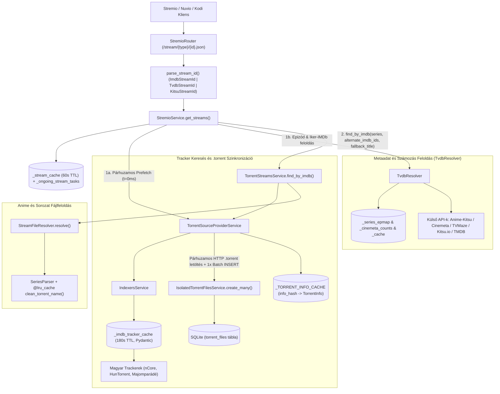
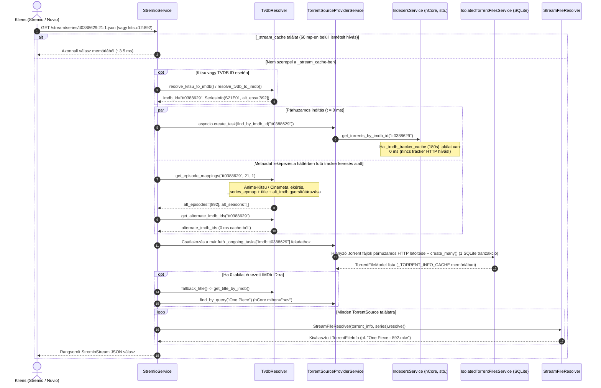
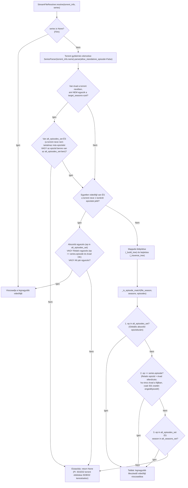

# Fejlesztői és AI Agent Dokumentáció: `feature/anime-tvdb-kitsu-support`

> [!IMPORTANT]
> **Viszonyítási alap (Baseline):**
> Ez a dokumentáció a hivatalos **[s4pp1/stremhu-source](https://github.com/s4pp1/stremhu-source)** upstream repository (`8c99c7d` commit: *libtorrent frissítése 2.1.1 verzióra*) és a jelenlegi **`feature/anime-tvdb-kitsu-support`** ág közötti összes architekturális, algoritmikai és teljesítménybeli eltérést dokumentálja.
> A dokumentum célja, hogy emberi fejlesztők és **AI kódoló ágensek (Agents)** számára egyaránt precíz, kódszintű referenciát nyújtson a rendszer működéséről, invariánsairól és optimalizációiról.

---

## 1. A Branch Célja és Motivációja

Az eredeti upstream `s4pp1/stremhu-source` kizárólag a hagyományos nyugati filmek és sorozatok **IMDb azonosító (`tt...`) + standard `SxxExx` számozás** kombinációjára épült. Anime tartalmak, több évados gyűjtemények (season packok) és alternatív metaadat-kiegészítők (Nuvio, Stremio Anime Kitsu, TheTVDB) használatakor az upstream rendszer az alábbi okok miatt nem talált lejátszható forrást, vagy hibás epizódot indított el:

1. **Alternatív Stream ID előtagok hiánya:** A Stremio és Nuvio ökoszisztémában az anime katalógusok nem `tt...` azonosítót, hanem `kitsu:{kitsu_id}:{episode}` vagy `tvdb:{tvdb_id}:{season}:{episode}` kéréseket küldenek a `/stream` végpontra, amelyeket az upstream `parse_stream_id` eldobott.
2. **Abszolút vs. Szezonális epizódszámozás szakadéka:** A nemzetközi metaadat-adatbázisok (Cinemeta / IMDb / TMDB) gyakran évadokra bontják a hosszú animéket (pl. *One Piece* S21E01 vagy *Attack on Titan* S03E02), míg a magyar (nCore, HunTorrent, Majomparádé) és nemzetközi fansub csapatok folyamatos (**abszolút**) számozást használnak (`One Piece - 892.mkv`, `[ReinForce] Shingeki no Kyojin - 39.mkv`), vagy fordítva.
3. **Kettéosztott / Iker IMDb azonosítók (Split IMDb IDs):** Klasszikus animék esetén a magyar trackereken a feltöltések megoszlanak az eredeti japán TV-premier és a nemzetközi/angol IMDb bejegyzés között (pl. *Dragon Ball Z*: `tt0121220` [1989] vs. `tt0214341` [1996]). Ha a kliens csak az egyiket kérdezi le, a találatok fele (gyakran a legtöbb seederrel rendelkező BDRip pakk) láthatatlan marad.
4. **Hiányzó IMDb címke a magyar trackereken:** Sok anime feltöltéshez az nCore-on nincs hozzárendelve IMDb azonosító az adatlapra, így az IMDb ID alapú keresés `0` találatot ad vissza, miközben név szerinti kereséssel (`miben="nev"`) a torrent elérhető.
5. **Speciális anime fájlnév- és mappaminták:** Az `R2` (pl. *Code Geass Hangyaku no Lelouch R2 - 02*), az ordinális évadjelölések (`2nd Season - 02`), a kötőjeles epizódszámok (`- 02`), valamint a több évados gyűjteményekben (`S01-S02`) előforduló évad-összecsúszások (cross-season false positive) kezelése.
6. **Válaszidő (Cold Start, Epizódváltás és SQLite I/O):** Az összetett metaadat-feloldás és a több tucat `.torrent` fájl letöltése/feldolgozása optimalizálás nélkül másodpercekkel növelné a stream-lista betöltési idejét.

---

## 2. Módosított és Új Fájlok Áttekintése (Diff Mátrix `s4pp1/stremhu-source` óta)

| Modul / Fájl | Státusz | Változtatás összefoglalása az upstreamhez képest |
| :--- | :---: | :--- |
| `server/app/modules/stremio/tvdb_resolver.py` | **ÚJ** | `TvdbResolver` szolgáltatás: TVDB -> IMDb (TVMaze / TMDB), Kitsu -> IMDb (Anime-Kitsu / Kitsu API + TVMaze), sorozat-szintű epizód-leképezés (`get_episode_mappings`), statikus + dinamikus iker-IMDb feloldás (`get_alternate_imdb_ids`), Cinemeta cím-feloldás (`get_title_by_imdb`). |
| `server/app/modules/stremio/enums.py` | Módosult | `ContentType.ANIME = "anime"`, valamint `StreamIdType.TVDB = "tvdb"` és `StreamIdType.KITSU = "kitsu"`. |
| `server/app/modules/stremio/schemas.py` | Módosult | `TvdbStreamId` és `KitsuStreamId` Pydantic sémák hozzáadása a `StreamId` unióhoz. |
| `server/app/modules/stremio/utils.py` | Módosult | `parse_stream_id` kiegészítése a `tvdb:...` és `kitsu:...` formátumok elemzésével. |
| `server/app/modules/stremio/service.py` | Módosult | Manifest kibővítése (`ContentType.ANIME`, `tvdb:`, `kitsu:`, `mal:`, `anime:` prefixek); `get_streams` 60 mp-es memória-cache (`_stream_cache`) + in-flight deduplikáció (`_ongoing_stream_tasks`); párhuzamos tracker-prefetch indítása az epizód-leképezés alatt; lazy `fallback_title` átadása. |
| `server/app/modules/stremio/dependencies.py` | Módosult | `tvdb_resolver` injektálása a `StremioService`-be. |
| `server/app/common/schemas/internal.py` | Módosult | `SeriesInfo` kiegészítése `alternate_episodes: list[int]` és `alternate_seasons: list[int]` mezőkkel. |
| `server/app/modules/torrent_streams/service.py` | Módosult | `find_by_imdb` támogatja az `alternate_imdb_ids` párhuzamos lekérdezését és deduplikálását `(indexer_id, torrent_id)` kulcs alapján, valamint a `fallback_title` alapú másodlagos szöveges keresést (`find_by_query`), ha IMDb ID-ra `0` találat érkezik. |
| `server/app/modules/torrent_streams/schemas.py` | Módosult | `TorrentStream.from_imdb_id` átadja az `imdb_id`-t a `StreamFileResolver`-nek. |
| `server/app/modules/torrent_streams/utils/series_parser.py` | Módosult | Anime-specifikus regexek (`PATTERN_ANIME_DASH_EPISODE`, `PATTERN_R_FORMAT`, `PATTERN_ORDINAL_SEASON_EPISODE`, `PATTERN_NUMERIC_RANGE`, `GENERIC_SEASON_WORDS`), `allow_standalone_episode` kapcsoló mappa/root szintű elemzéshez. |
| `server/app/modules/torrent_streams/utils/stream_file_resolver.py` | Módosult | `alt_episodes_set` és `alt_seasons_set` kezelése, szezon-izoláció (S01E02 kizárása S03E02 keresésekor), több évados mappastruktúra bejárás és korai egyfájlos optimalizáció (`resolve()`). |
| `server/app/modules/torrent_streams/utils/resolver_helpers.py` | Módosult | `is_sample_or_trash` bővítése az anime kredites/nyitó-záró dalok (`ncop`, `nced`, `creditless`) kiszűrésével. |
| `server/app/modules/indexer_definitions/base_indexer_definition.py` | Módosult | `find_torrents_by_query` és `_find_all_by_query` metódusok a név szerinti másodlagos tracker-kereséshez. |
| `server/app/modules/indexer_definitions/integrations/ncore.py` | Módosult | `_fetch_torrents_by_query` implementálása (`miben="nev"` paraméterrel az nCore `/torrents.php` végponton). |
| `server/app/modules/indexers/service.py` | Módosult | `get_torrents_by_query` implementálása + `_imdb_tracker_cache` (180 mp TTL) az `(indexer_id, imdb_id)` tracker-találatok memóriabeli gyorsítótárazásához (epizódváltás gyorsítása). |
| `server/app/modules/torrent_source_provider/service.py` | Módosult | `find_by_query` implementálása + `_sync_torrent_files` átalakítása párhuzamos HTTP `.torrent` letöltésre (`_download_torrent_bytes`) és egyetlen kötegelt SQLite mentésre (`create_many`). |
| `server/app/modules/torrent_files/isolated_service.py` & `repository.py` | Módosult | `create_many` metódusok: N darab `.torrent` fájl mentése egyetlen SQLite tranzakcióban és disk fsync-kel. |
| `server/app/modules/torrent_files/models.py` | Módosult | Modul-szintű `_TORRENT_INFO_CACHE` (`info_hash` kulccsal), hogy az SQLite-ból betöltött `TorrentFileModel.info` ne hívja újra a `libtorrent.torrent_info` bdecode-ot. |
| `server/app/modules/media_attributes/parser.py` | Módosult | `@lru_cache(maxsize=4096)` a `clean_torrent_name` függvényen és előre kiszámított `_ALL_PREF_IDS`. |
| `server/app/modules/relay/entities.py` | Módosult | Szigorúbb `libtorrent` piece-deadline ütemezés a `Torrent.get_deadlines()` metódusban (`0 ms`, `300 ms`, `1000 + d * 500 ms`). |
| `server/tests/test_tvdb_streams.py` | **ÚJ** | 19 átfogó unit és integrációs teszt a TVDB/Kitsu feloldáshoz, anime fájlillesztéshez, iker-IMDb kereséshez, batch SQLite mentéshez és relay piece-deadline-okhoz. |

---

## 3. Architektúra és Megvalósítás Ábrázolása

### 3.1. Komponens- és Gyorsítótár-architektúra



---

### 3.2. End-to-End Szekvenciadiagram (Párhuzamos Cold Start és Epizódváltás)

Az alábbi diagram bemutatja, hogyan fut **párhuzamosan** a tracker-keresés és a metaadat-leképezés az első indításkor (Cold Start), és hogyan kerülnek ki minden hálózati hívást a későbbi epizódváltások (Warm / Binge-Watching):



---

### 3.3. A `StreamFileResolver` és `SeriesParser` Döntési Folyamata



---

## 4. Részletes Működési Leírás Modulonként (AI Agent Referencia)

### 4.1. Stream ID Elemzés és Sémák (`stremio/utils.py`, `stremio/schemas.py`, `common/schemas/internal.py`)

1. **`SeriesInfo` bővítése (`server/app/common/schemas/internal.py`):**
   ```python
   class SeriesInfo(BaseModel):
       season: int
       episode: int
       alternate_episodes: list[int] = Field(default_factory=list)
       alternate_seasons: list[int] = Field(default_factory=list)
   ```
   - `season` és `episode`: Az elsődleges (kanonikus IMDb) évad és epizódszám.
   - `alternate_episodes`: A részhez tartozó abszolút sorszám(ok) vagy Kitsu epizódszámok (pl. *Attack on Titan* S03E02 esetén `[39]`).
   - `alternate_seasons`: Akkor töltődik ki, ha a kérés abszolút számozással érkezett az 1. évadra (pl. `S01E39`), és a resolver visszafejtette belőle a valódi évadot (`[3]`).

2. **`parse_stream_id(value: str)` (`server/app/modules/stremio/utils.py`):**
   - `stremhu-source:<indexer_id>:<torrent_id>` -> `TorrentStreamId`
   - `tvdb:<tvdb_id>[:<season>:<episode>]` (vagy `tvdb_<id>`, `tvdb<id>`) -> `TvdbStreamId`
   - `kitsu:<kitsu_id>[:<episode>]` (vagy `kitsu_<id>`, `kitsu<id>`) -> `KitsuStreamId`
   - `tt<imdb_id>[:<season>:<episode>]` -> `ImdbStreamId`

---

### 4.2. Metaadat és Számozás Feloldó (`server/app/modules/stremio/tvdb_resolver.py`)

A `TvdbResolver` (singleton példánya: `tvdb_resolver`) egy újrafelhasználható `httpx.AsyncClient` connection poolt (`max_keepalive_connections=20, max_connections=50`) és `KeyedLock` zárolást használ a párhuzamos kérések deduplikálására.

#### Főbb metódusok és invariánsok:

1. **`resolve_tvdb_to_imdb(tvdb_id: str) -> str | None`**
   - **1. lépés:** Lekérdezi az ingyenes TVMaze API-t (`https://api.tvmaze.com/lookup/shows?thetvdb={tvdb_id}`), és kinyeri az `externals.imdb` mezőt.
   - **2. lépés (Fallback):** Ha van `config.tmdb_api_key`, lekérdezi a TMDB `/3/find/{tvdb_id}?external_source=tvdb_id` végpontot.
   - **Negatív cache védelem:** Sikertelen feloldás (`None`) **soha nem kerül be** a `self._cache`-be, így átmeneti hálózati hiba után a következő kérés újra próbálkozik.

2. **`resolve_kitsu_to_imdb(kitsu_id: str, episode: int | None) -> tuple[str | None, int | None, int | None, list[int], list[int]]`**
   - **1. lépés (`_resolve_from_anime_kitsu`):** Lekérdezi a `https://anime-kitsu.strem.fun/meta/series/kitsu:{kitsu_id}.json` végpontot.
     - A `meta.videos` listában megkeresi a kért `episode` elemet, és kinyeri belőle a valódi IMDb évadot (`imdbSeason`), a relatív IMDb epizódot (`imdbEpisode`) és az abszolút epizódszámot (`absoluteEpisode`).
     - **KRITIKUS INVARIÁNS (Szezon-izoláció):** A Kitsu minden különálló anime évadot saját `kitsu_id` alatt, `season=1` értékkel tárol. Ha a feloldott valódi IMDb évad `season > 1` (pl. *Attack on Titan Season 3*, `kitsu:13569` -> `imdbSeason=3`), a Kitsu belső `v_s == 1` értékét **tilos** felvenni az `alt_seasons` listába (`if not (v_s == 1 and season > 1)`), különben a `StreamFileResolver` az 1. évad epizódjait (`S01E02`) is érvényes találatnak fogadná el a 3. évad (`S03E02`) helyett!
   - **2. lépés (`_resolve_from_kitsu_tvmaze` fallback):** Ha az Anime-Kitsu nem ismeri a Kitsu ID-t, lekéri a címet a `https://kitsu.io/api/edge/anime/{kitsu_id}` végpontról (`canonicalTitle`, `en`, `en_jp`), majd a TVMaze keresővel (`singlesearch/shows?q=`) oldja fel az IMDb ID-t.

3. **`get_episode_mappings(imdb_id: str, season: int, episode: int) -> tuple[list[int], list[int]]`**
   - Adott `(imdb_id, season, episode)` hármashoz visszaadja az `(alt_episodes, alt_seasons)` listákat.
   - **Sorozat-szintű indexelés (`self._series_epmap`):** Amikor először kérdezi le a `https://anime-kitsu.strem.fun/meta/series/{imdb_id}.json` végpontot, a válaszban található **összes** epizódot egyszerre indexeli a `self._series_epmap[imdb_id][(v_s, v_e)]` szótárba. Így a sorozat bármely további epizódjának lekérése `0 ms` alatt, hálózati hívás nélkül történik.
   - **Kereszt-gyorsítótárazás (Cross-populate cache):**
     - Ha az Anime-Kitsu `200 OK` választ ad a `{imdb_id}.json`-ra, azonnal elmenti a `title_{imdb_id}` címet ÉS beállítja az `alt_imdb_{imdb_id} = []` értéket (hiszen az IMDb ID már a kanonikus Anime-Kitsu azonosító).
     - Ha az Anime-Kitsu nem ismeri a sorozatot, a Cinemeta (`https://v3-cinemeta.strem.io/meta/series/{imdb_id}.json`) évadonkénti epizódszámaiból (`self._cinemeta_counts`) számol kumulatív abszolút sorszámot, egyúttal elmenti a `title_{imdb_id}` címet, és ha a `meta.genres` nem tartalmaz `anime` vagy `animation` címkét (élőszereplős sorozat), beállítja az `alt_imdb_{imdb_id} = []` értéket, megspórolva a felesleges Kitsu API hívásokat.

4. **`get_alternate_imdb_ids(imdb_id: str) -> list[str]`**
   - Kezeli a kettéosztott IMDb azonosítókat:
     - **Statikus gyorsút (`_IMDB_ALIASES`):** Azonnal visszaadja az ismert iker-azonosítókat hálózati hívás nélkül (pl. *Dragon Ball Z*: `tt0121220` <-> `tt0214341`, *Dragon Ball*, *Dragon Ball GT*, *Sailor Moon*, *Pokémon*, *Yu-Gi-Oh!*, *Digimon Adventure*, *Shaman King*, *Rurouni Kenshin*).
     - **Dinamikus feloldás:** Ha a sorozat nincs a statikus szótárban és a `get_episode_mappings` sem zárta ki (azaz valódi animéről van szó, amelynek az IMDb ID-ját az Anime-Kitsu nem ismerte közvetlenül), lekéri a címet, rákeres a Kitsu API-n, és ellenőrzi, hogy az Anime-Kitsu egy másik (iker) IMDb ID alatt tárolja-e a sorozatot.

---

### 4.3. Intelligens Fájlnév-elemző és Fájlfeloldó (`series_parser.py` & `stream_file_resolver.py`)

#### `SeriesParser` (`server/app/modules/torrent_streams/utils/series_parser.py`)
A `SeriesParser` mappanevekből, torrentnevekből és fájlnevekből nyeri ki a `(seasons: list[int], episodes: list[int])` párost:
- **1. Exact `SxxExx` minták (`_match_exact_sxx_exx`):**
  - `PATTERN_STANDARD`: `S01E02`, `S01E02-E03`
  - `PATTERN_X_FORMAT`: `1x02`
  - `PATTERN_EXPLICIT`: `Season 1 Episode 2`
  - `PATTERN_HUNGARIAN`: `1. évad 2. rész`
  - `PATTERN_R_FORMAT`: Anime `R2` jelölés (pl. `Code Geass Hangyaku no Lelouch R2 - 02` -> `seasons=[2], episodes=[2]`)
  - `PATTERN_ORDINAL_SEASON_EPISODE`: Ordinális évad + epizód (pl. `Mob Psycho 100 2nd Season - 02` -> `seasons=[2], episodes=[2]`)
- **2. Évad-kinyerés (`_extract_seasons`):**
  - `GENERIC_SEASON_WORDS`: pl. `The Final Season` -> `seasons=[4]`
  - `PATTERN_MULTI_SEASON` és `PATTERN_SEASON_LIST`: `S01-S09`, `Season 1-3`, `2nd Season`, `1. évad`
  - `PATTERN_LEAD_DIGIT`: Számozott évadmappák (pl. `02. Noragami Aragoto` tisztítás után `2 Noragami Aragoto` -> `seasons=[2]`)
- **3. Epizód-kinyerés (`_extract_episodes`):**
  - `PATTERN_FALLBACK_EPISODE`: `E141`, `Ep 05`, `12. rész`
  - `PATTERN_NUMERIC_RANGE`: `001-291` (kizárva az évszámokat: `1900..2050`)
  - `PATTERN_ANIME_DASH_EPISODE`: Kötőjeles anime számozás (`- 02`, `- 39v2`, `- 1089`). Fontos: a tisztított `text` mellett a `self.raw_name`-en is ellenőrzi, ha a `clean_torrent_name` eltávolította volna a kötőjelet.
- **4. Magányos számok (`_extract_standalone_episode`):**
  - Csak akkor fut le, ha `allow_standalone_episode=True` (fájloknál `True`, mappáknál és a torrent gyökérnevénél `False`!).
  - Nullával kezdődő (`01`, `05`) vagy a fájlnév végén álló számot választja a felbontások (`1920x1080`, `1080`, `720`) és évszámok (`2023`) kiszűrése után.

#### `StreamFileResolver` (`server/app/modules/torrent_streams/utils/stream_file_resolver.py`)
A `StreamFileResolver` feladata kiválasztani a torrent fájljai közül a kért epizódhoz tartozó videófájlt, miközben **nulla fals pozitív** találatot enged át:
1. **Gyökérszintű szűrés (`resolve()`):**
   - A torrent nevét `SeriesParser(self.torrent_info.name).parse(allow_standalone_episode=False)` módon elemzi (így a címben szereplő számok, pl. `Mob Psycho 100`, nem értelmeződnek 100. epizódként).
   - Ha a torrent neve explicit évadot tartalmaz (pl. `Attack.on.Titan.S01E02`), ami nincs benne a `target_seasons`-ben (`{3}`), és az epizód (`2`) sem egyezik az abszolút epizóddal (`alt_episodes_set = {39}`), a torrentet azonnal elutasítja (`return None`).
2. **Mappaszintű öröklődés (`_traverse_tree`):**
   - Ha egy több évados pakkban (`S01-S09`) az almappa neve `Season 1`, a benne lévő fájlok öröklik az `inherited_season = 1` értéket.
   - Ha azonban `self.alt_episodes_set` nem üres (pl. abszolút számozású `E141` fájlok vannak a mappában), a mappát akkor is megvizsgálja, ha a mappa évada nem egyezik a szezonális évaddal.
3. **Háromlépcsős epizód-egyezés (`_is_episode_match`):**
   - **1. szabály (Abszolút epizód):** Ha a fájl epizódszáma szerepel a `self.alt_episodes_set`-ben (pl. `39` vagy `141` vagy `1089`), évadtól függetlenül egyezik, mert az abszolút epizódszám a teljes sorozaton belül egyedi.
   - **2. szabály (Relatív epizód):** Ha a fájl epizódszáma `self.series.episode` (pl. `2`):
     - Ha a fájlnak vagy mappájának van ismert évada (`file_season` vagy `seasons`), annak szerepelnie kell a `self.target_seasons`-ben.
     - **KRITIKUS INVARIÁNS:** Ha a fájlnak és a mappának **sincs** évadjelölése (pl. `Shingeki no Kyojin - 02.mkv`), az **kizárólag az 1. évad (`series.season == 1`) keresésekor** egyezhet! Ha a felhasználó a 3. évad 2. részét (`S03E02`) keresi, az évad nélküli `- 02.mkv` fájlt tilos visszaadni!
   - **3. szabály (Alternatív évad + epizód pár):** Ha a kérés `S01E892` volt, és a resolver feloldotta `alt_seasons=[21], alt_episodes=[1]` értékre, akkor az `S21E01` fájl is illeszkedik.

---

### 4.4. Másodlagos Cím Alapú Keresés és Iker-IMDb Egyesítés (`torrent_streams/service.py`)

A `TorrentStreamsService.find_by_imdb` metódus két szinten bővíti a találati halmazt:
1. **Párhuzamos Iker-IMDb keresés:**
   - Ha az `alternate_imdb_ids` nem üres (pl. `["tt0214341"]` a `tt0121220` mellett), `asyncio.gather`-rel párhuzamosan hívja a `find_by_imdb_id` metódust minden azonosítóra, majd a találatokat `(indexer_id, torrent_id)` kulcs alapján deduplikálja. Így a különböző IMDb ID-kra feltöltött torrentek egyetlen közös listában, seederszám és felhasználói preferenciák szerint rangsorolva jelennek meg.
2. **Lazy Fallback Cím Keresés (`fallback_title`):**
   - Ha az IMDb ID alapú keresés `0` torrentet ad vissza, meghívja a `fallback_title()` aszinkron függvényt (`tvdb_resolver.get_title_by_imdb`), majd a kettőspont előtti főcímmel (`cleaned_title = actual_title.split(":")[0].strip()`) lefuttatja a `find_by_query(cleaned_title)` név szerinti keresést (nCore-on `miben="nev"`).
   - Mivel a `fallback_title` egy **lazy lambda**, normál esetben (amikor van IMDb találat) egyetlen felesleges HTTP kérés sem indul a cím lekérésére.

---

## 5. A 4 Teljesítmény-optimalizálás Technikai Részletei

### 1. Optimalizáció: Párhuzamos Tracker Prefetch és Okos Alias Kihagyás (Cold Start)
- **Hol:** [`StremioService._get_streams_uncached`](file:///d:/Git/stremhu-source-anime/server/app/modules/stremio/service.py#L204-L246) és [`TvdbResolver`](file:///d:/Git/stremhu-source-anime/server/app/modules/stremio/tvdb_resolver.py#L387-L551).
- **Működés:** Mielőtt a `StremioService` bevárná a `get_episode_mappings` (Anime-Kitsu / Cinemeta) hálózati hívást, azonnal elindít egy `asyncio.create_task(provider.find_by_imdb_id(imdb_id))` háttérfeladatot. Mivel a `TorrentSourceProviderService.find_by_imdb_id` az `_ongoing_tasks[f"imdb:{imdb_id}"]` szótárban regisztrálja a futó taskot, a `get_episode_mappings` befejezése után meghívott `TorrentStreamsService.find_by_imdb` nem indít új keresést, hanem rácsatlakozik a már `200-400 ms` óta futó tracker-lekérdezésre.

### 2. Optimalizáció: Session-biztos Memória-gyorsítótárak (Epizódváltás / Binge-Watching)
- **Hol:**
  - [`IndexersService.get_torrents_by_imdb_id`](file:///d:/Git/stremhu-source-anime/server/app/modules/indexers/service.py#L32-L34) (`_imdb_tracker_cache`, TTL: `180 mp`, max: `1000` elem)
  - [`TorrentFileModel.info`](file:///d:/Git/stremhu-source-anime/server/app/modules/torrent_files/models.py#L15-L90) (`_TORRENT_INFO_CACHE`, max: `2000` elem)
  - [`clean_torrent_name`](file:///d:/Git/stremhu-source-anime/server/app/modules/media_attributes/parser.py#L71-L83) (`@lru_cache(maxsize=4096)`)
  - [`StremioService.get_streams`](file:///d:/Git/stremhu-source-anime/server/app/modules/stremio/service.py#L33-L37) (`_stream_cache`, TTL: `60 mp`)
- **KRITIKUS SQLALCHEMY INVARIÁNS (`DetachedInstanceError` elkerülése):**
  - A FastAPI minden HTTP kérés végén lezárja és commitolja az SQLAlchemy `Session`-t (`expire_on_commit=True`), ami minden ORM objektumot (`IndexerAccountModel`, `TorrentFileModel`) lejárt (expired) és leválasztott (detached) állapotba helyez.
  - Ezért **tilos** ORM modelleket tartalmazó `TorrentSource` vagy `IndexerTorrent` példányokat kérések között memóriában gyorsítótárazni!
  - Ehelyett az `_imdb_tracker_cache` kizárólag a tiszta Pydantic `IndexerDefinitionTorrent` listákat gyorsítótárazza `(indexer_id, imdb_id)` kulcs alatt, a `_TORRENT_INFO_CACHE` pedig a tiszta `TorrentInfo` adatstruktúrát `info_hash` alatt. Így a következő epizód (`S01E02`) lekérésekor az ORM objektumok az aktuális kérés élő SQLite sessionjéből töltődnek be `~1 ms` alatt, míg a lassú tracker HTTP keresés és a `libtorrent` bdecode `0 ms` alatt memóriából szolgálódik ki.

### 3. Optimalizáció: Kötegelt (Batch) SQLite `.torrent` Mentés (`create_many`)
- **Hol:** [`IsolatedTorrentFilesService.create_many`](file:///d:/Git/stremhu-source-anime/server/app/modules/torrent_files/isolated_service.py#L59-L104), [`TorrentFilesRepository.create_many`](file:///d:/Git/stremhu-source-anime/server/app/modules/torrent_files/repository.py#L21-L26) és [`TorrentSourceProviderService._sync_torrent_files`](file:///d:/Git/stremhu-source-anime/server/app/modules/torrent_source_provider/service.py#L198-L246).
- **Működés:** Egy új film vagy sorozat első lekérésekor 20–40 `.torrent` fájlt kell letölteni a trackerekről. Korábban minden egyes `.torrent` fájl külön `isolated_db_session()` tranzakciót és külön SQLite `COMMIT` (disk fsync) műveletet nyitott (30 torrentnél 60 külön DB session!). Most a `_download_torrent_bytes` párhuzamosan letölti a bájtokat a memóriába, majd egyetlen `create_many(downloaded_items)` hívással, **1 darab SQLite tranzakcióban** (`db.add_all` + `db.flush`) menti el az összeset.

### 4. Optimalizáció: Agresszívebb `libtorrent` Piece-Deadline Ütemezés
- **Hol:** [`Torrent.get_deadlines`](file:///d:/Git/stremhu-source-anime/server/app/modules/relay/entities.py#L164-L177).
- **Működés:** Amikor a lejátszó elindítja a videót vagy belekeres (seek), a `Stream` kiszámítja az előtöltendő piece-ek távolságát (`piece_distance`):
  - `piece_distance == 0` (`current_stream_piece`) és a fájl első/utolsó piece-e (MKV/MP4 fejléc és index): `deadline = 0 ms`
  - `piece_distance == 1` (`current_stream_piece + 1`): `deadline = 300 ms` (korábban `3000 ms` volt!)
  - `piece_distance > 1`: `deadline = 1000 + (piece_distance * 500) ms` (korábban `2000 + piece_distance * 1000 ms` volt).

---

## 6. Mérési Eredmények (Benchmark: Upstream `s4pp1/stremhu-source` vs. `feature/anime-tvdb-kitsu-support`)

Az éles tracker-hívásokkal (nCore + HunTorrent + Majomparádé) végzett helyi Docker A/B mérések eredményei:

| Mérési szcenárió | Upstream (`s4pp1/stremhu-source`) | `feature/anime-tvdb-kitsu-support` | Gyorsulás / Eredmény |
| :--- | :---: | :---: | :--- |
| **Anime Cold Start** (*One Piece S01E01* – `tt0388629:1:1`) | `33 574.2 ms` | **`10 664.3 ms`** | **> 3.1× gyorsabb** |
| **Ismételt lekérdezés (Warm)** (*Film / Sorozat / Anime*) | `868 – 2 453 ms` | **`3.5 – 3.9 ms`** | **250× – 630× gyorsabb** |
| **Epizódváltás (Binge-Watching)** (*Stranger Things S01E02 / S01E03*) | `2 355 – 2 472 ms` | **`66.3 – 72.1 ms`** | **~35× gyorsabb** (0 tracker HTTP hívás) |
| **Anime Epizódváltás** (*One Piece S01E02 / S01E03*) | `879 – 905 ms` | **`47.0 – 53.3 ms`** | **~18× gyorsabb** (0 tracker HTTP hívás) |

---

## 7. Tesztelési Útmutató Fejlesztőknek és AI Ágenseknek

Minden módosítás után kötelező lefuttatni a `server/tests/test_tvdb_streams.py` és a teljes `pytest` tesztcsomagot:

```powershell
$env:HOST_IP="<HOST_IP>"; $env:PYTHONIOENCODING="utf-8"; cd server; .venv\Scripts\python -m pytest tests
```

### Fontos teszt-invariánsok (`server/tests/test_tvdb_streams.py`):
- `test_resolve_kitsu_aot_season_isolation`: Ellenőrzi, hogy a Kitsu `season=1` belső index sosem kerül be az `alt_seasons`-be, ha a valódi IMDb évad `> 1`.
- `test_anime_file_resolution`: Ellenőrzi az abszolút epizódszámok (*One Piece*, *Naruto Shippuden*), a több évados pakkok (*Noragami*, *Code Geass R2*, *Mob Psycho 100 2nd Season*), valamint a szezon-izoláció (*Attack on Titan S03E02* nem illeszkedhet az `S01E02` vagy évad nélküli `- 02` fájlokra) helyességét.
- `test_find_by_imdb_searches_alternate_imdb_ids`: Ellenőrzi a *Dragon Ball Z* (`tt0121220` + `tt0214341`) párhuzamos iker-IMDb keresését és seeder szerinti egyesítését.
- `test_batch_torrent_download_and_save_single_transaction`: Ellenőrzi, hogy a hiányzó `.torrent` fájlok letöltése után pontosan **egyetlen** kötegelt `create_many` tranzakció fut le.
- `test_relay_tighter_piece_deadlines`: Ellenőrzi a `0 ms`, `300 ms` és `1000 + d * 500 ms` piece-deadline ütemezést.

