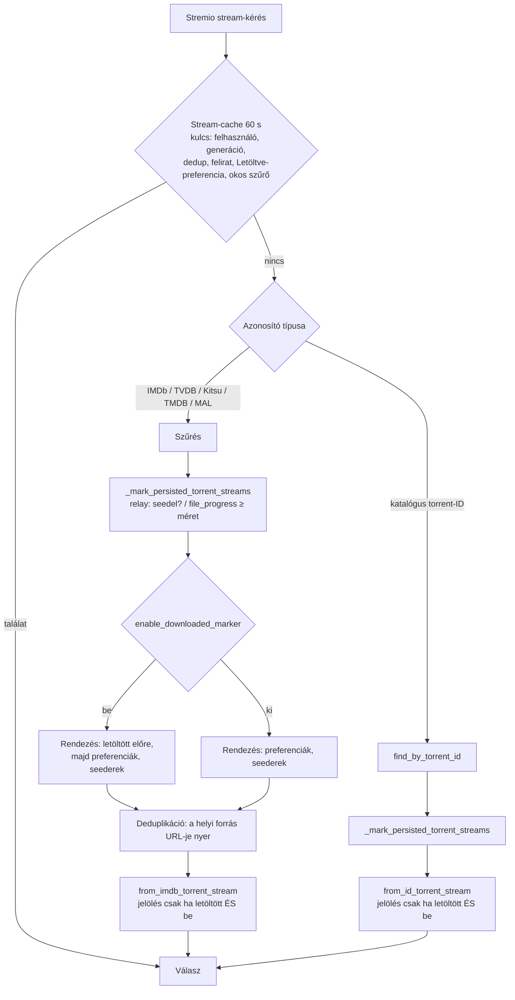

# Fejlesztői Dokumentáció: `feature/downloaded-marker`

> **Típus / státusz:** fejlesztői referencia, implementált, beolvasztásra vár (a `main` még nem tartalmazza).
> **Hatókör:** a Stremio-találatlista „⚡ Letöltve” jelölőjének ellenőrzése, a katalógusútvonal pótlása és a jelölő felhasználói preferenciává tétele.
> **Alap:** `main` `2615596`. **Viszonyítási alap (upstream):** [`s4pp1/stremhu-source`](https://github.com/s4pp1/stremhu-source) `8c99c7d`, helyben elérhető.

---

## 1. Cél

A találatlista jelzi, mely fájlok vannak már helyben letöltve (azonnali lejátszás). A feladat kettős volt:

1. Ellenőrizni, hogy a jelölő helyesen működik-e.
2. Választható preferenciává tenni a webes felületen.

## 2. Ellenőrzés a `main` ágon (a változtatás előtt)

Az ellenőrzés valódi `RelayService`-szel és libtorrent-handle csonkokkal futott, a `main` kódján.

| Eset | Eredmény a `main`-en |
|---|---|
| Évadcsomag, 1. rész kész, 2. félig, 3. el sem kezdődött | ✅ csak az 1. rész kap jelölést |
| Seedelő (teljesen kész) torrent | ✅ minden fájlja jelölést kap |
| A letöltött fájl kevesebb seederrel | ✅ a lista elejére kerül |
| A torrent nincs a relayben / érvénytelen handle / a libtorrent-lekérdezés hibát dob | ✅ nincs jelölés, nincs összeomlás |
| Több trackeren azonos kiadás (deduplikáció) | ✅ a jelölés és a helyi forrás lejátszási URL-je megmarad (meglévő teszt) |
| **Katalógusból megnyitott torrent fájllistája** (`stremhu-source:{indexer}:{torrent}`) | ❌ a letöltött állapot nem számolódott ki, a jelölés sosem jelent meg |
| **A letöltés befejezése vagy a torrent törlése után** | ⚠️ a 60 s-os stream-cache miatt legfeljebb 60 s-ig a régi állapot látszik (korlát, lásd lent) |
| Ki/bekapcsolhatóság | ❌ nem volt beállítás |

## 3. Diffmátrix

| Terület | Upstream `8c99c7d` | `main` (fork) | `feature/downloaded-marker` |
|---|---|---|---|
| Állapot forrása | a torrent szerepel-e az aktív relaytorrentek között (torrentszintű, a félig letöltött is „kész”) | fájlszintű: seedelés vagy `file_progress` ≥ fájlméret | változatlan (`_mark_persisted_torrent_streams` metódusba emelve) |
| Jelölés a névben / leírásban | `⭐` | `⚡ Letöltve` + „⚡ Helyben tárolva (Azonnali lejátszás)” | változatlan szöveg, de csak bekapcsolt preferenciánál |
| Előresorolás | mindig | mindig | csak bekapcsolt preferenciánál |
| Katalógus-torrent fájllistája | nincs jelölés | nincs jelölés | jelölés a fájlszintű állapot szerint |
| Felhasználói beállítás | nincs | nincs | `enable_downloaded_marker` (alapértelmezés: be), UI-kapcsoló |
| Stream-cache kulcs | – | dedup, felirat, okos szűrő | + `enable_downloaded_marker` |

## 4. Működés

**Kritikus invariánsok:**

- **Alapértelmezett viselkedés:** az alapértelmezés bekapcsolt (modell, Pydantic és migráció `server_default 1`), így a meglévő és az új felhasználóknál a viselkedés a `main`-ével azonos.
- **A tényleges állapot kikapcsolt preferenciánál is kiszámolódik.** A deduplikáció ezért továbbra is a helyben meglévő forrás lejátszási URL-jét választja; a preferencia csak a jelölést és az előresorolást kapcsolja.
- **Fájlszintű állapot:** évadcsomagnál csak a ténylegesen kész epizód kap jelölést. Hiányzó, érvénytelen vagy hibát dobó relay-állapot „nem letöltött”.
- **Cache:** a preferencia a cache-kulcs része, így átkapcsolás után nem a régi lista jön vissza.

## 5. Érintett modulok

| Réteg | Fájl | Változás |
|---|---|---|
| Adatmodell | `server/app/modules/users/models.py`, `server/alembic/versions/a7c41e9b2d10_add_enable_downloaded_marker_to_users.py` | `enable_downloaded_marker` oszlop, `server_default 1` |
| API-sémák | `users/schemas/internal.py`, `users/schemas/api.py`, `me/schemas/api.py`, `users/service.py` | létrehozás, frissítés, válasz (`enableDownloadedMarker`) |
| Állapot és rendezés | `server/app/modules/torrent_streams/service.py` | `_mark_persisted_torrent_streams`, preferenciafüggő előresorolás, katalógusútvonal |
| Megjelenítés és cache | `server/app/modules/stremio/schemas.py`, `server/app/modules/stremio/service.py` | `show_downloaded_marker` paraméter, `DOWNLOADED_MARKER` / `DOWNLOADED_BANNER`, cache-kulcs |
| Kliens | `client/src/routes/_protected/settings/preferences/-features/other-preferences.tsx`, `client/src/shared/schemas.ts`, `client/src/shared/lib/source/source-client.ts` | „Letöltött találatok” kártya kapcsolóval (Beállítások → Preferenciák → További preferenciák) |

A `source-client.ts` orval-generált fájl. A szerver dev módú OpenAPI-specifikációjából generálva csak az `enableDownloadedMarker` négy sora került át. A teljes újragenerálás 159 sornyi, ettől független, már meglévő eltérést hozna (`anime` enum, feliratvégpontok, opcionalitás).

## 6. Teszt- és ellenőrzési bizonyíték

- **Backend:** új `server/tests/test_downloaded_marker.py` (13 teszt):
  - részleges évadcsomag és seedelő torrent;
  - hiányzó, érvénytelen és hibás relay-állapot;
  - kikapcsolt preferencia mellett a rendezés, miközben a valós állapot megmarad;
  - a két renderer jelölése be- és kikapcsolva;
  - a katalógusútvonal;
  - a cache-kulcs;
  - az API-sémák oda-vissza;
  - a migráció (meglévő sor értéke 1, visszaállítható);
  - egyetlen alembic-head.

  Eredmény: Ruff `All checks passed!`, basedpyright `0 errors`, pytest **269 passed / 64 snapshot** (a `main` alapja 256).
- **Frontend:** új `other-preferences.test.tsx`, vitest 2/2: a mentett érték megjelenik, kikapcsoláskor a mentés csak ezt a mezőt változtatja. `npm run lint`, `npm run format` és `npm run build` (benne `tsc`) sikeres. A helyi `client/node_modules` másik platformra van telepítve, ezért ezek a Dockerfile `node:24-bookworm-slim` build-környezetében futottak, a forrás másolatán.
- **Docker (offline, `--network none`, eldobható adat, `.env` és bootstrap nélkül):** 10/10.
  - A migrációk lefutnak, az új felhasználónál a beállítás alapból be van kapcsolva.
  - `PUT /api/me` ki- és visszakapcsol, az érték megmarad.
  - A manifest és a film-/sorozatkeresés kikapcsolt beállítással is 200.

## 7. Korlátok és kockázatok

- **Cache-késés:** a 60 s-os stream-cache nem érvénytelenedik, amikor egy letöltés befejeződik vagy egy torrent törlődik. A jelölés ezért legfeljebb 60 s-ig elavult lehet. Lejátszáskor ez nem okoz hibát.
- **Blokkoló hívások:** az állapotlekérés (`status()`, `file_progress()`) a libtorrent szinkron hívása az event loopon. Ez a `main` meglévő viselkedése: csak a relayben lévő torrentekre, info-hashenként egyszer fut.
- **Alembic-ütközés a `feature/stability-and-optimization` ággal (PR #9):** az is az `e72a1c3d4f5b`-re épít (`54a9d30f7c82` → `6f0d92b1c843`). Amelyik ág másodikként kerül a `main`-be, annál a `a7c41e9b2d10` `down_revision`-jét az akkori headre kell állítani. Ezt a `test_alembic_history_has_a_single_head` teszt jelzi.
- **Várható merge-ütközés ugyanazzal az ággal:** `torrent_streams/service.py` és `stremio/service.py` (más sorokat érintő változások).
- **Natív kliensek:** valódi Stremio/Nuvio klienssel és valódi letöltött torrenttel a jelölés nem lett végigpróbálva; az állapotot libtorrent-csonkok szolgáltatták.
