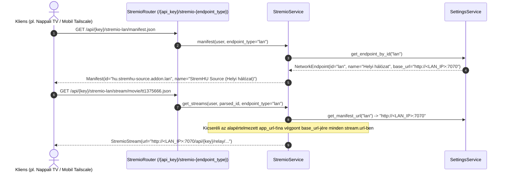

# Fejlesztői Dokumentáció: `feature/multi-manifest-endpoints`

> **Viszonyítási alap (Baseline):** Eredeti upstream [`s4pp1/stremhu-source`](https://github.com/s4pp1/stremhu-source) (`8c99c7d` commit).
> Ez a dokumentum a `feature/multi-manifest-endpoints` branch által bevezetett összes funkcionális és teljesítménybeli változtatást tartalmazza az eredeti `s4pp1/stremhu-source` állapothoz képest (beleértve a `main` ágból átvett anime feloldást és 4-pontos teljesítmény-optimalizálást is).

---

## 1. A Branch Célja és Motivációja

Az eredeti `s4pp1/stremhu-source` egyetlen globális szervercímet (`app_url`) használt minden Stremio, Nuvio és Kodi kliens kiszolgálásához. Ez a gyakorlatban feloldhatatlan kompromisszumot okozott:
1. **Ha a helyi LAN IP (`http://<LAN_IP>:7070`) volt beállítva:** Az otthoni okostévé gigabites sebességgel streamelt, de a lakáson kívülről (mobilneten, utazás közben) a szerver elérhetetlenné vált.
2. **Ha nyilvános domain vagy Cloudflare Tunnel volt beállítva:** Kívülről működött, de az otthoni TV is a külső proxyn és internetes feltöltési sávszélességen keresztül streamelt, ami 4K HDR tartalmaknál pufferelést és Cloudflare korlátozást okozott.
3. **Ha Tailscale / WireGuard VPN volt beállítva:** Saját mobiltelefonon és laptopon kiváló, de olyan eszközökön (pl. hotelszobai okostévé, vendégek eszközei), amelyekre nem telepíthető VPN kliens, nem használható.

A `feature/multi-manifest-endpoints` branch ezt oldja meg:
- **Dinamikus többvégpontos Stremio / Nuvio / Kodi router (`/{api_key}/stremio-{endpoint_id}/...`):** Egyetlen szerver egyszerre tudja kiszolgálni az alapértelmezett (Nyilvános), a Helyi (`lan`), a Tailscale (`tailscale`) és bármilyen egyedi (`custom`) hálózati végpontot.
- **Automatikus Stream és Felirat URL átírás (`endpoint_type` szerint):** A válaszban visszaadott `/relay/...` és `/subtitles/...` hivatkozások automatikusan annak a végpontnak a `base_url`-jére íródnak át, amelyik manifest végponton keresztül a kliens csatlakozott.
- **Automatikus hálózati interfész felderítés (`tailscale0`, `LAN_URL`, `TAILSCALE_URL`):** Linux `SIOCGIFADDR` ioctl hívással és környezeti változókból automatikusan felismeri a szerver helyi és Tailscale IP-címét.
- **Teljes körű Web UI végpontkezelő és gyorsválasztó:** A `/dashboard/system/network` oldalon dinamikusan szerkeszthetők, ki-/bekapcsolhatók és létrehozhatók a hálózati végpontok, a főoldalon és a felhasználói adatlapon pedig egyetlen legördülő menüvel választható ki, melyik hálózathoz generálja a telepítő linkeket.

---

## 2. Módosított és Új Fájlok Áttekintése (Diff Mátrix `s4pp1/stremhu-source` vs `feature/multi-manifest-endpoints`)

| Fájl elérési útja | Státusz | Változtatás összefoglalása |
| :--- | :---: | :--- |
| [`server/app/api.py`](file:///d:/Git/stremhu-source-anime/server/app/api.py) | **MÓDOSÍTOTT** | `/{api_key}/stremio` mellett a `/{api_key}/stremio-{endpoint_type}` dinamikus prefix regisztrációja. |
| [`server/app/config.py`](file:///d:/Git/stremhu-source-anime/server/app/config.py) | **MÓDOSÍTOTT** | `lan_url`, `tailscale_ip`, `tailscale_url`, `reverse_proxy_domain` környezeti változók támogatása. |
| [`server/app/modules/settings/enums.py`](file:///d:/Git/stremhu-source-anime/server/app/modules/settings/enums.py) | **MÓDOSÍTOTT** | `SettingKey.NETWORK_ENDPOINTS`, `LAN_URL`, `TAILSCALE_URL` kulcsok. |
| [`server/app/modules/settings/schemas/internal.py`](file:///d:/Git/stremhu-source-anime/server/app/modules/settings/schemas/internal.py) | **MÓDOSÍTOTT** | `NetworkEndpoint` séma (`id`, `name`, `base_url`, `enabled`, `is_builtin`). |
| [`server/app/modules/settings/schemas/api.py`](file:///d:/Git/stremhu-source-anime/server/app/modules/settings/schemas/api.py) | **MÓDOSÍTOTT** | API kérés/válasz sémák a hálózati végpontok lekérdezéséhez és mentéséhez. |
| [`server/app/modules/settings/service.py`](file:///d:/Git/stremhu-source-anime/server/app/modules/settings/service.py) | **MÓDOSÍTOTT** | `get_network_endpoints()`, `update_network_endpoints()`, `get_endpoint_by_id()`, `get_manifest_url()`, valamint `_detect_tailscale_ip()` automatikus interfész-felderítés. |
| [`server/app/modules/stremio/router.py`](file:///d:/Git/stremhu-source-anime/server/app/modules/stremio/router.py) | **MÓDOSÍTOTT** | `endpoint_type: str = "default"` paraméter továbbítása a `manifest.json`, `/stream/...` és `/subtitles/...` végpontokon. |
| [`server/app/modules/stremio/service.py`](file:///d:/Git/stremhu-source-anime/server/app/modules/stremio/service.py) | **MÓDOSÍTOTT** | Végpont-specifikus `addon_id` (`hu.stremhu-source.addon.{endpoint}`), `name` (`StremHU Source (LAN)`), `logo`, stream és felirat URL átírás; végpont-tudatos `_stream_cache` kulcs (`{user.id}:{endpoint_type}:{parsed_id}`). |
| [`server/app/modules/system/router.py`](file:///d:/Git/stremhu-source-anime/server/app/modules/system/router.py) | **MÓDOSÍTOTT** | `PUT /system/network-endpoints` végpont a hálózati végpontok adminisztrátori módosításához. |
| [`server/app/modules/system/service.py`](file:///d:/Git/stremhu-source-anime/server/app/modules/system/service.py) | **MÓDOSÍTOTT** | Rendszerállapot kiegészítése az aktív hálózati végpontokkal. |
| [`client/src/routes/_protected/dashboard/system/network/-features/manifest-settings-card.tsx`](file:///d:/Git/stremhu-source-anime/client/src/routes/_protected/dashboard/system/network/-features/manifest-settings-card.tsx) | **ÚJ** | React komponens a hálózati végpontok szerkesztéséhez, ki-/bekapcsolásához és új végpontok felvételéhez. |
| [`client/src/shared/hooks/use-integration-domain.ts`](file:///d:/Git/stremhu-source-anime/client/src/shared/hooks/use-integration-domain.ts) | **MÓDOSÍTOTT** | Végpontválasztó hook a Stremio, Nuvio és Kodi integrációs kártyákhoz. |
| [`server/tests/test_multi_manifest.py`](file:///d:/Git/stremhu-source-anime/server/tests/test_multi_manifest.py) | **ÚJ** | Unit tesztek a Default, LAN, Tailscale és egyedi manifest generálásra, valamint a stream URL átírásra. |

---

## 3. Architektúra és Működési Folyamatábrák

### 3.1. Végpont-specifikus Manifest és Stream URL Átírás Folyamata



---

## 4. Modulonkénti Részletes Működési Leírás (AI Agent Referencia)

### 4.1. Dinamikus Router Prefix (`server/app/api.py` & `server/app/modules/stremio/router.py`)
- Az `api_router` két útvonalon is beköti a `stremio_router`-t:
  1. `/{api_key}/stremio` (`endpoint_type="default"`)
  2. `/{api_key}/stremio-{endpoint_type}` (ahol az `endpoint_type` pl. `lan`, `tailscale` vagy egyedi azonosító).
- A Stremio kliens a manifest URL könyvtárához képest relatívan hívja meg a `/stream/{type}/{id}.json` végpontot, így ha a felhasználó a `/api/{key}/stremio-lan/manifest.json` linket telepíti, minden későbbi `/stream` kérés is automatikusan a `/api/{key}/stremio-lan/stream/...` útvonalra érkezik.

### 4.2. Egyedi Addon ID és Stream Cache Izoláció (`server/app/modules/stremio/service.py`)
- **Egyedi `addon_id`:** Ha `endpoint_type != "default"`, a manifest `id` mezője `hu.stremhu-source.addon.{endpoint_id}` (pl. `hu.stremhu-source.addon.lan`), a `name` pedig `StremHU Source ({ep.name})` lesz. Ez lehetővé teszi, hogy egyetlen Stremio fiókban akár egyszerre legyen telepítve a LAN és a Távoli addon anélkül, hogy felülírnák egymást.
- **Végpont-tudatos `_stream_cache`:** A memóriabeli stream gyorsítótár kulcsa tartalmazza a generációszámot, API-kulcsot és az `endpoint_type`-ot is (`f"{user.id}:{user_gen}:{api_key}:{endpoint_type}:..."`), így a `lan` és `default` végpontok átírt stream URL-jei soha nem keverednek össze.

### 4.3. Automatikus Hálózat-felderítés (`server/app/modules/settings/service.py`)
- **`_detect_tailscale_ip()`:** Linux konténerben `fcntl.ioctl` (`SIOCGIFADDR = 0x8915`) segítségével lekérdezi a `tailscale0` hálózati interfész IPv4 címét (ha a konténer `network_mode: host` módban fut vagy hozzáfér az interfészhez), illetve figyelembe veszi a `TAILSCALE_IP` / `TAILSCALE_URL` környezeti változókat.

---

## 5. Tesztelési és Ellenőrzési Referencia

```powershell
$env:HOST_IP="<HOST_IP>"; $env:PYTHONIOENCODING="utf-8"; cd server; .venv\Scripts\python -m ruff check .; .venv\Scripts\basedpyright.exe; .venv\Scripts\python -m pytest tests
```
- Unit tesztek száma ezen az ágon: **259 passed, 64 snapshots passed** (`test_multi_manifest.py`, `test_subtitles.py`, `test_tvdb_streams.py`, `test_stream_optimizations.py`, `test_audio_subtitle_detection.py` stb.).
