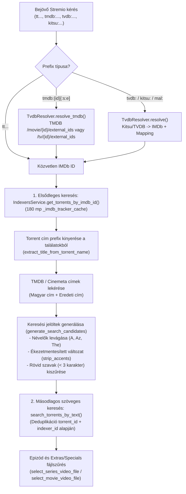

# Fejlesztői Dokumentáció: `feature/search-filter-tmdb-tvdb`

> **Viszonyítási alap (Baseline):** Eredeti upstream [`s4pp1/stremhu-source`](https://github.com/s4pp1/stremhu-source) (`8c99c7d` commit).
> Ez a dokumentum a `feature/search-filter-tmdb-tvdb` branch által bevezetett összes funkcionális és teljesítménybeli változtatást tartalmazza az eredeti `s4pp1/stremhu-source` állapothoz képest (beleértve a `main` ágból átvett anime feloldást és 4-pontos teljesítmény-optimalizálást is).

---

## 1. A Branch Célja és Motivációja

Az eredeti `s4pp1/stremhu-source` a következő korlátokkal rendelkezett a TMDB alapú Stremio katalógusok, a szöveges tracker-keresés és az epizódválasztás terén:

1. **TMDB Stream ID (`tmdb:{id}`) elutasítása:** A Stremio TheMovieDatabase Addon és a TMDB alapú katalógusok `tmdb:27205` (film) vagy `tmdb:1399:1:1` (sorozat) formátumú azonosítókat küldenek, amelyeket az eredeti rendszer elutasított.
2. **Hiányos tracker találatok (hiányzó IMDb ID címkézés a trackereken):** Sok régebbi vagy speciális magyar feltöltésnél a trackeren (nCore, Majomparádé) nincs kitöltve az IMDb azonosító, vagy az nCore API hibásan `imdb_id: False` (boolean) értéket ad vissza string helyett (`ValidationError`).
3. **Ékezetes és névelős címek keresési kudarca:** Ha a cinemeta / TMDB magyar címe ékezeteket vagy névelőt (*A*, *Az*, *The*) tartalmaz, a tracker szigorú szöveges keresője gyakran 0 találatot ad.
4. **Season Pack-ekben lévő Extrák / Menük / Special epizódok téves kiválasztása:** Az olyan fájlnevek, mint `S01E01 Extra`, `Menu`, `NCOP`, `OVA`, `OAD` vagy `Season 0` (Specials) gyakran hamis pozitív egyezést adtak a normál (`S >= 1`) epizódokra, vagy fordítva: a `Season 0` keresés normál évadok fájljait választotta ki.

A `feature/search-filter-tmdb-tvdb` branch ezeket oldja meg:
- **Natív `tmdb:{id}` és `tmdb:{id}:{s}:{e}` feloldás** a [`TvdbResolver.resolve_tmdb`](file:///d:/Git/stremhu-source-anime/server/app/modules/stremio/tvdb_resolver.py) segítségével.
- **Többlépcsős szöveges tartalékkeresés (Fallback Title Search)** ékezet-eltávolítással (`strip_accents`), névelő-levágással és a már megtalált torrentek fájlnév-prefixének visszanyerésével (`extract_title_from_torrent_name`).
- **nCore `imdb_id` típus-szanitizálás (`sanitize_imdb_id`)** a Pydantic validáció előtt.
- **Szigorú Extras / Menus / Specials (`Season 0`, `OVA`/`OAD`) fájlszűrés** a [`utils.py`](file:///d:/Git/stremhu-source-anime/server/app/modules/stremio/utils.py) modulban.

---

## 2. Módosított és Új Fájlok Áttekintése (Diff Mátrix `s4pp1/stremhu-source` vs `feature/search-filter-tmdb-tvdb`)

| Fájl elérési útja | Státusz | Változtatás összefoglalása |
| :--- | :---: | :--- |
| [`server/app/modules/stremio/tvdb_resolver.py`](file:///d:/Git/stremhu-source-anime/server/app/modules/stremio/tvdb_resolver.py) | **ÚJ** | `TvdbResolver`: `tmdb:{id}` (Find-by-ID / `/movie/{id}` / `/tv/{id}`), `tvdb:`, `kitsu:`, `mal:` és `tt` feloldás, magyar és eredeti címek lekérése (`get_titles_for_imdb`). |
| [`server/app/modules/stremio/service.py`](file:///d:/Git/stremhu-source-anime/server/app/modules/stremio/service.py) | **MÓDOSÍTOTT** | `tmdb` prefix regisztráció a `manifest.json`-ban, `resolve_tmdb` integráció, párhuzamos tracker prefetch, 60 mp-es `_stream_cache` és `_ongoing_stream_tasks`. |
| [`server/app/modules/stremio/utils.py`](file:///d:/Git/stremhu-source-anime/server/app/modules/stremio/utils.py) | **MÓDOSÍTOTT** | `EXTRAS_PENALTY_KEYWORDS`, `SPECIAL_KEYWORDS` (`OVA`, `OAD`, `NCOP`, `NCED`, `Menu`, `Sample`), `Season 0` szigorú izoláció és fájlszintű szűrés. |
| [`server/app/modules/torrent_source_provider/service.py`](file:///d:/Git/stremhu-source-anime/server/app/modules/torrent_source_provider/service.py) | **MÓDOSÍTOTT** | `strip_accents`, `generate_search_candidates`, `extract_title_from_torrent_name`, többlépcsős fallback keresés (`find_by_imdb_id`), batch `.torrent` mentés. |
| [`server/app/modules/indexers/definitions/ncore.py`](file:///d:/Git/stremhu-source-anime/server/app/modules/indexers/definitions/ncore.py) | **MÓDOSÍTOTT** | `NCORE_MOVIE_CATEGORIES` és `NCORE_SERIES_CATEGORIES` konstansok a célzott szöveges kereséshez. |
| [`server/app/modules/indexers/definitions/schemas/ncore.py`](file:///d:/Git/stremhu-source-anime/server/app/modules/indexers/definitions/schemas/ncore.py) | **MÓDOSÍTOTT** | `@field_validator("imdb_id", mode="before")` (`sanitize_imdb_id`) a boolean `False` vagy nem-string `imdb_id` értékek kiszűrésére. |
| [`server/app/modules/indexers/service.py`](file:///d:/Git/stremhu-source-anime/server/app/modules/indexers/service.py) | **MÓDOSÍTOTT** | 180 mp-es `_imdb_tracker_cache` és `search_torrents_by_text` metódus az összes aktív indexeren történő szöveges kereséshez. |
| [`server/app/modules/media_attributes/parser.py`](file:///d:/Git/stremhu-source-anime/server/app/modules/media_attributes/parser.py) | **MÓDOSÍTOTT** | `@lru_cache(maxsize=4096)` a `clean_torrent_name` függvényen, anime/epizód regex minták. |
| [`server/app/modules/torrent_files/models.py`](file:///d:/Git/stremhu-source-anime/server/app/modules/torrent_files/models.py) | **MÓDOSÍTOTT** | `_TORRENT_INFO_CACHE` a `libtorrent.torrent_info` memória-gyorsítótárazásához. |
| [`server/app/modules/torrent_files/repository.py`](file:///d:/Git/stremhu-source-anime/server/app/modules/torrent_files/repository.py) | **MÓDOSÍTOTT** | `create_many` kötegelt SQLite tranzakció. |
| [`server/app/modules/relay/entities.py`](file:///d:/Git/stremhu-source-anime/server/app/modules/relay/entities.py) | **MÓDOSÍTOTT** | Gyorsított `libtorrent` piece deadline ütemezés (`0 ms`, `300 ms`, `1000 + piece_distance * 500 ms`). |
| [`server/tests/test_search_and_filter.py`](file:///d:/Git/stremhu-source-anime/server/tests/test_search_and_filter.py) | **ÚJ** | 32 unit teszt a szöveges keresési jelöltekre, nCore `imdb_id` szanitizálásra, TMDB feloldásra és az Extras/Specials szűrésre. |

---

## 3. Architektúra és Működési Folyamatábrák

### 3.1. TMDB Feloldás és Többlépcsős Tracker Keresés



---

## 4. Modulonkénti Részletes Működési Leírás (AI Agent Referencia)

### 4.1. TMDB Feloldás (`server/app/modules/stremio/tvdb_resolver.py`)
- **`resolve_tmdb(stream_id, media_type)`:**
  - Támogatja mind a `tmdb:27205` (film), mind a `tmdb:1399:1:1` (sorozat) formátumot.
  - Ha van konfigurált `TMDB_API_KEY`, lekérdezi a `/3/movie/{id}/external_ids` vagy `/3/tv/{id}/external_ids` végpontot, és visszaadja az `imdb_id`-t (valamint sorozatnál a `season` és `episode` értékeket).
- **`get_titles_for_imdb(imdb_id, media_type)`:**
  - Lekéri a műsor eredeti és magyar címét TMDB-ről (vagy kulcs hiányában a Stremio Cinemeta API-ról), hogy a szöveges tartalékkeresés mindkét nyelven megtalálja a feltöltéseket.

### 4.2. Többlépcsős Szöveges Keresés (`server/app/modules/torrent_source_provider/service.py`)
- **`strip_accents(text)`:** Unicode NFD normalizációval eltávolítja az ékezeteket (pl. `Árvíztűrő` -> `Arvizturo`).
- **`extract_title_from_torrent_name(name)`:** Kinyeri a torrent nevéből az évszám, évad/epizód jelölés (`S01`, `1080p`, `HUN` stb.) előtti tiszta címet. Ha az IMDb-alapú keresés legalább 1 találatot adott, annak cím-prefixével is rákeres szövegesen, így a hiányzó IMDb ID-jú testvér-feltöltések is bekerülnek a találatok közé.
- **`generate_search_candidates(titles)`:**
  - Minden címhez előállítja az eredeti, a névelő nélküli (`A `, `Az `, `The `) és az ékezetmentesített keresőkifejezéseket.
  - Kiszűri a 3 karakternél rövidebb keresőkifejezéseket a túl általános tracker-találatok elkerülésére.

### 4.3. nCore `imdb_id` Szanitizálás (`server/app/modules/indexers/definitions/schemas/ncore.py`)
- **`sanitize_imdb_id(cls, v)`:** Az nCore JSON API-ja üres IMDb mező esetén gyakran `false` (boolean) értéket küld string vagy `null` helyett. A `mode="before"` Pydantic validátor minden nem-`str` értéket (vagy `"false"` szöveget) biztonságosan `None`-ra alakít.

### 4.4. Extras / Menus / Specials Fájlszűrés (`server/app/modules/stremio/utils.py`)
- **`SPECIAL_KEYWORDS` és `EXTRAS_PENALTY_KEYWORDS`:**
  - Minták: `extra`, `extras`, `bonus`, `special`, `ova`, `oad`, `ncop`, `nced`, `creditless`, `menu`, `sample`, `trailer`, `featurette`, `deleted`, `interview`.
- **Szigorú `Season 0` (Specials) izoláció:**
  - Ha a felhasználó normál epizódot kér (`season >= 1`), a rendszer kizárja azokat a fájlokat, amelyek `Season 0`-ként (`S00E..`) vannak jelölve, vagy önálló `OVA`/`OAD`/`Special` kulcsszót tartalmaznak normál évadjelölés nélkül.
  - Ha a felhasználó kifejezetten `Season 0` epizódot kér (`season == 0`), a rendszer csak a `season == 0` vagy `SPECIAL_KEYWORDS` egyezésű fájlokat engedi át, és kizárja a normál (`season >= 1`) évadok epizódjait.

---

## 5. Tesztelési és Ellenőrzési Referencia

```powershell
$env:HOST_IP="192.168.1.23"; $env:PYTHONIOENCODING="utf-8"; cd d:\Git\stremhu-source-anime\server; .venv\Scripts\python -m ruff check .; .venv\Scripts\basedpyright.exe; .venv\Scripts\python -m pytest tests
```
- Unit tesztek száma ezen az ágon: **187 passed** (`test_search_and_filter.py` + `test_tvdb_streams.py` + meglévő tesztcsomag).
