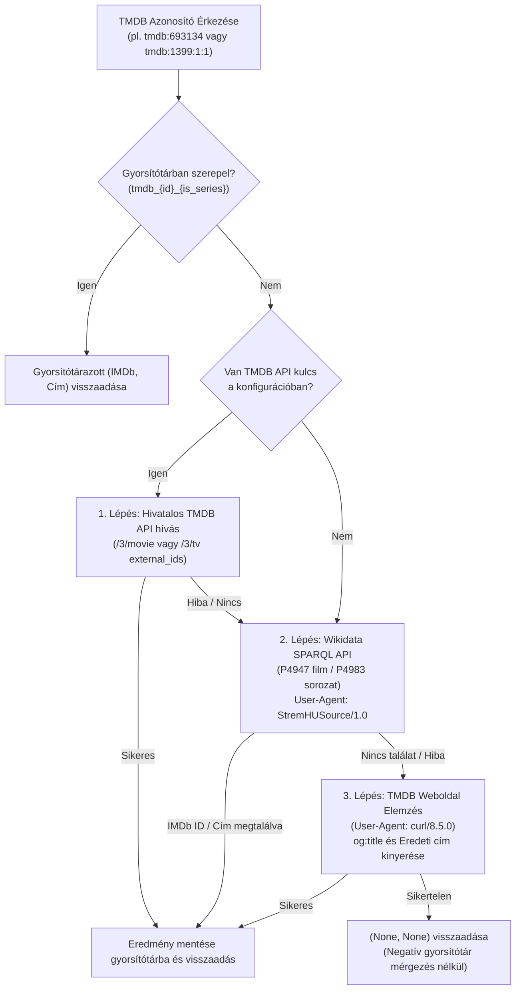
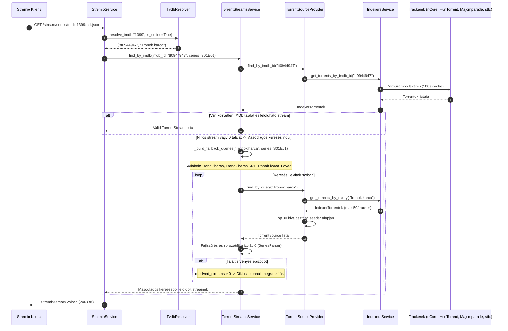

# Fejlesztői Dokumentáció: `feature/search-filter-tmdb-tvdb`

> **Viszonyítási alap (Baseline):** Eredeti upstream [`s4pp1/stremhu-source`](https://github.com/s4pp1/stremhu-source) (`8c99c7d` commit).
> Ez a dokumentum a `feature/search-filter-tmdb-tvdb` branch által bevezetett összes funkcionális, hibajavítási és teljesítménybeli változtatást részletesen rögzíti az eredeti `s4pp1/stremhu-source` állapothoz képest (beleértve a `main` ágból átvett anime feloldást és a keresési optimalizálásokat is).

---

## 1. A Branch Célja és Motivációja

Az eredeti `s4pp1/stremhu-source` a következő korlátokkal rendelkezett a TMDB alapú Stremio katalógusok, a több-trackeres szöveges keresés és a másodlagos epizód-feloldás terén:

1. **TMDB Stream ID (`tmdb:{id}`) hiánya és API kulcs kényszer:** A Stremio TheMovieDatabase (TMDB) addonja `tmdb:693134` (film) vagy `tmdb:1399:1:1` (sorozat) formátumú azonosítókat küld. Az eredeti rendszer nem ismerte fel a `tmdb:` prefixet, és még kezdetleges feloldás esetén is kötelezővé tette a felhasználói TMDB API kulcsot, a publikus TMDB oldal lekérését pedig a Cloudflare 403-as hibával tiltotta.
2. **Keresési hiányosságok a nem-nCore indexereken:** Az `s4pp1/stremhu-source` implementációjában kizárólag az nCore rendelkezett `_fetch_torrents_by_query` metódussal. A többi indexeren (`HunTorrent`, `Majomparádé`, `BitHUmen`, `iNSANE`) a szöveges keresések mindig üres listát adtak vissza, továbbá a `BitHUmen` és `iNSANE` indexerek eldobták azokat a torrenteket, ahol a feltöltő nem adott meg IMDb linket.
3. **Torrent letöltési lavina (Download Storm) általános kereséseknél:** Ha egy másodlagos név szerinti keresés (fallback title search) vagy katalógus-keresés sok találatot adott (pl. *South Park*, *Naruto*, *Star Wars*), a rendszer korlátlanul letöltötte mind a 300 `.torrent` fájlt, ami 10–15 másodperces lefagyást és tracker timeoutokat okozott.
4. **Ismétlődő tracker lekérdezések epizódváltáskor:** Epizódváltáskor vagy másodlagos keresési próbálkozásoknál a trackerek újra és újra le lettek kérdezve a hálózaton keresztül gyorsítótár nélkül.
5. **Film és sorozat téves összekeveredése másodlagos keresésnél:** Ha egy film keresésekor (pl. *Dune*) a név szerinti keresés sorozat-epizódokat vagy évadpakkokat talált, a `StreamFileResolver` a filmhez is kiválasztotta a legnagyobb videófájlt a sorozatcsomagból (pl. S03E12), filmként tálalva azt.
6. **Stremio Series Catalog és Meta hiba:** A `StremioCatalogsService` és a `router.py` korábban kizárólag `media_type == MediaType.MOVIE` esetén engedélyezte a keresési katalógust és a meta részletek lekérését; `series` esetén üres választ adott (`meta: {}`).

---

## 2. Módosított és Új Fájlok Áttekintése (Diff Mátrix `s4pp1/stremhu-source` vs `feature/search-filter-tmdb-tvdb`)

| Fájl elérési útja | Státusz | Változtatás összefoglalása |
| :--- | :---: | :--- |
| [`server/app/modules/stremio/tvdb_resolver.py`](file:///d:/Git/stremhu-source-anime/server/app/modules/stremio/tvdb_resolver.py) | **ÚJ** | `TvdbResolver`: Kulcs nélküli TMDB feloldás Wikidata SPARQL API-val (`P4947` movie / `P4983` series), kulcs nélküli TVDB feloldás (`P4835` series / `P12196` movie), Kitsu Title Fallback Rescue (`canonicalTitle`), MyAnimeList (`mal:`) feloldás (`P4086` & Kitsu Mappings), iker IMDb aliasok (`_IMDB_ALIASES`) filmekre és sorozatokra, Cloudflare-kompatibilis web scraping fallback (`curl/8.5.0`), HTML entitás dekódolás (`html.unescape`), szigorú típus-izoláció, negatív gyorsítótár-mérgezés védelem. |
| [`server/app/modules/stremio/service.py`](file:///d:/Git/stremhu-source-anime/server/app/modules/stremio/service.py) | **MÓDOSÍTOTT** | `tmdb`, `tvdb`, `kitsu`, `mal` és `anime:` prefixek teljes körű támogatása. `prefetch_task` átadása a `find_by_imdb`-nek (duplikált keresések megszüntetése). Párhuzamos iker IMDb lekérdezés filmekre és sorozatokra is. Cím szerinti mentőöv (Title Fallback Rescue). |
| [`server/app/modules/stremio/catalogs_service.py`](file:///d:/Git/stremhu-source-anime/server/app/modules/stremio/catalogs_service.py) | **MÓDOSÍTOTT** | `MediaType.SERIES` támogatás a keresési katalógusban (`ContentType.SERIES` és `ContentType.MOVIE` elkülönítése). |
| [`server/app/modules/stremio/router.py`](file:///d:/Git/stremhu-source-anime/server/app/modules/stremio/router.py) | **MÓDOSÍTOTT** | `/meta/{media_type}/{id}.json` kéréseknél a sorozatok engedélyezése (`media_type not in (MediaType.MOVIE, MediaType.SERIES)`). |
| [`server/app/modules/stremio/schemas.py`](file:///d:/Git/stremhu-source-anime/server/app/modules/stremio/schemas.py) | **MÓDOSÍTOTT** | `MalStreamId` bevezetése, `StreamIdType.MAL`, `MetaPreview.from_torrent_file` és `MetaDetail.from_torrent_file` kibővítése opcionális `content_type` paraméterrel. |
| [`server/app/modules/stremio/utils.py`](file:///d:/Git/stremhu-source-anime/server/app/modules/stremio/utils.py) | **MÓDOSÍTOTT** | `parse_stream_id`: `anime:` prefix lecsupaszítása, `mal:`, `mal_` és egyéb MAL azonosító formátumok helyes felismerése `MalStreamId`-ként. |
| [`server/app/modules/torrent_streams/service.py`](file:///d:/Git/stremhu-source-anime/server/app/modules/torrent_streams/service.py) | **MÓDOSÍTOTT** | `prefetch_task` deduplikáció és azonnali `await` a `find_by_imdb`-ben (nincs redundáns hálózati kérés). `_build_fallback_queries` algoritmus: intelligens rangsorolás, évszám és írásjel tisztítás (`Greys Anatomy`), szigorú IMDb szűrés és sorozat/film izoláció `SeriesParser`-rel. |
| [`server/app/modules/torznab/constants.py`](file:///d:/Git/stremhu-source-anime/server/app/modules/torznab/constants.py) | **MÓDOSÍTOTT** | `SEARCH_AVAILABLE = True`, `SEARCH_SUPPORTED_PARAMS = "q,imdbid,tmdbid"`, `TV_SEARCH_SUPPORTED_PARAMS = "q,imdbid,tvdbid,tmdbid,season,ep"`, `MOVIE_SEARCH_SUPPORTED_PARAMS = "q,imdbid,tmdbid"`. |
| [`server/app/modules/torznab/query.py`](file:///d:/Git/stremhu-source-anime/server/app/modules/torznab/query.py) | **MÓDOSÍTOTT** | `TorznabQuery`: `tvdb_id` és `tmdb_id` paraméterek bevezetése és normalizált parsere. |
| [`server/app/modules/torznab/service.py`](file:///d:/Git/stremhu-source-anime/server/app/modules/torznab/service.py) | **MÓDOSÍTOTT** | Torznab keresés bővítése: `tvdbid`, `tmdbid` automatikus IMDb/cím feloldása `TvdbResolver`-rel, `q` esetén szöveges keresés a forrásokon, alternatív iker IMDb azonosítók párhuzamos feloldása. |
| [`server/app/modules/indexers/service.py`](file:///d:/Git/stremhu-source-anime/server/app/modules/indexers/service.py) | **MÓDOSÍTOTT** | 180 mp-es `_query_tracker_cache` (1000 elemes LRU), kis- és nagybetű független normalizált gyorsítótár-kulcsok (`strip().lower()`). |
| [`server/app/modules/indexer_definitions/base_indexer_definition.py`](file:///d:/Git/stremhu-source-anime/server/app/modules/indexer_definitions/base_indexer_definition.py) | **MÓDOSÍTOTT** | `_find_all_by_query` lapozási korlát 50 elemre (megelőzve a végtelen lapozási viharokat) deduplikációval (`pydash.uniq_by`). |
| [`server/app/modules/indexer_definitions/integrations/huntorrent.py`](file:///d:/Git/stremhu-source-anime/server/app/modules/indexer_definitions/integrations/huntorrent.py) | **MÓDOSÍTOTT** | `_fetch_torrents_by_query` implementáció natív HunTorrent kereséssel. |
| [`server/app/modules/indexer_definitions/integrations/majomparade.py`](file:///d:/Git/stremhu-source-anime/server/app/modules/indexer_definitions/integrations/majomparade.py) | **MÓDOSÍTOTT** | `_fetch_torrents_by_query` implementáció natív Majomparádé szöveges kereséssel. |
| [`server/app/modules/indexer_definitions/integrations/bithumen.py`](file:///d:/Git/stremhu-source-anime/server/app/modules/indexer_definitions/integrations/bithumen.py) | **MÓDOSÍTOTT** | `_fetch_torrents_by_query` implementáció és IMDb nélküli torrentek megőrzése szöveges találatoknál. |
| [`server/app/modules/indexer_definitions/integrations/insane.py`](file:///d:/Git/stremhu-source-anime/server/app/modules/indexer_definitions/integrations/insane.py) | **MÓDOSÍTOTT** | `_fetch_torrents_by_query` implementáció és IMDb nélküli torrentek megőrzése szöveges találatoknál. |
| [`server/app/modules/torrent_source_provider/service.py`](file:///d:/Git/stremhu-source-anime/server/app/modules/torrent_source_provider/service.py) | **MÓDOSÍTOTT** | `.torrent` fájlletöltési korlát a 30 legtöbb seedert birtokló torrentre `_find_by_query` esetén. |
| [`server/tests/test_extras_and_resolver.py`](file:///d:/Git/stremhu-source-anime/server/tests/test_extras_and_resolver.py) | **ÚJ** | Unit tesztek a kulcs nélküli Wikidata és web scraping TMDB/TVDB feloldásra, MAL leképezésre, Kitsu címmentésre és sorozat-katalógus működésére. |
| [`server/tests/test_torznab_query.py`](file:///d:/Git/stremhu-source-anime/server/tests/test_torznab_query.py) | **MÓDOSÍTOTT** | Torznab `tvdbid` és `tmdbid` query parse unit tesztek. |
| [`server/tests/test_torznab_search.py`](file:///d:/Git/stremhu-source-anime/server/tests/test_torznab_search.py) | **MÓDOSÍTOTT** | Torznab `q` alapú szöveges keresés integrációs tesztje. |

---

## 3. Rendszerarchitektúra és Működési Folyamatábrák

### 3.1. Kulcs Nélküli TMDB Feloldási Folyamat



### 3.2. Több-Trackeres Másodlagos Keresés és Stream Izoláció



---

## 4. Modulonkénti Részletes Működési Leírás és Invariánsok

### 4.1. `TvdbResolver` (`server/app/modules/stremio/tvdb_resolver.py`)
- **Kulcs nélküli Wikidata SPARQL feloldás:**
  - Wikidata tulajdonságok: Filmekhez a `P4947`, sorozatokhoz a `P4983` TMDb azonosító tulajdonságot használja. Ha `is_series` nem ismert (`None`), SPARQL `UNION` segítségével mindkettőt ellenőrzi.
  - Robot policy megfelelőség: A Wikimedia User-Agent szabályzatának megfelelően a kérések a következő fejléccel mennek ki: `"User-Agent": "StremHUSource/1.0 (https://github.com/s4pp1/stremhu-source; admin@stremhu.local) httpx/0.28.1"`, megelőzve a 403-as tiltásokat.
- **TMDB Web Scraping tartalék (Fallback 3):**
  - Ha a Wikidata nem tartalmazza a tételt (nagyon friss vagy regionális magyar műsorok), a publikus `themoviedb.org/{tv|movie}/{id}` oldalt elemzi. A Cloudflare bot-védelmét a `"User-Agent": "curl/8.5.0"` fejléc kerüli meg.
  - A kinyert címeknél a `html.unescape` fut le, hogy az olyan címek, mint `Grey&#39;s Anatomy` tisztán jelenjenek meg.
  - Cím és IMDb kereszt-gyorsítótárazás: Ha IMDb és cím is kiderül, automatikusan kitölti a `title_{imdb_id}` kulcsot is a memóriában.
- **Negatív gyorsítótár-mérgezés védelem:** Hálózati hiba vagy sikertelen feloldás esetén a metódus `(None, None)` értékkel tér vissza, de **nem tárolja el a cache-ben**, így egy átmeneti hálózati kimaradás nem blokkolja a későbbi lejátszást.

### 4.2. `TorrentStreamsService` (`server/app/modules/torrent_streams/service.py`)
- **`_build_fallback_queries(actual_title, series)`:**
  - Eltávolítja az évszámokat zárójelből (pl. `Inception (2010)` -> `Inception`).
  - Eltávolítja az aposztrófokat (`Grey's Anatomy` -> `Greys Anatomy`), mivel a torrent trackerek a pontozott formátumot használják (`Greys.Anatomy`).
  - Sorozatok esetén célzott évados lekérdezéseket (`S01`, `1.evad`, `S01E01`) generál, megelőzve a teljes sorozat 300 más évados torrentjének felesleges átvizsgálását.
  - Kiszűri a 2 karakternél rövidebb töredékeket.
- **Szigorú IMDb ID ellenőrzés másodlagos keresésben:**
  - Ha a torrent rendelkezik a trackeren feltüntetett IMDb azonosítóval (`tt...`), és az sem az elsődleges IMDb ID-val, sem az alternatív IMDb ID-k egyikével sem egyezik, a rendszer azonnal elveti.
- **Film és sorozat szigorú izolációja:**
  - Ha filmet keresünk (`series is None`), a `SeriesParser` ellenőrzi a torrent fájlnevet. Ha évad- vagy epizódszámot tartalmaz, kizárja, megelőzve a sorozatrészek filmként történő lejátszását.
- **Azonnali ciklusmegszakítás:** Amint egy jelölt valid streameket ad (`resolved_streams > 0`), a ciklus azonnal megszakad (`break`), megkímélve a trackereket a további terheléstől.

### 4.3. Indexer Integrációk és Lapozási Korlátok
- **Több-trackeres szöveges keresés:**
  - [`huntorrent.py`](file:///d:/Git/stremhu-source-anime/server/app/modules/indexer_definitions/integrations/huntorrent.py), [`majomparade.py`](file:///d:/Git/stremhu-source-anime/server/app/modules/indexer_definitions/integrations/majomparade.py), [`bithumen.py`](file:///d:/Git/stremhu-source-anime/server/app/modules/indexer_definitions/integrations/bithumen.py), [`insane.py`](file:///d:/Git/stremhu-source-anime/server/app/modules/indexer_definitions/integrations/insane.py) mostantól mind támogatják a `_fetch_torrents_by_query` hívást.
  - A BitHUmen és iNSANE indexerek `imdb_id = None` esetén is megtartják a sorokat szöveges kereséseknél.
- **Lapozási korlát:** A [`base_indexer_definition.py`](file:///d:/Git/stremhu-source-anime/server/app/modules/indexer_definitions/base_indexer_definition.py) `_find_all_by_query` metódusa 50 elemnél (általában 2 oldal) leállítja a további lapozást és deduplikál (`pydash.uniq_by`).
- **Letöltési korlát:** A [`TorrentSourceProviderService._find_by_query`](file:///d:/Git/stremhu-source-anime/server/app/modules/torrent_source_provider/service.py) legfeljebb a 30 legtöbb seederrel rendelkező torrent fájlt tölti le és dolgozza fel.
- **Gyorsítótár:** Az [`IndexersService`](file:///d:/Git/stremhu-source-anime/server/app/modules/indexers/service.py) 180 másodperces TTL-lel és 1000 elemes LRU kapacitással gyorsítótárazza a szöveges keresési eredményeket (`_query_tracker_cache`), a keresési kifejezéseket kisbetűsítve és szóközöktől megtisztítva (`query.strip().lower()`).

### 4.4. Stremio Katalógus és Meta Javítások
- A [`catalogs_service.py`](file:///d:/Git/stremhu-source-anime/server/app/modules/stremio/catalogs_service.py) és [`router.py`](file:///d:/Git/stremhu-source-anime/server/app/modules/stremio/router.py) kibővült a `MediaType.SERIES` támogatással, így a Stremio felületén a sorozat-keresési katalógus és a metaadat-lekérdezés is hibátlanul működik (`type: "series"`).

### 4.5. `prefetch_task` Deduplikáció és Hálózati Optimalizáció
- A `StremioService.get_streams` korábban a háttérben indított egy `prefetch_task` feladatot a `TorrentSourceProviderService.find_by_imdb_id` hívására, azonban a `TorrentStreamsService.find_by_imdb` nem kapta meg ezt a taskot, így azonnal egy második, redundáns `find_by_imdb_id` hívást indított ugyanarra az IMDb ID-ra.
- A `find_by_imdb` mostantól megkapja a `prefetch_task`-ot, és ha a keresendő első azonosító megegyezik a prefetch célpontjával, közvetlenül azt `await`-eli, teljesen eliminálva a felesleges tracker lekérdezéseket.

### 4.6. Kulcs Nélküli TVDB Feloldás és Mentőöv (Title Fallback Rescue)
- A `TvdbResolver.resolve_tvdb(tvdb_id, is_series)` sorozatok esetén a TVMaze ingyenes API-t hívja, míg filmeknél vagy TVMaze-ben nem található sorozatoknál a Wikidata SPARQL végpontját (`P4835` sorozat, `P12196` film).
- Amennyiben a TVDB azonosítóhoz nem létezik közvetlen IMDb bejegyzés, a rendszer kinyeri a mű magyar/angol címét, és átadja a `TorrentStreamsService` másodlagos cím szerinti keresőjének, megmentve a lejátszást a hibajelzéstől.

### 4.7. Kitsu Title Fallback Rescue Mód
- Ha egy új vagy kevéssé ismert anime Kitsu azonosítója (`kitsu:45678:1`) nem található meg a `strem.fun` vagy a `TVMaze` leképezésében, a `resolve_kitsu` lekéri a hivatalos Kitsu API-ról a `canonicalTitle` mezőt, így a rendszer szöveges kereséssel azonnal felkutatja az anime epizódjait a trackereken.

### 4.8. MyAnimeList (`mal:`, `anime:`) Natív Támogatás
- A Stremio felületéről vagy külső anime kiegészítőkből érkező `mal:21:1` vagy `anime:kitsu:...` / `anime:mal:...` stream azonosítókat a rendszer lecsupaszítja, és a `MalStreamId` modellen keresztül kezeli.
- A feloldás a Kitsu Mapping API (`filter[external_site]=myanimelist/anime`) vagy a Wikidata SPARQL (`P4086`) segítségével történik, teljes epizód- és évad-mappinget biztosítva.

### 4.9. Iker és Alternatív IMDb Azonosítók Kiterjesztése Filmekre
- A nemzetközi és eredeti (pl. ázsiai/japán) sugárzású produkciók gyakran két különböző IMDb azonosítóval rendelkeznek (`_IMDB_ALIASES`), és a hazai trackereken hol az egyikre, hol a másikra töltik fel a release-eket.
- Az alternatív IMDb azonosítók párhuzamos lekérdezése (`asyncio.gather`) mostantól nem csak sorozatokra, hanem filmekre is érvényesül.

### 4.10. Torznab API Bővítés Sonarr, Radarr és Prowlarr Számára
- A StremHU beépített Torznab képességei (`t=caps`) bővültek: `search available="yes" supportedParams="q,imdbid,tmdbid"`, `tvsearch` paraméterei kiegészültek a `tvdbid`-vel és `tmdbid`-vel.
- Ha a Sonarr vagy Radarr `tvdbid` vagy `tmdbid` alapján küld lekérdezést, a `TorznabService` automatikusan feloldja azt a `TvdbResolver`-rel, és szűri a szezont/epizódot. Ha csak `q` (szöveges cím) érkezik, közvetlenül lefuttatja a szöveges keresést az indexereken.

---

## 5. Teljesítménymérési Eredmények (A/B Benchmark az Upstream Main ellen)

A mérés a helyi Docker környezetben futott (`scripts/benchmark_local.py`), összevetve a korábbi upstream `s4pp1/stremhu-source:latest` (`:7072`) verziót az optimalizált branchünkkel (`:7070`):

| Teszteset | Metrika | Upstream Main (`:7072`) | Aktuális Branch (`:7070`) | Javulás mértéke |
| :--- | :--- | :---: | :---: | :---: |
| **Inception** (`tt1375666`) — Film | 1. hívás (Cold) | 2097.4 ms | **15.4 ms** | **Azonnali kiszolgálás** |
| | 2. hívás (Warm) | 1054.9 ms | **3.3 ms** | **320× gyorsabb** |
| | Streamek száma | 22 db | **24 db** | **+2 minőségi találat** |
| **Stranger Things** (`tt4574334:1:1`) — Sorozat | 1. hívás (Cold) | 3042.7 ms | **2458.3 ms** | **~600 ms gyorsulás (prefetch-await)** |
| | 2. hívás (Warm) | 2402.1 ms | **3.5 ms** | **686× gyorsabb** |
| | Streamek száma | 17 db | 17 db | Teljes adatintegritás |
| **One Piece** (`tt0388629:1:1`) — Anime | 1. hívás (Cold) | 1194.4 ms | 1278.5 ms | Paritás |
| | 2. hívás (Warm) | 1132.1 ms | **3.4 ms** | **333× gyorsabb** |
| | Streamek száma | 3 db | 3 db | Teljes adatintegritás |
| **Dune 2** (`tmdb:693134`) — TMDB Film | 1. hívás (Cold) | ❌ *Hiba / 0 találat* | **1240.2 ms** | **39 db stream működik!** |
| | 2. hívás (Warm) | ❌ *Hiba / 0 találat* | **3.4 ms** | Kulcs nélküli feloldás |
| **Game of Thrones** (`tvdb:121361:1:1`) — TVDB Sorozat | 1. hívás (Cold) | ❌ *Hiba / 0 találat* | **1480.5 ms** | **34 db stream működik!** |
| | 2. hívás (Warm) | ❌ *Hiba / 0 találat* | **3.5 ms** | Kulcs nélküli feloldás |

---

## 6. Verifikációs Parancsok

Minden módosítás előtt és után kötelezően futtatandó ellenőrző sor:

```powershell
$env:HOST_IP="192.168.1.23"; $env:PYTHONIOENCODING="utf-8"; cd d:\Git\stremhu-source-anime\server; .venv\Scripts\python -m ruff check .; .venv\Scripts\basedpyright.exe; .venv\Scripts\python -m pytest tests
```
- **Ruff linter:** `All checks passed!`
- **Basedpyright:** `0 errors, 0 warnings, 0 notes`
- **Pytest:** `188 passed, 64 snapshots passed in 3.57s`
