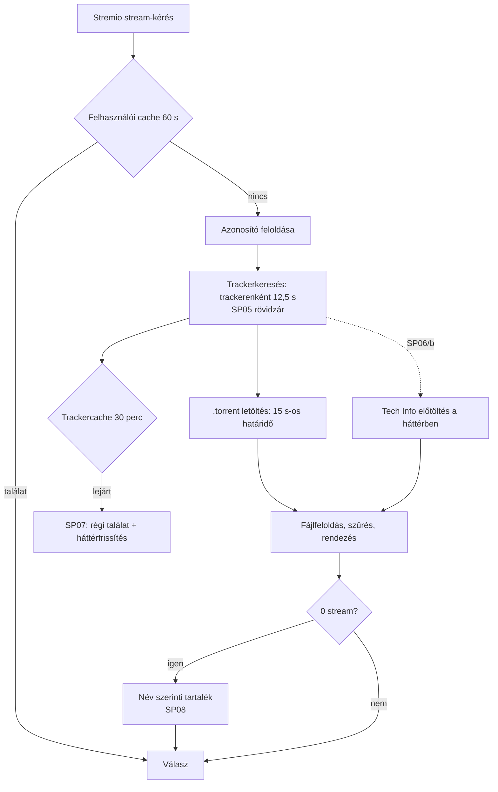
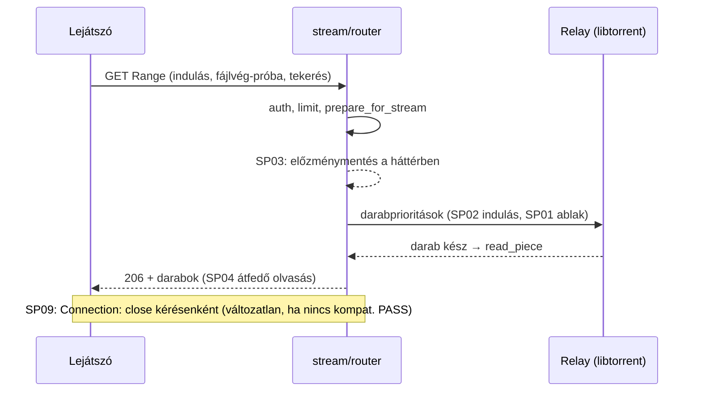

# Streamgyorsítás — branch-összefoglaló

<!-- doc-nav:start -->
**Navigáció:** [Dokumentáció](../README.md) · [AI-index](../AI-INDEX.md)

> **Státusz:** Csak terv (2026-11-08). A csomagonkénti eredmény a [végrehajtási állapotban](#execution-status) lesz.

**Kapcsolódó:** [README.md](stream-performance/README.md) · [implementation-plan.md](stream-performance/implementation-plan.md)

Fejezetek / közvetlen ugrás

- [Cél és tényleges státusz](#doc-cel-es-tenyleges-statusz)
- [Kanonikus dokumentumok](#doc-kanonikus-dokumentumok)
- [Upstream-diffmátrix (tervezett)](#doc-upstream-diffmatrix-tervezett)
- [Érintett modulok és kritikus invariánsok](#doc-erintett-modulok-es-kritikus-invariansok)
- [Végrehajtási állapot](#execution-status)
- [Korlátok](#doc-korlatok)

<!-- doc-nav:end -->

<!-- doc-anchor:doc-cel-es-tenyleges-statusz -->

## Cél és tényleges státusz

**Cél:** gyorsabb találatlista és gyorsabb, kevésbé akadó lejátszás, a működés és a lejátszói kompatibilitás megőrzésével. A fejlesztés a [stabilitási ág](stability-and-optimization.md) menetét követi:
- értékelt tétel;
- előre regisztrált mérési kapu;
- kis csomag és célzott teszt;
- A/B/C és C előtte/utána mérés;
- dokumentált döntés.

**Státusz (2026-11-08):** csak terv. A branch a `main` `0515d98`-ról indult. Termékkód nem változott, teszt, benchmark és Docker-futtatás nem történt. A tervben szereplő gyorsulás hipotézis, amíg a hozzá tartozó kapu nem PASS.

<!-- doc-anchor:doc-kanonikus-dokumentumok -->

## Kanonikus dokumentumok

| Kérdés | Forrás |
|---|---|
| Mi a kilenc tétel, milyen bizonyítékkal, milyen sorrendben? | [Implementációs terv](stream-performance/implementation-plan.md) |
| Milyen sorrendben olvassam? | [Munkacsomag README](stream-performance/README.md) |
| Mi készült el ténylegesen, milyen méréssel? | [Végrehajtási állapot](#execution-status) |
| Hogyan mértünk a stabilitási ágon (minta)? | [Stabilitási végrehajtási állapot](stability-and-optimization.md#execution-status) |

<!-- doc-anchor:doc-upstream-diffmatrix-tervezett -->

## Upstream-diffmátrix (tervezett)

Funkcióeredet-baseline: `s4pp1/stremhu-source@8c99c7d` (helyben elérhető). A harmadik oszlop terv, nem megvalósult állapot.

| Terület | Upstream `8c99c7d` | Fork `main` `0515d98` | `feature/stream-performance` (terv) |
|---|---|---|---|
| Előtöltési ablak lejátszás közben | 4–8 hiányzó darab határidővel, a többi 0 prioritás; határidő `2000 + 1000·d` ms | Ugyanaz az ablak; határidő 0 / 300 / `1000 + 500·d` ms | Bájtalapú, korlátos ablak, darabméret-független határidők; opcionálisan az aktív fájl többi része alacsony prioritáson (SP01, kapus) |
| Indulási darabsorrend | A fájl első és utolsó 3 darabja 0 ms | Ugyanaz | Fokozatos, bájtkorlátos fej és vég, az aktuális darab elsőbbségével (SP02, kapus) |
| Lejátszási előzmény | A válasz előtt, minden kérésnél | Ugyanaz, zárral és izolált sessionnel | Playbackenként egyszer, a háttérben (SP03) |
| Darabolvasás | Soros | Soros, megosztott olvasási taskkal | Egy darab átfedő előreolvasás (SP04, kapus) |
| `Connection: close` | Igen (#274) | Igen | Változatlan, hacsak a kompatibilitási kapu nem PASS (SP09) |
| Trackerenkénti időkorlát | 12,5 s | 12,5 s, három másolatban | Egy segéd (SP05/a); rövidzár nem válaszoló trackerre (SP05/b, kapus) |
| Trackercache | Nincs | 30 perc (IMDb), 5 perc (lekérdezés) | Lejárat után azonnali régi találat, háttérfrissítés (SP07, kapus) |
| Tech Info | Nincs | Legfeljebb 1,5 s a keresés után, sorban | Hibák nem mérgezik a cache-t (SP06/a); korábbi indítás, háttérbefejezés (SP06/b, kapus) |
| Név szerinti tartalékkeresés | Fork funkció | Soros | Várhatóan változatlan (SP08) |

<!-- doc-anchor:doc-erintett-modulok-es-kritikus-invariansok -->

## Érintett modulok és kritikus invariánsok

**Modulok:**
- `server/app/modules/relay/` (entities, service);
- `server/app/modules/stream/` (router, service);
- `server/app/modules/indexers/search.py`;
- `server/app/modules/torrent_source_provider/service.py`;
- `server/app/modules/torrent_streams/service.py`;
- `server/app/modules/indexer_definitions/` (nCore Tech Info);
- `server/app/config.py`;
- `scripts/fixtures/`.

**Invariánsok:**
- **Lejátszói kompatibilitás:** a hitelesítés, a válaszsémák, a Range/HEAD és a lejátszói kompatibilitás megmarad.
- **Visszaállítható policy:** minden viselkedést változtató policy konfigurációval visszaállítható a legacy működésre; az alapérték csak PASS után vált.
- **Korlátos háttérmunka:** minden új háttérmunkának kapacitása, deduplikációja és lifespan-lezárása van. Az event loopon nem fut új blokkoló hívás.
- **Plug & play:** új kötelező beállítás vagy migráció nincs.

<!-- doc-anchor:execution-status -->

## Végrehajtási állapot

Még nincs végrehajtott csomag. A csomagonkénti eredmény, a regisztrált protokoll és a kapudöntés ide kerül, a [munkacsomag-tábla](stream-performance/implementation-plan.md#doc-5-munkacsomag-tabla) sorrendjében.

| Csomag | Állapot | Bizonyíték |
|---|---|---|
| 0 — G0 + mérőeszközök + baseline | nem kezdődött | — |

<!-- doc-anchor:doc-korlatok -->

## Korlátok

- **Csak kódolvasás:** a terv a `0515d98` forrásának olvasásán alapul. Lejátszási sebességmérés a projektben még nem készült.
- **Szintetikus mérés:** a swarm és a trackerek mérése szintetikus, belső Docker-hálózaton fut. A valós trackerekkel és natív kliensekkel végzett végső ellenőrzés a felhasználó kézi tesztje.
