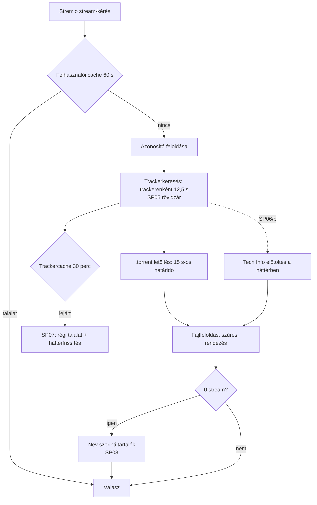
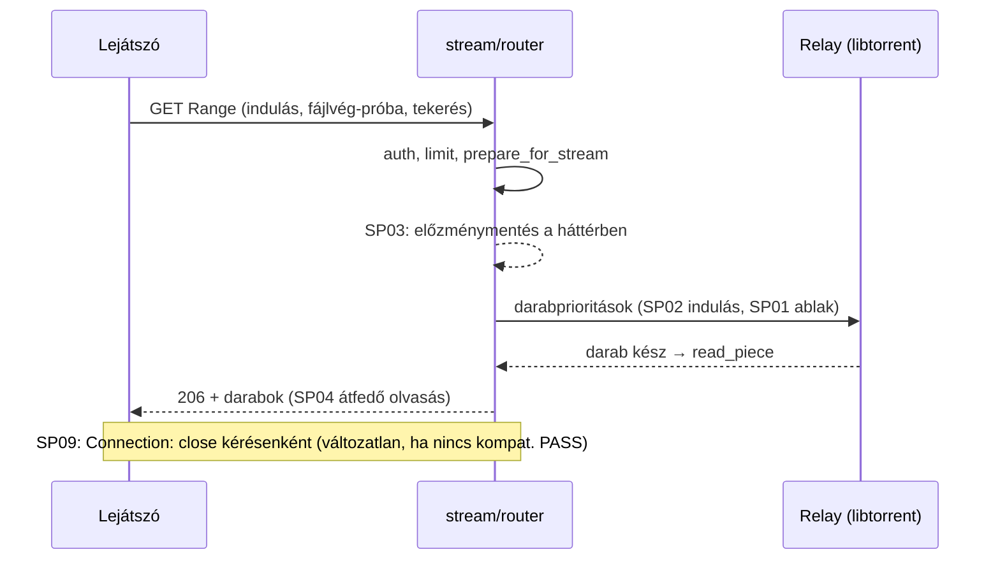

# Streamgyorsítás — branch-összefoglaló

<!-- doc-nav:start -->
**Navigáció:** [Dokumentáció](../README.md) · [AI-index](../AI-INDEX.md)

> **Státusz:** Csak terv (2026-11-08). A csomagonkénti eredmény a [végrehajtási állapotban](#execution-status) lesz.

**Kapcsolódó:** [README.md](stream-performance/README.md) · [implementation-plan.md](stream-performance/implementation-plan.md)

Fejezetek / közvetlen ugrás

- [Cél és tényleges státusz](#doc-cel-es-tenyleges-statusz)
- [Kanonikus dokumentumok](#doc-kanonikus-dokumentumok)
- [Upstream-diffmátrix (tervezett)](#doc-upstream-diffmatrix-tervezett)
- [Érintett modulok és kritikus invariánsok](#doc-erintett-modulok-es-kritikus-invariansok)
- [Végrehajtási állapot](#execution-status)
- [UX/SLO-keret (felhasználói döntés, 2026-11-09)](#doc-ux-slo-keret)
- [Korlátok](#doc-korlatok)

<!-- doc-nav:end -->

<!-- doc-anchor:doc-cel-es-tenyleges-statusz -->

## Cél és tényleges státusz

**Cél:** gyorsabb találatlista és gyorsabb, kevésbé akadó lejátszás, a működés és a lejátszói kompatibilitás megőrzésével. A fejlesztés a [stabilitási ág](stability-and-optimization.md) menetét követi:
- értékelt tétel;
- előre regisztrált mérési kapu;
- kis csomag és célzott teszt;
- A/B/C és C előtte/utána mérés;
- dokumentált döntés.

**Státusz (2026-11-08):** csak terv. A branch a `main` `0515d98`-ról indult. Termékkód nem változott, teszt, benchmark és Docker-futtatás nem történt. A tervben szereplő gyorsulás hipotézis, amíg a hozzá tartozó kapu nem PASS.

<!-- doc-anchor:doc-kanonikus-dokumentumok -->

## Kanonikus dokumentumok

| Kérdés | Forrás |
|---|---|
| Mi a kilenc tétel, milyen bizonyítékkal, milyen sorrendben? | [Implementációs terv](stream-performance/implementation-plan.md) |
| Milyen sorrendben olvassam? | [Munkacsomag README](stream-performance/README.md) |
| Mi készült el ténylegesen, milyen méréssel? | [Végrehajtási állapot](#execution-status) |
| Hogyan mértünk a stabilitási ágon (minta)? | [Stabilitási végrehajtási állapot](stability-and-optimization.md#execution-status) |

<!-- doc-anchor:doc-upstream-diffmatrix-tervezett -->

## Upstream-diffmátrix (tervezett)

Funkcióeredet-baseline: `s4pp1/stremhu-source@8c99c7d` (helyben elérhető). A harmadik oszlop terv, nem megvalósult állapot.

| Terület | Upstream `8c99c7d` | Fork `main` `0515d98` | `feature/stream-performance` (terv) |
|---|---|---|---|
| Előtöltési ablak lejátszás közben | 4–8 hiányzó darab határidővel, a többi 0 prioritás; határidő `2000 + 1000·d` ms | Ugyanaz az ablak; határidő 0 / 300 / `1000 + 500·d` ms | Bájtalapú, korlátos ablak, darabméret-független határidők; opcionálisan az aktív fájl többi része alacsony prioritáson (SP01, kapus) |
| Indulási darabsorrend | A fájl első és utolsó 3 darabja 0 ms | Ugyanaz | Fokozatos, bájtkorlátos fej és vég, az aktuális darab elsőbbségével (SP02, kapus) |
| Lejátszási előzmény | A válasz előtt, minden kérésnél | Ugyanaz, zárral és izolált sessionnel | Playbackenként egyszer, a háttérben (SP03) |
| Darabolvasás | Soros | Soros, megosztott olvasási taskkal | Egy darab átfedő előreolvasás (SP04, kapus) |
| `Connection: close` | Igen (#274) | Igen | Változatlan, hacsak a kompatibilitási kapu nem PASS (SP09) |
| Trackerenkénti időkorlát | 12,5 s | 12,5 s, három másolatban | Egy segéd (SP05/a); rövidzár nem válaszoló trackerre (SP05/b, kapus) |
| Trackercache | Nincs | 30 perc (IMDb), 5 perc (lekérdezés) | Lejárat után azonnali régi találat, háttérfrissítés (SP07, kapus) |
| Tech Info | Nincs | Legfeljebb 1,5 s a keresés után, sorban | Hibák nem mérgezik a cache-t (SP06/a); korábbi indítás, háttérbefejezés (SP06/b, kapus) |
| Név szerinti tartalékkeresés | Fork funkció | Soros | Várhatóan változatlan (SP08) |

<!-- doc-anchor:doc-erintett-modulok-es-kritikus-invariansok -->

## Érintett modulok és kritikus invariánsok

**Modulok:**
- `server/app/modules/relay/` (entities, service);
- `server/app/modules/stream/` (router, service);
- `server/app/modules/indexers/search.py`;
- `server/app/modules/torrent_source_provider/service.py`;
- `server/app/modules/torrent_streams/service.py`;
- `server/app/modules/indexer_definitions/` (nCore Tech Info);
- `server/app/config.py`;
- `scripts/fixtures/`.

**Invariánsok:**
- **Lejátszói kompatibilitás:** a hitelesítés, a válaszsémák, a Range/HEAD és a lejátszói kompatibilitás megmarad.
- **Visszaállítható policy:** minden viselkedést változtató policy konfigurációval visszaállítható a legacy működésre; az alapérték csak PASS után vált.
- **Korlátos háttérmunka:** minden új háttérmunkának kapacitása, deduplikációja és lifespan-lezárása van. Az event loopon nem fut új blokkoló hívás.
- **Plug & play:** új kötelező beállítás vagy migráció nincs.

<!-- doc-anchor:execution-status -->

## Végrehajtási állapot

Még nincs végrehajtott csomag. A csomagonkénti eredmény, a regisztrált protokoll és a kapudöntés ide kerül, a [munkacsomag-tábla](stream-performance/implementation-plan.md#doc-5-munkacsomag-tabla) sorrendjében.

| Csomag | Állapot | Bizonyíték |
|---|---|---|
| 0 — G0 + mérőeszközök + baseline | **kész.** G0-próba; H1 (A és B). `pb0-v1` 3 futás után megszakítva (harnesshiba), `pb0-v2` 135/135 futás, 0 hibás futás. Leíró eredmény: a fork indulása J-n túl lassabb az upstreamnél (SP02), a beragadó peerek 13–18 s-ot okoznak (új SP10), nagy a fel nem használt letöltés. | [G0-próba](stream-performance/evidence/g0-libtorrent-probe-v2.json), [pb0-v2 protokoll](stream-performance/evidence/pb0-v2-protocol.json), [összesítés](stream-performance/evidence/pb0-v2-summary.json), [értékelés](stream-performance/evidence/pb0-v2-assessment.json), [minden futás](stream-performance/evidence/pb0-v2-complete.json), [pb0-v1 megszakítás](stream-performance/evidence/pb0-v1-aborted.json) |
| 1 — SP03 | jelölt a `wip/sp03-playback-history` ágon (`996abd6`); tesztek zöldek, a kapu (H1 + H3) hátra | — |
| 2 — SP05/a | **kész** (`40d166e`): egy időkorlát-segéd, változatlan viselkedés | `test_indexer_search_timeout.py` |
| 3 — SP06/a | **kész** (`cd4b0ad`): sikertelen Tech Info-lekérés nem kerül 1 órára a cache-be | `test_tech_info_failures.py` |
| 4–5 — SP02/SP01 kód | kapcsoló mögött bent (`b794167`), alapérték `legacy` | `test_relay_start_and_readahead_policy.py` |
| 4 — GSP02 | **`gsp02-v1`: FAIL** (250/250 futás, 0 hiba). A szabály kulcscellái mind a zajos mixed profilban voltak (J 2–12 s, a beragadó peerek miatt), ott egyik javulás sem lépte túl J-t mindkét sorozatban. A fast profilban a graded indulás J-n túl gyorsabb (4 MiB 6,8 → 4,7 s, 16 MiB 13,2 → 9,1 s, az upstream szintje), de kis regressziók is vannak (fast/1 MiB TTFB +0,2 s, fast/16 MiB tekerés +0,3–0,5 s). Az alapérték `legacy` marad; `gsp02-v2` következik upstream-szerű jelölttel. | [protokoll](stream-performance/evidence/gsp02-v1-protocol.json), [összesítés](stream-performance/evidence/gsp02-v1-summary.json), [döntés](stream-performance/evidence/gsp02-v1-decision.json), [értékelés](stream-performance/evidence/gsp02-v1-assessment.json), [minden futás](stream-performance/evidence/gsp02-v1-complete.json) |
| 4 — GSP02 v2 | **`gsp02-v2`: FAIL** (360/360 futás, 0 hiba). A C2 (upstream-szerű) indulása 5/6 kulcscellában J-n túl gyorsabb, 1 MiB-nál sem rosszabb (pl. fast/4 MiB 6,8 → 4,8 s, thin/16 MiB 14,5 → 11,3 s). Mindkét jelölt viszont lassítja a tekerés utáni újraindulást 16 MiB-os darabnál (thin 3,5 → 6,8–9 s). Nem a prioritás-szivárgás okozza; a mechanizmus diagnosztikája következik, utána v3. Az alapérték `legacy` marad. | [protokoll](stream-performance/evidence/gsp02-v2-protocol.json), [összesítés](stream-performance/evidence/gsp02-v2-summary.json), [döntés](stream-performance/evidence/gsp02-v2-decision.json), [értékelés](stream-performance/evidence/gsp02-v2-assessment.json), [minden futás](stream-performance/evidence/gsp02-v2-complete.json) |

Ellenőrzés a `b794167`-en: Ruff és basedpyright tiszta; pytest 738 passed / 64 snapshot.

<!-- doc-anchor:doc-ux-slo-keret -->

## UX/SLO-keret (felhasználói döntés, 2026-11-09)

A felhasználó írásban rögzítette, a kapcsolódó kapuk (GSP01, GSP02, GSP05) mérése előtt. A `pb0-v2` protokoll szerint ez az alapmérés után esedékes; a döntés annak 45/135 futásánál született, a felhasználó kifejezett kérésére, hogy a munka beavatkozás nélkül haladhasson. Utólag, az eredményekhez nem igazítható.

| Kérdés (terv 7. fejezet) | Döntés | Következmény a kapukra |
|---|---|---|
| 1. Célbitráták | 8, 30 és 60 Mbit/s | A GSP01/GSP02 mindhárom bitrátán mér. A thin profil (5 MB/s összesen) 60 Mbit/s-on a sávszélesség alatt van: ott az akadás elkerülhetetlen, ez a cella csak leíró, nem elfogadási feltétel. |
| 2. Fel nem használt letöltés | Nem korlát | Mért mellékmetrika marad, de nem buktat kaput. Az ablak felső korlátja a natív hívásköltség (G0) miatt megmarad. |
| 3. H&R-torrent lejátszás közben | Szüneteljen, mint most | Az SP01 C3-jelöltje (háttérprioritás) nem érinti a teljes letöltésű torrenteket; a mai viselkedés marad. |
| 4. Nem válaszoló tracker | Átmenetileg kimaradhat, figyelmeztetéssel | SP05/b: 2 egymás utáni időtúllépés után 120 s kihagyás, ismétlődéskor duplázva, legfeljebb 600 s. |
| 5. Elavultság (kemény TTL, SP07) | Nyitott | Az SP07 kapuja előtt kérdezendő. |
| 6. Natív kliensteszt (SP09) | Nyitott | Az SP09 kapuja előtt kérdezendő. |
| 7. Valós címlista (SP08) | Nyitott, opcionális | Nélküle az SP08 szintetikus címekkel mér. |

<!-- doc-anchor:doc-korlatok -->

## Korlátok

- **Csak kódolvasás:** a terv a `0515d98` forrásának olvasásán alapul. Lejátszási sebességmérés a projektben még nem készült.
- **Szintetikus mérés:** a swarm és a trackerek mérése szintetikus, belső Docker-hálózaton fut. A valós trackerekkel és natív kliensekkel végzett végső ellenőrzés a felhasználó kézi tesztje.
