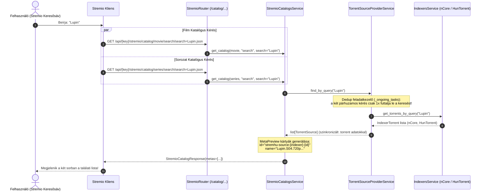
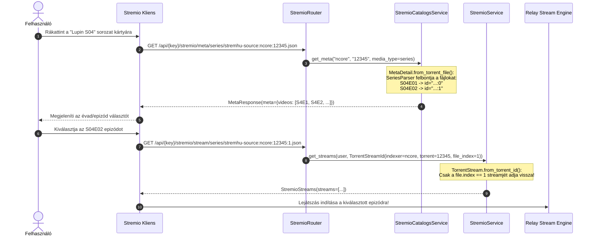

# Fejlesztői Dokumentáció: `feature/stremio-catalog-search`

> **Viszonyítási alap (Baseline):** Eredeti upstream [`s4pp1/stremhu-source`](https://github.com/s4pp1/stremhu-source) (`8c99c7d` commit).
> Ez a dokumentum a `feature/stremio-catalog-search` branch által bevezetett közvetlen katalógus-keresési, sorozat-epizódfelbontási és fájlszintű streaming fejlesztéseit részletezi.

---

## 1. A Branch Célja és Motivációja

Az eredeti upstream `s4pp1/stremhu-source` két keresési katalógust regisztrál a Stremio manifestben:
- `🔍 Torrent - StremHU • Filmek` (`id="search"`, `type=ContentType.MOVIE`)
- `🔍 Torrent - StremHU • Sorozatok` (`id="search"`, `type=ContentType.SERIES`)

Azonban az upstream megvalósításban a `StremioCatalogsService.get_catalog` kódja **kizárólag** a konkrét numerikus torrent ID-s kereséseket engedélyezte:
```python
parts = extra.search.split("-", 1)
if len(parts) < 2 or parts[0] != "t":
    return StremioCatalogResponse(metas=[])  # ❌ Minden szöveges keresésre üres választ adott!
```

Ez a gyakorlatban azt jelentette, hogy:
1. Ha a felhasználó a Stremio felső keresősávjába beírta bármilyen film vagy sorozat címét (pl. *Lupin*, *A mi kis falunk*, *Inception*), a StremHU **nulla találatot** adott vissza a két sorában.
2. Csak akkor lehetett tartalmat lejátszani, ha a Stremio beépített Cinemeta (IMDb) katalógusában már létezett a műsor. Ha egy tartalom nem szerepelt az IMDb-n (pl. hazai vetélkedők, régebbi televíziós közvetítések), azt a Stremio felületéről egyáltalán nem lehetett elérni.
3. Sorozatok esetén hiányzott a torrenten belüli fájlok automatikus epizódlistává (`MetaVideo`) alakítása, így a Stremio UI nem tudott epizódválasztót renderelni közvetlen torrent metaadatokból.

A `feature/stremio-catalog-search` branch ezt a hiányosságot szünteti meg:
- **Közvetlen szabadszavas tracker keresés (`find_by_query`):** Bármilyen szöveges keresőkifejezésre azonnal lekéri a beállított indexerek (nCore, HunTorrent, stb.) találatait, és megjeleníti őket a Stremio keresőjében.
- **Automatikus sorozat- és epizódfelbontás (`MetaDetail.videos`):** A sorozatkiadásokban és évadpakkokban lévő videofájlokat a `SeriesParser` segítségével automatikusan felbontja évadokra és epizódokra (`S04E01`, `S04E02`, stb.).
- **Fájlszintű közvetlen streaming (`file_index`):** A generált stream azonosító (`stremhu-source:{indexer_id}:{torrent_id}:{file_index}`) révén a Stremio epizódonként tudja elindítani a lejátszást évadcsomagokból is.

---

## 2. Módosított és Új Fájlok Áttekintése (Diff Mátrix `s4pp1/stremhu-source` vs `feature/stremio-catalog-search`)

| Fájl elérési útja | Státusz | Változtatás összefoglalása |
| :--- | :---: | :--- |
| [`server/app/modules/stremio/catalogs_service.py`](file:///d:/Git/stremhu-source-anime/server/app/modules/stremio/catalogs_service.py) | **MÓDOSÍTOTT** | Szabadszavas keresési ág integrálása: ha a kifejezés nem `t-...`, a `find_by_query` hívással lekéri az élő találatokat a trackerekről, és `MetaPreview` listát állít elő. |
| [`server/app/modules/stremio/schemas.py`](file:///d:/Git/stremhu-source-anime/server/app/modules/stremio/schemas.py) | **MÓDOSÍTOTT** | `MetaDetail.from_torrent_file` kiegészítése automatikus `MetaVideo` generálással (`content_type=ContentType.SERIES`), valamint `TorrentStreamId.file_index` támogatás. |
| [`server/app/modules/stremio/utils.py`](file:///d:/Git/stremhu-source-anime/server/app/modules/stremio/utils.py) | **MÓDOSÍTOTT** | `parse_stream_id` felkészítése az opcionális harmadik `:file_index` mező értelmezésére (`stremhu-source:{indexer}:{id}:{index}`). |
| [`server/app/modules/stremio/service.py`](file:///d:/Git/stremhu-source-anime/server/app/modules/stremio/service.py) | **MÓDOSÍTOTT** | `file_index` továbbítása a `_torrent_streams_service.find_by_torrent_id` hívás felé. |
| [`server/app/modules/torrent_streams/service.py`](file:///d:/Git/stremhu-source-anime/server/app/modules/torrent_streams/service.py) | **MÓDOSÍTOTT** | `find_by_torrent_id` metódus bővítése az opcionális `file_index` szűrő paraméterrel. |
| [`server/app/modules/torrent_streams/schemas.py`](file:///d:/Git/stremhu-source-anime/server/app/modules/torrent_streams/schemas.py) | **MÓDOSÍTOTT** | `TorrentStream.from_torrent_id` metódusban a fájlok szűrése a megadott `file_index` alapján. |
| [`server/tests/test_stremio_catalog_search.py`](file:///d:/Git/stremhu-source-anime/server/tests/test_stremio_catalog_search.py) | **ÚJ** | Teljes körű unit tesztcsomag: katalógus keresés filmre/sorozatra, sorozat epizódgenerálás, stream azonosító elemzés és fájlszintű szűrés. |

---

## 3. Architektúra és Működési Folyamatábrák

### 3.1. Közvetlen Katalógus-Keresési Folyamat



---

### 3.2. Sorozat Részletezés és Epizód Lejátszási Folyamat



---

## 4. Modulonkénti Részletes Működési Leírás (AI Agent Referencia)

### 4.1. `StremioCatalogsService.get_catalog` (`server/app/modules/stremio/catalogs_service.py`)
- Megvizsgálja a beérkező `extra.search` paramétert.
- Ha a kifejezés `t-<torrent_id>` formátumú, megőrzi az upstream eredeti funkcióját, és közvetlenül az adott azonosítójú torrentet tölti be.
- Minden más esetben meghívja a `_torrent_source_provider_service.find_by_query(extra.search)` metódust.
- A kapott forrásokból a kért `media_type` szerint (`ContentType.SERIES` vagy `ContentType.MOVIE`) előállítja a `MetaPreview` listát.

### 4.2. `MetaDetail.from_torrent_file` (`server/app/modules/stremio/schemas.py`)
- Ha a tartalom típusa `ContentType.SERIES`, végigmegy a torrent fájljain:
  - Kizárja a nem-videó és minta fájlokat (`is_sample_or_trash`).
  - A `SeriesParser` segítségével meghatározza az évadot és az epizódszámot a fájl nevéből/elérési útjából.
  - Generál egy `MetaVideo` elemet az egyedi azonosítóval (`f"{meta_id}:{file.index}"`).
  - Beállítja a `behavior_hints.default_video_id` mezőt az első elérhető epizódra.

### 4.3. `parse_stream_id` és `TorrentStreamId` (`server/app/modules/stremio/utils.py` & `schemas.py`)
- A `stremhu-source:<indexer_id>:<torrent_id>` és `stremhu-source:<indexer_id>:<torrent_id>:<file_index>` formátumokat egyaránt felismeri.
- A `file_index` mező opcionális (`int | None`), így a korábbi hivatkozásokkal és a filmekkel 100%-ban visszafelé kompatibilis.

---

## 5. Tesztelési és Ellenőrzési Referencia

A funkcióhoz tartozó linter, típusellenőrző és tesztcsomag futtatása:
```powershell
$env:HOST_IP="192.168.1.23"; $env:PYTHONIOENCODING="utf-8"; cd server; .venv\Scripts\python -m ruff check .; .venv\Scripts\basedpyright.exe; .venv\Scripts\python -m pytest tests
```
- **Ruff:** `All checks passed!`
- **Basedpyright:** `0 errors, 0 warnings, 0 notes`
- **Pytest:** `220 passed, 64 snapshots passed in 13.47s`

