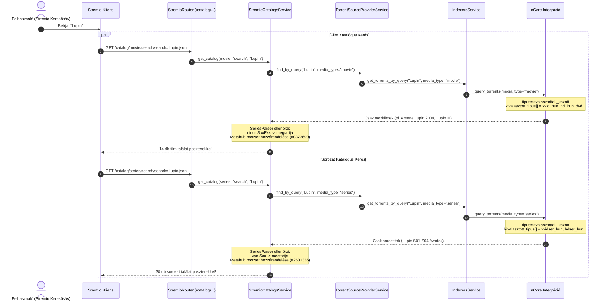

# Fejlesztői Dokumentáció: `feature/stremio-catalog-search`

> **Viszonyítási alap (Baseline):** Eredeti upstream [`s4pp1/stremhu-source`](https://github.com/s4pp1/stremhu-source) (`8c99c7d` commit).
> Ez a dokumentum a `feature/stremio-catalog-search` branch által bevezetett közvetlen katalógus-keresési, kategória szerinti szétválasztási (Filmek vs Sorozatok), borítókép/IMDb integrációs és sorozat-epizódfelbontási fejlesztéseit részletezi.

---

## 1. A Branch Célja és Motivációja

Az eredeti upstream `s4pp1/stremhu-source` két keresési katalógust regisztrál a Stremio manifestben:
- `🔍 Torrent - StremHU • Filmek` (`id="search"`, `type=ContentType.MOVIE`)
- `🔍 Torrent - StremHU • Sorozatok` (`id="search"`, `type=ContentType.SERIES`)

Azonban az upstream megvalósításban a `StremioCatalogsService.get_catalog` kódja **kizárólag** a konkrét numerikus torrent ID-s kereséseket engedélyezte (`t-<torrent_id>`):
```python
parts = extra.search.split("-", 1)
if len(parts) < 2 or parts[0] != "t":
    return StremioCatalogResponse(metas=[])  # ❌ Minden szöveges keresésre üres választ adott!
```

Ez a gyakorlatban azt jelentette, hogy:
1. Ha a felhasználó a Stremio felső keresősávjába beírta bármilyen film vagy sorozat címét (pl. *Lupin*, *A mi kis falunk*, *Inception*), a StremHU **nulla találatot** adott vissza a két sorában.
2. Csak akkor lehetett tartalmat lejátszani, ha a Stremio beépített Cinemeta (IMDb) katalógusában már létezett a műsor. Ha egy tartalom nem szerepelt az IMDb-n (pl. hazai vetélkedők, televíziós közvetítések), azt a Stremio felületéről egyáltalán nem lehetett elérni.
3. Sorozatok esetén hiányzott a torrenten belüli fájlok automatikus epizódlistává (`MetaVideo`) alakítása, így a Stremio UI nem tudott epizódválasztót renderelni közvetlen torrent metaadatokból.
4. **Kategória-keveredés és fekete kártyák:** A kezdeti közvetlen keresés mindkét katalógusban azonos listát adott vissza (filmeknél sorozatok, sorozatoknál filmek jelentek meg), és hiányoztak a poszterek.

### A megoldott fejlesztések:
- **Közvetlen szabadszavas tracker keresés (`find_by_query`):** Bármilyen szöveges keresőkifejezésre azonnal lekéri a beállított indexerek (nCore, HunTorrent, stb.) találatait, seederek szerint csökkenő sorrendben.
- **Kategória szerinti szétválasztás (Filmek vs Sorozatok):**
  - **Filmek katalógus:** Kizárólag magyar és külföldi filmkategóriák (`xvid_hun`, `hd_hun`, `dvd_hun`, `hd`, stb.).
  - **Sorozatok katalógus:** Kizárólag magyar és külföldi sorozatkategóriák (`xvidser_hun`, `hdser_hun`, `dvdser_hun`, `hdser`, stb.).
  - **Kettős védelem (`SeriesParser`):** A katalógus szerviz tartalomelemzéssel kiszűri a sorozat-epizódokat a filmek közül, és az önálló filmeket a sorozatok közül.
- **Hivatalos borítóképek & IMDb pontszám:** Az indexerek által visszaadott `imdb_id` továbbításával a kártyák automatikusan megkapják a nagyfelbontású Metahub borítóképet (`https://images.metahub.space/poster/medium/{imdb_id}/img`) és az IMDb értékelést a sötét dobozok helyett.
- **Automatikus sorozat- és epizódfelbontás (`MetaDetail.videos`):** A sorozatkiadásokban és évadpakkokban lévő videofájlokat a `SeriesParser` segítségével automatikusan felbontja évadokra és epizódokra (`S04E01`, `S04E02`, stb.).
- **Fájlszintű közvetlen streaming (`file_index`):** A generált stream azonosító (`stremhu-source:{indexer_id}:{torrent_id}:{file_index}`) révén a Stremio epizódonként tudja elindítani a lejátszást évadcsomagokból is.
- **Felhasználónkénti beállítás és UI kapcsoló (`enable_catalog_search`):**
  - Ha a felhasználó nem szeretné, hogy a Stremio felső keresője a trackereket közvetlenül terhelje vagy külön torrent-katalógus sorokat rendereljen, a webes felületen (**Beállítások -> Preferenciák -> További preferenciák**) egyetlen kapcsolóval kikapcsolhatja.
  - Kikapcsolt állapotban a dinamikus Stremio manifest (`/manifest.json`) teljesen elhagyja a `catalog` erőforrást és a keresési katalógusokat (`catalogs: []`), így a Stremio egyetlen felesleges keresési kérést sem küld.
  - A backend végpontok (`/catalog/...`) védettek: közvetlen hívás esetén is azonnal üres listát (`metas: []`) adnak vissza felesleges tracker lekérdezések futtatása nélkül.

---

## 2. Módosított és Új Fájlok Áttekintése (Diff Mátrix `s4pp1/stremhu-source` vs `feature/stremio-catalog-search`)

| Fájl elérési útja | Státusz | Változtatás összefoglalása |
| :--- | :---: | :--- |
| [`server/app/modules/stremio/catalogs_service.py`](file:///d:/Git/stremhu-source-anime/server/app/modules/stremio/catalogs_service.py) | **MÓDOSÍTOTT** | Szabadszavas keresési ág integrálása, `media_type` szerinti célzott lekérdezés, `SeriesParser` alapú kategória-védelem, seederek szerinti rendezés és `MetaPreview` előállítás `imdb_id`-val és borítóképpel. |
| [`server/app/modules/stremio/schemas.py`](file:///d:/Git/stremhu-source-anime/server/app/modules/stremio/schemas.py) | **MÓDOSÍTOTT** | `MetaPreview.from_torrent_file` és `MetaDetail.from_torrent_file` kiegészítése `imdb_id`, `poster` és `background` támogatással, valamint `MetaVideo` generálással. |
| [`server/app/modules/indexer_definitions/integrations/ncore.py`](file:///d:/Git/stremhu-source-anime/server/app/modules/indexer_definitions/integrations/ncore.py) | **MÓDOSÍTOTT** | `_NCORE_MOVIE_CATEGORIES` és `_NCORE_SERIES_CATEGORIES` szétválasztása, `tipus="kivalasztottak_kozott"` és `kivalasztott_tipus[]` tömb átadása `media_type` alapján. |
| [`server/app/modules/indexer_definitions/base_indexer_definition.py`](file:///d:/Git/stremhu-source-anime/server/app/modules/indexer_definitions/base_indexer_definition.py) | **MÓDOSÍTOTT** | `find_torrents_by_query`, `_find_all_by_query` és `_fetch_torrents_by_query` metódusok felkészítése az opcionális `media_type` paraméterre. |
| [`server/app/modules/indexers/service.py`](file:///d:/Git/stremhu-source-anime/server/app/modules/indexers/service.py) | **MÓDOSÍTOTT** | `get_torrents_by_query` bővítése `media_type`-pal és a cache kulcs elkülönítése: `(indexer_id, query, media_type)`. |
| [`server/app/modules/torrent_source_provider/service.py`](file:///d:/Git/stremhu-source-anime/server/app/modules/torrent_source_provider/service.py) | **MÓDOSÍTOTT** | `find_by_query` metódusban feladat-deduplikáció `media_type` szerint és paraméter továbbítása. |
| [`server/app/modules/stremio/utils.py`](file:///d:/Git/stremhu-source-anime/server/app/modules/stremio/utils.py) | **MÓDOSÍTOTT** | `parse_stream_id` felkészítése az opcionális harmadik `:file_index` mező értelmezésére (`stremhu-source:{indexer}:{id}:{index}`). |
| [`server/app/modules/stremio/service.py`](file:///d:/Git/stremhu-source-anime/server/app/modules/stremio/service.py) | **MÓDOSÍTOTT** | `file_index` továbbítása a `_torrent_streams_service.find_by_torrent_id` hívás felé. |
| [`server/app/modules/torrent_streams/service.py`](file:///d:/Git/stremhu-source-anime/server/app/modules/torrent_streams/service.py) | **MÓDOSÍTOTT** | `find_by_torrent_id` metódus bővítése az opcionális `file_index` szűrő paraméterrel. |
| [`server/app/modules/torrent_streams/schemas.py`](file:///d:/Git/stremhu-source-anime/server/app/modules/torrent_streams/schemas.py) | **MÓDOSÍTOTT** | `TorrentStream.from_torrent_id` metódusban a fájlok szűrése a megadott `file_index` alapján. |
| [`server/alembic/versions/e72a1c3d4f5b_add_enable_catalog_search_to_users.py`](file:///d:/Git/stremhu-source-anime/server/alembic/versions/e72a1c3d4f5b_add_enable_catalog_search_to_users.py) | **ÚJ** | Adatbázis migráció az `enable_catalog_search` (alapértelmezett: `True`) oszlop hozzáadására a `users` táblához. |
| [`server/app/modules/users/models.py`](file:///d:/Git/stremhu-source-anime/server/app/modules/users/models.py) | **MÓDOSÍTOTT** | `enable_catalog_search` oszlop hozzáadása a `UserModel` ORM modellhez. |
| [`server/app/modules/users/schemas/internal.py`](file:///d:/Git/stremhu-source-anime/server/app/modules/users/schemas/internal.py) | **MÓDOSÍTOTT** | `enable_catalog_search` hozzáadása a belső Pydantic sémákhoz (`BaseUser`, `UserUpdate`). |
| [`server/app/modules/users/schemas/api.py`](file:///d:/Git/stremhu-source-anime/server/app/modules/users/schemas/api.py) | **MÓDOSÍTOTT** | `enable_catalog_search` mező átadása a `UserResponse` és adminisztrátori sémákban. |
| [`server/app/modules/me/schemas/api.py`](file:///d:/Git/stremhu-source-anime/server/app/modules/me/schemas/api.py) | **MÓDOSÍTOTT** | `enable_catalog_search` engedélyezése a felhasználói beállításfrissítésben (`MeUpdateRequest`). |
| [`server/app/modules/users/service.py`](file:///d:/Git/stremhu-source-anime/server/app/modules/users/service.py) | **MÓDOSÍTOTT** | Új felhasználó létrehozásakor az `enable_catalog_search` mentése. |
| [`server/app/modules/stremio/router.py`](file:///d:/Git/stremhu-source-anime/server/app/modules/stremio/router.py) | **MÓDOSÍTOTT** | A bejelentkezett `user` továbbítása a `catalogs_service.get_catalog` felé. |
| [`client/src/shared/schemas.ts`](file:///d:/Git/stremhu-source-anime/client/src/shared/schemas.ts) | **MÓDOSÍTOTT** | `enableCatalogSearchSchema` Zod validátor definiálása. |
| [`client/src/shared/lib/source/source-client.ts`](file:///d:/Git/stremhu-source-anime/client/src/shared/lib/source/source-client.ts) | **MÓDOSÍTOTT** | TypeScript típusdefiníciók frissítése (`enableCatalogSearch` a `UserResponse`, `MeUpdateRequest` stb. interfészekben). |
| [`client/src/routes/_protected/settings/preferences/-features/other-preferences.tsx`](file:///d:/Git/stremhu-source-anime/client/src/routes/_protected/settings/preferences/-features/other-preferences.tsx) | **MÓDOSÍTOTT** | Új UI kártya és kapcsoló a "Közvetlen Stremio katalógus-keresés" beállításához sonner toast mentéssel. |
| [`server/tests/test_stremio_catalog_search.py`](file:///d:/Git/stremhu-source-anime/server/tests/test_stremio_catalog_search.py) | **ÚJ** | Teljes körű unit tesztcsomag: film/sorozat kategória-szétválasztás, Metahub borítóképek, `SeriesParser` védelem, epizódgenerálás, stream azonosító elemzés, valamint manifest és katalógus kapuzási tesztek `enable_catalog_search` kapcsoló alapján. |

---

## 3. Architektúra és Működési Folyamatábrák

### 3.1. Kategória-Célzott Katalógus Keresés és Borítókép Generálás



---

## 4. Tesztelési és Ellenőrzési Referencia

### 4.1. Unit Tesztek és Linter Eredmények
```powershell
$env:HOST_IP="192.168.1.23"; $env:PYTHONIOENCODING="utf-8"; cd server; .venv\Scripts\python -m ruff check .; .venv\Scripts\basedpyright.exe; .venv\Scripts\python -m pytest tests
```
- **Ruff:** `All checks passed!`
- **Basedpyright:** `0 errors, 0 warnings, 0 notes`
- **Pytest:** `223 passed, 64 snapshots passed in 2.42s` (beleértve a `test_catalog_disabled_for_user` és `test_manifest_catalog_gating` teszteket)

### 4.2. Élő Docker Desktop Verifikáció (`stremhu-local-test`)
- **Bekapcsolt állapotban (`enable_catalog_search = True`):**
  - **Manifest lekérés:**
    ```powershell
    Invoke-RestMethod -Uri "https://192-168-1-23.local-ip.medicmobile.org:7070/api/b97de43f-eb45-42e7-ad77-5033ca74506b/stremio/manifest.json"
    ```
    *Eredmény:* `resources: [stream, catalog, meta, subtitles]`, `catalogs: 2 db` (Filmek és Sorozatok).
  - **Sorozatok keresés:**
    ```powershell
    Invoke-RestMethod -Uri "https://192-168-1-23.local-ip.medicmobile.org:7070/api/b97de43f-eb45-42e7-ad77-5033ca74506b/stremio/catalog/series/search/search=Lupin.json"
    ```
    *Eredmény:* 30 db tiszta sorozat találat (`Lupin.S04...`, `Lupin.S01...`), mindegyikhez `imdbId="tt2531336"` és `poster="https://images.metahub.space/poster/medium/tt2531336/img"`.
  - **Filmek keresés:**
    ```powershell
    Invoke-RestMethod -Uri "https://192-168-1-23.local-ip.medicmobile.org:7070/api/b97de43f-eb45-42e7-ad77-5033ca74506b/stremio/catalog/movie/search/search=Lupin.json"
    ```
    *Eredmény:* 14 db tiszta mozifilm találat (`Arsene.Lupin.2004...`, `Lupin.III.Cagliostro...`), mindegyikhez saját `imdbId` (`tt0373690`, `tt0079833`) és hivatalos borítókép.
- **Kikapcsolt állapotban (`enable_catalog_search = False`):**
  - **Manifest lekérés:**
    *Eredmény:* `resources: [stream, meta, subtitles]` (a `catalog` hiányzik), `catalogs: 0 db` (`[]`).
  - **Katalógus végpont lekérés:**
    *Eredmény:* `metas: []` azonnali üres válasz tracker lekérdezések futtatása nélkül.
