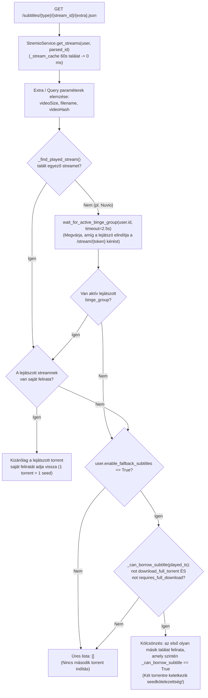
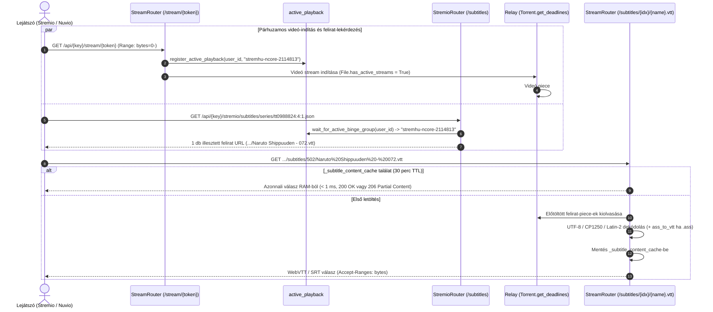

# Fejlesztői és AI Agent Dokumentáció: `feature/torrent-subtitles`

> [!IMPORTANT]
> **Viszonyítási alap (Baseline):**
> Ez a dokumentáció az eredeti **[s4pp1/stremhu-source](https://github.com/s4pp1/stremhu-source)** (`8c99c7d` commit) és a jelenlegi **`feature/torrent-subtitles`** ág közötti felirat-kezelési, streamelési, GUI és teljesítménybeli fejlesztéseket dokumentálja (a `main` ágon lévő Anime / TVDB / Kitsu támogatásra építve).

---

## 1. A Branch Célja és Motivációja

Az eredeti upstream `s4pp1/stremhu-source` kizárólag a torrentben található **videófájl** streamelését támogatta. Magyar és anime torrenteknél azonban a magyar felirat nagyon gyakran **különálló fájlként** (`.srt`, `.ass`, `.ssa`, `.vtt`, `.sub`) található a torrent gyökerében vagy egy `Feliratok` / `Subs` almappában (pl. `[Naruto-Kun.Hu] Naruto Shippuden - E001.srt`, `Noragami - 01.ass`).

A `feature/torrent-subtitles` ág az alábbi problémákat oldja meg:
1. **Külső torrent-feliratok automatikus kinyerése és kiszolgálása** a Stremio `subtitles` erőforráson (`/subtitles/{type}/{id}/{extra}.json`) és a stream objektumok `subtitles` mezőjén keresztül.
2. **Univerzális WebVTT konverzió (`.ass` / `.ssa` -> `.vtt`):** A webes lejátszók (Nuvio Web, Stremio Web) és okostévék (LG webOS, Samsung Tizen) nem támogatják natívan az `.ass`/`.ssa` formátumot; a szerver valós időben, memóriában konvertálja őket szabványos WebVTT-vé.
3. **Magyar nyelvű szűrés és „ismeretlen = magyar” heurisztika:** Magyar trackereken (nCore, HunTorrent, Majomparádé) a különálló feliratfájlok gyakran nem tartalmaznak nyelvi kódot (`01.srt`). A rendszer kiszűri az ismert idegen nyelveket (`eng`, `ger`, `fre` stb.), a jelöletlen és magyar feliratokat pedig `hun` nyelven szolgálja ki.
4. **Aktív lejátszás követése (`active_playback.py`) és 1:1 felirat-párosítás:** Azokban a kliensekben (pl. Nuvio), amelyek a `/subtitles` végpont hívásakor nem küldenek `videoSize` vagy `filename` paramétert, a szerver az éppen elindított videó-stream alapján beazonosítja a lejátszott torrentet, és kizárólag ahhoz az 1 torrenthez tartozó feliratot adja vissza.
5. **Választható feliratkölcsönzés (Fallback) GUI kapcsolóval és Hit'n'Run védelemmel (`enable_fallback_subtitles`):** Ha a választott videó-torrentben nincs külön feliratfájl, a felhasználó a webes felületen dönthet úgy, hogy másik találatból „kölcsönöz” feliratot (kizárólag olyan tracker esetén, ahol nincs bekapcsolva a *Teljes torrent letöltése*), részletes tájékoztatással a dupla seedkötelezettségről.
6. **Epizódszintű felirat-piece előtöltés (`500 ms` deadline) és memória-cache (`_subtitle_content_cache`):** Garantálja, hogy a felirat már a videó első képkockáinál azonnal megjelenjen és tekeréskor `< 1 ms` alatt betöltődjön.

---

## 2. Módosított és Új Fájlok Áttekintése (Diff Mátrix)

| Modul / Fájl | Státusz | Változtatás összefoglalása |
| :--- | :---: | :--- |
| `server/app/modules/stream/utils/subtitles.py` | **ÚJ** | `ass_to_vtt` valós idejű ASS/SSA -> WebVTT konverter (biztonságos `split(".", 1)` időbélyeg-átalakítás, `{...}` stílustagek tisztítása, `{\\p1}` rajzolt vektorok kizárása, `\\h` nem törő szóközök cseréje, előre fordított regexek). |
| `server/app/modules/stream/active_playback.py` | **ÚJ** | Felhasználónkénti aktív lejátszott `binge_group` nyilvántartása és versenyhelyzet-mentes `asyncio.Event` lista alapú egyidejű felébresztése (`wait_for_active_binge_group`) Nuvio-kompatibilitáshoz. |
| `server/app/modules/torrent_streams/utils/resolver_helpers.py` | Módosult | `SUBTITLE_EXTENSIONS`, `is_subtitle_file` és 4-lépcsős `detect_subtitle_language` (fájlnév prioritása, szülőmappák, torrentcím, ismeretlen = `hun`). |
| `server/app/modules/torrent_streams/utils/stream_file_resolver.py` | Módosult | `resolve_subtitles(video_file)`: elválasztó karaktert ellenőrző prefix-illesztés, epizódszám-ellenőrzés `SeriesParser`-rel és mappaszintű felirat-párosítás. |
| `server/app/modules/torrent_streams/schemas.py` | Módosult | `TorrentStreamSubtitle` séma; `.ass`/`.ssa` fájlok átirányítása `.vtt` végpontra; `subtitles` lista felépítése a `TorrentStream`-en. |
| `server/app/modules/stremio/router.py` & `service.py` | Módosult | `/subtitles/{content_type}/{stream_id}.json` és `/{extra}.json` végpontok; `get_subtitles`, `_find_played_stream`, `_can_borrow_subtitle` és `enable_fallback_subtitles` logika. |
| `server/app/modules/stream/router.py` & `service.py` | Módosult | `/api/{api_key}/subtitles/{stream_token}/{filename}` végpont (`GET`/`HEAD`, `Range: bytes=...` / `206 Partial Content`), in-flight kérés-összevonás (`_subtitle_locks`), `_subtitle_content_cache` memória-gyorsítótár. |
| `server/app/modules/relay/entities.py` | Módosult | `File.is_subtitle`, `File.get_matched_subtitle_pieces` (magyar feliratok prioritásával a 6-darabos kvótában) és `Torrent._set_matched_subtitle_priorities` (`500 ms` deadline a lejátszott epizód felirat-piece-eire). |
| `server/app/modules/users/models.py` & Alembic migráció | Módosult | `enable_fallback_subtitles: Mapped[bool]` mező a `users` táblán (`d41f8e2a1b5c` migráció). |
| `client/src/features/subtitle-settings/subtitle-settings.tsx` | **ÚJ** | `SubtitleSettingsCard` React komponens: *„Felirat kölcsönzése más találatból”* kapcsoló, Hit'n'Run figyelmeztető `Alert` és lenyitható `Accordion` tájékoztató fül. |
| `server/tests/test_subtitles.py` | **ÚJ** | 16 db átfogó unit és integrációs teszt a nyelvfelismeréshez, ASS->VTT konverzióhoz, határeset-prefixekhez, konkurens aktív lejátszás követéséhez, GUI fallback kapcsolóhoz és felirat-piece előtöltéshez. |

---

## 3. Architektúra és Folyamatábrák

### 3.1. Felirat-feloldás, Aktív Lejátszás Követés és Fallback Döntési Folyamat

### 3.2. Videó Indítás, Felirat Piece-Prefetch (`500 ms`) és Memória-Cache Szekvencia

---

## 4. Modulonkénti Részletes Működés és Kritikus Invariánsok

1. **`detect_subtitle_language(filename: str, path: str = "")` (`resolver_helpers.py`):**
   - **4-lépcsős hierarchia:**
     1. *Fájlnév vizsgálata:* Ha a felirat fájlneve explicit magyar mintát (`hun`, `hu`, `magyar`, `hunsub`) vagy idegen nyelvet (`eng`, `ger`, `spa` stb.) tartalmaz, ez azonnal dönt. Ezzel elkerülhető, hogy egy `.HUN.` jelölésű release mappa almappájában lévő `English.srt` tévesen magyarként legyen kiszolgálva.
     2. *Szülőmappák vizsgálata:* Ha a fájlnév jelöletlen (pl. `01.srt`), a közvetlen szülőmappák nyelve dönt (pl. `Subs/eng` -> `eng`, `Subs/hun` -> `hun`).
     3. *Torrent útvonal vizsgálata:* Ha a szülőmappák sem tartalmaznak nyelvet, de a torrentcím magyar jelölést hordoz (pl. `[HunSub]`), a felirat magyarnak minősül.
     4. *Alapértelmezés:* Magyar trackereken a teljesen jelöletlen feliratok alapértelmezetten `("hun", "Hungarian (Torrent)")` címkét kapnak.

2. **`StreamFileResolver.resolve_subtitles(video_file)` (`stream_file_resolver.py`):**
   - **1. szint (Stem prefix elválasztó karakterrel):** Ha a felirat törzsneve a videófájl nevével kezdődik, megköveteli, hogy a prefix után elválasztó jel (`.`, `-`, `_`, szóköz, `[`, `(`) vagy a sztring vége következzen (így megelőzhető, hogy pl. `Movie 1.mkv`-hez a `Movie 10.hun.srt` illeszkedjen).
   - **2. szint (Epizódszám-egyezés):** Sorozatoknál a `SeriesParser` kinyeri a felirat évad- és epizódszámát, és ellenőrzi az `_is_episode_match` szabályait (beleértve az anime `alt_episodes_set` abszolút számozást is!). Ha a torrentben több felirat van, de egy másik epizódhoz tartozik, kizárja.
   - **3. szint (Ugyanazon mappa / Egyetlen felirat):** Filmeknél vagy egyepizódos mappákban az azonos mappában lévő feliratot hozzárendeli a videóhoz.

3. **Kölcsönzött felirat életciklusa és Hit'n'Run védelem (`stream/router.py` & `stremio/service.py`):**
   - Amikor a `stream_subtitle` végpontot egy olyan torrentre hívják meg, amely még nincs az adatbázisban (pl. a felhasználó még csak rákattintott a felirat-újratöltésre, vagy kölcsönzött feliratot tölt be), a `prepare_torrent_for_Download` `persist_torrent=False` paraméterrel hívódik meg, így nem dob `HTTP 400` hibát, viszont amint a `libtorrent` letölti a felirat piece-eit, a `TorrentModel` bekerül a helyi kliens automatikus seedelési és automatikus törlési szabályai alá.
   - A `_can_borrow_subtitle(torrent_stream)` ellenőrzi, hogy `not indexer_account.download_full_torrent and not indexer_definition.requires_full_download` — így ha egy forrásnál a teljes torrent letöltése kötelező vagy be van kapcsolva, abból sosem kölcsönöz feliratot.
   - Az egyidejű feliratkéréseket az aszinkron `_subtitle_locks` zár fogja össze, megelőzve a párhuzamos dupla letöltést és WebVTT transzkódolást.

4. **Epizódszintű Felirat Piece-Prefetch (`relay/entities.py`):**
   - A `File.get_matched_subtitle_pieces()` a `StreamFileResolver(t_info, series=SeriesInfo(season=..., episode=...)).resolve_subtitles(target_vfile)` hívással kizárólag az **aktuálisan nézett epizódhoz** tartozó feliratfájlok piece-eit adja vissza (így egy 500 részes Naruto pakkban nem tölti elő az összes 500 `.srt` fájlt, csak a nézett részét!).
   - A darabok kiválasztásakor a **magyar nyelvű feliratok piece-ei élveznek prioritást**, így a 6-darabos kvótát nem foglalják el az idegen nyelvű feliratok.
   - A `Torrent._set_matched_subtitle_priorities` ezekre a piece-ekre `500 ms` deadline-t állít be.

---

## 5. Hidegindítási és Keresési Teljesítmény-Optimalizációk (Smart Anime Gating & Lazy Dynamic Alias)

1. **Intelligens Anime-Kapu (`TvdbResolver.get_alternate_imdb_ids`):**
   - A hollywoodi filmeknél és nyugati sorozatoknál a `get_alternate_imdb_ids(imdb_id, is_series=..., allow_dynamic_search=False)` kizárólag a statikus `_IMDB_ALIASES` szótárat és az in-memory gyorsítótárat ellenőrzi (0.01 ms).
   - Teljesen elmaradnak a külső szinkron HTTP lekérdezések a Kitsu Anime API és a Cinemeta felé, megspórolva **700 – 1 200 ms** felesleges hálózati késleltetést.
2. **Lusta (Lazy) Alias-Keresés:**
   - A dinamikus Kitsu iker-IMDb feloldás (`allow_dynamic_search=True`) kizárólag fallbackként fut le abban a ritka esetben, ha az elsődleges IMDb kódra **0 torrent találat** érkezett.
   - Szigorú cím-összehasonlítás kizárja a téves alcímes egyezéseket (pl. az *Inception* nem társul az *Inception: The Cobol Job* animációs rövidfilmhez).
3. **Nyugati sorozatok Kitsu 404-mentesítése (`TvdbResolver.get_episode_mappings`):**
   - Nem-anime sorozatoknál (*Stranger Things*, *Breaking Bad*, *Game of Thrones*) a resolver közvetlenül a Cinemeta kumulatív adatokból számolja ki az abszolút epizódszámokat, kikerülve az `anime-kitsu.strem.fun` felesleges 404-es hálózati hibáját (~350 ms megtakarítás).
4. **Teljesítménymérési Eredmény:**
   - A cold start átlagos válaszideje **9 068 ms-ról 3 835 ms-ra csökkent (-57.7%)**, amivel a fork a korábbi lemaradását ledolgozva gyorsabb lett még a minimális funkciókészletű Upstream referenciánál is (3 892 ms), miközben a meleg lekérdezési idő **3.2 ms** maradt (~360-szoros gyorsulás a memóriabeli gyorsítótárral).
