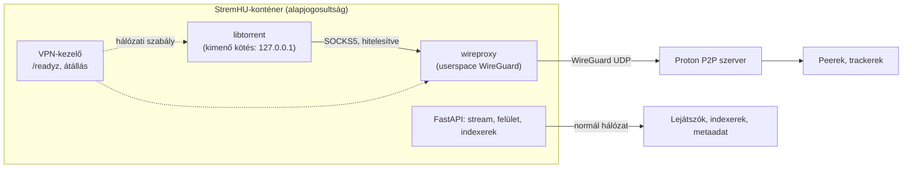
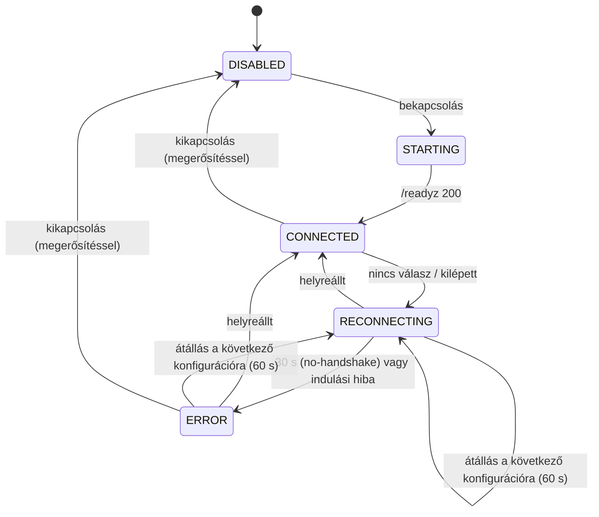

# Beépített torrent-VPN — branch-összefoglaló

<!-- doc-nav:start -->
**Navigáció:** [Dokumentáció](../README.md) · [AI-index](../AI-INDEX.md)

> **Státusz:** Kész, beolvasztva a fork `main` ágába (#17, 2026-11-28). Fork-saját funkció, az upstream PR-felbontásban nem szerepel. A részletes állapot a [terv 9. fejezetében](vpn-integration/implementation-plan.md#9-fázisok-kapuk-és-elfogadási-feltételek) van.

**Kapcsolódó:** [Dokumentumtérkép](vpn-integration/README.md) · [Implementációs terv](vpn-integration/implementation-plan.md) · [Felhasználói útmutató](../vpn-beallitas.md)

Fejezetek / közvetlen ugrás

- [Cél](#doc-cel)
- [Kanonikus dokumentumok](#doc-kanonikus-dokumentumok)
- [Diffmátrix](#doc-diffmatrix)
- [Forgalmi utak](#doc-forgalmi-utak)
- [Érintett modulok](#doc-erintett-modulok)
- [Kritikus invariánsok](#doc-kritikus-invariansok)
- [Bizonyítékok](#doc-bizonyitekok)
- [Korlátok és nyitott pontok](#doc-korlatok-es-nyitott-pontok)
- [Visszaállás](#doc-visszaallas)

<!-- doc-nav:end -->

<!-- doc-anchor:doc-cel -->

## Cél

- **A torrentforgalom VPN-en, plug & play módon.** A felhasználó csak a konténert telepíti, és a webes felületen tölti fel a Proton (vagy más) WireGuard-konfigurációt. Nincs `cap_add`, `/dev/net/tun`, külön VPN-konténer vagy compose-módosítás.
- **Csak a torrentforgalom megy a VPN-en:** peerek, trackerek és trackernevek. A streamelés, a webes felület, az indexerek és a metaadatok a normál hálózaton maradnak.
- **Fail-closed:** bekapcsolt VPN mellett a torrentforgalom vagy a tunnelen megy, vagy áll; közvetlen kapcsolatra soha nem vált.
- **Bővítések:**
  - több mentett konfiguráció automatikus átállással (F5);
  - sebességteszt a tunnelen át (F6).

<!-- doc-anchor:doc-kanonikus-dokumentumok -->

## Kanonikus dokumentumok

| Kérdés | Forrás |
|---|---|
| Hogyan állítom be, mit jelent egy hibakód? | [Felhasználói útmutató](../vpn-beallitas.md) |
| Mi a terv, melyik kapu milyen bizonyítékkal zárult? | [Implementációs terv, Rev. 5](vpn-integration/implementation-plan.md) (9. fejezet: F1–F6, G1–G6) |
| Milyen dokumentumok vannak, mi történeti? | [Dokumentumtérkép](vpn-integration/README.md) |
| Miért userspace és nem netns + kernel-WireGuard? | [A Rev. 3 felülvizsgálata](vpn-integration/review-rev3-findings.md), [PoC-jelentés](vpn-integration/userspace-poc-report.md) |

<!-- doc-anchor:doc-diffmatrix -->

## Diffmátrix

| Terület | `s4pp1/stremhu-source` (`@8c99c7d`) | Fork `main` (`7bf93aa`) | `feature/vpn-integration` |
|---|---|---|---|
| Torrent-VPN | — | — | Beépített WireGuard (wireproxy, userspace), csak a libtorrenthez, SOCKS5-ön át. |
| Libtorrent hálózati indulás | Azonnal nyitott hálózattal | Azonnal nyitott hálózattal | Zárt csomaggal indul (loopback-listener, DHT/LSD/UPnP/NAT-PMP ki). Torrent csak a hálózati szabály után kerülhet bele. Kikapcsolt VPN mellett a végállapot azonos a mainnel. |
| Relay-beállítások VPN módban | — | — | A port, az UPnP/NAT-PMP és az uTP zárolt (409, felületen „VPN által kezelt”). |
| Streamelés tunnelhiba alatt | — | — | Ha a kért rész nincs helyben, `503` + `Retry-After: 5`; a helyben lévő rész lejátszható. |
| Konfigurációk | — | — | Legfeljebb 10, AES-256-GCM-mel titkosítva (külön kulcs: `vpn.key` vagy `VPN_SECRET_KEY`). Sorrendezhetők, kézzel válthatók. |
| Átállás | — | — | `VPN_FAILOVER_AFTER` (60 s) válasz nélkül a következő konfigurációra vált, ugyanazon a proxyn; nincs visszaugrás. |
| Diagnosztika | — | — | Teszt (öt ellenőrzés), sebességteszt (Mbit/s, késleltetés, kilépő IP, összevetés a saját címmel). |
| Docker image | — | — | `wireproxy` v1.1.3, architektúránként rögzített SHA-256-tal (`docker/fetch_wireproxy.py`). |
| API (admin) | — | — | `GET/PUT /api/vpn`, `DELETE /api/vpn/configs/{id}`, `GET /api/vpn/status`, `POST /api/vpn/test`, `POST /api/vpn/speedtest`; a relay-beállítások válaszában `vpnManaged`. |
| Felület | — | — | *Irányítópult → Rendszer → VPN & Adatvédelem* oldal és állapotkártya; zárolt relay-mezők. |
| Adatbázis | — | — | Nincs migráció: egy `vpn` beállítássor. |

<!-- doc-anchor:doc-forgalmi-utak -->

## Forgalmi utak

<!-- doc-anchor:doc-erintett-modulok -->

## Érintett modulok

| Hely | Szerep |
|---|---|
| `server/app/modules/vpn/manager.py` | Állapotgép, wireproxy-felügyelet, `/readyz`-alapú állapot, átállás, újrapróba. |
| `server/app/modules/vpn/proxy_supervisor.py` | A wireproxy indítása tmpfs-konfiggal (indulás után törlődik), redaktált kimenet, health-port. |
| `server/app/modules/vpn/wireguard_config.py` | `.conf`-feldolgozás és -validálás (tiltott kulcsok: `PostUp` stb.), futási konfiguráció (`CheckAlive`). |
| `server/app/modules/vpn/secret_store.py` | AES-256-GCM boríték, kulcsfájl és kulcsrotáció. |
| `server/app/modules/vpn/service.py`, `router.py`, `schemas.py`, `dependencies.py` | Admin-API: konfigurációk, kapcsoló, sorrend, kézi váltás, törlés, Teszt, sebességteszt. |
| `server/app/modules/vpn/speedtest.py` | Minimális SOCKS5- és TLS-kliens a sebességteszthez. |
| `server/app/modules/vpn/state.py` | A stream-útvonal VPN-állapot-kérdése (függőség nélkül). |
| `server/app/modules/relay/network_policy.py`, `relay/service.py` | Zárt indulócsomag, közvetlen és VPN-szabály, futás közbeni váltás (pause → apply → resume), 503, ha nincs szabály. |
| `server/app/modules/relay_settings/service.py` | A hálózati relay-mezők zárolása VPN módban. |
| `server/app/modules/stream/service.py` | 503, ha a tunnel nem él, és a kért rész nincs helyben. |
| `server/app/main.py` | A szabály a beállítás-szinkron után, a torrentek visszatöltése előtt; a leállítás a natív session után. |
| `server/app/modules/settings/…`, `boot/settings.py`, `config.py` | VPN-beállítássor (legacy migrációval), környezeti változók. |
| `Dockerfile`, `docker/fetch_wireproxy.py` | Rögzített hash-ű wireproxy-bináris (amd64, arm64). |
| `client/src/routes/_protected/dashboard/system/vpn/`, `-features/vpn-info.tsx` | VPN-oldal és állapotkártya. |
| `client/src/routes/_protected/relay/settings/-features/` | Zárolt port-, UPnP- és uTP-mezők. |
| `client/src/shared/lib/source/vpn-client.ts`, `shared/queries/vpn.ts` | Kézzel írt API-kliens, amíg a generált kliens el van csúszva. |

<!-- doc-anchor:doc-kritikus-invariansok -->

## Kritikus invariánsok

- **Nincs közvetlen torrentforgalom bekapcsolt VPN mellett.** Minden nem `DISABLED` állapotban a relay proxymódban van, a kimenő socketek a loopbackre kötnek, a DHT, LSD, UPnP, NAT-PMP és uTP ki van kapcsolva, és a valódi hálózaton nincs torrent-listener.
- **Átállás és kézi váltás alatt sincs közvetlen ablak:** a SOCKS-port és a hitelesítés nem változik, csak a wireproxy indul újra.
- **Indulás:** a libtorrent zárt csomaggal indul. Ha a VPN-beállítás nem olvasható, nincs szabály, és torrent sem indul (`settings-unavailable`).
- **Titkok:** a privát kulcs, a `PresharedKey` és a SOCKS-jelszó nem kerül API-válaszba, naplóba vagy hibaüzenetbe. A nyílt konfiguráció csak tmpfs-en él a wireproxy indulásáig. A sebességteszt a saját IP-címet nem adja vissza és nem naplózza.
- **Kikapcsolt VPN mellett** a libtorrent végső hálózati állapota azonos a mainnel (port IPv4-en és IPv6-on, a felhasználó UPnP- és uTP-beállítása).
- **Kikapcsolás** csak megerősítéssel (`confirmUnprotected`). Bekapcsolt VPN mellett az utolsó konfiguráció nem törölhető.
- **Eseményhurok:** a DB- és kulcsműveletek `owned_to_thread`-ben futnak, a hálózati diagnosztika aszinkron, időkorláttal. Egyszerre csak egy sebességteszt futhat.

<!-- doc-anchor:doc-bizonyitekok -->

## Bizonyítékok

| Mit | Eredmény | Hol |
|---|---|---|
| Statikus és egységtesztek (`17bd23e1`) | Ruff és basedpyright hibátlan, pytest 910 passed / 64 snapshot; vitest 19, lint, format, build sikeres | Ez a dokumentum, a fő README |
| Szivárgásmentesség (G2–G4) | A termékcsomaggal letöltés, HTTP-, HTTPS- és UDP-tracker, magnet, web seed: 0 közvetlen csomag, 0 helyi DNS | [Terv: G2](vpn-integration/implementation-plan.md#g2-végrehajtási-állapot), [G4](vpn-integration/implementation-plan.md#g4-végrehajtási-állapot) |
| Futás közbeni váltás (G3) | VPN-re váltás után 2 s-on belül 0 közvetlen csomag | [Terv: G3](vpn-integration/implementation-plan.md#g3-végrehajtási-állapot) |
| Kapcsolatjelzés (G6) | `/readyz`-alapú állapot; tunnelhibánál a `/readyz` 4 s alatt 503, 30 s után `no-handshake` | [Terv: G6](vpn-integration/implementation-plan.md#g6-végrehajtási-állapot) |
| Élő Proton (G1) | Valódi handshake, DNS a tunnelen, kb. 66 Mbit/s egy magyar P2P szerveren | [Terv: G1](vpn-integration/implementation-plan.md#g1-végrehajtási-állapot) |
| Célgép (G5) | Ubuntu, i7-4720HQ, host hálózati mód; 4K lejátszás alatt 73–80 Mbit/s a tunnelen, a wireproxy kb. 1 CPU-mag és kb. 114 MiB | [Terv: G5](vpn-integration/implementation-plan.md#g5-végrehajtási-állapot) |
| Felület (F4) | Az útmutató lépései Chrome-ban végigkattintva | [Terv: F4](vpn-integration/implementation-plan.md#f4-végrehajtási-állapot) |
| Átállás (F5) | Migráció, átállás 34 s alatt (30 s-os küszöbbel), nincs visszaugrás, újraindítás, kézi váltás, visszalépés a korábbi buildre | [Terv: F5](vpn-integration/implementation-plan.md#f5-végrehajtási-állapot) |
| Sebességteszt (F6) | 3 × 25 MB egy teszt-tunnelen át, helyes kilépőcím; nem kapcsolódott VPN mellett 409 | [Terv: F6](vpn-integration/implementation-plan.md#f6-végrehajtási-állapot) |

A CI az ágra a PR megnyitásakor fut először.

<!-- doc-anchor:doc-korlatok-es-nyitott-pontok -->

## Korlátok és nyitott pontok

- **Alkalmazásszintű védelem:** a maradék kockázat egy olyan libtorrent-kódút, amely nem tartja be a proxyt. libtorrent-frissítéskor a PoC szivárgási tesztkészletét újra kell futtatni.
- **A libtorrent SOCKS5-UDP socketje** `0.0.0.0`-ra köt (elfogadott kockázat; a mérésekben nem ment rajta ki semmi).
- **VPN módban:** nincs bejövő kapcsolat és porttovábbítás, a DHT és az uTP ki van kapcsolva.
- **Átállás:** a trackerek új IP-címet látnak. A Proton-konfigurációk kb. egy évig érvényesek, az együtt generáltak együtt járnak le.
- **Nem mért:**
  - átállás és sebességteszt valódi Proton-szerverekkel, illetve a valódi Cloudflare-célponttal;
  - normál (nem P2P) Proton-szerver;
  - ARM-gép;
  - hosszú távú stabilitás.
- **Generált kliens:** a kézzel írt `vpn-client.ts` a generált API-kliensre cserélendő, miután a fork PR #16 (a kliens újragenerálása) is beolvadt.

<!-- doc-anchor:doc-visszaallas -->

## Visszaállás

- **Adatbázis:** nincs migráció; a `vpn` beállítássor marad, a VPN nélküli buildek nem használják. A main image-re való visszaváltást ezzel a sorral nem próbáltuk ki.
- **Korábbi VPN-build:** a mentett aktív konfiguráció a régi mezőkben is megvan, így egy korábbi, egykonfigos VPN-build is kapcsolódik vele. A többi konfiguráció elvész (helyben kipróbálva).
- **VPN nélküli build** (main, upstream): a torrentforgalom a saját IP-címről megy.
