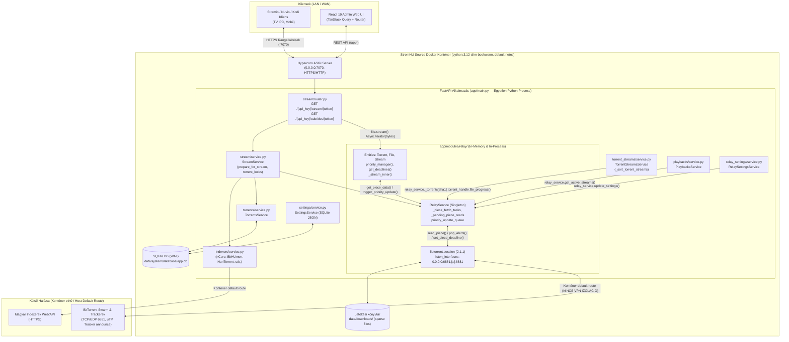
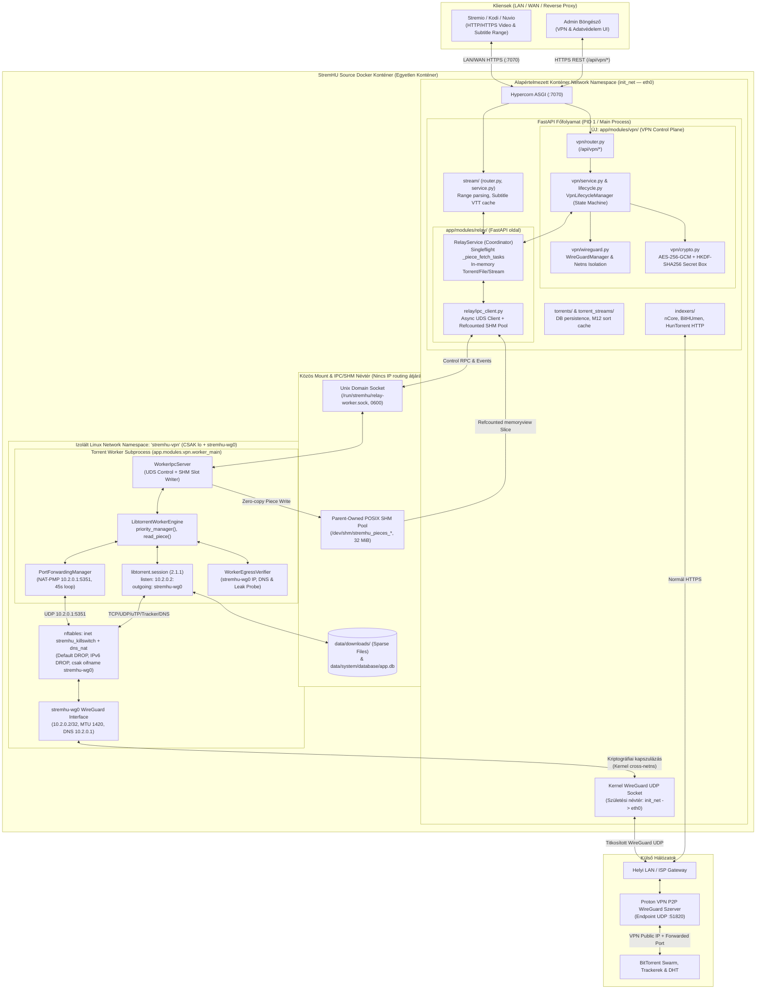
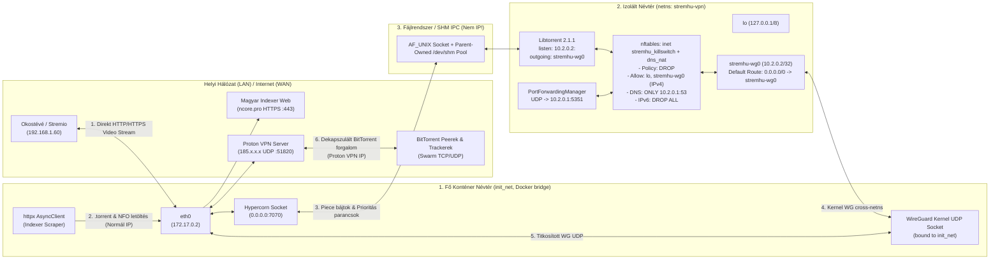
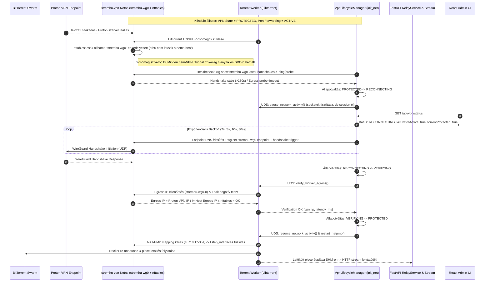
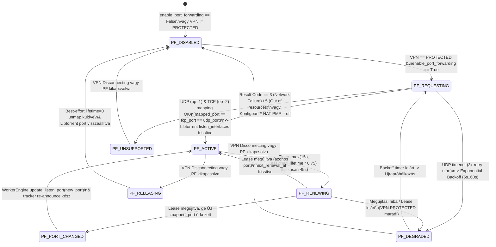
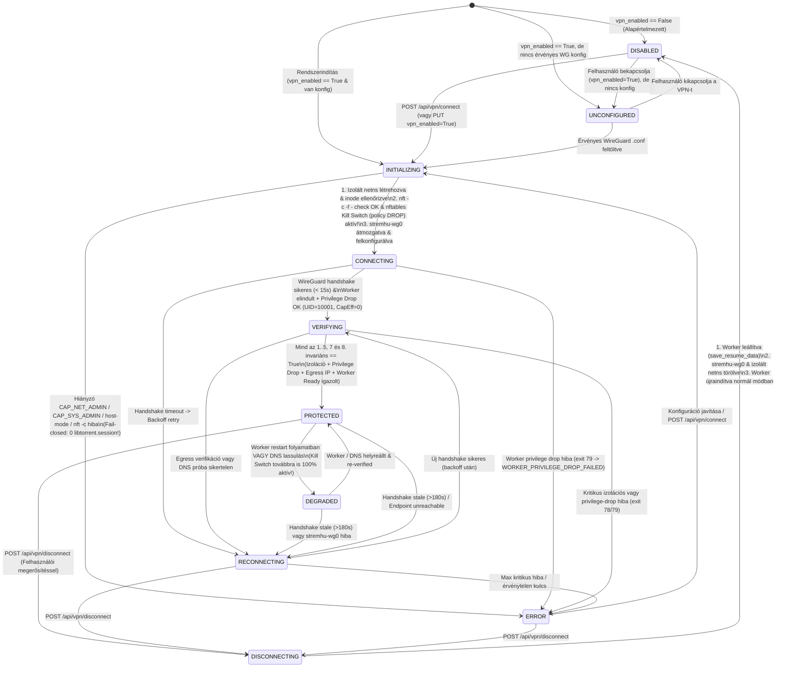

# StremHU Source — Beépített Proton VPN, Izolált BitTorrent Hálózat és Fail-Closed Kill Switch Implementációs Terv

> [!WARNING]
> **ARCHIVÁLT (2026-11-08).** Ezt a Rev. 3 tervet a [`../implementation-plan.md`](../implementation-plan.md) Rev. 4 (userspace, plug & play) váltotta fel. Az indoklás a [`../review-rev3-findings.md`](../review-rev3-findings.md) és a [`../userspace-poc-report.md`](../userspace-poc-report.md) dokumentumban van. Az alábbi tartalom változatlan történeti referencia; a benne lévő relatív linkek az eredeti helyére (`docs/feature/vpn-integration/`) vonatkoznak.


| Dokumentum metaadat | Érték |
|---|---|
| **Projekt** | StremHU Source (`stremhu-source-VibeCodedEdition`) |
| **Dokumentum típusa** | Architecture Research & Implementation Plan (Planning Only — Final Security & Implementability Revision) |
| **Állapot** | **BLOCKED ON PHASE 0 VALIDATION** *(Csak az izolált tesztkörnyezetben végrehajtott Phase 0 összes kötelező PoC kapujának dokumentált `PASS` eredménye után válik `IMPLEMENTATION READY` státuszúvá!)* |
| **Dátum** | 2026-11-04 (Végső biztonsági és implementálhatósági felülvizsgálat: Rev. 3) |
| **Stabil Base Branch** | `main` (szinkronban: `origin/main`) — `VERIFIED` |
| **Base Commit SHA** | `2615596f7cd181454dc5ae3e1ec9e4d215e3b154` (`docs: add universal setup guide for split-horizon DNS (#8)`) — `VERIFIED` |
| **Tervezési Git Ág** | `feature/vpn-integration` (tiszta munkakönyvtárból leágaztatva a `main` `2615596` commitjáról) — `VERIFIED` |
| **Célfájl** | `docs/feature/vpn-integration/implementation-plan.md` |

> [!CAUTION]
> **Kritikus Műszaki és Biztonsági Felülvizsgálati Megállapítás (Phase 0 Hard Gate):**
> A jelen dokumentum megtartja a **B architektúrát** (beépített WireGuard + izolált Linux network namespace + dedikált, privilegizálatlan Libtorrent worker subprocess), azonban normál Docker konténerben a `CAP_NET_ADMIN` **önmagában NEM elegendő** (`VERIFIED` Linux kernel tény): az `unshare(CLONE_NEWNET)`, `setns(..., CLONE_NEWNET)`, valamint az `ip netns add` / `ip netns exec` által végzett `mount()` műveletek **`CAP_SYS_ADMIN` jogosultságot** (és `mount()` használata esetén az AppArmor `docker-default` `deny mount` szabályának feloldását: `security_opt: ["apparmor:unconfined"]`) is igényelnek! A produkciós kód implementációja előtt a **Phase 0 empirikus validáció (`BLOCKER`)** végrehajtása kötelező **izolált Linux VM-ben vagy dedikált Docker tesztkörnyezetben (éles NAS hálózat módosítása nélkül!)**.

---

## 1. Executive Summary

A **StremHU Source** egy Python 3.12, FastAPI, Hypercorn, SQLAlchemy (SQLite WAL), Libtorrent 2.1.1 és React 19 + TanStack Query/Router/Form alapokra épülő, egykonténeres self-hosted streaming proxy és Stremio addon. Jelenleg a FastAPI HTTP/HTTPS kiszolgáló és a Libtorrent 2.1.1 session (`RelayService`) egyetlen közös folyamatban (`UID=0`) és közös hálózati névtérben fut (`VERIFIED`). Ennek következtében a BitTorrent peer-, tracker- és DHT/PEX forgalom ugyanazt az alapértelmezett konténer/host hálózati útvonalat használja, mint a helyi hálózati (LAN) vagy távoli (WAN/Tailscale/Reverse Proxy) Stremio/Kodi/Nuvio klienseket kiszolgáló HTTP/HTTPS streaming.

E dokumentum egy **egyetlen Docker konténeren belül megvalósuló, külső sidecar konténert (pl. Gluetun) nem igénylő, fail-closed Proton VPN + WireGuard integrációs architektúrát** és implementációs tervet határoz meg, szigorúan szétválasztva az **architekturálisan/kódszinten igazolt tulajdonságokat (`VERIFIED`)** azoktól a **futásidejű és teljesítménygaranciáktól (`UNVERIFIED` / `BLOCKER`)**, amelyekhez tényleges empirikus tesztelés szükséges.

### Kiválasztott jelölt architektúra (B alternatíva + Hibrid IPC — Phase 0 validációhoz kötve)

A részletes biztonsági, hálózati és teljesítményelemzés alapján a kiválasztott megoldás:
1. **Linux Network Namespace szeparáció (`stremhu-vpn`) + WireGuard „Birthplace Namespace” elv (`VERIFIED` kernel mechanizmus; konténer runtime profil: `BLOCKER` Phase 0-ig):**
   - A FastAPI főfolyamat, a Hypercorn ASGI szerver, az SQLite adatbázis, az ACME/DDNS modulok és a magyar torrent indexerek (nCore, BitHUmen, HunTorrent, Majomparádé, iNSANE) HTTP scraperei **változatlanul az elsődleges konténer hálózati névtérben (`init_net`)** maradnak.
   - Az egyedi nevű `stremhu-wg0` WireGuard interfész az elsődleges konténer névtérben jön létre (`ip link add dev stremhu-wg0 type wireguard`), majd átmozgatásra kerül az izolált network namespace-be (`ip link set stremhu-wg0 netns ...`), ahol **kizárólag a `lo` és a `stremhu-wg0` interfész létezik**.
   - Elsődlegesen a **mount-mentes, PID/FD-hez rögzített névtér-izolációt** (`B-MountFree`: `os.unshare(os.CLONE_NEWNET)` + nyitott `/proc/<pid>/ns/net` FD + `nftables` `output dnat` + `postrouting snat` DNS átirányítás) validáljuk `cap_add: [NET_ADMIN, SYS_ADMIN]` mellett; a `network_mode: host` használata **nem támogatott (`UNSUPPORTED`)**.
2. **Négyszintű Fail-Closed Kill Switch, `nft -c -f -` Előellenőrzés és Kötelező Worker Privilege Dropping:**
   - **L0 — Inert Startup DI Guard (`VERIFIED` kódszintű terv):** A `RelayService.__init__()` és a `sync_database_and_settings()` nem hoz létre `libtorrent.session`-t és nem nyit hálózati socketet a FastAPI indulásakor.
   - **L1 — Topológiai izoláció:** Az izolált VPN névtérben nincs fizikai/virtuális (`eth0`/`veth`) útvonal a LAN vagy a host gateway felé.
   - **L2 — Névtér-azonosított, `nft -c -f -`-ellenőrzött `nftables` zárás (globális `flush ruleset` NÉLKÜL):** A szabálybetöltés előtt a helper kötelezően ellenőrzi a `/proc/self/ns/net` inode-azonosságát (`!= init_net`), elkerüli a veszélyes globális `flush ruleset` parancsot (kizárólag saját tábláit cseréli atomikusan), lefuttatja az `nft -c -f -` szintaktikai/netlink dry-run ellenőrzést, majd betöltés után JSON-visszaolvasással (`nft -j list ruleset`) igazolja a `drop` policy-t.
   - **L3 — Kötelező Worker Privilege Dropping (8. Biztonsági Invariáns) + Libtorrent binding:** A Torrent Worker a `libtorrent` betöltése **előtt** visszafordíthatatlanul átvált dedikált nem-root felhasználóra (`stremhu-worker`, `UID=10001/GID=10001`), kinullázza az összes Linux capability halmazát (`CapEff=0, CapPrm=0, CapInh=0, CapBnd=0, CapAmb=0` — beleértve a `CAP_SYS_ADMIN` és `CAP_NET_ADMIN` jogokat!), és beállítja a `PR_SET_NO_NEW_PRIVS=1` zárat; bármilyen hiba esetén fail-closed módon azonnal leáll (`exit(79)` -> `WORKER_PRIVILEGE_DROP_FAILED`).
3. **Izolált Libtorrent Worker Subprocess + Versenyhelyzet-mentes (`Race-Free`) Refcountolt Hibrid IPC:**
   - A darabolvasás egyetlen FastAPI-birtokolt **32 MiB-os POSIX Shared Memory poolon** keresztül zajlik, per-waiter `ReaderTicket` alapú Singleflight átadással és szinkron (`await`-mentes) `try_retain()` késői-olvasó csatlakozással (0 TTL kényszer-reclaim, 0 use-after-grant race condition).
   - Ha minden SHM slot foglalt, az **UDS inline fallback** szigorú felső korlátokkal (`MAX_UDS_INLINE_PIECE_BYTES = 16 MiB`, `MAX_CONCURRENT_INLINE_PIECES = 2` / `16 MiB` memória-keret) és `StreamWriter.drain()` backpressure-rel védi a NAS memóriáját.
4. **Natív Proton VPN NAT-PMP Port Forwarding (`10.2.0.1:5351`):**
   - Szigorúan RFC 6886-kompatibilis bináris csomagkódolású (`12` B kérés / `16` B válasz, `1024..65535` port-validációval) `PortForwardingManager`, amelynek élő Proton szerveroldali viselkedése (`UNVERIFIED`) a Phase 0 `P0-4` kapuban kerül igazolásra.

---

## 2. Goals and Non-Goals

### 2.1. Elsődleges célok (Goals)

- **G1 — Egykonténeres Proton VPN + WireGuard integráció:** Külső VPN sidecar konténer (Gluetun stb.) nélkül, a StremHU Source saját webes adminisztrációs felületéről konfigurálható, engedélyezhető és monitorozható WireGuard kapcsolat.
- **G2 — Teljes hálózati szeparáció:** A FastAPI HTTP/HTTPS streaming, a Stremio addon API, az ACME/DDNS szolgáltatások és a magyar torrent indexerek HTTP lekérdezései a normál konténerhálózaton maradnak; kizárólag a Libtorrent BitTorrent forgalma (TCP/UDP peer, uTP, HTTP/HTTPS/UDP tracker, DHT, PEX, tracker DNS) kényszerül a VPN tunnelbe.
- **G3 — Kernelszintű Fail-Closed Kill Switch és Pre-VPN Session Tilalom:** Védett módban (`vpn_enabled=True`) sem a FastAPI startup / DI inicializáció során, sem handshake hiba, tunnel szakadás, DNS hiba, worker crash vagy konténer újraindulás esetén nem jöhet létre védtelen `libtorrent.session` és nem hagyhatja el egyetlen BitTorrent csomag sem a rendszert a normál internetkapcsolaton keresztül.
- **G4 — Dinamikus 4K HTTP Streaming, Lassú Kliens Konzisztencia és Felirat-kompatibilitás megőrzése:** A `server/app/modules/stream/` és `server/app/modules/relay/` közötti dinamikus piece-deadline számítás, a Singleflight olvasás (`acquire_piece_view`), a lassú/szüneteltetett HTTP lejátszók melletti 100%-os SHM adatintegritás, a `PieceReadAbortedError` életciklus és az ASS->WebVTT konverzió regressziómentes megtartása.
- **G5 — Proton VPN NAT-PMP Port Forwarding:** Automatikus UDP/TCP portkérés a Proton VPN gatewayen (`10.2.0.1`), 45 másodperces lease megújítás, és a Libtorrent `listen_interfaces` futásidejű frissítése.
- **G6 — Kompromisszummentes Titokkezelés (Encryption at Rest):** A WireGuard `PrivateKey` és konfiguráció AEAD (`AES-256-GCM` + `HKDF-SHA256`) titkosítása **kötelezően dedikált, nagy entrópiájú `VPN_SECRET_KEY` (vagy `VPN_SECRET_KEY_FILE`)** használatával; az alapértelmezett `SESSION_SECRET="stremhu-source"` vagy gyenge kulcs használatának fail-closed elutasítása, teljes API és log redaction mellett.
- **G7 — Visszafelé kompatibilitás (`vpn_enabled=False`) és Adatvesztés-mentes Migráció/Rollback:** Meglévő telepítéseken az alkalmazás extra Docker jogosultságok nélkül indul és működik; az SQLite séma előre- és visszafelé kompatibilis marad destruktív `downgrade()` vagy konténer-rollback crash (`sys.exit(1)`) nélkül.

### 2.2. Nem célok (Non-Goals)

- **NG1 — Nem cél külön Docker sidecar konténer bevezetése:** A megoldás nem épülhet Gluetunra vagy második Docker service-re.
- **NG2 — Nem cél a teljes konténer default route-jának felülírása:** A FastAPI HTTP szervernek továbbra is közvetlenül elérhetőnek kell maradnia LAN-on (`HOST_IP:7070`) és a konfigurált reverse proxy / DDNS domainen.
- **NG3 — Nem cél a Proton VPN nem-hivatalos, jelszavas REST API-jának reverse-engineeringje:** A Proton VPN fiók jelszavas/2FA-s közvetlen beléptetése helyett a hivatalosan dokumentált Proton WireGuard `.conf` profil importálása az elsődleges, stabil konfigurációs módszer.
- **NG4 — Nem cél az általános VPN szerverként való működés:** A StremHU Source VPN kliensként izolálja a saját BitTorrent motorját, nem nyújt VPN gateway szolgáltatást a helyi hálózat eszközeinek.

---

## 3. Current Repository Architecture

### 3.1. Git kiindulóállapot dokumentálása (0. fejezet szerinti ellenőrzés)

A tervezés megkezdése előtt a repository állapota ellenőrzésre került (`VERIFIED`):
- **Repository gyökér:** `D:/Git/gemini/stremhu-source-VibeCodedEdition`
- **Stabil kiindulóág:** `main` (`remotes/origin/main` és helyi `main` egyaránt a `2615596f7cd181454dc5ae3e1ec9e4d215e3b154` commiton áll).
- **Aktív tervezési ág:** `feature/vpn-integration` (azonos `2615596f7cd181454dc5ae3e1ec9e4d215e3b154` HEAD committal, `git status --porcelain` teljesen üres, commitolatlan módosítás nincs).

### 3.2. Jelenlegi rendszerarchitektúra áttekintése



### 3.3. Current Architecture Findings (Kötelező kódbázis-audit)

Az alábbi táblázat a tényleges repository fájljainak és sorainak tételes auditját tartalmazza (`VERIFIED`):

| Fájlútvonal (Pontos sorok) | Osztály / Függvény | Jelenlegi felelősség | VPN-integráció szempontjából releváns függőség | Szükséges változtatás | Várható kockázat |
|---|---|---|---|---|---|
| [Dockerfile](file:///D:/Git/gemini/stremhu-source-VibeCodedEdition/Dockerfile#L15-L45) | `runtime` stage | `python:3.12-slim-bookworm` alapú runtime image, jelenleg csak `ca-certificates` és `libstdc++6` csomagokat telepít, root userként indítja a `python -m app.run` parancsot. | Nem tartalmazza az `iproute2`, `wireguard-tools` (`wg`), `nftables` (`nft`), `util-linux` (`nsenter`) és `natpmpc` csomagokat. | `iproute2`, `wireguard-tools`, `nftables`, `natpmpc` (diagnosztikai/Phase 0 referencia kliens) telepítése `apt-get install --no-install-recommends` segítségével. | **Low** (image méret növekedése ~12–18 MB, meglévő függőségeket nem érinti). |
| [server/app/config.py](file:///D:/Git/gemini/stremhu-source-VibeCodedEdition/server/app/config.py#L18-L88) | [`Config`](file:///D:/Git/gemini/stremhu-source-VibeCodedEdition/server/app/config.py#L18-L118) | Környezeti változók (`HOST_IP`, `REVERSE_PROXY_DOMAIN`, `PORT`, `SESSION_SECRET`, `relay_piece_timeout_seconds`, `relay_read_timeout_seconds`) és könyvtárútvonalak (`base_data_dir`, `system_dir`, `downloads_dir`) kezelése. | **Kritikus biztonsági lelet (31. sor — `VERIFIED`):** A `session_secret` alapértelmezett értéke publikusan fix `"stremhu-source"`, így abból tilos VPN titkosítási kulcsot származtatni! | Dedikált `vpn_secret_key: str \| None = None`, `vpn_secret_key_file: Path \| None = None`, `vpn_secret_key_previous: str \| None = None`, `vpn_netns_name: str = "stremhu-vpn"`, `vpn_interface_name: str = "stremhu-wg0"`, `vpn_shm_pool_mb: int = 32` hozzáadása. | **Low** |
| [server/app/boot/setup.py](file:///D:/Git/gemini/stremhu-source-VibeCodedEdition/server/app/boot/setup.py#L19-L26) és [server/app/run.py](file:///D:/Git/gemini/stremhu-source-VibeCodedEdition/server/app/run.py#L18-L74) | [`run_migrations()`](file:///D:/Git/gemini/stremhu-source-VibeCodedEdition/server/app/boot/setup.py#L19-L26), [`start_server()`](file:///D:/Git/gemini/stremhu-source-VibeCodedEdition/server/app/run.py#L18-L69) | `setup_directories()`, `run_migrations()` (`alembic upgrade head`, hiba esetén **`sys.exit(1)`**!), `ensure_default_settings()`, majd Hypercorn indítása `0.0.0.0:7070`-en. | **Kritikus rollback lelet (`VERIFIED`):** Ha felesleges, tisztán adat-jellegű Alembic migráció növelné az `alembic_version` táblát, egy korábbi Docker image-re való visszaálláskor a régi konténer `Can't locate revision` hibával és **`sys.exit(1)`** kilépéssel összeomlana! | Nem készül felesleges Alembic verzióléptetés; az `ensure_default_settings()` idempotensen (`exclude_unset=True`) inicializálja a `settings.vpn` rekordot az adatvesztés- és crash-mentes rollback érdekében. | **Medium** |
| [server/app/main.py](file:///D:/Git/gemini/stremhu-source-VibeCodedEdition/server/app/main.py#L32-L75) | [`lifespan(app)`](file:///D:/Git/gemini/stremhu-source-VibeCodedEdition/server/app/main.py#L32-L75) | FastAPI életciklus: `sync_database_and_settings(app)` (41. sor), `resume_save_loop()`, `scheduler.start()`, `get_relay_service()`, `register_persisted_torrents_callbacks()`, `restore_torrents()` (50. sor), `priority_manager_loop()`. | **Kritikus Startup Race (`VERIFIED`):** Jelenleg már a 41. sorban futó `sync_database_and_settings()` példányosítja a `RelayService` singletont (és benne a `libtorrent.session`-t a `0.0.0.0:6881`-en!), a 50. sorban pedig a `restore_torrents()` elindítja a torrenteket bármilyen VPN ellenőrzés előtt! | Szigorú kétfázisú startup: (1) a `sync_database_and_settings()` nem érhet a `RelayService`-hez; (2) a `VpnLifecycleManager.initialize_on_startup()` előbb felépíti az izolált névteret + `nftables` Kill Switchet + Egress verifikációt, és **kizárólag ezután** indítja el a Torrent Workert és a `restore_torrents()`-t! | **High** (Kritikus a pre-VPN szivárgás kizárásához). |
| [server/app/sync.py](file:///D:/Git/gemini/stremhu-source-VibeCodedEdition/server/app/sync.py#L14-L39) és [relay_settings/dependencies.py](file:///D:/Git/gemini/stremhu-source-VibeCodedEdition/server/app/modules/relay_settings/dependencies.py#L12-L17) | [`sync_database_and_settings()`](file:///D:/Git/gemini/stremhu-source-VibeCodedEdition/server/app/sync.py#L14-L39), [`create_relay_settings_service()`](file:///D:/Git/gemini/stremhu-source-VibeCodedEdition/server/app/modules/relay_settings/dependencies.py#L12-L17) | A 34–35. sor meghívja a `create_relay_settings_service(db)` -> `get_relay_service()` (`@lru_cache`) -> `RelayService.__init__()` -> `libtorrent.session()` láncot, majd a `sync_settings()`-t. | **Kritikus korai példányosítási hiba (`VERIFIED`):** Ez a hívási lánc már a VPN inicializáció **előtt** létrehozná a `libtorrent.session`-t a fő hálózati névtérben (`init_net`)! | A `relay_settings_service.sync_settings()` hívást **eltávolítjuk** a `sync_database_and_settings()`-ből; a `RelaySettings` kezdeti szinkronizálását a `VpnLifecycleManager` végzi el azután, hogy a Worker a megfelelő névtérben elindult. | **High** |
| [server/app/modules/relay/service.py](file:///D:/Git/gemini/stremhu-source-VibeCodedEdition/server/app/modules/relay/service.py#L21-L489) és [relay/dependencies.py](file:///D:/Git/gemini/stremhu-source-VibeCodedEdition/server/app/modules/relay/dependencies.py#L6-L8) | [`RelayService`](file:///D:/Git/gemini/stremhu-source-VibeCodedEdition/server/app/modules/relay/service.py#L21-L489), [`get_relay_service()`](file:///D:/Git/gemini/stremhu-source-VibeCodedEdition/server/app/modules/relay/dependencies.py#L6-L8) | `@lru_cache(maxsize=1)` singleton, amely az `__init__()` 25. sorában azonnal létrehozza a `libtorrent.session()`-t és megnyitja a `0.0.0.0:6881,[::]:6881` listen socketeket. | **Legfontosabb architekturális csomópont:** Bármely FastAPI route vagy dependency, amely feloldja a `get_relay_service()`-t, meghívja az `__init__()`-et. | **Inert `__init__()` garancia:** A `RelayService.__init__()` soha nem importálhat/példányosíthat `libtorrent.session`-t és nem nyithat socketet (`UNINITIALIZED_FAIL_CLOSED` kezdőállapot). Minden motorhívás a `RelayWorkerClient` IPC-n megy át, szigorú `ensure_worker_allowed()` védelemmel. | **High** |
| [server/app/modules/relay/entities.py](file:///D:/Git/gemini/stremhu-source-VibeCodedEdition/server/app/modules/relay/entities.py#L28-L460) | [`Torrent`](file:///D:/Git/gemini/stremhu-source-VibeCodedEdition/server/app/modules/relay/entities.py#L28-L211), [`File`](file:///D:/Git/gemini/stremhu-source-VibeCodedEdition/server/app/modules/relay/entities.py#L213-L306), [`Stream`](file:///D:/Git/gemini/stremhu-source-VibeCodedEdition/server/app/modules/relay/entities.py#L308-L460) | A `Stream._stream_inner()` (400–460. sor) lekéri a darabot, `memoryview`-t képez rajta, és `1 MiB` (`CHUNK_SIZE`) szeletekben `yield`-eli a HTTP kliensnek. | **Kritikus lassú-kliens interakció (`VERIFIED`):** Pausolt vagy lassú HTTP lejátszó esetén a `_stream_inner` percekig felfüggesztve állhat a `yield chunk` soron (445. sor) nyitott `memoryview`-val! | A `_stream_inner` egy explicit `async with self.torrent.service.acquire_piece_view(...) as piece_view:` kontextuskezelőt használ, amely `finally` ágban előbb felszabadítja a `memoryview`-t, majd csökkenti a slot olvasói refcountját (`0` elérésekor szabadítva csak fel az SHM slotot). | **High** |
| [server/app/modules/stream/router.py](file:///D:/Git/gemini/stremhu-source-VibeCodedEdition/server/app/modules/stream/router.py#L53-L554) | [`stream()`](file:///D:/Git/gemini/stremhu-source-VibeCodedEdition/server/app/modules/stream/router.py#L59-L158), [`stream_subtitle()`](file:///D:/Git/gemini/stremhu-source-VibeCodedEdition/server/app/modules/stream/router.py#L361-L553) | Stremio/Kodi videó és felirat HTTP Range végpontok. Meghívja a `stream_service.prepare_for_stream()`-et, majd a `file.stream()` iterátort `StreamingResponse`-ba csomagolja. | Ha a VPN védett módban blokkolva van (`ERROR` / `RECONNECTING` Kill Switch alatt), a `prepare_for_stream` vagy az olvasás nem indíthat védtelen letöltést. | Ha a VPN Kill Switch aktív (`VpnKillSwitchActiveError`), rendezett `503 Service Unavailable` válasz visszaadása. | **Low** |
| [server/app/modules/stream/service.py](file:///D:/Git/gemini/stremhu-source-VibeCodedEdition/server/app/modules/stream/service.py#L37-L124) | [`StreamService.prepare_for_stream()`](file:///D:/Git/gemini/stremhu-source-VibeCodedEdition/server/app/modules/stream/service.py#L52-L123) | Ellenőrzi vagy letölti a `.torrent` fájlt az indexerről (`IndexersService`), létrehozza a torrentet a DB-ben és a `RelayService`-ben, majd lekéri a `File` objektumot. | Az `IndexersService.download_torrent()` HTTP kérést végez a magyar tracker felé (ez a FastAPI normál hálózatán marad), majd a `torrents_service.create_from_torrent_file()` adja át a `.torrent` bájtokat a `RelayService.add_torrent()`-nek. | Ha `vpn_enabled=True` és az állapot nem `PROTECTED`, a `RelayService.add_torrent()` megtagadja a hálózati torrentindítást (`VpnKillSwitchActiveError`). | **Low** |
| [server/app/modules/torrents/service.py](file:///D:/Git/gemini/stremhu-source-VibeCodedEdition/server/app/modules/torrents/service.py#L16-L224) | [`TorrentsService`](file:///D:/Git/gemini/stremhu-source-VibeCodedEdition/server/app/modules/torrents/service.py#L16-L224) | Torrentek DB + Relay életciklus-kezelése (`create_from_torrent_file`, `get_torrents`, `find_by_id`, `is_file_downloaded`, `update`, `delete`, `save_resume_data`, `restore_torrents`). | **Figyelem (134–137. sor):** A `TorrentsService.update()` közvetlenül belenyúl a `self._relay_service._torrents.get(sha1_hash)` privát dictbe, és meghívja a `torrent.update_default_priority(priority)`-t! | A `RelayService`-en publikus `update_torrent_priority(info_hash: str, priority: int)` metódus biztosítása, miközben a `_torrents` dict is megmarad a FastAPI oldali `RelayService`-ben. | **Medium** |
| [server/app/modules/torrent_streams/service.py](file:///D:/Git/gemini/stremhu-source-VibeCodedEdition/server/app/modules/torrent_streams/service.py#L574-L628) | [`TorrentStreamsService._sort_torrent_streams()`](file:///D:/Git/gemini/stremhu-source-VibeCodedEdition/server/app/modules/torrent_streams/service.py#L574-L664) | Stream találatok rendezése (M12 optimalizáció). | **Kritikus lelet (595–605. sor):** Közvetlenül eléri a `relay_service._torrents.get(sha1_hash)`-t, majd meghívja a `t.torrent_handle.status().is_seeding` és `t.torrent_handle.file_progress()` C++ metódusokat! | A FastAPI-oldali `Torrent` entitásban memóriabeli gyorsítótárazott `is_seeding: bool` és `file_progress: list[int]` állapotot tartunk fenn, amelyet a `RelayService.get_file_progress_snapshot(info_hash)` ad vissza 0 ms memóriabeli olvasással. | **High** |
| [server/app/modules/playbacks/service.py](file:///D:/Git/gemini/stremhu-source-VibeCodedEdition/server/app/modules/playbacks/service.py#L9-L59) | [`PlaybacksService`](file:///D:/Git/gemini/stremhu-source-VibeCodedEdition/server/app/modules/playbacks/service.py#L9-L59) | `get_active_playbacks()` és `check_playback_limit()`: meghívja a `self._relay_service.get_active_streams()`-t. | Mivel a `Stream` objektumok a FastAPI folyamatban maradnak, a `get_active_streams()` szinkron módon olvasható, és egyúttal korlátozza az egyidejű streamek (és SHM fallback pufferek) számát. | Nincs szükség módosításra a `PlaybacksService`-ben. | **Low** |
| [server/app/modules/settings/models.py](file:///D:/Git/gemini/stremhu-source-VibeCodedEdition/server/app/modules/settings/models.py#L7-L11), [enums.py](file:///D:/Git/gemini/stremhu-source-VibeCodedEdition/server/app/modules/settings/enums.py#L4-L8), [service.py](file:///D:/Git/gemini/stremhu-source-VibeCodedEdition/server/app/modules/settings/service.py#L16-L110) | [`SettingModel`](file:///D:/Git/gemini/stremhu-source-VibeCodedEdition/server/app/modules/settings/models.py#L7-L11), [`SettingsKeyEnum`](file:///D:/Git/gemini/stremhu-source-VibeCodedEdition/server/app/modules/settings/enums.py#L4-L8), [`SettingsService`](file:///D:/Git/gemini/stremhu-source-VibeCodedEdition/server/app/modules/settings/service.py#L16-L110) | Kulcs-érték (`key: str`, `value: dict` JSON) alapú beállítástárolás a `settings` SQLite táblában (`system`, `relay`, `network` kulcsokkal). | A `save_system` / `save_relay` (`exclude_unset=True`) mintájára a `settings` tábla séma-módosítás nélkül, visszafelé kompatibilisen képes tárolni a `vpn` kulcsot. | `SettingsKeyEnum.VPN = "vpn"` felvétele, `VpnSettings` belső modell (`encrypted_wireguard_config` AEAD mezővel), `save_vpn()` idempotens mentéssel. | **Low** |
| [server/app/modules/relay_settings/service.py](file:///D:/Git/gemini/stremhu-source-VibeCodedEdition/server/app/modules/relay_settings/service.py#L8-L43) | [`RelaySettingsService`](file:///D:/Git/gemini/stremhu-source-VibeCodedEdition/server/app/modules/relay_settings/service.py#L8-L43) | A `RelaySettings` mentése és szinkronizálása a `RelayService`-szel. | Ha a Worker még nem fut (pl. VPN `INITIALIZING`/`ERROR`), a `sync_settings()` nem indíthat sessiont; aktív VPN esetén pedig a router UPnP/NAT-PMP tiltott. | Összehangolás a `VpnLifecycleManager`-rel: ha a Worker nem aktív, csak DB mentés és memóriabeli cache történik; aktív VPN alatt `enable_upnp=False`, `enable_natpmp=False`. | **Medium** |
| [client/src/routes/_protected/relay/route.tsx](file:///D:/Git/gemini/stremhu-source-VibeCodedEdition/client/src/routes/_protected/relay/route.tsx#L10-L44) és [client/src/routes/_protected/relay/settings/index.tsx](file:///D:/Git/gemini/stremhu-source-VibeCodedEdition/client/src/routes/_protected/relay/settings/index.tsx#L7-L27) | `SettingsLayout`, `RouteComponent` | Adminisztrátori Relay és Rendszer beállítási oldalak (`/_protected/relay/settings` és `/_protected/dashboard/system`). | A frontend `@tanstack/react-router`, `@tanstack/react-query`, `@tanstack/react-form` + `zod` és Orval által generált `source-client.ts` API klienst használ. | Új **VPN & Adatvédelem** konfigurációs felület és státuszkártya integrálása. | **Low** |

---

## 4. Current Torrent and HTTP Streaming Data Flow

### 4.1. A `stream/` és `relay/` modulok valós idejű együttműködése (`VERIFIED`)

A kódbázis vizsgálata (`server/app/modules/stream/router.py`, `server/app/modules/stream/service.py`, `server/app/modules/relay/service.py`, `server/app/modules/relay/entities.py`) megerősíti a kritikus projektismeretet: **a StremHU Source nem kész fájlokat olvas a merevlemezről a HTTP kiszolgáláshoz, hanem a Libtorrent memóriabeli/session-szintű darabolvasási (`read_piece` -> `read_piece_alert`) és dinamikus határidő-kezelési (`set_piece_deadline`) mechanizmusára épül.**

#### Hívási lánc (Call Graph) egy HTTP Range kérés során:
1. **`GET /{api_key}/stream/{stream_token}`** (`stream/router.py:59`)
   - `record_active_playback(api_key, indexer_id, torrent_id)` (`stream/active_playback.py:10`): regisztrálja az aktív binge-csoportot a felirat-párosításhoz.
   - `auth_service.verify_api_key(api_key)` -> `playbacks_service.check_playback_limit(user, playback_id)` (amely meghívja a `relay_service.get_active_streams()`-t).
   - `stream_service.prepare_for_stream(range_header, indexer_id, torrent_id, file_index)` (`stream/service.py:52`):
     - `torrent_locks(f"{indexer_id}:{torrent_id}")` KeyedLock alatt ellenőrzi a torrentet (`torrents_service.find_by_id`).
     - Ha még nincs a `RelayService`-ben: letölti a `.torrent` fájlt az indexerről (`indexers_service.download_torrent`), elmenti (`isolated_torrent_files_service.create`), majd a `torrents_service.create_from_torrent_file()` meghívja a `relay_service.add_torrent(torrent_bytes, priority)`-t.
     - A `RelayService.add_torrent()` (`relay/service.py:266`) `storage_mode_sparse` módban hozzáadja a torrentet a `libtorrent.session`-höz, minden darab prioritását az alapértelmezett `priority` értékre (`0` ha nem teljes letöltés, `1` ha `full_download`) állítja, és létrehozza a memóriabeli `Torrent` és `File` entitásokat.
     - Lekéri a `File` entitást (`relay_service.get_torrent_file(info_hash, file_index)`) és kiszámítja a `ParsedRangeHeader`-t (`start_byte`, `end_byte`, `content_length`).
2. **Stream példányosítás és Byte->Piece leképezés (`relay/entities.py:286-340`)**:
   - A `file.stream(...)` létrehoz egy `Stream` példányt, amely bekerül a `file.streams[stream.id]` szótárba.
   - Kiszámítja a kért HTTP byte-tartományhoz tartozó kezdő és végső torrent darabindexet:
     - `stream_start_piece_index = (stream_start_byte + file.offset) // torrent.piece_size`
     - `stream_end_piece_index = (stream_end_byte + file.offset) // torrent.piece_size`
3. **Darabonkénti olvasási és prioritás-vezérlési ciklus (`Stream._stream_inner`, `relay/entities.py:400-460`)**:
   - Minden `piece_index`-re a `stream_start_piece_index .. stream_end_piece_index` tartományban:
     - Beállítja a kurzort: `self.current_stream_piece = piece_index`.
     - Meghívja a `self.torrent.service.trigger_priority_update(self.torrent.info_hash)`-t (`relay/service.py:75`), amely thread-safe módon (`call_soon_threadsafe`) beteszi az `info_hash`-t a `priority_update_queue`-ba.
     - A háttérben futó `priority_manager_loop()` (`relay/service.py:83-100`) kiveszi és deduplikálja az `info_hash`-eket, majd `asyncio.to_thread(torrent.priority_manager)` hívással lefuttatja a prioritásszámítást:
       - Ha van aktív stream, az alap piece prioritást `PRIO_0`-ra állítja (hogy csak a deadline-nal megjelölt darabokat töltse), a `max_connections`-t pedig legalább `50`-re emeli.
       - A `Torrent.get_deadlines()` (`relay/entities.py:126-182`) kiszámítja a cél-határidőket:
         - Fájl eleji és végi darabok (`boundary_count = min(3, total_pieces // 2)`): **`deadline = 0`** (MP4 `moov` atom / MKV `Cues` azonnali betöltéséhez).
         - Párosított feliratfájlok darabjai (magyar feliratok előresorolva, max 6 darab): **`deadline = 500`**.
         - Aktív streamek: a `current_stream_piece`-től előre legfeljebb `prefetch_piece_count` (4 vagy 8) hiányzó darabot keres:
           - `piece_index == current_stream_piece` -> **`deadline = 0`**
           - `piece_distance == 1` -> **`deadline = 300`**
           - `piece_distance >= 2` -> **`deadline = 1000 + (piece_distance * 500)`**
       - Törli a már nem szükséges deadline-okat (`reset_piece_deadline`), és beállítja az újakat (`set_piece_deadline`).
     - Ezzel párhuzamosan a `_stream_inner` meghívja az `await self.torrent.service.get_piece_data(torrent_handle, piece_index)` metódust (`relay/service.py:161-177`):
       - **Singleflight deduplikáció:** Ha már fut `_piece_fetch_tasks[(info_hash, piece_index)]`, akkor `await asyncio.shield(task)`-kal csatlakozik hozzá.
       - Ha a darab már megvan (`torrent_handle.have_piece(piece_index)`), azonnal meghívja a `torrent_handle.read_piece(piece_index)`-et, és `relay_read_timeout_seconds` (15s) határidővel várja a `future`-t.
       - Ha a darab még nincs meg, várja a `future`-t (maximum `relay_piece_timeout_seconds = 120s`-ig). Amikor a Libtorrent letölti a darabot, a `piece_finished_alert` (`relay/service.py:422-428`) látja, hogy a `(info_hash, piece_index)` szerepel a `_pending_piece_reads`-ben, ezért azonnal meghívja az `alert.handle.read_piece(piece_index)`-et, és újra meghívja a `trigger_priority_update(info_hash)`-t (hogy a prefetch ablak előrecsússzon!).
       - Amikor a `read_piece_alert` megérkezik (`relay/service.py:430-455`), a `bytes(alert.buffer)` feloldja a `future`-t.
     - A `_stream_inner` a kapott `piece_buffer`-ből `memoryview` szeletet képez a pontos byte-határokra (`start_offset:end_offset`), majd `CHUNK_SIZE` (`1 MiB`) blokkokban `yield`-eli a HTTP válasznak.

### 4.2. Folyamat-szétválasztáskor (Process / Netns Isolation) megszakadó memóriabeli kötések és IPC feloldásuk

Ha a `libtorrent.session` átkerül az izolált `stremhu-vpn` network namespace-ben futó Worker folyamatba, az alábbi közvetlen memóriabeli kapcsolatok szakadnak meg, amelyeket az IPC szerződésnek tételesen pótolnia kell:

| Megszakadó in-process hívás / objektum | Érintett fájl és sor | Hogyan pótolja a Hibrid IPC architektúra? |
|---|---|---|
| `torrent_handle` C++ referencia átadása a `get_piece_data(torrent_handle, piece_index)`-nek | `relay/entities.py:423`, `relay/service.py:163` | A `get_piece_data(info_hash: str, piece_index: int)` kanonikus `info_hash` stringet használ. A Singleflight (`_piece_fetch_tasks` és `asyncio.shield`) a FastAPI folyamatban marad, így több azonos darabra váró HTTP kliens továbbra is egyetlen IPC kérést indít! |
| `Torrent.priority_manager()` közvetlen `torrent_handle.have_piece()`, `set_piece_deadline()`, `reset_piece_deadline()`, `prioritize_pieces()` hívásai | `relay/entities.py:76-118`, `146`, `160`, `194`, `205` | A FastAPI folyamatban lévő `Torrent` összegyűjti az aktív streamek kurzorait (`StreamCursorSnapshot`: `current_stream_piece`, `start_piece_index`, `end_piece_index`, `matched_subtitle_pieces`, `default_priority`), és UDS Control Plane üzenetben (`update_stream_cursors`) elküldi a Workernek. A `have_piece()` ellenőrzést és a `set_piece_deadline()` C++ hívásokat maga a Worker futtatja helyben a saját `torrent_handle` példányán, sőt `piece_finished_alert` esetén azonnal helyben újraértékeli a prefetch ablakot IPC round-trip nélkül! |
| `alert.buffer` (`read_piece_alert`) memóriabeli átadása a `_pending_piece_reads` `Future`-nek | `relay/service.py:430-455` | A Worker a `read_piece_alert` bufferét közvetlenül a megosztott memória (`multiprocessing.shared_memory`) szabad slotjába írja (vagy fallbackként az UDS bináris csatornára), és a FastAPI `Future`-je egy SHM-backed bufferből vagy UDS frame-ből kapja meg a darabot. |
| `TorrentStreamsService._sort_torrent_streams()` közvetlen `relay_service._torrents[sha1].torrent_handle.file_progress()` olvasása | `torrent_streams/service.py:595-605` | A Worker 1 másodpercenként (és minden torrent hozzáadás/befejezés eseménykor) aszinkron státusz-snapshotot küld a FastAPI `RelayService`-nek (`is_seeding`, `file_progress`, sebességek, kapcsolatok), amelyet a FastAPI memóriában tárol (`_CachedTorrentStatus`). Így a `_sort_torrent_streams()` és a `get_torrents()` továbbra is 0 ms memóriabeli olvasással, blokkoló IPC hívás nélkül működik! |
| `on_save_resume` callbackek (`handle_save_resume_data`) | `relay/service.py:396-415`, `torrents/background_tasks.py:8-23` | Amikor a Workerben `save_resume_data_alert` keletkezik, a Worker UDS eseményként (`resume_data_ready(info_hash, resume_bytes)`) visszaküldi a bencodolt `resume_bytes`-t a FastAPI `RelayService`-nek, amely meghívja a regisztrált `on_save_resume` callbackeket (SQLite írás a FastAPI folyamatban marad, így a Workernek nem kell közvetlenül az SQLite adatbázishoz nyúlnia). |

---

## 5. Technical Constraints and Evidence Classification

Minden technikai állítás szigorúan három bizonyítási kategóriába sorolódik: **`VERIFIED`** (kódbázis, Linux kernel kézikönyv, RFC vagy hivatalos dokumentáció által bizonyított tény), **`UNVERIFIED`** (empirikus célkörnyezeti mérést igénylő állítás), vagy **`BLOCKER`** (a Phase 0-ban kötelezően igazolandó kapu, amely nélkül az implementáció nem kezdhető meg):

1. **[VERIFIED] Egykonténeres követelmény:** A StremHU Source egyetlen Docker konténerként (`Dockerfile`) települ; külön VPN sidecar konténer nem használható.
2. **[VERIFIED] Linux Network Namespace folyamatszintű hatókör:** Linuxon a network namespace (`CLONE_NEWNET` / `setns(fd, CLONE_NEWNET)`) a folyamat/task attribútuma. Egy többszálú folyamatban (Python + Hypercorn + Libtorrent C++ háttérszálak) nem lehet biztonságosan csak a Libtorrent C++ szálakat másik network namespace-be helyezni; a Libtorrent sessionnek külön gyerekfolyamatban (subprocess worker) kell futnia.
3. **[VERIFIED] WireGuard „Birthplace Namespace” tulajdonság:** A Linux kernel WireGuard modulja megőrzi azt a network namespace-t, amelyben a `stremhu-wg0` interfészt létrehozták (`init_net`), miközben maga az interfész átmozgatható egy másik network namespace-be. Így a titkosított WireGuard UDP csomagok az elsődleges névtér `eth0` interfészén keresztül távoznak, miközben az izolált névtérben lévő folyamatok kizárólag a titkosítatlan `stremhu-wg0` tunnel interfészt látják ([WireGuard Routing & Network Namespace Integration](https://www.wireguard.com/netns/)).
4. **[VERIFIED] Kritikus Linux Kernel és Docker Jogosultsági Tény (`CAP_NET_ADMIN` önmagában NEM elég!):**
   - A Linux kernelben (`man 2 unshare`, `man 2 setns`, `man 7 capabilities`) az új network namespace létrehozása (`unshare(CLONE_NEWNET)`), a meglévő network namespace-be való belépés (`setns(fd, CLONE_NEWNET)`), a mount namespace leválasztása (`unshare(CLONE_NEWNS)`) és a bind-mount (`mount()`) **mindegyike `CAP_SYS_ADMIN` jogosultságot követel meg**! A `CAP_NET_ADMIN` kizárólag egy *már létező* network namespace-en belüli interfész-, route- és `nftables`-konfigurációra jogosít.
   - A Docker/Moby alapértelmezett `seccomp` profilja (`default.json`) alapból tiltja az `unshare`, `setns` és `mount` rendszerhívásokat, és csak akkor engedélyezi őket (`SCMP_ACT_ALLOW`), ha a konténer megkapta a `CAP_SYS_ADMIN` capabilityt.
   - A Docker alapértelmezett AppArmor profilja (`docker-default` Ubuntu/Debian alapú hostokon) globális **`deny mount`** szabályt tartalmaz (`VERIFIED`). Emiatt az `ip netns add` (`/run/netns` shared/bind mount) és az `ip netns exec` (`/etc/netns/<name>/resolv.conf` bind mount) még `cap_add: [NET_ADMIN, SYS_ADMIN]` mellett is `Permission denied` hibával elbukik AppArmor-aktív hoston, hacsak nincs megadva a `security_opt: ["apparmor:unconfined"]` VAGY nem kerüljük el teljesen a `mount()` rendszerhívást!
5. **[BLOCKER] Konténer Izolációs Mód (Mount-mentes PID-Netns vs. `ip netns`) Phase 0 Validációja:** A Phase 0-ban empirikusan igazolni kell, hogy a mount-mentes `os.unshare(os.CLONE_NEWNET)` + `/proc/<pid>/ns/net` + `nftables` DNS DNAT megközelítés működik-e `cap_add: [NET_ADMIN, SYS_ADMIN]` mellett `apparmor:unconfined` nélkül standard Docker Engine-ben, vagy `security_opt: ["apparmor:unconfined"]` is kötelező.
6. **[VERIFIED] Libtorrent 2.1.1 API képességek:** A projekt `requirements.txt` fájlja a `libtorrent==2.1.1` csomagot használja. A `settings_pack` támogatja a `listen_interfaces`, `outgoing_interfaces`, `enable_dht`, `enable_lsd`, `enable_upnp`, `enable_natpmp` és `proxy_type` beállításokat.
7. **[VERIFIED] RFC 6886 NAT-PMP Csomagformátum és Dokumentált Proton Alapértékek:** A Proton VPN P2P szerverei a belső **`10.2.0.1:5351`** UDP végponton biztosítanak 60 másodperces lease-idejű NAT-PMP porttovábbítást (hivatalos parancs: `natpmpc -a 1 0 udp 60 -g 10.2.0.1` és `tcp 60` 45s-os ciklusban).
8. **[BLOCKER / UNVERIFIED] Proton VPN NAT-PMP Szerver Drótszintű Szemantika:** Élő Proton P2P végponton a Phase 0-ban igazolni kell az Opcode `0` válaszát, a megújítási paraméterek (`internal_port=1, suggested_external_port=0` vs. kapott port) elfogadását, az UDP/TCP portszimmetriát (`udp_port == tcp_port`) és a tényleges bejövő elérhetőséget a `10.2.0.2:<mapped_port>` címen.
9. **[VERIFIED] Docker `/dev/shm` alapértelmezett méret és `tmpfs` viselkedés:** A Docker Engine alapértelmezett `/dev/shm` mérete **64 MiB**, és Linux `tmpfs`-en az `shm_unlink()` nem szabadítja fel a memóriát, amíg bármely folyamat `mmap`-et tart nyitva. Ezért egyetlen, a szülő FastAPI folyamat által birtokolt fix **32 MiB**-os szegmenst kell használni szigorú olvasói refcounttal.
10. **[VERIFIED] Docker `network_mode: host` biztonsági összeférhetetlenség:** A `network_mode: host` módban az `init_net` maga a fizikai NAS/host hálózati névtere; `CAP_NET_ADMIN` + `CAP_SYS_ADMIN` jogosultságokkal kombinálva ez megszünteti a konténer-host hálózati határt és interfész-ütközést okozhat, ezért **nem támogatott (`UNSUPPORTED`)**.
11. **[UNVERIFIED] Kernel WireGuard modul és `nf_tables` elérhetősége NAS OEM kerneleken:** Synology DSM 7.2+, QNAP QTS 5.x és Rootless Docker környezetekben a `wireguard.ko`, az `nf_tables` (illetve a `nat output` DNAT lánc) és a `CAP_SYS_ADMIN` konténer-engedélyezés OEM kerneltől függ.

---

## 6. Architecture Alternatives

### 6.1. A alternatíva: Natív WireGuard a meglévő konténer hálózati környezetében (Single Namespace + Interface Binding)

Ebben a modellben a `stremhu-wg0` interfész a FastAPI-val közös konténer network namespace-ben jön létre, a konténer alapértelmezett route-ja változatlan marad (vagy policy-based routing `ip rule` / `fwmark` kerül beállításra), a Libtorrent pedig a `listen_interfaces = "<wg_ip>:<port>"` és `outgoing_interfaces = "stremhu-wg0"` beállításokkal próbál az interfészhez kötődni.

- **Technikai elemzés:**
  - **Előny:** Nem igényel `CLONE_NEWNET` / `CAP_SYS_ADMIN` jogosultságot, csupán `CAP_NET_ADMIN`-t.
  - **Miért nem elég a Libtorrent `outgoing_interfaces` / `listen_interfaces` önmagában?**
    - A rendszer DNS-feloldása (`getaddrinfo` / glibc resolver a folyamaton belül) a közös `/etc/resolv.conf`-ot és az alapértelmezett routing táblát használja, így a tracker hostname feloldások kiszivároghatnak a helyi router/ISP DNS szerverére.
    - Ha tűzfallal (`nftables`) próbáljuk a közös névtérben letiltani az `eth0` kimenő forgalmát, akkor **blokkoljuk a FastAPI saját kimenő forgalmát is** (magyar indexerek, metaadatok, ACME, DDNS), hacsak a Libtorrent nem fut külön folyamatban külön Linux UID-vel (`meta skuid`) + policy routinggal (`fwmark` + `src_valid_mark=1`).
- **Ítélet:** **Jelenleg elutasítva** a topológiai szeparáció hiánya miatt (csak akkor kerülhet újra előtérbe külön UID + `fwmark` policy-routing architektúraként, ha a Phase 0 során a `CAP_SYS_ADMIN` követelmény NAS környezetben elfogadhatatlannak bizonyul).

### 6.2. B alternatíva: Beépített WireGuard + Külön Linux Network Namespace + Dedikált Libtorrent Worker

Ebben a modellben a FastAPI alkalmazás a konténer alapértelmezett névterében (`init_net`) marad, míg a Libtorrent egy dedikált Python worker subprocess-ben fut, amely egy izolált Linux network namespace-be van zárva.

#### 6.2.1. Kritikus Docker jogosultsági és MAC (`seccomp` / `AppArmor`) kivitelezési alváltozatok (`BLOCKER` — Phase 0 döntés)

Mivel normál Docker konténerben az `ip netns add` és az `ip netns exec` `mount()` rendszerhívásokat hajt végre, amelyek beleütköznek a `docker-default` AppArmor profil `deny mount` szabályába (`VERIFIED`), két pontosan definiált névtér-létrehozási mechanizmust különböztetünk meg a B architektúrán belül:

| Jellemző | **B-MountFree (Elsődleges jelölt: PID-alapú `os.unshare` + `nftables` DNS DNAT)** | **B-BindMount (Másodlagos: Klasszikus `ip netns add/exec` + `/etc/netns` bind-mount)** |
|---|---|---|
| **Névtér létrehozása és életben tartása** | A Worker (vagy egy minimális névtér-horgony gyerekfolyamat) Python 3.12 `os.unshare(os.CLONE_NEWNET)` hívással hozza létre a névteret. A névtér a `/proc/<worker_pid>/ns/net` fájlleírón keresztül érhető el — **0 db `mount()` syscall!** | `ip netns add stremhu-vpn` (létrehozza és bind-mountolja a `/run/netns/stremhu-vpn` fájlt). |
| **Interfész átmozgatás és konfiguráció** | `ip link add dev stremhu-wg0 type wireguard` (`init_net`-ben) -> `ip link set stremhu-wg0 netns <worker_pid>`. Konfiguráció: Python helper `os.setns(ns_fd, os.CLONE_NEWNET)` hívással (vagy `nsenter --net=/proc/<worker_pid>/ns/net`) futtatja az `ip` és `nft -f -` parancsokat. | `ip link set stremhu-wg0 netns stremhu-vpn` és `ip -n stremhu-vpn ...` / `ip netns exec stremhu-vpn ...`. |
| **DNS szivárgásvédelem `mount()` nélkül** | Az izolált névtéren belül az `nftables` `ip nat output` lánca minden kimenő UDP/TCP `53` csomagot transzparensen átír (`dnat to $VPN_DNS_IPV4:53`, `route_localnet=1` mellett a Docker `127.0.0.11` feloldóra is!), az `inet filter output` pedig eldob minden nem `$VPN_DNS_IPV4` felé menő `53`-as csomagot. | Az `ip netns exec` `CLONE_NEWNS` + `mount(MS_BIND)` hívással csatolja a `/etc/netns/stremhu-vpn/resolv.conf` fájlt a `/etc/resolv.conf` fölé + `nftables` filter zár. |
| **Szükséges Docker Capability-k** | `cap_add: [NET_ADMIN, SYS_ADMIN]` (`VERIFIED`: az `unshare(CLONE_NEWNET)` és a Moby default seccomp megköveteli a `CAP_SYS_ADMIN`-t). | `cap_add: [NET_ADMIN, SYS_ADMIN]`. |
| **AppArmor (`docker-default`) igény** | Nincs `mount()` hívás; AppArmor kompatibilitás: **`UNVERIFIED` (Phase 0 P0-1 teszt igazolja!)**. | **Kötelező** a `security_opt: ["apparmor:unconfined"]` AppArmor-aktív hostokon (`VERIFIED`). |

- **Kell-e `veth` pár?** **NEM (`VERIFIED`)!** Mindkét alváltozatban a WireGuard „Birthplace Namespace” elv érvényesül: az izolált névtérben fizikailag nincs semmilyen virtuális ethernet (`veth`) interfész a fő névtér vagy a LAN felé; kizárólag `lo` és `stremhu-wg0` létezik.
- **IPC és Streaming adatútvonal (A 4 megközelítés tételes összehasonlítása):**
  Mivel a FastAPI folyamat és a Torrent Worker **ugyanazon a fájlrendszeren és IPC/SHM névtéren** osztozik (kizárólag a `netns` különül el), az alábbi 4 IPC mechanizmust vizsgáltuk:

| IPC Alternatíva | Előnyök | Hátrányok | Security Boundary | Másolatok és Syscallok a kritikus útvonalon |
|---|---|---|---|---|
| **1. Tiszta Unix Domain Socket (UDS)** | Egyszerű framing; `socketpair()` vagy `/run/stremhu/worker.sock` (`0600`) nem függ a `netns`-től; beépített kernel backpressure (`SO_SNDBUF`/`SO_RCVBUF`); nincs `/dev/shm` méretkorlát. | Nagy bitrátájú (80+ Mbps 4K Remux) streamnél minden 4–16 MiB-os piece átmegy egy `write()` -> kernel sk_buff -> `read()` másoláson a két Python folyamat között. | Csak lokális folyamatok érhetik el (`socketpair` FD öröklés esetén külső folyamat még rootként sem tud rácsatlakozni!). Nem nyit IP/inet útvonalat. | 2 kernel/userspace másolat (`libtorrent buffer -> worker UDS send -> kernel -> FastAPI UDS recv -> HTTP send`). |
| **2. Tiszta Shared Memory (`multiprocessing.shared_memory`)** | Zero-copy memóriamegosztás a Worker és a FastAPI között (`memoryview` közvetlenül a `/dev/shm` szegmensen). Minimális CPU terhelés NAS-on. | Önmagában nincs eseményértesítés (kell mellé szinkronizációs csatorna); a Docker alapértelmezett `/dev/shm` mérete 64 MiB; worker crash esetén az árva SHM szegmenseket takarítani kell (`unlink`). | POSIX SHM (`/dev/shm`), `0600` jogosultság. Nem hálózati socket, 0% IP leak kockázat. | 1 memóriamásolat (`libtorrent alert.buffer -> SHM slot`), a FastAPI `memoryview`-val másolás nélkül szeleteli `CHUNK_SIZE` darabokra! |
| **3. Közös lemezterület (`data/downloads/` direkt fájlos olvasás FastAPI-ból)** | Nincs IPC adatátvitel a darabokra. | **KIZÁRÓ OK:** A Libtorrent `storage_mode_sparse` és saját disk write cache-t használ; a `piece_finished_alert` pillanatában az adat még nem feltétlenül van flush-ölve a lemezre! Emellett HDD/NAS-on a párhuzamos torrent írás és FastAPI random read súlyos I/O thrashinget okoz, és nem váltja ki a dinamikus `set_piece_deadline` vezérlést. | Fájlrendszer szintű. | Disk write + page cache / disk read + kernel-userspace másolat; magas I/O latency p99 tüskék HDD-s NAS-on. |
| **4. HIBRID TERV (Kiválasztott: UDS Control Plane + Bounded SHM Slot Pool + UDS Data Fallback)** | Ötvözi az UDS megbízható eseményvezérlését a Shared Memory minimális memóriamásolásával. A 32 MiB-os SHM pool (pl. 8 × 4 MiB vagy dinamikus sub-allokáció) belefér a Docker alapértelmezett 64 MiB `/dev/shm` keretébe, és ha minden SHM slot foglalt, transzparensen UDS bináris frame-en küldi át a darabot! | Kicsivel összetettebb implementáció, mint a tiszta UDS, de egyértelmű slot-tulajdonjoggal és refcounttal teljesen determinisztikus. | `socketpair` / `0600` UDS + `0600` `/dev/shm` szegmens. Semmilyen IP/hálózati útvonalat nem nyit a két `netns` között! | **1 memóriamásolat** (`alert.buffer -> SHM slot`), majd FastAPI `memoryview(shm.buf)[start:end]` -> Hypercorn HTTP socket. |

- **Ítélet:** **Kiválasztva (Elsődleges architektúra).**

### 6.3. C alternatíva: SOCKS5 vagy beágyazott WireGuard-to-SOCKS5 proxy (`wireproxy` + Libtorrent proxy settings)

Ebben a modellben egy userspace folyamat (pl. `wireproxy`) WireGuard kapcsolatot épít ki, és lokálisan (`127.0.0.1:1080`) egy SOCKS5 proxyt nyit, amelyhez a Libtorrent a `proxy_type = proxy_type_t.socks5`, `proxy_peer_connections = True`, `proxy_tracker_connections = True`, `proxy_hostnames = True` beállításokkal csatlakozik.

- **Technikai elemzés (Libtorrent 2.1.1 alapján `VERIFIED`):**
  - **Nincs natív Proton VPN SOCKS5 szerver:** A Proton VPN nem biztosít közvetlen SOCKS5 végpontokat a szerverein, így mindenképpen lokális WireGuard-to-SOCKS5 bridge-re lenne szükség.
  - **Port Forwarding (NAT-PMP) összeférhetetlenség (`VERIFIED`):** A Libtorrent hivatalos dokumentációja szerint amikor a `proxy_type` be van állítva, a Libtorrent **felülírja a `listen_interfaces` beállítást**, letiltja a bejövő TCP peer kapcsolatokat, és egyetlen belső proxy-interfészt használ. Így a Proton VPN NAT-PMP által biztosított bejövő porton a Libtorrent **nem tudna bejövő TCP kapcsolatokat fogadni**, ami drasztikusan rontja a privát magyar trackereken (nCore, BitHUmen) a kapcsolódási és seedelési képességet!
  - **Alkalmazásszintű (nem kernelszintű) védelem:** A SOCKS5 proxy beállítás tisztán a Libtorrent alkalmazásszintű kódjára támaszkodik, nem nyújt kernelszintű `netns` + `nftables` Kill Switchet.
- **Ítélet:** **Elutasítva.** Nem teljesíti a kernelszintű Kill Switch és a teljes értékű bejövő Port Forwarding követelményeket.

### 6.4. D alternatíva: Userspace WireGuard (`wireguard-go` / `boringtun`) + Network Namespace

Ez a B alternatíva olyan változata, ahol a kernel WireGuard modul (`ip link add dev stremhu-wg0 type wireguard`) helyett userspace WireGuard daemon (`boringtun-cli` vagy `wireguard-go`) hoz létre `/dev/net/tun` alapú interfészt az izolált névtérben.

- **Technikai elemzés:**
  - Userspace WireGuard esetén minden egyes BitTorrent csomag kétszer lépi át a kernel–userspace határt a TUN eszközön (`/dev/net/tun`) keresztül, ami NAS CPU-kon (pl. ARM64 vagy Celeron J4125) 3–5× magasabb CPU-terhelést okoz, mint a kernelspace WireGuard modul, és kötelezővé teszi a `/dev/net/tun` device mountolását.
  - Ugyanakkor olyan NAS-okon, ahol a gyártói Linux kernelből hiányzik a `wireguard.ko` modul, a `boringtun-cli` hasznos tartalék (fallback) lehetőség, ha a `/dev/net/tun` elérhető.
- **Ítélet:** Önálló elsődleges architektúraként elutasítva a magasabb CPU overhead miatt, de a **B alternatíva opcionális userspace TUN fallbackjeként** dokumentálva marad.

---

## 7. Architecture Decision Matrix

Az alábbi döntési mátrix a 4.1. fejezetben előírt valamennyi szempont alapján értékeli az alternatívákat:

| Szempont | A. Közös Netns + Interface Binding | B. Külön Netns + Kernel WG + Worker (JELÖLT ARCHITEKTÚRA — Phase 0 Gate) | C. Beágyazott WG-to-SOCKS5 Proxy | D. Külön Netns + Userspace WG (TUN) |
|---|---|---|---|---|
| **Hálózati izoláció** | ❌ Nem bizonyítható (közös routing és DNS stack a FastAPI-val). | ✅ **Kernelszinten bizonyított** (`CLONE_NEWNET`, nincs `eth0` vagy `veth` az izolált névtérben). | ❌ Csak alkalmazásszintű (folyamat látja a normál hálózatot). | ✅ Kernelszinten bizonyított (`CLONE_NEWNET`). |
| **IP leak védelem** | ⚠️ Gyenge (DNS és fallback route szivárgás lehetséges). | ✅ **Háromszintű:** Topológiai izoláció (csak `lo` + `stremhu-wg0`) + `nftables` default-deny + Libtorrent bind. | ⚠️ Kockázatos (UDP associate / tracker bug esetén közvetlen socket nyílhat). | ✅ Háromszintű (Topológiai + `nftables` + Libtorrent bind). |
| **Kill Switch** | ⚠️ Alkalmazásszintű / komplex `skuid` tűzfal szükséges. | ✅ **Kernelszintű + Firewall (`nftables` default drop)** + Topológiai (nincs fizikai egress interfész `stremhu-wg0` nélkül). | ❌ Csak alkalmazásszintű (`proxy_type`). | ✅ Kernelszintű + Firewall (`nftables` default drop). |
| **HTTP streaming (LAN/WAN)** | ⚠️ Kockázatos (rossz route/firewall szabály elrontja a `:7070` elérést). | ✅ **100%-ban érintetlen:** A FastAPI a fő névtérben marad, a LAN/WAN/Reverse Proxy útvonal nem változik. | ✅ Érintetlen. | ✅ 100%-ban érintetlen. |
| **Libtorrent TCP/UDP/uTP** | ✅ Teljes támogatás. | ✅ **Teljes natív támogatás** (bejövő/kimenő TCP, UDP, uTP). | ❌ Korlátozott (Libtorrent proxy módban letiltja a bejövő TCP listen interfészt!). | ✅ Teljes natív támogatás. |
| **Tracker és DHT** | ⚠️ Tracker DNS a host DNS-en mehet ki. | ✅ **Teljesen védett:** Az izolált névtérben minden tracker HTTP/HTTPS/UDP, DHT és DNS a `stremhu-wg0`-n megy át. | ⚠️ UDP tracker / DHT SOCKS5 UDP-associate függő. | ✅ Teljesen védett. |
| **Port Forwarding (Proton NAT-PMP)** | ✅ Működik, de a helyi router NAT-PMP-vel összeakadhat. | ⚠️ **Architekturálisan támogatott** (`10.2.0.1:5351`), de az élő Proton szerver paraméter/portszimmetria viselkedése **`UNVERIFIED` (Phase 0 P0-4)**. | ❌ **Nem működik** (a SOCKS5 felülírja a `listen_interfaces`-t). | ⚠️ `10.2.0.1:5351` (`UNVERIFIED` Phase 0-ig). |
| **Docker jogosultságok** | `cap_add: [NET_ADMIN]` (`CAP_SYS_ADMIN` nem kell). | ⚠️ **`cap_add: [NET_ADMIN, SYS_ADMIN]`** (`VERIFIED` kernel igény a `CLONE_NEWNET`/`setns` miatt!) + MAC profil validáció (**`BLOCKER` Phase 0 P0-1**). | Nincs extra capability, de biztonságilag elégtelen. | `cap_add: [NET_ADMIN, SYS_ADMIN]` + `devices: [/dev/net/tun]`. |
| **Rootless Docker** | ⚠️ `UNVERIFIED`. | ⚠️ **`UNVERIFIED`:** Saját `user_namespace`-ben fut; kernel/disztribúció függő a `wireguard` és `nf_tables` netlink engedélyezése. | ✅ Támogatott. | ⚠️ `UNVERIFIED`. |
| **NAS kompatibilitás** | `UNVERIFIED` OEM kerneleken. | ⚠️ **`UNVERIFIED` OEM kerneleken:** Synology DSM 7.2+, QNAP QTS 5+ támogatottsága a kernel `wireguard`/`nf_tables` és Container UI `SYS_ADMIN` opciótól függ. | Minden platform, de funkcionálisan elégtelen. | `UNVERIFIED` (`/dev/net/tun` + `SYS_ADMIN` szükséges). |
| **CPU/RAM overhead** | ~0 MB extra RAM, minimális CPU. | **Alacsony (`UNVERIFIED` mérésig):** Kernel WG minimális CPU; Worker ~35–55 MB RSS + 32 MB szülő-birtokolt SHM pool. | Közepes (userspace WG + SOCKS5 csomagmásolás). | Magasabb CPU (TUN context switch minden csomagnál) + Worker RAM. |
| **Implementációs komplexitás** | Közepes. | **Közepes/Magas** (szigorú startup DI zárás, `vpn/` modul, refcountolt SHM + UDS IPC). | Alacsony/Közepes. | Közepes/Magas. |
| **Karbantarthatóság** | Nehézkes (routing tábla ütközések a host/Docker hálózattal). | **Magas:** A fő névtér hálózata tiszta marad; az izolált névtér atomikusan újraépíthető. | Alacsony (külső proxy bináris függőség). | Közepes. |
| **Biztonsági korlátok** | DNS leak, route flap leak, FastAPI blokkolás veszélye. | **`CAP_SYS_ADMIN` szélesebb konténer-jogosultságot jelent**; `network_mode: host` használata szigorúan **TILTOTT (`UNSUPPORTED`)**! | Nincs bejövő port, nincs kernelszintű Kill Switch. | `CAP_NET_ADMIN` + `CAP_SYS_ADMIN` + `/dev/net/tun`. |

---

## 8. Selected Architecture and Rationale

### 8.1. A kiválasztott architektúra: **B alternatíva (Beépített WireGuard „Birthplace Namespace” + Izolált Network Namespace + Libtorrent Worker + Refcountolt Hibrid UDS/SHM IPC)**

**Döntési indoklás és kritikus kompromisszumok:**
1. **Bizonyítható IP- és DNS-szivárgás elleni védelem (Prioritás #1 és #2):**
   Az izolált network namespace-ben fizikailag nem létezik a konténer `eth0` interfésze, és nincs `veth` kapcsolat sem a fő névtér felé. A WireGuard `stremhu-wg0` interfész a fő névtérben születik (`ip link add dev stremhu-wg0 type wireguard`), így a külső, titkosított UDP socket a fő névtérben marad, maga a `stremhu-wg0` interfész pedig átkerül az izolált névtérbe. Ennek eredményeként a Torrent Worker folyamata számára a külvilág felé vezető **egyetlen** hálózati csatorna a WireGuard kriptográfiai alagút.
2. **Őszinte jogosultsági kompromisszum (`CAP_NET_ADMIN` + `CAP_SYS_ADMIN` a szülőben, 0 capability a Workerben):**
   A B architektúra topológiai biztonságának ára, hogy a Linux kernelben a network namespace létrehozása (`unshare(CLONE_NEWNET)`) és beléptetése (`setns`) `CAP_SYS_ADMIN` capabilityt igényel (`VERIFIED`). A támadási felület minimalizálása érdekében:
   - Elsődlegesen a `mount()` rendszerhívást teljesen mellőző **B-MountFree** (`os.unshare(os.CLONE_NEWNET)` + nyitott `/proc/<worker_pid>/ns/net` FD + `nftables` DNS DNAT/SNAT) mechanizmust validáljuk a Phase 0-ban.
   - A `network_mode: host` módot **kizárjuk**, így a konténer saját Docker bridge hálózati névterében marad.
   - **KÖTELEZŐ biztonsági invariáns (`worker_privileges_dropped == True`):** A Torrent Worker az izolált névtérbe lépés után, **még a `libtorrent` C++ könyvtár betöltése előtt** visszafordíthatatlanul átvált dedikált nem-root felhasználóra (`stremhu-worker`, `UID=10001/GID=10001`), kinullázza az összes capability halmazát (`CAP_SYS_ADMIN` és `CAP_NET_ADMIN` garantáltan `0`!), és zárolja a `PR_SET_NO_NEW_PRIVS=1` bitet. Sikertelen jogosultságcsökkentés esetén a Worker azonnal fail-closed módon kilép (`os._exit(79)`).
3. **FastAPI HTTP Streaming és Magyar Indexer kompatibilitás (Prioritás #3):**
   Mivel a FastAPI folyamat a konténer alapértelmezett bridge névterében marad, a Stremio / Kodi / Nuvio lejátszók LAN/WAN elérése és az nCore / BitHUmen / HunTorrent HTTP keresése 100%-ban érintetlen marad.
4. **4K Streaming teljesítmény és Lassú Kliens Konzisztencia (Prioritás #5 és #6):**
   A szülő-birtokolt 32 MiB POSIX Shared Memory Slot Pool szigorú olvasói referenciaszámlálással (`reader_refcount`, 0% időalapú kényszerített újrahasznosítás) garantálja mind a másolásmentes szeletelést, mind a lassú vagy megállított lejátszók melletti 100%-os bájtszintű adatintegritást.

---

## 9. High-Level Component Architecture

### 9.1. Célarchitektúra komponensdiagram (Target Architecture Diagram)



### 9.2. Új és módosított modulok felelősségi köre

1. **`server/app/modules/vpn/` (Új modul):**
   - `wireguard.py` (`WireGuardConfigParser`, `WireGuardManager`): Proton `.conf` fájl szigorú szintaktikai és szemantikai validálása, konténer capability- és `network_mode: host` ellenőrzés, izolált network namespace létrehozása (`B-MountFree` `os.unshare(CLONE_NEWNET)` vagy `B-BindMount` `stremhu-vpn`), izolált DNS beállítása (`nftables` `stremhu_dns_nat` vagy `/etc/netns/stremhu-vpn/resolv.conf`), `stremhu-wg0` létrehozása a fő névtérben és átmozgatása az izolált névtérbe, IP/route beállítások, `nftables` Kill Switch szabályok atomikus betöltése és ellenőrzése.
   - `lifecycle.py` (`VpnLifecycleManager`): A VPN kapcsolat állapotgépe (`DISABLED`, `UNCONFIGURED`, `INITIALIZING`, `CONNECTING`, `VERIFYING`, `PROTECTED`, `DEGRADED`, `RECONNECTING`, `DISCONNECTING`, `DISCONNECTED`, `ERROR`), automatikus healthcheck, handshake monitorozás, exponenciális backoff reconnect és a `RelayService` worker életciklusának vezérlése.
   - `port_forwarding.py` (`PortForwardingManager`): Tiszta Python (asyncio UDP socket, külső bináristól független RFC 6886 NAT-PMP protokoll implementáció!) NAT-PMP kliens, amely az izolált névtéren belül a `10.2.0.1:5351` címen lekéri és 45 másodpercenként megújítja az UDP és TCP port mappinget, és portváltozáskor frissíti a Libtorrent `listen_interfaces` beállítását.
   - `crypto.py` (`VpnSecretBox`): A WireGuard privát kulcs és konfiguráció autentikált titkosítása (`AES-256-GCM` + `HKDF-SHA256`, dedikált nagy entrópiájú `VPN_SECRET_KEY`-jel, verziózott `v1:` borítékkal) és maszkolása.
   - `worker_main.py`: Az izolált network namespace-ben induló gyerekfolyamat belépési pontja.
2. **`server/app/modules/relay/` (Kibővített modul):**
   - `ipc_protocol.py`: Keretezett (4-byte length-prefixed JSON fejléc + opcionális bináris payload) UDS protokoll és szülő-birtokolt, olvasói refcounttal védett `SharedMemoryPiecePool` (`/dev/shm` slot allokátor).
   - `ipc_client.py` (`RelayWorkerClient`): A FastAPI folyamatban futó aszinkron IPC kliens, refcounted SHM olvasó és worker process supervisor.
   - `worker_engine.py` (`LibtorrentWorkerEngine`): A worker folyamatban futó, tényleges `libtorrent.session(2.1.1)`-t, `priority_manager`-t és alert-feldolgozót birtokló osztály.
   - `service.py` (`RelayService`): Inert konstruktorral (`0` `libtorrent.session` induláskor!) megőrzi az összes meglévő metódusát (`add_torrent`, `get_torrents`, `get_active_streams`, `get_torrent_file`, `get_piece_data`, `delete_torrent`, `update_settings`, `trigger_save_resume_data`), így a `stream/`, `torrents/`, `playbacks/`, `relay_settings/` modulok hívásai kompatibilisek maradnak.

---

## 10. Detailed Network Architecture

### 10.1. Hálózati adatfolyamok szeparációja (Network Flow Diagram)



### 10.2. Interfész-, Routing- és Névtér-terv

1. **Alapértelmezett konténer névtér (`init_net` — kizárólag Docker Bridge módban):**
   - **Interfészek:** `lo`, `eth0` (Docker bridge, pl. `172.17.0.2/16`). A `network_mode: host` használata VPN jogosultságok mellett biztonsági és host-interfész ütközési okból **nem támogatott (`UNSUPPORTED`)**!
   - **Routing tábla és DNS:** Teljesen érintetlen! A konténer alapértelmezett átjárója (`default via 172.17.0.1 dev eth0`) és `/etc/resolv.conf` fájlja nem változik.
2. **Izolált VPN névtér (`B-MountFree`: `/proc/<worker_pid>/ns/net`, vagy `B-BindMount`: `/run/netns/stremhu-vpn`):**
   - **Interfészek:**
     - `lo`: `127.0.0.1/8` (`ip link set dev lo up`).
     - `stremhu-wg0`: Egyedi néven a fő névtérben létrehozott (`ip link add dev stremhu-wg0 type wireguard`), majd átmozgatott (`ip link set stremhu-wg0 netns <pid_or_name>`) interfész. (A generikus `wg0` nevet szándékosan kerüljük az ütközések kizárására.)
     - **NINCS `eth0`, NINCS `veth`!**
   - **Címzés és MTU az izolált névtérben:**
     - IPv4 cím: a Proton WireGuard konfiguráció `Address` mezője (tipikusan `10.2.0.2/32`):
       `ip address add 10.2.0.2/32 dev stremhu-wg0`
     - MTU: `1420` (vagy a konfigurációban megadott érték):
       `ip link set dev stremhu-wg0 mtu 1420 up`
   - **Routing tábla az izolált névtérben:**
     - `10.2.0.1 dev stremhu-wg0 scope link` (Proton VPN belső gateway és DNS/NAT-PMP végpont)
     - `default dev stremhu-wg0 scope link` (minden `0.0.0.0/0` IPv4 forgalom a `stremhu-wg0` interfészre kerül)
     - IPv6 routing: teljes mértékben letiltva (`sysctl -w net.ipv6.conf.all.disable_ipv6=1` és `net.ipv6.conf.default.disable_ipv6=1` + `nftables` `meta nfproto ipv6 drop`).
   - **Névtér-specifikus DNS izoláció (két támogatott mód a Phase 0 validáció függvényében):**
     - **Mód A (`B-MountFree`, `mount()` syscall nélkül):** Az izolált névtérben `sysctl -w net.ipv4.conf.all.route_localnet=1` és `net.ipv4.conf.lo.route_localnet=1` mellett az `nftables` `ip stremhu_dns_nat` tábla `output` lánca kizárólag a konténer `/etc/resolv.conf` nameserver IP-jeire (`$INIT_RESOLVER_IPV4_SET`, pl. Docker `127.0.0.11:53`) irányuló UDP/TCP `53` csomagokat írja át `dnat to 10.2.0.1:53`-ra, a `postrouting` lánc pedig a `127.0.0.1` forráscímet `snat to $WG_CLIENT_IPV4`-re (`10.2.0.2`) fordítja! Az `inet stremhu_killswitch output` lánc emellett minden más, nem engedélyezett külső DNS célcímet (pl. `8.8.8.8:53`, `9.9.9.9:53`) maszkolás nélkül `DROP`-ol! (`UNVERIFIED` Docker `127.0.0.11` embedded DNS mellett -> Phase 0 P0-2 kapuban igazolandó!)
     - **Mód B (`B-BindMount`, ha `apparmor:unconfined` adott):** Az `ip netns exec stremhu-vpn` bind-mountolja a `/etc/netns/stremhu-vpn/resolv.conf` (`nameserver 10.2.0.1`) fájlt + `nftables` output filter zár (`VERIFIED` `ip-netns(8)` viselkedés).

---

## 11. WireGuard Integration Design

### 11.1. Proton VPN WireGuard `.conf` specifikáció és Parser (`server/app/modules/vpn/wireguard.py`)

A Proton VPN által generált szabványos WireGuard konfigurációs fájl felépítése (`VERIFIED`):

```ini
[Interface]
# Key for ...
# Bouncing = ...
# NetShield = ...
# Moderate NAT = off
# NAT-PMP (Port Forwarding) = on
# VPN Accelerator = on
PrivateKey = <base64_32_byte_key>
Address = 10.2.0.2/32
DNS = 10.2.0.1
MTU = 1420

[Peer]
# NL-FREE#1 / CH#14 stb.
PublicKey = <base64_32_byte_key>
AllowedIPs = 0.0.0.0/0
Endpoint = 185.159.157.1:51820
PersistentKeepalive = 25
```

#### Támogatott mezők és szerveroldali validációs szabályok (`WireGuardConfigParser`):
1. **Méret- és formátumkorlát:** Maximum `16 KiB` fájlméret, érvényes UTF-8 szöveg, csak `[Interface]` és egyetlen `[Peer]` szekció engedélyezett. Kommentekból (`# ...`) a parser kinyeri az opcionális Proton metaadatokat (pl. `# NAT-PMP (Port Forwarding) = on/off`, szerver címke `# CH#14`), hogy a UI figyelmeztethesse a felhasználót, ha olyan `.conf`-ot töltött fel, amelynél a Proton felületén elfelejtette bekapcsolni a NAT-PMP-t!
2. **`PrivateKey` és `PublicKey`:** Kötelező mezők. Szigorú regex és Base64 dekódolási ellenőrzés: pontosan 44 karakter hosszú Base64 string, amely dekódolva pontosan **32 bájtot** ad.
3. **`PresharedKey` (opcionális):** Ha szerepel, 32 bájtos Base64 validáció.
4. **`Address`:** Kötelező. Vesszővel elválasztott CIDR lista (`ipaddress.ip_interface`). Legalább egy érvényes IPv4 címet kell tartalmaznia (pl. `10.2.0.2/32`). Ha IPv6 cím is szerepel benne, a parser különválasztja; alapértelmezetten az IPv6 a `stremhu-vpn` névtérben tiltott a leak-mentesség érdekében, kivéve ha a peer és a konfiguráció kifejezetten IPv6 tunnelre épül (Proton VPN WireGuard profilok jelenleg IPv4 `10.2.0.2/32` belső címet használnak — `VERIFIED`).
5. **`DNS`:** Opcionális (ha hiányzik, Proton esetén alapértelmezett: `10.2.0.1`). Minden megadott elemnek érvényes IP-címnek kell lennie.
6. **`MTU`:** Opcionális (alapértelmezett: `1420`, megengedett tartomány: `1280..1500`).
7. **`Endpoint`:** Kötelező `<host_or_ip>:<port>` formátumban (`1 <= port <= 65535`).
   - Ha az `Endpoint` hostname-et tartalmaz, a `WireGuardManager` a **fő konténer névtérben** (még a `wg set` hívása előtt) feloldja IPv4 címre (`socket.getaddrinfo(..., AF_INET)`), és reconnectkor újra feloldja, ha az IP változna.
   - Elutasítja a loopback (`127.0.0.0/8`), link-local (`169.254.0.0/16`) és multicast címeket.
8. **`AllowedIPs`:** Kötelező. A teljes BitTorrent védelemhez tartalmaznia kell a `0.0.0.0/0`-t (vagy a `0.0.0.0/1, 128.0.0.0/1` párost). Ha a felhasználó szűkített `AllowedIPs`-t ad meg, a validátor elutasítja (`422 Unprocessable Entity`), mert a split-tunnel a `stremhu-vpn` névtéren belül nem megengedett!
9. **`PersistentKeepalive`:** Opcionális (`0..300`, alapértelmezett: `25` másodperc, ami elengedhetetlen a NAT-PMP és a bejövő kapcsolatok nyitva tartásához).
10. **Parancs-injekció elleni védelem:** A parser **nem használ `wg-quick` shell scriptet** (és így teljes mértékben immunis a `PostUp` / `PreDown` / `SaveConfig` shell-injekciós támadásokra!). Ha a `.conf` fájl `PreUp`, `PostUp`, `PreDown`, `PostDown` vagy `Table` direktívát tartalmaz, a parser biztonsági okból figyelmen kívül hagyja vagy visszautasítja azokat, és a `wg set` parancsot kizárólag a validált kriptográfiai mezőkből generált, memóriabeli (`stdin`-en átadott) tiszta WireGuard konfigurációval hívja meg (`subprocess.run(["wg", "setconf", ...], check=True)` shell nélkül!).

---

## 12. Torrent Worker and Libtorrent Design

### 12.0. Kritikus Startup DI és Singleton Izolációs Garancia (`VERIFIED` kódbázis-hiba megelőzése)

A kódbázis mélyreható auditja feltárt egy kritikus rejtett hívási láncot a jelenlegi FastAPI indítási folyamatban (`VERIFIED`):
1. A [`lifespan(app)`](file:///D:/Git/gemini/stremhu-source-VibeCodedEdition/server/app/main.py#L41) legelső lépésként meghívja a `sync_database_and_settings(app)` függvényt.
2. A [`sync_database_and_settings(app)`](file:///D:/Git/gemini/stremhu-source-VibeCodedEdition/server/app/sync.py#L34-L35) meghívja a `create_relay_settings_service(db)` -> `relay_settings_service.sync_settings()` metódust.
3. A [`create_relay_settings_service(db)`](file:///D:/Git/gemini/stremhu-source-VibeCodedEdition/server/app/modules/relay_settings/dependencies.py#L12-L17) feloldja a [`get_relay_service()`](file:///D:/Git/gemini/stremhu-source-VibeCodedEdition/server/app/modules/relay/dependencies.py#L6-L8) `@lru_cache(maxsize=1)` singletont.
4. A jelenlegi [`RelayService.__init__()`](file:///D:/Git/gemini/stremhu-source-VibeCodedEdition/server/app/modules/relay/service.py#L25-L57) a **25. sorban azonnal példányosítja a `libtorrent.session()`-t** és megnyitja a `0.0.0.0:6881,[::]:6881` portokat a fő hálózati névtérben (`init_net`), még mielőtt bármilyen VPN inicializáció lefuthatna!

**Kötelező négyszintű védelmi terv ennek 100%-os kizárására:**
1. **Zéró `libtorrent` import és példányosítás a FastAPI főfolyamatban:** A `RelayService` (és egyetlen FastAPI-oldali modul sem, kivéve ha a bencode/torrent-info parserhez tisztán lokális, hálózatmentes `lt.torrent_info(bytes)` metaadat-olvasás fut) **soha nem hívhat `libtorrent.session()`-t**! A `libtorrent.session` kizárólag a `LibtorrentWorkerEngine` (`worker_engine.py`) osztályban létezhet.
2. **100%-ban inert `RelayService.__init__()`:** A `get_relay_service()` meghívása kizárólag üres memóriabeli struktúrákat (`_torrents = {}`, `_inflight_pieces = {}`, `_engine_state = EngineState.UNINITIALIZED_FAIL_CLOSED`) hoz létre: **0 hálózati socket, 0 gyerekfolyamat, 0 C++ session**.
3. **`sync_settings()` leválasztása a `sync_database_and_settings()`-ről (`server/app/sync.py`):** A `server/app/sync.py` 34–35. sorából a `relay_settings_service.sync_settings()` hívás kikerül. A kezdeti `RelaySettings` szinkronizációt kizárólag a `VpnLifecycleManager.initialize_on_startup()` hajtja végre **azután**, hogy:
   - `vpn_enabled == False` esetén a normál Worker elindult, VAGY
   - `vpn_enabled == True` esetén az izolált névtér, az `nftables` Kill Switch, a `stremhu-wg0` kézfogás és az Egress ellenőrzés maradéktalanul teljesült (`PROTECTED` állapot)!
4. **Fail-Closed metódus-zárak (`_ensure_engine_ready()`):** Ha bármely külső API kérés (pl. korai HTTP stream kérés vagy `PUT /api/relay/settings`) érkezik, amíg `vpn_enabled == True` és `vpn_state != PROTECTED`:
   - `RelayService.update_settings()` csupán elmenti memóriába a kívánt beállítást (`_desired_settings`), de nem indít Workert.
   - `RelayService.add_torrent()` és `acquire_piece_view()` azonnal `VpnKillSwitchActiveError` kivételt dob.

### 12.1. Libtorrent 2.1.1 `settings_pack` konfiguráció VPN módban (`VERIFIED` API kulcsok)

A `LibtorrentWorkerEngine` a `libtorrent==2.1.1` sessiont az alábbi paraméterekkel inicializálja és frissíti:

| Libtorrent 2.1.1 `settings_pack` kulcs | Jelenlegi érték (`relay/service.py`) | Érték **VPN Protected Mode** alatt (izolált netns) | Érték **VPN Disabled Mode** alatt | Biztonsági / Működési indoklás |
|---|---|---|---|---|
| `listen_interfaces` | `0.0.0.0:6881,[::]:6881` | `<wg_ipv4>:<active_port>` (pl. `10.2.0.2:6881`, majd NAT-PMP után `10.2.0.2:53186`) | `0.0.0.0:<port>,[::]:<port>` | VPN módban kizárólag a `stremhu-wg0` IPv4 címén nyit TCP/uTP/tracker/DHT socketet; az IPv6 `[::]` ki van zárva. |
| `outgoing_interfaces` | `""` (nincs megadva) | `"stremhu-wg0"` | `""` | Minden kimenő TCP peer socketet explicit módon a `stremhu-wg0` interfészhez köt (L3 alkalmazásszintű védelem az L1 netns és L2 nftables felett). |
| `enable_upnp` | `payload.enable_upnp_and_natpmp` (`False`) | **`False` (Kényszerített)** | `settings.enable_upnp_and_natpmp` | VPN módban a Libtorrent beépített UPnP-jét tilos engedélyezni; nem küldhet SSDP multicast csomagokat. |
| `enable_natpmp` | `payload.enable_upnp_and_natpmp` (`False`) | **`False` (Kényszerített)** | `settings.enable_upnp_and_natpmp` | A Proton VPN 60 másodperces NAT-PMP lease-ét dedikáltan a `PortForwardingManager` kezeli (`10.2.0.1:5351`), így a Libtorrent saját NAT-PMP-jét ki kell kapcsolni ([Proton VPN Docs](https://protonvpn.com/support/port-forwarding-manual-setup/)). |
| `enable_lsd` | `False` | **`False` (Kényszerített)** | `False` | Local Service Discovery (helyi LAN peer keresés) letiltva, hogy soha ne próbáljon lokális multicastot küldeni. |
| `enable_dht` | `False` | `False` (privát magyar trackerekhez alapból tiltott) | `False` | A magyar privát trackerek (nCore, BitHUmen, HunTorrent) szabályzata tiltja a DHT-t; továbbra is `False` marad. |
| `anonymous_mode` | `False` | `True` | `False` | VPN módban elrejti a kliens lokális IP/hoszt metaadatait a tracker HTTP fejlécekből és a peer handshake kiterjesztésekből. |
| `auto_sequential` | `False` | `False` | `False` | Megtartva: a StremHU saját `priority_manager()` deadline-kezelést használ, nem vak szekvenciális letöltést. |
| `piece_extent_affinity` | `True` | `True` | `True` | Megtartva a streaming teljesítményhez. |
| `connections_limit` | `300` (majd `200` DB-ből) | `settings.connections_limit` | `settings.connections_limit` | Megtartva. |
| `mixed_mode_algorithm` | `prefer_tcp` | `prefer_tcp` | `prefer_tcp` | Megtartva. |

### 12.2. Torrent Worker életciklus, Kötelező Privilege Dropping és Futásidejű Portfrissítés

#### 12.2.1. Worker Indítás és a Kötelező Privilege Dropping Életciklus (8. Biztonsági Invariáns)

> [!CAUTION]
> **KÖTELEZŐ BIZTONSÁGI INVARIÁNS (`worker_privileges_dropped == True`):**
> A C++ `libtorrent` (`2.1.1`) nem megbízható külső BitTorrent peerektől érkező bináris adatokat dolgoz fel. Ha a Torrent Worker megtartaná a `CAP_NET_ADMIN` vagy `CAP_SYS_ADMIN` jogosultságot (vagy `UID=0` maradna), egy esetleges C++ memóriasérülékenység kihasználásával a támadó törölhetné az izolált névtér `nftables` Kill Switch szabályait vagy megkísérelhetné a névtérből való kitörést! Ezért a jogosultságok teljes és visszafordíthatatlan eldobása **nem opcionális ajánlás, hanem kötelező hard invariáns** (mind `vpn_protected=True`, mind `vpn_protected=False` módban!).

1. **Dedikált nem-root rendszerfelhasználó és szülőoldali előkészítés (`VERIFIED` Linux kernel szabályok alapján):**
   - A `Dockerfile` létrehoz egy dedikált, shell nélküli csoportot és felhasználót: `stremhu-worker` (`UID = 10001`, `GID = 10001`, konfigurálható a `Config.vpn_worker_uid >= 1` és `vpn_worker_gid >= 1` mezőkkel; a `0` értéket Pydantic validátor utasítja el!).
   - A FastAPI szülőfolyamat (`RelayWorkerClient`, `UID=0`):
     - Létrehozza az `AF_UNIX` `socketpair` vezérlőcsatornát (`pass_fds`-sel átadva a gyereknek, fájlrendszerbeli race condition nélkül).
     - Beállítja a szülő-birtokolt `/dev/shm/stremhu_pieces_*` szegmens jogosultságát `0660`-ra (`chown(worker_uid, 0)`), így a `UID=10001` Worker és a `GID=0` FastAPI is eléri `CAP_DAC_OVERRIDE` nélkül.
     - Gondoskodik róla, hogy a `config.downloads_dir` írható legyen a `(worker_uid, worker_gid)` számára.
   - **Kritikus Linux `dumpable=0` / `/proc/<pid>/ns/net` csapda kivédése (`VERIFIED` `ptrace_may_access` szabály):**
     Amikor egy Linux folyamat `UID=0`-ról nem-root UID-ra vált (`setresuid`), a kernel a folyamat `dumpable` attribútumát `0`-ra állítja, ami után a `/proc/<worker_pid>/ns/net` újbóli megnyitása kívülről `CAP_SYS_PTRACE` jogosultságot igényelne! Ennek elkerülésére `B-MountFree` módban a `WireGuardManager` **még a Worker UID-váltása ELŐTT** (`NETNS_CREATED` fázisban) megnyitja a `netns_fd = os.open(f"/proc/{worker_pid}/ns/net", os.O_RDONLY | os.O_CLOEXEC)` leírót, és nyitva tartja a FastAPI szülőfolyamatban a Worker teljes élettartama alatt (`/proc/self/fd/<netns_fd>` használatával `CAP_SYS_PTRACE` soha nem szükséges!).

2. **A `worker_main.py` szigorú, 6-lépéses visszafordíthatatlan Privilege Dropping szekvenciája (SZIGORÚAN az `import libtorrent` ELŐTT!):**
   Miután a Worker belépett az izolált network namespace-be (`B-MountFree`: `os.unshare(os.CLONE_NEWNET)` -> `NETNS_CREATED` -> szülő felépíti a `stremhu-wg0` + `nftables` zárást -> `NETNS_CONFIGURED`), a `drop_and_verify_worker_privileges(target_uid, target_gid, expected_ppid)` függvény az alábbi sorrendben fut le:
   - **1. lépés — `Ambient` capability halmaz törlése:**
     `prctl(PR_CAP_AMBIENT, PR_CAP_AMBIENT_CLEAR_ALL, 0, 0, 0)` (`ctypes` `libc.prctl`).
   - **2. lépés — `Bounding` capability halmaz (`CapBnd`) teljes kiürítése (`0 .. cap_last_cap`):**
     Beolvassa a `/proc/sys/kernel/cap_last_cap` értéket, és amíg a `CAP_SETPCAP` még jelen van az `Effective` halmazban, minden egyes capability bitre meghívja a `prctl(PR_CAPBSET_DROP, cap, 0, 0, 0)` hívást (beleértve a `CAP_SYS_ADMIN` [21] és `CAP_NET_ADMIN` [12] biteket!). *(Megjegyzés: ha a felhasználó keményített `cap_drop: [ALL]` Docker profilt használ, a 21.1. fejezet előírja a `SETUID`, `SETGID`, `SETPCAP`, `DAC_OVERRIDE` megtartását a szülő számára.)*
   - **3. lépés — Kiegészítő csoportok törlése és visszafordíthatatlan GID/UID váltás (`Real`, `Effective` ÉS `Saved` ID-k!):**
     `os.setgroups([])` $\rightarrow$ `os.setresgid(target_gid, target_gid, target_gid)` $\rightarrow$ `os.setresuid(target_uid, target_uid, target_uid)`. Mivel a `Saved` UID/GID is `10001`-re változik (és `SECBIT_KEEP_CAPS` nincs beállítva), a folyamat soha többé nem hívhat `setuid(0)`-t, a Linux kernel pedig automatikusan kinullázza a `CapEff` és `CapPrm` halmazokat (`VERIFIED`, `man 7 capabilities`).
   - **4. lépés — Explicit `capset()` nullázás (`CapEff = 0`, `CapPrm = 0`, `CapInh = 0`):**
     Közvetlen Linux `capset(_LINUX_CAPABILITY_VERSION_3)` rendszerhívás mindkét 32 bites capability szóra `effective = 0, permitted = 0, inheritable = 0` értékkel (ez akkor is garantálja a `0` capability állapotot, ha a konténer eleve nem-root UID-val indult volna!).
   - **5. lépés — `PR_SET_NO_NEW_PRIVS = 1` zárolás ÉS `PR_SET_PDEATHSIG` újbóli beállítása:**
     - `prctl(PR_SET_NO_NEW_PRIVS, 1, 0, 0, 0)` — garantálja, hogy semmilyen SUID vagy file-capability bináris (`execve`) sem szerezhet soha új jogosultságot.
     - **Kritikus Linux `prctl(2)` szabály (`VERIFIED`):** A `setresuid()` / `setresgid()` hívás a Linux kernelben **törli a korábban beállított `PR_SET_PDEATHSIG` jelzést**! Ezért a `prctl(PR_SET_PDEATHSIG, signal.SIGTERM, 0, 0, 0)` hívást **kötelezően a `setresuid()` UTÁN** kell kiadni, közvetlenül utána ellenőrizve az `os.getppid() == expected_ppid` feltételt (a szülő-halál race window lezárására).
   - **6. lépés — Kötelező Fail-Closed Önteszt (`verify_privileges_and_isolation()`):**
     Mielőtt a `libtorrent` modul betöltődne:
     1. Ellenőrzi: `os.getresuid() == (target_uid, target_uid, target_uid)`, `0 not in os.getresuid()`, `os.getresgid() == (target_gid, target_gid, target_gid)`, `os.getgroups() == []`.
     2. Beolvassa a `/proc/self/status` fájlt és ellenőrzi: `CapEff == 0000000000000000`, `CapPrm == 0000000000000000`, `CapInh == 0000000000000000`, `CapAmb == 0000000000000000` (valamint `CAP_SETPCAP` megléte esetén `CapBnd == 0000000000000000`), továbbá `NoNewPrivs == 1`.
     3. Negatív rendszerhívás-próbát végez: az `os.unshare(os.CLONE_NEWNET)` és egy dummy `socket` `SO_BINDTODEVICE` / `nft` művelet **kötelezően `PermissionError (EPERM)` hibával kell elbukjon**!
     4. Védett módban ellenőrzi, hogy az `os.listdir('/sys/class/net')` kizárólag `['lo', 'stremhu-wg0']` elemeket tartalmaz (`exit(78)` hálózat-izolációs hiba esetén), valamint ellenőrzi az írási jogot a `downloads_dir` könyvtáron.
     5. **Fail-Closed leállás:** Ha az 1–6. lépés bármelyike kivételt dob vagy bármelyik ellenőrzés megbukik, a Worker naplózza a hibát az UDS csatornára és **azonnal kilép `os._exit(79)` kóddal** `libtorrent.session` létrehozása nélkül! A `VpnLifecycleManager` a `79`-es kilépési kódot **`ERROR` (`WORKER_PRIVILEGE_DROP_FAILED`)** állapotra képezi le, törli a `stremhu-wg0` interfészt, és megtagadja a `PROTECTED` állapotot!
     6. Sikeres ellenőrzés esetén a Worker elküldi a `WORKER_PRIVILEGES_DROPPED_OK` igazolást (`uid`, `gid`, `cap_eff="0000000000000000"`, `no_new_privs=1`), amely beállítja a 8. biztonsági invariánst (`worker_privileges_dropped = True`).

#### 12.2.2. Futásidejű Listen Port módosítás (Proton NAT-PMP portváltáskor, 0 capability mellett)
- A `NatPmpClient` szigorúan validálja, hogy a kapott port nem-privilegizált tartományba esik (`1024 <= external_port <= 65535`; `< 1024` esetén `NatPmpError`-t dob), így a `UID=10001` (`CAP_NET_BIND_SERVICE` nélküli) Worker mindig képes bindolni a `10.2.0.2:<mapped_port>` címet!
- Amikor a `PortForwardingManager` új `mapped_port` értéket kap (pl. `53186`):
  1. Értesíti a szülő `VpnLifecycleManager`-t UDS-en (`natpmp_port_leased`), amely a `WireGuardManager.update_allowed_listen_port(mapped_port)` hívással atomikusan frissíti az izolált névtér `stremhu_killswitch` `bt_listen_port` `nftables` halmazát (`{ 53186 }`).
  2. Meghívja a `WorkerEngine.update_listen_port(mapped_port)` metódust:
     ```python
     self._libtorrent_session.apply_settings({
         "listen_interfaces": f"{self._wg_ipv4}:{mapped_port}"
     })
     ```
- A Libtorrent 2.1.1 dokumentációja szerint az `apply_settings({"listen_interfaces": ...})` futásidőben újranyitja a listen socketet és tracker re-announce-ot indít (`VERIFIED` API viselkedés); annak hatása az aktív peer adatátvitelre **`UNVERIFIED` (`P0-5` kapuban empirikusan mérve)**.

---

## 13. HTTP Streaming and IPC Design

### 13.1. A `stream/` ↔ `relay/` dinamikus adatútvonal megőrzése

A tervezés szigorú követelménye (1.3. és 7. fejezet), hogy a 4K/nagy bitrátájú HTTP streaming, a dinamikus darabprioritás (`set_piece_deadline`), a Singleflight olvasás és a NAS memóriahasználat ne szenvedjen regressziót, **még lassú vagy szüneteltetett HTTP kliensek esetén sem**.

#### Ki mit birtokol a két folyamatban?

| Komponens / Állapot | Birtokos folyamat | Miért ott található? |
|---|---|---|
| `Stream` entitás (`_stream_inner`, `current_stream_piece`, `start_byte`, `end_byte`, `playback_id`, `user_id`) | **FastAPI folyamat** | Közvetlenül kapcsolódik a FastAPI `Request.is_disconnected()`-hez, a `StreamingResponse` generátorhoz és a `PlaybacksService` memóriabeli lekérdezéseihez. |
| `File` entitás (`size`, `offset`, `start_piece_index`, `end_piece_index`, `get_matched_subtitle_pieces()`, `streams`) | **FastAPI folyamat** | A `StreamFileResolver` és a HTTP Range fejlécek azonnal, 0 IPC késleltetéssel olvassák. |
| `Torrent` metaadat (`TorrentInfo`, `_CachedTorrentStatus`: `is_seeding`, `file_progress`, sebességek) | **FastAPI folyamat** | A `TorrentStreamsService._sort_torrent_streams()` (M12 optimalizáció) és a `/api/torrents` végpont 0 ms-os memóriabeli olvasással működik. |
| Singleflight `_inflight_pieces` + **Szülő-birtokolt 32 MiB `SharedMemoryPiecePool`** (`slot_refcounts[0..7]`) | **FastAPI folyamat** | A FastAPI birtokolja a `/dev/shm` szegmenst és számolja az aktív HTTP olvasókat, így Worker crash esetén sem duplázódik meg a `/dev/shm` foglalás (`ENOSPC` kizárva) és soha nem keletkezik Python `BufferError`! |
| `libtorrent.session`, `libtorrent.torrent_handle`, `_active_deadlines`, `priority_manager()` végrehajtás, `_pending_piece_reads` | **Torrent Worker (izolált netns)** | A `torrent_handle.have_piece()`, `set_piece_deadline()`, `reset_piece_deadline()` és `read_piece()` hívások közvetlenül a C++ sessionön futnak az izolált névtérben. |

### 13.2. Hibrid IPC Protokoll, Versenyhelyzet-mentes (`Race-Free`) SHM Élettartam és Korlátos UDS Fallback (`server/app/modules/relay/ipc_protocol.py`)

#### 1. Control Plane: Unix Domain Socket (`socketpair`) — Privilege-Boundary Framing Korlátokkal
Mivel a Torrent Worker privilegizálatlan (`UID=10001`, 0 capability) folyamatként külső BitTorrent peer adatokat dolgoz fel, a FastAPI szülőfolyamat az UDS csatornát **nem megbízható jogosultsági határként (`untrusted privilege boundary`)** kezeli:
- **Framing:** `[4-byte uint32 big-endian header_len][4-byte uint32 big-endian payload_len][UTF-8 JSON header][optional binary payload]`.
- **Kemény protokoll-méretkorlátok (`readexactly()` OOM DoS védelem):**
  - `MAX_IPC_HEADER_BYTES = 65_536` (`64 KiB`)
  - `MAX_UDS_INLINE_PIECE_BYTES = 16_777_216` (`16 MiB` — a `TorrentsService` / `RelayService.add_torrent` már feltöltéskor `PIECE_SIZE_EXCEEDS_MAX_LIMIT` hibával elutasítja a `> 16 MiB` piece-méretű `.torrent` fájlokat!)
  - Ha a beérkező 8 bájtos frame-fejlécben `header_len > 65_536` vagy `payload_len > 16_777_216`, a `RelayWorkerClient` **memóriafoglalás (`readexactly`) nélkül azonnal lezárja a socketet és újraindítja a Workert**!
- **Fő üzenettípusok (FastAPI -> Worker):**
  - `init_shm_pool`: `{ "cmd": "init_shm_pool", "shm_name": "stremhu_relay_<boot_id>", "slot_size": 4194304, "total_slots": 8, "available_slots": [0,1,2,3,4,5,6,7], "worker_epoch": 1 }`.
  - `grant_shm_slot`: `{ "cmd": "grant_shm_slot", "slot_id": 2, "generation": 20, "worker_epoch": 1 }` (kizárólag akkor küldi a FastAPI, amikor az adott sloton `reader_refcount == 0` ÉS a slot állapota atomikusan `GRANTED_TO_WORKER`-re váltott!).
  - `add_torrent`, `remove_torrent`, `update_settings`, `sync_stream_cursors`, `fetch_piece`, `cancel_piece`, `trigger_save_resume`, `get_diagnostics`.
- **Fő üzenettípusok (Worker -> FastAPI):**
  - `piece_ready_shm`: `{ "event": "piece_ready_shm", "req_id": 104, "info_hash": "...", "piece_index": 45, "slot_id": 2, "generation": 19, "worker_epoch": 1, "length": 4194304 }`.
  - `piece_ready_inline`: `{ "event": "piece_ready_inline", "req_id": 104, "info_hash": "...", "piece_index": 45 }` + bináris payload (`<= 16 MiB`, szigorú concurrency és backpressure limittel!).
  - `piece_error`, `natpmp_port_leased`, `torrents_status_snapshot`, `resume_data_ready`.

#### 2. Data Plane: Versenyhelyzet-mentes (`Race-Free`) Slot Élettartam, Késői Olvasók (`Late Joiners`) és Korlátos UDS Backpressure

> [!IMPORTANT]
> **Kritikus Felülvizsgálati Szabály — TILOS az időalapú (TTL) SHM slot visszavétel, ÉS TILOS az `await` pont a referencia-átadási kritikus szakaszokban!**
> Egy megállított (Pause) vagy lassú Wi-Fi-s HTTP lejátszó esetén a `Stream._stream_inner` (`relay/entities.py:445`) percekig felfüggesztve állhat a `yield chunk` utasításon nyitott `memoryview`-val. A referencia-átadásnak nemcsak a válasz megérkezésekor már várakozó olvasókra, hanem a **Singleflight válasz megérkezése UTÁN csatlakozó új olvasókra (`post-arrival / late-joining readers`)** és az `asyncio` event loop ready-queue-ban történő `CancelledError` megszakításokra is 100%-ban versenyhelyzet-mentesnek kell lennie!

Az architekturális konzisztenciát az alábbi **6 szigorú invariáns** biztosítja (amelyek futásidejű terheléses igazolása a **Phase 0 `P0-6`** és **`E-07` / `M-02`** tesztekben kötelező):

1. **Szülő-birtokolt (Parent-Owned) egyetlen 32 MiB SHM szegmens:**
   - A `SharedMemory(create=True, size=33_554_432)` objektumot a **FastAPI szülőfolyamat** hozza létre egyszer induláskor, és csak a FastAPI végső leállásakor (`reader_refcount == 0` mellett) hív `close()` + `unlink()`-et.
   - Mivel Worker crash esetén nem nyílik új 32 MiB-os szegmens, a Docker alapértelmezett 64 MiB-os `/dev/shm` területe soha nem merül ki (`ENOSPC` kizárva), és soha nem hívódik `SharedMemory.close()` aktív `memoryview` mellett (`BufferError` kizárva).
2. **Szigorú 4-állapotú Slot-Állapotgép (`GRANTED_TO_WORKER` -> `WRITING_IN_WORKER` -> `PINNED_BY_FASTAPI(refcount >= 1)` -> `GRANTED_TO_WORKER`):**
   - Amikor a Worker elküldi a `piece_ready_shm(slot_id, generation)` üzenetet, a slotot helyben nem-írható állapotba teszi, és soha többé nem ír bele, amíg a FastAPI vissza nem küldi a `grant_shm_slot(slot_id, generation + 1)` üzenetet (`generation` és `worker_epoch` ellenőrzéssel a stale üzenetek kiszűrésére).
3. **Singleflight Érkezési Átadás: Olvasónkénti `ReaderTicket` és `CancelledError`-biztos Referenciamegőrzés:**
   - Minden `acquire_piece_view(ih, idx)` hívó egy **saját, egyedi `Waiter(future: Future[ReaderTicket])`** objektumot regisztrál az `_inflight_pieces[(ih, idx)]` bejegyzésbe (nem közös `Future`-ön osztoznak!).
   - Amikor a `piece_ready_shm` üzenet megérkezik az `_on_piece_ready_shm()` UDS callbackbe, az alábbi lépések **egyetlen atomi, `await`-mentes szinkron blokkban** futnak le az `asyncio` event loopon:
     1. `entry = self._inflight_pieces.pop((ih, idx), None)` — az inflight bejegyzés **azonnal kikerül a szótárból**, így egyetlen későn érkező olvasó sem csatlakozhat már feloldott inflight bejegyzéshez!
     2. Kiszűri az élő várakozókat: `live_waiters = [w for w in entry.waiters if not w.future.done()]`.
     3. Ha `len(live_waiters) == 0` (minden várakozó már megszakadt lemezolvasás közben), azonnal visszaküldi a `grant_shm_slot(slot_id, gen + 1)` üzenetet (`refcount = 0`, nincs slot-szivárgás!).
     4. Ha `len(live_waiters) >= 1`, létrehozza a `lease = ShmSlotLease(slot_id, gen, length, state=PINNED_BY_FASTAPI, refcount=len(live_waiters))` objektumot, bejegyzi a `self._pinned_piece_leases[(ih, idx)] = lease` gyorsítótárba, és minden élő `w`-nek egy **egyedi, idempotens `ReaderTicket(lease)`** példányt ad át (`w.future.set_result(ticket)`).
   - **`asyncio` Ready-Queue `CancelledError` Race Védelem:** Ha egy olvasó taskot az `asyncio` pontosan azután szakít meg (`task.cancel()`), hogy a `w.future.set_result(ticket)` már lefutott, de még mielőtt az `await w.future` visszatért volna:
     ```python
     try:
         ticket = await w.future
     except BaseException:
         entry.discard_waiter(w)
         if w.future.done() and not w.future.cancelled() and w.future.exception() is None:
             w.future.result().release()  # A már lefoglalt 1 refcount azonnali, idempotens visszaadása!
         elif entry.has_no_live_waiters():
             self._cancel_inflight_if_active((ih, idx), entry)
         raise
     ```
     Így sem refcount-szivárgás (örökre beragadt slot), sem dupla-felszabadítás (`ticket._released` idempotencia miatt) nem fordulhat elő!
4. **A Singleflight Válasz Megérkezése UTÁN Csatlakozó Új Olvasók (`Post-Arrival / Late-Joining Readers`) Versenyhelyzet-mentes Kezelése:**
   Amikor egy új HTTP olvasó (`Reader B`) meghívja az `acquire_piece_view(ih, idx)` metódust *azután*, hogy az első Singleflight válasz már megérkezett:
   - **1. eset — A darab még memóriában pinnelt (`_pinned_piece_leases.get((ih, idx))` létezik ÉS `lease.refcount >= 1`):**
     Az `acquire_piece_view` belépéskor (szinkron módon, **0 db `await` ponttal!**) meghívja a `ticket = existing_lease.try_retain()` metódust:
     ```python
     def try_retain(self) -> ReaderTicket | None:
         # Szinkron, await-mentes metódus! Csak élő PINNED_BY_FASTAPI állapotban növelhető!
         if self.state is not SlotState.PINNED_BY_FASTAPI or self.refcount < 1:
             return None
         self.refcount += 1
         return ReaderTicket(self)
     ```
     Ha `try_retain()` nem `None`-nal tér vissza, `Reader B` **0 IPC üzenettel, 0 lemezolvasással és 0 másolással** megkapja a saját `ReaderTicket`-jét ugyanarra az SHM slotra!
   - **2. eset — Az utolsó korábbi olvasó (`Reader A`) éppen elengedi a slotot (`refcount: 1 -> 0`):**
     Amikor `Reader A` `finally` blokkja előbb meghívja a `slice_view.release()`-t, majd a `ticket.release()` -> `lease._decrement()` metódust, az alábbi állapotváltás **szintén szinkron módon, 0 db `await` ponttal** hajtódik végre:
     ```python
     def _decrement(self) -> None:
         assert self.refcount >= 1
         self.refcount -= 1
         if self.refcount == 0:
             # 1. AZONNAL lezárjuk a további try_retain() csatlakozást (még a grant elküldése ELŐTT!):
             self.state = SlotState.GRANTED_TO_WORKER
             # 2. AZONNAL eltávolítjuk a _pinned_piece_leases szótárból (identity-checkkel!):
             self._pool.detach_if_current(self.piece_key, self)
             # 3. Csak EZUTÁN ütemezzük a grant_shm_slot(slot_id, gen + 1) üzenetet a Workernek:
             self._pool.enqueue_grant_shm_slot(self.slot_id)
     ```
     **Miért garantáltan race-condition mentes ez?** Az egy-szálú `asyncio` event loopon sem a `try_retain()`, sem a `_decrement()` nem tartalmaz `await` felfüggesztési pontot. Így:
     - Ha `Reader B` `Reader A` `_decrement()` hívása *előtt* fut: `refcount` `1 -> 2` lesz, így `Reader A` kilépésekor `2 -> 1` marad, és **nem** megy ki `grant_shm_slot`!
     - Ha `Reader B` `Reader A` `_decrement()` hívása *után* fut: a `_pinned_piece_leases`-ben már nincs ott a `lease` (és `lease.state == GRANTED_TO_WORKER`, tehát `try_retain()` garantáltan `None`), így `Reader B` tisztán új `_inflight_pieces[(ih, idx)]` kérést indít, soha nem érintve a Workernek már visszaadott slotot!
5. **Explicit UDS Inline Fallback Korlátok, Concurrency Limit és Backpressure Mechanizmus:**
   Ha mind a 8 SHM slotot lassú/pausolt kliensek tartják lefoglalva (`PINNED_BY_FASTAPI`), vagy a torrent piece-mérete `> 4 MiB` (`<= 16 MiB`), az inline UDS fallback nem foglalhat korlátlan heap- és socket-memóriát:
   - **Maximális inline darabméret:** `MAX_UDS_INLINE_PIECE_BYTES = 16 MiB` (`16_777_216` bájt; efelett hard elutasítás).
   - **Explicit Inline Concurrency & Memória-keret (`InlineFallbackLimiter`):** Legfeljebb **`MAX_CONCURRENT_INLINE_PIECES = 2`** konkurens inline darab ÉS legfeljebb **`MAX_INLINE_BYTES_BUDGET = 16 MiB`** aktív (átvitel alatt álló **vagy** lassú HTTP olvasó által `InlinePieceLease`-ben visszatartott!) inline memória engedélyezett egyszerre!
     - Az inline módon érkezett `bytes` objektumot is egy refcountolt `InlinePieceLease` csomagolja be: a `MAX_INLINE_BYTES_BUDGET` keret csak akkor szabadul fel, amikor az utolsó HTTP olvasó is kilép az `acquire_piece_view` `finally` blokkjából!
     - Ha mind a 8 SHM slot (`32 MiB`) ÉS az inline keret (`2 slot / 16 MiB`, összesen max `48 MiB` piece-memória!) telített pausolt kliensek miatt, az új olvasó az `InlineFallbackLimiter` szemafort várja legfeljebb `config.relay_read_timeout_seconds` (`15s`) ideig; ha nem szabadul fel hely, kontrolált `PieceTimeoutError` (`HTTP 503`) hibával tér vissza korlátlan RAM-foglalás (OOM) helyett!
   - **Worker-oldali Disk-Read Concurrency és UDS Transport Backpressure:**
     - A `LibtorrentWorkerEngine` legfeljebb `MAX_WORKER_INFLIGHT_DISK_READS = 4` egyidejű `torrent_handle.read_piece()` hívást enged be a C++ `libtorrent` lemezolvasó szálába (a további kérések egy korlátos `deque(maxlen=32)` várósorban állnak a Workerben, megelőzve a C++ `read_piece_alert` memóriacsúcsokat).
     - A Worker és a FastAPI UDS `asyncio.StreamWriter` csatornáján explicit `set_write_buffer_limits(high=2 * 1024 * 1024, low=512 * 1024)` (`2 MiB` high-water mark) van beállítva, és minden keretküldés írási lock alatt **kötelezően meghívja az `await writer.drain()`** metódust, így egy lelassuló olvasó kernelszintű `AF_UNIX` backpressure-t fejt ki a küldőre!
6. **Worker Crash Recovery Slot-megőrzéssel:**
   - Ha a Worker összeomlik, miközben a `slot #3`-at egy lassú HTTP kliens még olvassa (`refcount >= 1`), a FastAPI törli a `_pinned_piece_leases` gyorsítótárat (hogy új olvasók az új Workertől kérjenek), de a `slot #3` memóriáját érintetlenül hagyja; az új Worker indításakor az `init_shm_pool` üzenetben csak a `refcount == 0` szabad slotokat (`[0, 1, 2, 4, 5, 6, 7]`) adja át, a `slot #3` pedig a lassú kliens `finally` kilépésekor (`_decrement()`) szabadul fel az új Worker számára!

### 13.3. Streaming Sequence Diagram (Stremio -> FastAPI -> Torrent Worker -> Swarm)

```mermaid
sequenceDiagram
    autonumber
    participant Client as Stremio / TV Kliens (LAN)
    participant Router as FastAPI stream/router.py (init_net)
    participant Relay as FastAPI RelayService & Stream (init_net)
    participant SHM as Parent-Owned SHM Pool (/dev/shm, 32 MiB)
    participant Worker as Torrent Worker (izolált netns)
    participant LT as libtorrent.session 2.1.1 (stremhu-wg0)
    participant Swarm as BitTorrent Swarm (Proton VPN-en át)

    Client->>Router: GET /{api_key}/stream/{token} (Range: bytes=0-)
    Router->>Relay: prepare_for_stream() & file.stream()
    Relay->>Relay: Stream._stream_inner() -> acquire_piece_view(start_piece) (waiters=1)
    Relay->>Worker: UDS: sync_stream_cursors(info_hash, cursor=start_piece, boundaries, subs)
    Worker->>LT: priority_manager(): set_piece_deadline(start_piece, 0), boundary(0), prefetch(300..2500)
    Relay->>Worker: UDS: fetch_piece(req_id=101, info_hash, piece_index=start_piece)
    
    alt A darab még nincs letöltve (have_piece == False)
        LT->>Swarm: Peer piece requestek (kizárólag stremhu-wg0 -> Proton VPN tunnelen)
        Swarm-->>LT: Piece blokkok megérkeznek (TCP/uTP over stremhu-wg0)
        LT-->>Worker: piece_finished_alert(start_piece)
        Worker->>LT: alert.handle.read_piece(start_piece) & helyi priority_manager() előreléptetés
    else A darab már megvan (have_piece == True)
        Worker->>LT: torrent_handle.read_piece(start_piece)
    end

    LT-->>Worker: read_piece_alert(start_piece, alert.buffer)
    alt Van szabad SHM slot (pl. slot #0)
        Worker->>SHM: write alert.buffer -> slot #0 (1× másolat, slot -> PINNED)
        Worker-->>Relay: UDS: piece_ready_shm(req_id=101, slot_id=0, gen=1, len=4194304)
        Relay->>Relay: ShmSlotLease(slot_id=0, refcount=active_waiters)
        loop 1 MiB (CHUNK_SIZE) szeletenként (akár lassú/pausolt klienssel is biztonságos!)
            Relay->>SHM: slice_view[chunk_start:chunk_end].tobytes()
            Relay-->>Router: yield chunk (1 MiB)
            Router-->>Client: HTTP 206 Partial Content chunk (LAN eth0-n)
        end
        Relay->>Relay: finally: slice_view.release(); refcount -= 1 (refcount == 0)
        Relay->>Worker: UDS: grant_shm_slot(slot_id=0, gen=2)
    else Minden SHM slot PINNED (8 pausolt stream)
        Worker-->>Relay: UDS: piece_ready_inline(req_id=101, payload=bytes)
        Relay-->>Client: HTTP 206 Partial Content chunks (GC-managed bytes)
    end
```

---

## 14. Network Isolation and Kill Switch

### 14.1. Háromrétegű Fail-Closed Kill Switch architektúra és `nftables` Szabályzat-validáció

A Kill Switch **nem alkalmazásszintű `torrent.pause()` hívásra épül**, hanem három egymástól független, egymást erősítő rétegre:

1. **1. Réteg — Kernel Network Namespace Topológiai Zár (`CLONE_NEWNET`):**
   Az izolált VPN névtérben nem létezik sem fizikai, sem virtuális (`veth`) kapcsolat a helyi hálózat vagy a host default gateway felé. Az egyetlen nem-loopback interfész a `stremhu-wg0`. Ha a `stremhu-wg0` interfész nem létezik vagy `DOWN` állapotban van, a Linux kernel hálózati stackje azonnal `ENETUNREACH` hibával utasít el minden kimenő socket műveletet.

2. **2. Réteg — Névtér-azonosított, `nft -c -f -`-ellenőrzött Kernel Netfilter (`nftables`) Default-Deny Tűzfal és DNS-Zár:**

   > [!CAUTION]
   > **Kritikus `nftables` Biztonsági és Szintaktikai Szabályok (`VERIFIED` Rev. 3 javítások):**
   > 1. **TILOS a globális `flush ruleset` használata!** Egy esetleges névtér-hiba esetén a `flush ruleset` kitörölné a fő konténer névtér (`init_net`) Docker által felépített belső NAT szabályait (`DOCKER_OUTPUT` / `DOCKER_POSTROUTING` `127.0.0.11` DNS!). Helyette kizárólag **hatókörre korlátozott (scoped) atomikus táblacserét** (`table inet stremhu_killswitch` + `delete table inet stremhu_killswitch` + újradefiniálás egyetlen `nft -f -` tranzakcióban) szabad használni!
   > 2. **Kötelező Network Namespace Inode Azonosság-ellenőrzés (`stat("/proc/self/ns/net")`):** Bármilyen `sysctl` vagy `nft` parancs kiadása **előtt** a `setns()` után futó helpernek kötelezően igazolnia kell, hogy `(st_dev, st_ino) != init_net_id`, `(st_dev, st_ino) == target_worker_netns_id`, és a `/sys/class/net` nem tartalmaz semmilyen külső/bridge interfészt (`eth0`, `ens*`, `enp*`, `wlan*`, `docker0`, `br-*`)!
   > 3. **Érvényes L4 protokoll-szabályok (TILOS a kombinált `udp dport != 53 tcp dport != 53` egy szabályban!):** Az `nftables`-ben egyetlen szabályban az `udp dport ...` és `tcp dport ...` együttes megadása ütköző `meta l4proto` feltételt eredményez (`Error: conflicting protocols specified: udp vs. tcp`). Az UDP és TCP portszűréseket különálló szabályokra kell bontani!
   > 4. **Kétirányú helyi DNS DNAT + SNAT (`B-MountFree` módban):** Amikor a folyamat a `/etc/resolv.conf`-ban szereplő `127.0.0.11:53` címre küld csomagot, a kezdeti route-lookup `saddr = 127.0.0.1` forráscímet választ. Az `output` láncbeli `dnat` önmagában nem írja át a forráscímet, ezért a `postrouting` láncban **`snat to $WG_CLIENT_IPV4`** szabály szükséges, hogy a csomag érvényes `10.2.0.2` forráscímmel lépjen a WireGuard alagútba, a válaszcsomagot pedig a `conntrack` automatikusan visszaírja `127.0.0.11:53` feladóra a glibc / C-ares számára! A DNAT kizárólag a konténer eredeti `/etc/resolv.conf` feloldóira (`$INIT_RESOLVER_IPV4_SET`, pl. `{ 127.0.0.11 }`) vonatkozik, így a közvetlen jogosulatlan külső DNS-kísérletek (`8.8.8.8:53`, `9.9.9.9:53`) **nem** íródnak át csendben, hanem a `stremhu_killswitch` `drop` szabályán elbuknak (`EPERM`)!
   > 5. **Interfész-név alapú illesztés (`iifname` / `oifname`):** A szabályok az interfész-index (`iif`/`oif`) helyett szöveges `iifname` / `oifname` illesztést használnak (`VERIFIED` `nft(8)`), így a teljes Kill Switch **még a `stremhu-wg0` interfész létrehozása vagy átmozgatása ELŐTT** hibátlanul validálható (`nft -c -f -`) és betölthető!

   Még mielőtt a `stremhu-wg0` interfész `UP` állapotba kerülne vagy a Torrent Worker elindulna, a `WireGuardManager` legenerálja (minden IP-címet előzetesen `ipaddress.IPv4Address`-szel validálva!), `nft -c -f -` paranccsal ellenőrzi, majd `nft -f -` paranccsal atomikusan betölti az alábbi szabályzatot:

```nft
# Renderelt, validált IPv4 konstansok (ipaddress.IPv4Address által ellenőrizve):
define WG_IFACE = "stremhu-wg0"
define WG_CLIENT_IPV4 = 10.2.0.2
define VPN_GATEWAY_IPV4 = 10.2.0.1
define VPN_PRIMARY_DNS_IPV4 = 10.2.0.1
define VPN_DNS_IPV4_SET = { 10.2.0.1 }
define INIT_RESOLVER_IPV4_SET = { 127.0.0.11 }

# 1. Scoped idempotens táblacsere (NINCS globális 'flush ruleset'!)
#    (B-MountFree módban a stremhu_dns_nat tábla is betöltődik)
table ip stremhu_dns_nat
delete table ip stremhu_dns_nat

table ip stremhu_dns_nat {
    chain output {
        type nat hook output priority dstnat; policy accept;
        # A konténer /etc/resolv.conf feloldóira (pl. Docker 127.0.0.11:53) menő DNS kérések
        # transzparens átirányítása a Proton belső DNS szerverére (route_localnet=1 mellett)
        ip daddr $INIT_RESOLVER_IPV4_SET udp dport 53 counter dnat to $VPN_PRIMARY_DNS_IPV4:53
        ip daddr $INIT_RESOLVER_IPV4_SET tcp dport 53 counter dnat to $VPN_PRIMARY_DNS_IPV4:53
    }

    chain postrouting {
        type nat hook postrouting priority srcnat; policy accept;
        # A 127.0.0.11:53-ra indított kérések 127.0.0.1 forráscímének átírása a WG alagút IP-re
        # (a conntrack a választ automatikusan visszaírja 127.0.0.11:53 -> 127.0.0.1-re)
        oifname $WG_IFACE ip saddr != $WG_CLIENT_IPV4 counter snat to $WG_CLIENT_IPV4
    }
}

table inet stremhu_killswitch
delete table inet stremhu_killswitch

table inet stremhu_killswitch {
    # Dinamikusan frissített halmaz az éppen aktív BitTorrent listen porthoz (pl. 6881 vagy NAT-PMP port)
    set bt_listen_port {
        type inet_service
    }

    chain input {
        type filter hook input priority filter; policy drop;

        # 1. IPv6 teljes és feltétlen tiltása
        meta nfproto ipv6 counter drop

        # 2. Érvénytelen conntrack állapotú csomagok eldobása
        ct state invalid counter drop

        # 3. Loopback IPv4 engedélyezése
        iifname "lo" meta nfproto ipv4 accept

        # 4. Minden nem stremhu-wg0 interfészen érkező csomag eldobása
        iifname != $WG_IFACE counter drop

        # 5. Felépített kimenő kapcsolatok válaszcsomagjainak engedélyezése (DNS, NAT-PMP, peer, tracker)
        ct state established,related accept

        # 6. Szükséges IPv4 ICMP típusok (PMTU discovery / Echo reply) engedélyezése stremhu-wg0-n
        ip protocol icmp icmp type { echo-reply, destination-unreachable, time-exceeded } accept

        # 7. Bejövő ÚJ BitTorrent peer kapcsolatok engedélyezése KIZÁRÓLAG az aktív listen porton!
        iifname $WG_IFACE tcp dport @bt_listen_port accept
        iifname $WG_IFACE udp dport @bt_listen_port accept
    }

    chain forward {
        type filter hook forward priority filter; policy drop;
    }

    chain output {
        type filter hook output priority filter; policy drop;

        # 1. IPv6 teljes és feltétlen tiltása
        meta nfproto ipv6 counter drop

        # 2. Érvénytelen conntrack csomagok eldobása
        ct state invalid counter drop

        # 3. Loopback IPv4: az 53-as port (UDP és TCP külön szabályban!) tiltása, minden más lo IPv4 engedélyezése
        oifname "lo" udp dport 53 counter drop
        oifname "lo" tcp dport 53 counter drop
        oifname "lo" meta nfproto ipv4 accept

        # 4. KIZÁRÓLAG a stremhu-wg0 interfészen hagyhatja el csomag a névteret
        oifname != $WG_IFACE counter drop

        # 5. DNS Leak zár: az 53-as portra KIZÁRÓLAG a konfigurált VPN DNS szerver(ek) felé mehet csomag
        udp dport 53 ip daddr $VPN_DNS_IPV4_SET accept
        tcp dport 53 ip daddr $VPN_DNS_IPV4_SET accept
        udp dport 53 counter drop
        tcp dport 53 counter drop

        # 6. NAT-PMP zár: az 5351-es portra KIZÁRÓLAG a Proton VPN gateway (10.2.0.1) felé mehet UDP csomag
        udp dport 5351 ip daddr $VPN_GATEWAY_IPV4 accept
        udp dport 5351 counter drop
        tcp dport 5351 counter drop

        # 7. Diagnosztikai ICMP echo-request engedélyezése a VPN gateway felé
        ip daddr $VPN_GATEWAY_IPV4 ip protocol icmp icmp type echo-request accept

        # 8. Minden privát, link-local, CGNAT és multicast IPv4 tartomány szigorú tiltása a tunnelen keresztül is!
        #    (A 10.2.0.1:53 és 10.2.0.1:5351 és ICMP már a fenti explicit szabályokon elfogadásra került;
        #     semmilyen más portra vagy 10/8, 172.16/12, 192.168/16, 169.254/16, 224/4 címre nem mehet csomag!)
        ip daddr {
            10.0.0.0/8,
            100.64.0.0/10,
            169.254.0.0/16,
            172.16.0.0/12,
            192.168.0.0/16,
            224.0.0.0/4,
            255.255.255.255/32
        } counter drop

        # 9. Publikus internetes IPv4 BitTorrent peer és HTTP/HTTPS/UDP tracker forgalom engedélyezése stremhu-wg0-n
        oifname $WG_IFACE meta nfproto ipv4 accept
    }
}
```

3. **Kötelező 5-lépéses Tűzfal-aktiválási és Verifikációs Protokoll (`WireGuardManager.setup_isolated_namespace_and_killswitch`):**
   1. **Névtér-azonosság ellenőrzése (`Netns Inode Guard`):** A `setns(netns_fd, CLONE_NEWNET)` után futó helper folyamat ellenőrzi, hogy `os.stat("/proc/self/ns/net")` `(st_dev, st_ino)` értéke **nem egyezik** a FastAPI fő névterének (`init_net`) azonosítójával, **pontosan egyezik** a célzott izolált névtér azonosítójával, és a `/sys/class/net` könyvtárban nincs host/bridge interfész (`eth0` stb.). Eltérés esetén azonnal megszakítja a futást `VpnKillSwitchError`-ral, egyetlen szabály módosítása nélkül!
   2. **IPv6 és `route_localnet` sysctl zárás az izolált névtérben:** `net.ipv6.conf.all.disable_ipv6=1`, `net.ipv6.conf.default.disable_ipv6=1` (és `B-MountFree` módban `net.ipv4.conf.all.route_localnet=1`, `net.ipv4.conf.lo.route_localnet=1`).
   3. **Kötelező `nft -c -f -` Dry-Run Előellenőrzés (`--check`):** A renderelt szabályzatot először az `nft -c -f -` parancsnak adja át `stdin`-en. Ez éles módosítás nélkül ellenőrzi mind a szintaxist, mind a futó Linux kernel `nf_tables` netlink kifejezéseinek (`nat`, `conntrack`, `inet_service` set) támogatottságát (`returncode == 0` kötelező!).
   4. **Atomikus Betöltés (`nft -f -`):** Sikeres `--check` után egyetlen kernel-tranzakcióban betölti a szabályzatot (`returncode == 0` kötelező!).
   5. **Betöltés Utáni JSON Struktúra-visszaolvasás (`nft -j list ruleset`):** A `verify_killswitch_rules_active()` parancs beolvassa és JSON-ként elemzi az izolált névtér aktív szabályzatát, igazolva, hogy az `inet stremhu_killswitch` tábla `input`, `forward` és `output` láncai mind léteznek és `"policy": "drop"` beállítással futnak, továbbá nem létezik idegen, engedélyező tábla a névtérben!

4. **3. Réteg — Kötelező Privilege Dropping és Alkalmazásszintű Védelem:**
   - A Torrent Worker a 12.2.1. fejezet szerint eldobja az összes capabilityt (`CAP_NET_ADMIN = 0`, `CAP_SYS_ADMIN = 0`, `UID = 10001`, `NoNewPrivs = 1`), így fizikailag képtelen módosítani vagy kikapcsolni a fenti `nftables` szabályokat!
   - A Libtorrent `listen_interfaces = "<wg_ip>:<port>"` és `outgoing_interfaces = "stremhu-wg0"` beállításokat kap.
   - Ha a `VpnLifecycleManager` azt észleli, hogy a Kill Switch, az izoláció vagy a privilege drop invariáns sérült, azonnal leállítja (`SIGTERM` -> `SIGKILL`) a Torrent Worker folyamatot és törli a `stremhu-wg0` interfészt.

### 14.2. Kötelező 18 hibaszcenárió tételes elemzése (5. fejezet)

Az alábbi táblázat mind a 18 kötelező biztonsági és hálózati eseményre meghatározza a rendszer viselkedését:

| # | Esemény | Elvárt rendszerállapot | Torrentforgalom sorsa | HTTP streamingre gyakorolt hatás | Hálózati szabályok állapota | Szükséges recovery mechanizmus | Felhasználónak megjelenített státusz | Diagnosztikai esemény |
|---|---|---|---|---|---|---|---|---|
| **1** | **A backend elindul, de a VPN még nem aktív (`vpn_enabled=True`)** | `INITIALIZING` -> `CONNECTING` | **Blokkolva (0 bájt):** A `restore_torrents()` nem fut le, a `RelayService` inert (`0` `libtorrent.session`), és a Worker nem indul el, amíg az izolált netns + `nftables` Kill Switch nem aktív. | A FastAPI `:7070` elindul; a már teljesen letöltött fájlok olvashatók vagy a stream kérés várakozik a VPN indulására. | Izolált netns létrehozva, `nftables` default `DROP` azonnal betöltve a `stremhu-wg0` felélesztése előtt. | A `VpnLifecycleManager` befejezi a `stremhu-wg0` konfigurálást, az egress verifikációt, majd elindítja a Workert és a `restore_torrents()`-t. | `CONNECTING` („VPN kapcsolat felépítése folyamatban...”) | `VPN_BOOT_INITIALIZING` |
| **2** | **WireGuard handshake sikertelen** | `ERROR` (vagy `RECONNECTING` ha átmeneti) | **Blokkolva:** A `stremhu-wg0`-n nem megy át adat; az izolált névtérben nincs más interfész. | Már letöltött darabok kiszolgálhatók; új darabok letöltése timeoutol (`503` / stream várakozás). | `nftables` default `DROP` aktív az izolált névtérben. | Exponenciális backoff (2s, 5s, 10s, 30s, max 60s) endpoint DNS újrafeloldással és `wg set` újrapróbálással. | `ERROR` / `RECONNECTING` („Sikertelen WireGuard kézfogás (Handshake timeout)”) | `WG_HANDSHAKE_TIMEOUT` |
| **3** | **A Proton VPN endpoint nem elérhető** | `RECONNECTING` -> `ERROR` | **Blokkolva:** A titkosított UDP csomagok elakadnak a fő névtérben, a `stremhu-vpn`-ből semmi nem jut ki. | A LAN-os HTTP streaming és az admin UI zavartalanul elérhető. | `nftables` Kill Switch aktív, `stremhu-vpn` izolált. | Periodikus (30s–60s) retry ciklus; amikor az endpoint újra válaszol, handshake helyreáll -> `VERIFYING` -> `PROTECTED`. | `RECONNECTING` („Proton VPN végpont nem elérhető, újrapróbálkozás...”) | `VPN_ENDPOINT_UNREACHABLE` |
| **4** | **A VPN tunnel megszakad (stale handshake > 180s)** | `DEGRADED` -> `RECONNECTING` | **Blokkolva:** A csomagok a `stremhu-wg0` interfészben maradnak vagy eldobódnak; közvetlen internetre **soha** nem vált át. | Az éppen olvasott memóriabeli/lemezbeli darabok kimennek, a hiányzó darabok a tunnel helyreállásáig várnak (max `120s` piece timeout). | `nftables` Kill Switch érintetlenül aktív (`policy drop`). | A healthcheck észleli a handshake elavulását, újraküldi a keepalive/endpoint konfigurációt, majd futtatja a `verify_egress()`-t. | `RECONNECTING` („VPN alagút megszakadt, Kill Switch aktív”) | `VPN_TUNNEL_STALE` |
| **5** | **A WireGuard interfész (`stremhu-wg0`) eltűnik** | `ERROR` -> `RECONNECTING` | **Blokkolva (Hard Kernel Drop):** Az izolált névtérben csak a `lo` marad; minden `send()`/`connect()` azonnal `ENETUNREACH`-t ad. | A FastAPI (`init_net`) zavartalanul fut tovább. | `nftables` `oifname != "stremhu-wg0" drop` szabály minden nem-loopback csomagot eldob. | A `VpnLifecycleManager` detektálja a hiányzó `stremhu-wg0`-t, újra létrehozza a fő névtérben, átteszi az izolált névtérbe, és frissíti a Workert. | `RECONNECTING` („WireGuard interfész elveszett, újraépítés...”) | `WG_INTERFACE_MISSING` |
| **6** | **A VPN endpoint IP-címe megváltozik** | `RECONNECTING` -> `PROTECTED` | Átmenetileg megáll, amíg az új endpoint IP beállításra nem kerül; szivárgás nincs. | Érintetlen. | `nftables` Kill Switch folyamatosan aktív. | A `WireGuardManager` újra feloldja az `Endpoint` hostname-et a fő névtérben, és `wg set stremhu-wg0 peer <pub> endpoint <new_ip>:<port>`-ot hív. | `RECONNECTING` -> `PROTECTED` | `VPN_ENDPOINT_IP_UPDATED` |
| **7** | **A DNS-feloldás hibás (a VPN DNS nem válaszol)** | `DEGRADED` -> `RECONNECTING` | A tracker hostname feloldások meghiúsulnak (nem esnek vissza a host/ISP DNS-re!), IP-alapú peerek tovább működhetnek. | A FastAPI saját DNS-e (`init_net`) továbbra is működik; a HTTP streaming nem sérül. | Az `nftables` `udp/tcp dport 53 ip daddr != $VPN_DNS drop` szabály megakadályozza a DNS leaket. | A healthcheck DNS próbát végez a `10.2.0.1:53` felé; tartós hiba esetén tunnel re-initet indít. | `DEGRADED` („VPN DNS feloldási hiba – szivárgásvédelem aktív”) | `VPN_DNS_FAILURE` |
| **8** | **A torrent worker váratlanul leáll (crash / OOM)** | `DEGRADED` -> `PROTECTED` | A worker folyamattal együtt minden socket bezárul; nincs árván maradó torrent kapcsolat. | A folyamatban lévő `_pending_piece_reads` hívások `PieceReadAbortedError`-t kapnak, de az aktív HTTP olvasók által pinnelt SHM slotok érintetlenek maradnak! | Az izolált névtér és az `nftables` szabályok a kernelben megmaradnak (vagy `B-MountFree` módban az új Workerrel atomikusan újraépülnek). | A `RelayWorkerClient` észleli az UDS EOF-ot / gyerek PID kilépést, felszabadítja a nem-pinnelt SHM slotokat, újraindítja a Workert az izolált névtérben, és meghívja a `restore_torrents()`-t. | `DEGRADED` („Torrent motor újraindítása...”) -> `PROTECTED` | `TORRENT_WORKER_RESTARTED` |
| **9** | **A FastAPI folyamat váratlanul leáll** | Folyamat leállás / Container restart | A Worker érzékeli a `socketpair` / UDS control socket bezáródását (`EOF`) és a `PR_SET_PDEATHSIG` jelzést, azonnal elmenti a resume adatokat és kilép (`sys.exit(0)`). | A teljes szerver újraindul. | A `stremhu-vpn` névtér a konténerrel együtt megsemmisül vagy újrainduláskor tisztán újraépül. | A Docker `restart: unless-stopped` újraindítja a konténert; a #1-es szcenárió szerint fail-closed módon indul újra. | Kapcsolat bontva -> Újraindulás után `PROTECTED`. | `FASTAPI_PARENT_EOF_SHUTDOWN` |
| **10** | **A Docker konténer újraindul** | `INITIALIZING` -> `VERIFYING` -> `PROTECTED` | Az adatbázisban tárolt `vpn_enabled=True` miatt a konténer **soha nem indul el védtelen módban**; a torrentek csak a VPN felállása után indulnak. | A `:7070` webes felület azonnal elérhető. | Induláskor az izolált netns + `nftables` Kill Switch épül fel elsőként. | Automatikus boot szekvencia (`VpnLifecycleManager.initialize_on_startup()`). | `CONNECTING` -> `PROTECTED` | `CONTAINER_BOOT_VPN_RESTORE` |
| **11** | **A NAS átmenetileg elveszíti az internetkapcsolatot** | `RECONNECTING` | **Blokkolva:** Az izolált névtérben csak a `stremhu-wg0` van, így a NAS internetének visszatérésekor sem tud a torrent a normál `eth0`-ra kilépni. | A **helyi hálózati (LAN)** HTTP streaming a már letöltött fájlokra továbbra is működik! | `nftables` Kill Switch mindvégig aktív. | Amint a NAS internetkapcsolata helyreáll, a WireGuard handshake automatikusan megújul, majd a `PortForwardingManager` újrakéri a NAT-PMP portot. | `RECONNECTING` („Nincs internetkapcsolat / VPN újracsatlakozás...”) | `WAN_LINK_DOWN_RECONNECTING` |
| **12** | **Az IPv6 kapcsolat aktiválódik a hoston/LAN-on** | `PROTECTED` (változatlan) | **0 bájt IPv6 forgalom:** Az izolált névtérben a kernel `disable_ipv6=1` sysctl, az `nftables` `meta nfproto ipv6 drop` és a Libtorrent IPv4-only `listen_interfaces` hármas zárja blokkolja az IPv6-ot. | Érintetlen. | `meta nfproto ipv6 drop` az `input` és `output` láncok legelső szabálya. | Nincs szükség beavatkozásra; az IPv6 csomagok eldobódnak. | `PROTECTED` | `IPV6_BLOCKED_ACTIVE` |
| **13** | **A felhasználó módosítja a WireGuard konfigurációt** | `DISCONNECTING` -> `CONNECTING` -> `PROTECTED` | A váltás idejére a Libtorrent session rendezetten megáll (resume mentéssel), az izolált névtérben az új `stremhu-wg0` kulcs/endpoint atomikusan beállítódik. | Rövid (1–2s) szünet az új darabok letöltésében, miközben a meglévő HTTP kapcsolat nem szakad meg. | Az `nftables` Kill Switch a konfigurációcsere alatt is aktív marad (`policy drop`). | Atomi re-konfiguráció (`VpnLifecycleManager.reload_config()`), majd új NAT-PMP lease kérése. | `CONNECTING` -> `PROTECTED` | `VPN_CONFIG_UPDATED` |
| **14** | **A VPN konfiguráció hibás vagy hiányos** | `UNCONFIGURED` vagy `ERROR` | Ha `vpn_enabled=True`, de a konfig hibás/hiányzik, **a torrent worker nem indulhat el nem védett módban** -> 0 bájt torrentforgalom! | Az admin UI és a meglévő HTTP végpontok működnek. | A torrent worker leállítva / `stremhu-vpn` `policy drop` alatt. | A felhasználónak érvényes `.conf` fájlt kell feltöltenie, vagy explicit meg kell erősítenie a VPN kikapcsolását. | `ERROR` („Érvénytelen vagy hiányzó WireGuard konfiguráció”) | `VPN_CONFIG_INVALID` |
| **15** | **Port Forwarding (NAT-PMP) lease lejár** | VPN: `PROTECTED`, PF: `DEGRADED` / `RETRYING` | **A VPN kapcsolat NEM szakad meg!** A kimenő torrentforgalom és a meglévő peer kapcsolatok zavartalanul működnek tovább a `stremhu-wg0`-n. | Teljesen érintetlen. | `nftables` és `stremhu-wg0` érintetlen. | A `PortForwardingManager` exponenciális backoff-fal (5s, 10s, 30s) újrakéri a NAT-PMP mappinget a `10.2.0.1:5351`-től; ha új portot kap, frissíti a `listen_interfaces`-t. | VPN: `PROTECTED`, Port Forwarding: `WARNING` („Porttovábbítás megújítása folyamatban...”) | `NATPMP_LEASE_EXPIRED_RETRY` |
| **16** | **A VPN újracsatlakozik eltérő endpointtal / belső IP-vel** | `CONNECTING` -> `VERIFYING` -> `PROTECTED` | A régi socketek lezárulnak, az új `stremhu-wg0` IP-re (`listen_interfaces`) átkötődik a Libtorrent, és új NAT-PMP mapping kérődik. | Folyamatos (a `_fetch_piece_with_retry` áthidalja az átállást). | Az `nftables` szabályok az új `$VPN_DNS` és `$VPN_GATEWAY` IP-kkel atomikusan frissülnek. | `WireGuardManager` -> `WorkerEngine.rebind_interface()` -> `PortForwardingManager.reset_and_request()`. | `VERIFYING` -> `PROTECTED` | `VPN_RECONNECTED_NEW_ENDPOINT` |
| **17** | **Névtér-izoláció vagy `nftables` alkalmazása sikertelen (hiányzó `CAP_NET_ADMIN` / `CAP_SYS_ADMIN`, AppArmor blokkolás vagy hiányzó kernelmodul)** | **`ERROR` (Hard Fail-Closed Stop)** | **TILOS elindítani a Torrent Workert!** 0 bájt torrentforgalom, 0 `libtorrent.session`. | A FastAPI web UI elérhető marad, így az adminisztrátor látja a pontos hibaüzenetet. | A `stremhu-wg0` interfész törlésre kerül, a Worker folyamat nem indul el. | A felhasználónak biztosítania kell a `cap_add: [NET_ADMIN, SYS_ADMIN]` jogosultságokat (és szükség esetén az AppArmor profilt), vagy kikapcsolnia a VPN-t. | `ERROR` („Izoláció vagy Kill Switch tűzfal aktiválása sikertelen – Torrent forgalom leállítva!”) | `KILLSWITCH_FIREWALL_FAILED` |
| **18** | **A VPN kikapcsolása folyamatban van (Felhasználói lekapcsolás)** | `DISCONNECTING` -> `DISABLED` | A váltás csak tudatos adminisztrátori műveletre (megerősítő dialógussal) indul: először a Worker leáll (`save_resume_data`), az izolált névtér és a `stremhu-wg0` törlődik, majd a Worker a normál névtérben indul újra. | Aktív stream esetén a darabolvasás rövid ideig újrapróbálkozik vagy újracsatlakozik. | Az izolált névtér és a `stremhu-wg0` interfész tisztán eltávolításra kerül. | Kontrollált átmenet: `stop_worker()` -> `teardown_netns()` -> `start_worker(netns=None)` -> `restore_torrents()`. | `DISCONNECTING` -> `DISABLED` („VPN kikapcsolva – Védtelen kapcsolat”) | `VPN_MANUALLY_DISABLED` |

### 14.3. Failure Sequence Diagram (VPN megszakadás, Kill Switch és Automatikus Helyreállás)



### 14.4. VPN Protected Mode vs. VPN Disabled Mode és Privacy-by-Default kompromisszum

- **VPN Protected Mode (`vpn_enabled = True`):**
  - A `kill_switch_enabled` értéke `vpn_enabled = True` esetén **kötelezően `True`** (nem kapcsolható ki külön úgy, hogy a VPN be van kapcsolva, mert egy Kill Switch nélküli VPN hamis biztonságérzetet adna BitTorrentezés közben).
  - A torrentforgalom csak akkor engedélyezett, ha mind az 5 kulcsfeltétel (a 17.1. fejezet 1., 2., 3., 4., 5., 7., 8. invariánsai) egyidejűleg teljesül:
    1. Az izolált névtér és a `stremhu-wg0` interfész létezik és `UP`.
    2. Az `nftables` `inet stremhu_killswitch` tábla (`nft -c -f -` előellenőrzés után) aktív és JSON-visszaolvasással igazolt.
    3. A Torrent Worker visszafordíthatatlanul eldobta az összes jogosultságát (`UID=10001`, `CapEff=CapPrm=CapInh=CapAmb=0`, `NoNewPrivs=1`).
    4. A WireGuard handshake friss (< 180s).
    5. Az egress route ellenőrzése (`10.2.0.1` gateway elérés + publikus VPN IP eltér a fő névtér IP-jétől + negatív leak-próbák) sikeres.
- **VPN Disabled Mode (`vpn_enabled = False`):**
  - Alapértelmezett állapot új és meglévő telepítéseken a visszafelé kompatibilitás érdekében (mivel a meglévő felhasználók Docker Compose fájljában még nem szerepel a `cap_add: [NET_ADMIN, SYS_ADMIN]` és a `VPN_SECRET_KEY`).
  - **Kifejezett felhasználói megerősítés:** Amikor a felhasználó a `vpn_enabled` kapcsolót `True`-ról `False`-ra állítja (vagy a `POST /api/vpn/disconnect` végpontot hívja), a React UI egy megerősítő dialógust (`useConfirmDialog`) jelenít meg: *„Biztosan kikapcsolod a VPN-védelmet? A kikapcsolás után a BitTorrent forgalom közvetlenül a saját internetkapcsolatodon (saját IP-címeden) keresztül fog haladni.”*

---

## 15. DNS, IPv4 and IPv6 Leak Protection

### 15.1. Vektorszintű szivárgásvédelmi modell

| Szivárgási vektor | Védelmi mechanizmus a kiválasztott architektúrában | Ellenőrzési módszer |
|---|---|---|
| **IPv4 Peer / Tracker forgalom** | Az izolált névtérben csak `lo` és `stremhu-wg0` van; default route `0.0.0.0/0 dev stremhu-wg0`; `nftables` `oifname != "stremhu-wg0" drop`; Libtorrent `outgoing_interfaces="stremhu-wg0"`; Workerben `CAP_NET_ADMIN=0, CAP_SYS_ADMIN=0`. | Interfész-, routing- és capability-állapot ellenőrzése az izolált névtérben minden induláskor és healthcheckkor. |
| **IPv6 Peer / Tracker / ICMPv6 / SLAAC** | 1. Kernel sysctl az izolált névtérben: `net.ipv6.conf.all.disable_ipv6=1`, `net.ipv6.conf.default.disable_ipv6=1`.<br>2. `nftables` első szabály: `meta nfproto ipv6 drop` (`input`, `output`, `forward`).<br>3. Libtorrent `listen_interfaces` csak az IPv4 `stremhu-wg0` címet tartalmazza. | Negatív teszt: `socket(AF_INET6, SOCK_DGRAM)` megnyitása és `sendto(('2606:4700:4700::1111', 53))` kísérlete a workerből -> kötelezően `ENETUNREACH` / `EPERM` hibát kell dobnia. |
| **DNS-feloldás (Tracker hostname, C-ares, glibc)** | 1. **Mód A (`B-MountFree`):** `nftables` `ip stremhu_dns_nat` `output` (`ip daddr $INIT_RESOLVER_IPV4_SET dnat to 10.2.0.1:53`) + `postrouting` (`snat to $WG_CLIENT_IPV4`, `route_localnet=1` mellett) + `inet stremhu_killswitch` `udp/tcp dport 53 ip daddr != $VPN_DNS_IPV4_SET drop` (`UNVERIFIED` Docker `127.0.0.11` embedded DNS mellett -> Phase 0 `P0-2` kapuban igazolandó!).<br>2. **Mód B (`B-BindMount`):** Izolált `/etc/netns/stremhu-vpn/resolv.conf` (`nameserver 10.2.0.1`) + ugyanez az `nftables` DNS lock. | Negatív teszt: közvetlen UDP/TCP csomag küldése a `8.8.8.8:53`, `9.9.9.9:53` és `127.0.0.11:53` címekre -> `127.0.0.11:53` a `10.2.0.1:53`-ra DNAT+SNAT-olódik, míg a `8.8.8.8:53`/`9.9.9.9:53` maszkolás nélkül `DROP`-olódik (`0` külső DNS szivárgás). |
| **DHT / uTP / UDP Tracker** | A Libtorrent az összes UDP/uTP/DHT socketet a `listen_interfaces` (`10.2.0.2:<port>`) socketén keresztül küldi, amely az izolált névtérben van. | Csomagszintű ellenőrzés: `init_net` `eth0`-n kizárólag a Proton VPN Endpoint UDP portjára menő WireGuard csomagok látszódhatnak. |
| **Local Network Discovery (LSD, UPnP, NAT-PMP helyi router felé)** | 1. Libtorrent `enable_lsd=False`, `enable_upnp=False`, `enable_natpmp=False`.<br>2. `nftables` tiltja a `10.0.0.0/8`, `100.64.0.0/10`, `169.254.0.0/16`, `172.16.0.0/12`, `192.168.0.0/16`, `224.0.0.0/4` és `255.255.255.255/32` célcímeket a `stremhu-wg0`-n keresztül is (a `10.2.0.1:53` és `10.2.0.1:5351` explicit engedélyezése után). | Negatív teszt: `192.168.1.1:5351`, `10.0.0.1:80` vagy `239.192.152.143:6771` (LSD multicast) küldési kísérlet a workerből -> `EPERM` / `ENETUNREACH` / `DROP`. |
| **WireGuard Endpoint DNS feloldás** | A WireGuard `Endpoint` hostname feloldása a **fő konténer névtérben (`init_net`)** történik, mielőtt a `wg set` megkapja az endpoint IP-t. | A Workernek soha nem kell publikus DNS-t használnia a VPN szerver megtalálásához. |

### 15.2. Kettős, szétválasztott Egress-ellenőrzés (`Dual-Egress Verification`)

A 10. fejezet előírásának megfelelően a rendszer szigorúan különválasztja a két hálózati környezet ellenőrzését:

1. **Torrent Worker Egress Probe (az izolált névtérből):**
   - Kizárólag a Worker folyamaton belül (`WorkerEgressVerifier`) fut.
   - **Elsődleges ellenőrzés:**
     - Ellenőrzi az izolált névtér interfészeit (`only lo and stremhu-wg0`), a `stremhu-wg0` IP-címet, a default route-ot, az `nftables` szabályok meglétét, valamint megkísérel egy RFC 6886 NAT-PMP `Public Address Request` (`opcode=0`, 2 bájtos UDP csomag: `\x00\x00`) lekérdezést a Proton VPN belső gatewaye (`10.2.0.1:5351`) felé.
     - **Bizonyítási státusz (`VERIFIED` RFC 6886 protokoll / `UNVERIFIED` Proton nem-P2P szervereken):** Maga az RFC 6886 §3.2 `Public Address Request` (`\x00\x00`) szabványos (`VERIFIED`), és a `natpmpc` is ezt küldi elsőként; ugyanakkor az, hogy a Proton VPN `10.2.0.1:5351` démonja válaszol-e az `opcode=0` kérésre akkor is, ha a profil `# NAT-PMP = off` módban készült, **`UNVERIFIED` (Phase 0 P0-4 élő tesztben igazolandó)**! Ezért timeout vagy `Unsupported` válasz esetén azonnal a másodlagos HTTPS Egress Probe lép életbe.
   - **Másodlagos (általános HTTPS fallback) ellenőrzés:**
     - HTTPS GET (`httpx` a workerben, `stremhu-wg0`-ra kötve, 3s timeouttal, szigorú TLS tanúsítvány-ellenőrzéssel) ellenőrzött végpontra (`https://ip.me` / `https://api.ipify.org` / `https://icanhazip.com`).
2. **FastAPI Normál Szerver Egress Probe (`init_net` névtérből):**
   - Kizárólag a FastAPI főfolyamatban fut, külön diagnosztikai kérésre vagy 15 perces gyorsítótárral (a meglévő `DDNSService.get_current_ip` logikájával összehangolva).
   - A két IP-cím (`torrent_egress_ip` vs `server_egress_ip`) összehasonlítása megerősíti, hogy a két névtér eltérő publikus IP-n kommunikál (`torrent_egress_ip != server_egress_ip`), és a `PROTECTED` állapot alapfeltétele a kernelszintű `netns` + `nftables` izoláció igazolt megléte!

---

## 16. Proton NAT-PMP Port Forwarding

### 16.1. A Proton VPN NAT-PMP dokumentált működése vs. RFC 6886 szemantika

1. **Hivatalos dokumentáció alapján igazolt tények (`VERIFIED` — [Proton VPN Manual Port Forwarding](https://protonvpn.com/support/port-forwarding-manual-setup/)):**
   - **Előfeltételek:** Fizetős Proton VPN csomag (Plus / Unlimited), **P2P-támogatott** szerver, és a WireGuard `.conf` generálásakor bekapcsolt **NAT-PMP (Port Forwarding)** opció (`# NAT-PMP (Port Forwarding) = on`).
   - **Gateway cím és lease idő:** A WireGuard alagútban a kliens címe tipikusan `10.2.0.2/32`, a NAT-PMP és DNS gateway címe pedig **`10.2.0.1`** (UDP `5351`). A lease élettartama **60 másodperc**, a hivatalos megújítási ciklus pedig **45 másodperc**.
   - **A hivatalos Proton `natpmpc` parancs paraméterei (`VERIFIED` a `libnatpmp` `natpmpc.c` forráskódja alapján):**
     A Proton dokumentációja az alábbi ciklust írja elő:
     ```bash
     natpmpc -a 1 0 udp 60 -g 10.2.0.1 && natpmpc -a 1 0 tcp 60 -g 10.2.0.1
     ```
     A `libnatpmp` (`natpmpc.c` -> `sendnewportmappingrequest`) szintaxisában `-a <privateport> <publicport> <protocol> <lifetime>`, tehát a Proton hivatalos példája:
     - **`internal_port` (`privateport`) = `1`**
     - **`suggested_external_port` (`publicport`) = `0`**
     - **`requested_lifetime_sec` = `60`**
     értékeket küld mind az első kéréskor, mind a 45 másodpercenkénti megújításkor! A Proton NAT-PMP szervere erre egy dinamikus külső portot ad vissza (`Mapped public port <P> ...`), és a Proton VPN szerveroldali DNAT szabálya szimmetrikusan a `<vpn_public_ip>:<P>` -> `10.2.0.2:<P>` portra továbbítja a bejövő csomagokat (ezért kell a BitTorrent kliens listen portját `<P>`-re állítani, nem `1`-re!).

2. **Élő Proton szerveren kötelezően igazolandó (`UNVERIFIED` / Phase 0 `P0-4` kapu) részletek:**
   - **Megújítási paraméterek (`(1, 0)` vs. `(mapped_port, mapped_port)`):** Míg az RFC 6886 §3.3 szabványos megújításkor a korábbi `internal_port` és `mapped_external_port` visszaküldését írja le, a Proton egyedi szerveroldali NAT-PMP implementációja a dokumentált `natpmpc -a 1 0` hívásra épül. **A Phase 0-ban élő Proton P2P szerveren és a konténerbe telepített referencia `/usr/bin/natpmpc` binárissal összevetve igazolni kell**, hogy a `(internal_port=1, suggested_external_port=0)` tartja-e stabilan ugyanazt a portot 45 másodpercenkénti megújításnál, és mi történik `(mapped_port, mapped_port)` küldésekor! Alapértelmezett profilként a `PortForwardingManager` a Proton által dokumentált `(internal_port=1, suggested_external_port=0, lifetime=60)` paraméterezést használja.
   - **UDP és TCP portszimmetria (`udp_port == tcp_port`):** Az, hogy az egymás után küldött `opcode=1` (UDP) és `opcode=2` (TCP) kérés minden esetben azonos `mapped_external_port` értéket ad-e vissza, **`UNVERIFIED`**. Ha `udp_port != tcp_port` állna elő, a `PortForwardingManager` egyszer újrapróbálja a páros kérést; tartós eltérés esetén a TCP portot köti be a Libtorrent `listen_interfaces`-be és `PF_DEGRADED` figyelmeztetést naplóz (`NATPMP_ASYMMETRIC_PORTS`), a VPN kapcsolat megszakítása nélkül.
   - **Valódi bejövő csomagérkezés (`Inbound Reachability`):** A Phase 0-ban külső tesztkliensről igazolni kell, hogy a `<vpn_public_ip>:<mapped_port>` címre küldött TCP SYN és UDP csomag valóban megérkezik az izolált névtér `stremhu-wg0` (`10.2.0.2:<mapped_port>`) socketére.

### 16.2. Pontos RFC 6886 Bináris Csomagformátum (`server/app/modules/vpn/port_forwarding.py` — `VERIFIED` RFC 6886 §3.2–3.3)

A `PortForwardingManager` szigorúan az RFC 6886 bájtkiosztását valósítja meg (`big-endian` / network byte order):

1. **Public Address Request & Response (`Opcode 0` — RFC 6886 §3.2):**
   - **Kérés (pontosan 2 bájt):** `struct.pack("!BB", 0, 0)` (`version=0`, `opcode=0`) -> `10.2.0.1:5351`.
   - **Válasz (pontosan 12 bájt):** `version, resp_opcode, result_code, sssoe_epoch, public_ipv4_int = struct.unpack("!BBHII", data)`
     - Validáció: `len(data) == 12`, forrás IP == `gateway_ip` (`10.2.0.1`), `version == 0`, `resp_opcode == 128`, `result_code == 0`.
2. **Port Mapping Request & Response (`Opcode 1 = UDP`, `Opcode 2 = TCP` — RFC 6886 §3.3):**
   - **Kérés (pontosan 12 bájt — `"!BBHHHI"`):**
     ```python
     # 1B version (0) + 1B opcode (1|2) + 2B reserved (0) + 2B internal_port + 2B suggested_external_port + 4B lifetime = 12 bájt
     req_packet = struct.pack("!BBHHHI", 0, opcode, 0, internal_port, suggested_external_port, requested_lifetime_sec)
     ```
     - Proton mód (alapértelmezett): `internal_port = 1`, `suggested_external_port = 0`, `requested_lifetime_sec = 60`.
     - Leálláskori unmap (RFC 6886 §3.4): `requested_lifetime_sec = 0`.
   - **Válasz (pontosan 16 bájt — `"!BBHIHHI"`):**
     ```python
     # 1B version + 1B resp_opcode (128+op) + 2B result_code + 4B sssoe_epoch + 2B internal_port + 2B mapped_external_port + 4B lifetime = 16 bájt
     version, resp_opcode, result_code, sssoe_epoch, resp_internal_port, mapped_external_port, assigned_lifetime_sec = struct.unpack("!BBHIHHI", data)
     ```
     - Validáció: `len(data) == 16`, forrás IP == `gateway_ip` (`10.2.0.1`), `version == 0`, `resp_opcode == 128 + opcode`, `result_code == 0`, `mapped_external_port > 0`, `assigned_lifetime_sec > 0`.
3. **Retransmission időzítés (RFC 6886 §3.1):** Kezdeti UDP várakozási timeout `250 ms`, sikertelen válasz esetén duplázódó újraküldés (`250 ms -> 500 ms -> 1000 ms -> 2000 ms`, max 4 kísérlet ciklusonként).
4. **Helyi router védelme:** Az `nftables` szabály (`udp dport 5351 ip daddr != $VPN_GATEWAY_IPV4 drop`) és az izolált névtér garantálja, hogy NAT-PMP csomag **soha nem juthat el a felhasználó otthoni routeréhez (`192.168.x.1`)**.

### 16.3. Port Forwarding Lifecycle Diagram



---

## 17. VPN Lifecycle and State Machines

### 17.1. A 8 biztonsági alapfogalom (invariáns) szigorú szétválasztása

A `VpnLifecycleManager` és a `VpnStatusResponse` külön booleanként (invariánsként) követi és publikálja a 8 biztonsági és működési állapotjelzőt:

1. `wg_interface_exists: bool` — A `stremhu-wg0` interfész létezik az izolált névtérben és `UP` állapotú.
2. `wg_handshake_active: bool` — A `wg show stremhu-wg0 latest-handshakes` szerinti utolsó sikeres kézfogás kora `> 0` és `< 180` másodperc.
3. `vpn_egress_verified: bool` — Az izolált névtérből a Proton gateway (`10.2.0.1`) és a hitelesített publikus VPN IP ellenőrzés sikeres (és különbözik a fő névtér IP-jétől).
4. `network_isolation_active: bool` — Az izolált névtérben kizárólag a `lo` és `stremhu-wg0` interfész létezik, az IPv6 sysctl tiltott, és az `nftables` `inet stremhu_killswitch` tábla (`nft -c -f -` előellenőrzés után) `drop` policy-val betöltött és `nft -j list ruleset` JSON visszaolvasással igazolt.
5. `torrent_egress_verified: bool` — A Torrent Worker folyamat saját maga igazolta, hogy az izolált névtérben fut, az Egress IP-je megegyezik a VPN IP-vel (és különbözik a fő névtér IP-jétől), és a negatív leak-próbák (tiltott IPv6, tiltott külső DNS `8.8.8.8:53`/`9.9.9.9:53`, tiltott RFC1918 LAN) mind elbuktak (azaz a blokkolás működik).
6. `port_forwarding_active: bool` — A `PortForwardingManager` állapota `PF_ACTIVE`, érvényes, le nem járt NAT-PMP lease-zel (`1024 <= port <= 65535`) és szinkronizált Libtorrent listen porttal + `@bt_listen_port` tűzfal-halmazzal.
7. `worker_ready: bool` — A Torrent Worker subprocess él, az UDS Control Plane és az SHM pool válaszol, és a `libtorrent.session` inicializálva van.
8. `worker_privileges_dropped: bool` — **KÖTELEZŐ biztonsági invariáns:** A Torrent Worker visszafordíthatatlanul átváltott a dedikált nem-root `stremhu-worker` (`UID >= 1`, default `10001:10001`) fiókra, minden Linux capability halmaza üres (`CapEff == 0`, `CapPrm == 0`, `CapInh == 0`, `CapAmb == 0`, így `CAP_SYS_ADMIN = 0` és `CAP_NET_ADMIN = 0`!), és a `NoNewPrivs == 1` zárolva van.

> [!IMPORTANT]
> **Kanonikus szabály a `PROTECTED` állapothoz:**
> A rendszer kizárólag akkor léphet `PROTECTED` állapotba (és engedélyezheti a BitTorrent hálózati kommunikációt védett módban), ha az **1., 2., 3., 4., 5., 7. ÉS 8. feltétel EGYIDEJŰLEG `True`**! Ha a 8. feltétel (`worker_privileges_dropped`) meghiúsul, a Worker `os._exit(79)` kóddal kilép, a szülő pedig azonnal `ERROR` (`WORKER_PRIVILEGE_DROP_FAILED`) állapotba zár! A 6. feltétel (`port_forwarding_active`) külön állapotgépben fut, így annak hibája nem bontja le a VPN védelmet.

### 17.2. VPN State Machine Diagram



### 17.3. Startup és Shutdown szekvencia (`server/app/main.py` & `server/app/sync.py`)

#### Startup sorrend (`lifespan` indításakor — Pre-VPN Session Kizárással):
1. `sync_database_and_settings(app)` (`server/app/sync.py`): Szerepkörök, preferenciák, attribútumok és indexerek szinkronizálása. **A `relay_settings_service.sync_settings()` hívás innen el van távolítva, így a `RelayService` nincs példányosítva vagy ha feloldódik, 100%-ban inert (`UNINITIALIZED_FAIL_CLOSED`, 0 socket, 0 `libtorrent.session`)!**
2. `vpn_lifecycle_manager = get_vpn_lifecycle_manager()`: Beolvassa a `SettingsService.get_vpn()` konfigurációt és ellenőrzi a konténer capabilityket (`NET_ADMIN`, `SYS_ADMIN`, host network tilalom, `VPN_SECRET_KEY` meglét).
3. `await vpn_lifecycle_manager.initialize_on_startup()`:
   - **Ha `vpn_enabled == False`:** Állapot = `DISABLED`. Elindítja a Torrent Workert az alapértelmezett bridge névtérben, szinkronizálja a `RelaySettings`-t, regisztrálja a resume callbackeket, majd meghívja a `restore_torrents()`-t.
   - **Ha `vpn_enabled == True`:**
     - Állapot = `INITIALIZING`.
     - Ha hiányzik/gyenge a `VPN_SECRET_KEY`, vagy `network_mode: host` aktív, vagy az izolált névtér (`CLONE_NEWNET`) / `nftables` Kill Switch (`policy drop`) felépítése meghiúsul: **az állapot azonnal `ERROR`-ba kerül, a Torrent Worker NEM indul el, 0 `libtorrent.session` jön létre, és a `restore_torrents()` NEM fut le!**
     - Sikeres izoláció után felépíti a `stremhu-wg0` interfészt (`CONNECTING`), ellenőrzi a kézfogást, az Egress IP-t és a negatív leak-próbákat (`VERIFYING`), elindítja a Torrent Workert az izolált névtérben, majd **kizárólag `PROTECTED` állapotban** szinkronizálja a `RelaySettings`-t (`enable_upnp=False`, `enable_natpmp=False`), meghívja a `restore_torrents()`-t és (ha `enable_port_forwarding == True`) elindítja a `PortForwardingManager`-t.
4. Elindul a `resume_save_loop()`, a `scheduler.start()` és a `relay_service.priority_manager_loop()`.

#### Shutdown sorrend (`lifespan` leállásakor):
1. `priority_manager_task.cancel()` és `await relay_service.close_piece_requests()` (minden függő HTTP stream olvasás rendezett lezárása, aktív `memoryview`-k elengedése).
2. `await vpn_lifecycle_manager.shutdown()`:
   - Leállítja a healthcheck és reconnect taskokat.
   - Leállítja a `PortForwardingManager`-t (best-effort NAT-PMP unmap `lifetime=0` küldéssel).
   - Utasítja a Torrent Workert a resume adatok mentésére (`trigger_save_resume_data()`), megvárja a `resume_data_ready` UDS eseményeket (max 2s timeouttal), majd leállítja a Workert.
   - Felszabadítja a szülő-birtokolt `/dev/shm` szegmenst (`close()` + `unlink()`, miután minden olvasói refcount `0`), és törli a `stremhu-wg0` interfészt (valamint `B-BindMount` módban a `stremhu-vpn` névteret).

---

## 18. Database and Settings Schema

### 18.1. Meglévő `settings` tábla bővítése vs. külön tábla

A repository audit (`server/app/modules/settings/models.py`, `enums.py`, `service.py`) igazolta, hogy a StremHU Source minden rendszerszintű konfigurációt (`system`, `relay`, `network`) az egységes `settings` táblában (`SettingModel`: `key: str`, `value: dict`) tárol, erős Pydantic sémavalidációval. Ehhez a konvencióhoz igazodva:
- A `SettingsKeyEnum` bővül a **`VPN = "vpn"`** kulccsal.
- Az érzékeny WireGuard konfiguráció a JSON objektumon belül **soha nem plaintextként**, hanem kizárólag AEAD-titkosított tokenként (`encrypted_wireguard_config: str | None`) tárolódik!

### 18.2. Adatmodell: Tárolt, Runtime-only és Számított mezők

| Mező neve | Típus | Kategória | Titkosított? | Leírás |
|---|---|---|---|---|
| `vpn_enabled` | `bool` | **DB-ben tárolt** (`settings.vpn`) | Nem | Engedélyezve van-e a VPN-védelem (default: `False`). |
| `vpn_provider` | `Literal["proton"]` | **DB-ben tárolt** (`settings.vpn`) | Nem | VPN szolgáltató azonosító (default: `"proton"`). |
| `encrypted_wireguard_config` | `str \| None` | **DB-ben tárolt** (`settings.vpn`) | **IGEN (`AES-256-GCM` + `HKDF-SHA256`, dedikált `VPN_SECRET_KEY`-jel)** | A teljes validált WireGuard konfiguráció autentikált ciphertextje (`v1:` borítékkal). Plaintext `PrivateKey` soha nem kerül adatbázisba! |
| `config_metadata` | `VpnConfigMetadata \| None` | **DB-ben tárolt** (`settings.vpn`) | Nem (csak publikus metaadat) | Nem érzékeny összefoglaló a UI számára: `address_ipv4` (`10.2.0.2/32`), `dns_servers` (`["10.2.0.1"]`), `endpoint_host`, `endpoint_port`, `public_key_fingerprint` (SHA256 első 12 hex karaktere), `natpmp_comment_hint` (`bool \| None`), `imported_at` (`int` timestamp). |
| `enable_port_forwarding` | `bool` | **DB-ben tárolt** (`settings.vpn`) | Nem | Proton NAT-PMP automatikus porttovábbítás kérése (default: `True`). |
| `kill_switch_enabled` | `bool` | **DB-ben tárolt** (`settings.vpn`) | Nem | Kill Switch állapot (default: `True`; ha `vpn_enabled=True`, a backend validátor kényszeríti a `True` értéket!). |
| `natpmp_gateway` | `str` | **DB-ben tárolt** (`settings.vpn`) | Nem | NAT-PMP gateway IP (default: `"10.2.0.1"`). |
| `vpn_last_connected_at` | `int \| None` | **DB-ben tárolt** (`settings.vpn`) | Nem | Utolsó sikeres `PROTECTED` állapotba lépés Unix timestampje. |
| `vpn_last_error_code` | `str \| None` | **DB-ben tárolt** (`settings.vpn`) | Nem | Utolsó hiba gépi kódja (pl. `KILLSWITCH_FIREWALL_FAILED`). |
| `vpn_last_error_message` | `str \| None` | **DB-ben tárolt** (`settings.vpn`) | Nem | Redaktált, felhasználóbarát magyar hibaüzenet. |
| `state` | `VpnStateEnum` | **Runtime-only** (`VpnLifecycleManager`) | — | Aktuális állapotgép státusz (`DISABLED`, `PROTECTED`, stb.). |
| `port_forwarding_state` | `PortForwardingStateEnum` | **Runtime-only** (`PortForwardingManager`) | — | Aktuális NAT-PMP állapot (`PF_ACTIVE`, `PF_DEGRADED`, stb.). |
| `forwarded_port` | `int \| None` | **Runtime-only** | — | A Proton NAT-PMP által jelenleg kiosztott publikus TCP/UDP port. |
| `lease_expires_at` | `datetime \| None` | **Runtime-only** | — | Az aktuális 60s NAT-PMP lease lejárati ideje. |
| `torrent_egress_ip` | `str \| None` | **Runtime-only** | — | A Worker által az izolált névtérből mért publikus VPN IPv4 cím. |
| `server_egress_ip` | `str \| None` | **Runtime-only** | — | A FastAPI fő névtérből mért normál szerver publikus IPv4 cím (csak ADMIN számára). |
| `last_handshake_at` | `datetime \| None` | **Runtime-only / Számított** | — | A `wg show stremhu-wg0 latest-handshakes` alapján számított időpont. |
| `has_wireguard_config` | `bool` | **Számított** | — | `encrypted_wireguard_config is not None` |
| `is_torrent_protected` | `bool` | **Számított** | — | `state == VpnStateEnum.PROTECTED and network_isolation_active` |

### 18.3. Adatvesztés- és Crash-mentes Séma-kezelés (Miért TILOS a destruktív vagy üres Alembic migráció? — `VERIFIED`)

A kritikus műszaki felülvizsgálat két súlyos hibát tárt fel a hagyományos adat-migrációs megközelítésben a jelenlegi kódbázisban (`VERIFIED`):
1. **Régi konténer `sys.exit(1)` összeomlása Docker image rollback esetén (`VERIFIED` — [`server/app/boot/setup.py:19-26`](file:///D:/Git/gemini/stremhu-source-VibeCodedEdition/server/app/boot/setup.py#L19-L26)):**
   A `run_migrations()` minden konténerindításkor lefuttatja a `command.upgrade(alembic_cfg, "head")` parancsot, és bármilyen kivétel esetén **`sys.exit(1)`** hívással leállítja a szervert! Mivel a `settings` tábla generikus `(key VARCHAR PK, value JSON)` sémája **nem igényel DDL (`ALTER TABLE` / `CREATE TABLE`) módosítást**, egy mesterséges Alembic migráció (pl. `a81f2d9e4b7c`) átírná az SQLite `alembic_version` táblát. Ha a felhasználó ezután visszaáll az előző Docker image verzióra, a régi konténer nem találja az `a81f2d9e4b7c` fájlt a `server/alembic/versions/` mappában, és `Can't locate revision` hibával azonnal összeomlik!
2. **Adatvesztés `downgrade()` során:** Egy `DELETE FROM settings WHERE key = 'vpn'` utasítás véglegesen megsemmisítené a felhasználó elmentett, titkosított WireGuard konfigurációját!

**Kiválasztott, 100%-ban adatvesztés-mentes megoldás (a meglévő `system` és `relay` settings mintájára — `VERIFIED`):**
- Az `alembic_version` érintetlenül marad a jelenlegi `e72a1c3d4f5b` revízión (nem hozunk létre felesleges, DDL-mentes Alembic migrációs fájlt).
- Az [`ensure_default_settings()`](file:///D:/Git/gemini/stremhu-source-VibeCodedEdition/server/app/boot/settings.py#L9-L24) meghívja a `settings_service.save_vpn(VpnSettingsUpdate())` metódust.
- A `save_vpn()` pontosan a [`save_relay()`](file:///D:/Git/gemini/stremhu-source-VibeCodedEdition/server/app/modules/settings/service.py#L51-L62) `payload.model_dump(exclude_unset=True)` + `model_copy(update=data)` mintáját követi:
  - Ha a `settings.vpn` sor még nem létezik, létrehozza az alapértelmezett (`vpn_enabled=False`) értékekkel.
  - Ha már létezik, az üres `VpnSettingsUpdate()` híváskor `data == {}`, így **egyetlen meglévő felhasználói beállítást vagy `encrypted_wireguard_config` mezőt sem ír felül**, miközben az esetleges új séma-alapértékeket automatikusan kiegészíti.
  - Ha a felhasználó ideiglenesen visszavált egy korábbi Docker image-re, a régi kód egyszerűen figyelmen kívül hagyja a `key = 'vpn'` sort (0 crash, 0 adatvesztés, és újbóli frissítéskor a VPN konfig érintetlenül megmarad!). *(A védtelen torrent-újraindulás elleni adatvédelmi rollback eljárást lásd a 30. fejezetben!)*

---

## 19. Backend API Contracts

### 19.1. Útvonalkonvenció és Jogosultságkezelés

A meglévő backend architektúrában (`server/app/api.py`, `server/app/modules/network/router.py`, `server/app/modules/relay_settings/router.py`) az `api_router` prefixe `/api`, az adminisztrátori végpontokat pedig a `Depends(SessionGuard([UserRoleKey.ADMIN]))` védi, és a Pydantic API sémák `alias_generator=to_camel` beállítást használnak az Orval TypeScript kliensgenerátorhoz.

Az új router (`server/app/modules/vpn/router.py`) az `/api/vpn` prefix alatt (és opcionálisan a `/api/v1/settings/vpn` alias útvonalakon is a prompt 8.2. fejezetével való teljes kompatibilitásért) az alábbi végpontokat biztosítja, **kizárólag `UserRoleKey.ADMIN` jogosultsággal**:

| HTTP Metódus és Útvonal | Funkció | Idempotens? | Jogosultság |
|---|---|---|---|
| `GET /api/vpn/settings` | VPN konfigurációs beállítások és publikus `.conf` metaadatok lekérése (privát kulcs SOHA nem szerepel benne!). | Igen | `SessionGuard([UserRoleKey.ADMIN])` |
| `PUT /api/vpn/settings` | VPN beállítások (`vpnEnabled`, `enablePortForwarding`, `killSwitchEnabled`) és/vagy új `wireguardConfigContent` atomikus mentése és alkalmazása. | Igen | `SessionGuard([UserRoleKey.ADMIN])` |
| `DELETE /api/vpn/config` | Az elmentett WireGuard konfiguráció biztonságos törlése (csak ha `vpnEnabled == False`, vagy egyidejű lekapcsolással). | Igen | `SessionGuard([UserRoleKey.ADMIN])` |
| `GET /api/vpn/status` | Részletes valós idejű VPN, Kill Switch, Egress IP és Port Forwarding státusz lekérése. | Igen | `SessionGuard([UserRoleKey.ADMIN])` |
| `POST /api/vpn/connect` | VPN-védelem explicit aktiválása / újracsatlakoztatása (`vpn_enabled=True` mentéssel). | Igen | `SessionGuard([UserRoleKey.ADMIN])` |
| `POST /api/vpn/disconnect` | VPN-védelem explicit kikapcsolása (`confirmUnprotected: true` kötelező mezővel!). | Igen | `SessionGuard([UserRoleKey.ADMIN])` |
| `POST /api/vpn/test` | Aktív diagnosztikai és szivárgás-ellenőrző teszt (`Self-Test`: handshake, DNS, Kill Switch negatív próba, NAT-PMP próba, Egress IP összehasonlítás) futtatása. | Nem (diagnosztikai művelet) | `SessionGuard([UserRoleKey.ADMIN])` |

### 19.2. Request és Response Pydantic Sémák (`server/app/modules/vpn/schemas/api.py`)

```python
from datetime import datetime
from typing import Literal
from pydantic import BaseModel, ConfigDict, Field
from pydantic.alias_generators import to_camel

from app.modules.vpn.enums import (
    PortForwardingStateEnum,
    VpnErrorCodeEnum,
    VpnProviderEnum,
    VpnStateEnum,
)


class VpnConfigMetadataResponse(BaseModel):
    model_config = ConfigDict(validate_by_name=True, alias_generator=to_camel)

    address_ipv4: str
    dns_servers: list[str]
    endpoint_host: str
    endpoint_port: int
    public_key_fingerprint: str
    mtu: int
    persistent_keepalive: int
    natpmp_comment_hint: bool | None = None
    server_label: str | None = None
    imported_at: datetime


class VpnSettingsResponse(BaseModel):
    model_config = ConfigDict(validate_by_name=True, alias_generator=to_camel)

    vpn_enabled: bool
    vpn_provider: VpnProviderEnum
    has_wireguard_config: bool
    config_metadata: VpnConfigMetadataResponse | None = None
    enable_port_forwarding: bool
    kill_switch_enabled: bool
    natpmp_gateway: str
    vpn_last_connected_at: datetime | None = None
    vpn_last_error_code: VpnErrorCodeEnum | None = None
    vpn_last_error_message: str | None = None


class VpnSettingsUpdateRequest(BaseModel):
    model_config = ConfigDict(validate_by_name=True, alias_generator=to_camel)

    vpn_enabled: bool | None = None
    wireguard_config: str | None = Field(
        default=None,
        max_length=16384,
        description="Opcionális új Proton WireGuard .conf fájl szöveges tartalma. Soha nem kerül visszaadásra GET-ben.",
    )
    enable_port_forwarding: bool | None = None
    kill_switch_enabled: bool | None = None
    confirm_unprotected: bool = False


class VpnDisconnectRequest(BaseModel):
    model_config = ConfigDict(validate_by_name=True, alias_generator=to_camel)

    confirm_unprotected: bool = Field(
        ...,
        description="Kötelezően True-nak kell lennie a védtelen módra váltáshoz.",
    )


class VpnInvariantsResponse(BaseModel):
    model_config = ConfigDict(validate_by_name=True, alias_generator=to_camel)

    wg_interface_exists: bool
    wg_handshake_active: bool
    vpn_egress_verified: bool
    network_isolation_active: bool
    torrent_egress_verified: bool
    port_forwarding_active: bool
    worker_ready: bool
    worker_privileges_dropped: bool


class VpnCapabilitiesResponse(BaseModel):
    model_config = ConfigDict(validate_by_name=True, alias_generator=to_camel)

    has_cap_net_admin: bool
    has_cap_sys_admin: bool
    netns_isolation_supported: bool
    is_host_network_mode: bool
    has_valid_vpn_secret_key: bool
    has_tun_device: bool
    has_kernel_wireguard: bool
    has_nftables: bool
    supported_on_host: bool
    blocker_reason: str | None = None


class VpnStatusResponse(BaseModel):
    model_config = ConfigDict(validate_by_name=True, alias_generator=to_camel)

    state: VpnStateEnum
    vpn_enabled: bool
    kill_switch_active: bool
    is_torrent_protected: bool
    invariants: VpnInvariantsResponse
    capabilities: VpnCapabilitiesResponse
    torrent_egress_ip: str | None = None
    server_egress_ip: str | None = None
    endpoint: str | None = None
    interface_ipv4: str | None = None
    port_forwarding_state: PortForwardingStateEnum
    forwarded_port: int | None = None
    lease_expires_at: datetime | None = None
    last_handshake_at: datetime | None = None
    last_verified_at: datetime | None = None
    rx_bytes: int = 0
    tx_bytes: int = 0
    is_reconnecting: bool = False
    last_error_code: VpnErrorCodeEnum | None = None
    last_error_message: str | None = None


class VpnDiagnosticCheckItem(BaseModel):
    model_config = ConfigDict(validate_by_name=True, alias_generator=to_camel)

    check_id: str
    title: str
    passed: bool
    detail: str
    duration_ms: float


class VpnDiagnosticTestResponse(BaseModel):
    model_config = ConfigDict(validate_by_name=True, alias_generator=to_camel)

    overall_passed: bool
    tested_at: datetime
    checks: list[VpnDiagnosticCheckItem]
    status: VpnStatusResponse
```

### 19.3. Versenyhelyzetek (Race Condition) elleni védelem

Minden állapotmódosító API végpont (`PUT /api/vpn/settings`, `POST /api/vpn/connect`, `POST /api/vpn/disconnect`, `DELETE /api/vpn/config`, `POST /api/vpn/test`) a `VpnLifecycleManager._operation_lock: asyncio.Lock` záron keresztül fut. Ha egy kapcsolódási vagy konfigurációfrissítési művelet már folyamatban van, a párhuzamos módosító kérés szabályozott `409 Conflict` (`"Egy VPN művelet már folyamatban van, kérlek várj!"`) választ kap, míg a `GET /api/vpn/status` olvasási végpont lock-mentesen, memóriabeli állapot-snapshotból azonnal válaszol.

---

## 20. Frontend UX and TanStack Query Design

### 20.1. Elhelyezés a meglévő React útvonal-struktúrában

A meglévő adminisztrátori felületen a BitTorrent motor beállításai a `/_protected/relay` alatt (`client/src/routes/_protected/relay/route.tsx`) találhatók (`Torrentek` és `Beállítások` fülekkel), a rendszerbeállítások pedig a `/_protected/dashboard/system/` alatt.
A legtisztább, meglévő navigációba illeszkedő kialakítás:
1. A **`/relay/settings`** (`client/src/routes/_protected/relay/settings/index.tsx`) oldalon kiemelt felső szekcióként (vagy dedikált **`/relay/vpn`** fülként a `client/src/routes/_protected/relay/route.tsx` fejlécben: `Torrentek` | `VPN & Adatvédelem` | `Beállítások`, valamint gyorslink kártyával a `/dashboard/system` oldalon a `NetworkAccessInfo` mellett) jelenik meg a **VPN & Adatvédelem** felület.
2. Így a felhasználó mind az Irányítópult -> Rendszer oldalról (státusz áttekintő kártya), mind a Relay menüből (`VPN & Adatvédelem` fül) 1 kattintással eléri.

### 20.2. Komponensstruktúra

1. **`VpnStatusCard` (`client/src/routes/_protected/relay/vpn/-features/vpn-status-card.tsx`):**
   - Megjeleníti a 11.2. fejezetben előírt valamennyi elemet:
     - **VPN Kapcsolat Állapota (`Badge`):** Zöld (`PROTECTED` — „Védett kapcsolat”), Sárga (`CONNECTING` / `VERIFYING` / `RECONNECTING` / `DEGRADED` spinnerrel), Szürke (`DISABLED` — „Kikapcsolva”), Piros (`ERROR` — „Hiba – Kill Switch aktív”).
     - **Torrent Védelem Státusza:** Egyértelmű jelzés (`🛡️ BitTorrent forgalom izolálva (Kill Switch aktív)` vs `⚠️ BitTorrent forgalom közvetlen internetkapcsolaton`).
     - **IP Összehasonlító Panel:**
       - `Torrent Egress IP (VPN):` pl. `185.159.157.42`
       - `Normál Szerver IP (HTTP/LAN):` pl. `84.2.x.x` (maszkolható szem ikonnal).
     - **Alagút és Porttovábbítás részletek:**
       - `VPN Végpont:` `185.159.157.1:51820` (`# CH#14`)
       - `Port Forwarding (NAT-PMP):` `🟢 Aktív (Port: 53186 TCP/UDP, megújítás 45 mp-enként)` vagy `🟡 Nem támogatott ezen a szerveren`.
       - `Utolsó kézfogás (Handshake):` relatív idő (`date-fns`) + `Utolsó ellenőrzés`.
     - **Gyorsműveleti gombok:** `Diagnosztikai teszt indítása` (`POST /api/vpn/test`), `Újracsatlakozás`, `Kikapcsolás`.
2. **`VpnConfigPanel` (`client/src/routes/_protected/relay/vpn/-features/vpn-config-panel.tsx`):**
   - **Előfeltétel-ellenőrző Banner (`capabilities` alapján):** Ha a konténernek hiányzik a `CAP_NET_ADMIN` vagy `CAP_SYS_ADMIN` jogosultsága (`!status.capabilities.hasCapNetAdmin || !status.capabilities.hasCapSysAdmin || !status.capabilities.canUnshareNetns`), `network_mode: host` módban fut (`status.capabilities.isHostNetworkMode`), vagy nincs érvényes `VPN_SECRET_KEY` (`!status.capabilities.hasValidVpnSecretKey`), egy sárga/piros `Alert` komponens megjeleníti a pontos `docker-compose.yml` és `.env` teendőket (`cap_add: [NET_ADMIN, SYS_ADMIN]`, `bridge` hálózat, `VPN_SECRET_KEY`).
   - **Drag-and-drop & Fájlfeltöltő (`.conf` import):**
     - Kliensoldali elővalidáció (`zod` + regex): ellenőrzi, hogy a kiválasztott fájl tartalmazza-e az `[Interface]`, `[Peer]`, `PrivateKey`, `PublicKey`, `Endpoint` sorokat, és ha a Proton kommentben `# NAT-PMP (Port Forwarding) = off` szerepel, azonnal barátságos figyelmeztetést ad!
     - Mentés után a `PrivateKey` szövegmező törlődik a DOM-ból és a memóriából; csak a `configMetadata` (publikus kulcs ujjlenyomat, endpoint, belső IP, importálás ideje) látható, valamint egy `Konfiguráció törlése` gomb.
   - **Kapcsolók (`Switch`):**
     - `VPN védelem engedélyezése` (kikapcsoláskor a meglévő `useConfirmDialog()` hookkal kér megerősítést!).
     - `Proton NAT-PMP Port Forwarding engedélyezése`.
     - `Kill Switch (Kernelszintű forgalomzár)` — aktív VPN mellett mindig bekapcsolt, zárolt (`disabled={true}` `checked={true}`) állapotban, magyarázó felirattal: *„Aktív VPN mellett a kernelszintű Kill Switch biztonsági okból nem kapcsolható ki.”*

### 20.3. Felhasználói hibajelzések (14 kötelező VPN hibakód leképezése)

| Backend `VpnErrorCodeEnum` | Magyar UI Hibaüzenet és Megoldási javaslat Self-Hosted felhasználóknak |
|---|---|
| `INVALID_WG_CONFIG` | **Érvénytelen WireGuard konfiguráció:** A feltöltött `.conf` fájl hiányos vagy hibás kulcsot tartalmaz. Kérlek tölts le egy új GNU/Linux WireGuard konfigurációt a Proton VPN felületéről! |
| `MISSING_CAP_NET_ADMIN` | **Hiányzó Docker jogosultság (`NET_ADMIN`):** A konténer nem rendelkezik hálózatkezelési jogosultsággal. Add hozzá a `cap_add: [NET_ADMIN, SYS_ADMIN]` blokkot a `docker-compose.yml` fájlhoz! |
| `MISSING_CAP_SYS_ADMIN_OR_MAC_BLOCKED` | **Hiányzó névtér-izolációs jogosultság (`SYS_ADMIN` / AppArmor):** Az izolált Linux network namespace létrehozása blokkolva van. Add hozzá a `SYS_ADMIN` jogosultságot (és szükség esetén a dokumentált `security_opt` beállítást) a `docker-compose.yml`-hez! |
| `UNSUPPORTED_HOST_NETWORK_MODE` | **Nem támogatott `network_mode: host` mód:** Biztonsági és host-interfész ütközési okból a beépített VPN nem használható `network_mode: host` mellett. Állítsd vissza a konténert alapértelmezett Docker `bridge` módba (`ports: ["7070:7070"]`)! |
| `MISSING_OR_WEAK_VPN_SECRET_KEY` | **Hiányzó vagy túl gyenge `VPN_SECRET_KEY` titkosítási kulcs:** A WireGuard privát kulcs biztonságos tárolásához állíts be egy legalább 32 karakteres, nagy entrópiájú `VPN_SECRET_KEY` környezeti változót (pl. `openssl rand -base64 32`)! |
| `TUN_DEVICE_UNAVAILABLE` | **Nem elérhető WireGuard / TUN eszköz:** A host Linux kernel nem támogatja a natív WireGuardot, és a `/dev/net/tun` eszköz sincs csatolva. Engedélyezd a `wireguard` kernelmodult vagy csatold a `/dev/net/tun` eszközt! |
| `WG_HANDSHAKE_FAILED` | **Sikertelen VPN kézfogás (Handshake):** A Proton VPN szerver nem válaszol az UDP végponton. Ellenőrizd az internetkapcsolatot, a tűzfalat, vagy próbálj másik Proton VPN szerverprofilt importálni! |
| `VPN_DNS_ERROR` | **VPN DNS feloldási hiba:** A VPN alagúton belüli DNS szerver (`10.2.0.1`) nem válaszol. A DNS-szivárgás elleni védelem blokkolta a külső névfeloldást. |
| `VPN_EGRESS_VERIFICATION_FAILED` | **VPN kimeneti ellenőrzés sikertelen:** Az alagút felépült, de a kimenő forgalom nem igazolt. A Kill Switch biztonsági okból blokkolva tartja a torrentforgalmat. |
| `KILLSWITCH_ACTIVATION_FAILED` | **Kill Switch aktiválási hiba (`nftables`):** Az `nft -c -f -` előellenőrzés vagy a kernelszintű tűzfalszabályok betöltése meghiúsult. A BitTorrent motor biztonsági okból leállt. |
| `WORKER_PRIVILEGE_DROP_FAILED` | **Worker jogosultságcsökkentési hiba (Fail-Closed Stop):** A BitTorrent gyerekfolyamat nem tudta eldobni a kiemelt (`CAP_SYS_ADMIN` / `CAP_NET_ADMIN` / `root`) jogosultságait, vagy nem tud írni a letöltési mappába. Ellenőrizd, hogy `cap_drop: [ALL]` használata esetén a `SETUID`, `SETGID`, `SETPCAP` engedélyezett-e, és a `./data` mappa írható-e! |
| `PORT_FORWARDING_UNSUPPORTED` | **Port Forwarding nem támogatott ezen a szerveren:** A VPN-védelem aktív, de a Proton gateway elutasította a NAT-PMP kérést. Győződj meg róla, hogy P2P szervert választottál és bekapcsoltad a NAT-PMP opciót a `.conf` letöltésekor! |
| `PORT_FORWARDING_LEASE_EXPIRED` | **Port Forwarding lease lejárt:** A porttovábbítás megújítása átmenetileg sikertelen volt, a rendszer automatikusan újrapróbálkozik. A VPN-védelem továbbra is aktív. |
| `TORRENT_WORKER_UNAVAILABLE` | **Torrent worker nem elérhető:** Az izolált BitTorrent folyamat váratlanul leállt, az automatikus újraindítás folyamatban van. |

### 20.4. TanStack Query integráció (`client/src/shared/queries/vpn.ts`)

A meglévő `client/src/shared/queries/torrents.ts` (M15 adaptív lekérdezés) mintájára:
- **Query Key-ek:**
  - `['vpn', 'settings']` (`getVpnSettings`: `staleTime: 30_000`)
  - `['vpn', 'status']` (`getVpnStatus`: adaptív `refetchInterval`, `refetchIntervalInBackground: false`):
    - Ha a státusz átmeneti (`INITIALIZING`, `CONNECTING`, `VERIFYING`, `RECONNECTING`, `DISCONNECTING`): **`1500 ms`** (1.5 másodperc).
    - Ha a státusz stabil (`PROTECTED`, `DISABLED`, `UNCONFIGURED`, `ERROR`): **`10000 ms`** (10 másodperc), így minimális terhelést okoz a NAS-on, és háttérben lévő böngészőfül esetén egyáltalán nem pollol!
- **Mutation Hookok:**
  - `useUpdateVpnSettings()`, `useDeleteVpnConfig()`, `useConnectVpn()`, `useDisconnectVpn()`, `useTestVpnConnection()`.
  - Minden mutáció `onSuccess` ága invalidálja a `['vpn', 'settings']`, `['vpn', 'status']` és `['relay', 'settings']` kulcsokat. Optimistic update-et biztonsági státuszra **nem** alkalmazunk (a UI soha nem mutathat `PROTECTED` állapotot, amíg a backend a verifikációt ténylegesen be nem fejezte!).

---

## 21. Docker and NAS Compatibility

### 21.1. Telepítéskori vs. Futásidejű jogosultságok szétválasztása

1. **Telepítéskor (konténer indításakor) szükséges Docker beállítások (ha a felhasználó használni kívánja a beépített VPN-t — a pontos MAC profilt a Phase 0 véglegesíti):**
   ```yaml
   services:
     stremhu-source:
       image: levfero/stremhu-source:latest
       container_name: stremhu-source
       restart: unless-stopped
       # KIZÁRÓLAG bridge hálózati módban (network_mode: host NEM támogatott VPN mellett!)
       cap_add:
         - NET_ADMIN
         - SYS_ADMIN   # Kötelező a Linux CLONE_NEWNET / setns névtér-izolációhoz!
       # MEGJEGYZÉS (Hardened cap_drop: [ALL] használatakor):
       # Normál Docker bridge konténerben a SETUID, SETGID, SETPCAP, CHOWN és DAC_OVERRIDE
       # az alapértelmezett Docker capability készlet része. Ha a felhasználó `cap_drop: [ALL]`
       # szigorítást alkalmaz, akkor a szülő inicializációjához és a Worker kötelező
       # privilege-drop életciklusához (`UID=10001`, `CapBnd/CapEff=0`) a `cap_add` listában
       # a `[NET_ADMIN, SYS_ADMIN, SETUID, SETGID, SETPCAP, CHOWN, DAC_OVERRIDE]` elemeket kell megadni!
       # Ha a Phase 0 igazolja, hogy AppArmor-aktív hoston szükséges (B-BindMount mód):
       # security_opt:
       #   - apparmor:unconfined
       # Csak olyan NAS kerneleken szükséges, ahol nincs natív kernel WireGuard modul:
       # devices:
       #   - /dev/net/tun:/dev/net/tun
       environment:
         - HOST_IP=192.168.1.100
         - SESSION_SECRET=replace-with-unique-32-byte-session-secret
         # KÖTELEZŐ a VPN konfiguráció titkosításához (pl. openssl rand -base64 32):
         - VPN_SECRET_KEY=replace-with-independent-32-byte-vpn-secret
       ports:
         - "7070:7070/tcp"
       volumes:
         - ./data:/app/data
   ```
   > [!WARNING]
   > **Miért tilos a `network_mode: host` használata beépített VPN esetén (`VERIFIED` biztonsági kockázat)?**
   > 1. **Host hálózati névtér szennyezés és interfész-ütközés:** `network_mode: host` módban az `init_net` maga a fizikai NAS/host operációs rendszer gyökér hálózati névtere. Bármilyen interfész-művelet vagy hiba közvetlenül a host fizikai hálózatát érintené.
   > 2. **Konténer-izoláció megszűnése (`Host Takeover` kockázat):** A `network_mode: host` + `CAP_NET_ADMIN` + `CAP_SYS_ADMIN` kombináció gyakorlatilag megszünteti a hálózati és névtér-határt a konténer és a NAS host között (egy esetleges alkalmazásszintű sérülékenység teljes host hálózati/tűzfal átvételt tenne lehetővé).
   > 3. **Védtelen bind `vpn_enabled=False` módban:** Kikapcsolt VPN mellett a Libtorrent a host összes fizikai, VLAN és menedzsment interfészére (`0.0.0.0:6881`) közvetlenül rákötődne.
   > Ezért a `WireGuardManager.check_capabilities()` detektálja a host network módot, és `UNSUPPORTED_HOST_NETWORK_MODE` hibakóddal **megtagadja** a VPN inicializációt!

2. **Alkalmazáson belül dinamikusan (konténer-újraindítás nélkül) kezelhető műveletek:**
   - WireGuard `.conf` feltöltése, cseréje, törlése (amennyiben a `VPN_SECRET_KEY` be van állítva).
   - VPN bekapcsolása (`connect`) és kikapcsolása (`disconnect`).
   - Port Forwarding (NAT-PMP) be- és kikapcsolása.
   - Diagnosztikai és szivárgástesztek futtatása.
3. **Konténer redeploymentet igénylő művelet:**
   - Ha a konténert eredetileg `NET_ADMIN` + `SYS_ADMIN` capabilityk vagy `VPN_SECRET_KEY` nélkül indították el, és a felhasználó utólag szeretné aktiválni a VPN-t.

### 21.2. Kötelező 14-pontos Platform és Környezeti Kompatibilitási Mátrix (Szigorú Bizonyíték-Osztályozással)

| Platform / Környezet | Támogatási státusz | Technikai előfeltételek | Korlátok | Szükséges konfiguráció | Validációs terv |
|---|---|---|---|---|---|
| **1. Normál Linux Docker Engine (Ubuntu/Debian/Fedora)** | **`BLOCKER` / `UNVERIFIED` Phase 0-ig** | Linux 5.6+, `NET_ADMIN` + `SYS_ADMIN` | Az `ip netns add` AppArmor alatt `deny mount`-ba ütközik (`VERIFIED`); `B-MountFree` (`os.unshare`) vs `apparmor:unconfined` Phase 0-ban igazolandó! | `cap_add: [NET_ADMIN, SYS_ADMIN]` (+ MAC profil Phase 0 szerint) | **Phase 0 P0-1 & P0-2** kötelező kapu! |
| **2. Docker Compose (v2)** | **`UNVERIFIED` Phase 0-ig** | Bridge hálózat, `cap_add: [NET_ADMIN, SYS_ADMIN]`, `VPN_SECRET_KEY` | User-defined bridge `127.0.0.11` DNS DNAT működése Phase 0-ban igazolandó. | Standard `docker-compose.yml` | **Phase 0 P0-2** (`docker compose up` teszt). |
| **3. Rootful Docker** | **`UNVERIFIED` Phase 0-ig** | Alapértelmezett rootful Docker daemon | `CAP_SYS_ADMIN` biztonsági lábnyom dokumentálása kötelező. | `cap_add: [NET_ADMIN, SYS_ADMIN]` | **Phase 0 P0-1**. |
| **4. Rootless Docker** | **`UNVERIFIED`** | Rootlesskit saját `user_namespace` | Sok disztribúció tiltja a `wireguard` / `nf_tables` netlinket nem-init userns-ből. | Környezetfüggő | Induláskori `VpnCapabilities` detekció; hiba esetén fail-closed tiltás. |
| **5. Synology NAS (DSM 7.2+ Container Manager)** | **`UNVERIFIED`** | DSM 7.2+ OEM kernel; Container Manager capability beállítás | Régebbi (Linux 4.4) kernelekből hiányozhat a `wireguard.ko` és az `nf_tables` `nat output` lánc. | `NET_ADMIN` + `SYS_ADMIN` (+ `/dev/net/tun` ha userspace) | `VpnCapabilities` futásidejű próba + NAS teszt. |
| **6. QNAP NAS (QTS 5.x / QuTS hero Container Station)** | **`UNVERIFIED`** | QTS 5.1+ (Linux 5.10+) | Container Station-ben a `NET_ADMIN` és `SYS_ADMIN` megadása szükséges. | `cap_add: [NET_ADMIN, SYS_ADMIN]` | Induláskori capability probe. |
| **7. Linux Kernel WireGuard támogatás** | `VERIFIED` (Kernel tény) / **`UNVERIFIED` Docker netns-ben Phase 0-ig** | `wireguard` kernelmodul (Linux 5.6+ mainline) | OEM NAS kernelekből hiányozhat. | Automatikus (`ip link add dev stremhu-wg0 type wireguard`) | **Phase 0 P0-1** (`check_kernel_support()`). |
| **8. WireGuard userspace alternatíva (`boringtun` / `wireguard-go`)** | **`UNVERIFIED`** (Csak tartalék terv) | `/dev/net/tun` + `NET_ADMIN` + `SYS_ADMIN` | Nincs beépítve az alap image-be; magasabb CPU terhelés és külön cross-netns UDP FD kezelés szükséges. | `devices: [/dev/net/tun:/dev/net/tun]` | Csak igény esetén, későbbi bővítésként. |
| **9. ARM64 (`linux/arm64`)** | **`UNVERIFIED` Phase 0-ig** *(Meglévő CI workflow: `VERIFIED`)* | Debian Bookworm `arm64` csomagok (`iproute2`, `wireguard-tools`, `nftables`, `natpmpc`). | Multi-arch build és SHM viselkedés `arm64`-en tesztelendő. | Nincs extra igény. | Phase 0 Docker multi-arch build próba. |
| **10. AMD64 (`linux/amd64`)** | **`UNVERIFIED` Phase 0-ig** *(Meglévő CI workflow: `VERIFIED`)* | Debian Bookworm `amd64`. | Nincs. | Nincs extra igény. | Phase 0 Docker build + PoC teszt. |
| **11. Host network mode (`network_mode: host`)** | ❌ **`UNSUPPORTED` (`VERIFIED` Biztonsági Tiltás!)** | — | **TILOS:** `CAP_SYS_ADMIN` + `CAP_NET_ADMIN` + `host` netns megszünteti a host izolációt és veszélyezteti a host saját hálózati interfészeit! | **Nem támogatott** (`bridge` mód kötelező!) | `B-09` negatív teszt: a backend detektálja és `UNSUPPORTED_HOST_NETWORK_MODE` hibával elutasítja. |
| **12. Bridge network mode (Alapértelmezett Docker)** | **`UNVERIFIED` Phase 0-ig** *(Kizárólagos célzott mód)* | `ports: ["7070:7070"]`, `cap_add: [NET_ADMIN, SYS_ADMIN]` | `127.0.0.11` Docker DNS átirányítás a `stremhu_dns_nat` táblával igazolandó. | Standard Compose konfig. | **Phase 0 P0-1 & P0-2**. |
| **13. TUN device hiánya (`/dev/net/tun` nincs csatolva)** | `VERIFIED` (Kernel WG netlink architektúra) / **`UNVERIFIED` Dockerben Phase 0-ig** | Kernel `wireguard` modul (`RTNETLINK` alapú, nem használ `/dev/net/tun`-t). | Csak kernel `wireguard` modul megléte esetén igaz. | `/dev/net/tun` nélkül tesztelendő Phase 0-ban! | **Phase 0 P0-1** teszt `/dev/net/tun` csatolása nélkül. |
| **14. `NET_ADMIN` vagy `SYS_ADMIN` hiánya** | `VERIFIED` (Fail-Closed Blocker VPN aktiválásakor) | `vpn_enabled=False` esetén extra capability nélkül is 100%-osan indul az alkalmazás. | A B architektúrájú VPN nem aktiválható `NET_ADMIN` + `SYS_ADMIN` nélkül. | `cap_add: [NET_ADMIN, SYS_ADMIN]` | `capabilities` probe -> UI figyelmeztetés, 0 torrent indul védett módban. |

---

## 22. Secrets Management and Security Model

### 22.1. Encryption at Rest és az Alapértelmezett `SESSION_SECRET` Tilalma (`server/app/modules/vpn/crypto.py`)

> [!CAUTION]
> **Kritikus Biztonsági Felülvizsgálati Javítás (`VERIFIED` sérülékenység elhárítása):**
> A [`server/app/config.py:31`](file:///D:/Git/gemini/stremhu-source-VibeCodedEdition/server/app/config.py#L31) fájlban a `session_secret: str = "stremhu-source"` alapértelmezett érték minden telepítésen azonos és nyilvánosan ismert a forráskódból! Ha a rendszer ebből az alapértelmezett stringből (vagy általában a süti-aláíró `SESSION_SECRET`-ből) determinisztikus HKDF-fel származtatná a WireGuard titkosítási kulcsot, akkor bárki, aki hozzáfér az `app.db` mentéséhez, azonnal visszafejthetné a felhasználó Proton VPN `PrivateKey` kulcsát, ráadásul a `SESSION_SECRET` rotálása tönkretenné a VPN konfiguráció visszafejtését!

Ennek kiküszöbölésére a `VpnSecretBox` **szigorú Fail-Closed kulcskezelést** valósít meg:

1. **Kötelező, Független, Nagy Entrópiájú `VPN_SECRET_KEY` (NINCS `SESSION_SECRET` fallback!):**
   - A kulcs kizárólag a dedikált **`VPN_SECRET_KEY`** környezeti változóból (vagy Docker Secrets esetén a **`VPN_SECRET_KEY_FILE`** által mutatott fájlból, `0400`/`0600` jogosultsággal) érkezhet.
   - **Kötelező szerveroldali kulcsvalidációs szabályok (`VpnSecretBox.validate_master_secret`):**
     1. Nem lehet `None` vagy üres.
     2. Hossza minimum **32 bájt (32 karakter)** kell legyen.
     3. **Nem egyezhet meg** a `config.session_secret` értékével (`key_separation` elv!).
     4. Tiltólistás / alacsony entrópiájú értékek azonnali elutasítása: nem lehet `"stremhu-source"`, `"changeme"`, `"replace-with-..."`, vagy `< 10` egyedi karakterből álló ismétlődő string!
2. **AEAD Titkosítási Konstrukció (`cryptography==50.0.2`):**
   - Minden egyes mentéskor friss, kriptográfiailag véletlen **16 bájtos `salt`** (`os.urandom(16)`) és **12 bájtos `nonce`** (`os.urandom(12)`) generálódik.
   - A mesterkulcsból `HKDF(algorithm=hashes.SHA256(), length=32, salt=random_16b_salt, info=b"stremhu-vpn-wg-aead-v1")` származtat egy egyedi 256 bites kulcsot, amellyel **`AESGCM(derived_key)` (`AES-256-GCM`)** hitelesített titkosítást végzünk `aad=b"settings.vpn.encrypted_wireguard_config"` kiegészítő adattal (tárolt formátum: `"v1:" + base64url(salt + nonce + ciphertext_and_tag)`).
3. **Kulcsrotáció (`VPN_SECRET_KEY_PREVIOUS`):**
   - Ha az adminisztrátor lecseréli a `VPN_SECRET_KEY`-t és a korábbit megadja `VPN_SECRET_KEY_PREVIOUS`-ként, a rendszer induláskor hitelesítetten visszafejti a konfigurációt a régi kulccsal, és azonnal újra-titkosítja az új kulccsal + friss salttal/nonce-szal.
4. **Fail-Closed viselkedés hiányzó, gyenge vagy hibás kulcs esetén:**
   - **Ha `vpn_enabled == False`:** Az alkalmazás zökkenőmentesen elindul VPN nélkül. Ha az adminisztrátor `.conf` fájlt próbál feltölteni `VPN_SECRET_KEY` nélkül, a `PUT /api/vpn/settings` **`400 Bad Request` (`MISSING_OR_WEAK_VPN_SECRET_KEY`)** hibával visszautasítja a mentést (a privát kulcs soha nem kerülhet adatbázisba gyenge vagy hiányzó kulccsal!).
   - **Ha `vpn_enabled == True` konténerindításkor**, de a `VPN_SECRET_KEY` hiányzik, gyenge, vagy az `AESGCM.decrypt` `InvalidTag` hibát dob: a rendszer **FAIL-CLOSED `ERROR` (`MISSING_OR_WEAK_VPN_SECRET_KEY` / `VPN_SECRET_DECRYPTION_FAILED`)** állapotba lép, **0 torrent indul el**, és a Torrent Worker leállítva marad!

### 22.2. Redaction és szivárgásmegelőzési szabályok

- **API Response Filtering:** Sem a `GET /api/vpn/settings`, sem a `GET /api/vpn/status`, sem semmilyen más végpont nem tartalmaz `private_key` vagy `wireguard_config` mezőt a Response Pydantic sémájában. Csak a `public_key_fingerprint` (SHA256 hash első 12 hex karaktere) kerül kiadásra.
- **Log & Exception Redaction (`VpnSecretRedactionFilter`):**
  - A `server/app/common/logger.py` kiegészül egy `VpnSecretRedactionFilter(logging.Filter)` szűrővel, amely minden logüzenetben és exception tracebackben maszkolja a `PrivateKey`, `PresharedKey` és `VPN_SECRET_KEY` értékeket `[REDACTED]` formára.
  - A `wg setconf` hívásakor a privát kulcs **soha nem szerepel parancssori argumentumként** (`ps aux` / `/proc/<pid>/cmdline` védelem!), hanem memóriából, `stdin` pipe-on (`input=wg_conf_str.encode()`) keresztül kapja meg a `wg setconf stremhu-wg0 /dev/stdin` folyamat!
- **Biztonságos törlés (`DELETE /api/vpn/config`):**
  - Törli az adatbázisból az `encrypted_wireguard_config` és `config_metadata` mezőket, és ha a `stremhu-wg0` interfész létezett, a kernelből is eltávolítja (`ip link del dev stremhu-wg0`).

---

## 23. Error Handling and Recovery

### 23.1. Worker Crash és Folyamat-felügyelet (Process Supervision)

1. **Gyerekfolyamat életciklus figyelése (`RelayWorkerClient._monitor_worker_loop`):**
   - A FastAPI folyamatban futó `RelayWorkerClient` figyeli mind az `asyncio.subprocess.Process.wait()` kilépési kódját, mind az UDS Control Socket `EOF` eseményét.
   - Ha a Torrent Worker váratlanul leáll (pl. C++ `libtorrent` szegmentálási hiba vagy OOM):
     1. A `RelayService.cancel_piece_requests_all()` minden éppen várakozó (még fel nem oldott) `_inflight_pieces` future-t azonnal felold `PieceReadAbortedError("A torrent worker újraindul.")` kivétellel, így egyetlen HTTP stream kérés sem ragad be.
     2. A `SharedMemoryPiecePool.reclaim_unpinned_worker_slots()` **kizárólag azokat** a slotokat veszi vissza szabad listára, amelyeknek `reader_refcount == 0` értéke van! Azokat a slotokat, amelyeket egy lassú/pausolt HTTP stream `memoryview`-ja éppen olvas (`reader_refcount > 0`), **érintetlenül meghagyja**, amíg az adott HTTP generátor `finally` blokkja fel nem szabadítja őket (`BufferError` és adatkorrupció 100%-ban kizárva!).
     3. A `VpnLifecycleManager` ellenőrzi, hogy az izolált névtér és az `nftables` Kill Switch továbbra is sértetlen-e (vagy `B-MountFree` módban az új Workerrel újraépíti az izolált névteret + Kill Switchet a `libtorrent.session` indítása előtt).
     4. Exponenciális backoff-fal (1s, 2s, 5s, 15s) újraindítja a Torrent Workert, átadja neki a szabad SHM slot-maszkot (`init_shm_pool`), majd meghívja a `restore_torrents()`-t és szinkronizálja a még aktív HTTP streamek kurzorait (`sync_stream_cursors`).
2. **Szülőfolyamat (FastAPI) halálának észlelése a Workerben (Orphan Prevention) és `exit(79)` Fail-Closed Stop:**
   - Ha a Worker az induláskori privilege-drop fázisban **`exit_code == 79` (`WORKER_PRIVILEGE_DROP_FAILED`)** vagy **`exit_code == 78` (`WORKER_NETNS_ISOLATION_FAILED`)** kóddal lép ki, a `VpnLifecycleManager` **NEM próbálja végtelen ciklusban újraindítani**, hanem azonnal leállítja a `stremhu-wg0` alagutat és **`ERROR`** állapotba zár!
   - A Worker folyamat két mechanizmussal védekezik az ellen, hogy a FastAPI összeomlása után árván (`zombie` / `orphan` folyamatként) a háttérben tovább fusson:
     1. Linux `prctl(PR_SET_PDEATHSIG, SIGTERM)` beállítása **újraalkalmazva közvetlenül az `os.setresuid()` után** (`man 2 prctl`: az UID/GID váltás törli a `pdeath_signal` mezőt!), kiegészítve az `os.getppid() == expected_ppid` versenyhelyzet-ellenőrzéssel.
     2. Az örökölt `socketpair` UDS control socket olvasási EOF figyelése: amint a szülő folyamat bezárja a socketet, a Worker azonnal meghívja a `trigger_save_resume_data()`-t és kilép.

### 23.2. Reconnect és Exponential Backoff szabályok

| Komponens | Kezdeti késleltetés | Szorzó (Factor) | Max késleltetés | Jitter | Max kísérlet (`ERROR` állapotig) |
|---|---|---|---|---|---|
| **WireGuard Handshake / Tunnel Reconnect** | `2.0 s` | `2.0×` | `60.0 s` | `±15%` | Végtelen újrapróbálkozás `RECONNECTING` állapotban (ha a konfig szintaktikailag érvényes), a Kill Switch mindvégig aktív marad. |
| **NAT-PMP Port Forwarding Renewal** | `45.0 s` (normál megújítás) | Hiba esetén: `5s -> 10s -> 20s -> 45s` | `60.0 s` | `±1.0 s` | Folyamatos háttérbeli retry `PF_DEGRADED` állapotban; nem bontja le a VPN-t. |
| **Torrent Worker Crash Restart** | `1.0 s` | `2.0×` | `30.0 s` | `±10%` | `exit(78/79)` esetén **0 retry** (azonnali Fail-Closed `ERROR`); egyéb váratlan crash esetén 5 egymást követő gyors (<10s) crash után `ERROR` (`TORRENT_WORKER_UNAVAILABLE`). |

---

## 24. Performance and Resource Considerations

### 24.1. Architekturálisan Igazolt Műveletszámok vs. Méréshez Kötött Teljesítménycélok

> [!IMPORTANT]
> **Szigorú szétválasztás az architekturális tények és az empirikus teljesítménygaranciák között:**
> A jelen fejezetben szereplő **memóriakorlátok, másolatszámok és IPC üzenetszámok** a kódterv determinisztikus következményei (`VERIFIED BY DESIGN`), míg az **RSS becslések, késleltetési (p50/p95/p99) értékek és a 4K stall-mentesség** célzott elfogadási küszöbök (**`TARGET — UNVERIFIED UNTIL PHASE 7 BENCHMARK`**), amelyek teljesülését tényleges futásidejű méréssel kell igazolni!

1. **Kernel WireGuard vs. Userspace WireGuard CPU Overhead (`VERIFIED` Linux Kernel architektúra / `UNVERIFIED` pontos CPU % cél-NAS-on):**
   - A kiválasztott architektúra elsődlegesen a Linux kernel beépített `wireguard` modulját használja. A ChaCha20-Poly1305 titkosítás közvetlenül a kernel hálózati stackjében fut, elkerülve a `/dev/net/tun` alapú userspace megoldások csomagonkénti 2× kernel↔userspace context switch-ét (`VERIFIED` kernel tény). A konkrét NAS CPU terhelés 80 Mbps 4K letöltés alatt a Phase 7 benchmarkban mérendő (`UNVERIFIED`).
2. **Memóriahasználat (Kemény Felső Korlátok vs. Becslések):**
   - **Bounded Shared Memory Pool (`/dev/shm` — `VERIFIED BY DESIGN`):** Fixen felső korlátos (**alapértelmezetten pontosan `32 MiB`**, `8 × 4 MiB` slot, `config.vpn_shm_pool_mb`). Soha nem jön létre második SHM szegmens vagy teljes videófájl-méretű memóriabeli másolat.
   - **Bounded UDS Inline Fallback (`VERIFIED BY DESIGN`):** Legfeljebb `2` egyidejű inline olvasás, darabonként maximum `16 MiB` (`InlineFallbackLimiter(max_slots=2, max_bytes=16 MiB)` -> elméleti plafon `32 MiB`), `StreamWriter` `2 MiB` high-water backpressure limittel.
   - **Worker Python alapfolyamat RSS (`ESTIMATE — UNVERIFIED UNTIL PHASE 7`):** A Worker folyamat *nem* tölti be a FastAPI-t, a Hypercornt, az SQLAlchemy-t, az APSchedulert, az ACME-t és az indexer scrapereket; kizárólag a Python standard könyvtárat, a `libtorrent` C++ bindingot és a könnyűsúlyú `ipc_protocol`-t importálja. A ~25–35 MiB-os alap Python interpreter RSS többlet **tervezési becslés (`UNVERIFIED`)**, amelyet a Phase 7 benchmarkban `/proc/<pid>/status` (`VmRSS`) méréssel kell ellenőrizni.
3. **Másolat- és Syscall-szám a 4K Streaming útvonalon (`1 db 4 MiB` piece esetén — `VERIFIED BY DESIGN`):**
   - **In-process (jelenlegi baseline):**
     `libtorrent C++ disk/cache -> bytes(alert.buffer)` (1 másolat) -> `memoryview(piece_buffer)` (0 másolat) -> `view[chunk].tobytes()` (1 másolat 1 MiB-onként) -> `Hypercorn socket.send()` (1 userspace->kernel másolat). **Összesen: 2 userspace másolat + 1 kernel send.**
   - **Kiválasztott Hibrid SHM + UDS architektúra (normál SHM útvonal):**
     `libtorrent C++ disk/cache -> Worker writes alert.buffer to SHM slot` (1 másolat) + 1 db ~120 bájtos `piece_ready` UDS kontrollüzenet (+ felszabaduláskor 1 db `grant_shm_slot` kontrollüzenet) -> FastAPI `memoryview(shm_slot)` (0 másolat!) -> `view[chunk].tobytes()` (1 másolat 1 MiB-onként) -> `Hypercorn socket.send()` (1 userspace->kernel másolat). **Összesen: 2 userspace másolat + 1 kernel send + 2 db ~120 bájtos UDS kontroll-üzenet darabonként!**
   - Egy 80 Mbps-os (`10 MB/s`) stream aritmetikailag másodpercenként **~2.5 db `4 MiB`-os darabot** (`~5` db rövid UDS kontroll-üzenet/másodperc) igényel (`VERIFIED` aritmetika; a tényleges p50/p95/p99 késleltetés **`UNVERIFIED`** a Phase 7 mérésig).

### 24.2. Kontrollált 4K Streaming Benchmark Terv és NAS Elfogadási Küszöbök (`TARGET — UNVERIFIED UNTIL PHASE 7`)

Az alábbi táblázat értékei **nem elvégzett mérések**, hanem a Phase 7-ben kötelezően igazolandó elfogadási küszöbök (`Acceptance Thresholds`), amelyeket kontrollált lokális teszt-swarmon (lokális seeder + StremHU konténer, 60–80 Mbps bitrátájú, 4 MiB piece-méretű tesztfájllal) kell megmérni VPN nélkül (`Baseline`), VPN Disabled Workerrel és VPN Protected (`stremhu-vpn` + `stremhu-wg0`) módban:

| Metrika | Mérési módszer | Elfogadási küszöb (`TARGET — Phase 7-ben igazolandó`) |
|---|---|---|
| **IPC Control Plane Latency (`sync_stream_cursors`)** | Monotonic timestamp különbség a FastAPI `trigger_priority_update` és a Worker `set_piece_deadline` végrehajtása között (1000 mintán). | **p50 < 0.5 ms**, **p95 < 2.0 ms**, **p99 < 5.0 ms** |
| **IPC Piece Transfer Overhead (`read_piece_alert` -> FastAPI `acquire_piece_view` ready, 4 MiB piece)** | Monotonic timestamp különbség a Worker `read_piece_alert` és a FastAPI `ReaderTicket` feloldása között. | **p50 < 3.0 ms**, **p95 < 8.0 ms**, **p99 < 15.0 ms** |
| **HTTP Time-To-First-Byte (TTFB) — Warm Piece (már letöltött darab)** | `httpx` Range kérés (`bytes=0-1048575`) első bájtjának megérkezési ideje. | **p95 < 25 ms** (maximum +10 ms többlet az in-process baseline-hoz képest). |
| **HTTP Chunk Latency (1 MiB `CHUNK_SIZE` szeletek, 80 Mbps 4K stream)** | Folyamatos olvasás közben az egymást követő `1 MiB` chunkok közötti késleltetés. | **0 db buffer underrun / stall** (ha a seeder sávszélessége >= 1.25× stream bitráta). |
| **Együttes Peak RSS (FastAPI + Torrent Worker + SHM)** | `/proc/<pid>/status` (`VmRSS`) + `/dev/shm` foglalás mérése 2 párhuzamos 4K stream + 1 felirat konverzió alatt. | A teljes konténer memóriatöbblete a baseline-hoz képest **<= 80 MiB** (beleértve a 32 MiB SHM poolt és a Worker Python folyamatot). |

---

## 25. File-by-File Implementation Plan

### 25.1. Érintett és Létrehozandó Fájlok Teljes Táblázata

| File (Pontos repository path) | Change type | Existing responsibility | Proposed change | Functions/classes | Dependencies | Risk | Tests | Phase |
|---|---|---|---|---|---|---|---|---|
| [Dockerfile](file:///D:/Git/gemini/stremhu-source-VibeCodedEdition/Dockerfile) | `MODIFY` | Node.js client build + Python 3.12 runtime image összeállítása. | `iproute2`, `wireguard-tools`, `nftables` és `natpmpc` (diagnosztikai referencia) telepítése a `runtime` stage-ben; dedikált nem-root `stremhu-worker` rendszerfiók (`UID=10001`, `GID=10001`, `/usr/sbin/nologin`) létrehozása; `/run/stremhu` könyvtár előkészítése. | `runtime` stage `apt-get install`, `groupadd`/`useradd` | Debian Bookworm apt repo | Low | Docker build & Phase 0 PoC | Phase 0 / Phase 1 |
| [server/.env.example](file:///D:/Git/gemini/stremhu-source-VibeCodedEdition/server/.env.example) | `MODIFY` | Környezeti változó sablon. | `VPN_SECRET_KEY` (VPN használatakor **kötelező**, >=32 bájtos nagy entrópiájú kulcs, pl. `openssl rand -base64 32`) és `VPN_SECRET_KEY_PREVIOUS` dokumentálása. | — | `server/app/config.py` | Low | Config teszt | Phase 5 |
| [server/app/config.py](file:///D:/Git/gemini/stremhu-source-VibeCodedEdition/server/app/config.py) | `MODIFY` | Alkalmazásszintű `Config(BaseSettings)` beállítások. | `vpn_secret_key`, `vpn_secret_key_file`, `vpn_secret_key_previous`, `vpn_netns_name = "stremhu-vpn"`, `vpn_interface_name = "stremhu-wg0"`, `vpn_worker_uid = 10001` (`>= 1` validációval!), `vpn_worker_gid = 10001` (`>= 1` validációval!), `vpn_shm_pool_mb = 32`, `vpn_max_inline_piece_mb = 16`, `vpn_max_concurrent_inline_pieces = 2` és `vpn_runtime_dir` hozzáadása (`SESSION_SECRET` fallback tiltásával!). | `Config`, `vpn_runtime_dir` | `pydantic_settings` | Low | `test_vpn_config_settings.py` | Phase 1 / Phase 5 |
| [server/app/sync.py](file:///D:/Git/gemini/stremhu-source-VibeCodedEdition/server/app/sync.py) | `MODIFY` | Induláskori szerepkör, attribútum, indexer és relay beállítás szinkronizáció (`sync_database_and_settings`). | A korai `create_relay_settings_service(db)` / `relay_settings_service.sync_settings()` hívás (34–35. sor) eltávolítása a `sync_database_and_settings()`-ből, hogy a startup fázisban **soha ne jöhessen létre `libtorrent.session` a VPN izoláció előtt**! | `sync_database_and_settings()` | `server/app/main.py`, `VpnLifecycleManager` | High | `test_startup_no_pre_vpn_session.py` (`E-11`) | Phase 2 / Phase 3 |
| [server/app/common/logger.py](file:///D:/Git/gemini/stremhu-source-VibeCodedEdition/server/app/common/logger.py) | `MODIFY` | Alkalmazás naplózás (`RichHandler`) és Hypercorn disconnect szűrés. | `VpnSecretRedactionFilter` hozzáadása a WireGuard `PrivateKey` / `PresharedKey` és `VPN_SECRET_KEY` minták automatikus maszkolásához minden logban és tracebackben. | `VpnSecretRedactionFilter`, `setup_logger()` | `logging`, `re` | Low | `test_vpn_secret_redaction.py` | Phase 5 |
| `server/app/modules/vpn/__init__.py` | `CREATE` | — | VPN modul csomag inicializáció. | — | — | Low | — | Phase 1 |
| `server/app/modules/vpn/enums.py` | `CREATE` | — | VPN állapotgép (`VpnStateEnum`), Port Forwarding állapotgép (`PortForwardingStateEnum`), szolgáltató (`VpnProviderEnum`) és a 14 VPN hibakód (`VpnErrorCodeEnum`, beleértve `WORKER_PRIVILEGE_DROP_FAILED`) felsorolásai. | `VpnStateEnum`, `PortForwardingStateEnum`, `VpnProviderEnum`, `VpnErrorCodeEnum` | `enum` | Low | `test_vpn_state_machine.py` | Phase 1 |
| `server/app/modules/vpn/exceptions.py` | `CREATE` | — | VPN-specifikus kivételek (`VpnConfigValidationError`, `VpnCapabilityError`, `VpnSecretKeyError`, `VpnKillSwitchError`, `VpnKillSwitchActiveError`, `VpnPrivilegeDropError`, `NatPmpError`). | Kivételosztályok | `app.modules.vpn.enums` | Low | Unit tesztek | Phase 1 |
| `server/app/modules/vpn/crypto.py` | `CREATE` | — | WireGuard konfiguráció AEAD titkosítása (`AES-256-GCM` + `HKDF-SHA256`, verziózott `v1:` boríték), dedikált >=32 bájtos `VPN_SECRET_KEY` kikényszerítése (`SESSION_SECRET` és `"stremhu-source"` tiltása), kulcsrotáció (`vpn_secret_key_previous`), ujjlenyomat-képzés és redaction segédfüggvények. | `VpnSecretBox` | `cryptography.hazmat.primitives.ciphers.aead.AESGCM`, `HKDF`, `app.config` | Medium | `test_vpn_crypto.py` | Phase 5 |
| `server/app/modules/vpn/wireguard.py` | `CREATE` | — | Proton WireGuard `.conf` parser és validátor (`WireGuardConfigParser`), konténer capability- és `network_mode: host` detektor, `B-MountFree` (`os.unshare(CLONE_NEWNET)` + nyitva tartott `netns_fd`) / `B-BindMount` (`stremhu-vpn`) netns kezelő, `stremhu-wg0` Birthplace Namespace létrehozó/átmozgató és `nftables` (`nft -c -f -` dry-run + névtér inode guard + `flush ruleset` nélküli atomikus táblacsere + `@bt_listen_port` frissítés) betöltő (`WireGuardManager`). | `ParsedWireGuardConfig`, `WireGuardConfigParser`, `WireGuardManager` | `os`, `ipaddress`, `subprocess`, `asyncio`, `app.modules.vpn.exceptions` | High | `test_wireguard_parser.py`, `test_netns_killswitch.py` | Phase 1 |
| `server/app/modules/vpn/port_forwarding.py` | `CREATE` | — | Natív Python RFC 6886 NAT-PMP kliens (`!BBHHHI` 12B kérés, `!BBHIHHI` 16B válasz, `!BBHII` 12B Opcode 0 válasz, `1024 <= external_port <= 65535` unprivileged port validáció) és életciklus-kezelő (`10.2.0.1:5351`, 60s lease, 45s megújítás, UDP+TCP mapping, portváltozás callback). | `NatPmpClient`, `PortForwardingManager`, `NatPmpLease` | `asyncio`, `struct`, `socket` | Medium | `test_natpmp_port_forwarding.py` | Phase 4 |
| `server/app/modules/vpn/egress_verifier.py` | `CREATE` | — | Izolált névtér és fő névtér (`init_net`) szétválasztott egress ellenőrzése, negatív leak-próbák (IPv6, `8.8.8.8:53`/`9.9.9.9:53` külső DNS, RFC1918 LAN, non-`stremhu-wg0` interfész) végrehajtása. | `WorkerEgressVerifier`, `HostEgressVerifier`, `EgressVerificationResult` | `socket`, `httpx`, `app.modules.vpn.port_forwarding` | Medium | `test_egress_verifier.py` | Phase 3 |
| `server/app/modules/vpn/lifecycle.py` | `CREATE` | — | A VPN állapotgép (`VpnLifecycleManager`, 8 biztonsági invariánssal, beleértve `worker_privileges_dropped`), startup/shutdown vezérlés, `@bt_listen_port` frissítés koordinálása, periodikus healthcheck, exponenciális backoff reconnect és a `RelayService` worker + késleltetett `RelaySettingsService.sync_settings()` vezérlése. | `VpnLifecycleManager` | `app.modules.vpn.wireguard`, `app.modules.relay.service`, `app.modules.settings.service` | High | `test_vpn_lifecycle.py` | Phase 3 |
| `server/app/modules/vpn/schemas/__init__.py` | `CREATE` | — | Séma csomag. | — | — | Low | — | Phase 5 |
| `server/app/modules/vpn/schemas/internal.py` | `CREATE` | — | Belső VPN modellek (`VpnConfigMetadata`, `VpnRuntimeStatus`, `VpnDiagnosticResult`). | Pydantic belső modellek | `pydantic` | Low | — | Phase 5 |
| `server/app/modules/vpn/schemas/api.py` | `CREATE` | — | REST API Request/Response Pydantic sémák (`to_camel` alias generátorral), kibővített `VpnCapabilitiesResponse` és 8-invariánsos `VpnInvariantsResponse` mezőkkel. | `VpnCapabilitiesResponse`, `VpnInvariantsResponse`, `VpnSettingsResponse`, `VpnSettingsUpdateRequest`, `VpnStatusResponse`, `VpnDiagnosticTestResponse` | `pydantic`, `app.modules.vpn.enums` | Low | `test_vpn_api.py` | Phase 5 |
| `server/app/modules/vpn/service.py` | `CREATE` | — | Magas szintű `VpnService` a router számára (beállítások lekérése/mentése, `.conf` import/törlés, connect/disconnect, diagnosztikai teszt). | `VpnService` | `SettingsService`, `VpnLifecycleManager`, `VpnSecretBox` | Medium | `test_vpn_service.py` | Phase 5 |
| `server/app/modules/vpn/dependencies.py` | `CREATE` | — | FastAPI Dependency Injection (`get_vpn_lifecycle_manager`, `get_vpn_service`). | `get_vpn_lifecycle_manager`, `create_vpn_service`, `get_vpn_service` | `fastapi`, `sqlalchemy` | Low | — | Phase 5 |
| `server/app/modules/vpn/router.py` | `CREATE` | — | Adminisztrátori VPN API végpontok (`/api/vpn/*`). | `get_settings`, `update_settings`, `delete_config`, `get_status`, `connect`, `disconnect`, `run_test` | `SessionGuard([UserRoleKey.ADMIN])`, `VpnService` | Low | `test_vpn_api.py` | Phase 5 |
| `server/app/modules/vpn/worker_main.py` | `CREATE` | — | A Torrent Worker subprocess belépési pontja (`python -m app.modules.vpn.worker_main`): `os.unshare(CLONE_NEWNET)` (B-MountFree), induláskori `['lo', 'stremhu-wg0']` önteszt (`os._exit(78)` védtelen hálózatnál), **kötelező 6-lépéses visszafordíthatatlan privilege drop (`UID=10001`, `CapBnd/CapEff/CapPrm/CapInh/CapAmb=0`, `NoNewPrivs=1`, `PR_SET_PDEATHSIG` re-arm, negatív `unshare` próba; hiba esetén `os._exit(79)` a `libtorrent` importálása ELŐTT!)**, majd a `LibtorrentWorkerEngine` + `WorkerIpcServer` futtatása. | `drop_and_verify_worker_privileges()`, `main()`, `run_worker()` | `ctypes`, `os`, `app.modules.relay.worker_engine`, `app.modules.vpn.egress_verifier` | High | `test_worker_privilege_drop.py`, `test_worker_ipc_integration.py` | Phase 2 |
| `server/app/modules/relay/ipc_protocol.py` | `CREATE` | — | Keretezett, privilégium-határ méretkorlátos (`64 KiB` header, `16 MiB` max payload) UDS üzenetprotokoll, szülő-birtokolt 32 MiB `SharedMemoryPiecePool`, versenyhelyzet-mentes `PinnedPieceLease` / `ReaderTicket` (`try_retain` post-arrival olvasókhoz, 0 TTL kényszer-reclaim) és `InlineFallbackLimiter` (`max_slots=2`, `max_bytes=16 MiB`). | `IpcFrame`, `SharedMemoryPiecePool`, `PinnedPieceLease`, `InlinePieceLease`, `ReaderTicket`, `InlineFallbackLimiter`, `StreamCursorSnapshot` | `multiprocessing.shared_memory`, `struct`, `json` | High | `test_ipc_protocol_and_shm.py` | Phase 2 |
| `server/app/modules/relay/worker_engine.py` | `CREATE` | — | A Worker folyamaton belül (már `UID=10001`, `CapEff=0` alatt!) futó `libtorrent.session(2.1.1)` motor, `<= 16 MiB` piece-méret validáció, `MAX_WORKER_INFLIGHT_DISK_READS = 4` backpressure szemafor, `priority_manager()` deadline számítás, `read_piece` kezelés (`await writer.drain()` backpressure-rel) és `PortForwardingManager` integráció. | `LibtorrentWorkerEngine`, `WorkerIpcServer` | `libtorrent`, `app.modules.relay.ipc_protocol`, `app.modules.vpn.port_forwarding` | High | `test_worker_engine.py` | Phase 2 |
| `server/app/modules/relay/ipc_client.py` | `CREATE` | — | A FastAPI folyamatban futó `RelayWorkerClient`, amely birtokolja a 32 MiB SHM szegmenst (`0660`, `chown(10001, 0)`), nyitva tartja a Worker `netns_fd`-t a `setresuid` előtt, felügyeli a Worker gyerekfolyamatot (`exit 78/79` fail-closed kezeléssel), és kezeli az egyedi waiter-future + post-arrival `try_retain` alapú `acquire_piece_view()` olvasást. | `RelayWorkerClient` | `asyncio`, `app.modules.relay.ipc_protocol` | High | `test_worker_ipc_integration.py` | Phase 2 |
| [server/app/modules/relay/service.py](file:///D:/Git/gemini/stremhu-source-VibeCodedEdition/server/app/modules/relay/service.py) | `MODIFY` | `RelayService` (jelenleg közvetlen in-process `libtorrent.session` a konstruktorban!). | **Inert konstruktor** (`UNINITIALIZED_FAIL_CLOSED`, 0 socket induláskor!); Singleflight `acquire_piece_view` olvasói refcount koordináció; a publikus metódusok és a `_pending_piece_reads` megőrzése `RelayWorkerClient` delegációval; `get_file_progress_snapshot()` és `update_torrent_priority()` hozzáadása. | `RelayService` | `app.modules.relay.ipc_client`, `app.modules.relay.entities` | High | `test_relay_pending_piece_requests.py` + `E-11` + új IPC tesztek | Phase 2 |
| [server/app/modules/relay/entities.py](file:///D:/Git/gemini/stremhu-source-VibeCodedEdition/server/app/modules/relay/entities.py) | `MODIFY` | `Torrent`, `File`, `Stream` entitások. | A `Stream._stream_inner` az `async with self.torrent.acquire_piece_view(piece_index) as view:` blokkon belül tartja életben az olvasói pin-t minden `yield chunk` alatt (lassú HTTP kliens védelem!); a `Torrent` tárolja a gyorsítótárazott `is_seeding` és `file_progress` értékeket. | `Torrent`, `File`, `Stream` | `app.modules.relay.ipc_protocol` | High | `test_stream_optimizations.py`, `test_worker_ipc_integration.py` | Phase 2 |
| [server/app/modules/torrent_streams/service.py](file:///D:/Git/gemini/stremhu-source-VibeCodedEdition/server/app/modules/torrent_streams/service.py) | `MODIFY` | Stream találatok keresése, dúsítása és rendezése (`_sort_torrent_streams`). | Az 595–605. sorban a közvetlen `t.torrent_handle.status()` helyett a `relay_service.get_file_progress_snapshot(stream.info_hash)` memóriabeli gyorsítótárazott metódus használata (0 ms-os M12 működés megőrzése!). | `TorrentStreamsService._sort_torrent_streams` | `app.modules.relay.service` | Medium | `test_stream_optimizations.py` | Phase 2 |
| [server/app/modules/torrents/service.py](file:///D:/Git/gemini/stremhu-source-VibeCodedEdition/server/app/modules/torrents/service.py) | `MODIFY` | Torrentek adatbázis és relay kezelése. | A 134–137. sorban a `self._relay_service.update_torrent_priority(info_hash, priority)` használata. | `TorrentsService.update` | `app.modules.relay.service` | Low | Meglévő torrent tesztek | Phase 2 |
| [server/app/modules/relay_settings/service.py](file:///D:/Git/gemini/stremhu-source-VibeCodedEdition/server/app/modules/relay_settings/service.py) | `MODIFY` | Relay beállítások szinkronizálása. | Csak aktív Worker mellett küld beállításokat; aktív VPN esetén az `enable_upnp_and_natpmp` kényszerített letiltása a helyi router védelmére. | `RelaySettingsService.sync_settings` | `app.modules.settings.service` | Low | `test_vpn_service.py` | Phase 4 / Phase 5 |
| [server/app/modules/settings/enums.py](file:///D:/Git/gemini/stremhu-source-VibeCodedEdition/server/app/modules/settings/enums.py) | `MODIFY` | `SettingsKeyEnum` definíció. | `VPN = "vpn"` kulcs hozzáadása. | `SettingsKeyEnum` | — | Low | `test_vpn_service.py` | Phase 5 |
| [server/app/modules/settings/schemas/internal.py](file:///D:/Git/gemini/stremhu-source-VibeCodedEdition/server/app/modules/settings/schemas/internal.py) | `MODIFY` | Belső `Settings` Pydantic modellek. | `VpnSettings` (`extra="ignore"`) és `VpnSettingsUpdate` belső sémák hozzáadása. | `VpnSettings`, `VpnSettingsUpdate` | `pydantic` | Low | `test_vpn_service.py` | Phase 5 |
| [server/app/modules/settings/service.py](file:///D:/Git/gemini/stremhu-source-VibeCodedEdition/server/app/modules/settings/service.py) | `MODIFY` | `SettingsService` (`system`, `relay`, `network`). | `save_vpn()`, `find_vpn()`, `get_vpn()` metódusok hozzáadása (`exclude_unset=True` merge logikával, meglévő titkosított konfig felülírása nélkül!). | `SettingsService` | `SettingsRepository` | Low | `test_vpn_service.py` | Phase 5 |
| [server/app/boot/settings.py](file:///D:/Git/gemini/stremhu-source-VibeCodedEdition/server/app/boot/settings.py) | `MODIFY` | Induláskori alapértelmezett beállítások (`ensure_default_settings`). | `settings_service.save_vpn(VpnSettingsUpdate())` idempotens meghívása induláskor (**új Alembic revízió létrehozása NÉLKÜL**, így a konténer image rollback 100%-ban adatvesztés- és crash-mentes marad!). | `ensure_default_settings()` | `SettingsService` | Low | Boot & Rollback teszt | Phase 5 |
| [server/app/api.py](file:///D:/Git/gemini/stremhu-source-VibeCodedEdition/server/app/api.py) | `MODIFY` | Fő `api_router` regisztráció. | `vpn_router` felvétele (`include_in_schema=show_internal_routes()`). | `api_router` | `app.modules.vpn.router` | Low | `test_vpn_api.py` | Phase 5 |
| [server/app/main.py](file:///D:/Git/gemini/stremhu-source-VibeCodedEdition/server/app/main.py) | `MODIFY` | FastAPI `lifespan` startup/shutdown. | `vpn_lifecycle_manager.initialize_on_startup()` meghívása a `restore_torrents()` előtt, és `vpn_lifecycle_manager.shutdown()` meghívása leálláskor. | `lifespan()` | `app.modules.vpn.dependencies` | High | `test_vpn_lifecycle.py` | Phase 3 |
| `client/src/shared/queries/vpn.ts` | `CREATE` | — | TanStack Query `getVpnSettings`, `getVpnStatus` (adaptív 1.5s/10s pollinggal) és mutációs hookok. | `getVpnSettings`, `getVpnStatus`, `useUpdateVpnSettings`, `useConnectVpn`, `useDisconnectVpn`, `useTestVpnConnection`, `useDeleteVpnConfig` | `@tanstack/react-query`, `source-client.ts` | Low | Client build & típusellenőrzés | Phase 6 |
| [client/src/routes/_protected/relay/route.tsx](file:///D:/Git/gemini/stremhu-source-VibeCodedEdition/client/src/routes/_protected/relay/route.tsx) | `MODIFY` | Relay navigációs fejléc (`Torrentek`, `Beállítások`). | `VPN & Adatvédelem` (`/relay/vpn`) navigációs fül + állapotjelző pont hozzáadása. | `SettingsLayout` | `@tanstack/react-router` | Low | UI teszt | Phase 6 |
| `client/src/routes/_protected/relay/vpn/route.tsx` | `CREATE` | — | `/relay/vpn` breadcrumb és route definíció (`VPN & Adatvédelem`). | `Route` | `@tanstack/react-router` | Low | UI teszt | Phase 6 |
| `client/src/routes/_protected/relay/vpn/index.tsx` | `CREATE` | — | A `VPN & Adatvédelem` főoldala (`VpnStatusCard` + `VpnConfigPanel` + `VpnDiagnosticsCard`). | `VpnRouteComponent` | `VpnStatusCard`, `VpnConfigPanel` | Low | UI teszt | Phase 6 |
| `client/src/routes/_protected/relay/vpn/-features/vpn-status-card.tsx` | `CREATE` | — | Élő VPN, Kill Switch, Egress IP, Port Forwarding és Handshake státuszkártya. | `VpnStatusCard` | `client/src/shared/queries/vpn.ts`, `Card`, `Badge` | Low | UI teszt | Phase 6 |
| `client/src/routes/_protected/relay/vpn/-features/vpn-config-panel.tsx` | `CREATE` | — | Proton `.conf` drag-and-drop importáló, kliensoldali validátor, capability/secret előfeltétel banner, kapcsolók és megerősítő dialógusok. | `VpnConfigPanel` | `@tanstack/react-form`, `zod`, `useConfirmDialog` | Low | UI teszt | Phase 6 |
| [client/src/routes/_protected/dashboard/system/index.tsx](file:///D:/Git/gemini/stremhu-source-VibeCodedEdition/client/src/routes/_protected/dashboard/system/index.tsx) | `MODIFY` | Rendszer áttekintő oldal (`NetworkAccessInfo`, `KeepSeeding`, stb.). | Kompakt `VpnSystemSummaryCard` elhelyezése a `NetworkAccessInfo` alatt, amely mutatja a VPN védelmi státuszt és átlinkel a `/relay/vpn` oldalra. | `SystemRoute` | `VpnSystemSummaryCard` | Low | UI teszt | Phase 6 |

### 25.2. Tervezett Python Interfész-szerződések (Type-Annotated Contracts)

Az alábbi interfész-szerződések pontosan meghatározzák a legfontosabb új backend komponensek szignatúráit az implementáció számára:

```python
# 1. WireGuardManager & Config Parser (server/app/modules/vpn/wireguard.py)
from dataclasses import dataclass
from datetime import datetime
from ipaddress import IPv4Address, IPv4Interface
from app.modules.vpn.schemas.api import VpnCapabilitiesResponse


@dataclass(frozen=True, slots=True)
class ParsedWireGuardConfig:
    private_key: str
    address_ipv4: IPv4Interface
    dns_servers: list[IPv4Address]
    mtu: int
    peer_public_key: str
    preshared_key: str | None
    endpoint_host: str
    endpoint_port: int
    allowed_ips: list[str]
    persistent_keepalive: int
    natpmp_comment_hint: bool | None
    server_label: str | None
    public_key_fingerprint: str


class WireGuardConfigParser:
    @staticmethod
    def parse_and_validate(raw_conf: str) -> ParsedWireGuardConfig: ...
    @staticmethod
    def render_wg_setconf(config: ParsedWireGuardConfig, resolved_endpoint_ip: str) -> str: ...


class WireGuardManager:
    def __init__(
        self,
        netns_name: str = "stremhu-vpn",
        interface_name: str = "stremhu-wg0",
    ) -> None: ...
    async def check_capabilities(self) -> VpnCapabilitiesResponse: ...
    async def resolve_endpoint_ipv4(self, host: str) -> str: ...
    async def setup_isolated_namespace_and_killswitch(
        self,
        target_netns_fd: int | None,
        wg_client_ipv4: IPv4Address,
        dns_servers: list[IPv4Address],
        natpmp_gateway: IPv4Address,
        initial_listen_port: int = 6881,
    ) -> None: ...
    async def update_allowed_listen_port(
        self,
        target_netns_fd: int | None,
        new_port: int,
    ) -> None: ...
    async def configure_and_activate_wireguard(
        self,
        target_netns_fd: int | None,
        config: ParsedWireGuardConfig,
        resolved_endpoint_ip: str,
    ) -> None: ...
    async def get_handshake_and_transfer_stats(
        self,
        target_netns_fd: int | None,
    ) -> tuple[datetime | None, int, int]: ...
    async def verify_killswitch_rules_active(self, target_netns_fd: int | None) -> bool: ...
    async def teardown_namespace(self) -> None: ...
```

```python
# 2. PortForwardingManager (server/app/modules/vpn/port_forwarding.py)
from collections.abc import Awaitable, Callable
from dataclasses import dataclass
from datetime import datetime
from app.modules.vpn.enums import PortForwardingStateEnum


@dataclass(frozen=True, slots=True)
class NatPmpLease:
    internal_port: int
    external_port: int
    lifetime_seconds: int
    obtained_at: datetime
    expires_at: datetime
    public_ipv4: str | None = None


class PortForwardingManager:
    def __init__(
        self,
        gateway_ip: str,
        on_port_changed: Callable[[int], Awaitable[None]],
    ) -> None: ...
    @property
    def state(self) -> PortForwardingStateEnum: ...
    @property
    def current_lease(self) -> NatPmpLease | None: ...
    async def query_public_ip(self, timeout: float = 2.0) -> str: ...
    async def request_mapping_once(self, suggested_port: int = 0) -> NatPmpLease: ...
    async def start(self) -> None: ...
    async def stop(self, release_mapping: bool = True) -> None: ...
```

```python
# 3. RelayWorkerClient, SharedMemoryPiecePool & InlineFallbackLimiter (server/app/modules/relay/ipc_client.py)
from collections.abc import Callable
from contextlib import AbstractAsyncContextManager
from app.modules.relay.ipc_protocol import (
    PinnedPieceLease,
    ReaderTicket,
    StreamCursorSnapshot,
    TorrentStatusSnapshot,
)
from app.modules.relay.schemas import RelaySettingsUpdate, RelayTorrent


class InlineFallbackLimiter:
    """Felső korlátos UDS inline tartalék útvonal (max 2 párhuzamos darab, <= 16 MiB/darab)."""

    def __init__(
        self,
        max_slots: int = 2,
        max_piece_bytes: int = 16 * 1024 * 1024,
    ) -> None: ...
    async def acquire(self, piece_length: int, timeout: float) -> None: ...
    def release(self) -> None: ...


class SharedMemoryPiecePool:
    """FastAPI szülőfolyamat által birtokolt 32 MiB SHM pool (0 TTL kényszer-reclaim, 0660 root:worker)."""

    def __init__(self, pool_mb: int = 32, slot_bytes: int = 4 * 1024 * 1024) -> None: ...
    def create_pinned_lease(
        self,
        key: tuple[str, int],
        slot_id: int,
        length: int,
    ) -> PinnedPieceLease: ...
    def try_retain_existing(self, key: tuple[str, int]) -> ReaderTicket | None: ...
    def reclaim_unpinned_worker_slots(self) -> list[int]: ...
    def close_and_unlink_when_idle(self) -> None: ...


class RelayWorkerClient:
    def __init__(
        self,
        on_resume_data: Callable[[str, bytes], None],
        on_status_snapshot: Callable[[dict[str, TorrentStatusSnapshot]], None],
        shm_pool_mb: int = 32,
    ) -> None: ...
    @property
    def is_ready(self) -> bool: ...
    @property
    def worker_pid(self) -> int | None: ...
    async def start_worker(
        self,
        use_mount_free_netns: bool,
        netns_name: str | None,
        listen_ipv4: str | None,
        outgoing_interface: str | None,
        vpn_protected: bool,
    ) -> None: ...
    async def stop_worker(self, save_resume: bool = True) -> None: ...
    async def add_torrent(
        self,
        torrent_bytes: bytes,
        priority: int = 0,
        resume_bytes: bytes | None = None,
    ) -> RelayTorrent: ...
    async def remove_torrent(self, info_hash: str) -> bool: ...
    async def update_settings(self, payload: RelaySettingsUpdate) -> None: ...
    async def update_listen_port(self, port: int) -> None: ...
    async def sync_stream_cursors(self, snapshot: StreamCursorSnapshot) -> None: ...
    def acquire_piece_view(
        self,
        info_hash: str,
        piece_index: int,
        timeout: float,
    ) -> AbstractAsyncContextManager[memoryview]: ...
    async def trigger_save_resume_data(self) -> None: ...
    async def run_worker_egress_verification(self, expected_gateway: str) -> dict: ...
```

```python
# 4. VpnLifecycleManager (server/app/modules/vpn/lifecycle.py)
from app.modules.vpn.schemas.api import (
    VpnDiagnosticTestResponse,
    VpnSettingsUpdateRequest,
    VpnStatusResponse,
)


class VpnLifecycleManager:
    async def initialize_on_startup(self) -> None: ...
    async def shutdown(self) -> None: ...
    async def connect(self) -> VpnStatusResponse: ...
    async def disconnect(self, confirm_unprotected: bool) -> VpnStatusResponse: ...
    async def apply_settings_update(self, payload: VpnSettingsUpdateRequest) -> VpnStatusResponse: ...
    async def get_status(self, include_server_ip: bool = True) -> VpnStatusResponse: ...
    async def run_diagnostic_test(self) -> VpnDiagnosticTestResponse: ...
```

---

## 26. Phased Implementation Roadmap

> [!CAUTION]
> **KÖTELEZŐ PHASE 0 HARD GATE ÉS ÉLES NAS VÉDELMI SZABÁLY (`BLOCKED ON PHASE 0 VALIDATION`):**
> 1. A **Phase 1–8 produkciós alkalmazáskód implementációja NEM KEZDHETŐ MEG** addig, amíg a **Phase 0** összes alábbi empirikus PoC ellenőrzőpontja (`P0-1` .. `P0-7`) dokumentált mérési bizonyítékokkal és `PASS` eredménnyel le nem zárul!
> 2. **ÉLES NAS HÁLÓZATI KONFIGURÁCIÓ ÉRINTETLENSÉGE (KÖTELEZŐ):** A `P0-1` .. `P0-6` PoC teszteket **KIZÁRÓLAG izolált, eldobható Linux virtuális gépben (KVM / QEMU / Multipass / Proxmox / Cloud Linux VM) vagy dedikált, nem-éles Docker teszthoszton** szabad futtatni! **SZIGORÚAN TILOS** kísérleti Phase 0 tesztekkel éles (produkciós) NAS hálózati konfigurációját, interfészeit, routing tábláját, tűzfalát vagy kernelmoduljait módosítani!

### Phase 0: Kötelező Empirikus Validáció és Blocker-feloldó Kapu (`HARD GATE`)

#### 26.0.1. Phase 0 Környezeti Izolációs Követelmények
1. **Elsődleges tesztkörnyezet (`P0-1` .. `P0-6`):** Eldobható Linux VM (pl. Debian 12 Bookworm / Ubuntu 24.04 LTS VM, minimum 2 vCPU, 2 GiB RAM, natív Docker Engine + Compose v2 telepítéssel, snapshot/rollback lehetőséggel) vagy dedikált fizikai Linux tesztgép, amely **nem** szolgál ki éles NAS tárhelyet vagy otthoni hálózati szolgáltatást.
2. **Célplatform felmérés (`P0-7`):** Ha a célkörnyezet egy meglévő NAS, azon a Phase 0 keretében **kizárólag zéró-mutációs, írásvédett (read-only) diagnosztikai lekérdezések** futtathatók (`uname`, `/proc/config.gz`, `lsmod`, `docker info`), bármilyen aktív hálózati/konténer PoC-t az izolált teszt-VM-ben kell végrehajtani!

#### 26.0.2. Kötelezően Rögzítendő Környezeti Verzióadatok (Environment Metadata Header)
Minden Phase 0 mérési jegyzőkönyvnek (`docs/feature/vpn-integration/phase0-evidence-report.md` — a PoC futtatásakor létrehozandó) az alábbi reprodukálható verzióblokkal kell kezdődnie:
- **Host / Teszt-VM adatok:** `uname -a` (pontos Linux kernel verzió és architektúra: `x86_64` / `aarch64`), `cat /etc/os-release` (`PRETTY_NAME`, `VERSION_ID`), `modinfo wireguard nf_tables nft_nat nft_ct` (modulverziók / built-in státusz).
- **Docker Engine és MAC profil adatok:** `docker version` (Server Engine, `containerd`, `runc` verzió), `docker info` (`Security Options`: `seccomp`, `apparmor`, `selinux`, `Cgroup Version`, `Kernel Version`, `Operating System`).
- **Konténeren belüli teszt-image csomagverziók (`python:3.12-slim-bookworm` bázison):**
  - `python3 --version`
  - `python3 -c "import libtorrent as lt; print(lt.__version__)"` (elvárt: `2.1.1`)
  - `ip -V` (`iproute2`), `wg --version` (`wireguard-tools`), `nft --version` (`nftables` + `libnftnl`)
  - `dpkg-query -W -f='${Package}=${Version}\n' iproute2 wireguard-tools nftables natpmpc libc6`
- **Proton VPN tesztprofil metaadatok (`P0-3`, `P0-4` — titkok redaktálásával!):** Előfizetési szint (`Plus` / `Unlimited`), P2P szerver régióazonosító (pl. `CH#<redacted>`, `# NAT-PMP (Port Forwarding) = on`), non-P2P referencia szerver régióazonosító (`# NAT-PMP = off`), teszt időpontja (UTC ISO-8601).

#### 26.0.3. Tételes Phase 0 PoC Specifikáció (`P0-1` .. `P0-7` — Bizonyítékok, Elvárt Kimenetek és Reprodukálható `PASS`/`FAIL` Kritériumok)

| PoC ID | Vizsgált Hipotézis & Izolált Környezet | Reprodukálható Végrehajtási Módszer | Kötelező Mérési Bizonyítékok (Artifacts) | Pontos Elvárt Kimenetek | Reprodukálható `PASS` / `FAIL` Feltételek |
|---|---|---|---|---|---|
| **`P0-1`**<br>**Docker Netns + Mandatory Privilege Drop PoC** | Normál Docker `bridge` konténerben (`cap_add: [NET_ADMIN, SYS_ADMIN]`, `privileged: true` nélkül, alapértelmezett `seccomp` + `docker-default` AppArmor alatt) működik-e a `B-MountFree` (`os.unshare(CLONE_NEWNET)` + szülő által `setresuid` előtt megnyitott `netns_fd` + `setns`) ÉS a Worker 6-lépéses privilege drop (`stremhu-worker` `10001:10001`, `Cap*=0`, `NoNewPrivs=1`, `PR_SET_PDEATHSIG` re-arm).<br>*Környezet:* Izolált Linux VM (AppArmor aktív). | Eldobható tesztkonténer indítása `--cap-add NET_ADMIN --cap-add SYS_ADMIN` flagekkel: 1) Worker `unshare(CLONE_NEWNET)`, 2) Szülő megnyitja `/proc/<pid>/ns/net`-et, 3) Worker végrehajtja a 12.2.1. fejezet 6 lépését (`UID=10001`), 4) Szülő a nyitott `netns_fd`-vel `setns()` helper folyamatot indít `CAP_SYS_PTRACE` nélkül, 5) Worker megkísérel egy második `unshare(CLONE_NEWNET)` és `nft` műveletet (negatív próba). | 1. `docker inspect` (`HostConfig.CapAdd`, `AppArmorProfile`, `Privileged: false`)<br>2. `strace -f -e trace=unshare,setns,mount,capset,prctl,setresuid,setresgid` log<br>3. Worker `/proc/self/status` kivonat (`Uid`, `Gid`, `Groups`, `CapInh`, `CapPrm`, `CapEff`, `CapBnd`, `CapAmb`, `NoNewPrivs`)<br>4. `dmesg \| grep -i apparmor` kimenet. | - `mount()` hívások száma `B-MountFree` módban: `0`<br>- Worker `/proc/self/status`:<br>`Uid: 10001 10001 10001 10001`<br>`Gid: 10001 10001 10001 10001`<br>`CapInh: 0000000000000000`<br>`CapPrm: 0000000000000000`<br>`CapEff: 0000000000000000`<br>`CapBnd: 0000000000000000`<br>`CapAmb: 0000000000000000`<br>`NoNewPrivs: 1`<br>- Szülő `setns(netns_fd)` `returncode == 0`<br>- Worker post-drop `unshare()` -> `PermissionError (EPERM)`. | **`PASS`:** `Privileged == false` mellett a `B-MountFree` (vagy dokumentált `apparmor:unconfined` `B-BindMount`) `0` AppArmor denial-lel lefut, minden `Cap*` mező pontosan `0000000000000000`, `Uid == 10001`, a szülő `netns_fd` `setns()` működik, és a post-drop `unshare` `EPERM`-mel elbukik.<br>**`FAIL`:** `EPERM`/`EACCES` az inicializációkor, nem-nulla `CapEff`/`CapPrm`/`CapBnd`, vagy `CAP_SYS_PTRACE` igény. |
| **`P0-2`**<br>**`nft -c -f -` Szabályzat, DNS DNAT+SNAT és Kill Switch PoC** | A 14.1. fejezet teljes `nftables` szabályzata (`flush ruleset` nélkül!) átmegy-e az `nft -c -f -` validáción, az izolált névtérben a Docker `127.0.0.11:53` kérések `dnat` + `postrouting snat` útján eljutnak-e a `10.2.0.1:53`-ra (glibc + Libtorrent C-ares), míg a tiltott `8.8.8.8:53`/`9.9.9.9:53`, IPv6 és RFC1918 csomagok maszkolás nélkül `DROP`-ra kerülnek-e.<br>*Környezet:* Izolált Linux VM, user-defined Docker Compose bridge (`127.0.0.11` aktív). | Két-névteres teszt (`worker_netns` <-> lokális WireGuard teszt-peer `10.2.0.1` DNS szerverrel): 1) Netns inode ellenőrzés, 2) `nft -c -f -`, 3) `nft -f -`, 4) `nft -j list ruleset`, 5) `socket.getaddrinfo()` + `libtorrent` HTTP/UDP tracker hostname feloldás, 6) Negatív próbák: `8.8.8.8:53`, `9.9.9.9:53`, `2606:4700:4700::1111:53`, `192.168.1.1:5351`, `10.0.0.1:80`. | 1. `nft -c -f -` stdout/stderr és exit kód<br>2. `nft -j list ruleset` teljes JSON dump (az izolált ÉS az `init_net` névtérből!)<br>3. `nft list ruleset` csomagszámlálók (`dnat`, `snat`, `drop` counterek) a teszt után<br>4. `tcpdump -ni eth0` (`init_net`) és `tcpdump -ni stremhu-wg0` `.pcap` összefoglaló. | - `nft -c -f -` -> `exit_code == 0`, üres stderr<br>- `init_net` Docker NAT szabályai 100%-ban érintetlenek<br>- `127.0.0.11:53` kérés a `stremhu-wg0`-n `src=10.2.0.2 -> dst=10.2.0.1:53` fejléccel jelenik meg és sikeresen feloldódik<br>- `8.8.8.8:53` és `9.9.9.9:53` **NEM** íródik át `10.2.0.1`-re, hanem a `stremhu_killswitch` `drop` számlálóját növeli (`EPERM`)<br>- `init_net` `eth0`-n `0` db `:53` vagy titkosítatlan csomag. | **`PASS`:** `nft -c -f -` `0`-val tér vissza; glibc + Libtorrent DNS feloldás sikeres a `10.2.0.1:53`-on; `8.8.8.8:53`, IPv6 és RFC1918 próbák mind `DROP`-olódnak; `eth0` leak csomagszám == `0`.<br>**`FAIL`:** Bármely `nft -c` szintaxis/kernel hiba, `saddr=127.0.0.1` csomag a `stremhu-wg0`-n, DNS timeout, vagy `> 0` nem-WG csomag az `eth0`-n. |
| **`P0-3`**<br>**Cross-Netns WireGuard „Birthplace” PoC (`/dev/net/tun` nélkül)** | Normál Docker `bridge` konténerben (`/dev/net/tun` csatolása nélkül!) az `init_net`-ben létrehozott `stremhu-wg0` interfész átmozgatható-e a Worker névterébe, és felépíti-e az élő WireGuard kézfogást miközben az `init_net` `:7070` HTTP szervere saját IP-n elérhető marad.<br>*Környezet:* Izolált Linux VM + élő Proton WireGuard profil. | 1) `docker run` `--device /dev/net/tun` NÉLKÜL, `-p 7070:7070`, 2) `ip link add dev stremhu-wg0 type wireguard` az `init_net`-ben, 3) `ip link set stremhu-wg0 netns /proc/<worker_pid>/ns/net`, 4) `wg setconf` + IP/route az izolált névtérben, 5) párhuzamos Egress IP lekérdezés az `init_net`-ből és a `worker_netns`-ből. | 1. `ls -l /dev/net/tun` a konténerben (`No such file` vagy nem használt)<br>2. `ip -o link` és `ip route` kimenet mindkét névtérben<br>3. `wg show stremhu-wg0 latest-handshakes transfer` (kulcsok maszkolva)<br>4. Két névtér publikus Egress IP összehasonlítása (redaktált ISP oktettekkel). | - `worker_netns` interfészei: kizárólag `lo` és `stremhu-wg0`<br>- `latest-handshakes` kor `< 15s`, `rx_bytes > 0`, `tx_bytes > 0`<br>- `worker_egress_ip == <proton_exit_ip>` és `worker_egress_ip != init_net_egress_ip`<br>- `init_net` `ip route` bájt-azonos a VPN indítása előtti állapottal. | **`PASS`:** Handshake `< 15s` alatt létrejön `/dev/net/tun` nélkül, a két névtér publikus IP-je eltér, és a `:7070` HTTP végpont az `init_net`-ben zavartalanul válaszol.<br>**`FAIL`:** `RTNETLINK Operation not supported`, handshake timeout, vagy `init_net` routing módosulás. |
| **`P0-4`**<br>**Élő Proton P2P NAT-PMP Protokoll & Inbound Reachability PoC** | Valódi Proton VPN P2P (`# NAT-PMP = on`) és non-P2P (`# NAT-PMP = off`) szerveren az RFC 6886 csomagok (`Opcode 0`, `Opcode 1/2`), a 45s megújítás (`(1,0)` vs `(port,port)`), az UDP/TCP port-azonosság és a külső bejövő elérhetőség empirikus mérése.<br>*Környezet:* Izolált Linux VM + külső ellenőrző host (pl. második cloud VM / mobilnet tesztkliens). | 1) Raw Python RFC 6886 kliens (`!BB`, `!BBHHHI` 12B) + referencia `/usr/bin/natpmpc -g 10.2.0.1 -a 1 0 udp 60` / `tcp 60` futtatása, 2) 10 egymást követő 45s megújítási ciklus (`7.5 perc`) mérése `(1, 0)` és `(mapped_port, mapped_port)` paraméterekkel, 3) `@bt_listen_port` frissítése és Python TCP/UDP echo listener indítása `10.2.0.2:<mapped_port>`-on (`UID=10001`), 4) Külső teszthosztról TCP connect + UDP payload küldés a `<vpn_public_ip>:<mapped_port>` címre. | 1. Hex dump a küldött (2B/12B) és fogadott (12B/16B) NAT-PMP csomagokról P2P és non-P2P szerveren<br>2. 10 ciklusos megújítási idősor táblázat (`cycle`, `udp_port`, `tcp_port`, `lifetime`, `result_code`)<br>3. `tcpdump -ni stremhu-wg0 port <mapped_port>` napló a bejövő külső SYN és UDP csomagokról. | - P2P szerveren: `version=0`, `resp_opcode=129/130`, `result_code=0`, `1024 <= mapped_port <= 65535`, `lifetime=60`<br>- Non-P2P szerveren: pontos hibakód (`result_code != 0` vagy timeout) dokumentálva<br>- Külső teszthosztról küldött TCP handshake és UDP tesztüzenet megérkezik az `UID=10001` Worker socketére. | **`PASS`:** P2P szerveren sikeres `1024..65535` port-kiosztás, dokumentált 10-ciklusos megújítási viselkedés, igazolt külső TCP+UDP bejövő kapcsolat a `stremhu-wg0`-n, és non-P2P hiba kecses kezelése.<br>**`FAIL`:** Külső csomag nem érkezik meg (`@bt_listen_port` vagy Proton DNAT hiba), vagy `< 1024` privilegizált port érkezik. |
| **`P0-5`**<br>**Libtorrent `2.1.1` Élő `listen_interfaces` Port-Rebind PoC** | Aktív torrent darab-letöltés közben a `session.apply_settings({"listen_interfaces": "10.2.0.2:<new_port>"})` megszakítja-e a már felépített TCP/uTP peer kapcsolatokat a `libtorrent==2.1.1`-ben.<br>*Környezet:* Izolált Linux VM, lokális két-névteres teszt-swarm (1 seeder + 1 izolált Worker, külső swarm nélkül!). | Kontrollált lokális `64 MiB` tesztfájl (`16 × 4 MiB` piece) letöltése `8 MiB/s` korlátozott seederrel; letöltés felénél (`piece #8`) élő portváltás (`10.2.0.2:6881` -> `10.2.0.2:54321`), a `listen_succeeded_alert`, `listen_failed_alert` és `peer_disconnected_alert` események rögzítésével. | 1. Libtorrent alert időbélyeges napló (`listen_succeeded_alert`, `peer_disconnected_alert`)<br>2. `ss -tulnp` kimenet portváltás előtt és után<br>3. Letöltött tesztfájl SHA-256 hash ellenőrzése. | - `listen_succeeded_alert` `< 500 ms` alatt megérkezik az új `10.2.0.2:54321` végpontra, a régi `:6881` socket bezárul<br>- Dokumentált tény arról, hogy a meglévő peer kapcsolat fennmarad-e vagy `< 2s` alatt újracsatlakozik<br>- Teljes fájl SHA-256 `100%` egyezés. | **`PASS`:** A `listen_interfaces` frissítés hiba és deadlock nélkül lefut, a régi port bezárul, az új port nyitott, és a letöltés SHA-256 hibátlanul befejeződik.<br>**`FAIL`:** `listen_failed_alert`, beragadó régi wildcard/port bind, vagy megszakadó és helyre nem álló letöltés. |
| **`P0-6`**<br>**64 MiB `/dev/shm` + Post-Arrival Singleflight + Bounded Inline Fallback + `SIGKILL` Stressz PoC** | Alapértelmezett 64 MiB Docker `/dev/shm` korlát mellett a szülő-birtokolt `32 MiB` (`8 × 4 MiB`) SHM pool, a Singleflight válasz megérkezése **után** csatlakozó (`try_retain`) olvasók, a `CancelledError` ready-queue eset, a telített pool melletti korlátos UDS inline fallback (`max_slots=2`, `<= 16 MiB`, backpressure) és a Worker `SIGKILL` versenyhelyzet-mentesen működik-e.<br>*Környezet:* Izolált Linux VM, Docker alapértelmezett `--shm-size=64m`. | 1) `Reader A` lassú olvasása (`65s` szünet `yield chunk` közben) miközben `Reader B` a Singleflight megérkezése **után** 1000× csatlakozik/kilép (`try_retain` vs `_decrement` stressz), 2) Ready-queue `task.cancel()` injektálása, 3) Mind a 8 SHM slot pinnelése + 4 párhuzamos új piece kérés (2 db `InlineFallbackLimiter`-en átmegy, 2 db backpressure-rel várakozik) + 1 db `20 MiB` túlméretes frame elutasítási teszt, 4) Worker `kill -9` (`SIGKILL`) aktív `memoryview` olvasás közben + Worker újraindítás. | 1. `df -B1 /dev/shm` és `ls -la /dev/shm` idősor a teszt elején, csúcsán, `SIGKILL` után és leálláskor<br>2. Minden olvasó által fogadott adat SHA-256 hash összehasonlítása az eredeti darabokkal<br>3. Python memória (`tracemalloc` / `VmRSS`) csúcsérték inline fallback telítettség alatt<br>4. Teljes kivétel- és refcount-audit log (`0` negatív vagy beragadt `refcount`). | - `/dev/shm` StremHU foglalás mindvégig `<= 33,554,432` bájt (`32 MiB`, `SIGKILL` után is pontosan 1 szegmens!)<br>- `0` db `BufferError`, `0` db `ENOSPC`, `0` db SHA-256 eltérés mind a lassú, mind a post-arrival olvasóknál<br>- Inline fallback egyidejű memória `<= 2 × piece_size`, a `> 16 MiB` frame protokollhibával azonnal visszautasítva<br>- Leállás után `/dev/shm/stremhu_*` darabszám == `0`. | **`PASS`:** `100%` SHA-256 egyezés minden (normál, `65s` lassú, post-arrival és cancelled) ágon, `0` `BufferError`, `0` refcount leak, `/dev/shm` foglalás `<= 32 MiB`, bounded inline memória.<br>**`FAIL`:** Bármilyen bájtszintű eltérés, `BufferError`, `ENOSPC`, beragadt slot (`refcount > 0` olvasók nélkül), vagy korlátlan memórianövekedés. |
| **`P0-7`**<br>**Célplatform Read-Only Kompatibilitási & Go/No-Go Audit** | A megcélzott self-hosted Linux / NAS környezet rendelkezik-e a szükséges kernelképességekkel (`wireguard`, `nf_tables`, `nft_nat`, `nft_ct`), és biztonsági szempontból engedélyezhető-e a konténer `cap_add: [NET_ADMIN, SYS_ADMIN]` beállítása.<br>*Környezet:* Célplatformon **kizárólag read-only lekérdezés** (hálózati módosítás tilos!). | Read-only ellenőrző parancsok futtatása (hálózati konfiguráció érintése nélkül): `uname -r`, `lsmod \| grep -E 'wireguard\|nf_tables'`, `/proc/config.gz` vagy `/boot/config-*` ellenőrzése (`CONFIG_WIREGUARD`, `CONFIG_NF_TABLES`, `CONFIG_NF_TABLES_INET`, `CONFIG_NFT_NAT`, `CONFIG_NFT_CT`, `CONFIG_NET_NS`), `docker info` ellenőrzése. | 1. Read-only kernel config és `docker info` kivonat<br>2. Explicit üzemeltetői Go/No-Go nyilatkozat a `cap_add: [NET_ADMIN, SYS_ADMIN]` elfogadásáról `bridge` módban. | - `CONFIG_NET_NS=y`, `CONFIG_NF_TABLES=y/m`, `CONFIG_NF_TABLES_INET=y/m`, `CONFIG_NFT_NAT=y/m`<br>- `CONFIG_WIREGUARD=y/m` (vagy dokumentált `/dev/net/tun` tartalék igény)<br>- Explicit `GO` döntés a `NET_ADMIN + SYS_ADMIN` használatára. | **`PASS`:** Minden kötelező kernel-képesség elérhető ÉS a `cap_add: [NET_ADMIN, SYS_ADMIN]` (`bridge` módban + Worker privilege droppal) jóváhagyott.<br>**`FAIL`:** Hiányzó `CONFIG_NET_NS` / `CONFIG_NF_TABLES`, vagy a `CAP_SYS_ADMIN` nem engedélyezhető -> Phase 1 előtt architekturális újratervezés kötelező! |

2. **Érintett produkciós fájlok Phase 0 alatt:** **Nincs** (kizárólag az izolált teszt-VM-ben futó PoC szkriptek és a `docs/feature/vpn-integration/phase0-evidence-report.md` mérési jegyzőkönyv).
3. **Kockázatok:** High (ez a fázis szűri ki az összes kernel-, Docker MAC-, `nftables` és Proton szerver-szintű meglepetést éles rendszerek veszélyeztetése nélkül).
4. **Acceptance criteria (Exit Gate):** Mind a `P0-1` .. `P0-7` tételes jegyzőkönyve `PASS` eredménnyel zárul, a környezeti verzióadatok és bizonyítékok dokumentáltak, a `B-MountFree` vs. `B-BindMount` és a NAT-PMP megújítási paraméterek `VERIFIED` státuszba kerülnek, és csak ezután válthat a terv státusza `BLOCKED ON PHASE 0 VALIDATION`-ről `IMPLEMENTATION READY`-re.

### Phase 1: Alap Infrastruktúra, WireGuard Konfiguráció Parser, Izolált Netns és Fail-Closed Kill Switch
1. **Cél:** A `Dockerfile` runtime csomagok (`iproute2`, `wireguard-tools`, `nftables`, `natpmpc`) és a `stremhu-worker` (`10001:10001`) rendszerfiók, a Proton WireGuard `.conf` parser/validátor, a Phase 0-ban igazolt izolált network namespace (`B-MountFree` / `B-BindMount`), a Birthplace Namespace `stremhu-wg0` interfész-mozgatás és az `nft -c -f -` által előellenőrzött `nftables` default-deny Kill Switch + DNS DNAT/SNAT megvalósítása.
2. **Érintett valós fájlok:** `Dockerfile`, `server/app/config.py`.
3. **Létrehozandó fájlok:** `server/app/modules/vpn/__init__.py`, `server/app/modules/vpn/enums.py`, `server/app/modules/vpn/exceptions.py`, `server/app/modules/vpn/wireguard.py`, `server/tests/test_wireguard_parser.py`, `server/tests/test_netns_killswitch.py`.
4. **Módosítandó osztályok és függvények:** `Config` (`server/app/config.py`), `WireGuardConfigParser`, `WireGuardManager`.
5. **Tervezett interfészek:** `VpnCapabilitiesResponse`, `VpnStateEnum`, `VpnErrorCodeEnum`, `ParsedWireGuardConfig`, `WireGuardManager`.
6. **Dependency-k:** Sikeresen lezárt `Phase 0`.
7. **Fontos implementációs lépések:**
   - Szigorú `.conf` parser (shell-injekció mentes, `PostUp`/`PreDown` kizárása, `AllowedIPs = 0.0.0.0/0` megkövetelése).
   - `CAP_NET_ADMIN` + `CAP_SYS_ADMIN` próba és `network_mode: host` detektálás (`UNSUPPORTED_HOST_NETWORK_MODE` tiltás).
   - Névtér inode ellenőrzés (`/proc/self/ns/net` != `init_net`), kötelező `nft -c -f -` dry-run validáció, globális `flush ruleset` nélküli atomikus táblacsere (`inet stremhu_killswitch` + `ip stremhu_dns_nat`), és `nft -j list ruleset` visszaellenőrzés.
   - `wg setconf stremhu-wg0 /dev/stdin` memóriabeli pipe-on keresztül (parancssori kulcsszivárgás nélkül).
8. **Előfeltételek:** `Phase 0` `PASS`.
9. **Kockázatok:** High (hálózati parancsok pontos hibakezelése és idempotens takarítása szükséges).
10. **Acceptance criteria:** Érvénytelen `.conf` fájlokat, hibás `nftables` szintaxist (`nft -c`), névtér-eltérést és a `network_mode: host` módot 100%-ban visszautasítja; az izolált névtérben a `stremhu-wg0` leállásakor 0 csomag hagyhatja el a névteret.
11. **Tesztelési módszerek:** `ruff check`, `basedpyright`, unit tesztek a parserre és az `nft -c -f -` szabálygenerátorra (`E-12`); izolált Linux `netns` integrációs teszt.
12. **Rollback megközelítés:** `stremhu-wg0` / névtér törlése, `Dockerfile`, `config.py` és `vpn/` modul változtatások revertálása.

### Phase 2: Torrent Worker Subprocess (Kötelező Privilege Droppal), Inert `RelayService`, Versenyhelyzet-mentes SHM Pool és Bounded Inline Fallback
1. **Cél:** A `RelayService` konstruktorának 100%-ban inertté tétele (`0` pre-VPN `libtorrent.session`), a `libtorrent.session(2.1.1)` kiszervezése a `worker_main.py` gyerekfolyamatba **kötelező 6-lépéses privilege droppal (`UID=10001`, `Cap*=0`, `NoNewPrivs=1`, `os._exit(79)` fail-closed)**, valamint a versenyhelyzet-mentes Singleflight/post-arrival `ReaderTicket` SHM pool (`32 MiB`) + korlátos UDS inline fallback (`max_slots=2`, `max_bytes=16 MiB`, backpressure) megvalósítása.
2. **Érintett valós fájlok:** `server/app/sync.py`, `server/app/modules/relay/service.py`, `server/app/modules/relay/entities.py`, `server/app/modules/torrent_streams/service.py`, `server/app/modules/torrents/service.py`.
3. **Létrehozandó fájlok:** `server/app/modules/relay/ipc_protocol.py`, `server/app/modules/relay/worker_engine.py`, `server/app/modules/relay/ipc_client.py`, `server/app/modules/vpn/worker_main.py`, `server/tests/test_worker_privilege_drop.py`, `server/tests/test_ipc_protocol_and_shm.py`, `server/tests/test_worker_ipc_integration.py`, `server/tests/test_startup_no_pre_vpn_session.py`.
4. **Módosítandó osztályok és függvények:** `sync_database_and_settings`, `drop_and_verify_worker_privileges`, `RelayService`, `Torrent`, `File`, `Stream`, `TorrentStreamsService._sort_torrent_streams`, `TorrentsService.update`.
5. **Tervezett interfészek:** `SharedMemoryPiecePool`, `InlineFallbackLimiter`, `ReaderTicket`, `RelayWorkerClient`, `LibtorrentWorkerEngine`.
6. **Dependency-k:** `Phase 1`.
7. **Fontos implementációs lépések:**
   - A `relay_settings_service.sync_settings()` eltávolítása a `server/app/sync.py`-ból és a `RelayService.__init__()` inertté tétele (`UNINITIALIZED_FAIL_CLOSED`).
   - Kötelező privilege drop a `worker_main.py`-ban a `libtorrent` importálása előtt (`UID=10001`, `CapBnd/CapEff/CapPrm/CapInh/CapAmb=0`, `NoNewPrivs=1`, `PR_SET_PDEATHSIG` re-arm; bármilyen hiba esetén `os._exit(79)`).
   - Szülő-birtokolt `SharedMemoryPiecePool` (`8 × 4 MiB`, `0660 root:10001`), egyedi waiter-future Singleflight, `await`-mentes post-arrival `try_retain()` / `_decrement()`, valamint `InlineFallbackLimiter(max_slots=2, max_bytes=16 MiB)` és `StreamWriter` `drain()` backpressure.
   - `Torrent` memóriabeli `_CachedTorrentStatus` (`is_seeding`, `file_progress`) frissítése a Worker státusz-snapshotjaiból.
8. **Előfeltételek:** `Phase 1`.
9. **Kockázatok:** High (a meglévő 256 pytest tesztnek, a privilege dropnak és a lassú/post-arrival streamingnek regressziómentesen kell futnia).
10. **Acceptance criteria:** `E-07`, `E-11`, `B-10` és minden meglévő teszt (`test_relay_pending_piece_requests.py`, `test_stream_optimizations.py`, `test_range_and_file_validation.py`, `test_subtitles.py`) zölden fut.
11. **Tesztelési módszerek:** Unit és integrációs pytest tesztek (`pytest tests`).
12. **Rollback megközelítés:** `sync.py` és `relay/` módosítások revertálása.

### Phase 3: VPN Lifecycle Manager, Kettős Egress Verifikáció és Startup/Shutdown Integráció
1. **Cél:** A `VpnLifecycleManager` állapotgép (mind a 8 biztonsági invariánssal), a kettős Egress ellenőrző (`WorkerEgressVerifier` + `HostEgressVerifier`), a negatív leak-próbák és a `server/app/main.py` `lifespan` integráció megvalósítása.
2. **Érintett valós fájlok:** `server/app/main.py`.
3. **Létrehozandó fájlok:** `server/app/modules/vpn/egress_verifier.py`, `server/app/modules/vpn/lifecycle.py`, `server/tests/test_vpn_lifecycle.py`, `server/tests/test_egress_verifier.py`.
4. **Módosítandó osztályok és függvények:** `lifespan(app)`.
5. **Tervezett interfészek:** `VpnLifecycleManager`, `WorkerEgressVerifier`.
6. **Dependency-k:** `Phase 1`, `Phase 2`.
7. **Fontos implementációs lépések:**
   - Az 1., 2., 3., 4., 5., 7. és **8. (`worker_privileges_dropped`)** biztonsági invariáns együttes ellenőrzése `VERIFYING` -> `PROTECTED` átmenet előtt.
   - Startup guard: `vpn_enabled=True` esetén a `RelaySettingsService.sync_settings()` és a `restore_torrents()` kizárólag a sikeres `PROTECTED` állapot elérése után futhat le; `exit(78/79)` esetén azonnali fail-closed `ERROR`.
   - Exponenciális backoff reconnect és periodikus healthcheck (15s intervallum, beleértve a Worker `/proc/<pid>/status` jogosultság-invariáns és az `nftables` szabályzat sértetlenségének ellenőrzését).
8. **Előfeltételek:** `Phase 2`.
9. **Kockázatok:** Medium.
10. **Acceptance criteria:** Indításkori VPN vagy privilege-drop hiba esetén 0 `libtorrent.session` és 0 torrent indul el; helyreálláskor a torrentek automatikusan betöltődnek.
11. **Tesztelési módszerek:** Állapotgép és hibaszcenárió (#1–#18) unit/integrációs tesztek.
12. **Rollback megközelítés:** `main.py` lifespan visszaállítása.

### Phase 4: Proton NAT-PMP Port Forwarding Manager
1. **Cél:** Az RFC 6886 NAT-PMP protokoll (`10.2.0.1:5351`, `!BBHHHI` 12B kérés / `!BBHIHHI` 16B válasz) és a Phase 0 `P0-4`-ben igazolt Proton megújítási szemantika, valamint a Libtorrent `listen_interfaces` dinamikus portszinkronizáció megvalósítása.
2. **Érintett valós fájlok:** `server/app/modules/relay/worker_engine.py`, `server/app/modules/relay_settings/service.py`.
3. **Létrehozandó fájlok:** `server/app/modules/vpn/port_forwarding.py`, `server/tests/test_natpmp_port_forwarding.py`.
4. **Módosítandó osztályok és függvények:** `PortForwardingManager`, `LibtorrentWorkerEngine.update_listen_port`, `RelaySettingsService.sync_settings`.
5. **Tervezett interfészek:** `PortForwardingManager`, `NatPmpLease`.
6. **Dependency-k:** `Phase 2`, `Phase 3`.
7. **Fontos implementációs lépések:**
   - UDP + TCP port mapping kérés és válasz-validáció (`version == 0`, `opcode == 128 + req_op`, `result_code == 0`).
   - Portváltozás esetén `listen_interfaces` azonnali frissítése a Workerben.
   - Lease hiba esetén `PF_DEGRADED` / `PF_UNSUPPORTED` állapot a VPN kapcsolat megszakítása nélkül.
8. **Előfeltételek:** `Phase 3`.
9. **Kockázatok:** Low/Medium.
10. **Acceptance criteria:** Mockolt UDP NAT-PMP szerverrel a pontos 12/16 bájtos csomagformátum, a 45s-os megújítás, a portváltás és a hibakezelés 100%-ban igazolt.
11. **Tesztelési módszerek:** Lokális asyncio UDP socket teszt (`test_natpmp_port_forwarding.py`).
12. **Rollback megközelítés:** `enable_port_forwarding = False` kikapcsolása.

### Phase 5: Adatvesztés-mentes Settings Perzisztencia, `VpnSecretBox` (`AES-256-GCM`) és Backend REST API
1. **Cél:** A `SettingsKeyEnum.VPN`, a dedikált `VPN_SECRET_KEY`-t megkövetelő `AES-256-GCM` titkosítás (`crypto.py`), a log redaction, az idempotens `ensure_default_settings()` inicializáció (**új Alembic migráció nélkül!**) és az `/api/vpn/*` végpontok megvalósítása.
2. **Érintett valós fájlok:** `server/app/common/logger.py`, `server/app/modules/settings/enums.py`, `server/app/modules/settings/schemas/internal.py`, `server/app/modules/settings/service.py`, `server/app/boot/settings.py`, `server/app/api.py`, `server/.env.example`.
3. **Létrehozandó fájlok:** `server/app/modules/vpn/crypto.py`, `server/app/modules/vpn/schemas/__init__.py`, `server/app/modules/vpn/schemas/internal.py`, `server/app/modules/vpn/schemas/api.py`, `server/app/modules/vpn/service.py`, `server/app/modules/vpn/dependencies.py`, `server/app/modules/vpn/router.py`, `server/tests/test_vpn_crypto.py`, `server/tests/test_vpn_api.py`.
4. **Módosítandó osztályok és függvények:** `SettingsService`, `ensure_default_settings`, `setup_logger`.
5. **Tervezett interfészek:** `VpnSecretBox`, `VpnService`, REST API Pydantic sémák.
6. **Dependency-k:** `Phase 3`, `Phase 4`.
7. **Fontos implementációs lépések:**
   - `AES-256-GCM` + `HKDF-SHA256` titkosítás implementálása, a hiányzó/gyenge `VPN_SECRET_KEY`, a `"stremhu-source"` konstans és a `VPN_SECRET_KEY == SESSION_SECRET` fail-closed elutasításával.
   - `VpnSecretRedactionFilter` bekötése a loggerbe.
   - Idempotens `save_vpn(VpnSettingsUpdate())` (`exclude_unset=True`) az `ensure_default_settings()`-ben, az `alembic_version` (`e72a1c3d4f5b`) érintetlenül hagyásával.
   - Admin jogosultság (`SessionGuard([UserRoleKey.ADMIN])`) kikényszerítése minden `/api/vpn/*` végponton.
   - `NODE_ENV=dev` módban az `openapi.json` újragenerálása az Orval klienshez.
8. **Előfeltételek:** `Phase 4`.
9. **Kockázatok:** Low.
10. **Acceptance criteria:** A `GET /api/vpn/settings` és a logok soha nem tartalmazzák a `PrivateKey`-t; hiányzó `VPN_SECRET_KEY` mellett a `.conf` mentés `MISSING_OR_WEAK_VPN_SECRET_KEY` hibával elutasításra kerül; nem-admin felhasználó `401`/`403` hibát kap; a régi/új verziók közötti indítás adatvesztés- és crash-mentes.
11. **Tesztelési módszerek:** API integrációs tesztek (`TestClient`), crypto, rollback és redaction unit tesztek.
12. **Rollback megközelítés:** Router és settings módosítások revertálása (az `alembic_version` változatlan, így adatbázis-downgrade sem szükséges).

### Phase 6: React Frontend (`VPN & Adatvédelem`) és TanStack Query Integráció
1. **Cél:** Az adminisztrátori web UI (`VpnStatusCard`, `VpnConfigPanel`, capability/secret előfeltétel-ellenőrző banner, `.conf` drag-and-drop import, megerősítő dialógusok) és az adaptív TanStack Query hookok megvalósítása.
2. **Érintett valós fájlok:** `client/src/routes/_protected/relay/route.tsx`, `client/src/routes/_protected/dashboard/system/index.tsx`, `client/src/shared/lib/source/source-client.ts` (Orval generált).
3. **Létrehozandó fájlok:** `client/src/shared/queries/vpn.ts`, `client/src/routes/_protected/relay/vpn/route.tsx`, `client/src/routes/_protected/relay/vpn/index.tsx`, `client/src/routes/_protected/relay/vpn/-features/vpn-status-card.tsx`, `client/src/routes/_protected/relay/vpn/-features/vpn-config-panel.tsx`, `client/src/routes/_protected/dashboard/system/-features/vpn-summary-card.tsx`.
4. **Módosítandó osztályok és függvények:** `SettingsLayout` (`/relay`), `SystemRoute` (`/dashboard/system`).
5. **Tervezett interfészek:** TanStack Query options és React komponensek.
6. **Dependency-k:** `Phase 5`.
7. **Fontos implementációs lépések:**
   - `npm run generate:api` (Orval) futtatása az új `/api/vpn/*` végpontokhoz.
   - Drag-and-drop `.conf` olvasó (`FileReader`), amely mentés után azonnal törli a privát kulcsot a memóriából és soha nem hív `console.log`-ot.
   - `useConfirmDialog()` bekötése a VPN kikapcsolásához és a konfiguráció törléséhez.
8. **Előfeltételek:** `Phase 5`.
9. **Kockázatok:** Low.
10. **Acceptance criteria:** `npm run lint`, `npm run format` és `npm run build` (`vite build && tsc`) 0 hibával lefut.
11. **Tesztelési módszerek:** TypeScript fordítás, ESLint, Prettier, Vitest komponens tesztek.
12. **Rollback megközelítés:** Frontend route és query fájlok revertálása.

### Phase 7: Biztonsági, Negatív (Leak/Kill Switch), Lassú Kliens és 4K Streaming Terhelési Tesztek
1. **Cél:** A teljes E, B, M, V tesztmátrix (27. fejezet) végrehajtása, különös tekintettel a negatív szivárgástesztekre, a lassú HTTP kliens SHM integritástesztre és a 4K streaming benchmarkra.
2. **Érintett valós fájlok:** `server/tests/*`.
3. **Létrehozandó fájlok:** `server/tests/test_vpn_negative_leaks.py`, `server/tests/test_vpn_streaming_benchmark.py`.
4. **Módosítandó osztályok és függvények:** Teszt segédfüggvények (`server/tests/helpers.py`).
5. **Tervezett interfészek:** —
6. **Dependency-k:** `Phase 1–6`.
7. **Fontos implementációs lépések:** Kontrollált két-névteres (`stremhu-vpn` + mock WireGuard peer névtér) automatizált tesztkörnyezet kialakítása, amely valódi internetes torrentforgalom generálása nélkül, lokális netns WireGuard peerrel bizonyítja a Kill Switch, a lassú-kliens SHM védelem és a 4K streaming működését!
8. **Előfeltételek:** `Phase 6`.
9. **Kockázatok:** Low.
10. **Acceptance criteria:** Minden E, B, M, V teszt és a 28. fejezet összes Acceptance Criteria pontja teljesül.
11. **Tesztelési módszerek:** Pytest + kontrollált Docker netns teszt.
12. **Rollback megközelítés:** —

### Phase 8: Dokumentáció, Telepítési Útmutató és Biztonságos Rollback Protokoll
1. **Cél:** A felhasználói dokumentáció (`README.md`, `docs/STREMHU-UNIVERSAL-SETUP-GUIDE.md`) frissítése a Docker Compose `cap_add: [NET_ADMIN, SYS_ADMIN]` követelménnyel, a kötelező `VPN_SECRET_KEY` generálással, a `network_mode: host` tiltásával, az adatvédelmi image-rollback protokollal, a Proton VPN `.conf` letöltési lépésekkel és a NAS hibaelhárítási útmutatóval.
2. **Érintett valós fájlok:** `README.md`, `docs/STREMHU-UNIVERSAL-SETUP-GUIDE.md`.
3. **Létrehozandó fájlok:** —
4. **Módosítandó osztályok és függvények:** —
5. **Tervezett interfészek:** —
6. **Dependency-k:** `Phase 7`.
7. **Fontos implementációs lépések:** Normál Linux Docker `bridge` Compose példák, AppArmor megjegyzések és Synology/QNAP/CasaOS előfeltételek pontos dokumentálása.
8. **Előfeltételek:** `Phase 7`.
9. **Kockázatok:** Low.
10. **Acceptance criteria:** A dokumentáció pontos, nem tartalmaz megalapozatlan platform-ígéreteket, és hiánytalanul leírja a biztonsági előfeltételeket.
11. **Tesztelési módszerek:** Dokumentációs review.
12. **Rollback megközelítés:** Git revert.

---

## 27. Testing and Verification Matrix

A tesztelési stratégia négy kötelező kategóriára (**E**, **B**, **M**, **V**) tagolódik, kizárólag kontrollált, izolált tesztkörnyezetben (éles külső torrentforgalom indítása nélkül):

### 27.1. E — Egységtesztek (Unit Tests)

| Teszt ID | Tesztfájl | Tesztelt komponens / függvény | Teszteset leírása | Elvárt eredmény |
|---|---|---|---|---|
| **E-01** | `test_wireguard_parser.py` | `WireGuardConfigParser.parse_and_validate` | Érvényes Proton VPN `.conf` fájl (`PrivateKey`, `Address`, `DNS`, `PublicKey`, `Endpoint`, `AllowedIPs = 0.0.0.0/0`, `# NAT-PMP = on`) elemzése. | `ParsedWireGuardConfig` helyesen felépül, `natpmp_comment_hint == True`, `public_key_fingerprint` 12 hex karakter. |
| **E-02** | `test_wireguard_parser.py` | `WireGuardConfigParser.parse_and_validate` | Hibás Base64 kulcs (nem 32 bájt), hiányzó `Endpoint`, szűkített `AllowedIPs = 10.0.0.0/8`, vagy veszélyes `PostUp = rm -rf /` direktíva. | `VpnConfigValidationError` kivétel keletkezik; shell-parancs soha nem kerül végrehajtásra. |
| **E-03** | `test_vpn_state_machine.py` | `VpnLifecycleManager` | Engedélyezett és tiltott állapotátmenetek tesztelése; kísérlet `PROTECTED` állapotba lépésre úgy, hogy az 1., 2., 3., 4., 5., 7. vagy **8. (`worker_privileges_dropped`)** invariáns közül bármelyik `False`. | Tiltott átmenet esetén a rendszer visszautasítja a `PROTECTED` állapotot és `ERROR` / `RECONNECTING` állapotba lép. |
| **E-04** | `test_vpn_state_machine.py` | Exponential Backoff kalkulátor | Handshake, NAT-PMP és Worker restart backoff idők és jitter számítása; `exit(78)` és `exit(79)` kódok retry-kizárása. | Pontosan a megadott korlátok (`2s..60s`, `1s..30s`) között marad; `exit(78/79)` esetén `0` retry (`ERROR`). |
| **E-05** | `test_natpmp_port_forwarding.py` | `NatPmpClient` packet parser/builder | RFC 6886 Opcode `0` (`\x00\x00` 2B kérés -> `!BBHII` 12B válasz), Opcode `1` (UDP) és Opcode `2` (TCP) `!BBHHHI` **12 bájtos** kérés és `!BBHIHHI` **16 bájtos** válasz bináris csomagok kódolása/dekódolása, `< 1024` privilegizált port elutasítása, valamint hibakódok (`result_code = 3` Unsupported). | Bájtpontos RFC 6886 csomagok (`struct.calcsize("!BBHHHI") == 12`, `struct.calcsize("!BBHIHHI") == 16`); `< 1024` port és hibakód esetén `NatPmpError`. |
| **E-06** | `test_natpmp_port_forwarding.py` | `PortForwardingManager` lease timer | 60s lease esetén 45s megújítási időzítés; portváltozás (`53186 -> 54001`) esetén az `on_port_changed` callback és `@bt_listen_port` frissítés meghívása. | Callback pontosan egyszer hívódik az új portszámmal; hiba esetén a VPN állapot `PROTECTED` marad. |
| **E-07** | `test_ipc_protocol_and_shm.py` | `SharedMemoryPiecePool`, `ReaderTicket` & `InlineFallbackLimiter` | Szülő-birtokolt 32 MiB SHM pool, **>60s szüneteltetett lassú HTTP olvasó**, **Singleflight megérkezése UTÁN csatlakozó (`try_retain`) késői olvasók vs. `_decrement` versenyhelyzet**, ready-queue `CancelledError` refcount-védelem, 8/8 telített pool melletti korlátos UDS inline fallback (`max_slots=2`, `max_bytes=16 MiB` backpressure), valamint `> 16 MiB` frame elutasítás. | 0 bájt adatkorrupció, 0 `BufferError`, 0 refcount-szivárgás, 0 use-after-grant race; a 3. párhuzamos inline kérés backpressure-rel várakozik, a `> 16 MiB` frame azonnal protokollhibával megszakad. |
| **E-08** | `test_vpn_crypto.py` | `VpnSecretBox` | `AES-256-GCM` + `HKDF-SHA256` encrypt/decrypt körfolyamat, `vpn_secret_key_previous` kulcsrotáció, valamint **hiányzó / <32 bájtos `VPN_SECRET_KEY`, `"stremhu-source"` alapértelmezés és `VPN_SECRET_KEY == SESSION_SECRET` elutasítása**. | A titkosított `v1:` string autentikált; gyenge/hiányzó/megosztott kulcsnál `VpnSecretKeyError` (`MISSING_OR_WEAK_VPN_SECRET_KEY`) keletkezik. |
| **E-09** | `test_vpn_secret_redaction.py` | `VpnSecretRedactionFilter` | Logrekord és exception traceback, amely tartalmaz egy WireGuard `.conf` részletet `PrivateKey = <base64>` és `VPN_SECRET_KEY` értékkel. | A naplókimenetben `[REDACTED]` jelenik meg, a kulcsok egyetlen karaktere sem szivárog ki. |
| **E-10** | `test_vpn_api.py` | `/api/vpn/*` Pydantic sémák és Auth Guard | Nem-admin és be nem jelentkezett kérések; `POST /api/vpn/disconnect` `confirmUnprotected: false` értékkel. | `401` / `403` jogosulatlan hozzáféréskor; `400 Bad Request` megerősítés nélküli disconnectnél. |
| **E-11** | `test_startup_no_pre_vpn_session.py` | `sync_database_and_settings`, `get_relay_service`, `RelayService.__init__` | A FastAPI startup (`sync_database_and_settings` + `get_relay_service()` singleton feloldás + `RelaySettingsService` DI) lefuttatása `vpn_enabled=True` mellett a VPN felépülése előtt (`lt.session` spy/monkeypatch mellett). | **0 db** `libtorrent.session` példányosul és **0 db** hálózati socket nyílik a `PROTECTED` állapot elérése előtt! |
| **E-12** | `test_netns_killswitch.py` | `WireGuardManager` `nftables` renderer, `nft -c -f -` & Netns Inode Guard | Generált `nftables` szabályzat szintaktikai és szemantikai tesztje (`nft -c -f -`), `flush ruleset` teljes hiányának ellenőrzése, kombinált `udp+tcp` hibás szabályok kizárása, valamint `init_net` inode egyezés szimulálása a helperben. | A renderelt szabályzatban `0` db globális `flush ruleset` szerepel, az `nft -c -f -` `0`-val tér vissza, `init_net` inode egyezéskor pedig egyetlen `nft` parancs meghívása nélkül `VpnKillSwitchError` dobódik! |

### 27.2. B — Biztonsági és Negatív Tesztek (Security & Negative Leak Tests)

Minden biztonsági teszt egy **izolált teszt-VM-ben futó, lokális két-névteres Linux tesztkörnyezetben** (`stremhu-vpn` kliens netns <-> `stremhu-mock-proton` szerver netns, lokális veth-en futó WireGuard peerrel, éles hálózat érintése nélkül) fut, csomagszintű számlálókkal (`nft -j list ruleset` counterek és socket megfigyelés) igazolva:

| Teszt ID | Negatív teszteset | Végrehajtási módszer | Megfigyelési módszer (Observability) | Elvárt Fail-Closed eredmény |
|---|---|---|---|---|
| **B-01** | **VPN nélküli torrent egress kísérlet védett módban** | `vpn_enabled=True`, de a mock Proton WireGuard peer le van állítva; a Workerben kimenő TCP és UDP tracker/peer kapcsolódást indítunk. | `init_net` névtérben futó packet listener + Worker socket visszatérési érték. | **0 db** titkosítatlan BitTorrent csomag hagyja el a konténert; a kapcsolat timeoutol. |
| **B-02** | **WireGuard interfész váratlan eltávolítása (`ip link del stremhu-wg0`)** | Aktív adatátvitel közben töröljük a `stremhu-wg0` interfészt az izolált névtérből. | Interfész lista, Worker socket hibakódok, `nft` drop számlálók. | Minden kimenő socket azonnal `ENETUNREACH` / `EPERM` hibát kap; a `VpnLifecycleManager` `RECONNECTING`-be vált és újraépíti a `stremhu-wg0`-t. |
| **B-03** | **Default route eltérítési / fallback kísérlet** | Kísérlet az izolált névtérben a default route törlésére vagy `lo`-ra irányítására. | `WorkerEgressVerifier` és `nftables` `oifname != "stremhu-wg0" drop` számláló. | Az `nftables` minden nem-`stremhu-wg0` kimenő csomagot eldob; nincs fizikai `eth0` interfész a névtérben, amire visszaeshetne. |
| **B-04** | **DNS Leak és Rogue DNS Maszkolás-tilalmi Negatív Teszt (`127.0.0.11` vs. `8.8.8.8`/`9.9.9.9`)** | A Worker folyamaton belül közvetlen UDP/TCP DNS lekérdezés küldése a `8.8.8.8:53`, `9.9.9.9:53`, `192.168.1.1:53` és `127.0.0.11:53` címekre. | `nft list ruleset` `dnat` / `snat` / `drop` counterek + `init_net` és `stremhu-wg0` packet capture. | Külső vagy ISP DNS felé **0 db** csomag jut ki: a `127.0.0.11:53` kérés `src=10.2.0.2 -> dst=10.2.0.1:53`-ra DNAT+SNAT-olódik, míg a `8.8.8.8:53`, `9.9.9.9:53` és `192.168.1.1:53` **NEM** íródik át, hanem a `stremhu_killswitch` `DROP` szabályán akad fenn! |
| **B-05** | **IPv6 Leak negatív teszt** | IPv6 cím vagy route manuális hozzáadásának kísérlete az izolált névtérben, majd `AF_INET6` UDP/TCP csomag küldése (`2606:4700:4700::1111`). | Kernel `disable_ipv6=1` sysctl + `nftables` `meta nfproto ipv6 drop` számláló. | **0 db** IPv6 csomag hagyja el a névteret (`EADDRNOTAVAIL` / `ENETUNREACH` / `EPERM`). |
| **B-06** | **UDP / uTP / DHT és Helyi LAN (RFC1918 / `10.0.0.0/8`) szivárgásteszt** | A Workerből UDP/TCP csomag küldése a `192.168.1.1:5351` (helyi router NAT-PMP), `10.0.0.1:80`, `10.2.0.1:80` (nem DNS/NAT-PMP port a gatewayen) és `239.192.152.143:6771` (LSD multicast) címekre. | `nftables` RFC1918 drop szabály számlálója. | Valamennyi csomagot a tűzfal azonnal eldobja (`DROP`); a helyi router soha nem kap NAT-PMP vagy UPnP kérést, és a `10.2.0.1`-en is csak az `:53` és `:5351` érhető el. |
| **B-07** | **Névtér-izoláció, Netns Inode eltérés vagy `nft -c -f -` hiba szimulálása** | Mockoljuk az `unshare`, a netns inode ellenőrzés vagy az `nft -c -f -` parancs sikertelen visszatérését az indulási folyamatban. | `VpnLifecycleManager.state`, `init_net` `nft` táblák és `RelayWorkerClient.is_ready` ellenőrzése. | A rendszer **`ERROR` (`KILLSWITCH_ACTIVATION_FAILED` / `MISSING_CAP_SYS_ADMIN_OR_MAC_BLOCKED`)** állapotba lép, az `init_net` tűzfala érintetlen marad, a `stremhu-wg0` törlődik, és a Torrent Worker **el sem indul**. |
| **B-08** | **Konténer újraindulás védett módban (`Container Restart Persistence`)** | `vpn_enabled=True` mentése az SQLite adatbázisba, majd a teljes FastAPI `lifespan` újraindítása. | Startup hívási sorrend napló (`0` pre-VPN session!) és állapotgép ellenőrzés. | A rendszer induláskor automatikusan `INITIALIZING -> CONNECTING -> VERIFYING -> PROTECTED` útvonalon indul, és a `restore_torrents()` csak a Kill Switch és a Worker privilege drop igazolása után fut le. |
| **B-09** | **Docker `network_mode: host` tiltás negatív teszt** | Host hálózati névtér szimulálása / detektálása (`is_host_network_mode == True`) `vpn_enabled=True` mellett. | `VpnCapabilitiesResponse` és `VpnLifecycleManager.state` ellenőrzése. | A backend **azonnal elutasítja** a VPN indítását `ERROR` (`UNSUPPORTED_HOST_NETWORK_MODE`) kóddal, és nem végez semmilyen hálózati módosítást a host névtérben! |
| **B-10** | **Torrent Worker Kötelező Privilege Drop és Fail-Closed (`exit 79`) Teszt** | 1) Elindult Worker `/proc/<pid>/status` vizsgálata és kísérlet a Workerből `os.unshare(CLONE_NEWNET)`, `nft flush table inet stremhu_killswitch` és `setuid(0)` végrehajtására; 2) Sikertelen `setresuid` / `capset` szimulálása induláskor. | `/proc/<pid>/status` (`Uid`, `Gid`, `Cap*`, `NoNewPrivs`), Worker kilépési kód (`79`), `VpnLifecycleManager.state` és `sys.modules` (`libtorrent` betöltetlenség). | 1) Éles Workerben `Uid == 10001`, `CapEff == CapPrm == CapBnd == CapAmb == 0`, `NoNewPrivs == 1`, minden privilégium-visszaszerzési és tűzfal-törlési kísérlet `EPERM`-mel elbukik! 2) Szimulált drop-hibánál a Worker a `libtorrent` importálása **előtt** `os._exit(79)`-cel kilép, a szülő `ERROR` (`WORKER_PRIVILEGE_DROP_FAILED`) állapotba zár (`0` retry). |

### 27.3. M — Működési és Integrációs Tesztek (Integration Tests)

- **M-01 (`test_worker_ipc_integration.py`):** Valós `RelayService` <-> `RelayWorkerClient` <-> `LibtorrentWorkerEngine` (`UID=10001`) kommunikáció lokális `.torrent` seed-del: torrent hozzáadása, `sync_stream_cursors` prioritásfrissítés, `acquire_piece_view` Singleflight + **post-arrival (`try_retain`)** olvasás (eltérő sebességű párhuzamos és későn csatlakozó HTTP olvasók ugyanarra a darabra -> 1 db SHM olvasás, 0 adatkorrupció!), `delete_torrent` és `PieceReadAbortedError` ellenőrzés.
- **M-02 (`test_worker_ipc_integration.py`):** Worker crash recovery + lassú HTTP olvasó: a Worker subprocess kilövése (`SIGKILL`) miközben egy lassú HTTP stream még olvassa a 0. SHM slotot (`reader_refcount == 1`) -> az aktív HTTP chunk sértetlen marad, a nem-pinnelt slotok felszabadulnak (`reclaim_unpinned_worker_slots()`), **nem jön létre duplikált 32 MiB SHM szegmens (`0` `ENOSPC`)**, és az újrainduló (újra privilege-droppolt!) Worker visszaállítja a torrenteket.
- **M-03 (`test_natpmp_port_forwarding.py`):** Teljes ciklus lokális asyncio UDP NAT-PMP mock szerverrel (`10.2.0.1:5351`): publikus IP lekérése (`opcode=0`), UDP/TCP port mapping (`!BBHHHI`, `1024..65535`), `@bt_listen_port` `nftables` set és Libtorrent `listen_interfaces` frissülésének ellenőrzése, majd portváltás szimulálása a következő megújításkor.
- **M-04 (`test_stream_optimizations.py`):** Annak igazolása, hogy a `TorrentStreamsService._sort_torrent_streams()` (M12 optimalizáció) a Worker architektúrában is 0 SQL lekérdezéssel és 0 blokkoló IPC hívással rendezi a találatokat a memóriabeli `_CachedTorrentStatus` alapján.
- **M-05 (`test_settings_lossless_rollback.py`):** Adatvesztés-mentes migráció és image-kompatibilitás teszt: `ensure_default_settings()` meglévő titkosított `settings.vpn` rekord mellett (`exclude_unset=True`) nem írja felül a konfigurációt, és az `alembic_version` (`e72a1c3d4f5b`) változatlan marad.

### 27.4. V — Végponttól Végpontig Történő Tesztek (End-to-End Tests)

- **V-01:** Admin UI / API: WireGuard `.conf` feltöltése (`PUT /api/vpn/settings` érvényes `VPN_SECRET_KEY` mellett) -> `POST /api/vpn/connect` -> `GET /api/vpn/status` (`state == "PROTECTED"`, `isTorrentProtected == True`, `invariants.workerPrivilegesDropped == True`, `torrentEgressIp != serverEgressIp`).
- **V-02:** Stremio HTTP Range streaming (`GET /{api_key}/stream/{token}` `Range: bytes=0-1048575`) — normál, későn csatlakozó (post-arrival) és mesterségesen lassított (throttled) HTTP klienssel — valamint külső `.ass` -> `.vtt` felirat streaming (`GET /{api_key}/subtitles/{token}/sub.vtt`) aktív VPN alatt.
- **V-03:** VPN alagút megszakítása streaming közben -> 0 bájt szivárgás -> alagút helyreállítása -> a streaming és a NAT-PMP porttovábbítás automatikusan helyreáll.

---

## 28. Acceptance Criteria

Az implementáció kizárólag akkor fogadható el késznek, ha a **Phase 0 minden PoC kapuja (`P0-1`..`P0-7`) izolált tesztkörnyezetben sikeresen lezárult**, ÉS az alábbi objektív, automatizáltan ellenőrizhető feltételek mindegyike teljesül:

| ID | Követelmény (Acceptance Criterion) | Ellenőrző teszt | Objektív elvárt eredmény |
|---|---|---|---|
| **AC-01** | Aktív VPN-védelem (`vpn_enabled=True`) mellett az izolált névtérben nem létezhet engedélyezett közvetlen internetes egress útvonal, és a FastAPI startup során sem jöhet létre védtelen `libtorrent.session`. | `E-11`, `B-01`, `B-03` | `0` pre-VPN `libtorrent.session` startupkor; `os.listdir('/sys/class/net')` a workerben kizárólag `['lo', 'stremhu-wg0']`; `nft -j list ruleset` `inet stremhu_killswitch` `policy: "drop"`-ot mutat. |
| **AC-02** | VPN-kapcsolat hiányában vagy a `stremhu-wg0` leállásakor a Torrent Worker egyetlen bájtot sem küldhet ki a normál hálózatra, és a tiltott DNS lekérdezések (`8.8.8.8:53`) maszkolás nélkül `DROP`-ra kerülnek. | `B-01`, `B-02`, `B-04` | `0` kimenő nem-WireGuard csomag a fő névtér `eth0` interfészén; `127.0.0.11:53` DNAT+SNAT-olódik `10.2.0.1:53`-ra, míg a `8.8.8.8:53` `DROP`-olódik. |
| **AC-03** | A VPN engedélyezése nem változtatja meg a FastAPI normál HTTP/HTTPS (`:7070`) kiszolgálásának és a magyar indexerek elérésének útvonalát, és nem érinti az `init_net` Docker `nftables` szabályait. | `E-12`, `V-01`, `V-02` | Az `init_net` routing táblája és `nft list ruleset` állapota bájt-azonos a VPN bekapcsolása előtt és után; a LAN/WAN `:7070` válaszidő változatlan. |
| **AC-04** | A WireGuard `PrivateKey` soha nem kerül vissza HTTP GET válaszba vagy logba, és a titkosítás elutasítja az alapértelmezett `SESSION_SECRET="stremhu-source"` vagy gyenge kulcsokat. | `E-08`, `E-09`, `E-10` | `GET /api/vpn/settings` és `GET /api/vpn/status` JSON válaszában nincs privát kulcs; DB-ben csak dedikált `VPN_SECRET_KEY`-jel titkosított `AES-256-GCM` (`v1:`) ciphertext van. |
| **AC-05** | A Proton NAT-PMP Port Forwarding pontosan az RFC 6886 csomagméreteket használja (`1024 <= port <= 65535`), frissíti a `@bt_listen_port` tűzfal-halmazt, és meghibásodása nem szakítja meg a működő VPN-védelmet. | `E-05`, `E-06`, `M-03` | 12B kérés / 16B válasz; NAT-PMP timeout vagy `result_code != 0` esetén `portForwardingState == "PF_DEGRADED" \| "PF_UNSUPPORTED"`, miközben `state == "PROTECTED"`. |
| **AC-06** | A frontend és a backend státusz soha nem jeleníthet meg `PROTECTED` állapotot, amíg az 1., 2., 3., 4., 5., 7. és **8. (`worker_privileges_dropped`)** biztonsági invariáns mindegyike nem `True`. | `E-03`, `V-01` | `status.state == "PROTECTED"` csak akkor áll fenn, ha `invariants.networkIsolationActive && invariants.workerPrivilegesDropped && invariants.torrentEgressVerified && invariants.wgHandshakeActive`. |
| **AC-07** | A konténer újraindítása után a `vpn_enabled=True` konfiguráció soha nem állhat vissza védtelen torrentezésre, és a `network_mode: host` szigorúan tiltott. | `B-08`, `B-09` | Újraindításkor a `restore_torrents()` előtt az izolált netns + `nftables` Kill Switch + Worker privilege drop aktív; `network_mode: host` esetén fail-closed `UNSUPPORTED_HOST_NETWORK_MODE`. |
| **AC-08** | A 4K HTTP Range streaming (lassú/szüneteltetett ÉS post-arrival Singleflight olvasókkal is!), a korlátos UDS inline fallback (`max_slots=2`, `<= 16 MiB`, backpressure), a dinamikus `set_piece_deadline` és a felirat-konverzió versenyhelyzet, adatkorrupció és memóriakiugrás nélkül működik. | `E-07`, `M-01`, `M-02`, `M-04`, `V-02` | Mind a 256+ meglévő pytest teszt zöld; 0 bájt SHM felülírás lassú és post-arrival olvasónál; 0 `BufferError`; az SHM pool fix 32 MiB, az inline fallback legfeljebb `2 × 16 MiB`; a 24.2. fejezet benchmark küszöbei teljesülnek. |
| **AC-09** | Az adatbázis-inicializáció és a verziók közötti váltás adatvesztés- és crash-mentes. | `M-05` | Az `alembic_version` (`e72a1c3d4f5b`) változatlan marad, és az `ensure_default_settings()` soha nem törli vagy írja felül a meglévő `settings.vpn` rekordot. |
| **AC-10** | A Torrent Worker kötelezően eldobja a `CAP_SYS_ADMIN`, `CAP_NET_ADMIN` és `root` jogosultságait a `libtorrent` betöltése előtt, az `nftables` szabályzat pedig kötelező `nft -c -f -` előellenőrzésen és névtér-inode ellenőrzésen megy át `flush ruleset` nélkül. | `E-12`, `B-07`, `B-10` | Worker `/proc/<pid>/status`: `Uid=10001`, `CapEff=CapPrm=CapInh=CapBnd=CapAmb=0`, `NoNewPrivs=1`; szimulált drop hiba -> `exit(79)` -> `WORKER_PRIVILEGE_DROP_FAILED` (`0` session); `nft -c -f -` `exit 0`. |

---

## 29. Migration and Backward Compatibility

1. **DDL-mentes, 100%-ban Adatvesztés-mentes Sémakezelés (`VERIFIED`):**
   - A meglévő SQLite `settings` tábla (`key VARCHAR PRIMARY KEY, value JSON`) nem igényel táblaséma-módosítást (`ALTER TABLE` / `CREATE TABLE`), ezért **NEM hozunk létre mesterséges Alembic migrációt**! Az `alembic_version` tábla a meglévő `e72a1c3d4f5b` revízión marad.
   - Ezzel elkerüljük a `server/app/boot/setup.py:26` `run_migrations()` `sys.exit(1)` csapdáját (`Can't locate revision`), és kizárjuk a destruktív `DELETE FROM settings WHERE key = 'vpn'` downgrade adatvesztést.
   - Az új Docker image indulásakor az `ensure_default_settings()` (`server/app/boot/settings.py`) idempotensen meghívja a `settings_service.save_vpn(VpnSettingsUpdate())` metódust (`exclude_unset=True` merge szemantikával), amely:
     - Első indításkor létrehozza a `key = "vpn"` rekordot `vpn_enabled = False` alapértelmezett értékkel;
     - Meglévő telepítéseken érintetlenül megőrzi a már elmentett `encrypted_wireguard_config` és egyéb beállításokat;
     - Jövőbeli mezőbővítés esetén transzparensen pótolja az új alapértelmezett mezőket (`extra="ignore"` Pydantic védelemmel).
2. **Zökkenőmentes frissítés meglévő (`vpn_enabled == False`) telepítéseken:**
   - Mivel `vpn_enabled == False`, a meglévő felhasználóknak **nem kell módosítaniuk a `docker-compose.yml` vagy `.env` fájljukat** a frissítéshez: a szerver `CAP_NET_ADMIN`, `CAP_SYS_ADMIN` és `VPN_SECRET_KEY` nélkül is pontosan úgy indul el és szolgálja ki a Stremio klienseket, mint a frissítés előtt!
3. **Tudatos váltás VPN Protected Mode-ra:**
   - Amikor az adminisztrátor be szeretné kapcsolni a VPN-t, a `/relay/vpn` (**VPN & Adatvédelem**) felületen az előfeltétel-ellenőrző azonnal jelzi a szükséges `cap_add: [NET_ADMIN, SYS_ADMIN]` jogosultságokat, a `bridge` hálózati módot és a `VPN_SECRET_KEY` meglétét, majd lehetővé teszi a Proton WireGuard `.conf` biztonságos feltöltését és aktiválását.

---

## 30. Rollback Strategy

1. **Futásidejű (Runtime) Rollback az Admin UI-on keresztül (`Adatvesztés-mentes`):**
   - Az adminisztrátor bármikor kikapcsolhatja a VPN-t a `VPN & Adatvédelem` oldalon (`Kikapcsolás` gomb -> megerősítő dialógus). Ekkor a rendszer elmenti a `resume_bytes` adatokat, leállítja az izolált Workert, törli a `stremhu-wg0` interfészt és az izolált névteret, majd újraindítja a BitTorrent motort a normál hálózati névtérben (miközben a titkosított WireGuard `.conf` az adatbázisban megmarad későbbi visszakapcsoláshoz).
2. **Adatbázis Kompatibilitás Rollback során (`100% Adatvesztés-mentes — VERIFIED`):**
   - Mivel az `alembic_version` (`e72a1c3d4f5b`) nem változik és a meglévő `SettingsService` csak a `system`, `relay`, `network` kulcsokat olvassa, az SQLite `app.db` bármilyen `alembic downgrade` parancs nélkül azonnal kompatibilis az előző Docker image verzióval; a `settings.vpn` titkosított rekord, a `users`, a `torrents`, a `torrent_files` és az `indexer_accounts` táblák 100%-ban sértetlenek maradnak.
3. **Teljes Konténer Image Rollback és Kötelező Adatvédelmi Óvintézkedés:**
   - A felhasználó bármikor visszaállhat az előző Docker image tagre crash (`sys.exit(1)`) és adatvesztés nélkül, **DE az alábbi adatvédelmi szabály betartása kötelező**:

> [!WARNING]
> **KRITIKUS ADATVÉDELMI SZABÁLY KONTÉNER IMAGE DOWNGRADE ESETÉN (`Pre-Rollback Torrent Drain`):**
> Egy VPN-integráció előtti (régebbi) Docker image **nem ismeri a `settings.vpn` beállítást**, és induláskor azonnal meghívja a `relay_service.restore_torrents()`-t a normál ISP kapcsolaton!
> Ezért ha a rendszer `vpn_enabled = True` módban futott és a `torrents` táblában aktív torrentek szerepelnek, a régebbi Docker image-re való visszaállás **ELŐTT** az adminisztrátornak:
> 1. Törölnie kell az aktív torrenteket a StremHU felületén (`Relay -> Torrentek`), **VAGY**
> 2. Hálózat nélkül (`docker run --network none ...` / WAN leválasztással) kell elindítania a konténert a torrentek eltávolításáig, különben a régi, VPN-t nem ismerő image a normál IP-címen jelentené be a korábbi torrenteket!

---

## 31. Risks and Mitigations

| # | Kockázat | Súlyosság | Valószínűség | Mitigációs stratégia a tervben |
|---|---|---|---|---|
| **R-01** | **Hiányzó `CAP_SYS_ADMIN` / `CAP_NET_ADMIN`, AppArmor `deny mount` blokkolás vagy hiányzó `wireguard` kernelmodul** | Magas | Magas (alapértelmezett Dockerben) | A `B-MountFree` (`os.unshare(CLONE_NEWNET)` + nyitott `netns_fd`) elkerüli a `mount()` syscallt; induláskori `VpnCapabilities` próba és **Fail-Closed `ERROR`** állapot (`0` `libtorrent.session`) hiányzó capabilityk esetén; kötelező **Phase 0 `P0-1` és `P0-7`** validáció izolált VM-ben. |
| **R-02** | **Lassú/szüneteltetett vagy post-arrival HTTP kliens SHM versenyhelyzet, UDS OOM vagy 64 MiB `/dev/shm` kimerülés (`ENOSPC`)** | Magas | Közepes | **Architekturális protokoll + Phase 0 `P0-6` stresszvalidáció:** Egyetlen FastAPI-birtokolt 32 MiB SHM szegmens (`8 × 4 MiB`), `await`-mentes `try_retain` / `_decrement` referenciaszámlálás (0 TTL kényszer-reclaim!), `InlineFallbackLimiter(max_slots=2, max_bytes=16 MiB)` + `StreamWriter.drain()` backpressure, valamint futásidejű igazolás a `P0-6` stressztesztben. |
| **R-03** | **Korai `libtorrent.session` példányosodás a FastAPI startup / DI szinkronizáció során** | Kritikus | Biztos (a jelenlegi `sync.py` mellett) | **Architekturálisan kizárva + `E-11` teszttel védve:** A `relay_settings_service.sync_settings()` eltávolítása a `server/app/sync.py`-ból + 100%-ban inert `RelayService.__init__()` (`UNINITIALIZED_FAIL_CLOSED`) + Worker önellenőrző `os._exit(78)` védelem. |
| **R-04** | **Magyar privát trackerek (nCore, BitHUmen) VPN IP blokkolása a webes keresésnél / login-nál** | Magas | Magas (teljes konténer VPN-nél) | **Architekturálisan szeparált + `P0-3`/`V-01` tesztben ellenőrizve:** A FastAPI és az `IndexersService` a fő névtérben (`init_net`) marad, így a webes login és `.torrent` letöltés a felhasználó otthoni IP-jéről megy, és csak a Libtorrent peer/announce forgalom megy az izolált névtérben. |
| **R-05** | **Alapértelmezett `SESSION_SECRET="stremhu-source"` melletti látszat-titkosítás vagy `network_mode: host` melletti host-izoláció vesztés** | Kritikus | Közepes | **Fail-Closed tiltás:** Dedikált, >=32 bájtos nagy entrópiájú `VPN_SECRET_KEY` kötelező (`SESSION_SECRET` fallback zéró toleranciával tilos -> `MISSING_OR_WEAK_VPN_SECRET_KEY`); `network_mode: host` detektálásakor azonnali `UNSUPPORTED_HOST_NETWORK_MODE` tiltás. |
| **R-06** | **Proton VPN Free szerver feltöltése vagy NAT-PMP megújítási / port-szimmetria eltérés** | Közepes | Közepes | RFC 6886 bájtpontos 12B/16B csomagok (`1024 <= port <= 65535`), `# NAT-PMP = off` komment és `Result Code 3/5` kezelése a VPN megszakítása nélkül (`PF_UNSUPPORTED` / `PF_DEGRADED`), valamint kötelező élő Proton szerver mérés a **Phase 0 `P0-4`** kapuban. |
| **R-07** | **Régi (VPN előtti) Docker image-re való visszaálláskor az aktív torrentek védtelen újraindulása** | Magas | Alacsony | Dokumentált **Pre-Rollback Torrent Drain** eljárás a 30. fejezetben és a telepítési útmutatóban. |
| **R-08** | **Távoli BitTorrent peer/tracker által kiváltott C++ (`libtorrent`) memóriasérülékenység a Workerben (Kill Switch megkerülési vagy konténer-kitörési kísérlet)** | Kritikus | Alacsony | **Kötelező 8. biztonsági invariáns (`worker_privileges_dropped == True`):** A Worker még az `import libtorrent` **előtt** visszafordíthatatlanul átvált `UID=10001/GID=10001` nem-root fiókra, törli a `CapBnd/CapEff/CapPrm/CapInh/CapAmb` halmazokat (`CAP_SYS_ADMIN=0`, `CAP_NET_ADMIN=0`), zárolja a `NoNewPrivs=1` bitet, hiba esetén pedig `os._exit(79)`-cel fail-closed leáll; a szülő emellett `16 MiB` IPC frame-limittel védi a privilégium-határt! |

---

## 32. Architekturálisan Igazolt Tulajdonságok vs. Tesztelést Igénylő Működési és Teljesítménygaranciák

A felülvizsgálat szigorúan elkülöníti azokat a tulajdonságokat, amelyek **architekturálisan, statikus kódbázis-audittal, Linux syscall-szemantikával vagy RFC-specifikációval már a tervben bizonyítottak**, azoktól a **futásidejű működési, külső szolgáltatói és teljesítménybeli garanciáktól**, amelyek érvényességéhez tényleges empirikus tesztelés (`Phase 0` PoC és `Phase 7` benchmark) szükséges.

### 32.1. Architekturálisan, Kódbázis-audittal, Kernel-specifikációval és RFC-vel Igazolt Tulajdonságok (`ARCHITECTURALLY VERIFIED`)

Az alábbi állítások igazságértéke nem függ külső futásidejű becsléstől, mert a jelenlegi repository forráskódjából, a Linux kernel dokumentált rendszerhívás-szabályaiból vagy kriptográfiai/protokoll szabványokból determinisztikusan következik:

| Terület | Architekturálisan / Kódból Igazolt Tény (`VERIFIED`) | Mi az, amit ez ÖNMAGÁBAN NEM igazol (és tesztelést igényel)? |
|---|---|---|
| **1. Git Baseline és Módosítatlanság** | Tiszta `feature/vpn-integration` ág a `main` (`2615596f7cd181454dc5ae3e1ec9e4d215e3b154`) commitból; `0` módosított produkciós kódfájl. | — |
| **2. Pre-VPN Session Kizárása Startupkor** | A jelenlegi [`server/app/sync.py:34-35`](file:///D:/Git/gemini/stremhu-source-VibeCodedEdition/server/app/sync.py#L34-L35) -> [`RelayService.__init__()`](file:///D:/Git/gemini/stremhu-source-VibeCodedEdition/server/app/modules/relay/service.py#L25) bizonyítottan korai `libtorrent.session`-t nyit. Az inert konstruktor + a `libtorrent.session` kizárólagos elhelyezése a `worker_engine.py`-ban architekturálisan lehetetlenné teszi a pre-VPN session létrejöttét a FastAPI főfolyamatban. | Az implementált DI bekötés regressziómentességét az `E-11` automatizált tesztnek kell futásidőben ellenőriznie. |
| **3. Linux Capability és Privilege Drop Szemantika** | `man 2 unshare`, `man 2 setns`, `man 2 prctl`, `man 7 capabilities`: a `CLONE_NEWNET` `CAP_SYS_ADMIN`-t igényel; az `UID=0 -> UID=10001` váltás + `CapBnd/CapEff/CapPrm/CapInh/CapAmb = 0` + `PR_SET_NO_NEW_PRIVS = 1` a Linux kernelben visszafordíthatatlanul megfosztja a Workert a `nftables` és a network namespace módosításának jogától; a `setresuid` törli a `pdeath_signal`-t és `dumpable=0`-t állít. | Azt, hogy a konkrét Docker Engine (`runc` + `seccomp` + `docker-default` AppArmor) alatt a 6 lépés és a nyitott `netns_fd` `setns()` hiba nélkül lefut-e, a **`P0-1`** PoC-nak kell igazolnia! |
| **4. Egyszálú `asyncio` SHM Slot Tulajdonjog és Korlátos Memória-plafon** | Mivel a `RelayWorkerClient` egyetlen Python `asyncio` event loop szálon fut, és a `try_retain()` valamint a `_decrement()` metódusok `0` db `await` pontot tartalmaznak, a `refcount: 1 -> 0` átmenet és a `_pinned_piece_leases.pop()` + `SlotState.GRANTED_TO_WORKER` állapotváltás atomi az event loopon belül; a `/dev/shm` szegmens mérete fixen `32 MiB`, az `InlineFallbackLimiter` pedig legfeljebb `2 × 16 MiB` inline puffert engedélyez. | A CPython `SharedMemory` / `memoryview` életciklus hibamentességét `SIGKILL` és `CancelledError` terhelés alatt a **`P0-6`** PoC-nak, a valós 4K átviteli késleltetést pedig a **Phase 7** benchmarknak kell igazolnia. |
| **5. `nftables` Szabály-struktúra és Scoped Csere** | Az `udp dport != 53 tcp dport != 53` ütköző L4 protokoll-szabály bizonyítottan érvénytelen; a globális `flush ruleset` elhagyása (`table X` + `delete table X`) és a `/proc/self/ns/net` inode-ellenőrzés architekturálisan kizárja az `init_net` Docker NAT szabályainak véletlen törlését. | Azt, hogy a cél-kernel `nf_tables` modulja minden kifejezést (`inet_service` set, `ip nat output/postrouting`) támogat-e (`nft -c -f -` == `0`), és a C-ares/glibc feloldó működik-e `127.0.0.11` DNAT+SNAT mellett, a **`P0-2`** PoC-nak kell igazolnia! |
| **6. RFC 6886 Csomagformátum és `natpmpc` Kódolás** | Az RFC 6886 §3.2–3.3 alapján az Opcode `0` kérés `2B`, válasza `12B` (`"!BBHII"`), a Mapping kérés `12B` (`"!BBHHHI"`), válasza `16B` (`"!BBHIHHI"`), a `natpmpc -a 1 0` pedig `privateport=1, publicport=0` értékeket küld. | A Proton VPN élő szerveroldali NAT-PMP démonjának pontos megújítási, port-szimmetria és külső bejövő DNAT viselkedését a **`P0-4`** PoC-nak kell élőben igazolnia! |
| **7. `VPN_SECRET_KEY` AEAD Kriptográfia és Adatvesztés-mentes Rollback** | Az [`server/app/config.py:31`](file:///D:/Git/gemini/stremhu-source-VibeCodedEdition/server/app/config.py#L31) `"stremhu-source"` alapérték alkalmatlan titkosításra; az önálló `>= 32B` `VPN_SECRET_KEY` + `HKDF-SHA256` + `AES-256-GCM` szabványos AEAD védelmet ad; az [`alembic_version`](file:///D:/Git/gemini/stremhu-source-VibeCodedEdition/server/app/boot/setup.py#L19-L26) változatlanul hagyása (`e72a1c3d4f5b`) + `exclude_unset=True` kizárja a downgrade `sys.exit(1)` crasht és a `settings.vpn` törlődését. | A kulcsrotáció és a `VpnSecretRedactionFilter` minden hibakimenetre kiterjedő működését az `E-08`, `E-09` és `M-05` tesztek igazolják. |

### 32.2. Tényleges Futásidejű, Környezeti és Teljesítménytesztelést Igénylő Garanciák (`UNVERIFIED — REQUIRES RUNTIME TESTING`)

#### 32.2.1. Phase 0 PoC-ban Kötelezően Igazolandó Környezeti és Harmadik Fél Működési Garanciák (`P0-1` .. `P0-7`)
1. **Docker Engine `seccomp` + `docker-default` AppArmor + `B-MountFree` + Privilege Drop együttműködés (`P0-1`):** Működik-e `0` `mount()` syscallal és `0` AppArmor denial-lel az `os.unshare(CLONE_NEWNET)` + szülő `netns_fd` `setns()` + Worker `UID=10001` capability-nullázás `privileged: true` nélkül.
2. **Kernel `nf_tables` modulok és Docker `127.0.0.11` DNS `dnat` + `postrouting snat` viselkedés (`P0-2`):** Átmegy-e a 14.1. fejezet szabályzata az `nft -c -f -` ellenőrzésen a célzott Linux kernelen, és szivárgásmentesen működik-e a glibc + Libtorrent C-ares névfeloldás `route_localnet=1` mellett.
3. **Cross-Netns Kernel WireGuard kézfogás `/dev/net/tun` nélkül (`P0-3`):** Felépül-e az élő WireGuard handshake az `init_net`-ben született és a Worker névterébe átmozgatott `stremhu-wg0` interfészen keresztül.
4. **Élő Proton VPN szerveroldali NAT-PMP viselkedés és külső bejövő elérhetőség (`P0-4`):** Opcode `0` válasz non-P2P szerveren, `(1, 0)` vs. `(<port>, <port>)` port-megtartás 10 megújítási cikluson át, UDP/TCP port-azonosság, és valódi külső TCP SYN / UDP csomag megérkezése az `UID=10001` Worker socketére.
5. **Libtorrent `2.1.1` élő `listen_interfaces` port-rebind hatása (`P0-5`):** Megmaradnak-e vagy milyen gyorsan épülnek újra az aktív TCP/uTP peer kapcsolatok futásidejű portváltáskor.
6. **CPython `/dev/shm` `memoryview` + Post-Arrival Singleflight + Inline Backpressure + `SIGKILL` viselkedés (`P0-6`):** `64 MiB` Docker `/dev/shm` alatt `0` `BufferError`, `0` SHA-256 korrupció és `<= 32 MiB` SHM használat igazolása valós futtatókörnyezetben.
7. **Célplatform (Linux / NAS) kernelmodulok és `CAP_SYS_ADMIN` elfogadhatóság (`P0-7`):** A célzott kernelek (`Synology DSM 7.2`, `QNAP QTS`, `Debian/Ubuntu`) `CONFIG_WIREGUARD`, `CONFIG_NF_TABLES`, `CONFIG_NFT_NAT` támogatottsága.

#### 32.2.2. Phase 7 Integrációs és Terheléses Méréssel Igazolandó Teljesítmény- és Stabilitási Garanciák (`TARGET — UNVERIFIED UNTIL PHASE 7`)
1. **IPC Control és Data Plane késleltetési küszöbök (24.2. fejezet):** Hogy a `sync_stream_cursors` p95 `< 2.0 ms`, a `4 MiB` SHM piece átadás p95 `< 8.0 ms`, és a meleg HTTP TTFB p95 `< 25 ms` értéken belül marad-e.
2. **80 Mbps 4K UHD Streaming folytonosság:** Hogy 2 párhuzamos 4K stream + 1 felirat-konverzió mellett `0` buffer underrun / stall tapasztalható-e WireGuard titkosítás alatt.
3. **Valós Memória Lábnyom (`Peak VmRSS`):** Hogy a külön Worker Python folyamat (~25–35 MiB becslés) + 32 MiB SHM pool + `libtorrent` együttes konténer-memóriatöbblete valóban `<= 80 MiB` marad-e a jelenlegi baseline-hoz képest.
4. **Hosszú távú (Soak) stabilitás:** Órákon át tartó 45 másodperces NAT-PMP megújítások, többszöri VPN tunnel megszakítás/újracsatlakozás és Worker újraindítás memóriaszivárgás és FD-szivárgás nélküli futása.

### 32.3. `BLOCKER` (A Phase 1 Megkezdését Blokkoló Kötelező Phase 0 Feltételek)
Az alkalmazáskód implementációja (`Phase 1–8`) **zárolva van (`BLOCKED ON PHASE 0 VALIDATION`)**, amíg a **Phase 0 (`P0-1` .. `P0-7`)** empirikus tesztjei izolált tesztkörnyezetben, dokumentált mérési jegyzőkönyvvel fel nem oldják a 33.1. fejezetben felsorolt összes blokkolót!

---

## 33. Phase 0 Hard Gate & Implementation Readiness Checklist

### 33.1. KÖTELEZŐ PHASE 0 VALIDÁCIÓS KAPU (`BLOCKER` Lista — Jelenleg Nyitott, Státusz: `BLOCKED ON PHASE 0 VALIDATION`)
A terv **KIZÁRÓLAG** akkor minősíthető át `IMPLEMENTATION READY` státuszúra, ha az alábbi 7 empirikus ellenőrzés mindegyike **izolált Linux VM-ben / dedikált Docker tesztkörnyezetben (éles NAS hálózatának érintése nélkül!)** és élő Proton VPN P2P végponttal dokumentáltan `PASS` eredménnyel teljesült (`[x]`):

- [ ] **`P0-1` — Izolált VM Docker `NET_ADMIN`+`SYS_ADMIN`, AppArmor/Seccomp és Kötelező Worker Privilege Drop PoC:** `Privileged: false` mellett igazolt a `B-MountFree` (`0` `mount()` syscall, szülő által `setresuid` előtt nyitott `netns_fd` `setns()` működése `CAP_SYS_PTRACE` nélkül) ÉS a Worker 6-lépéses privilege drop (`Uid=10001`, `CapInh=CapPrm=CapEff=CapBnd=CapAmb=0000000000000000`, `NoNewPrivs=1`, post-drop `unshare` -> `EPERM`).
- [ ] **`P0-2` — `nft -c -f -` Szabályzat-validáció, Docker DNS DNAT+SNAT (`127.0.0.11` -> `10.2.0.1:53`) és Kill Switch PoC:** Igazolt az `nft -c -f -` `exit 0` kimenete (`0` `flush ruleset`), az `init_net` tűzfal érintetlensége, a glibc + Libtorrent DNS feloldás `src=10.2.0.2 -> dst=10.2.0.1:53` csomagokkal, valamint a `8.8.8.8:53`/`9.9.9.9:53`, IPv6 és RFC1918 csomagok maszkolás nélküli `DROP`-olása (`0` leak az `eth0`-n).
- [ ] **`P0-3` — Cross-Netns WireGuard „Birthplace Namespace” Kézfogás (`/dev/net/tun` nélkül):** Igazolt, hogy az `init_net`-ben létrehozott `stremhu-wg0` interfész `/dev/net/tun` nélkül átmozgatható az izolált gyerek-névtérbe, `< 15s` alatt élő WireGuard kézfogást létesít, és a `:7070` HTTP végpont saját IP-n zavartalanul elérhető marad.
- [ ] **`P0-4` — Élő Proton VPN P2P NAT-PMP Protokoll és Külső Bejövő Elérhetőség Validáció:** Élő Proton P2P és non-P2P szerveren hex dumppal és 10×45s idősorral igazolt az Opcode `0`/`1`/`2` viselkedése, a port-stabilitás (`(1, 0)` vs. `(<port>, <port>)`), az UDP/TCP port-azonosság (`1024..65535`), valamint külső teszthosztról a valódi bejövő TCP+UDP kapcsolat megérkezése az `UID=10001` Worker socketére.
- [ ] **`P0-5` — Libtorrent `2.1.1` Élő `listen_interfaces` Port-Rebind Teszt:** Lokális teszt-swarmon igazolt a futásidejű portváltás (`10.2.0.2:6881` -> `10.2.0.2:<new_port>`) hatása aktív letöltés közben (`100%` SHA-256 integritással).
- [ ] **`P0-6` — 64 MiB `/dev/shm` + Lassú & Post-Arrival Singleflight Olvasók + Bounded Inline Fallback + `SIGKILL` Stressz PoC:** Igazolt, hogy `65s` szüneteltetett olvasó, 1000× post-arrival `try_retain`/`_decrement` váltás, ready-queue `CancelledError`, `2 × 16 MiB` korlátos inline fallback backpressure és Worker `SIGKILL` mellett `0` SHA-256 hiba, `0` `BufferError`, `0` refcount leak és `<= 32 MiB` `/dev/shm` használat lép fel.
- [ ] **`P0-7` — Célplatform Read-Only Kernel- és `CAP_SYS_ADMIN` Go/No-Go Döntés:** Zéró-mutációs (read-only) ellenőrzéssel igazolt a `CONFIG_NET_NS`, `CONFIG_NF_TABLES`, `CONFIG_NFT_NAT`, `CONFIG_WIREGUARD` megléte és a `cap_add: [NET_ADMIN, SYS_ADMIN]` üzemeltetői elfogadása.

### 33.2. Tervezési és Biztonsági Felülvizsgálati Ellenőrzőlista (Rev. 3 — Elkészült Tervezési Elemzések)
- [x] **0. Git Baseline és Kód-érintetlenség:** Tiszta `feature/vpn-integration` ág (`2615596f7cd181454dc5ae3e1ec9e4d215e3b154`), `0` módosított produkciós alkalmazáskód-fájl.
- [x] **1. `nftables` Szintaxis, Szemantika, Netns Inode Guard és `nft -c -f -` (14.1. fejezet):** Hibás kombinált `udp+tcp` szabály javítva, globális `flush ruleset` eltávolítva, `postrouting snat` és rogue-DNS `DROP` beépítve, `/proc/self/ns/net` inode ellenőrzés és `nft -c -f -` elővalidáció kötelezővé téve.
- [x] **2. Kötelező Worker Privilege Dropping Invariáns (12.2.1. & 17.1. fejezet):** `stremhu-worker` (`UID=10001/GID=10001`), teljes capability-nullázás (`CapBnd/CapEff/CapPrm/CapInh/CapAmb=0`), `NoNewPrivs=1`, `PR_SET_PDEATHSIG` re-arm és `os._exit(79)` fail-closed leállás a `libtorrent` importálása előtt megtervezve.
- [x] **3. Versenyhelyzet-mentes Post-Arrival SHM Lifecycle és Bounded Inline Fallback (13.2. fejezet):** Egyedi waiter-future Singleflight, `await`-mentes `try_retain()` / `_decrement()`, `16 MiB` IPC frame cap, `InlineFallbackLimiter(max_slots=2, max_bytes=16 MiB)` és `StreamWriter.drain()` backpressure megtervezve.
- [x] **4. Phase 0 Környezeti Izoláció és Reprodukálható PoC Specifikációk (26. fejezet):** Éles NAS módosításának tilalma, izolált Linux VM előírása, kötelező verzió-metaadatok és reprodukálható `PASS`/`FAIL` kritériumok rögzítve.
- [x] **5. Architekturális vs. Empirikus Garanciák Szétválasztása (24. & 32. fejezet):** Kódból/kernelből bizonyított tulajdonságok és futásidejű tesztelést igénylő teljesítmény/működési garanciák szigorúan szétválasztva.
- [x] **6. Startup, Titokkezelés és Rollback Garanciák:** Inert `RelayService.__init__()`, dedikált `>=32B` `VPN_SECRET_KEY` (`AES-256-GCM`), `network_mode: host` tiltás és DDL-mentes (`e72a1c3d4f5b`) adatvesztés-mentes rollback megőrizve.

---

## 34. References

Minden külső technikai hivatkozás ellenőrzési dátuma: **2026-11-04**.

1. **Linux Programmer's Manual — `unshare(2)`, `setns(2)`, `prctl(2)`, `capget(2)`/`capset(2)` & `capabilities(7)`:**
   - URL: https://man7.org/linux/man-pages/man2/unshare.2.html | https://man7.org/linux/man-pages/man2/setns.2.html | https://man7.org/linux/man-pages/man2/prctl.2.html | https://man7.org/linux/man-pages/man2/capset.2.html | https://man7.org/linux/man-pages/man7/capabilities.7.html
   - Státusz: `VERIFIED` (2026-11-04) — Igazolja a `CAP_SYS_ADMIN` igényt `CLONE_NEWNET`-hez, a `PR_CAP_AMBIENT_CLEAR_ALL` / `PR_CAPBSET_DROP` / `PR_SET_NO_NEW_PRIVS` / `capset` privilege-drop életciklust, valamint azt, hogy a `setresuid(2)` törli a `PR_SET_PDEATHSIG` jelzést és `dumpable=0` állapotot idéz elő.
2. **Moby / Docker Engine — Default Seccomp Profile (`profiles/seccomp/default.json`) & AppArmor Security (`docker-default`):**
   - URL: https://github.com/moby/moby/blob/master/profiles/seccomp/default.json | https://docs.docker.com/engine/security/apparmor/
   - Státusz: `VERIFIED` (2026-11-04) — Igazolja, hogy a Docker alapértelmezett `seccomp` profilja a `CAP_SYS_ADMIN` meglétéhez köti az `unshare`, `setns` és `mount` rendszerhívásokat, míg a `docker-default` AppArmor profil `deny mount` szabállyal tiltja a bind-mountokat (`ip netns add` / `ip netns exec`).
3. **WireGuard — Routing & Network Namespace Integration („Birthplace Namespace” Principle):**
   - URL: https://www.wireguard.com/netns/#the-new-namespace-solution
   - Státusz: `VERIFIED` (2026-11-04) — Igazolja, hogy a fő névtérben létrehozott és másik névtérbe átmozgatott WireGuard interfész titkosított külső UDP socketje a születési névtérben marad, míg a cél-névtérben kizárólag a titkosítatlan tunnel interfész érhető el.
4. **RFC 6886 — NAT Port Mapping Protocol (NAT-PMP):**
   - URL: https://datatracker.ietf.org/doc/html/rfc6886
   - Státusz: `VERIFIED` (2026-11-04) — Igazolja az UDP `5351` porton használt 2 bájtos Opcode `0` kérést, a 12 bájtos Opcode `0` választ, a **12 bájtos** Opcode `1`/`2` Mapping Requestet (`"!BBHHHI"`) és a **16 bájtos** Mapping Response-t (`"!BBHIHHI"`).
5. **Proton VPN — How to manually configure Port Forwarding (NAT-PMP) on Linux with WireGuard & `miniupnp/libnatpmp` (`natpmpc.c`):**
   - URL: https://protonvpn.com/support/port-forwarding-manual-setup/ | https://github.com/miniupnp/libnatpmp/blob/master/natpmpc.c
   - Státusz: `VERIFIED` (2026-11-04) — Igazolja a Proton által dokumentált `natpmpc -a 1 0 udp 60` / `tcp 60 -g 10.2.0.1` 45 másodperces ciklust, valamint a `natpmpc.c` forráskód alapján azt, hogy az `-a 1 0` parancs `privateport=1, publicport=0` értékeket küld a dróton.
6. **Libtorrent (Arvid Norberg) — Reference Documentation (`settings_pack`: `listen_interfaces`, `outgoing_interfaces`, `proxy_type`):**
   - URL: https://www.libtorrent.org/reference-Settings.html
   - Státusz: `VERIFIED` (2026-11-04) — Igazolja a `listen_interfaces` és `outgoing_interfaces` viselkedését, valamint a SOCKS5 `proxy_type` korlátait.
7. **Linux Kernel / Man7 — `ip-netns(8)`, `nft(8)` (`--check` / `-c`) & Netfilter `nftables` Wiki:**
   - URL: https://man7.org/linux/man-pages/man8/ip-netns.8.html | https://man7.org/linux/man-pages/man8/nft.8.html | https://wiki.nftables.org/
   - Státusz: `VERIFIED` (2026-11-04) — Igazolja az `ip netns` bind-mount mechanizmusát, az `nft -c -f` dry-run validációt, az ütköző L4 protokoll-feltételek tilalmát, az atomikus táblacserét, valamint az `ip nat output` + `postrouting` láncok működését.
8. **Python 3.12 Standard Library — `multiprocessing.shared_memory`:**
   - URL: https://docs.python.org/3.12/library/multiprocessing.shared_memory.html
   - Státusz: `VERIFIED` (2026-11-04) — Igazolja a POSIX shared memory szegmensek működését és azt, hogy a `SharedMemory.close()` aktív exportált `memoryview` mellett `BufferError` kivételt dob.
