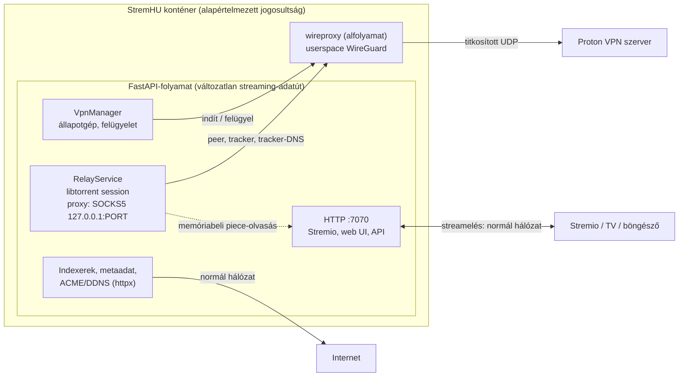
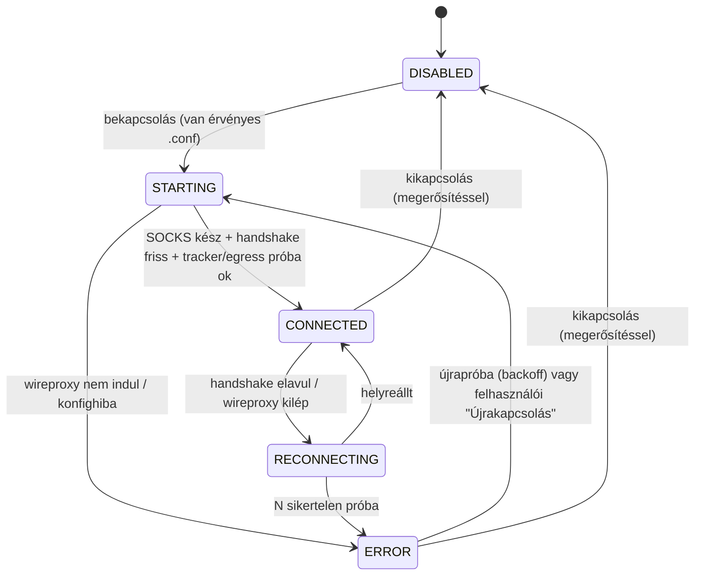

# StremHU Source — Beépített Proton VPN a torrentforgalomhoz: implementációs terv (Rev. 4, userspace, plug & play)

| Metaadat | Érték |
|---|---|
| **Típus / státusz** | Implementációs terv. **Az 1. fázis (backend mag) indítható**, a fázisonkénti nyitott kapuk (G1–G6) a [9. fejezetben](#9-fázisok-kapuk-és-elfogadási-feltételek). |
| **Dátum** | 2026-11-08 |
| **Alap** | `main` `2615596`; a megvalósítás a PR #9 (`feature/stability-and-optimization`) beolvasztása **után** ajánlott, lásd a [10. fejezetet](#10-viszony-a-pr-9-hez-featurestability-and-optimization). |
| **Felváltja** | Rev. 3 → [`archive/implementation-plan-rev3.md`](archive/implementation-plan-rev3.md) |
| **Alapdokumentumok** | [`review-rev3-findings.md`](review-rev3-findings.md) (miért nem a Rev. 3), [`userspace-poc-report.md`](userspace-poc-report.md) (mérési bizonyíték) |

---

## 1. Döntés röviden

- **Termékkövetelmény (felhasználói döntés, 2026-11-08):** *plug & play.* A felhasználó csak elindítja a konténert; ha van Proton VPN-je, a webes felületen konfigurálja. Nem kell `cap_add`, `/dev/net/tun`, kernelmodul vagy compose-módosítás.
- **Megoldás:** a konténerbe épített **userspace WireGuard** (wireproxy: wireguard-go + gVisor netstack), amely `127.0.0.1`-en SOCKS5 proxyt ad. **Csak a libtorrent** kapja meg ezt a proxyt.
- **Hatás:** a torrent le- és feltöltése, a trackerforgalom és a trackernevek DNS-feloldása a VPN-en megy. **A Stremio-streamelés, a webes felület, az indexerek, a metaadat, az ACME és a DDNS nem**: ezek a konténer normál hálózatán maradnak, mert a wireproxy nem hoz létre interfészt és nem módosít útvonalat.
- **Mit nyerünk:** a libtorrent a FastAPI-folyamatban marad, ezért a streamelési adatút (`stream/` ↔ `relay/`, piece-határidők, memóriabeli olvasás) változatlan. Nincs worker, osztott memória, IPC, network namespace és `SYS_ADMIN`.
- **Ára:**
  - a kill switch **alkalmazásszintű** (konfiguráció és proxykényszer, kernelszintű tiltás nélkül);
  - **nincs bejövő kapcsolat és porttovábbítás**, mert proxy módban a libtorrent nem nyit TCP-listenert;
  - VPN módban a **DHT és az uTP ki van kapcsolva**. Privát magyar trackereknél ez nem jár funkcióvesztéssel.
- **Bizonyíték:** a userspace PoC 8 forgatókönyve. Tunnel nélküli forgalom 0; a kill switch tunnel- és proxyhibánál is zár, és magától visszaáll. Részletek a [`userspace-poc-report.md`](userspace-poc-report.md)-ben.

## 2. Követelmények és nem-célok

| ID | Követelmény | Forrás |
|---|---|---|
| K1 | Telepítés extra Docker-jogosultság nélkül; a VPN teljesen a GUI-ból kezelhető. | Felhasználói döntés (plug & play) |
| K2 | Csak a torrentforgalom (peer, tracker, tracker-DNS) megy VPN-en; a streamelés és minden más nem. | Prompt 2.1, felhasználói megerősítés |
| K3 | Bekapcsolt VPN mellett a torrentforgalom soha nem vált automatikusan közvetlen kapcsolatra (fail-closed). A kikapcsolás csak tudatos, megerősített felhasználói művelet lehet. | Prompt 5.1–5.2 |
| K4 | Proton WireGuard `.conf` import, validálás, titkosított tárolás; a privát kulcs soha nem jelenik meg API-válaszban, logban vagy hibaüzenetben. | Prompt 6.1, 13 |
| K5 | A streamelés (Range/HEAD, piece-prioritás, lejátszói kompatibilitás) nem romlik. | Prompt 1.3, 7 |
| K6 | Alacsony erőforrásigény NAS-on, mérhető kerettel. | Prompt 14 |

**Nem célok (v1):**
- **Porttovábbítás / Proton NAT-PMP:** proxy módban nem lehetséges (PoC `inbound`).
- **Kernelszintű izoláció:** később opcionális „emelt védelem” lehet (Rev. 3 irány).
- **Az indexer-weboldalak VPN-en át:** későbbi, kapcsolható opció lehet, lásd a [11. fejezetet](#11-kockázatok).
- **Proton-fiókos (jelszavas) bejelentkezés.**

## 3. Kiinduló állapot (kód, `main` `2615596`)

| Hely | Mi van ott | Mit kell változtatni |
|---|---|---|
| `server/app/modules/relay/service.py` 22–25. sor | `libtorrent.session()` argumentum nélkül, majd `apply_settings` (`listen_interfaces = 0.0.0.0/[::]:6881`, DHT/LSD ki). A konstrukció és a beállítás között a libtorrent alapértékei élnek (UPnP/NAT-PMP be). | A session a **teljes beállításcsomaggal** jöjjön létre (`libtorrent.session(settings)`), VPN módban már proxyval. |
| `relay/service.py` 101–131. sor (`update_settings`) | A GUI relay-beállításai futás közben átírhatják a listen portot és bekapcsolhatják az UPnP/NAT-PMP-t. | VPN módban ezek felülíródnak: UPnP/NAT-PMP ki, listen nincs (proxy). |
| `server/app/sync.py` 34–35. sor | Az indulási szinkron példányosítja a `RelayService`-t (`get_relay_service()`), még bármely VPN-ellenőrzés előtt. | A session-konstrukcióhoz a VPN-beállítás már ekkor kell: a DB-ből olvasott hálózati szabály alapján. |
| `server/app/main.py` `lifespan` | `sync_database_and_settings` → … → `restore_torrents()` → `priority_manager_loop`. | A VPN-kezelő indítása a `restore_torrents()` **előtt**, leállítása a session után. |
| `server/app/modules/settings/` | Kulcs-érték `settings` tábla (`system`, `relay`, `network`), `save_*` minta (`exclude_unset`). | Új kulcs: `vpn`. **Nincs alembic-migráció** (rollback-biztos). |
| `server/app/boot/settings.py` `ensure_default_settings` | Alapértelmezett beállítások induláskor. | `save_vpn(VpnSettingsUpdate())` hozzáadása. |
| `server/app/config.py` 31. sor | `session_secret = "stremhu-source"` (nyilvános alapérték). | VPN-kulcs **nem** származtatható belőle; külön, automatikusan generált kulcsfájl kell (6.6). |
| `server/requirements.txt` | `cryptography==50.0.2` már függőség. | AES-GCM új függőség nélkül. |
| `Dockerfile` | `node-build` + `python:3.12-slim-bookworm` runtime, root, nincs `USER`. | Új build-stage a wireproxyhoz (8. fejezet). |
| `client/src/routes/_protected/dashboard/system/` | Admin rendszeroldalak (`network` alroute). | Új `vpn` alroute (7. fejezet). |

## 4. Architektúra

| Forgalom | Útvonal VPN módban |
|---|---|
| Torrent-peerek (letöltés, feltöltés), tracker-announce (HTTP/HTTPS/UDP), tracker-DNS | libtorrent → SOCKS5 → wireproxy → Proton |
| Stremio/Kodi/Nuvio streamelés, web UI, API | normál hálózat (változatlan) |
| Indexer-keresés, `.torrent` letöltése az oldalról, TMDB/Cinemeta, ACME, DDNS | normál hálózat (változatlan) |
| DHT, LSD, UPnP, NAT-PMP, uTP | **tiltva** VPN módban |

## 5. Biztonsági modell és kill switch

| Réteg | Mechanizmus | Bizonyítottság |
|---|---|---|
| L1 | A session **csak proxyval** jön létre VPN módban: `proxy_type=socks5`, `proxy_hostnames`, `proxy_peer_connections`, `proxy_tracker_connections`; DHT, LSD, UPnP, NAT-PMP, uTP ki (6.3). Már a konstruktorban, nem utólag. | PoC: 0 közvetlen csomag; a DHT bootstrap helyi DNS-szivárgása miatt kötelező a DHT tiltása. |
| L2 | **Proxy nélkül nincs út.** Ha a wireproxy nem fut, vagy a tunnel nem él, a SOCKS-kapcsolat meghiúsul, és a libtorrent megáll; közvetlen tartaléka nincs. | PoC `killswitch_tunnel`, `killswitch_proxy`: megállás, 0 közvetlen csomag, magától folytatja. |
| L3 | **Loopback-kötés** (defense in depth): `outgoing_interfaces = "127.0.0.1"`. Egy esetleges proxyt megkerülő libtorrent-kapcsolat loopback forráscímről indulna, ezért a kernel nem engedi ki. | **Nem igazolt → G2 kapu.** Ha a libtorrent proxyval így nem működik, a réteg elmarad, és ezt dokumentálni kell. |
| L4 | **Módváltás csak felhasználói művelettel:** be/ki kapcsoláskor `session.pause()` → beállítás → (VPN-nél) proxy kész → `resume()`. Automatikus visszaesés közvetlen módra nincs. A kikapcsoláshoz megerősítés kell. | **G3 kapu** (futás közbeni váltás aktív torrentekkel). |
| L5 | **Indulás:** ha a mentett beállítás `vpn_enabled=True`, a session proxyval jön létre. Ha a wireproxy nem indul el, az L2 miatt nincs forgalom, a GUI pedig hibát mutat. | Konstrukcióból következik + 1. fázis tesztje. |

**Maradék kockázat:** egy olyan libtorrent-kódút, amely a proxyt nem tartja be, szivárogna. Ilyet a PoC egyet talált (a DHT bootstrap-nevének helyi feloldása), ezt az L1 tiltja. A G2 és G4 kapu, valamint libtorrent-frissítéskor a szivárgási tesztkészlet ismételt futtatása csökkenti a kockázatot.

## 6. Backend-terv (fájlszinten)

### 6.1. Új modul: `server/app/modules/vpn/`

| Fájl | Felelősség |
|---|---|
| `wireguard_config.py` | Proton `.conf` parser és validátor: `[Interface] PrivateKey, Address, DNS`, `[Peer] PublicKey, PresharedKey?, Endpoint, AllowedIPs, PersistentKeepalive`. Ismeretlen vagy hiányzó kötelező mező, rossz base64, rossz CIDR és port esetén hiba. Kimenet: tipizált objektum + nem titkos metaadat (cím, DNS, végpont, publikus kulcs ujjlenyomat). |
| `secret_store.py` | AES-256-GCM (`cryptography`) a teljes konfigurációra. **Kulcs:** `VPN_SECRET_KEY` környezeti változó, ha meg van adva; különben az első induláskor generált `data/system/vpn.key` (32 bájt, `0600`) — **plug & play**. Verziózott boríték (`v1:`), kulcsrotáció a régi kulccsal visszafejtve és újratitkosítva. |
| `proxy_supervisor.py` | A wireproxy alfolyamat életciklusa. A futási konfigurációt `/dev/shm/stremhu-vpn/` alá írja (`0700` könyvtár, `0600` fájl), elindítja a wireproxyt (`-c`), megvárja a SOCKS-portot, majd **törli a konfigurációs fájlt**. Felügyel, exponenciális visszalépéssel újraindít, a kimenetet redaktálva logolja. |
| `manager.py` | `VpnManager`: állapotgép (6.4), az L4 módváltás, a health-ellenőrzés és az állapot publikálása az API felé. |
| `schemas/internal.py`, `schemas/api.py` | `VpnSettings`, `VpnSettingsUpdate`, `VpnStatusResponse`, `VpnConfigImportRequest` (camelCase alias, a meglévő minta szerint). |
| `router.py`, `dependencies.py` | Admin-végpontok (6.5). |

### 6.2. Módosuló fájlok

| Fájl | Változás |
|---|---|
| `settings/enums.py`, `settings/schemas/internal.py`, `settings/service.py` | `SettingsKeyEnum.VPN = "vpn"`. `save_vpn` / `get_vpn` a `save_relay` mintájára. Tárolt mezők: `vpn_enabled`, `encrypted_config`, `config_metadata`, `last_error_code`, `last_connected_at`. |
| `boot/settings.py` | `save_vpn(VpnSettingsUpdate())` az `ensure_default_settings`-ben. |
| `relay/service.py` | `RelayService.__init__` a teljes beállításcsomaggal hívja a `libtorrent.session(settings)`-t, a hálózati szabályt (`direct` / `vpn(proxy_port)`) egy új `torrent_network_policy()` függvény adja. Új `apply_network_policy(policy)`: pause → beállítás → resume. Az `update_settings` VPN módban nem kapcsolhatja be az UPnP/NAT-PMP-t, és nem állíthat listen portot. |
| `relay_settings/service.py` | A GUI-beállítások összehangolása a hálózati szabállyal (VPN módban a port- és UPnP-mező „VPN által kezelt”). |
| `sync.py` | Változatlan hívási sorrend, de a `RelayService` konstrukciója már a DB-ből olvasott VPN-szabállyal történik (nincs közvetlen ablak). |
| `main.py` (`lifespan`) | `VpnManager.start()` a `restore_torrents()` **előtt**. Leállítás: torrentek mentése → session → wireproxy. |
| `api.py` | `vpn` router felvétele. |
| `stream/router.py` | Ha VPN módban a tunnel nem él, a még el nem kezdett letöltésre a válasz egyértelmű legyen (`503`, `Retry-After`). A meglévő 206/0 bájt viselkedést a PR #9 utáni kódon kell újraellenőrizni (Rev. 3 bizonyítékjelentés 11A). |

### 6.3. Libtorrent-beállítások VPN módban

| Beállítás | Érték | Indok |
|---|---|---|
| `proxy_type` | `socks5` | Minden torrentforgalom a wireproxyn megy. |
| `proxy_hostname` / `proxy_port` | `127.0.0.1` / a supervisor által választott port | Csak loopback. |
| `proxy_hostnames` | `True` | A trackernevek a tunnelen oldódnak fel (PoC: 0 helyi DNS). |
| `proxy_peer_connections`, `proxy_tracker_connections` | `True` | Peer- és trackerforgalom a proxyn. |
| `enable_dht` | `False` | A PoC helyi DNS-szivárgást mért (DHT bootstrap). |
| `enable_lsd`, `enable_upnp`, `enable_natpmp` | `False` | LAN-multicast, illetve routerport-nyitás; VPN módban tilos. |
| `enable_outgoing_utp`, `enable_incoming_utp` | `False` | A wireproxyn az uTP nem épül ki; TCP elég. |
| `outgoing_interfaces` | `"127.0.0.1"` | L3 réteg, **G2 kapu után**. |
| `listen_interfaces` | (proxy módban nincs TCP-listener) | A PoC szerint proxy módban nem nyílik; a beállítást nem tekintjük védelemnek. |

Közvetlen (VPN nélküli) módban a mai beállítások maradnak.

### 6.4. Állapotgép

- **Minden nem-`DISABLED` állapotban** a libtorrent session proxymódban van: a torrentforgalom vagy a tunnelen megy, vagy áll. Állapotváltás közben sincs közvetlen forgalom.
- **Health:** a SOCKS-port elérhető, a WireGuard handshake friss, és egy próbakapcsolat a proxyn át sikeres. A wireproxy health- és metrikavégpontjának használhatósága a **G6 kapu**.

### 6.5. API (admin, `SessionGuard([UserRoleKey.ADMIN])`, `/api/vpn` alatt)

| Végpont | Funkció |
|---|---|
| `GET /api/vpn` | Beállítások és nem titkos metaadatok (cím, DNS, végpont, kulcs-ujjlenyomat, `hasConfig`). Privát kulcsot soha nem ad vissza. |
| `PUT /api/vpn` | `.conf` import (szövegként) és/vagy `enabled` kapcsoló. A kikapcsoláshoz `confirmUnprotected: true` kell. Validálás, titkosított mentés, az L4 módváltás alkalmazása. |
| `DELETE /api/vpn/config` | Konfiguráció törlése (csak kikapcsolt VPN mellett). |
| `GET /api/vpn/status` | Állapot, utolsó handshake, hibakód, a tunnel átviteli számlálói. |
| `POST /api/vpn/test` | Diagnosztika: handshake, DNS a tunnelen, próbakapcsolat a proxyn át, és annak ellenőrzése, hogy a libtorrent-beállítások a 6.3 szerintiek. |

### 6.6. Titokkezelés

- **Tárolás:** az `encrypted_config` AES-GCM-mel titkosítva a DB-ben; a kulcs külön fájlban (`data/system/vpn.key`) vagy környezeti változóban.
  - **Korlát:** a teljes adatkötet megszerzése ellen ez nem véd, csak a DB-mentés vagy DB-fájl kiszivárgása ellen. Ezt a felületen és a dokumentációban is ki kell mondani.
- **Futás közben:** a nyílt konfiguráció csak tmpfs-en (`/dev/shm`) él, a wireproxy indulása után törlődik.
- **Redakció:** `PrivateKey` és `PresharedKey` sem logban, sem kivételben, sem API-válaszban, sem a böngészőkonzolban. A wireproxy kimenete szűrve kerül a logba.

## 7. Frontend

- **Hely:** `client/src/routes/_protected/dashboard/system/vpn/` (admin), „VPN & Adatvédelem” címmel. A meglévő `network` oldal mintáját követi: TanStack Query + Form, zod, és az orval-generált kliens a szerver OpenAPI-specifikációjából.
- **Elemek:**
  - `.conf` beillesztése vagy feltöltése;
  - be/ki kapcsoló, a kikapcsoláskor megerősítő ablakkal;
  - állapotkártya: állapot, utolsó handshake, végpont, hibaüzenet;
  - „Teszt” gomb;
  - tájékoztató szöveg: *„Csak a torrent le- és feltöltése megy a VPN-en; a streamelés és a weboldal nem. VPN módban nincs porttovábbítás, a DHT és az uTP ki van kapcsolva.”*
- **Relay-beállítások oldal:** VPN módban a port és az UPnP/NAT-PMP mező zárolt, „VPN által kezelt” jelzéssel.

## 8. Docker

- **Új build-stage:** a wireproxy forrásból, rögzített verzióval:
  - `go install github.com/windtf/wireproxy/cmd/wireproxy@v1.1.3`, `CGO_ENABLED=0`, `-trimpath`; a Go-modulok sértetlenségét a `go.sum` és a checksum-adatbázis adja;
  - a v1.1.3 `go.mod` modulútvonala `github.com/windtf/wireproxy`, `go 1.26.0` — ezt a fordításkor ellenőrizni kell;
  - multi-arch (`amd64`, `arm64`) buildx-szel.
- **Másolás** a runtime image-be `/usr/local/bin/wireproxy`-ként (~10 MB).
- **Nincs** új `cap_add`, eszköz, compose-változás vagy AppArmor-kivétel (K1).
- **A PoC-ban** a kiadott bináris futott (v1.1.3 `linux_amd64`, SHA-256 a PoC-jelentésben). A forrásból fordított binárist a G-kapuk előtt ugyanazzal a tesztkészlettel újra kell mérni.

## 9. Fázisok, kapuk és elfogadási feltételek

### F0 — PoC (kész)
[`userspace-poc-report.md`](userspace-poc-report.md), 8 forgatókönyv.

**Nyitott kapuk:**

| Kapu | Tartalom | Ki/hol |
|---|---|---|
| G1 | Élő Proton: P2P és normál szerver; handshake, DNS a tunnelen, MTU, átviteli sebesség, szivárgásmentesség. | A felhasználó Proton `.conf`-jával, izolált környezetben. A kulcs nem kerül repóba vagy logba. |
| G2 | `outgoing_interfaces="127.0.0.1"` a proxyval működik-e, és megakadályoz-e egy szándékosan proxy nélküli kapcsolatot. | PoC-harness |
| G3 | Futás közbeni módváltás (VPN be/ki) aktív torrentekkel: 0 közvetlen csomag a váltás alatt. | PoC-harness |
| G4 | Magnet-metaadat (`ut_metadata`), web seed, HTTPS-tracker (SNI hostnévvel a proxyn át) szivárgásmentessége. | PoC-harness |
| G5 | NAS-erőforrásmérés a célgépen (CPU, RSS, 4K bitráta), `GOMEMLIMIT` hatása; arm64, ha releváns. | A felhasználó NAS-a |
| G6 | A wireproxy health- és metrikaadatai (handshake-idő) használhatók-e az állapotgéphez. | PoC-harness |

### F1 — Backend mag
- **Tartalom:** a 6.1–6.4 és 6.6 pont: `vpn` modul, settings, secret store, supervisor, manager, relay hálózati szabály.
- **Elfogadás:**
  - egységtesztek (parser, titkosítás és kulcsrotáció, supervisor hamis binárissal, állapotátmenetek, relay-szabály alkalmazása);
  - Ruff → basedpyright → teljes pytest zöld;
  - a session VPN módban már a konstruktorban proxyval jön létre (teszt).

### F2 — API és GUI
- **Tartalom:** 6.5 és 7. pont.
- **Elfogadás:**
  - a privát kulcs egyetlen API-válaszban sem szerepel (teszt);
  - a kikapcsolás megerősítés nélkül elutasítva;
  - frontend lint/format/build zöld, a kapcsolók viselkedési tesztjei zöldek.

### F3 — Docker
- **Tartalom:** 8. pont.
- **Elfogadás:**
  - az image alapértelmezett jogosultsággal indul;
  - a VPN a GUI-ból bekapcsolható;
  - a szivárgási tesztkészlet (a PoC-harness termékre portolt változata) 0 közvetlen csomagot mér;
  - a Stremio-streamelés VPN módban is a normál hálózaton megy.

### F4 — Validáció és dokumentáció
- **Tartalom:** a G1 és G5 kapu a felhasználóval, telepítési útmutató, README.
- **Mérési elfogadás**, a küszöbök a NAS-alapmérés **előtt** rögzítendők:
  - VPN módban 0 közvetlen torrent-csomag minden forgatókönyvben;
  - a kill switch 5 s-on belül megállítja a forgalmat, 0 közvetlen csomaggal, és magától visszaáll;
  - a streamelés p95-ös TTFB-je és megakadási aránya nem romlik a közvetlen módhoz képest a mérési zajon túl;
  - a wireproxy memóriája és CPU-ja a G5 alapján rögzített kereten belül marad.

## 10. Viszony a PR #9-hez (`feature/stability-and-optimization`)

- **Ütközések:** a PR #9 átírja a `lifespan`-t, a relay- és stream-kódot (CR09, CR13, CR15, CR17) és a settingset, valamint új alembic-revíziókat hoz. A VPN-változtatás ugyanezeket a pontokat érinti (`RelayService` konstrukció, `lifespan`, `relay_settings`), ezért a **megvalósítás a PR #9 beolvasztása után** induljon, az akkori kódra újraellenőrzött fájl- és sorhivatkozásokkal.
- **A CR15/a korlátos `.torrent`-letöltése** az indexer-HTTP-t érinti, ez a normál hálózaton marad, tehát nincs ütközés.
- **Plug & play ütközés a PR #9-ben:** a CR05 kötelezővé teszi a `SESSION_SECRET`-et (nélküle nem indul az alkalmazás). Javasolt: ha nincs megadva, első induláskor generált és az adatkötetben tárolt titok, a környezeti változó csak felülírja. Részletek: [`review-rev3-findings.md`](review-rev3-findings.md) 4. fejezet.

## 11. Kockázatok

| Kockázat | Hatás | Kezelés |
|---|---|---|
| Egy libtorrent-kódút nem tartja be a proxyt | IP-szivárgás | L1 tiltások, G2 loopback-kötés, G3/G4 tesztek; libtorrent-frissítéskor a tesztkészlet kötelező újrafuttatása. |
| A wireproxy ellátási lánca, karbantartása | Biztonsági vagy kompatibilitási kockázat | Rögzített verzió, forrásból fordítás, frissítéskor a szivárgási tesztkészlet. Tartalékként más userspace-megvalósítás vizsgálható. |
| Nincs porttovábbítás | Kevesebb peer, gyengébb ratio | A GUI-ban kimondva; a kernelszintű „emelt védelem” később adhat porttovábbítást. |
| A privát tracker figyeli, hogy az oldal- és announce-IP eltér | Figyelmeztetés vagy tiltás a trackeren | Dokumentálva; opció lehet az indexerforgalom VPN-en át (külön döntés). |
| NAS-erőforrás (wireproxy 80–90 MiB terhelés alatt a PoC-ban) | Memórianyomás kis NAS-on | G5 mérés, `GOMEMLIMIT`, rögzített keret. |
| A futó konfigurációban a nyílt kulcs | Kulcsszivárgás | tmpfs, `0600`, törlés indulás után, redakció. |

## 12. Visszaállítás és kompatibilitás

- **Nincs alembic-migráció.** A `vpn` kulcs a `settings` táblában van; egy régebbi image figyelmen kívül hagyja.
- **Ha egy régebbi, VPN-t nem ismerő image-re áll vissza a felhasználó, miközben `vpn_enabled=True`**, a torrentek VPN nélkül indulnának. Ezt a kiadási jegyzetben és a GUI-ban figyelmeztetésként kell jelezni, mert a régi kód ezt nem tudja megakadályozni.
- **A VPN kikapcsolása** csak felhasználói megerősítéssel, és csak a torrentforgalmat érinti; a streamelés mindkét módban azonos.

## 13. Hivatkozások

- [`userspace-poc-report.md`](userspace-poc-report.md), [`poc/userspace/`](poc/userspace/) (szkriptek, eredmény-JSON)
- [`review-rev3-findings.md`](review-rev3-findings.md), [`archive/implementation-plan-rev3.md`](archive/implementation-plan-rev3.md), [`phase0-evidence-report.md`](phase0-evidence-report.md)
- wireproxy: <https://github.com/whyvl/wireproxy> (ISC), v1.1.3
- libtorrent 2.1 settings: <https://www.libtorrent.org/reference-Settings.html>
