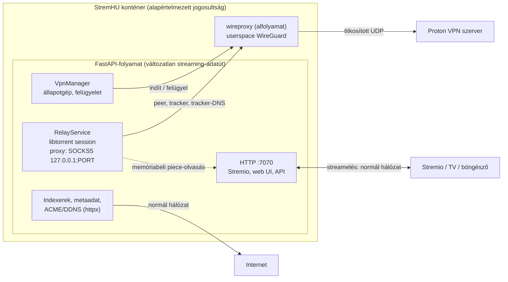
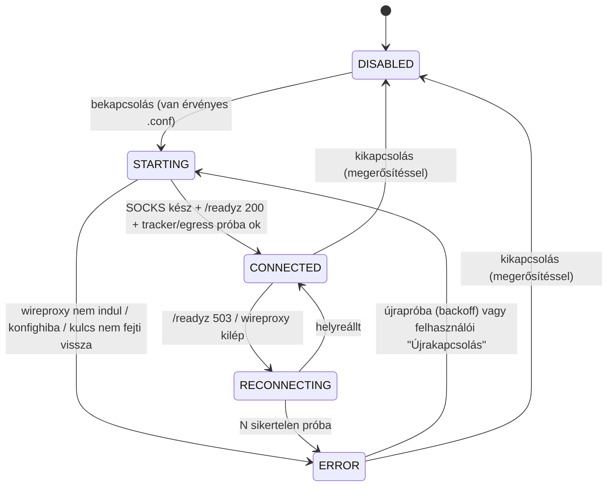

# StremHU Source — Beépített Proton VPN a torrentforgalomhoz: implementációs terv (Rev. 5, userspace, plug & play)

| Metaadat | Érték |
|---|---|
| **Típus / státusz** | Implementációs terv. **Az F1 (backend mag), az F2 (API és felület) és az F3 (Docker) elkészült** a `feature/vpn-integration` ágon, lásd az [F1](#f1-végrehajtási-állapot), az [F2](#f2-végrehajtási-állapot) és az [F3 végrehajtási állapotát](#f3-végrehajtási-állapot). A G2, G3, G4 és G6 kapu helyben kész, a G1 P2P szerverrel lefutott, az F4 felhasználói útmutatója elkészült ([`docs/vpn-beallitas.md`](../../vpn-beallitas.md)); a G5 a felhasználó szerverén lefutott; az F5 (több konfiguráció, automatikus átállás) és az F6 (sebességteszt) helyben kész; a funkció beolvasztva a fork `main` ágába (#17, 2026-11-28); nyitott a G1 maradéka (normál szerver) ([9. fejezet](#9-fázisok-kapuk-és-elfogadási-feltételek)). |
| **Dátum** | 2026-11-27 (Rev. 4: 2026-11-08) |
| **Ellenőrzött kódalap** | fork `main` `7bf93aa` (benne a PR #9, #11, #12, #13, #14, #15), beolvasztva a `feature/vpn-integration` ágba. A 3. fejezet fájl- és sorhivatkozásai erre a commitra igazak. |
| **Felváltja** | Rev. 4 (ugyanez a fájl, git-előzmény), Rev. 3 → [`archive/implementation-plan-rev3.md`](archive/implementation-plan-rev3.md) |
| **Alapdokumentumok** | [`review-rev3-findings.md`](review-rev3-findings.md) (miért nem a Rev. 3), [`userspace-poc-report.md`](userspace-poc-report.md) (mérési bizonyíték) |

---

## 0. Mi változott a Rev. 4-hez képest

A Rev. 5 nem új architektúra: a Rev. 4 userspace irányát a jelenlegi kódhoz és ellenőrzött külső tényekhez igazítja.

| # | Változás | Ok |
|---|---|---|
| R1 | **Indulási sorrend:** a `RelayService` ma a beállítások beolvasása **előtt** jön létre (`main.py` 97–98). A session ezért „zárt hálózati” beállításcsomaggal indul, és torrent csak a hálózati szabály alkalmazása után kerülhet bele (L6). | A Rev. 4 a régi `sync.py`-beli példányosításra épített. |
| R2 | **Hibakezelés:** a `sync_settings()` ma elnyeli a hibát (`relay_settings/service.py` 43. sor). VPN módban a szabály alkalmazásának hibája nem engedheti tovább a `restore_torrents()`-t. | Fail-closed (K3). |
| R3 | **Új GUI-kapcsolók a #292 óta:** titkosítás és uTP. VPN módban az uTP-kapcsoló is zárolt; a titkosítás a felhasználónál marad. | Upstream `99e76e6`. |
| R4 | **`listen_interfaces` VPN módban loopbackre** (`127.0.0.1:0`), nem „nincs listener” feltételezés. | A PoC nyitott UDP-socketet mért a valódi IP-n. |
| R5 | **Proxy-hitelesítés:** indításonként véletlen SOCKS5 felhasználónév/jelszó (`socks5_pw`). | A wireproxy `[Socks5]` szekciója támogatja; konténeren belüli visszaélés ellen. |
| R6 | **`anonymous_mode` marad `False`**, `dht_bootstrap_nodes` üres. | Privát trackerek kliens-fehérlistája; DHT-bootstrap DNS. |
| R7 | **UDP-tracker ellentmondás:** a wireproxy README-je szerint a SOCKS5 csak CONNECT-et tud (UDP a TODO-listán), a PoC viszont UDP-tracker-csomagot mért a tunnelcímről. A G4 tisztázza; ha nem megy, VPN módban a UDP-trackerek elmaradnak (fail-closed, nem szivárgás). | Ellenőrzött README (2026-11-27). **Feloldva a G2-ben:** a termékcsomaggal a UDP-tracker a tunnelen ment (`10.2.0.2` forrás), a README ezen pontja elavult. |
| R8 | **Health:** a wireproxy `-i/--info` kapcsolója `/readyz` és `/metrics` végpontot ad, a `CheckAlive` opcióval. A G6 ezzel szűkebb. | Ellenőrzött README. |
| R9 | **Docker:** a wireproxy kanonikus tárolója `github.com/windtf/wireproxy` (a `whyvl` URL ugyanezt szolgálja ki). Javasolt a kiadott, ellenőrzőösszeggel rögzített bináris (amd64, arm64) a forrásból fordítás helyett. | A PoC is ezt a binárist mérte. |
| R10 | **Lejátszás tunnelhiba alatt:** pontos javaslat a mai Range/időkorlát-viselkedésre épülve (`503` + `Retry-After`, csak ha a kért első darab nincs meg helyben). | A Rev. 4 csak „újraellenőrzést” írt elő. |
| R11 | **Titokkulcs:** a `SESSION_SECRET` a CR05 óta generált fájl; a VPN-kulcs ettől **függetlenül** marad külön fájlban. | Kulcscserekor (image-váltás, utólag megadott secret) a VPN-konfiguráció ne vesszen el. |

## 1. Döntés röviden

- **Termékkövetelmény (felhasználói döntés, 2026-11-08):** *plug & play.* A felhasználó csak elindítja a konténert; ha van Proton VPN-je, a webes felületen konfigurálja. Nem kell `cap_add`, `/dev/net/tun`, kernelmodul vagy compose-módosítás.
- **Megoldás:** a konténerbe épített **userspace WireGuard** (wireproxy: wireguard-go + gVisor netstack), amely `127.0.0.1`-en SOCKS5 proxyt ad. **Csak a libtorrent** kapja meg ezt a proxyt.
- **Hatás:** a torrent le- és feltöltése, a trackerforgalom és a trackernevek DNS-feloldása a VPN-en megy. **A Stremio-streamelés, a webes felület, az indexerek, a metaadat, az ACME és a DDNS nem**: ezek a konténer normál hálózatán maradnak, mert a wireproxy nem hoz létre interfészt és nem módosít útvonalat.
- **Fontos pontosítás a streamelésről:** a szerver és a lejátszó közti adatút nem megy a VPN-en, de a lejátszott adat a torrentből jön. A VPN sebessége és a kevesebb peer (lásd lent) ezért **közvetlenül hat** az indulási időre és az akadásra.
- **Mit nyerünk:** a libtorrent a FastAPI-folyamatban marad, ezért a streamelési adatút (`stream/` ↔ `relay/`, piece-határidők, memóriabeli olvasás) változatlan. Nincs worker, osztott memória, IPC, network namespace és `SYS_ADMIN`.
- **Ára:**
  - a kill switch **alkalmazásszintű** (konfiguráció és proxykényszer, kernelszintű tiltás nélkül);
  - **nincs bejövő kapcsolat és porttovábbítás**, mert proxy módban a libtorrent nem fogad bejövő peert;
  - VPN módban a **DHT és az uTP ki van kapcsolva**. Privát magyar trackereknél ez nem jár funkcióvesztéssel, de a ratio lassabban nő.
- **Bizonyíték:** a userspace PoC 8 forgatókönyve. Tunnel nélküli forgalom 0; a kill switch tunnel- és proxyhibánál is zár, és magától visszaáll. Részletek a [`userspace-poc-report.md`](userspace-poc-report.md)-ben.

## 2. Követelmények és nem-célok

| ID | Követelmény | Forrás |
|---|---|---|
| K1 | Telepítés extra Docker-jogosultság nélkül; a VPN teljesen a GUI-ból kezelhető. | Felhasználói döntés (plug & play) |
| K2 | Csak a torrentforgalom (peer, tracker, tracker-DNS) megy VPN-en; a streamelés és minden más nem. | Felhasználói megerősítés |
| K3 | Bekapcsolt VPN mellett a torrentforgalom soha nem vált automatikusan közvetlen kapcsolatra (fail-closed). A kikapcsolás csak tudatos, megerősített felhasználói művelet lehet. | Biztonsági követelmény |
| K4 | Proton WireGuard `.conf` import, validálás, titkosított tárolás; a privát kulcs soha nem jelenik meg API-válaszban, logban vagy hibaüzenetben. | Biztonsági követelmény |
| K5 | A streamelés (Range/HEAD, piece-prioritás, lejátszói kompatibilitás) közvetlen módban nem romlik; VPN módban a romlás mérve és a GUI-ban kimondva. | AGENTS.md 3. pont |
| K6 | Alacsony erőforrásigény NAS-on, mérhető kerettel. | Felhasználói környezet |

**Nem célok (v1):**
- **Porttovábbítás / Proton NAT-PMP:** proxy módban nem lehetséges (PoC `inbound`).
- **Kernelszintű izoláció:** később opcionális „emelt védelem” lehet (Rev. 3 irány).
- **Az indexer-weboldalak VPN-en át:** későbbi, kapcsolható opció lehet, lásd a [11. fejezetet](#11-kockázatok).
- **Proton-fiókos (jelszavas) bejelentkezés.**
- **Az upstream felé küldés:** ez fork-saját funkció, nem része az upstream PR-felbontási tervnek.

## 3. Kiinduló állapot (kód, fork `main` `7bf93aa`)

| Hely | Mi van ott | Mit kell változtatni |
|---|---|---|
| `server/app/modules/relay/service.py` 80. sor | `libtorrent.session()` argumentum nélkül, majd 89–113: `apply_settings` (`listen_interfaces = 0.0.0.0/[::]:6881`, `connections_limit` 300, DHT/LSD ki, időkorlátok). Az UPnP/NAT-PMP itt nincs beállítva, ezért a `sync_settings()`-ig a libtorrent alapértéke él (**be**). | A session a **teljes, zárt beállításcsomaggal** jöjjön létre (`libtorrent.session(settings)`), lásd L6 és 6.3. |
| `relay/service.py` 195–232. sor (`update_settings`) | Sávszélesség-korlát, kapcsolatkorlát, UPnP/NAT-PMP, torrentenkénti kapcsolat-szabály (PR-08), titkosítás és uTP (#292), port → `listen_interfaces`. | VPN módban a port, az UPnP/NAT-PMP és az uTP mezőt a hálózati szabály írja felül; a titkosítás és a korlátok maradnak. |
| `server/app/main.py` `lifespan`, 97–104. sor | `get_relay_service()` (97) → `sync_database_and_settings(app)` (98) → … → `restore_torrents()` (104). **A session a DB beolvasása előtt jön létre.** | A hálózati szabály (direct / vpn) a 98. és a 104. sor között alkalmazódik; torrent csak utána kerül a sessionbe (L6). |
| `main.py` leállítás, 152–194. sor | Sorrend: `relay-admission` → … → `pieces` → `final-resume` → `resume-writer` → … → `native-session` (187) → … → `relay-factory` (194). | Új lépés: `vpn-supervisor` a `native-session` **után** (a wireproxy túléli a sessiont, így leállításkor sincs közvetlen ablak). |
| `server/app/sync.py` 33–35. sor, `relay_settings/service.py` 26–43. sor | A `sync_settings()` a DB-ből alkalmazza a relay-beállításokat, a hibát `logger.exception`-nel elnyeli. | VPN módban a hiba nem nyelhető el: a `restore_torrents()` nem futhat (R2). |
| `server/app/modules/settings/` | Kulcs-érték `settings` tábla (`SettingModel`: `key`, JSON `value`), kulcsok: `system`, `relay`, `network` (`enums.py` 5–7). | Új kulcs: `vpn`. **Nincs alembic-migráció.** |
| `server/app/boot/settings.py` 9–23. sor | `ensure_default_settings` a `system` és `relay` alapértékeit menti. | `save_vpn(VpnSettingsUpdate())` hozzáadása. |
| `server/app/config.py` 44. sor | `load_or_create_session_secret`: a `SESSION_SECRET` (CR05) generált fájl a `data/system/` alatt, atomikus létrehozással. | A VPN-kulcs **külön** fájl (`data/system/vpn.key`), ugyanezzel az atomikus mintával (R11). |
| `server/requirements.txt` | `cryptography==50.0.2` már függőség. | AES-GCM új függőség nélkül. |
| `Dockerfile` | `node:24-bookworm-slim` build + `python:3.12-slim-bookworm` runtime, root, nincs `USER`. | Új lépés a wireproxyhoz (8. fejezet). |
| `client/src/routes/_protected/dashboard/system/` | Admin rendszeroldalak, köztük a `network` alroute. | Új `vpn` alroute (7. fejezet). |
| `client/src/routes/_protected/relay/settings/-features/` | `port.tsx` (port, UPnP/NAT-PMP), `peer-protocol.tsx` (titkosítás, uTP, #292), `connection.tsx`, `speed.tsx`. | VPN módban a `port.tsx` mezői és az uTP-kapcsoló zárolt, „VPN által kezelt” jelzéssel. |
| Python-oldali trackerforgalom | Nincs: a `server/app` alatt nincs scrape- vagy announce-hívás, a trackerforgalom kizárólag a libtorrenten megy. | Ezt egy regressziós ellenőrzés őrizze (6.2). |

## 4. Architektúra

| Forgalom | Útvonal VPN módban |
|---|---|
| Torrent-peerek (letöltés, feltöltés, magnet-metaadat), web seed, tracker-announce (HTTP/HTTPS), tracker-DNS | libtorrent → SOCKS5 → wireproxy → Proton (a G2-ben és a G4-ben mérve) |
| UDP-tracker | libtorrent → SOCKS5 UDP → wireproxy (a G2-ben mérve; libtorrent- vagy wireproxy-frissítéskor újramérendő) |
| Stremio/Kodi/Nuvio streamelés, web UI, API | normál hálózat (változatlan) |
| Indexer-keresés, `.torrent` letöltése az oldalról, TMDB/Cinemeta, ACME, DDNS | normál hálózat (változatlan) |
| DHT, LSD, UPnP, NAT-PMP, uTP | **tiltva** VPN módban |

## 5. Biztonsági modell és kill switch

| Réteg | Mechanizmus | Bizonyítottság |
|---|---|---|
| L1 | A session VPN módban **csak proxyval** fut: `proxy_type=socks5_pw`, `proxy_hostname=127.0.0.1`, `proxy_hostnames`, `proxy_peer_connections`, `proxy_tracker_connections`; DHT, LSD, UPnP, NAT-PMP, uTP ki; `dht_bootstrap_nodes=""` (6.3). | PoC: 0 közvetlen csomag; a DHT bootstrap helyi DNS-szivárgása miatt kötelező a DHT tiltása. A beállításnevek a libtorrent 2.1.1-ben ellenőrizve (2026-11-27). |
| L2 | **Proxy nélkül nincs út.** Ha a wireproxy nem fut, vagy a tunnel nem él, a SOCKS-kapcsolat meghiúsul, és a libtorrent megáll; közvetlen tartaléka nincs. | PoC `killswitch_tunnel`, `killswitch_proxy`: megállás, 0 közvetlen csomag, magától folytatja. |
| L3 | **Loopback-kötés** (defense in depth): `outgoing_interfaces="127.0.0.1"` és `listen_interfaces="127.0.0.1:0"`. Egy proxyt megkerülő kapcsolat loopback forráscímről indulna. | **G2-ben mérve:** mindkettővel megy a letöltés, 0 közvetlen csomag, TCP-listener nincs. A libtorrent SOCKS5-UDP socketje ezektől is `0.0.0.0:<véletlen>`-re köt; azon nem ment ki csomag, és a PoC szerint a bejövő forgalomra sem válaszol. |
| L4 | **Módváltás csak felhasználói művelettel:** be/ki kapcsoláskor `session.pause()` → beállítás → (VPN-nél) proxy kész → `resume()`. Automatikus visszaesés közvetlen módra nincs. A kikapcsoláshoz megerősítés kell. | **G3 kapu** (futás közbeni váltás aktív torrentekkel). |
| L5 | **Indulás mentett VPN-nel:** ha `vpn_enabled=True`, a szabály proxymódot ír elő. Ha a wireproxy nem indul el, az L2 miatt nincs forgalom, a GUI hibát mutat. | Konstrukcióból következik + F1-teszt. |
| L6 | **Zárt indulás (R1):** a session olyan csomaggal jön létre, amelyben nincs UPnP/NAT-PMP/LSD/DHT, és a listener loopbacken van. Torrent (`restore_torrents()`, új stream) csak a hálózati szabály **sikeres** alkalmazása után kerülhet be; VPN módban sikertelen alkalmazásnál nem kerül be (R2). | **F1-teszt** (invariáns: a szabály előtt 0 torrent, 0 UPnP/NAT-PMP). Mellékhatásként a mai közvetlen módú UPnP-ablak is megszűnik. |
| L7 | **Proxy-hitelesítés (R5):** indításonként véletlen felhasználónév és jelszó a wireproxy `[Socks5]` szekciójában és a libtorrentben (`proxy_username`, `proxy_password`). | A beállításnevek érvényesek (2.1.1), a wireproxy README támogatja; G2-ben mérni. |

**Maradék kockázat:** egy olyan libtorrent-kódút, amely a proxyt nem tartja be, szivárogna. Ilyet a PoC egyet talált (a DHT bootstrap-nevének helyi feloldása), ezt az L1 tiltja. A `force_proxy` kulcs a 2.1.1-ben még létezik, de a hatása nem igazolt, ezért nem támaszkodunk rá. A G2 és G4 kapu, valamint libtorrent-frissítéskor a szivárgási tesztkészlet ismételt futtatása csökkenti a kockázatot.

## 6. Backend-terv (fájlszinten)

### 6.1. Új modul: `server/app/modules/vpn/`

| Fájl | Felelősség |
|---|---|
| `wireguard_config.py` | Proton `.conf` parser és validátor: `[Interface] PrivateKey, Address, DNS`, `[Peer] PublicKey, PresharedKey?, Endpoint, AllowedIPs, PersistentKeepalive`. Ismeretlen vagy hiányzó kötelező mező, rossz base64, rossz CIDR és port esetén hiba. Kimenet: tipizált objektum + nem titkos metaadat (cím, DNS, végpont, publikus kulcs ujjlenyomat). Kiegészítő ellenőrzés: `wireproxy -n` (configtest) a generált futási konfigurációra. |
| `secret_store.py` | AES-256-GCM (`cryptography`) a teljes konfigurációra. **Kulcs:** `VPN_SECRET_KEY` környezeti változó, ha meg van adva; különben az első induláskor generált `data/system/vpn.key` (32 bájt, `0600`), a `load_or_create_session_secret` atomikus mintájával — **plug & play**. Verziózott boríték (`v1:`), kulcsrotáció a régi kulccsal visszafejtve és újratitkosítva. Ha a kulcs nem fejti vissza a konfigurációt, a VPN `ERROR` állapotba megy (újraimportálás kell), és **nem** vált közvetlen módra. |
| `proxy_supervisor.py` | A wireproxy alfolyamat életciklusa. A futási konfigurációt `/dev/shm/stremhu-vpn/` alá írja (`0700` könyvtár, `0600` fájl), véletlen SOCKS-porttal és -hitelesítéssel, `-i 127.0.0.1:<port>` health-végponttal indítja (`-c`), megvárja a SOCKS-portot és a `/readyz`-t, majd **törli a konfigurációs fájlt**. Felügyel, exponenciális visszalépéssel újraindít, a kimenetet redaktálva logolja. Tulajdonolt (owned) taskként fut, a meglévő leállítási rendben. |
| `manager.py` | `VpnManager`: állapotgép (6.4), az L4 módváltás, a health-ellenőrzés és az állapot publikálása az API felé. |
| `schemas/internal.py`, `schemas/api.py` | `VpnSettings`, `VpnSettingsUpdate`, `VpnStatusResponse`, `VpnConfigImportRequest` (camelCase alias, a meglévő minta szerint). |
| `router.py`, `dependencies.py` | Admin-végpontok (6.5). |

### 6.2. Módosuló fájlok

| Fájl | Változás |
|---|---|
| `settings/enums.py`, `settings/schemas/internal.py`, `settings/service.py` | `SettingsKeyEnum.VPN = "vpn"`. `save_vpn` / `get_vpn` a `save_relay` mintájára. Tárolt mezők: `vpn_enabled`, `encrypted_config`, `config_metadata`, `last_error_code`, `last_connected_at`. |
| `boot/settings.py` | `save_vpn(VpnSettingsUpdate())` az `ensure_default_settings`-ben. |
| `relay/service.py` | A `RelayService.__init__` a **zárt** csomaggal hívja a `libtorrent.session(settings)`-t (L6). Új `torrent_network_policy()` (`direct` / `vpn(proxy_port, auth)`) és `apply_network_policy(policy)`: pause → beállítás → resume. Az `update_settings` VPN módban nem kapcsolhatja be az UPnP/NAT-PMP-t és az uTP-t, és nem állíthat listen portot; minden GUI-módosítás után a VPN-felülírás újra érvényesül. |
| `relay_settings/service.py` | A `sync_settings()` VPN módban a hibát továbbadja (R2). A GUI felé a port-, UPnP- és uTP-mező „VPN által kezelt” jelzése. |
| `sync.py`, `main.py` (`lifespan`) | A 98. sor (`sync_database_and_settings`) után a `VpnManager.start()` alkalmazza a hálózati szabályt; csak siker esetén fut a `restore_torrents()` (104). Leállítás: a meglévő `native-session` lépés után `vpn-supervisor`. |
| `api.py` | `vpn` router felvétele. |
| `stream/service.py` (`prepare_for_stream`) | **R10:** ha a VPN be van kapcsolva, de nem `CONNECTED`, és a kért tartomány első darabja nincs meg helyben (`have_piece`), a válasz még a fejlécek előtt `503` + `Retry-After: 5` (a `stream/router.py` 303–309. és a `common/lifecycle.py` 15–16. sor meglévő mintájára). A helyben meglévő darabok tunnelhiba alatt is lejátszhatók. Ma ilyenkor `200/206` fejléc megy ki, majd a darabolvasás a `relay_piece_timeout_seconds` (120 s) / `relay_read_timeout_seconds` (15 s) után csonka választ ad. |
| `tests/` | Regressziós ellenőrzés, hogy a `server/app` alatt nincs Python-oldali tracker- vagy peerforgalom (a K2 a libtorrent-proxyn múlik). |

### 6.3. Libtorrent-beállítások

**Zárt indulócsomag (mindkét módban, a `session()` konstruktorában):** `enable_upnp=False`, `enable_natpmp=False`, `enable_lsd=False`, `enable_dht=False`, `listen_interfaces="127.0.0.1:0"`, a mai időkorlát- és korlátbeállításokkal. A közvetlen mód ezután a felhasználó relay-beállításait alkalmazza (port, UPnP/NAT-PMP, uTP stb.), ahogy ma a `sync_settings()`.

**VPN mód:**

| Beállítás | Érték | Indok |
|---|---|---|
| `proxy_type` | `socks5_pw` (3) | Minden torrentforgalom a wireproxyn megy, hitelesítéssel (L7). |
| `proxy_hostname` / `proxy_port` | `127.0.0.1` / a supervisor által választott port | Csak loopback. |
| `proxy_username` / `proxy_password` | Indításonként véletlen | L7. |
| `proxy_hostnames` | `True` | A trackernevek a tunnelen oldódnak fel (PoC: 0 helyi DNS). |
| `proxy_peer_connections`, `proxy_tracker_connections` | `True` | Peer- és trackerforgalom a proxyn. |
| `enable_dht` / `dht_bootstrap_nodes` | `False` / `""` | A PoC helyi DNS-szivárgást mért (DHT bootstrap). |
| `enable_lsd`, `enable_upnp`, `enable_natpmp` | `False` | LAN-multicast, illetve routerport-nyitás; VPN módban tilos. |
| `enable_outgoing_utp`, `enable_incoming_utp` | `False` | A wireproxyn az uTP nem épül ki; TCP elég. A GUI uTP-kapcsolója (#292) zárolt. |
| `listen_interfaces` | `"127.0.0.1:0"` | L3; a PoC a `0.0.0.0:6881` UDP-socketet a valódi IP-n nyitva találta. **G2:** a UDP-tracker a loopback-listenerrel is működik-e. |
| `outgoing_interfaces` | `"127.0.0.1"` (közvetlen módban `""`) | L3, mélységi védelem; a G2 óta be van kapcsolva. |
| `anonymous_mode` | `False` (marad) | A privát trackerek a klienst a peer-ID és a User-Agent alapján fehérlistázzák; anonim módban elutasíthatják. |
| `out_enc_policy`, `in_enc_policy` | A felhasználó beállítása (#292) | A titkosítás a peerprotokollon belül van, a SOCKS5-től független. |

### 6.4. Állapotgép

- **Minden nem-`DISABLED` állapotban** a libtorrent session proxymódban van: a torrentforgalom vagy a tunnelen megy, vagy áll. Állapotváltás közben sincs közvetlen forgalom.
- **Health (R8):** a wireproxy `-i 127.0.0.1:<port>` kapcsolóval `/readyz` (`503`, ha a `CheckAlive` célpont a `CheckAliveInterval` alatt, alapból 5 s, nem válaszol) és `/metrics` (a `wg show` adatai, köztük a handshake) végpontot ad. Nyitott kérdés a G6-ban: melyik `CheckAlive` célpont érhető el megbízhatóan a Proton-tunnelen át (pl. a belső DNS-cím), és ICMP-vel válaszol-e.

### 6.5. API (admin, `SessionGuard([UserRoleKey.ADMIN])`, `/api/vpn` alatt)

| Végpont | Funkció |
|---|---|
| `GET /api/vpn` | Beállítások és nem titkos metaadatok (cím, DNS, végpont, kulcs-ujjlenyomat, `hasConfig`); F5 óta a mentett konfigurációk listája, az aktív azonosító, `autoFailover`, `failoverAt`. Privát kulcsot soha nem ad vissza. |
| `PUT /api/vpn` | `.conf` import (szövegként, F5 óta a listához adva, opcionális névvel) és/vagy `enabled` kapcsoló; F5: `order`, `activeConfigId`, `autoFailover`. A kikapcsoláshoz `confirmUnprotected: true` kell. Validálás, titkosított mentés, az L4 módváltás alkalmazása. |
| `DELETE /api/vpn/configs/{id}` | Egy mentett konfiguráció törlése (F5; korábban `DELETE /api/vpn/config`). Bekapcsolt VPN mellett az utolsó nem törölhető. |
| `GET /api/vpn/status` | Állapot, utolsó handshake, hibakód, a tunnel átviteli számlálói (`/metrics`-ből). |
| `POST /api/vpn/speedtest` | Sebességteszt a tunnelen át (F6): letöltés, késleltetés, kilépő IP, összevetés a saját címmel (azt nem adja vissza). Csak kapcsolódott VPN mellett, egyszerre egy. |
| `POST /api/vpn/test` | Diagnosztika: handshake, DNS a tunnelen, próbakapcsolat a proxyn át, és annak ellenőrzése, hogy a libtorrent-beállítások a 6.3 szerintiek. |

### 6.6. Titokkezelés

- **Tárolás:** az `encrypted_config` AES-GCM-mel titkosítva a DB-ben; a kulcs külön fájlban (`data/system/vpn.key`) vagy környezeti változóban.
  - **Miért nem a `SESSION_SECRET`-ből:** az a gyakorlatban változhat (image-váltás az upstream és a fork között, utólag megadott secret). Ilyenkor a munkamenetek és a lejátszási linkek amúgy is újraindulnak, de a VPN-konfiguráció ne vesszen el.
  - **Korlát:** a teljes adatkötet megszerzése ellen ez nem véd, csak a DB-mentés vagy DB-fájl kiszivárgása ellen. Ezt a felületen és a dokumentációban is ki kell mondani.
- **Futás közben:** a nyílt konfiguráció csak tmpfs-en (`/dev/shm`) él, a wireproxy indulása után törlődik.
- **Redakció:** `PrivateKey`, `PresharedKey` és a SOCKS-jelszó sem logban, sem kivételben, sem API-válaszban, sem a böngészőkonzolban. A wireproxy kimenete szűrve kerül a logba.

## 7. Frontend

- **Hely:** `client/src/routes/_protected/dashboard/system/vpn/` (admin), „VPN & Adatvédelem” címmel. A meglévő `network` oldal mintáját követi: TanStack Query + Form, zod, és az orval-generált kliens a szerver OpenAPI-specifikációjából.
- **Elemek:**
  - `.conf` beillesztése vagy feltöltése;
  - be/ki kapcsoló, a kikapcsoláskor megerősítő ablakkal;
  - állapotkártya: állapot, utolsó handshake, végpont, hibaüzenet;
  - „Teszt” gomb;
  - tájékoztató szöveg: *„Csak a torrent le- és feltöltése megy a VPN-en; a streamelés és a weboldal nem. A lejátszás adata viszont a torrentből jön, ezért a VPN sebessége hat az indulásra. VPN módban nincs porttovábbítás, a DHT és az uTP ki van kapcsolva.”*
- **Relay-beállítások oldal:** VPN módban a `port.tsx` (port, UPnP/NAT-PMP) mezői és a `peer-protocol.tsx` uTP-kapcsolója zárolt, „VPN által kezelt” jelzéssel. A titkosítás és a korlátok szerkeszthetők maradnak.

## 8. Docker

- **Forrás:** a wireproxy kanonikus tárolója `github.com/windtf/wireproxy` (ISC, Go-modulútvonal `github.com/windtf/wireproxy`, `go 1.26.0`). A régi `whyvl/wireproxy` URL ugyanezt a tárolót szolgálja ki. Legutóbbi kiadás: **v1.1.3** (2026-07-16), `linux_amd64` és `linux_arm64` archívummal és `checksums.txt`-vel.
- **Javasolt út (R9): a kiadott bináris, rögzített ellenőrzőösszeggel.**
  - Architektúránként (`TARGETARCH`) a `wireproxy_linux_<arch>.tar.gz` letöltése egy build-stage-ben, a SHA-256 ellenőrzése a Dockerfile-ba beírt értékkel, eltérésnél a build megáll.
  - Az amd64-archívum ellenőrzött hash-e a PoC-jelentésben van (`e88c1d09…f51c`); az arm64-é a kiadás `checksums.txt`-jéből a megvalósításkor rögzítendő, és két független forrásból (letöltött fájl + `checksums.txt`) egyeztetendő.
  - Előny: a PoC pontosan ezt a binárist mérte, így a forrásból fordított bináris újramérése elmarad.
- **Alternatíva:** forrásból fordítás (`go install github.com/windtf/wireproxy/cmd/wireproxy@v1.1.3`, `CGO_ENABLED=0`, `-trimpath`, Go 1.26 build-stage). Ekkor a G-kapuk szivárgási tesztkészletét az így fordított binárissal újra kell futtatni.
- **Másolás** a runtime image-be `/usr/local/bin/wireproxy`-ként (~10 MB).
- **Nincs** új `cap_add`, eszköz, compose-változás vagy AppArmor-kivétel (K1).

## 9. Fázisok, kapuk és elfogadási feltételek

### F0 — PoC (kész)
[`userspace-poc-report.md`](userspace-poc-report.md), 8 forgatókönyv.

**Nyitott kapuk:**

| Kapu | Tartalom | Ki/hol |
|---|---|---|
| G1 | Élő Proton: P2P és normál szerver; handshake, DNS a tunnelen, MTU, átviteli sebesség, szivárgásmentesség. | **P2P szerverrel lefutott** (2026-11-27), lásd [G1 végrehajtási állapota](#g1-végrehajtási-állapot). Nyitott: normál (nem P2P) szerver, valódi torrentforgalom, MTU. |
| G2 | Az L3 és L7 réteg: `outgoing_interfaces="127.0.0.1"` és `listen_interfaces="127.0.0.1:0"` a proxyval működik-e (letöltés, HTTP- és UDP-tracker), megakadályoz-e egy szándékosan proxy nélküli kapcsolatot, és a `socks5_pw` hitelesítés működik-e a wireproxyval. | **Helyben kész**, lásd [G2 végrehajtási állapota](#g2-végrehajtási-állapot). |
| G3 | Futás közbeni módváltás (VPN be/ki) aktív torrentekkel: 0 közvetlen csomag a váltás alatt. | **Helyben kész**, lásd [G3 végrehajtási állapota](#g3-végrehajtási-állapot). |
| G4 | Magnet-metaadat (`ut_metadata`), web seed, HTTPS-tracker (SNI hostnévvel a proxyn át) szivárgásmentessége, és **a UDP-tracker a SOCKS5-ön** (R7): ha nem működik, VPN módban a UDP-trackerek elmaradnak, ezt a GUI jelzi. | **Helyben kész** (a UDP-tracker része a G2-ben), lásd [G4 végrehajtási állapota](#g4-végrehajtási-állapot). |
| G5 | NAS-erőforrásmérés a célgépen (CPU, RSS, 4K bitráta), `GOMEMLIMIT` hatása; arm64, ha releváns. | **Kész a felhasználó szerverén** (amd64, 4K lejátszás közben), lásd [G5 végrehajtási állapota](#g5-végrehajtási-állapot). |
| G6 | A `/readyz` és a `CheckAlive` használhatósága a Proton-tunnelen (célpont, ICMP), és a `/metrics` handshake-adata az állapotgéphez. | **Helyben kész** (kernel-WireGuard tesztszerverrel, lásd [G6 végrehajtási állapota](#g6-végrehajtási-állapot)); nyitott: a Proton belső címe válaszol-e a pingre (G1). A `/metrics` nincs bekötve. |

### F1 — Backend mag
- **Tartalom:** a 6.1–6.4 és 6.6 pont: `vpn` modul, settings, secret store, supervisor, manager, relay hálózati szabály, zárt indulás.
- **Elfogadás:**
  - egységtesztek (parser, titkosítás és kulcsrotáció, visszafejtési hiba → `ERROR`, supervisor hamis binárissal, állapotátmenetek, relay-szabály alkalmazása);
  - **L6-invariáns:** a hálózati szabály alkalmazása előtt 0 torrent és 0 UPnP/NAT-PMP; VPN módban sikertelen alkalmazásnál a `restore_torrents()` nem fut;
  - a session VPN módban proxyval fut, mielőtt bármely torrent bekerül (teszt);
  - Ruff → basedpyright → teljes pytest zöld.

#### F1 végrehajtási állapot

| Elem | Hely | Állapot |
|---|---|---|
| Hálózati szabály, zárt indulás, szabálykapu | `server/app/modules/relay/network_policy.py`, `relay/service.py` (`apply_network_policy`, `update_settings`, `add_torrent`) | Kész. Szabály nélkül az `add_torrent` `503`-at ad (`Retry-After: 5`); VPN módban a port, az UPnP/NAT-PMP és az uTP nem nyitható vissza, a titkosítás a felhasználónál marad. |
| WireGuard-feldolgozó | `vpn/wireguard_config.py` | Kész. Egy `[Interface]` + egy `[Peer]`; a `PostUp`-féle kulcsokat elutasítja; a hibák titokmentesek. |
| Titkos tároló | `vpn/secret_store.py` | Kész. AES-256-GCM `v1:` boríték; `VPN_SECRET_KEY` vagy `data/system/vpn.key`; rotáció a régi kulccsal. |
| wireproxy-felügyelő | `vpn/proxy_supervisor.py` | Kész. tmpfs-konfiguráció, törlés indulás után, redaktált kimenet; készenlét a SOCKS-port alapján. |
| Állapotgép | `vpn/manager.py`, `vpn/dependencies.py` | Kész. Bekapcsolt VPN-nél hiba esetén is proxymód marad (fail-closed). |
| Beállítások | `settings` (`VPN` kulcs, `VpnSettings`), `boot/settings.py` | Kész. Tárolt mezők: `vpn_enabled`, `encrypted_config`, `config_metadata`. |
| Életciklus | `main.py` `lifespan` | Kész. A szabály a `sync_database_and_settings()` után, a `restore_torrents()` előtt; a `vpn-supervisor` lépés a `native-session` után. |

**Eltérések a tervtől (F1):**
- A `last_error_code` és a `last_connected_at` nem a DB-ben, hanem a memóriabeli `VpnStatus`-ban van; az API (F2) innen olvassa.
- Az `outgoing_interfaces` nincs beállítva, a G2-ig vár.
- A wireproxy a `-i` health-porttal indul, de a `/readyz` még nincs használva (G6); a készenlét a SOCKS-porton mért.
- A wireproxy-bináris még nincs az image-ben (F3). Hiányában a VPN `ERROR` (`binary-missing`) állapotban, proxymódban marad.

**Ellenőrzés (2026-11-27, Windows, `server/.venv`):** Ruff hibátlan, basedpyright 0 hiba. Teljes `pytest tests`: 880 passed, 64 snapshot. A végleges kódon 9 futásból 7 zöld; 2 futásban egy-egy nem VPN-es teszt (`test_indexer_cache_swr`, illetve egy fixture) `WinError 10055` (Windows socketpuffer-kifogyás) hibával állt le, mindkétszer még az új tesztek előtt. A változatlan `main` 8 futásból 8-szor zöld volt. A hiba Windows-specifikus (az asyncio itt TCP-loopbackkel készít belső socketpárt): Linux-konténerben (az ág image-e, hálózat nélkül) a teljes csomag 5 futásból 5-ször zöld, 880 passed.

**Helyi Docker-próba (2026-11-27, az ág image-e, eldobható kötet, internet nélküli belső hálózat):**

| Eset | Figyelő socketek (IPv4) | Egyéb |
|---|---|---|
| VPN ki | `172.20.0.2:6881` és `127.0.0.1:6881` (TCP, UDP), `0.0.0.0:7070` | A közvetlen szabály az indulás után érvényesült; a `vpn` beállítássor létrejött. |
| VPN be, konfiguráció nélkül | `0.0.0.0:7070`, és egy **`0.0.0.0:<véletlen>` UDP-socket** | A 6881-es porton semmi; a napló `operation=vpn-config reason=missing-config`. Fail-closed. |

- **G2-höz fontos:** a `0.0.0.0`-ra kötött UDP-socket csak VPN módban jelenik meg, tehát a libtorrent proxymódjához tartozik (valószínűleg a SOCKS5 UDP-hez). A `listen_interfaces="127.0.0.1:0"` nem köti loopbackre. A G2 vizsgálja meg, hogy az `outgoing_interfaces="127.0.0.1"` megköti-e, és hogy erről a socketről megy-e ki bármi a proxy megkerülésével (a PoC szerint nem).
- A leállítás mindhárom indításnál 0-s kilépési kóddal, cleanup-hiba nélkül futott le. Új tesztek: `test_relay_network_policy.py`, `test_vpn_wireguard_config.py`, `test_vpn_secret_store.py`, `test_vpn_proxy_supervisor.py` (valódi alfolyamat, hamis wireproxyval), `test_vpn_manager.py`, és a `test_lifespan_cleanup.py` sorrendtesztje (szabály a visszatöltés előtt, wireproxy a natív session után). Élő Proton, Docker-image és szivárgásmérés nem futott (F3, G1–G6).

### F2 — API és GUI
- **Tartalom:** 6.5 és 7. pont, a `prepare_for_stream` 503-as ága (R10).
- **Elfogadás:**
  - a privát kulcs és a SOCKS-jelszó egyetlen API-válaszban sem szerepel (teszt);
  - a kikapcsolás megerősítés nélkül elutasítva;
  - VPN módban a port-, UPnP- és uTP-mező zárolt, és API-n át sem kapcsolható be;
  - frontend lint/format/build zöld, a kapcsolók viselkedési tesztjei zöldek.

#### F2 végrehajtási állapot

| Elem | Hely | Állapot |
|---|---|---|
| Admin-API | `vpn/router.py`, `vpn/service.py`, `vpn/schemas.py` | Kész: `GET/PUT /api/vpn`, `DELETE /api/vpn/config`, `GET /api/vpn/status`, `POST /api/vpn/test`. Az admin-ellenőrzés a szolgáltatás előtt fut. A kikapcsoláshoz `confirmUnprotected`, a bekapcsoláshoz mentett konfiguráció kell; bekapcsolt VPN mellett a konfiguráció nem törölhető (`409`). |
| Futás közbeni váltás (L4) | `vpn/manager.py` (`apply_settings`) | Kész. Be: a relay azonnal proxymódba vált, a forgalom a tunnelig áll; ki: a felügyelő leáll, majd közvetlen mód. |
| Lejátszás tunnelhiba alatt (R10) | `stream/service.py` (`prepare_for_stream`), `relay/entities.py` (`File.has_byte`), `vpn/state.py` | Kész: `503` + `Retry-After: 5`, ha a VPN be van kapcsolva, nem `CONNECTED`, és a kért első darab nincs meg helyben. |
| Relay-mezők zárolása | `relay_settings/service.py`, `settings/schemas/api.py` (`vpn_managed`) | Kész: VPN módban a port, az UPnP/NAT-PMP és az uTP módosítása `409`; a válaszban `vpnManaged`. |
| Felület | `client/src/routes/_protected/dashboard/system/vpn/`, `-features/vpn-info.tsx`, `relay/settings/-features/port.tsx`, `peer-protocol.tsx` | Kész: „VPN & Adatvédelem” oldal (beillesztés/feltöltés, kapcsoló megerősítéssel, állapot, teszt), kártya a Rendszer oldalon, zárolt port-, UPnP- és uTP-mező. |

**Eltérések (F2):**
- A kliens VPN-hívásai kézzel írtak (`client/src/shared/lib/source/vpn-client.ts`), mert a generált `source-client.ts` már a VPN előtt el volt csúszva a szerverhez képest (feliratvégpontok, opcionális mezők). Az újragenerálás külön feladat.
- A `POST /api/vpn/test` és a `GET /api/vpn/status` még nem ad handshake-, DNS- és forgalmi adatot; ezek a wireproxy `/readyz` és `/metrics` végpontjára épülnek (G6).

**Ellenőrzés (2026-11-27):**
- Backend: Ruff hibátlan, basedpyright 0 hiba; teljes `pytest tests` Windowson 889 passed, Linux-konténerben 2/2 futás 889 passed. Új: `test_vpn_api.py` (titokmentes válasz, megerősítés, törlési tilalom, admin-védelem, relay-zárolás, `503`-ág), a `test_vpn_manager.py` futás közbeni váltása.
- Kliens: a teljes `npm run lint` és `npm run format` hibátlan, `npx vitest run` 15 passed (új: `-vpn-page.test.tsx`: kikapcsolás csak megerősítés után, konfiguráció nélkül nem kapcsolható be), `npm run build` sikeres.
- Docker (az ág image-e, belső hálózat): az app elindul, a VPN-végpontok munkamenet nélkül `401`-et adnak, a leállítás 0-s kilépési kóddal fut le.
- **Nem futott:** bejelentkezett, végponttól végpontig tartó próba Dockerben (admin-bootstrap kell), valódi wireproxy (F3), élő Proton.

### F3 — Docker
- **Tartalom:** 8. pont.
- **Elfogadás:**
  - az image alapértelmezett jogosultsággal indul;
  - a VPN a GUI-ból bekapcsolható;
  - a szivárgási tesztkészlet (a PoC-harness termékre portolt változata) 0 közvetlen csomagot mér;
  - a Stremio-streamelés VPN módban is a normál hálózaton megy.

#### F3 végrehajtási állapot

- **Megvalósítás:** a `Dockerfile` új `wireproxy` stage-e a `docker/fetch_wireproxy.py` szkripttel letölti a `windtf/wireproxy` v1.1.3 kiadott archívumát (`TARGETARCH`: `amd64` vagy `arm64`), ellenőrzi az archívum SHA-256-ját, és a binárist `/usr/local/bin/wireproxy`-ként másolja a runtime image-be. Eltérésnél a build megáll. Az alapjogosultság, a compose és a `cap_add` nem változik.
- **Rögzített hash-ek:**
  - amd64-archívum: `e88c1d09…f51c`. Egyezik a kiadás `checksums.txt`-jével, a kiadási oldallal és a PoC-jelentéssel.
  - amd64-bináris: `70ae5e52…466d`, a PoC-ban mért érték; a build ezt is ellenőrzi.
  - arm64-archívum: `370e00bd…21b6`. Egyezik a `checksums.txt`-vel és a kiadási oldallal.

**Ellenőrzés (2026-11-27, helyi Docker):**

| Próba | Eredmény |
|---|---|
| amd64 build | Sikeres; az archívum- és a bináris-hash egyezik; `wireproxy -v`: `1.1.3`, kb. 10 MB. |
| Szándékosan rossz archívum-hash | A build `archive checksum mismatch` hibával megáll. |
| arm64 | A helyi builder nem tudta betölteni az arm64-es Python alapimage-et, ezért nem épült. Az archívum közvetlenül letöltve: a hash egyezik a rögzítettel, a benne lévő `wireproxy` aarch64 ELF. A teljes arm64-build a CI-ben (buildx, `linux/amd64,linux/arm64`) fut le először. |
| VPN be, eldobható tesztkulcs, elérhetetlen végpont, belső hálózat | A wireproxy fut (`-c <tmpfs>`, `-i 127.0.0.1:<port>`); a tmpfs-mappa üres, `0700`; a SOCKS és a health csak `127.0.0.1`-en figyel; a 6881-es porton semmi; a tesztkulcs nem szerepel a naplóban. |
| A wireproxy kilövése (`kill -9`) | A felügyelő kb. 1 s alatt újraindította (új PID), a naplóban `operation=vpn-proxy-exit code=-9`. |
| Leállítás | 0-s kilépési kód, cleanup-hiba nélkül. |

**Megfigyelés (G6, azóta megoldva):** elérhetetlen WireGuard-végpont mellett is elindul a SOCKS-proxy, így a SOCKS-port alapú készenlét szerint az állapot `CONNECTED` volt, holott handshake nem történt. A [G6](#g6-végrehajtási-állapot) óta az állapot a `/readyz` + `CheckAlive` válaszát követi.

**Nem futott:** a PoC-harness termékre portolt szivárgási tesztkészlete (0 közvetlen csomag), élő Proton (G1), NAS-mérés (G5).

#### G1 végrehajtási állapot

- **Környezet (2026-11-27):** a felhasználó Proton VPN Plus `.conf`-ja (magyar P2P szerver), a felhasználó kifejezett engedélyével. A fájl csak olvashatóan volt csatolva a tesztkonténerekbe, a tartalma sehol nem jelent meg. Az ág image-e, helyi Docker, alapértelmezett bridge-hálózat. Élő trackerhez nem csatlakozott, torrent nem futott. A titkosított konfigot tartalmazó eldobható kötet a teszt után törölve.
- **A konfig:** érvényes; 2 cím (IPv4 + IPv6), 2 DNS-cím (`10.2.0.1` és egy IPv6-os), `AllowedIPs` IPv4 + IPv6, `PersistentKeepalive = 25`.

| Próba | Eredmény |
|---|---|
| Az app a saját útján (import, bekapcsolás) | Valódi handshake (a `/metrics` `last_handshake_time_sec` értéke friss), forgalom a tunnelen. |
| `CheckAlive` a konfig mindkét DNS-címére (a G6 alapértéke) | Az IPv4-es `10.2.0.1` válaszol a pingre, az IPv6-os **soha** → a `/readyz` folyamatosan `503`, és 30 s után `no-handshake` hiba **működő tunnel mellett**: a forgalom fölöslegesen leállt volna. |
| Javítás után (`CheckAlive` alapból csak az IPv4-es DNS-címek) | A `/readyz` `200`, 45 s után sincs `no-handshake`; az állapot `CONNECTED`. |
| Önálló wireproxy ugyanazzal a konfiggal, saját SOCKS-hitelesítéssel | `/readyz` 0,5 s alatt `200`; a névfeloldás a proxyn át működik (DNS a tunnelen); letöltés 25 MB / 3,0 s ≈ **66 Mbit/s** (egy TLS-kapcsolat, Cloudflare sebességteszt-végpont). |
| Kilépő IP | `146.70.x.x`; nem azonos a konfig belépőcímével (a Protonnál gyakori a külön kilépőcím). Hogy nem a felhasználó otthoni címe, azt szándékosan nem ellenőriztük gépileg (ehhez az otthoni címet egy külső szolgáltatásnak kellett volna elküldeni); a felhasználó össze tudja vetni. |

- **Kódváltozás a G1 nyomán:** `wireguard_config.check_alive_targets()` alapból csak az IPv4-es DNS-címeket adja (ha nincs ilyen, az elsőt); a `VPN_CHECK_ALIVE` felülírása változatlan.
- **Nyitott:** normál (nem P2P) szerver, valódi torrentforgalom élő swarmmal (a G2 szimulált kilépővel mérte), MTU-hangolás, hosszabb távú stabilitás.

#### G3 végrehajtási állapot

- **Mérés (2026-11-27):** a PoC tesztkörnyezete két új forgatókönyvvel, amelyek 25%-os letöltöttség után ugyanúgy váltanak, mint a termék `apply_network_policy()`-ja: `pause()` → `apply_settings(csomag)` → `resume()`. A csomagok a termék `vpn_settings()` és `direct_settings()` értékei. A váltás után 2 s türelmi idő jár a pause által bontott régi kapcsolatok csomagjainak; az ezutáni közvetlen csomagokat külön számolja (`tcpdump -tt`). Eredmények: [`poc/userspace/results/g3-runtime-switch-results.json`](poc/userspace/results/g3-runtime-switch-results.json).

| Forgatókönyv | Váltás | Közvetlen csomag a türelmi időben | Közvetlen csomag utána | Letöltés |
|---|---|---|---|---|
| `switch_to_vpn` (közvetlen → VPN) | 41%-nál | 278 (a régi közvetlen uTP-kapcsolat: a seeder még küldött, a kliens nyugtázott) | **0** | Kész, SHA ok, a tunnelen fejeződött be (a trackernél a tunnelcím jelent meg) |
| `switch_to_direct` (VPN → közvetlen) | 54%-nál | 0 | szándékosan közvetlen | Kész, SHA ok |
| `vpn_product_bind` (kontroll) | — | — | 0 | 12,5 s, SHA ok |
| `direct` (kontroll) | — | — | 234 617 | 13,0 s, SHA ok |

- **Értékelés:**
  - A VPN-re váltás után 2 s-on belül megszűnik minden közvetlen forgalom; új közvetlen kapcsolat nem jön létre.
  - A váltás pillanatában a már futó közvetlen kapcsolatok peerjei a valódi IP-t a váltás előtt is ismerték; ezt a váltás nem tudja visszamenőleg elrejteni. A felületi szöveg erre kitérhet.
- **Megjegyzés:** a váltás után mindkét irányban kb. 60 s kellett a befejezéshez. Ez a PoC-kliens beállítása: nem állítja a `min_reconnect_time`-ot, így a libtorrent alapértelmezett 60 s-a érvényes. A termék 5 s-ot állít be, ott gyorsabb újrakapcsolódás várható; ezt nem mértük.
- **Harness-javítás:** a `switch_to_vpn` a `direct` kontrollhoz hasonlóan helyi trackerfeloldást kap (különben a közvetlen fázisban nincs peer). A váltás után a libtorrent a neveket a proxyn át oldja fel, így ez ott nem takar el semmit.

#### G2 végrehajtási állapot

- **Mérés:** a PoC tesztkörnyezete (szimulált Proton-kilépő kernel-WireGuarddal, seeder, internet nélküli belső hálózatok, 256 MiB-os hibrid torrent), két új forgatókönyvvel. Eredmények: [`poc/userspace/results/g2-product-pack-results.json`](poc/userspace/results/g2-product-pack-results.json), futtatás: `POC_RESULTS_NAME=g2-product-pack-results.json python run_userspace_poc.py vpn_tcp vpn_product vpn_product_bind direct`.
  - `vpn_product`: a termék `vpn_settings()` csomagja (`socks5_pw` hitelesítéssel, `listen_interfaces="127.0.0.1:0"`, DHT-bootstrap üres);
  - `vpn_product_bind`: ugyanez `outgoing_interfaces="127.0.0.1"`-gyel;
  - kontrollok: a régi `vpn_tcp` és a VPN nélküli `direct`.
- **wireproxy:** az image-ből kimásolt, ellenőrzött v1.1.3 bináris (`70ae5e52…466d`).

| Forgatókönyv | Letöltés | Közvetlen csomag (swarm / WAN) | Helyi DNS | UDP-tracker a kilépőn | libtorrent-socketek |
|---|---|---|---|---|---|
| `vpn_tcp` (régi) | 12,5 s, SHA ok | 0 / 0 | 0 | a tunnelcímről | UDP `0.0.0.0:6881` |
| `vpn_product` | 12,5 s, SHA ok | 0 / 0 | 0 | a tunnelcímről | UDP `0.0.0.0:<véletlen>`, TCP-listener nincs |
| `vpn_product_bind` | 13,0 s, SHA ok | 0 / 0 | 0 | a tunnelcímről | UDP `0.0.0.0:<véletlen>`, TCP-listener nincs |
| `direct` (kontroll) | 13,3 s, SHA ok | 229 996 / 7 | 0 | a valódi címről | listenerek minden interfészen |

- **Következmények:**
  - A `socks5_pw` hitelesítés működik a wireproxyval (L7).
  - Az `outgoing_interfaces="127.0.0.1"` nem rontja a proxyn át menő forgalmat, ezért a G2 óta a termékcsomag része (`network_policy.vpn_settings()`; közvetlen módban üres).
  - A libtorrent SOCKS5-UDP socketje egyik beállítással sem köthető loopbackre. Ezen a mérésben nem ment ki semmi; a kockázat elfogadott, libtorrent-frissítéskor újramérendő.
  - A UDP-tracker a SOCKS5-ön át működik (R7 feloldva).

#### G4 végrehajtási állapot

- **Mérés (2026-11-27):** a PoC tesztkörnyezete négy új forgatókönyvvel, mind a termék `vpn_settings()` csomagjával (`socks5_pw`, loopback-kötés). Eredmények: [`poc/userspace/results/g4-magnet-webseed-https-results.json`](poc/userspace/results/g4-magnet-webseed-https-results.json), futtatás: `POC_RESULTS_NAME=g4-magnet-webseed-https-results.json python run_userspace_poc.py vpn_magnet vpn_webseed vpn_https_tracker vpn_https_untrusted`.
  - `vpn_magnet`: csak magnetlink (v1 info-hash és HTTP-tracker); a metaadatot a peer adja (`ut_metadata`).
  - `vpn_webseed`: trackerek nélkül; az egyetlen forrás a seeder HTTP web seedje (`http://seed.poc.test:8080/…`, Range-kérések).
  - `vpn_https_tracker`: csak HTTPS-tracker (`https://tracker.poc.test:6970`), eldobható teszt-CA által aláírt tanúsítvánnyal; a kliens az `SSL_CERT_FILE`-lal bízik a CA-ban.
  - `vpn_https_untrusted`: ugyanez az image rendszer-CA-listájával (negatív kontroll a tanúsítvány-ellenőrzésre).
  - A szimulált kilépő a neveket csak a tunnelen át oldja fel. A seeder (BitTorrent és HTTP) és a tracker minden kérést a forráscímmel naplóz, a TLS-tracker a kézfogás SNI-nevével együtt.

| Forgatókönyv | Letöltés | Közvetlen csomag (swarm / WAN) | Helyi DNS | Amit a túloldal látott |
|---|---|---|---|---|
| `vpn_magnet` | metaadat 1,0 s, kész 2,5 s, SHA ok | 0 / 0 | 0 | A trackernév a tunnel DNS-én (`10.2.0.2`); a seeder bejövő kapcsolata a kilépőcímről (`172.30.20.2`). |
| `vpn_webseed` | kész 2,0 s, SHA ok | 0 / 0 | 0 | `seed.poc.test` a tunnel DNS-én; 20 HTTP-kérés (256 MiB) csak a kilépőcímről; BitTorrent-peer nem volt. |
| `vpn_https_tracker` | kész 2,5 s, SHA ok | 0 / 0 | 0 | 4 sikeres TLS-kézfogás a tunnelcímről, SNI: `tracker.poc.test`; az announce-ok HTTPS-en, a tunnelcímről. |
| `vpn_https_untrusted` | nem indult el (várt eredmény) | 0 / 0 | 0 | A kliens `certificate verify failed` hibával bontja a kézfogást (a szerveren `unknown ca`); announce nem érkezett, sima HTTP-re nem esett vissza. |

- **Következmények:**
  - A magnet-metaadat, a web seed és a HTTPS-tracker is a proxyn megy; a hostneveket a wireproxy a tunnelen oldja fel (`proxy_hostnames`). A G4 nem igényel termékkód-változást.
  - A HTTPS-trackerek tanúsítvány-ellenőrzése a proxyn át is érvényes (`validate_https_trackers`, a libtorrent alapértéke; a termék nem módosítja). A VPN-szolgáltató így a tracker nevét látja (DNS, SNI), az announce URL-jében lévő passkey-t nem. Ezt a beállítást VPN módban sem szabad kikapcsolni.
  - A termék a relaybe `.torrent`-fájlt tesz; magnetet csak a Torznab-kimenet ad más klienseknek. A magnetút mérése a teljességet szolgálja.
- **Harness-javítás:** az első futásban a magnet első announce-a megelőzte a seeder első regisztrációját a trackeren. A válasz 0 peer volt, és a libtorrent a `min_announce_interval` (300 s) miatt csak az időkorlát végén announce-olt újra; a metaadat ekkor azonnal megjött. A vezérlő most megvárja a seeder announce-át (v1 és v2), mielőtt az első forgatókönyv indul. Abban a futásban a 6 „WAN”-csomag ICMP „port unreachable” volt a WireGuard-végpont felé: a wireproxy leállítása után a végpont még küldött csomagot. Ez nem torrentforgalom.
- **Korlátok:** a futási idők nem teljesítménymérések (a G2-ben a hasonló letöltés 12,5 s volt, az eltérés okát nem vizsgáltuk). IPv6-on csak link-szintű MLD-jelentések mentek ki. A SOCKS5-UDP socket `0.0.0.0`-ra köt (G2, elfogadott kockázat). Élő vagy valódi HTTPS-trackert (pl. nCore) a G4 nem ért el.

#### G5 végrehajtási állapot

- **Mérés (2026-11-27, a felhasználó szerverén, csak olvasó hozzáféréssel):**
  - Célgép: Ubuntu Server, Intel Core i7-4720HQ (4 mag / 8 szál, AVX2), kb. 15 GiB RAM, amd64.
  - Image: a `feature/vpn-integration` ág, a felhasználó webes frissítőjével buildelve. A termékkód azonos a `4cecffb`-ével (két kulcsfájl hash-e alapján). `network_mode: host`, extra jogosultság nélkül.
  - Terhelés: a VPN bekapcsolva (Proton), közben a felhasználó egy 4K lejátszást indított.
  - Mintavétel: `/proc` CPU- és hálózati bájtszámlálók 3 × 10 s-ig, szálankénti CPU 5 s-ig, valamint egy `docker stats` pillanatkép.

| Mit | Érték |
|---|---|
| VPN-állapot | `/readyz` 200; a torrentporton (6881) nincs TCP/UDP figyelő; kb. 61 kapcsolat a helyi SOCKS-proxyn át |
| Letöltés (a hálózati kártya bejövő forgalma, minden forgalommal együtt) | 73–80 Mbit/s |
| wireproxy CPU | 88–96% (kb. 1 mag) 15 szálon; a legterheltebb szál kb. 11% |
| StremHU-folyamat CPU | 15–19% |
| A gép terhelése | load 1,6 (8 szálon) |
| Memória | a konténer kb. 380 MiB (pillanatkép), ebből a wireproxy RSS-e kb. 114 MiB; a gépen kb. 13 GB szabad |
| Napló | az indulás óta hiba és figyelmeztetés nélkül |

- **Értékelés:**
  - **A célgép bőven elbírja:** kb. 1 mag a 8 szálból. A terhelés több szálon oszlik meg, egyik szál sem telített, tehát a VPN sebességét itt nem a CPU korlátozza.
  - **A wireproxy CPU-igénye nagyobb a vártnál:** kb. 1 mag 75–80 Mbit/s-nál, többet, mint a PoC-ból becsültük (az ottani gyorsabb gépen 256 MiB ≈ 2,5 CPU-másodperc). Gyenge, 2–4 magos ARM NAS-on ez szűk lehet; a felhasználói útmutató ezt kimondja.
  - **Memória:** kb. 114 MiB, kicsit több, mint a PoC 80–90 MiB-ja. 15 GiB mellett `GOMEMLIMIT` nem kell.
  - **Host hálózati mód:** működik. A SOCKS-proxy és a health-végpont a gép loopbackjén van, véletlen jelszóval.
  - **Élő swarm:** a felhasználó saját torrentjei a VPN-en át töltöttek (a G1 egyik nyitott pontja). Élesben csomagrögzítéses szivárgásmérés nem futott.
- **Nem mért:**
  - a lejátszás indulási ideje és akadása (a felhasználó indította, metrika nélkül);
  - arm64 (a célgép amd64);
  - hosszabb távú stabilitás.
- **F4 mérési keret:** a küszöböket nem a mérés előtt rögzítettük, ezért ezek utólagos referenciaértékek a regressziókhoz (ugyanezen a gépen, 4K lejátszás közben):
  - wireproxy legfeljebb kb. 1,2 mag és 150 MiB RSS;
  - `/readyz` 200;
  - 0 figyelő a torrentporton.

#### G6 végrehajtási állapot

- **Megvalósítás:**
  - A futási konfiguráció `[Interface]` szekciójába `CheckAlive` (alapból a konfiguráció DNS-címei, felülírható: `VPN_CHECK_ALIVE`) és `CheckAliveInterval` (`VPN_CHECK_ALIVE_INTERVAL`, alapból 5 s) kerül.
  - A felügyelő a wireproxy `-i` health-portján lekérdezi a `/readyz`-t (`proxy_supervisor.readiness()`).
  - A kezelő ebből számolja az állapotot: `CONNECTED` csak `200`-nál; korábbi `CONNECTED` után `503` → `RECONNECTING`; 30 s válasz nélkül → `ERROR` (`no-handshake`). A wireproxy ilyenkor nem indul újra, a WireGuard magától újrakapcsol.
  - A `POST /api/vpn/test` `handshake` ellenőrzése a `/readyz`-t használja.
  - Az ismétlődő wireproxy-kimenet (pl. sikertelen ping) üzenetenként legfeljebb 60 s-onként kerül a naplóba.
- **Kipróbált wireproxy-viselkedés (v1.1.3, az image-ben):** a `CheckAlive` és a `CheckAliveInterval` az `[Interface]` szekcióban érvényes (`-n` configtest), az utóbbi csak `CheckAlive`-val együtt. Elérhetetlen végpontnál a `/readyz` `503`, `CheckAlive` nélkül mindig `200`.
- **Helyi Docker-próba (2026-11-27):**
  - Tesztkörnyezet: a PoC kernel-WireGuard tesztszervere (`10.2.0.1`; csak ez kap `NET_ADMIN`-t) és az ág image-e alapjogosultsággal, eldobható kulcsokkal, internet nélküli belső hálózaton.

  | Lépés | Eredmény |
  |---|---|
  | Indulás bekapcsolt VPN-nel | Valódi handshake (a szerver is látja); a `/readyz` 1 s-on belül `200`, a tunnelen át érkező pingválasszal. |
  | A szerver `wg0` leállítva | A `/readyz` 4 s alatt `503`; kb. 30 s után a napló: `operation=vpn-health reason=no-handshake`. |
  | A szerver `wg0` visszakapcsolva | A `/readyz` 8 s alatt újra `200`. |
  | Napló és leállítás | A klienskulcs nem szerepel a naplóban, pinghiba-sor nem jelent meg; leállítás 0-s kóddal, hiba nélkül. |

- **Ellenőrzés:** Ruff hibátlan, basedpyright 0 hiba, teljes `pytest tests` 892 passed (új esetek: `/readyz`-alapú állapotváltások, `CheckAlive`-renderelés és -felülírás, valódi alfolyamatos `/readyz`, ismétlődő naplósor korlátozása).
- **Nyitott (G1):** hogy a Proton belső DNS-címe (a konfigban a `DNS`) válaszol-e ICMP-pingre a tunnelen át. Ha nem, a `VPN_CHECK_ALIVE` egy válaszoló címre állítandó, különben a VPN `ERROR` állapotban marad, és a forgalom áll.

### F4 — Validáció és dokumentáció
- **Tartalom:** a G1 és G5 kapu a felhasználóval, telepítési útmutató, README.
- **Mérési elfogadás**, a küszöbök a NAS-alapmérés **előtt** rögzítendők:
  - VPN módban 0 közvetlen torrent-csomag minden forgatókönyvben;
  - a kill switch 5 s-on belül megállítja a forgalmat, 0 közvetlen csomaggal, és magától visszaáll;
  - közvetlen módban a streamelés p95-ös TTFB-je és megakadási aránya nem romlik a mérési zajon túl; VPN módban a romlás mérve és a GUI-ban kimondva;
  - a wireproxy memóriája és CPU-ja a G5 alapján rögzített kereten belül marad.

#### F4 végrehajtási állapot

- **Felhasználói útmutató (2026-11-27):** [`docs/vpn-beallitas.md`](../../vpn-beallitas.md). Tartalma:
  - Proton-konfiguráció letöltése és beállítás a felületen;
  - mi változik VPN módban, állapotok;
  - kikapcsolás, csere, törlés;
  - titkosítás és mentés (`vpn.key`);
  - környezeti változók (`VPN_SECRET_KEY`, `VPN_CHECK_ALIVE`, `VPN_CHECK_ALIVE_INTERVAL`);
  - minden hibakód magyarázata;
  - visszaállás VPN nélküli változatra, korlátok.
- **Hivatkozások:** a fő README (TIP-doboz és egy sor az összehasonlító mátrixban), a [`docs/README.md`](../../README.md), az [`AI-INDEX.md`](../../AI-INDEX.md), a feature-katalógus, a gépi katalógus (`index.json`) és az átállási útmutató visszaállási része.
- **Ellenőrzés:** a felület szövegei, az állapotok, a hibakódok és a környezeti változók a `4cecffb` forrásából; a `VPN_CHECK_ALIVE` formátuma kipróbálva (csak JSON-lista érvényes, a sima cím induláskor hibát ad); a helyi linkek és anchorok, a kódfence-ek és az `index.json` statikusan ellenőrizve. A Proton-lépések a Proton súgóoldalai alapján (2026-11-27).
- **API-szintű próba (2026-11-27):** az ág image-e (`4cecffb` forrása) eldobható kötettel, a PoC kernel-WireGuard tesztszerverével, internet nélküli belső hálózaton. Az útmutató minden lépése egyezett:
  - hibás feltöltés: `unsupported-key: PostUp`, `malformed-line`; bekapcsolás konfiguráció nélkül: 400;
  - bekapcsolás után 1 s alatt `connected`; a Teszt mind az öt sora rendben;
  - VPN módban a port, az UPnP/NAT-PMP és az uTP módosítása 409, a titkosítás és a korlátok állíthatók; törlés bekapcsolt VPN mellett 409;
  - a szerver `wg0` leállítása után 7 s-mal `reconnecting`, 35 s-mal `error` (`no-handshake`), a Teszt `handshake` sora `no-reply`; visszakapcsolás után 10 s-mal `connected`;
  - kikapcsolás megerősítés nélkül 400, megerősítéssel `disabled`, a relay-zárolás feloldódik; törlés után `hasConfig: false`;
  - a klienskulcs nem szerepel a konténer naplójában.
- **Böngészős bejárás (2026-11-27, Chrome, ugyanilyen eldobható környezetben):**
  - első admin létrehozása után a felhasználónév menüje → Irányítópult → Rendszer → VPN-kártya → VPN-oldal;
  - a kapcsoló konfiguráció nélkül letiltott; hibás fájlra a *„Érvénytelen WireGuard-konfiguráció (unsupported-key: PostUp).”* üzenet jelenik meg; a „Fájl kiválasztása” betölti a `.conf`-ot;
  - mentés után végpont és cím látszik, a kulcs nem; bekapcsolás után az oldal magától 🟡 → 🟢 lesz; a Teszt öt sora 🟢;
  - a relay-oldalon a port, az UPnP / NAT-PMP és az uTP zárolt, a két „VPN által kezelt” szöveggel;
  - a szerver leállítása után 🟡 *Újrakapcsolódás...* (kb. 10 s), majd 🔴 *Hiba* `no-handshake` kóddal (kb. 38 s); a Rendszer-kártyán „🟡 VPN bekapcsolva, a kapcsolat nem él: a torrentforgalom áll”; visszakapcsolás után 🟢;
  - kikapcsoláskor és törléskor megerősítő ablak, utána ⚪ és letiltott kapcsoló.
  - Az útmutató ennek nyomán pontosabb lett: a navigáció (a felhasználónév menüje) és a Rendszer-kártya állapotszövegei. A beépített böngésző a helyi hálózati címen futó oldal fájljait letiltotta, ezért készült a bejárás a Chrome-ban.
- **Nyitott:**
  - a G1 maradéka: normál (nem P2P) szerver, csomagrögzítéses szivárgásmérés élesben (az élő swarm a G5-ben működött);
  - a kézzel írt `vpn-client.ts` cseréje a generált kliensre (a [PR #16](https://github.com/Levfero/stremhu-source-VibeCodedEdition/pull/16) után). A VPN-ág beolvasztva a `main`-be (#17, 2026-11-28).

### F5 — Több konfiguráció és automatikus átállás

- **Igény (felhasználó, 2026-11-28):** ha az egyetlen Proton-szerver leáll, a torrentforgalom állt, amíg a szerver vissza nem jött, vagy amíg kézzel nem töltött fel másik konfigurációt. Kérés: több konfiguráció, automatikus átállással.
- **Tárolás (`settings/schemas/internal.py`):**
  - `VpnSettings.configs` rendezett lista (azonosító, név, AES-GCM boríték, nem titkos metaadat), legfeljebb 10 elem; `active_config_id`; `auto_failover` (alapból be).
  - Az egykonfigos sor (`encrypted_config`, `config_metadata`) olvasáskor `legacy` azonosítójú listaelem lesz; az induláskori mentés ezt tartósítja.
  - Mentéskor az aktív konfiguráció a régi mezőkben is szerepel, így egy korábbi, egykonfigos build visszalépés után is kapcsolódik vele.
- **Kezelő (`vpn/manager.py`):**
  - Ha az aktív konfiguráció `failover_after` ideig (alapból 60 s, `VPN_FAILOVER_AFTER`, 20–3600) nem ad `/readyz` 200-at, vagy a wireproxy a gyors próbák után sem indul, a kezelő friss beállításokból veszi a következőt (körbe).
  - Átálláskor a wireproxy újraindul az új konfigurációval, de **ugyanazzal a SOCKS-porttal és hitelesítéssel**, ezért a relay szabálya nem változik, és közvetlen ablak sem keletkezik. Közben az állapot `reconnecting`, a forgalom áll.
  - A visszafejthetetlen vagy hibás konfigurációt átugorja; ha egyik sem használható, `error` a régi hibakóddal.
  - Az új aktív azonosítót elmenti (újraindítás után is az marad). Nincs automatikus visszaugrás az eredetire.
  - Napló: `operation=vpn-failover from=<id> to=<id> reason=<kód>`. Az azonosító véletlen hexa, nem titok, a név nem kerül a naplóba.
  - Kikapcsolt átállásnál vagy egyetlen konfigurációval nincs váltás: a kezelő a régi módon a szerver visszatérésére vár.
- **API (`vpn/service.py`, `vpn/router.py`):**
  - `PUT /api/vpn`: `config` (+ `name`) hozzáad. Ugyanaz a konfiguráció (kliens-kulcs, szerverkulcs, végpont) újra feltöltve a helyén frissül. Működő kapcsolatot nem bont, de az első konfiguráció és a hibaállapotban feltöltött új konfiguráció azonnal aktív lesz.
  - `PUT /api/vpn`: `order` (az összes azonosító új sorrendben), `activeConfigId` (kézi váltás, bekapcsolt VPN mellett újraindítással), `autoFailover`.
  - `DELETE /api/vpn/configs/{id}`: törlés. Az aktív törlésekor a következő lesz aktív; bekapcsolt VPN mellett az utolsó nem törölhető (409).
  - Válasz: `configs`, `activeConfigId`, `autoFailover`, `failoverAt`. A `metadata` az aktív konfigurációé, a `hasConfig` megmaradt.
- **Felület:**
  - *Mentett konfigurációk* lista (sorrendnyilak, *Aktív* jelölés, **Használat**, törlés) és *Automatikus átállás a következő konfigurációra* kapcsoló;
  - az állapotblokkban *Aktív konfiguráció* és *Utolsó automatikus átállás*;
  - az új konfigurációhoz névmező.

#### F5 végrehajtási állapot

- **Ellenőrzés (2026-11-28):**
  - Ruff hibátlan, basedpyright 0 hiba, teljes `pytest tests` 903 passed. Új esetek: átállás csendes szerverről ugyanazzal a proxyval, átállás nélkül marad, körbeforgás, indulási hiba és visszafejthetetlen konfiguráció átugrása, migráció és visszafelé olvasható mentés, hozzáadás kapcsolatbontás nélkül, sorrend, kézi váltás, törlés, korlát.
  - Kliens: vitest 4 fájl / 18 teszt, lint, format, build sikeres.
- **Helyi Docker-próba (két PoC kernel-WireGuard teszt-kilépő, internet nélküli belső hálózaton, eldobható kötettel; `VPN_FAILOVER_AFTER=30`):**

| Lépés | Eredmény |
|---|---|
| Az előző (egykonfigos) image egy konfigurációval, bekapcsolva | `connected` |
| Váltás az új image-re ugyanazon a köteten | migráció: egy `legacy` elem („Konfiguráció 1”), `connected`, kapcsolatbontás nélkül |
| „B” hozzáadása működő kapcsolat mellett | a lista bővül, az aktív marad, nincs újraindítás |
| Az „A” kilépő `wg0` leállítva | 6 s-mal `reconnecting`, 34 s-mal `connected` a „B”-n; a Teszt öt sora rendben; egy `operation=vpn-failover … reason=no-handshake` naplósor |
| Az „A” visszakapcsolva | 40 s múlva is a „B”-n (nincs visszaugrás) |
| A konténer újraindítva | a „B”-n folytatja |
| Kézi váltás az „A”-ra | 1 s alatt `connected` |
| Visszalépés az előző image-re ugyanazon a köteten | az aktív konfigurációval `connected`; a második konfiguráció elvész, mert a régi build a saját formájában menti a beállítást |
| Felület (Chrome) | lista, *Aktív* jelölés, nyilak, **Használat**, törlés, kapcsoló rendben. Az „A” leállítása után a felületen kb. 10 s-mal 🟡, 36 s-mal 🟢 „B szerver”, *Utolsó automatikus átállás* sorral. |
| Napló | a teszt-kliensek privát kulcsa nem szerepel benne |

- **Korlátok:**
  - Átálláskor új a VPN kilépő IP-címe, így a trackerek is másik címet látnak; ezért kikapcsolható az átállás.
  - Ha minden szerver áll, a kezelő `failover_after`-enként forgatja őket; a forgalom közben áll.
  - Élő Proton-szerverekkel az átállást nem próbáltuk ki.

### F6 — Sebességteszt a VPN-en át

- **Igény (felhasználó, 2026-11-28):** a VPN-oldalon lehessen mérni a kapcsolat sebességét.
- **Megvalósítás (`vpn/speedtest.py`):**
  - Minimális SOCKS5-kliens (RFC 1928/1929, felhasználónév és jelszó) a kezelő aktuális proxyszabályával. A hostnevet tartománynévként adja át, így a tunnel DNS-e oldja fel.
  - A TLS a proxykapcsolaton belül épül fel (`StreamWriter.start_tls`), új függőség nincs.
  - Egy `trace` kérés adja a kilépő IP-t, az országkódot és a késleltetést (az első válaszbájtig). Utána egy letöltés fut (`__down`), legfeljebb 25 MB-ig és 15 s-ig; a teljes időkorlát 30 s.
  - A saját IP-cím csak az összehasonlításhoz kell: IPv4-en, a normál hálózaton kérdezi le, és nem adja vissza és nem naplózza. Eltérő IP-verziónál az eredmény „nem összevethető”.
  - Célpont: alapból `speed.cloudflare.com`, `VPN_SPEEDTEST_DOWNLOAD_URL` és `VPN_SPEEDTEST_TRACE_URL` változóval felülírható (csak http(s); a konfiguráció ellenőrzi). Az URL API-n át nem állítható.
- **API:** `POST /api/vpn/speedtest` (admin).
  - Csak kapcsolódott VPN mellett fut, egyszerre egy (409).
  - Hibánál 502, titokmentes kóddal: `timeout`, `proxy-refused`, `proxy-connect-failed`, `tls-error`, `http-error`, `network-error`.
  - Napló: `operation=vpn-speedtest`.
- **Felület:**
  - **Sebességteszt** gomb a **Teszt** mellett, csak 🟢 állapotban aktív;
  - eredmény: Mbit/s, mennyiség és idő, a konfiguráció neve, 4K-tájékoztató, késleltetés, kilépő IP és országkód, valamint az összevetés.

#### F6 végrehajtási állapot

- **Ellenőrzés (2026-11-28):**
  - Ruff hibátlan, basedpyright 0 hiba, teljes `pytest tests` 910 passed.
  - Új esetek: mérés kamu SOCKS5-proxyn át (a név a proxyhoz megy), azonos és hiányzó saját cím, bájtkorlát, rossz proxyjelszó, elakadt letöltés (`timeout`), csak http(s) URL, a szolgáltatás feltételei (csak `connected`, egyszerre egy, 502 kóddal).
  - Kliens: vitest 4 fájl / 19 teszt, lint, format, build sikeres.
- **Helyi Docker-próba:** a PoC teszt-kilépő HTTP-szervere `__down` és `cdn-cgi/trace` végpontot kapott, a célpont `tracker.poc.test` volt (csak a tunnel DNS-ével oldható fel).
  - 3 × 25 MB, kb. 1,1 Gbit/s (helyi tunnel); a kilépő a tunnelcímet (`10.2.0.2`) látta; az összevetés „nem összevethető”, mert a célpont közvetlenül nem érhető el.
  - Kikapcsolt VPN mellett és a `wg0` leállítása után 409.
  - A kulcs nem szerepelt a naplóban; a felület az eredményt a Chrome-ban helyesen mutatta.
- **Nem futott:** mérés a valódi Cloudflare-célponttal és valódi Proton-szerverrel. Ezt a felhasználó a saját szerverén a gombbal tudja elvégezni.

## 10. Viszony a beolvasztott munkákhoz

- **PR #9 (stabilitás, CR01–CR19) és PR #11 (streamgyorsítás) beolvasztva.** A Rev. 4 kért feltétele teljesült; a 3. fejezet a `7bf93aa` kódjára igazított. A legfontosabb következmény az R1: a relay a `lifespan` elején, a DB előtt jön létre, és a leállítás tulajdonolt lépésekből áll.
- **CR05 (`SESSION_SECRET` plug & play) megoldva:** megadás nélkül generált, az adatkötetben tárolt kulcs (`config.py` 44. sor). A Rev. 4 ezzel kapcsolatos ütközése megszűnt; a VPN-kulcs ugyanezt a mintát követi, de külön fájlban (R11).
- **Upstream-szinkron (#12):** a #292 titkosítás- és uTP-kapcsolója (R3).
- **Upstream felé:** a VPN fork-saját funkció; az upstream PR-felbontási tervben nem szerepel.

## 11. Kockázatok

| Kockázat | Hatás | Kezelés |
|---|---|---|
| Egy libtorrent-kódút nem tartja be a proxyt | IP-szivárgás | L1 tiltások, L3 loopback-kötés (G2), G3/G4 tesztek; libtorrent-frissítéskor a tesztkészlet kötelező újrafuttatása. |
| A wireproxy SOCKS5 UDP-támogatása bizonytalan (R7) | UDP-trackerek VPN módban nem érhetők el | A G2-ben működött (a README ezen pontja elavult); libtorrent- vagy wireproxy-frissítéskor újramérendő. Ha elromlik: fail-closed, a GUI jelzi. A magyar privát trackerek HTTP(S)-trackert használnak. |
| A wireproxy ellátási lánca, karbantartása | Biztonsági vagy kompatibilitási kockázat | Rögzített verzió és SHA-256, frissítéskor a szivárgási tesztkészlet. Tartalékként más userspace-megvalósítás vizsgálható. |
| Nincs porttovábbítás | Kevesebb peer, gyengébb ratio, lassabb indulás | A GUI-ban kimondva; a kernelszintű „emelt védelem” később adhat porttovábbítást. |
| A privát tracker figyeli, hogy az oldal- és announce-IP eltér, vagy tiltja a VPN-címeket | Figyelmeztetés vagy tiltás a trackeren | Dokumentálva; a tracker szabályzatát a felhasználónak kell ellenőriznie. Opció lehet az indexerforgalom VPN-en át (külön döntés). |
| Kliens-fehérlista a trackeren | Elutasított announce | `anonymous_mode=False` (6.3). |
| A titkosítókulcs elvész (új kötet) | A VPN-konfiguráció nem fejthető vissza | `ERROR` állapot, újraimportálás; nincs közvetlen visszaesés. |
| NAS-erőforrás (wireproxy 80–90 MiB terhelés alatt a PoC-ban) | Memórianyomás és CPU-igény kis NAS-on | G5: a célgépen 4K-nál kb. 1 mag és kb. 114 MiB; gyenge NAS-on szűk lehet (az útmutató kimondja). `GOMEMLIMIT` csak kevés RAM-nál. |
| A futó konfigurációban a nyílt kulcs | Kulcsszivárgás | tmpfs, `0600`, törlés indulás után, redakció. |

## 12. Visszaállítás és kompatibilitás

- **Nincs alembic-migráció.** A `vpn` kulcs a `settings` táblában van; egy régebbi image figyelmen kívül hagyja.
- **Ha egy régebbi, VPN-t nem ismerő image-re vagy az upstreamre áll vissza a felhasználó, miközben `vpn_enabled=True`**, a torrentek VPN nélkül indulnának. Ezt a kiadási jegyzetben, a GUI-ban és az [átállási útmutatóban](../../atallas-es-visszaallas.md) figyelmeztetésként kell jelezni, mert a régi kód ezt nem tudja megakadályozni.
- **A VPN kikapcsolása** csak felhasználói megerősítéssel, és csak a torrentforgalmat érinti; a streamelés útvonala mindkét módban azonos.

## 13. Hivatkozások

- [`userspace-poc-report.md`](userspace-poc-report.md), [`poc/userspace/`](poc/userspace/) (szkriptek, eredmény-JSON)
- [`review-rev3-findings.md`](review-rev3-findings.md), [`archive/implementation-plan-rev3.md`](archive/implementation-plan-rev3.md), [`phase0-evidence-report.md`](phase0-evidence-report.md)
- wireproxy: <https://github.com/windtf/wireproxy> (ISC), v1.1.3; README (SOCKS5 csak CONNECT, `-i/--info`, `/readyz`, `/metrics`, `CheckAlive`, `[Socks5] Username/Password`, `-n` configtest), ellenőrizve 2026-11-27
- libtorrent 2.1.1 settings: <https://www.libtorrent.org/reference-Settings.html>; a 6.3 kulcsai a `server/.venv` libtorrent `2.1.1.0`-ján beállítva és visszaolvasva (2026-11-27)
