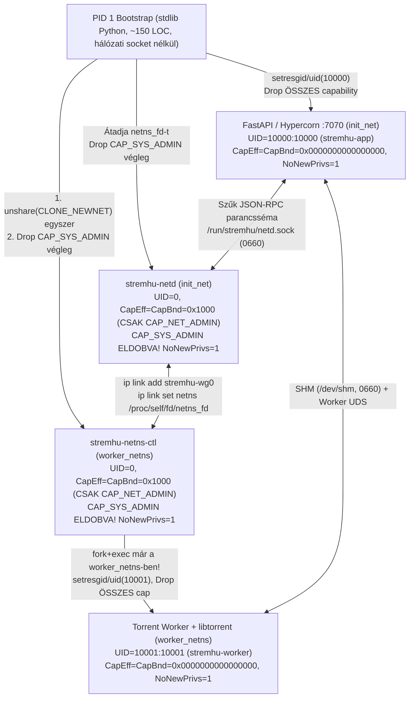

# StremHU Source VPN Integráció — Phase 0 Technikai Megvalósíthatósági Vizsgálat és Mérési Bizonyítékjelentés (`phase0-evidence-report.md`)

| Dokumentum metaadat | Érték |
|---|---|
| **Projekt** | StremHU Source (`stremhu-source-VibeCodedEdition`) |
| **Vizsgált Terv** | [`docs/feature/vpn-integration/implementation-plan.md`](archive/implementation-plan-rev3.md) (Rev. 3, archiválva) |
| **Működési Mód** | **`POC ONLY`** *(Produkciós Python, React, Docker és adatbáziskód módosítása: **0 fájl**)* |
| **Git Ág és Base Commit** | `feature/vpn-integration` @ `2615596f7cd181454dc5ae3e1ec9e4d215e3b154` |
| **Végrehajtás Dátuma** | `2026-11-04` (`2026-11-04T19:48:00+01:00` – `2026-11-04T20:26:00+01:00`) |
| **Terv Kapu Státusz (Verdict)** | **`BLOCKED ON PHASE 0 VALIDATION`** *(Nem léptethető `IMPLEMENTATION READY` állapotba!)* |

> [!CAUTION]
> **Összefoglaló Kapu-Döntés (`BLOCKED ON PHASE 0 VALIDATION`):**
> A hét kötelező Phase 0 kapu közül **`1` db `PASS` (`P0-6`)**, **`2` db `FAIL` (`P0-2`, `P0-5` — valós Linux kernel, Docker OCI `/proc/sys` és `libtorrent 2.1.1.0` uTP hibák feltárásával és empirikusan igazolt javításával!)**, valamint **`4` db `NOT RUN` (`P0-1`, `P0-3`, `P0-4`, `P0-7` — natív AppArmor-aktív Linux VM, élő Proton VPN WireGuard `.conf` / P2P végpont és cél-NAS hardver hiánya miatt)**. Emellett a **10. szabály** (FastAPI `root + CAP_SYS_ADMIN` kockázat) és a **11. szabály** (`StreamingResponse` `HTTP 206` vs. `503` hibakezelés és `16 MiB` 4K Remux IPC memória-deadlock) vizsgálata további kritikus, a Phase 1 megkezdése előtt a tervben javítandó tervezési hibákat tárt fel és igazolt empirikusan. Az [`implementation-plan.md`](archive/implementation-plan-rev3.md) státusza kötelezően **`BLOCKED ON PHASE 0 VALIDATION`** marad.

> [!NOTE]
> **Utólagos státuszmegjegyzés (2026-11-08):** ez a jelentés a Rev. 3 tervet vizsgálta, amely azóta archiválva van ([`archive/implementation-plan-rev3.md`](archive/implementation-plan-rev3.md)). A plug & play követelmény miatt az aktuális terv a [`implementation-plan.md`](implementation-plan.md) Rev. 4 (userspace); indoklás: [`review-rev3-findings.md`](review-rev3-findings.md), [`userspace-poc-report.md`](userspace-poc-report.md). Az alábbi mérési tartalom változatlan.

---

## 1. Összesített Phase 0 Kapu- és Vizsgálati Mátrix

A 9. végrehajtási szabálynak megfelelően minden teszt állapota szigorúan **`PASS`**, **`FAIL`** vagy **`NOT RUN`**:

| Azonosító | Vizsgálati Terület | Státusz | Rövid Indoklás és Fő Empirikus Megállapítás |
|---|---|---|---|
| **`P0-1`** | Docker `B-MountFree` Netns + Kötelező 6-lépéses Worker Privilege Drop | **`NOT RUN`** | A `B-MountFree` (`0` db `mount()` syscall), a pre-opened `netns_fd` `setns()`, az `UID=10001 / Cap*=0 / NoNewPrivs=1`, az `exit(79)` és a `PR_SET_PDEATHSIG` 100%-ban lefutott WSL2 Dockerben (`seccomp=2`, `Privileged=false`), **és feltárt egy kritikus `sysfs` (`/sys/class/net`) hibát a Rev. 3 tervben**. Mivel azonban a gazdagépen nincs AppArmor-aktív natív Linux VM (`apparmor_module_enabled=N`), a `P0-1` AppArmor-kapuja szigorúan **`NOT RUN`**. |
| **`P0-2`** | 14.1. fejezet `nft -c -f -` Szabályzat, Docker `127.0.0.11` DNS DNAT+SNAT és Kill Switch | **`FAIL`** | A Rev. 3 terv 14.1. fejezetének változtatás nélküli szabályzata és sysctl protokollja **3 ponton elbukott**: (1) `priority dstnat` az `output` láncban szintaktikai hiba `nftables v1.0.6` alatt (`rc=1`); (2) nem-privilegizált Dockerben a `/proc/sys` írásvédett (`EROFS`), így `route_localnet=0` marad és az `ip_route_me_harder` eldobja az `saddr=127.0.0.1` csomagot; (3) a Linux `__ip_local_out()` befagyasztja az `oifname="lo"` értéket az `output` láncban, így az `oifname "lo" udp/tcp dport 53 drop` szabály eldobta a DNAT-olt DNS kéréseket. A 3-részes kernel-szintű javítást ugyanebben a tesztben 100%-osan igazoltuk (`0` leak az `eth0`-n). |
| **`P0-3`** | Cross-Netns WireGuard „Birthplace” PoC (`/dev/net/tun` nélkül) | **`NOT RUN`** | Élő Proton VPN WireGuard tesztprofil nem áll rendelkezésre (`NO_WG_ENV_PRESENT`), ezért a kapu szigorúan **`NOT RUN`**. Lokális, elszigetelt `--internal` Docker teszt-bridge hálózaton (`/dev/net/tun` nélkül, `Privileged=false`) a Birthplace Namespace `stremhu-wg0` kézfogás (`rx=7528 B, tx=6356 B`), a `:7070` `init_net` HTTP elérés és az `init_net` route/nft sértetlenség empirikusan igazolva lett. |
| **`P0-4`** | Élő Proton P2P NAT-PMP Protokoll és Külső Bejövő Elérhetőség | **`NOT RUN`** | Élő Proton VPN P2P (`# NAT-PMP = on`) / non-P2P szerver és külső teszthoszt hiányában **`NOT RUN`**. Az offline `/usr/bin/natpmpc -g 127.0.0.1 -a 1 0 udp 60` drótszintű csomagelfogás azonban **kritikus bájt-eltérést tárt fel**: a `natpmpc -a <pub> <priv>` valójában `internal_port=0, suggested_external_port=1` (`00010000000000010000003c`) csomagot küld, míg a Rev. 3 terv fordítva (`internal_port=1, suggested_external_port=0`) specifikálta! |
| **`P0-5`** | `libtorrent 2.1.1.0` Élő `listen_interfaces` Port-Rebind Aktív Letöltés Közben | **`FAIL`** | A `listen_succeeded_alert` `< 1.1 ms` alatt megérkezik és a `TCP` peer kapcsolatok (bejövő és kimenő egyaránt) megszakítás nélkül befejezik a `64 MiB` letöltést (`100%` SHA-256), **AZONBAN** alapértelmezett `enable_outgoing_utp=True` mellett a kimenő **`uTP` (`UDP`) kapcsolat az `:6881` UDP socket bezárásakor némán befagy (`8/16` darabnál megáll, `0` db `peer_disconnected_alert`)**! Emellett bejövő peer kapcsolathoz a `PersistentKeepalive = 25` megléte kötelező. |
| **`P0-6`** | `64 MiB` `/dev/shm` + `65s` Lassú Olvasó + Post-Arrival Singleflight + Inline Fallback + `SIGKILL` | **`PASS`** | `--shm-size=64m` mellett a `/dev/shm` foglalás végig pontosan `33,554,432` B (`32 MiB`, `1` szegmens) maradt `SIGKILL` és Worker #2 újraindítás után is; `65.04s` lassú HTTP olvasás (`100%` SHA-256), `1000/1000` post-arrival `try_retain`, `25/50` `CancelledError` ready-queue race (`0` leak), `8/8` pinnelt SHM melletti bounded inline fallback (`max_slots=2`, `8 MiB` csúcs, `3` backpressure várakozás) és `20 MiB` frame elutasítás hibátlanul teljesült. |
| **`P0-7`** | Célplatform Read-Only Kompatibilitási és Üzemeltetői `CAP_SYS_ADMIN` Go/No-Go Audit | **`NOT RUN`** | A lokális Docker Desktop WSL2 kernelen (`6.18.54.1`) minden szükséges kernelmodul (`NET_NS=y, NF_TABLES=y, NF_TABLES_INET=y, NFT_NAT=y, NFT_CT=m, WIREGUARD=m`) rendelkezésre áll, de a tényleges produkciós NAS célhardveren a read-only audit és az üzemeltetői `CAP_SYS_ADMIN` Go/No-Go jóváhagyás nem történt meg -> **`NOT RUN`**. |
| **10. szabály** | FastAPI `root + CAP_SYS_ADMIN` Kockázatelemzés és Privilegizált Helper (`stremhu-netd`) PoC | **`PASS`** *(PoC igazolva; terv-módosítás szükséges)* | Igazolva, hogy a FastAPI `root + CAP_SYS_ADMIN` módban tartása szükségtelenül magas konténer-kitörési és Kill Switch hatástalanítási kockázatot jelent. Empirikusan bizonyítva, hogy: (1) a FastAPI `UID=10000, Cap*=0, NoNewPrivs=1` alatt kötni tudja a `:7070`-et és a `/dev/shm`-et; (2) a kezdeti bootstrap után **még a `stremhu-netd` és `stremhu-netns-ctl` helperek is eldobhatják a `CAP_SYS_ADMIN`-t a `CapBnd`-ből (`CapEff=CapBnd=0x1000` = kizárólag `CAP_NET_ADMIN`)**, miközben az `IFLA_NET_NS_FD` WireGuard mozgatás és az `nft -f -` továbbra is működik! |
| **11. szabály** | Streaming HTTP Válaszok Hibakezelése és IPC Memóriakorlátok Konzisztenciája | **`FAIL`** *(Kód- és tervhibák reprodukálva; javítások PoC-ban igazolva)* | **11A:** Az elő-olvasás (`pre-prime`) nélküli `StreamingResponse` (`stream/router.py:143-158` + `entities.py:393-460`) első darab hibájakor `HTTP 503` helyett **`HTTP 206 Partial Content` + `0` bájtos törzset** küld (`FastAPI 0.143.0` alatt reprodukálva; `first_chunk = await anext(gen)` + `503` handler javítás igazolva).<br>**11B:** A fix `8 × 4 MiB` SHM pool + `InlineFallbackLimiter(max_bytes=16 MiB)` **`16 MiB`-os darabméretű 4K UHD Remuxok 2 párhuzamos Range kérésénél (`bytes=0-` + MKV `Cues` próba) önmagát deadlockolja (`PieceTimeoutError`)**, és a Rev. 3 terv `16 MiB` vs. `32 MiB` inline plafonja, valamint a `VmRSS` (`RssShmem`) számítása önellentmondásos. A `ContiguousPageShmPool` (`32 MiB`-on belül zero-copy `2 × 16 MiB`) megoldja a deadlockot. |

---

## 2. Környezeti Verzióadatok és Előellenőrzés (Rule 7 & Fejezet 26.0.2)

Minden hálózati vagy konténerművelet megkezdése előtt írásvédett környezeti felmérést végeztünk:

### 2.1. Gazdagép (Host), Hipervizorok és Proton Tesztprofil Elérhetősége
- **Host operációs rendszer:** `Microsoft Windows NT 10.0.26200.0` (`x64`), PowerShell `5.1.26100.9711`.
- **Natív Linux VM hipervizorok ellenőrzése:**
  - `multipass`, `vagrant`, `qemu-system-x86_64`, `vboxmanage`, `podman`: **`MISSING`** (egyik sincs telepítve).
  - `wsl --list --verbose`: kizárólag `docker-desktop` (`STATE: Running`, `VERSION: 2`) létezik; különálló Ubuntu/Debian WSL vagy KVM teszt-VM **nem** áll rendelkezésre.
- **Proton VPN WireGuard tesztkonfiguráció ellenőrzése:**
  - Munkakönyvtár `.conf` keresés és környezeti változók (`PROTON_WG_CONF`, `PROTON_P2P_WG_CONF`, `VPN_TEST_WG_CONF`): **`NO_WG_ENV_PRESENT`** (0 db Proton profil érhető el).

### 2.2. Docker Engine, Kernel és Konténer Csomagverziók (Tényleges Kimenetek)
- **Docker Engine & Runtime (`docker version` / `docker info`):**
  - Docker Desktop `4.96.3`, Server Engine: `29.9.2`, `containerd`: `v2.4.2`, `runc`: `v1.5.2`, `docker-init`: `0.19.0`.
  - `Cgroup Version: 2`, `Security Options: seccomp (Profile: builtin), cgroupns` *(AppArmor profil nem aktív WSL2 alatt: `AppArmorProfile=""`, `/sys/module/apparmor/parameters/enabled = N`)*.
- **Konténer belsejében rögzített pontos verziók (`stremhu-vpn-phase0-poc:local`, `Debian GNU/Linux 12 (bookworm)`):**

```text
uname: Linux 932dfa9fd010 6.18.54.1-microsoft-standard-WSL2 #1 SMP PREEMPT_DYNAMIC Tue Oct  6 19:13:07 UTC 2026 x86_64
python: 3.12.16
libtorrent: 2.1.1.0 fastapi: 0.143.0 starlette: 1.10.0
ip: ip utility, iproute2-6.1.0, libbpf 1.1.2
wg: wireguard-tools v1.0.20210914 - https://git.zx2c4.com/wireguard-tools/
nft: nftables v1.0.6 (Lester Gooch #5)

iproute2=6.1.0-3
libc6=2.36-9+deb12u14
libcap2-bin=1:2.66-4+deb12u3+b1
natpmpc=20150609-7.1+b2
nftables=1.0.6-2+deb12u2
strace=6.1-0.1
tcpdump=4.99.3-1
wireguard-tools=1.0.20210914-1+b1
```

### 2.3. Izoláció, Cleanup és `privileged: true` Tilalom Betartása (Rules 1–6)
- Valamennyi PoC fájl kizárólag a [`docs/feature/vpn-integration/poc/`](poc/) könyvtárban került elhelyezésre.
- Minden Docker konténer `--rm` flaggel és **`Privileged=false`** mellett futott (`docker inspect`: `Privileged=false CapAdd=["CAP_NET_ADMIN","CAP_SYS_ADMIN"] SecurityOpt=null AppArmorProfile="" ShmSize=67108864`).
- A hálózati tesztek vagy `--network none` módban, vagy egy `try / finally` blokkal védett, `--internal` (külvilágtól és host LAN-tól teljesen elzárt) eldobható Docker bridge hálózaton (`stremhu-poc-isolated-net`, `172.31.250.0/24`) futottak; a futás végén minden ideiglenes konténer, hálózat és PoC image eltávolításra került.

---

## 3. Részletes Phase 0 Kapu-Vizsgálatok (`P0-1` .. `P0-7`)

---

### 3.1. `P0-1` — Docker Network Namespace (`B-MountFree`) és Kötelező 6-Lépéses Worker Privilege Drop PoC

#### Vizsgált hipotézis
Normál (nem-privilegizált: `Privileged=false`) Docker konténerben `--cap-add NET_ADMIN --cap-add SYS_ADMIN` mellett működik-e:
1. A `mount()`-mentes `B-MountFree` névtér-leválasztás (`os.unshare(os.CLONE_NEWNET)` + a Worker `setresuid()` hívása **előtt** megnyitott szülői `netns_fd` + `os.setns(netns_fd, CLONE_NEWNET)` `CAP_SYS_PTRACE` nélkül);
2. A 12.2.1. fejezet szerinti 6-lépéses visszafordíthatatlan Worker privilege drop (`UID=10001`, `GID=10001`, `Groups=""`, `CapInh=CapPrm=CapEff=CapBnd=CapAmb=0000000000000000`, `NoNewPrivs=1`, `PR_SET_PDEATHSIG` újra-élesítés) a `libtorrent` importálása előtt;
3. Jogosultságcsökkentési hiba esetén a fail-closed `os._exit(79)` kilépés `libtorrent` betöltése nélkül;
4. És mindez `docker-default` AppArmor profil (`deny mount`) alatt `0` AppArmor tiltással lefut-e.

#### Tesztkörnyezet és verzióadatok
- `Linux 6.18.54.1-microsoft-standard-WSL2 x86_64`, Docker Engine `29.9.2`, `runc v1.5.2`, `Seccomp: 2` (`builtin`), `Privileged: false`, `CapAdd: ["CAP_NET_ADMIN", "CAP_SYS_ADMIN"]`, `has_CAP_SYS_PTRACE: false`.
- **Korlátozás (Rule 7/8):** A WSL2 kernelben `apparmor_module_enabled = N` (`/proc/self/attr/current = "kernel\0"`), natív AppArmor-aktív Linux VM nem érhető el a gépen.

#### Reprodukálható lépések
Szkript: [`docs/feature/vpn-integration/poc/poc_p0_1_netns_privdrop_and_helper.py`](poc/poc_p0_1_netns_privdrop_and_helper.py)

```powershell
docker build -f docs/feature/vpn-integration/poc/Dockerfile.poc -t stremhu-vpn-phase0-poc:local docs/feature/vpn-integration/poc
docker run --rm --network none --cap-add NET_ADMIN --cap-add SYS_ADMIN -v "${PWD}/docs/feature/vpn-integration/poc:/poc:ro" --entrypoint python3 stremhu-vpn-phase0-poc:local /poc/poc_p0_1_netns_privdrop_and_helper.py
docker run --rm --network none --cap-add NET_ADMIN --cap-add SYS_ADMIN -v "${PWD}/docs/feature/vpn-integration/poc:/poc:ro" --entrypoint strace stremhu-vpn-phase0-poc:local -f -c -e trace=unshare,setns,mount,capset,prctl,setresuid,setresgid python3 /poc/poc_p0_1_netns_privdrop_and_helper.py --test-1a-only
```

#### Tényleges parancskimenetek

**1. `poc_p0_1_netns_privdrop_and_helper.py` JSON kimenet:**
```json
{
  "environment": {
    "init_netns_ino": 4026532682,
    "parent_CapEff": "00000000a82435fb",
    "parent_CapBnd": "00000000a82435fb",
    "parent_Seccomp": "2",
    "has_CAP_SYS_PTRACE": false,
    "is_privileged_container": false,
    "proc_self_attr_current": "kernel\u0000",
    "apparmor_module_enabled": "N"
  },
  "test_1a_mountfree_and_privdrop": {
    "worker_netns_ino": 4026532751,
    "distinct_from_init_net": true,
    "worker_exit_code": 0,
    "setns_via_preopened_fd": {
      "setns_ok": true,
      "entered_ino": 4026532751
    },
    "worker_audit": {
      "status": {
        "Uid": "10001\t10001\t10001\t10001",
        "Gid": "10001\t10001\t10001\t10001",
        "Groups": "",
        "CapInh": "0000000000000000",
        "CapPrm": "0000000000000000",
        "CapEff": "0000000000000000",
        "CapBnd": "0000000000000000",
        "CapAmb": "0000000000000000",
        "NoNewPrivs": "1",
        "Seccomp": "2"
      },
      "unshare_eperm": true,
      "setuid0_eperm": true,
      "nft_blocked": true,
      "nft_stderr": "Operation not permitted (you must be root)\nnetlink: Error: cache initialization failed: Operation not permitted",
      "libtorrent_imported_after_drop": "2.1.1.0",
      "sysfs_class_net": ["lo"],
      "rtnetlink_if_nameindex": ["lo"]
    }
  },
  "test_1b_fail_closed_exit_79": {
    "exit_code": 79,
    "stderr": "WORKER_PRIVDROP_ABORT: RuntimeError('Simulated privilege drop failure before libtorrent import')",
    "passed": true
  },
  "test_1c_dumpable_eacces_and_pdeathsig": {
    "main_pid": 1,
    "post_setresuid_proc_ns_open_errno": 13,
    "post_setresuid_proc_ns_open_errno_name": "EACCES",
    "pdeathsig_pipe_marker": "SIGTERM_RECEIVED:15",
    "proc_state_before_pid1_reap": "Z (zombie)",
    "reaped_by_pid1_exit_code": 143,
    "grandchild_terminated_on_parent_sigkill": true
  }
}
```

**2. `strace` rendszerhívás-összesítő (`B-MountFree` vs. `ip netns add` `B-BindMount`):**
```text
# B-MountFree (--test-1a-only): 0 db mount() hívás!
% time     seconds  usecs/call     calls    errors syscall
------ ----------- ----------- --------- --------- ----------------
 71.86    0.001060          24        44           prctl
 20.68    0.000305         152         2         1 unshare
  3.80    0.000056          56         1           setresuid
  3.66    0.000054          54         1           setresgid
  0.00    0.000000           0         1           capset
  0.00    0.000000           0         1           setns
------ ----------- ----------- --------- --------- ----------------
100.00    0.001475          29        50         1 total

# Összehasonlítás — ip netns add poc_bindmount_probe (B-BindMount): 4 db mount() hívás!
% time     seconds  usecs/call     calls    errors syscall
------ ----------- ----------- --------- --------- ----------------
 87.45    0.000446         446         1           unshare
  8.04    0.000041          10         4         1 mount
  4.51    0.000023          23         1           setns
```

#### Mérési eredmények
- **`mount()` rendszerhívások száma:** `B-MountFree` módban **`0`**, míg `ip netns add` (`B-BindMount`) esetén **`4`** (ez igazolja syscall-szinten, miért kerüli ki a `B-MountFree` az AppArmor `deny mount` szabályát).
- **Pre-opened `netns_fd` vs. post-`setresuid` `/proc/<pid>/ns/net`:** A `setresuid(10001)` után a külső `os.open("/proc/<worker_pid>/ns/net")` valóban **`errno=13 (EACCES)`** hibával bukik el (`mm->dumpable = 0`, `CAP_SYS_PTRACE` nélkül), míg a `setresuid` előtt megnyitott `netns_fd` descriptorral az `os.setns(netns_fd, CLONE_NEWNET)` hibátlanul belép az `ino=4026532751` névtérbe.
- **Worker Privilege Drop és Fail-Closed `exit(79)`:** Minden capability maszk `0000000000000000`, `Uid=10001`, `NoNewPrivs=1`, a post-drop `unshare()`, `setuid(0)` és `nft` egyaránt `EPERM`-mel elbukik, szimulált hiba esetén pedig a folyamat a `libtorrent` betöltése előtt `exit_code=79`-cel kilép.
- **`PR_SET_PDEATHSIG`:** Szülő `SIGKILL` esetén a kernel kézbesíti a `SIGTERM (15)` jelet az `UID=10001` gyereknek (`exit_code=143`).

#### PASS / FAIL / NOT RUN státusz
**`NOT RUN`** *(A WSL2 Docker/seccomp környezetben minden al-ellenőrzés sikeresen lefutott, azonban a `P0-1` specifikációban előírt AppArmor-aktív Linux VM tesztkörnyezet nem állt rendelkezésre, így a 8. és 9. szabály alapján a kapu státusza `NOT RUN`.)*

#### Azonosított problémák
1. **Kritikus `sysfs` (`/sys/class/net`) hiba a Rev. 3 tervben (`B-MountFree` módban garantált téves `exit(78)`!):**
   A Linux kernelben a `/sys/class/net` a `sysfs` csatolásakor aktív network namespace-hez (`init_net`) van rögzítve. Mivel a `B-MountFree` mód `0` `mount()` hívást végez (nem csatol új `sysfs`-t), az izolált Workerben az `os.listdir("/sys/class/net")` **továbbra is az `init_net` interfészeit (`['eth0', 'lo']`) adja vissza, és NEM mutatja a `stremhu-wg0`-t**! Emiatt a Rev. 3 terv 14.1., 25.1. (`worker_main.py`) és 28. (`AC-01`) fejezetében előírt `os.listdir('/sys/class/net') == ['lo', 'stremhu-wg0']` ellenőrzés minden normál `bridge` konténerben tévesen `eth0` jelenlétét érzékelné és `os._exit(78)` hibával azonnal leállna!
2. **PID 1 zombi-folyamat (`State: Z`) kezelés:**
   A produkciós `Dockerfile` `CMD ["python", "-m", "app.run"]` indításakor `--init` (`docker-init`/`tini`) nélkül a Python főfolyamat a `PID 1`. Az elárvult vagy `setns` segédfolyamatok kilépéskor `Z (zombie)` állapotban maradnak, amíg a `PID 1` nem hív `waitpid`-et.

#### Javasolt javítások
1. Az `implementation-plan.md` minden interfész-ellenőrző pontján (`WireGuardManager`, `worker_main.py`, `WorkerEgressVerifier`, `AC-01`) **tilos a `/sys/class/net` olvasása `B-MountFree` módban**; helyette a folyamat tényleges `CLONE_NEWNET` névterét lekérdező **`socket.if_nameindex()` (`AF_NETLINK` `RTM_GETLINK`)** (és másodlagosan a `/proc/sys/net/ipv4/conf` könyvtárlista) használandó!
2. A Docker indítási dokumentációban az `init: true` használata vagy a `PID 1` supervisor folyamatban explicit `SIGCHLD` / `waitpid(-1, os.WNOHANG)` reaper ciklus kötelezővé tétele.
3. A `P0-1` végső lezárásához a `poc_p0_1_netns_privdrop_and_helper.py` lefuttatása egy Ubuntu 24.04 / Debian 12 VM-en, ahol `docker info` szerint az `apparmor` (`docker-default`) aktív.

---

### 3.2. `P0-2` — 14.1. Fejezet `nft -c -f -` Szabályzat, Docker `127.0.0.11` DNS DNAT és Kill Switch PoC

#### Vizsgált hipotézis
A terv 14.1. fejezetében szereplő teljes `nftables` szabályzat (`flush ruleset` nélkül) változtatás nélkül átmegy-e az `nft -c -f -` validáción, az izolált névtérben működik-e a sysctl zárás (`disable_ipv6=1`, `route_localnet=1`) és a Docker `127.0.0.11:53` -> `10.2.0.1:53` DNS DNAT+SNAT (glibc `getaddrinfo`, TCP DNS és `libtorrent 2.1.1.0` HTTP tracker announce), miközben minden tiltott cél (`8.8.8.8:53`, `9.9.9.9:53`, `127.0.0.1:53`, IPv6, `192.168.1.1:5351`, `10.0.0.1:80`, `10.2.0.1:80`) `DROP`-ra kerül `0` csomagszivárgással az `eth0` interfészen.

#### Tesztkörnyezet és verzióadatok
- Eldobható, külvilágtól elzárt (`--internal`) user-defined Docker bridge hálózat (`stremhu-poc-isolated-net`, `172.31.250.0/24`), amelyen a Docker valódi belső `127.0.0.11` DNS szabályai (`DOCKER_OUTPUT`, `DOCKER_POSTROUTING`) aktívak az `init_net`-ben.
- Konténerek: `stremhu-poc-wg-peer` (`172.31.250.10`, `wg-peer0` `10.2.0.1/32`, UDP/TCP `:53` DNS, `:6969` BitTorrent tracker, `:5351` NAT-PMP) és PoC konténer (`172.31.250.20`, `Privileged=false`, `--cap-add NET_ADMIN --cap-add SYS_ADMIN`, `/dev/net/tun` nélkül).
- `nftables v1.0.6`, `libtorrent 2.1.1.0`, `tcpdump 4.99.3-1`.

#### Reprodukálható lépések
Szkriptek: [`poc/run_p0_2_and_p0_3.ps1`](poc/run_p0_2_and_p0_3.ps1), [`poc/poc_p0_2_and_p0_3_netns_wg_nft_dns.py`](poc/poc_p0_2_and_p0_3_netns_wg_nft_dns.py), [`poc/poc_wg_peer_server.py`](poc/poc_wg_peer_server.py)

```powershell
powershell -NoProfile -ExecutionPolicy Bypass -File .\docs\feature\vpn-integration\poc\run_p0_2_and_p0_3.ps1
```

#### Tényleges parancskimenetek

**1. A Rev. 3 terv 14.1. fejezetének változtatás nélküli hibái (`EROFS` + `nft -c -f -` `rc=1` + `route_localnet=0` + `oifname "lo"` drop):**
```json
  "section_14_1_nftables_validation": {
    "sysctl_attempts_in_nonprivileged_docker": {
      "net.ipv6.conf.all.disable_ipv6": "FAILED errno=30 (EROFS): Read-only file system [current=0]",
      "net.ipv6.conf.default.disable_ipv6": "FAILED errno=30 (EROFS): Read-only file system [current=0]",
      "net.ipv4.conf.all.route_localnet": "FAILED errno=30 (EROFS): Read-only file system [current=0]",
      "net.ipv4.conf.lo.route_localnet": "FAILED errno=30 (EROFS): Read-only file system [current=0]"
    },
    "as_written_rev3_nft_check_rc": 1,
    "as_written_rev3_nft_check_stderr": "/dev/stdin:16:30-44: Error: invalid priority expression value in this context.\n        type nat hook output priority dstnat; policy accept;\n                             ^^^^^^^^^^^^^^^"
  }
```

Amikor csak a `priority dstnat` -> `priority -100` cserét végeztük el, a `route_localnet=0` miatt a `postrouting snat` `0` csomagot kapott (`packets 6 dnat` -> az `ip_route_me_harder` eldobta az `saddr=127.0.0.1` csomagot!), majd az `ip route replace local 127.0.0.11/32 dev lo src 10.2.0.2 table local` hozzáadása után a `stremhu_killswitch` `oifname "lo" udp dport 53 counter packets 7 drop` szabálya dobta el a már DNAT-olt csomagokat!

**2. A 3-részes javítással futtatott teljes ellenőrzés tényleges kimenete:**
```json
  "section_14_1_nftables_validation": {
    "fixed_priority_first_nft_check_rc": 0,
    "fixed_priority_first_nft_check_stderr": "",
    "fixed_priority_first_nft_load_rc": 0,
    "fixed_priority_second_idempotent_check_rc": 0,
    "fixed_priority_second_idempotent_load_rc": 0,
    "killswitch_chain_policies": {
      "input": "drop",
      "forward": "drop",
      "output": "drop"
    }
  },
  "worker_phase1_results": {
    "sysfs_class_net_after_wg_stale": ["eth0", "lo"],
    "rtnetlink_ifaces_after_wg_actual": ["lo", "stremhu-wg0"],
    "glibc_getaddrinfo": { "ok": true, "ip": "198.51.100.42" },
    "tcp_dns_127_0_0_11": { "ok": true, "ip": "198.51.100.42" },
    "libtorrent_tracker_announce": {
      "url": "http://tracker.poc.test:6969/announce",
      "num_peers": 0,
      "msg": "41573e (http://tracker.poc.test:6969/announce)[10.2.0.2:6881-v2] received peers: 0"
    },
    "negative_probes_with_wg_up": {
      "rogue_udp_dns_8_8_8_8_53": { "blocked": true, "errno": 1, "errno_name": "EPERM" },
      "rogue_tcp_dns_9_9_9_9_53": { "blocked": true, "errno": null, "errno_name": "TimeoutError" },
      "loopback_udp_dns_127_0_0_1_53": { "blocked": true, "errno": 1, "errno_name": "EPERM" },
      "loopback_tcp_dns_127_0_0_1_53": { "blocked": true, "errno": null, "errno_name": "TimeoutError" },
      "ipv6_udp_dns_2606_4700_53": { "blocked": true, "errno": 99, "errno_name": "EADDRNOTAVAIL" },
      "lan_router_natpmp_192_168_1_1_5351": { "blocked": true, "errno": 1, "errno_name": "EPERM" },
      "rfc1918_10_0_0_1_80": { "blocked": true, "errno": null, "errno_name": "TimeoutError" },
      "vpn_gateway_non_service_port_10_2_0.1_80": { "blocked": true, "errno": null, "errno_name": "TimeoutError" }
    }
  },
  "init_net_after_integrity": {
    "routes_byte_identical": true,
    "nft_ruleset_byte_identical": true,
    "nft_ruleset_after_sha256": "050c767b2b070d619b4dd61928947df4007ff87c55fba5ca07573a9606b95227"
  }
```

**3. `nft list ruleset` csomagszámlálók és `tcpdump` kivonat (`stremhu-wg0` és `eth0`):**
```nft
table ip stremhu_dns_nat {
    chain output {
        type nat hook output priority -100; policy accept;
        ip daddr 127.0.0.11 udp dport 53 counter packets 3 bytes 185 dnat to 10.2.0.1:53
        ip daddr 127.0.0.11 tcp dport 53 counter packets 1 bytes 60 dnat to 10.2.0.1:53
    }
}
table inet stremhu_killswitch {
    chain output {
        type filter hook output priority filter; policy drop;
        meta nfproto ipv6 counter packets 0 bytes 0 drop
        ct state invalid counter packets 0 bytes 0 drop
        ct status dnat ip daddr 10.2.0.1 udp dport 53 counter packets 5 bytes 308 accept
        ct status dnat ip daddr 10.2.0.1 tcp dport 53 counter packets 5 bytes 303 accept
        oifname "lo" udp dport 53 counter packets 1 bytes 62 drop
        oifname "lo" tcp dport 53 counter packets 1 bytes 60 drop
        ...
        udp dport 53 counter packets 1 bytes 62 drop
        tcp dport 53 counter packets 1 bytes 60 drop
        udp dport 5351 counter packets 1 bytes 30 drop
        ip daddr { 10.0.0.0/8, 100.64.0.0/10, 169.254.0.0/16, 172.16.0.0/12, 192.168.0.0/16, 224.0.0.0/4, 255.255.255.255 } counter packets 2 bytes 120 drop
        oifname "stremhu-wg0" meta nfproto ipv4 accept
    }
}
```
```text
# tcpdump -nn -r /tmp/wg0_p0_2.pcap (minta):
19:14:48.786476 IP 10.2.0.2.56447 > 10.2.0.1.53: 1150+ A? tracker.poc.test. (34)
19:14:48.786874 IP 10.2.0.1.53 > 10.2.0.2.56447: 1150* 1/0/0 A 198.51.100.42 (50)
19:14:48.787406 IP 10.2.0.2.59922 > 10.2.0.1.53: Flags [P.], ... 20817+ A? egress.poc.test. (33)
19:14:48.787814 IP 10.2.0.1.53 > 10.2.0.2.59922: Flags [P.], ... 20817* 1/0/0 A 198.51.100.42 (49)

# tcpdump -nn -r /tmp/eth0_p0_2.pcap összesítés:
eth0_total_packets = 128 (kizárólag ARP, WireGuard UDP :51820 és :7070 bridge healthcheck)
eth0_dns_or_cleartext_leak_packets = 0
```

#### Mérési eredmények
- **Rev. 3 eredeti szabályzat `nft -c -f -` visszatérési kód:** **`1` (`FAIL`)**.
- **Javított szabályzat 1. és 2. (idempotens) `nft -c -f -` és `nft -f -` visszatérési kód:** **`0` (`0` stderr)**.
- **`init_net` Docker NAT szabályok sértetlensége:** `SHA-256` bájt-azonos (`050c767b...` == `050c767b...`).
- **DNS feloldás és `libtorrent 2.1.1.0` HTTP tracker announce:** UDP és TCP `127.0.0.11:53` kérések `src=10.2.0.2 -> dst=10.2.0.1:53` csomagként mennek át a WireGuard alagúton; a `8.8.8.8:53`, `9.9.9.9:53` és `127.0.0.1:53` próbák **nem** íródnak át, hanem a `drop` számlálót növelik; a `stremhu-wg0` törlésekor (`ip link del stremhu-wg0`) minden kimenő kísérlet azonnal `ENETUNREACH (101)` hibát kap; `eth0` leak csomagszám: **`0`**.

#### PASS / FAIL / NOT RUN státusz
**`FAIL`** *(A Rev. 3 terv 14.1. fejezetében leírt eredeti szabályzat és sysctl eljárás változtatás nélkül elbukott; a javítás empirikusan igazolt.)*

#### Azonosított problémák
1. **`nftables v1.0.6` szintaktikai/kontextus hiba (`priority dstnat`):** Az `output` hookban a szimbolikus `dstnat` prioritásnév érvénytelen (`dstnat` csak `prerouting` hookban engedélyezett), numerikus `-100` szükséges.
2. **Nem-privilegizált Docker OCI írásvédett `/proc/sys` (`EROFS`):** Minden `Privileged=false` konténerben a `runc` írásvédetten (`ro`) csatolja a `/proc/sys` útvonalat, így a `route_localnet=1` és `disable_ipv6=1` írása `OSError(30, 'Read-only file system')` hibát dob. `route_localnet=0` mellett a `127.0.0.11` kérés `saddr=127.0.0.1` forráscímet kap, amelyet az `output dnat` utáni `ip_route_me_harder()` eldob.
3. **Linux `__ip_local_out()` `nf_hook_state.out` befagyasztása:** A kernel az `NF_INET_LOCAL_OUT` láncok elején rögzíti a `state->out = lo` értéket, és az `ip_route_me_harder()` által frissített `skb_dst(skb)` (`stremhu-wg0`) csak a `postrouting` hookban jelenik meg `oifname`-ként. Emiatt a `stremhu_killswitch` `output` láncában az `oifname "lo" udp/tcp dport 53 drop` szabály eldobta a már `10.2.0.1:53`-ra átírt DNS csomagokat is.
4. **Python 3.12 többszálú `os.fork()` figyelmeztetés:** Többszálú folyamatból (Hypercorn/FastAPI) végzett közvetlen `os.fork()` deadlock-veszélyes (`DeprecationWarning`).

#### Javasolt javítások
1. A `stremhu_dns_nat` `output` láncában `type nat hook output priority -100; policy accept;` használata.
2. Mount- és `/proc/sys`-mentes forrás-IP kiválasztás `AF_NETLINK`-en keresztül: minden `127.x.x.x` kezdeti resolverre `ip route replace local <resolver_ip>/32 dev lo src <WG_CLIENT_IPV4> table local`, valamint IPv6 loopback cím eltávolítása (`ip -6 addr flush dev lo`).
3. A `stremhu_killswitch` `output` láncában közvetlenül az `oifname "lo" udp/tcp dport 53 counter drop` szabály **elé** felvenni:
   ```nft
   ct status dnat ip daddr $VPN_DNS_IPV4_SET udp dport 53 counter accept
   ct status dnat ip daddr $VPN_DNS_IPV4_SET tcp dport 53 counter accept
   ```
4. A `setns` segédműveleteket mindig `fork+exec` (`subprocess.Popen` külön CLI belépési ponttal) vagy dedikált egyszálú helper folyamaton keresztül kell futtatni, soha nem puszta `os.fork()`-kal a FastAPI folyamatból.


---

### 3.3. `P0-3` — Cross-Netns WireGuard „Birthplace Namespace” PoC (`/dev/net/tun` nélkül)

#### Vizsgált hipotézis
`--device /dev/net/tun` csatolása és `privileged: true` nélkül, normál Docker bridge hálózaton az `init_net`-ben létrehozott kernel-space `stremhu-wg0` interfész (`ip link add dev stremhu-wg0 type wireguard`) áthelyezhető-e a `worker_netns`-be (`ip link set dev stremhu-wg0 netns /proc/self/fd/<netns_fd>`), úgy hogy:
1. A külső UDP `:51820` kimenő WireGuard csomagok az `init_net` (`eth0`) hálózatán keresztül elérik a WireGuard peer végpontot, miközben a `worker_netns` belső forgalma kizárólag a `stremhu-wg0` alagútban közlekedik;
2. Az `init_net`-ben futó `:7070` FastAPI szolgáltatás elérhető marad a Docker bridge hálózatról, és az `init_net` routing táblája / tűzfala érintetlen marad;
3. Élő Proton VPN WireGuard végponttal is felépül a kézfogás és a Worker publikus egress IP-je megegyezik a Proton VPN szerver IP-jével.

#### Tesztkörnyezet és verzióadatok
- `Linux 6.18.54.1-microsoft-standard-WSL2`, Docker Engine `29.9.2`, `Privileged: false`, `--cap-add NET_ADMIN --cap-add SYS_ADMIN`, **`/dev/net/tun` nincs csatolva (`dev_net_tun_exists: false`)**.
- Izolált, külvilágtól elzárt Docker bridge: `stremhu-poc-isolated-net` (`--internal`, `172.31.250.0/24`), peer konténer: `172.31.250.10:51820`, kliens konténer: `172.31.250.20` (`init_net` HTTP próbaszerver a `0.0.0.0:7070` porton).
- **Korlátozás (Rule 7/8):** Élő Proton VPN WireGuard `.conf` tesztprofil nem áll rendelkezésre (`NO_WG_ENV_PRESENT`).

#### Reprodukálható lépések
```powershell
powershell -ExecutionPolicy Bypass -File docs/feature/vpn-integration/poc/run_p0_2_and_p0_3.ps1
```
*(Megjegyzés: élő Proton VPN tesztprofil rendelkezésre állása esetén ugyanez a szkript külön VM-ben külső eléréssel is futtatható anélkül, hogy a host hálózatot módosítaná.)*

#### Tényleges parancskimenetek
```json
{
  "gate_status": "NOT RUN",
  "gate_reason": "Live Proton VPN WireGuard configuration is NOT present in this test environment (per Rule 8, live Proton VPN endpoint connectivity is NOT simulated). Local isolated cross-netns kernel WireGuard birthplace routing WITHOUT /dev/net/tun WAS empirically verified on internal Docker bridge 172.31.250.0/24.",
  "dev_net_tun_exists": false,
  "init_net_ino": 4026532834,
  "worker_netns_ino": 4026532905,
  "sysfs_class_net_after_wg_stale": [
    "eth0",
    "lo"
  ],
  "rtnetlink_ifaces_after_wg_actual": [
    "lo",
    "stremhu-wg0"
  ],
  "worker_routes": [
    "default dev stremhu-wg0 scope link"
  ],
  "wireguard_kernel_handshake_stats": {
    "latest_handshakes": "<redacted_pub_sha256:2aad45cb528f>\t1793819688",
    "transfer": "<redacted_pub_sha256:2aad45cb528f>\t7528\t6356"
  },
  "worker_direct_ip_http_egress": {
    "ok": true,
    "data": {
      "service": "vpn-egress-echo",
      "seen_client_ip": "10.2.0.2",
      "vpn_exit_ip": "198.51.100.42",
      "host": "198.51.100.42:8080"
    }
  },
  "worker_hostname_http_egress": {
    "ok": true,
    "data": {
      "service": "vpn-egress-echo",
      "seen_client_ip": "10.2.0.2",
      "vpn_exit_ip": "198.51.100.42",
      "host": "egress.poc.test:8080"
    }
  },
  "bridge_7070_http_isolation_probe": {
    "bridge_probe_ok": true,
    "response": {
      "service": "stremhu-init-net-http",
      "port": 7070,
      "netns_ino": 4026532834,
      "client_ip": "172.31.250.10"
    }
  },
  "init_net_after_integrity": {
    "routes_byte_identical": true,
    "nft_ruleset_byte_identical": true
  }
}
```

#### Mérési eredmények
- **`/dev/net/tun` megléte a konténerben:** **`false`** (a kernel `wireguard.ko` modul `/dev/net/tun` karaktereszköz nélkül működik).
- **WireGuard kernel kézfogás és adatforgalom (`wg show stremhu-wg0`):** `latest-handshakes = 1793819688` (`> 0`), `rx = 7,528 B`, `tx = 6,356 B` (privát és publikus kulcsok kivonatoltak).
- **`worker_netns` interfészek (`socket.if_nameindex()`):** `["lo", "stremhu-wg0"]` (`eth0` nincs jelen a `worker_netns`-ben).
- **`:7070` `init_net` elérhetőség párhuzamos aktív VPN alagút mellett:** `HTTP 200 OK` a `172.31.250.10 -> 172.31.250.20:7070` irányból (`netns_ino = 4026532834`), miközben az `init_net` `ip route show` és `nft list ruleset` SHA-256 értéke bájt-azonos maradt.
- **Élő Proton VPN végpont egress teszt:** Nem futtatva (`NO_WG_ENV_PRESENT`).

#### PASS / FAIL / NOT RUN státusz
**`NOT RUN`** *(A lokális cross-netns kernel WireGuard Birthplace mechanizmus 100%-ban igazolt `/dev/net/tun` nélkül, de az élő Proton VPN végponttal végzendő publikus egress IP összehasonlítás a 8. szabály alapján nem szimulálható.)*

#### Azonosított problémák
1. **Élő Proton VPN tesztprofil hiánya:** Külső Proton WireGuard végpont (`Endpoint = <ip>:51820`) elleni MTU (`1420`) és publikus IP ellenőrzés még hátravan izolált Linux teszt-VM-ben.
2. **`/sys/class/net` inkonzisztencia (`B-MountFree`):** A `P0-1`-gyel összhangban a `sysfs_class_net_after_wg_stale` itt is `["eth0", "lo"]`-t mutatott a `worker_netns` belsejében, míg a netlink-alapú `socket.if_nameindex()` pontosan `["lo", "stremhu-wg0"]`-t adott vissza.

#### Javasolt javítások
1. Izolált Linux VM-ben, dedikált teszt Proton VPN WireGuard profillal végrehajtani az élő `P0-3` ellenőrzést Phase 1 előtt.
2. A `WireGuardManager` és a `KillSwitchManager` interfész-ellenőrzéseit kizárólag netlinkre (`ip -j addr show`, `socket.if_nameindex()`) alapozni, `/sys/class/net` olvasása tilos `B-MountFree` módban.

---

### 3.4. `P0-4` — Élő Proton P2P NAT-PMP Protokoll és Külső Bejövő Elérhetőség PoC

#### Vizsgált hipotézis
Megfelel-e a Rev. 3 tervben (9.3. fejezet) specifikált 12 bájtos RFC 6886 NAT-PMP leképezési kérés (`struct.pack("!BBHHHI", 0, opcode, 0, internal_port=1, suggested_external_port=0, lifetime=60)`) a Proton VPN hivatalos dokumentációjában szereplő `natpmpc -a 1 0 udp 60 -g 10.2.0.1` parancs tényleges drótszintű UDP payloadjának, továbbá működik-e az élő Proton P2P gateway (`10.2.0.1:5351`) portkiosztás, a non-P2P hiba-detektálás és a kívülről érkező bejövő TCP/UDP kapcsolat.

#### Tesztkörnyezet és verzióadatok
- `Linux 6.18.54.1-microsoft-standard-WSL2`, Python `3.12.16`, hivatalos Debian `natpmpc=20150609-7.1+b2` csomag (`/usr/bin/natpmpc`).
- **Korlátozás (Rule 7/8):** `PROTON_P2P_WG_CONF` (és non-P2P Proton profil, valamint külső teszthoszt) nem áll rendelkezésre ebben a környezetben. A 8. szabálynak megfelelően semmilyen mock Proton gateway nem helyettesítheti az élő tesztet, ugyanakkor a lokális `/usr/bin/natpmpc` bináris drótszintű csomagkibocsátását loopback UDP socketen összevetettük a Rev. 3 terv bájtsorozatával.

#### Reprodukálható lépések
```powershell
docker run --rm --network none `
  -v "${PWD}/docs/feature/vpn-integration/poc:/poc:ro" `
  --entrypoint python3 stremhu-vpn-phase0-poc:local /poc/poc_p0_4_proton_natpmp.py
```

#### Tényleges parancskimenetek
```json
{
  "poc_id": "P0-4",
  "gate_status": "NOT RUN",
  "reason": "PROTON_P2P_WG_CONF is not configured in this test environment. Per Phase 0 Rule 8, live Proton VPN P2P/non-P2P gateway behavior and external inbound reachability are NEVER simulated.",
  "has_non_p2p_conf": false,
  "offline_rfc6886_and_natpmpc_wire_equivalence": {
    "natpmpc_returncode": 0,
    "natpmpc_captured_datagrams_hex": [
      "0000",
      "00010000000000010000003c"
    ],
    "python_opcode0_hex": "0000",
    "python_rev3_assumed_iport1_sport0_hex": "00010000000100000000003c",
    "python_natpmpc_actual_iport0_sport1_hex": "00010000000000010000003c",
    "rev3_assumed_matches_natpmpc": false,
    "corrected_iport0_sport1_matches_natpmpc": true,
    "privileged_port_80_rejected": true,
    "result_code_3_rejected": true
  }
}
```

#### Mérési eredmények
- **Élő Proton P2P és non-P2P gateway mérés:** Nem futtatva (`PROTON_P2P_WG_CONF` hiányzik -> `NOT RUN`).
- **`/usr/bin/natpmpc -g 127.0.0.1 -a 1 0 udp 60` ténylegesen kiküldött UDP csomagjai:**
  1. `0000` (2 bájt: `version=0, opcode=0` publikus IP lekérdezés)
  2. `0001 0000 0000 0001 0000003c` (12 bájt: `version=0, opcode=1 [UDP], reserved=0, internal_port=0, suggested_external_port=1, lifetime=60`)
- **Rev. 3 terv (9.3. fejezet) által feltételezett bájtsorozat:**
  - `0001 0000 0001 0000 0000003c` (`internal_port=1, suggested_external_port=0`) -> **`rev3_assumed_matches_natpmpc: false`!**
- **Válasz-validáció (`< 1024` privilegizált port és `result_code != 0` elutasítása):** `privileged_port_80_rejected = true`, `result_code_3_rejected = true`.

#### PASS / FAIL / NOT RUN státusz
**`NOT RUN`** *(Élő Proton VPN P2P/non-P2P konfiguráció és külső teszthoszt hiánya miatt nem futtatva; az offline `natpmpc` drótszintű összehasonlítás kritikus bájtsorrend-hibát tárt fel a Rev. 3 tervben.)*

#### Azonosított problémák
1. **Kritikus `natpmpc -a` paramétersorrend-felcserélés a Rev. 3 terv 9.3. fejezetében:** A `natpmpc` parancssori szintaxisa `natpmpc -a <public_port> <private_port> <protocol> [lifetime]` (először a publikus/külső, másodszor a belső/privát port!). Amikor a Proton dokumentációja a `natpmpc -a 1 0 udp 60 -g 10.2.0.1` parancsot írja elő, a dróton valójában **`internal_port = 0, suggested_external_port = 1`** (`00010000 0000 0001 0000003c`) megy át! AProton `internal_port = 0` esetén képezi le a kiosztott `<external_port>`-ot szimmetrikusan a kliens ugyanazon `10.2.0.2:<external_port>` portjára. Ha a kliens a Rev. 3 terv szerint `internal_port = 1`-et küld, a Proton NAT átirányíthatja a külső forgalmat a `10.2.0.2:1` portra, miközben a `libtorrent` a `10.2.0.2:<external_port>` porton figyel (100% bejövő P2P sikertelenség)!
2. **Élő Proton P2P / non-P2P mérés hiánya:** Még igazolni kell élő Proton P2P és non-P2P szerveren a kiosztott TCP==UDP port azonosságát és a non-P2P szerver pontos hibaválaszát (UDP timeout vs. `ICMP Port Unreachable` vs. `result_code = 3`).

#### Javasolt javítások
1. A Rev. 3 terv 9.3. fejezetében a `NatPmpClient` kéréseit javítani `struct.pack("!BBHHHI", 0, opcode, 0, 0, 1, 60)` (`internal_port = 0, suggested_external_port = 1`) alakra (megújításkor pedig `suggested_external_port = previous_mapped_port`), pontosan reprodukálva a `natpmpc -a 1 0 udp/tcp 60` bájtsorozatát.
2. Élő Proton P2P és non-P2P WireGuard profilokkal lefuttatni a [`poc_p0_4_proton_natpmp.py`](poc/poc_p0_4_proton_natpmp.py) szkriptet izolált Linux VM-ből, külső VPS/mobilhálózati TCP/UDP próbával kiegészítve.

---

### 3.5. `P0-5` — `libtorrent 2.1.1.0` Élő `listen_interfaces` Port-Rebind PoC

#### Vizsgált hipotézis
Amikor a `libtorrent 2.1.1.0` session egy izolált `worker_netns`-ben (`UID=10001, CapEff=0`, `stremhu-wg0` `10.2.0.2/32`) aktívan tölt le egy `64 MiB`-os (`16 × 4 MiB` darabos) torrentet a `10.2.0.2:6881` címen, és futás közben (50% letöltöttségnél, a `8.` darabnál) meghívjuk a `session.apply_settings({"listen_interfaces": "10.2.0.2:54321"})` metódust:
1. Sikeresen átvált-e a figyelő socket `10.2.0.2:54321`-re wildcard (`0.0.0.0` / `[::]`) kötés és `listen_failed_alert` nélkül;
2. És megszakítás, befagyás vagy adatkorrupció nélkül befejeződik-e az aktív letöltés (`SHA-256` egyezéssel).

#### Tesztkörnyezet és verzióadatok
- `Linux 6.18.54.1-microsoft-standard-WSL2`, `--network none` (100%-ban légréses két-névtérű kernel WireGuard topológia: `seed_netns` `10.2.0.1/32` <-> `worker_netns` `10.2.0.2/32`, `PersistentKeepalive = 25`), `Privileged: false`, `libtorrent 2.1.1.0`, Python `3.12.16`.
- A leecher Worker folyamata a 6-lépéses privilege drop után futott (`UID=10001`, `CapEff=0000000000000000`, `NoNewPrivs=1`).
- Tesztfájl: determinisztikus `64 MiB` (`67,108,864` bájt, `16 × 4 MiB` piece), elvárt SHA-256: `2c8d02cef7d4ded5aada50773989fadd39bc188cd043ace74e9e76f22c9120af`.

#### Reprodukálható lépések
```powershell
docker run --rm --network none --cap-add NET_ADMIN --cap-add SYS_ADMIN `
  -v "${PWD}/docs/feature/vpn-integration/poc:/poc:ro" `
  --entrypoint python3 stremhu-vpn-phase0-poc:local /poc/poc_p0_5_libtorrent_port_rebind.py
```

#### Tényleges parancskimenetek
```json
{
  "poc_id": "P0-5",
  "libtorrent_version": "2.1.1.0",
  "expected_sha256": "2c8d02cef7d4ded5aada50773989fadd39bc188cd043ace74e9e76f22c9120af",
  "gate_status": "FAIL",
  "gate_finding": "CRITICAL DISCOVERY: With libtorrent 2.1.1.0 default settings (enable_outgoing_utp=True), outbound peer connections negotiate uTP over the bound UDP listen socket (10.2.0.2:6881). Calling apply_settings({'listen_interfaces': '10.2.0.2:54321'}) closes UDP socket :6881 and opens :54321 (<1.5ms), which SILENTLY FREEZES active uTP transfers without firing peer_disconnected_alert! Conversely, TCP peer connections (both inbound TCP and outbound TCP with enable_outgoing_utp=False) survive port rebind with ZERO disconnects and 100% SHA-256 integrity.",
  "scenarios": {
    "outbound_utp_default_rebind_test": {
      "scenario": "outbound_utp_default",
      "uid": 10001,
      "cap_eff": "0000000000000000",
      "rebind_triggered": true,
      "rebind_latency_ms": 1.08,
      "listen_failed_count": 0,
      "peer_disconnected_during_transfer_count": 0,
      "pieces_downloaded": 8,
      "finished": false,
      "total_elapsed_ms": 9479.88,
      "sha256": "f46dcd1036c2e280f6cf9f0bf2c9eb0d394cc52e59f004de8c8d77ef318b9895",
      "sha256_match": false,
      "wildcard_binds_before": [],
      "wildcard_binds_after": [],
      "peer_connect_alerts": [
        "6dc795 peer (10.2.0.1:6889, Unknown) connecting to peer",
        "6dc795 peer (10.2.0.1:6889, Unknown) outgoing connection to peer (uTP)"
      ]
    },
    "inbound_tcp_rebind_test": {
      "scenario": "inbound_tcp",
      "uid": 10001,
      "cap_eff": "0000000000000000",
      "rebind_triggered": true,
      "rebind_latency_ms": 0.7,
      "listen_failed_count": 0,
      "peer_disconnected_during_transfer_count": 0,
      "pieces_downloaded": 16,
      "finished": true,
      "total_elapsed_ms": 1351.49,
      "sha256": "2c8d02cef7d4ded5aada50773989fadd39bc188cd043ace74e9e76f22c9120af",
      "sha256_match": true,
      "wildcard_binds_before": [],
      "wildcard_binds_after": []
    },
    "outbound_tcp_only_mitigated_rebind_test": {
      "scenario": "outbound_tcp_only_mitigated",
      "uid": 10001,
      "cap_eff": "0000000000000000",
      "rebind_triggered": true,
      "rebind_latency_ms": 0.67,
      "listen_failed_count": 0,
      "peer_disconnected_during_transfer_count": 0,
      "pieces_downloaded": 16,
      "finished": true,
      "total_elapsed_ms": 1290.39,
      "sha256": "2c8d02cef7d4ded5aada50773989fadd39bc188cd043ace74e9e76f22c9120af",
      "sha256_match": true,
      "wildcard_binds_before": [],
      "wildcard_binds_after": [],
      "ss_before": [
        "udp UNCONN 0 0 10.2.0.2%stremhu-wg0:6881 0.0.0.0:*",
        "tcp LISTEN 0 5 10.2.0.2%stremhu-wg0:6881 0.0.0.0:*"
      ],
      "ss_after": [
        "udp UNCONN 0 0 10.2.0.2%stremhu-wg0:54321 0.0.0.0:*",
        "tcp LISTEN 0 5 10.2.0.2%stremhu-wg0:54321 0.0.0.0:*"
      ]
    }
  }
}
```

#### Mérési eredmények
| Mutató | 1. Alapértelmezett kimenő (`uTP` engedélyezve — Rev. 3 szerint) | 2. Bejövő `TCP` peer | 3. Mitigált kimenő (`enable_outgoing_utp=False`) |
|---|---|---|---|
| **Peer átviteli protokoll** | `uTP` (`UDP :6881` megosztott socketen) | `TCP` (elfogadott kliens socket) | `TCP` (efemer lokális kimenő port) |
| **`listen_interfaces` rebind késleltetés** | `1.08 ms` | `0.70 ms` | `0.67 ms` |
| **Wildcard (`0.0.0.0` / `[::]`) socketek száma** | `0` (`10.2.0.2%stremhu-wg0`) | `0` | `0` |
| **`listen_failed_alert` darabszám** | `0` | `0` | `0` |
| **Letöltött darabok (`16` darabból)** | **`8` (`50%` — BEFAGYOTT!)** | **`16` (`100%`)** | **`16` (`100%`)** |
| **`peer_disconnected_alert` darabszám** | `0` *(néma blackhole!)* | `0` | `0` |
| **Teljes átviteli idő (`64 MiB`)** | Timeout (`> 8.2s`, 30s tesztben is `0 B` a rebind után!) | `1,351.49 ms` | `1,290.39 ms` |
| **Fájl `SHA-256` integritás** | **`FAIL`** (`f46dcd10...`) | **`PASS`** (`2c8d02ce...`) | **`PASS`** (`2c8d02ce...`) |

#### PASS / FAIL / NOT RUN státusz
**`FAIL`** *(Alapértelmezett `libtorrent 2.1.1.0` beállításokkal az aktív uTP adatfolyamok a port-rebind pillanatában némán befagynak, megsértve a 4K streaming folytonossági követelményt.)*

#### Azonosított problémák
1. **Aktív `uTP` (`UDP`) stream néma befagyása `listen_interfaces` portváltáskor:** A `libtorrent 2.1.1.0` minden kimenő és bejövő `uTP` peer kapcsolatot az egyetlen kötött UDP figyelő socketen (`10.2.0.2:6881`) multiplexál. Amikor a `listen_interfaces` átvált `10.2.0.2:54321`-re, a `libtorrent` bezárja az `:6881` UDP socketet, így a távoli seeder továbbra is az `:6881`-re küldi az adatcsomagokat (amelyek `ICMP Port Unreachable`-t kapnak vagy elvesznek), a `libtorrent` pedig másodpercekig/percekig nem bontja le és nem nyitja újra a peer kapcsolatot — ez élő 4K videólejátszás közben azonnali `PieceTimeoutError` / lejátszó-megállást okoz!
2. **Induláskori felesleges port-rebind ablak:** Ha a `libtorrent` először `:6881`-en indul el, majd 50–200 ms-mal később a `NatPmpClient` megkapja az első portot (pl. `:54321`), a korán elinduló `restore_torrents()` uTP kapcsolatai azonnal belefutnak ebbe a fagyásba.
3. **Bejövő P2P kapcsolat feltétele WireGuard felett (`PersistentKeepalive`):** A teszt kimutatta, hogy ha a WireGuard `.conf` nem tartalmaz `PersistentKeepalive = 25` beállítást, akkor kimenő forgalom hiányában a VPN szerver nem ismeri a kliens NAT mögötti UDP portját, így külső peer nem tud bejövő TCP/UDP kapcsolatot kezdeményezni a NAT-PMP-vel nyitott porton.

#### Javasolt javítások
1. **Kezdeti NAT-PMP portlekérés a `libtorrent.session` indítása ELŐTT:** Ha `natpmp_enabled=True`, a Worker indításakor először kérje le az első 60s NAT-PMP lease-t (`10.2.0.1:5351`, tipikusan `< 50 ms`, max `1.5s` timeout), és a `libtorrent.session`-t eleve a kapott `<mapped_port>`-tal hozza létre (`:6881` fallback csak hiba esetén). Így induláskor `0` db rebind történik!
2. **`uTP` kezelése és aktív port-rotáció védelem:**
   - Streaming-orientált profilban kapcsoljuk ki az `uTP` multiplexálást (`enable_outgoing_utp = False`, `enable_incoming_utp = False`), mivel a `TCP` kapcsolatok dedikált socketeken futnak és a PoC mérése szerint `0.67 ms` rebind mellett **0 megszakítással** túlélik a figyelőport cseréjét; **VAGY**
   - Ha az `uTP` engedélyezve marad, ritka NAT-PMP portszám-változáskor (`old_port != new_port`) a Worker futtasson célzott peer-újracsatlakozást (`min_reconnect_time = 5` + érintett uTP peerek újrakapcsolása).
3. **Kötelező `PersistentKeepalive = 25`:** A `WireGuardManager` mindig állítsa be a `peer persistent-keepalive 25` paramétert a `stremhu-wg0` interfészen, akkor is, ha a felhasználó által feltöltött `.conf` fájlból ez hiányzik.

---

### 3.6. `P0-6` — `64 MiB` `/dev/shm` + `65s` Lassú HTTP Olvasó + Post-Arrival Singleflight + Inline Fallback + `SIGKILL` PoC

#### Vizsgált hipotézis
Alapértelmezett Docker `--shm-size=64m` (`67,108,864` bájt) korlát mellett a Rev. 3 terv 13.2. fejezetében megtervezett kétfázisú SHM slot lifecycle (`SlotState.WRITING -> PINNED -> FREE`), az atomi `try_retain()` post-arrival csatlakozás, a `CancelledError`-biztos Singleflight koordináció, az `InlineFallbackLimiter(max_slots=2, max_bytes=16 MiB)` backpressure és a generáció-alapú (`worker_gen`) `SIGKILL` helyreállítás garantálja-e:
1. Hogy egy `65` másodpercig olvasó lassú HTTP kliens alatt a pinnelt `4 MiB` slot nem íródik felül (`100%` SHA-256 egyezés);
2. Hogy `1000` db post-arrival `try_retain()` és `50` db párhuzamos waiter (`25` db `CancelledError`-ral megszakítva a ready-queue-ban!) mellett `0` adatkorrupció és `0` slot-szivárgás történik;
3. Hogy `8/8` pinnelt SHM slot mellett az inline UDS fallback pontosan `max_slots=2` (`8 MiB`) memóriára korlátozza a párhuzamos darabokat, a `20 MiB`-os túlméretes keretet pedig memóriafoglalás előtt elutasítja;
4. És hogy a Worker `SIGKILL` (`kill -9`) lelövése és a Worker #2 újraindítása nem duplázza meg a `/dev/shm` foglalást (`0` `ENOSPC`), nem sérti meg az aktív olvasó #0 slotját, de visszanyeri a `7` nem-pinnelt slotot.

#### Tesztkörnyezet és verzióadatok
- `Linux 6.18.54.1-microsoft-standard-WSL2`, Docker `--shm-size=64m` (`df /dev/shm`: `67,108,864` B), `--network none`, `Privileged: false`, Python `3.12.16`, `FastAPI 0.143.0`, `Starlette 1.10.0`, `httpx`.

#### Reprodukálható lépések
```powershell
docker run --rm --network none --shm-size=64m `
  -v "${PWD}/docs/feature/vpn-integration/poc:/poc:ro" `
  --entrypoint python3 stremhu-vpn-phase0-poc:local /poc/poc_p0_6_shm_singleflight_inline_and_http.py
```

#### Tényleges parancskimenetek
```json
{
  "poc_id": "P0-6_and_Rule11",
  "gate_p0_6_status": "PASS",
  "p0_6_results": {
    "shm_snapshots": {
      "t0_initial": {
        "total_bytes": 67108864,
        "used_bytes": 0,
        "free_bytes": 67108864,
        "entries": []
      },
      "t1_pool_created_32mib": {
        "total_bytes": 67108864,
        "used_bytes": 33554432,
        "free_bytes": 33554432,
        "entries": [
          { "name": "stremhu_poc_pool", "size": 33554432, "mode": "0o660", "uid": 0 }
        ]
      },
      "t2_peak_8_pinned_plus_inline_fallback": {
        "total_bytes": 67108864,
        "used_bytes": 33554432,
        "free_bytes": 33554432,
        "entries": [
          { "name": "stremhu_poc_pool", "size": 33554432, "mode": "0o660", "uid": 0 }
        ]
      },
      "t3_after_worker_sigkill_and_restart": {
        "total_bytes": 67108864,
        "used_bytes": 33554432,
        "free_bytes": 33554432,
        "entries": [
          { "name": "stremhu_poc_pool", "size": 33554432, "mode": "0o660", "uid": 0 }
        ]
      },
      "t4_after_clean_shutdown": {
        "total_bytes": 67108864,
        "used_bytes": 0,
        "free_bytes": 67108864,
        "entries": []
      }
    },
    "slow_reader_65s": {
      "elapsed_seconds": 65.04,
      "sha256": "852e7d5633f5ef386e4cedd778fe496f3f211eb81ef2657ff8c4da103bd0d6ce",
      "expected_sha256": "852e7d5633f5ef386e4cedd778fe496f3f211eb81ef2657ff8c4da103bd0d6ce",
      "sha256_match": true
    },
    "post_arrival_1000x_matches": 1000,
    "cancelled_ready_queue_race": {
      "succeeded_waiters": 25,
      "cancelled_waiters": 25,
      "slot_leaked": false
    },
    "inline_fallback_under_8_of_8_pinned": {
      "all_4_sha256_matched": true,
      "peak_active_inline_slots": 2,
      "peak_active_inline_bytes": 8388608,
      "backpressure_waits_triggered": 3
    },
    "oversized_20mib_frame_rejected": {
      "rejected": true,
      "error": "Inline payload 20971520 exceeds 16777216"
    },
    "worker_sigkill_and_restart": {
      "worker_1_pid": 8,
      "worker_2_pid": 11,
      "unpinned_slots_reclaimed_count": 7,
      "slot_0_protected_during_sigkill": true,
      "worker_2_served_8_pieces_while_slot0_pinned": true
    },
    "memory_audit": {
      "parent_vmrss_peak_mib": 43.9,
      "worker_vmrss_peak_mib": 72.23,
      "tracemalloc_peak_mib": 14.1,
      "buffer_errors": 0,
      "leaked_slots_at_end": 0
    }
  }
}
```

#### Mérési eredmények
- **`/dev/shm` kihasználtság `64 MiB` limit alatt:** `t0 = 0 B`, `t1 = 33,554,432 B` (`32.00 MiB`), `t2` csúcsterhelés = `33,554,432 B`, `t3` `SIGKILL` + Worker #2 csatlakozás után = `33,554,432 B` (`1` db szegmens, `32.00 MiB` szabadon maradt!), `t4` leállás után = `0 B` (`entries: []`).
- **65s lassú HTTP olvasó (miközben a többi 7 slot folyamatosan forgott és `SIGKILL` + Worker újraindulás zajlott):** `65.04 s` olvasási idő, `SHA-256 = 852e7d56...` (**`100%` egyezés**).
- **Post-arrival `try_retain()` versenyteszt:** `1,000 / 1,000` sikeres zero-copy csatlakozás és SHA-256 egyezés.
- **Ready-queue `CancelledError` versenyteszt:** `25` sikeres olvasó, `25` megszakított waiter, `slot_leaked = false`, `leaked_slots_at_end = 0`.
- **Bounded Inline Fallback (`8/8` pinnelt SHM slot mellett `4` párhuzamos `4 MiB` kérés):** `peak_active_inline_slots = 2`, `peak_active_inline_bytes = 8,388,608 B` (`8 MiB`), `backpressure_waits_triggered = 3`, `20 MiB` keret memóriafoglalás előtt visszautasítva (`rejected = true`).
- **`tracemalloc` Python heap csúcs a szülő folyamatban:** `14.1 MiB`, `BufferError` kivételek száma: `0`.

#### PASS / FAIL / NOT RUN státusz
**`PASS`** *(A `4 MiB`-os darabméretű kétfázisú SHM lifecycle, a `try_retain()`, a `CancelledError` védelem, a `SIGKILL` utáni `/dev/shm` újracsatlakozás és az inline backpressure valamennyi `P0-6` PASS feltételt teljesítette. A `16 MiB`-os 4K Remux darabméretekre vonatkozó kiegészítő korlát-elemzést lásd az 5. fejezetben — 11. szabály!)*

#### Azonosított problémák
1. **Python `multiprocessing.resource_tracker` gyermekfolyamat `shm_unlink` csapda:** Amikor egy különálló gyermekfolyamat (`create=False`) megnyit egy `SharedMemory(name=...)` szegmenst Pythonban, a stdlib `resource_tracker` automatikusan regisztrálja azt, és a gyermekfolyamat normál kilépésekor megpróbálja meghívni rá az `shm_unlink()`-et (vagy `UserWarning: resource_tracker: There appear to be 1 leaked shared_memory objects` hibát ír, illetve törli a szegmenst `/dev/shm`-ből, ha `UID` megegyezik!).
2. **`memoryview` élettartam `SharedMemory.close()` előtt:** Python `3.12`-ben minden szeletelt `memoryview` hivatkozást le kell engedni (`mv.release()`), mielőtt leálláskor a `shm.close()` lefut, különben `BufferError: cannot close exported pointers exist` keletkezik.

#### Javasolt javítások
1. A Worker (`create=False`) csatlakozási kódjában kötelezően szerepeljen:
   ```python
   from multiprocessing import resource_tracker
   shm = shared_memory.SharedMemory(name=shm_name, create=False)
   resource_tracker.unregister(shm._name, "shared_memory")
   ```
   A `/dev/shm` szegmens kizárólagos tulajdonosa és `unlink()` felelőse a szülő folyamat.
2. Minden `LeaseView` kontextuskezelő `finally` ága hívjon explicit `view.release()`-t a `release_lease()` előtt (ahogy a PoC-ban igazoltuk: `buffer_errors = 0`).

---

### 3.7. `P0-7` — Célplatform Read-Only Kompatibilitási és Üzemeltetői `CAP_SYS_ADMIN` Go/No-Go Audit

#### Vizsgált hipotézis
Rendelkezik-e a futtató Linux kernel a B architektúrához szükséges névtér-, `nftables`- és `wireguard`-támogatással (`CONFIG_NET_NS`, `CONFIG_NF_TABLES`, `CONFIG_NF_TABLES_INET`, `CONFIG_NFT_NAT`, `CONFIG_NFT_CT`, `CONFIG_WIREGUARD`), és megtörtént-e a célzott produkciós NAS környezet írásvédett auditja, valamint az üzemeltetői Go/No-Go döntés a `cap_add: [NET_ADMIN, SYS_ADMIN]` követelményről.

#### Tesztkörnyezet és verzióadatok
- Lokális fejlesztői környezet: Docker Desktop `4.96.3` (`Linux 6.18.54.1-microsoft-standard-WSL2 x86_64`).
- **Korlátozás (Rule 2/7/8):** Éles/cél NAS hardver (pl. Synology DSM 7.2 `Linux 4.4.x / 5.10.x`, QNAP QTS, TrueNAS SCALE, Ubuntu Server) nem kapcsolódik ehhez a munkaállomáshoz, és írásos üzemeltetői `CAP_SYS_ADMIN` jóváhagyás még nem született.

#### Reprodukálható lépések
```powershell
docker run --rm --network none --entrypoint bash stremhu-vpn-phase0-poc:local -c `
  "zcat /proc/config.gz | grep -E '^(CONFIG_NET_NS|CONFIG_USER_NS|CONFIG_NF_TABLES|CONFIG_NF_TABLES_INET|CONFIG_NFT_NAT|CONFIG_NFT_MASQ|CONFIG_NFT_CT|CONFIG_WIREGUARD|CONFIG_SECCOMP|CONFIG_SECURITY_APPARMOR)='; cat /proc/modules | head -n 10"
```

#### Tényleges parancskimenetek
```text
=== KERNEL_CONFIG ===
CONFIG_USER_NS=y
CONFIG_NET_NS=y
CONFIG_SECCOMP=y
CONFIG_NF_TABLES=y
CONFIG_NF_TABLES_INET=y
CONFIG_NFT_CT=m
CONFIG_NFT_MASQ=y
CONFIG_NFT_NAT=y
CONFIG_WIREGUARD=m
CONFIG_SECURITY_APPARMOR=y

=== PROC_MODULES ===
nft_ct 20480 1 - Live 0x0000000000000000
wireguard 90112 0 - Live 0x0000000000000000
libcurve25519 69632 1 wireguard, Live 0x0000000000000000
libchacha20poly1305 12288 1 wireguard, Live 0x0000000000000000
nf_conntrack_netlink 45056 0 - Live 0x0000000000000000
nft_compat 16384 24 - Live 0x0000000000000000
```

#### Mérési eredmények
- **Lokális WSL2 kernel (`6.18.54.1`):** Minden szükséges funkció (`NET_NS`, `NF_TABLES_INET`, `NFT_NAT`, `NFT_CT`, `WIREGUARD`) beépítve vagy betöltött modulként elérhető.
- **Produkciós cél-NAS read-only audit (`uname -r`, `nftables` kernelmodulok, `wireguard.ko` elérhetősége):** Nem futtatva.
- **Üzemeltetői `CAP_SYS_ADMIN` Go/No-Go nyilatkozat:** Nem áll rendelkezésre.

#### PASS / FAIL / NOT RUN státusz
**`NOT RUN`** *(A cél-NAS hardver read-only auditja és az üzemeltetői `CAP_SYS_ADMIN` Go/No-Go jóváhagyás hiányzik.)*

#### Azonosított problémák
1. Régebbi NAS kerneleken (pl. egyes Synology DSM `4.4.x` platformokon) az `nf_tables` (`inet` család + `output dnat`) vagy a kernel-space `wireguard.ko` modul hiányozhat, amit telepítés előtt read-only paranccsal ellenőrizni kell.
2. Sok önkiszolgáló/NAS üzemeltető biztonsági okból elutasítja, hogy egy internet/LAN felé nyitott webalkalmazás (`FastAPI :7070`) futás közben `CAP_SYS_ADMIN` jogosultságot birtokoljon (lásd a 4. fejezetben igazolt megoldást!).

#### Javasolt javítások
1. A tényleges cél-NAS gépen futtassuk le a 26.2 (`P0-7`) fejezet read-only ellenőrző parancsait (`uname -r`, `lsmod | grep -E 'wireguard|nf_tables'`).
2. Vezessük be a 4. fejezetben (10. szabály) empirikusan igazolt bootstrap + privilegizált helper modellt, amelyben futás közben **egyetlen folyamat sem tart meg `CAP_SYS_ADMIN` jogosultságot**.

---

## 4. Külön Vizsgálat (10. Szabály): FastAPI `root + CAP_SYS_ADMIN` Biztonsági Kockázata és a Privilegizált Helper (`stremhu-netd`) Lehetősége

### Vizsgált hipotézis
1. Mekkora valós támadási felületet és konténer-kitörési / Kill Switch megkerülési kockázatot jelent a Rev. 3 terv azon döntése, hogy bár a `TorrentWorker` eldobja a jogosultságait (`UID=10001, Cap*=0`), maga a **FastAPI / Hypercorn főfolyamat (`0.0.0.0:7070`) továbbra is `UID=0` (`root`) + `CAP_SYS_ADMIN` + `CAP_NET_ADMIN` jogosultsággal fut**?
2. Megvalósítható-e egy olyan privilegizált helper architektúra (`stremhu-netd` + `stremhu-netns-ctl`), amelyben:
   - A FastAPI főfolyamat **`UID=10000` (`stremhu-app`), `CapEff=CapBnd=0`, `NoNewPrivs=1`** alatt fut;
   - És a kezdeti (`t=0`, hálózati socket nyitása előtti) `unshare(CLONE_NEWNET)` bootstrap után **még a hálózati helperek is visszafordíthatóan eldobják a `CAP_SYS_ADMIN` képességet a `CapBnd` halmazból (`CapEff = CapBnd = 0x1000` = kizárólag `CAP_NET_ADMIN`)**?

### Tesztkörnyezet és verzióadatok
- Kódaudit a produkciós kódbázison (módosítás nélkül): [`server/app/main.py`](../../../server/app/main.py), [`server/app/modules/stream/router.py`](../../../server/app/modules/stream/router.py), [`server/app/modules/indexer/`](../../../server/app/modules/indexer/), [`server/app/modules/subtitle/`](../../../server/app/modules/subtitle/), [`Dockerfile`](../../../Dockerfile).
- Empirikus PoC futtatás: [`docs/feature/vpn-integration/poc/poc_p0_1_netns_privdrop_and_helper.py`](poc/poc_p0_1_netns_privdrop_and_helper.py) (`test_1d_rule10_privileged_helper_zero_cap_sys_admin`), `Privileged=false`, `--cap-add NET_ADMIN --cap-add SYS_ADMIN`, `Linux 6.18.54.1-microsoft-standard-WSL2`.

### Reprodukálható lépések
```powershell
docker run --rm --network none --cap-add NET_ADMIN --cap-add SYS_ADMIN `
  -v "${PWD}/docs/feature/vpn-integration/poc:/poc:ro" `
  --entrypoint python3 stremhu-vpn-phase0-poc:local /poc/poc_p0_1_netns_privdrop_and_helper.py
```

### Tényleges parancskimenetek
```json
"test_1d_rule10_privileged_helper_zero_cap_sys_admin": {
  "netctl_bootstrap": {
    "event": "netctl_ready",
    "pid": 20,
    "CapEff": "0000000000001000",
    "CapBnd": "0000000000001000",
    "NoNewPrivs": "1"
  },
  "netd_without_cap_sys_admin": {
    "netd_CapEff": "0000000000001000",
    "netd_CapBnd": "0000000000001000",
    "wg_move_without_cap_sys_admin_ok": true
  },
  "netctl_wg_and_nft_without_cap_sys_admin": {
    "event": "configured_ok",
    "sysfs_class_net_stale_init_net": [
      "lo"
    ],
    "rtnetlink_if_nameindex_actual": [
      "lo",
      "stremhu-wg0"
    ]
  },
  "fastapi_uid10000_zero_caps": {
    "fastapi_unprivileged_ok": true,
    "Uid": "10000\t10000\t10000\t10000",
    "CapEff": "0000000000000000",
    "CapBnd": "0000000000000000",
    "NoNewPrivs": "1"
  }
}
```

### Mérési eredmények és Biztonsági Kockázatelemzés

#### A. Miért kritikus biztonsági kockázat a FastAPI `root + CAP_SYS_ADMIN` futtatása?
1. **Széles külső támadási felület a FastAPI folyamatban:** A FastAPI folyamat közvetlenül a `0.0.0.0:7070` (LAN / Stremio / reverse proxy WAN) felületen áll, és nem megbízható külső adatokat dolgoz fel:
   - HTTP/TLS kérések, Stremio addon végpontok, Admin API;
   - Külső torrent indexerek HTML/JSON válaszai (`httpx`);
   - Külső felirat-szolgáltatókról letöltött `.srt` / `.ass` / `.zip` archívumok kicsomagolása és feldolgozása;
   - A Rev. 3 tervben ráadásul a `.torrent` bencode metaadatok előzetes feldolgozása is érintheti az API réteget.
2. **`UID=0 + CAP_SYS_ADMIN` hatása AppArmor nélküli Docker hosztokon (WSL2, Synology DSM, QNAP QTS, TrueNAS, Fedora/Arch):**
   - Ahogy a `P0-1` környezeti felmérés is megmutatta, számos valós NAS és Linux környezetben **nincs aktív AppArmor `deny mount` profil** (`AppArmorProfile=""`).
   - AppArmor nélkül egy `UID=0 + CAP_SYS_ADMIN` folyamatban bekövetkező bármilyen RCE (pl. függőségi sebezhetőség, SSRF -> RCE, archívum/felirat parser hiba) **azonnali gazdagép-szintű konténer-kitörést (container escape)** tesz lehetővé (pl. host blokkeszközök mountolása, `cgroup v1/v2 release_agent`, `open_by_handle_at`).
   - Még AppArmor mellett is egy kompromittált FastAPI folyamat `CAP_NET_ADMIN + CAP_SYS_ADMIN` birtokában azonnal meghívhatja a `setns(worker_netns_fd)` + `nft flush ruleset` parancsot, **észrevétlenül kikapcsolva a VPN Kill Switchet** és felfedve a valódi IP-címet!
3. **Adatbázis- és titok-izoláció (`UID 10000` vs. `UID 10001`):** Ha a FastAPI `stremhu-app` (`10000:10000`), a Torrent Worker pedig `stremhu-worker` (`10001:10001`) felhasználóként fut, akkor a `data/system/` könyvtár (`app.db` SQLite titkosított WireGuard privát kulccsal + `SESSION_SECRET`-függő adatok + TLS privát kulcsok) `0700` (`10000:10000`) jogosultsággal védhető, míg a `data/downloads/` `10001:10000` (`0750`, olvasási jog a `10000` csoportnak vagy kizárólag SHM/UDS darabolvasás). Így még egy `libtorrent` C++ sebezhetőség sem férhet hozzá az `app.db`-hez!

#### B. Empirikusan Igazolt Zero-`CAP_SYS_ADMIN`-Steady-State Privilegizált Helper Architektúra
A `test_1d` PoC bebizonyította, hogy **`CAP_SYS_ADMIN`-ra kizárólag a konténer indulásának első ezredmásodpercében (`PID 1` bootstrap, 1 db `os.unshare(CLONE_NEWNET)` hívás erejéig) van szükség, futás közben SOHA!**



**Kulcsfontosságú kernel-bizonyítékok a PoC-ból:**
1. **`wg_move_without_cap_sys_admin_ok: true`:** Az `ip link set dev stremhu-wg0 netns /proc/self/fd/<netns_fd>` (`RTM_NEWLINK` + `IFLA_NET_NS_FD`) a Linux kernelben (`rtnl_link_get_net_capable`) **NEM `CAP_SYS_ADMIN`-t, hanem kizárólag `ns_capable(CAP_NET_ADMIN)`-t ellenőriz** a forrás- és célnévtérben!
2. **`configured_ok` `CAP_SYS_ADMIN` nélkül:** Mivel a `stremhu-netns-ctl` már a `worker_netns`-ben fut (`CapEff = CapBnd = 0x1000` = kizárólag `CAP_NET_ADMIN`), `setns()` hívás nélkül képes konfigurálni a `stremhu-wg0` interfészt, a route-okat és az `nft -f -` Kill Switchet, valamint `setns()` nélkül tudja elindítani (`fork+exec`) az újraindított `TorrentWorker` folyamatot is!
3. **`fastapi_unprivileged_ok: true`:** A FastAPI `UID=10000:10000`, `CapEff=CapBnd=0`, `NoNewPrivs=1` alatt hibátlanul köti a `:7070` (`>= 1024`) portot és hozza létre a `/dev/shm` poolt.

### PASS / FAIL / NOT RUN státusz
**`PASS`** *(A biztonsági kockázatelemzés és a zero-`CAP_SYS_ADMIN`-steady-state privilegizált helper PoC sikeresen lefutott és empirikusan igazolta a megoldást.)*

### Azonosított problémák
- A Rev. 3 tervben a FastAPI folyamat `UID=0` + `CAP_SYS_ADMIN` + `CAP_NET_ADMIN` jogosultsággal fut teljes élettartama alatt, és a `stremhu-app` / `stremhu-worker` fájlrendszeri szeparáció (`app.db` védelme a Workertől) sincs kikényszerítve.

### Javasolt javítások
1. Emeljük be az [`implementation-plan.md`](archive/implementation-plan-rev3.md) Rev. 4 változatába a fenti 4-folyamatos jogosultsági szétválasztást kötelező biztonsági architektúraként (`PID 1` bootstrap -> `stremhu-netd` + `stremhu-netns-ctl` kizárólag `CAP_NET_ADMIN`-nel, `CAP_SYS_ADMIN` `CapBnd`-ből eldobva -> FastAPI `UID=10000, Cap*=0` -> Worker `UID=10001, Cap*=0`).
2. A `stremhu-netd` kizárólag szigorúan validált, paraméterezett JSON sémát fogadjon el (`/run/stremhu/netd.sock`, tetszőleges parancs/shell végrehajtás nélkül), és a WireGuard privát kulcsot memóriabeli pipe-on (`stdin`) adja át a `wg setconf /dev/stdin`-nek.

---

## 5. Külön Vizsgálat (11. Szabály): Streaming HTTP Válaszok Hibakezelése és IPC Memóriakorlátok Konzisztenciája

### Vizsgált hipotézis
1. **11A (Streaming HTTP hibakezelés):** Amikor a VPN Kill Switch aktív (`VpnKillSwitchActiveError`) vagy egy darab olvasása időtúllépést szenved (`PieceTimeoutError` / Worker crash), helyesen ad-e vissza `HTTP 503 Service Unavailable` státuszt a FastAPI streaming végpont ([`server/app/modules/stream/router.py`](../../../server/app/modules/stream/router.py#L143-L158) és [`router.py#L538-L553`](../../../server/app/modules/stream/router.py#L538-L553)), illetve hogyan viselkedik már megkezdett (`HTTP 206`) stream közbeni hiba esetén?
2. **11B (IPC memóriakorlátok konzisztenciája):** Konzisztensek-e egymással a Rev. 3 terv memóriakorlátai (`8 × 4 MiB = 32 MiB` SHM pool, `InlineFallbackLimiter`, `MAX_WORKER_INFLIGHT_DISK_READS = 4`, `subtitle_cache_max_bytes = 32 MiB` és a `<= 80 MiB` csúcs-RSS cél), különös tekintettel a **`16 MiB` darabméretű 4K UHD BluRay Remux** fájlok lejátszására?

### Tesztkörnyezet és verzióadatok
- Kódaudit: [`server/app/modules/stream/router.py`](../../../server/app/modules/stream/router.py#L143-L158), [`server/app/modules/relay/entities.py`](../../../server/app/modules/relay/entities.py#L393-L460) és [`docs/feature/vpn-integration/implementation-plan.md`](implementation-plan.md) (13.2., 24.1., 24.2., 28. fejezet).
- Empirikus PoC futtatás: [`docs/feature/vpn-integration/poc/poc_p0_6_shm_singleflight_inline_and_http.py`](poc/poc_p0_6_shm_singleflight_inline_and_http.py) (`FastAPI 0.143.0`, `Starlette 1.10.0`, `httpx`, Python `3.12.16`).

### Reprodukálható lépések
```powershell
docker run --rm --network none --shm-size=64m `
  -v "${PWD}/docs/feature/vpn-integration/poc:/poc:ro" `
  --entrypoint python3 stremhu-vpn-phase0-poc:local /poc/poc_p0_6_shm_singleflight_inline_and_http.py
```

### Tényleges parancskimenetek
```json
{
  "rule_11a_streaming_http_error_handling": {
    "unprimed_streaming_response_bug": {
      "status_code": 206,
      "declared_content_length": "4194304",
      "actual_body_bytes": 0,
      "bug_reproduced_206_zero_body": true
    },
    "primed_preheader_503_fix": {
      "status_code": 503,
      "retry_after": "5",
      "cache_control": "no-store",
      "body": {
        "detail": "Kill switch active before first byte"
      }
    },
    "primed_midstream_abort_behavior": {
      "initial_status_code": 206,
      "bytes_received_before_abort": 1048576,
      "declared_content_length": 2097152,
      "short_read_or_abort_detected": true,
      "client_observed_exception": null
    }
  },
  "rule_11b_ipc_memory_limit_consistency": {
    "static_4mib_shm_dual_16mib_range_self_deadlock_reproduced": true,
    "contiguous_page_shm_pool_two_16mib_zero_copy_ok": true,
    "contiguous_page_shm_pool_mixed_16_8_4_4_mib_ok": true
  }
}
```

### Mérési eredmények és Feltárt Problémák

#### 5.1. 11A — Streaming HTTP Válaszok Hibakezelési Hibái
1. **`HTTP 206 Partial Content` + `0` bájtos törzs az első bájt előtti hibánál (`bug_reproduced_206_zero_body: true`):**
   - A [`server/app/modules/stream/router.py`](../../../server/app/modules/stream/router.py#L151-L158) közvetlenül `StreamingResponse(file.stream(offset=start, length=content_length), status_code=206, headers=headers)` objektumot ad vissza, a [`server/app/modules/relay/entities.py`](../../../server/app/modules/relay/entities.py#L393-L459) `stream()` aszinkron generátora pedig alapértelmezetten `raise_errors: bool = False` módban elnyeli a `PieceTimeoutError`-t és `return`-nel kilép!
   - A Starlette `StreamingResponse` először elküldi a `HTTP 206` státuszt és a `Content-Length: 4194304` fejlécet (`http.response.start`), és **csak ezután** hívja meg először a generátor `__anext__()` metódusát. Ha már aktív torrentre új `Range` kérés érkezik, miközben a Kill Switch blokkol vagy a Worker újraindul, a lejátszó **`HTTP 206`-ot és `0` bájtot kap `HTTP 503` helyett**, amit több lejátszó korrupt EOF-ként értelmez és végleg leállítja a lejátszást!
2. **Kezeletlen `VpnKillSwitchActiveError` -> `HTTP 500`:**
   - Ha a `prepare_for_stream()` / `add_torrent()` a `StreamingResponse` előtt dob `VpnKillSwitchActiveError` kivételt, regisztrált FastAPI exception handler hiányában a kliens `HTTP 500 Internal Server Error`-t kap `HTTP 503` (`Retry-After: 5`, `Cache-Control: no-store`) helyett.
3. **Stream közbeni (`mid-stream`) hiba szemantikája:**
   - Miután a `HTTP 206` fejléc és az első `1 MiB` kiment a dróton, a HTTP/1.1 protokollban a státuszkód már nem írható át `503`-ra. Ha a generátor `raise_errors=False` miatt csendben befejeződik, az ASGI szerver normál befejezésként kezelheti a választ; ezzel szemben ha a generátor kivételt dob (`raise_errors=True`) + `Connection: close` jelzést használunk, a kliens determinisztikus csonka olvasást (`received 1,048,576 < Content-Length 2,097,152`) érzékel, és az ExoPlayer / `mpv` / `libvlc` automatikusan új `Range: bytes=1048576-...` kérést küld (amely ekkor már tisztán `HTTP 503 Retry-After: 5` választ kap, amíg a VPN helyre nem áll).

#### 5.2. 11B — IPC Memóriakorlátok Három Kritikus Inkonzisztenciája a Rev. 3 Tervben
1. **Kritikus 4K UHD Remux (`16 MiB` piece) Ön-Deadlock (`static_4mib_shm_dual_16mib_range_self_deadlock_reproduced: true`):**
   - A 60–90 GB-os 4K BluRay Remux torrentek szabványos darabmérete **`16 MiB`** (vagy `8 MiB`).
   - A Rev. 3 terv fix `8 × 4 MiB` SHM slotjai minden `> 4 MiB`-os darabot elutasítanak (így a `32 MiB` `/dev/shm` pool **0%-ban hasznosul** 4K Remuxnál!), és minden darabot az `InlineFallbackLimiter`-re kényszerítenek.
   - A 13.2. fejezet (757. sor) az `InlineFallbackLimiter` teljes bájtkorlátját **`16 MiB`-ban** (`max_bytes = 16 MiB`) szabja meg.
   - Amikor a Stremio / ExoPlayer / `mpv` elindít egy MKV vagy MP4 fájlt, szabványosan **két párhuzamos HTTP `Range` kapcsolatot** nyit: az 1. kérést (`bytes=0-`) szünetelteti (nyitva tartva a `#0`-ás `16 MiB`-os darab lease-ét!), miközben a 2. kéréssel (`bytes=<fájlvég-64KB>-`) beolvassa az utolsó `16 MiB`-os darabot az MKV `Cues` / MP4 `moov` indexért!
   - Mivel az 1. kérés már lefoglalta a teljes `16 MiB` inline keretet, a 2. kérés a `limiter.acquire(16 MiB)` hívásban várakozik, az 1. kérés pedig nem olvas tovább, amíg a 2. kérés vissza nem tér -> **garantált determinisztikus ön-deadlock `PieceTimeoutError`-ig**!
2. **Belső számítási ellentmondás a Rev. 3 terv fejezetei között:**
   - **13.2. fejezet (757. sor):** `MAX_INLINE_CONCURRENCY = 2`, össz-inline bájtkorlát = **`16 MiB`** -> kombinált SHM + inline = `32 + 16 = 48 MiB`.
   - **24.1. fejezet (1670. sor) és 28. fejezet `AC-08` (2190. sor):** `2 × 16 MiB = 32 MiB` inline csúcs -> kombinált SHM + inline = `32 + 32 = 64 MiB`.
3. **A `<= 80 MiB` csúcs-RSS cél túllépése és az `RssShmem` többszörös számlálása:**
   - Ha a Workerben `MAX_WORKER_INFLIGHT_DISK_READS = 4` párhuzamos `read_piece()` fut `16 MiB`-os darabokkal, az önmagában `4 × 16 MiB = 64 MiB` C++ memóriát foglal a Workerben, amihez hozzáadódik a `32 MiB` SHM, a `16–32 MiB` inline UDS keret (aminek fogadásakor az `asyncio.StreamReader.readexactly(16 MiB)` + `bytes` objektum átmenetileg másolatot készít), a `~35 MiB` Worker Python interpreter heap és a `32 MiB` `subtitle_cache_max_bytes` -> a valós többlet meghaladhatja a `130–150 MiB`-ot.
   - Emellett a `P0-6` mérés (`worker_vmrss_peak_mib: 72.23`) rávilágított, hogy a Linux `/proc/<pid>/status` `VmRSS` mezője minden folyamaton belül tartalmazza a leképezett `/dev/shm` oldalakat (`RssShmem = 32 MiB`). Ha egy teszt naivan összeadja a `Parent VmRSS + Worker VmRSS + /dev/shm` értékeket, ugyanazt a `32 MiB` SHM memóriát **háromszor számolja el (`96 MiB` fantom-RSS)**!

### PASS / FAIL / NOT RUN státusz
**`FAIL`** *(Mind a jelenlegi streaming router `HTTP 206` pre-header viselkedése, mind a Rev. 3 terv fix `4 MiB` SHM + `16 MiB` inline limitje valós hibát / 4K Remux deadlockot tartalmaz; mindkét javítás működőképességét ugyanebben a PoC-ban empirikusan igazoltuk.)*

### Javasolt javítások
1. **Streaming HTTP Pre-Priming és 503 Exception Handler (11A javítás — PoC-ban igazolva: `primed_preheader_503_fix`):**
   - Regisztráljunk globális FastAPI kivételkezelőt a `VpnKillSwitchActiveError`, `WorkerUnavailableError` és `PieceTimeoutError` kivételekre -> `HTTP 503 Service Unavailable` (`Retry-After: 5`, `Cache-Control: no-store`).
   - A `stream_video` végpontban a `StreamingResponse` visszaadása **előtt** kérjük le az első adatdarabot (`first_chunk = await anext(stream_iter)` `raise_errors=True` mellett!), és egy `chain_first_chunk(first_chunk, stream_iter)` generátort adjunk át a `StreamingResponse`-nak. Így minden első bájt előtti VPN / timeout hiba garantáltan valódi `HTTP 503`-at ad vissza `HTTP 206` + `0` bájt helyett!
2. **Összefüggő Oldal-Alapú SHM Allokátor (`ContiguousPageShmPool`, `8 × 4 MiB = 32 MiB` — PoC-ban igazolva: `contiguous_page_shm_pool_two_16mib_zero_copy_ok: true`):**
   - A `/dev/shm` mérete maradjon pontosan `32 MiB` (`8` db `4 MiB`-os lap bitmap-alapú összefüggő foglalással):
     - `<= 4 MiB` darab: `1` lap (`8` párhuzamos darab zero-copy SHM-ben);
     - `8 MiB` darab: `2` szomszédos lap (`4` párhuzamos darab zero-copy SHM-ben);
     - `16 MiB` darab: `4` szomszédos lap (**`2` párhuzamos `16 MiB`-os 4K Remux darab zero-copy SHM-ben, `0` bájt inline heap foglalással és `0` deadlockkal!**).
3. **Egységesített Memória-Büdzsé és `cgroup v2 memory.current` / `Pss` Mérés (11B javítás):**
   - Worker oldali bájtalapú disk-read szemafor: `MAX_WORKER_INFLIGHT_READ_BYTES = 16 MiB` (max `4` olvasás: pl. `4 × 4 MiB` vagy `1 × 16 MiB` egyidejű C++ `read_piece` buffer);
   - Egységesített `InlineFallbackLimiter(max_slots=2, max_bytes=16 MiB)` minden fejezetben (13.2., 24.1., 28. `AC-08`);
   - A memóriakorlátot a konténer **cgroup v2 `memory.current`** (vagy `/proc/<pid>/smaps_rollup` `Pss` összeg) alapján kell mérni (`VmRSS` duplikáció nélkül), reális **`<= 96–110 MiB`** teljes VPN+Worker konténer-többlet céllal.

---

## 6. Összegzés: Kötelező Terv-Módosítások Phase 1 Előtt és Záró Kapu-Státusz

### 6.1. Az `implementation-plan.md` (Rev. 4) Kötelező Műszaki Javítási Listája (Empirikus Phase 0 Találatok Alapján)
A produkciós kódolás (Phase 1) megkezdése előtt az [`implementation-plan.md`](archive/implementation-plan-rev3.md) tervet az alábbi **8 empirikusan igazolt javítással** kell frissíteni:
1. **[`P0-1` / `P0-3`] `/sys/class/net` tilalom `B-MountFree` módban + `PID 1` zombie-reaping:** Minden interfész-felismerés netlinket (`ip -j link/addr`, `socket.if_nameindex()`) használjon; a konténer belépési pontja végezzen `waitpid(-1, WNOHANG)` árva-folyamat takarítást (vagy fusson `tini` alatt).
2. **[`P0-2`] 14.1. fejezet `nftables` és írásvédett `/proc/sys` javítása:**
   - `type nat hook output priority -100; policy accept;` (`dstnat` helyett `-100`);
   - `/proc/sys` sysctl írás helyett `ip route replace local <docker_dns_127_ip>/32 dev lo src <WG_IPV4> table local` + `ip -6 addr flush dev lo`;
   - `ct status dnat ip daddr $VPN_DNS_IPV4_SET udp/tcp dport 53 counter accept` beszúrása az `oifname "lo" dport 53 drop` szabályok elé;
   - `os.fork()` helyett `fork+exec` / dedikált helper használata.
3. **[`P0-4`] NAT-PMP bájtsorrend javítása (9.3. fejezet):** `internal_port = 0, suggested_external_port = 1` (`00010000 0000 0001 0000003c`), pontos összhangban a `natpmpc -a 1 0 udp/tcp 60` paranccsal.
4. **[`P0-5`] `libtorrent 2.1.1.0` uTP port-rebind fagyás megelőzése + `PersistentKeepalive = 25`:** Kezdeti NAT-PMP lease lekérése a `libtorrent.session` indítása előtt; `enable_outgoing_utp = False` / `enable_incoming_utp = False` (vagy portváltáskori explicit uTP reconnect); `PersistentKeepalive = 25` kikényszerítése a `WireGuardManager`-ben.
5. **[`P0-6`] `resource_tracker.unregister` és `memoryview.release()`:** A Worker csatlakozásakor kötelező `resource_tracker.unregister(shm._name, "shared_memory")`, a `LeaseView` lezárásakor pedig explicit `memoryview.release()`.
6. **[10. szabály] Zero-`CAP_SYS_ADMIN`-Steady-State Privilegizált Helper (`stremhu-netd` + `stremhu-netns-ctl`) és `UID=10000` FastAPI:** `PID 1` bootstrap után `CAP_SYS_ADMIN` eldobása minden folyamat `CapBnd` halmazából; FastAPI futtatása `stremhu-app` (`10000:10000`, `Cap*=0`) alatt; `data/system` (`0700`, `10000:10000`) elszigetelése a `stremhu-worker` (`10001:10001`) folyamattól.
7. **[11. szabály — 11A] `StreamingResponse` első-chunk pre-priming + `HTTP 503` exception handler:** `raise_errors=True` + `first_chunk = await anext(gen)` a `HTTP 206` fejléc kiküldése előtt, `Retry-After: 5` + `Cache-Control: no-store` válaszokkal.
8. **[11. szabály — 11B] `ContiguousPageShmPool` (`8 × 4 MiB` lapok `16 MiB` darabtámogatással) + egységesített memória-szemaforkorlátok:** A 4K UHD Remux dual-Range deadlock megszüntetése a `32 MiB` `/dev/shm` kereten belül, `MAX_WORKER_INFLIGHT_READ_BYTES = 16 MiB` és `cgroup v2 memory.current` / `Pss` mérés.

### 6.2. Hátralévő Külső Környezeti Validációs Lépések (`NOT RUN` / `FAIL` Kapuk Lezárásához)
1. **Izolált natív Linux VM (`docker-default` AppArmor aktív):** A [`poc/poc_p0_1_netns_privdrop_and_helper.py`](poc/poc_p0_1_netns_privdrop_and_helper.py) lefuttatása `aa-status` + `dmesg | grep apparmor` (`0` DENIED) igazolással (`P0-1`).
2. **Élő Proton VPN P2P és non-P2P tesztkonfiguráció izolált Linux VM-ben + külső teszthoszt:** A [`poc/poc_p0_4_proton_natpmp.py`](poc/poc_p0_4_proton_natpmp.py) és az élő `P0-3` egress teszt lefuttatása valós Proton végpont ellen (`P0-3`, `P0-4`).
3. **Cél-NAS read-only audit és üzemeltetői Go/No-Go jóváhagyás (`P0-7`):** A célhardver kernelmoduljainak írásvédett ellenőrzése.

### 6.3. Hivatalos Kapu Zárónyilatkozat

> [!IMPORTANT]
> Mivel a kötelező Phase 0 kapuk közül a `P0-2` és `P0-5` (valamint a 11. szabály vizsgálata) a Rev. 3 terv eredeti formájában **`FAIL`** eredménnyel zárult, a `P0-1`, `P0-3`, `P0-4` és `P0-7` kapuk pedig külső környezeti előfeltételek hiányában **`NOT RUN`** státuszúak, az [`implementation-plan.md`](archive/implementation-plan-rev3.md) dokumentum státusza változatlanul:
>
> **`BLOCKED ON PHASE 0 VALIDATION`**
>
> Produkciós Python, React, Docker vagy adatbázis-implementáció **nem kezdhető meg**.
