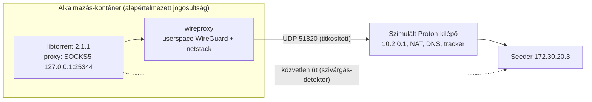

# VPN-integráció — Userspace (plug & play) PoC-jelentés

| Metaadat | Érték |
|---|---|
| **Típus / státusz** | PoC-mérési jelentés. Nem implementáció. Erre épül az [`implementation-plan.md`](implementation-plan.md) Rev. 4. |
| **Dátum** | 2026-11-08 |
| **Ág / alap** | `feature/vpn-integration` @ `49c2f0b` (a PoC-fájlok commitolatlanok) |
| **Termékkövetelmény** | **Plug & play** (felhasználói döntés, 2026-11-08): a felhasználó csak elindítja a konténert, a VPN-t a GUI-ban konfigurálja; extra Docker-jogosultság nem várható el. |
| **Vizsgált irány** | Az [archivált Rev. 3](archive/implementation-plan-rev3.md) „B” architektúrája helyett (netns + kernel WireGuard + worker, `cap_add: NET_ADMIN, SYS_ADMIN`): **userspace WireGuard a konténeren belül** (wireproxy, SOCKS5), a libtorrent proxyn keresztül. |
| **Bizonyíték** | [`poc/userspace/results/userspace-poc-results.json`](poc/userspace/results/userspace-poc-results.json), szkriptek: [`poc/userspace/`](poc/userspace/) |

---

## 1. Kérdések

1. Működik-e a letöltés **alapértelmezett Docker-jogosultságú** konténerben (nincs `cap_add`, `/dev/net/tun`, `sysctl`), kizárólag userspace WireGuarddal?
2. Kimegy-e bármi a tunnelt megkerülve: TCP/UDP peer, tracker, DNS, DHT, uTP?
3. Mi történik, ha a tunnel vagy a userspace WireGuard-folyamat letöltés közben leáll (kill switch)?
4. Működik-e a bejövő kapcsolat (Proton-porttovábbítás), és a valódi IP-n nyitott-e valami?
5. Mekkora a CPU- és memóriaköltség?

## 2. Környezet és topológia

- **Docker Engine 29.9.2** (Docker Desktop, WSL2 kernel `6.18.54.1`). Fejlesztői gép, **nem NAS**; az erőforrásszámok csak tájékoztatók.
- **Image:** `stremhu-vpn-phase0-poc:rev4` (Debian 12, Python 3.12, libtorrent `2.1.1.0`).
- **Userspace WireGuard:** [wireproxy](https://github.com/whyvl/wireproxy) **v1.1.3** `linux_amd64` (ISC-licenc, statikus Go-bináris).
  - Az archívum SHA-256-ja (`e88c1d09…f51c`) egyezik a kiadás `checksums.txt`-jével; a bináris SHA-256-ja `70ae5e52…466d`.
- **Alkalmazás-konténer:** alapértelmezett jogosultság, 2 CPU / 1 GiB. A tesztkonténerek csak belső (`--internal`) hálózaton futottak, internet és élő Proton nélkül.
- **Szimulált Proton-kilépő** (tesztinfrastruktúra, egyedül ez kap `NET_ADMIN`-t):
  - kernel WireGuard `10.2.0.1`, NAT a swarm felé;
  - DNS `10.2.0.1:53`, HTTP tracker és UDP-trackernapló;
  - porttovábbítás `172.30.20.2:16881 → 10.2.0.2:6881`.
- **Seeder:** 256 MiB, 4 MiB-os darabok, hibrid v1/v2 torrent, HTTP és UDP trackerrel.
- **Szándékos közvetlen útvonal:** az alkalmazásnak van közvetlen útja is a swarm felé, így minden tunnelt megkerülő csomag látható és sikeres lenne. A detektort a VPN nélküli `direct` kontroll validálja.



**Mérés.** Az alkalmazás-konténerben tcpdump rögzít minden csomagot. Kivétel csak a várt `libtorrent ↔ wireproxy` loopback-forgalom és a WireGuard-végpont felé menő UDP. Mellé interfészenkénti bájtszámláló, `ss`-pillanatkép, valamint a kilépő oldali DNS-, tracker- és seeder-nézet került rögzítésre.

## 3. Eredmények

| Forgatókönyv | Letöltés | Közvetlen IPv4 (swarm / WAN, nem tunnel) | Helyi DNS | Megjegyzés |
|---|---|---|---|---|
| `vpn_tcp`: proxy, TCP, DHT/LSD/UPnP/NAT-PMP/uTP ki | ✅ 12,5 s, SHA-256 ok | 0 / 0 | 0 | A tracker neve a tunnelen oldódott fel; a seeder csak a kilépő IP-t látta. |
| `vpn_udp_probe`: minden UDP-mechanizmus be | ✅ 17,0 s, SHA-256 ok | 0 / 0 | **4** (`dht.poc.test.`) | **DNS-szivárgás:** a DHT bootstrap-nevét a libtorrent helyben oldja fel. Az uTP nem épül ki, TCP-re vált. |
| `killswitch_tunnel`: a kilépő `wg0` leáll 31%-nál, 20 s-ig | ✅ 97,6 s, SHA-256 ok | 0 / 3 | 0 | A letöltés 31,35%-on megállt, majd magától folytatódott. A 3 WAN-csomag a végponthoz tartozó ICMP-hibaüzenet. |
| `killswitch_proxy`: a wireproxy leáll 31%-nál, 20 s múlva újraindul | ✅ 135,8 s, SHA-256 ok | 0 / 11 | 0 | Megállt 31,5%-on, újraindítás után befejeződött. A 11 WAN-csomag ICMP-hibaüzenet a leállított folyamat UDP-portjára. |
| `inbound`: porttovábbítás → wireproxy `TCPServerTunnel` → `127.0.0.1:6881` | ❌ nincs adat | 0 / 0 | 0 | **Proxy módban a libtorrent nem nyit TCP-listenert** (`ss`): bejövő peer nem fogadható. |
| `inbound_direct`: TCP a valódi IP-re | ✅ nincs adat | 2 / 1 | 0 | A bejövő SYN-re RST ment, adat nem. |
| `inbound_direct_utp`: uTP a valódi IP-re | ✅ nincs adat | 3 / 0 | 0 | A `0.0.0.0:6881` UDP-socket nem válaszolt a bejövő uTP-re. |
| `direct`: VPN nélküli pozitív kontroll | ✅ 12,5 s | **260 057** / 10 | 0 | A detektor jelez; a seeder a valódi IP-t látta. |

**Erőforrás** (256 MiB-onként, fejlesztői gépen):

| | libtorrent-folyamat CPU | wireproxy CPU | wireproxy memória-csúcs | libtorrent max RSS |
|---|---|---|---|---|
| VPN (`vpn_tcp`, `killswitch_*`) | 0,9–1,05 s | 2,9–3,4 s | 80–88 MiB (tétlenül ~13 MiB) | 41–50 MiB |
| Közvetlen (`direct`, uTP) | 2,3 s | — | — | 40,5 MiB |

## 4. Megállapítások

1. **A plug & play megvalósítható.** Alapjogú konténerben, kizárólag userspace WireGuarddal a letöltés működik, a nyomkövetés szerint a tunnelt megkerülő forgalom nélkül:
   - a TCP-peerek, a HTTP-tracker és a tracker DNS-feloldása is a tunnelen megy;
   - az UDP-trackerkérések szintén (a wireproxy 1.1.x tud UDP-t továbbítani).
2. **A kill switch alkalmazásszintű, és a mért esetekben zárt.** Akár a tunnel, akár a wireproxy-folyamat áll le, a libtorrent megáll, közvetlen kapcsolatot nem nyit, a visszaállás után pedig magától folytatja.
   - **Ez megfigyelés, nem bizonyítás.** A garancia azon múlik, hogy a libtorrent proxy módban soha nem nyit közvetlen kapcsolatot; kernelszintű tiltás itt jogosultság nélkül nem lehetséges.
3. **Kötelező libtorrent-beállítások VPN módban:**
   - proxy: `proxy_type=socks5`, `proxy_hostnames`, `proxy_peer_connections`, `proxy_tracker_connections`;
   - **`enable_dht=False`**: helyi DNS-szivárgás mérve;
   - `enable_lsd`, `enable_upnp`, `enable_natpmp` = `False`: ezek itt nem voltak kiválthatók, mert nincs átjáró és multicast-partner, ezért konfigurációval kell tiltani őket;
   - `enable_outgoing_utp` és `enable_incoming_utp` = `False`: a wireproxyn az uTP nem épül ki.

   A magyar privát trackereknél (privát torrent: DHT, PEX és LSD eleve tiltott, HTTP(S)-tracker) ez nem okoz funkcióvesztést.
4. **Nincs bejövő kapcsolat és porttovábbítás.** Proxy módban a libtorrent 2.1.1 nem nyit TCP-listenert, ezért a Proton NAT-PMP porttovábbítás ebben a módban nem használható; csak kimenő peerkapcsolat van.
   - **Következmény:** csak a „connectable” peerekhez lehet csatlakozni, és a feltöltés is csak kimenő kapcsolaton megy. Streamelésre és letöltésre elegendő, a ratio-építést rontja.
   - **Valódi IP:** egy UDP-socket nyitva van (`0.0.0.0:6881`), de a bejövő uTP-re nem válaszol, a TCP-re RST jön.
5. **Erőforrás.** A titkosítás és a netstack ~3 s CPU-t visz 256 MiB-onként ezen a gépen (≈12 ms/MiB), és terhelés alatt ~80–90 MiB memóriát. **NAS-on mérni kell**, és ki kell próbálni a Go `GOMEMLIMIT` korlátot.
6. **A streamelési útvonal változatlan maradhat.** A libtorrent a FastAPI-folyamatban marad, csak a session proxybeállításai változnak. Nem kell worker, osztott memória vagy UDS-IPC (a Rev. 3 legkockázatosabb része), és nem kell `CAP_SYS_ADMIN` sem.

## 5. Korlátok (nem igazolt)

- **Élő Proton nem volt:** a valós handshake, az MTU, a Proton DNS és a késleltetés mérése hiányzik. NAS-on és arm64-en nem mértünk.
- **IPv6:** a tesztháló csak IPv4; IPv6-ból csak link-local MLD-csomagok látszottak.
- **Le nem fedett libtorrent-utak:** a szivárgásmentesség ezekben a forgatókönyvekben igaz. Az LSD/UPnP/NAT-PMP, a web seed, a magnet-metaadat és a futás közbeni proxyváltás (VPN be/ki aktív torrentekkel) nem szerepelt; a terméknél ezeket külön kell tesztelni.
- **Harmadik féltől származó bináris:** a wireproxy ellátási láncát kezelni kell (rögzített verzió + ellenőrzőösszeg, vagy forrásból fordítás az image-ben).
- **Privát kulcs a futás alatt:** a wireproxy konfigurációs fájlból olvassa a kulcsot, ezért a terméknél tmpfs-en, `0600` joggal kell tartani.

## 6. Következmény a tervre

- **Alapverzió:** a plug & play követelményhez a Rev. 3 „B” architektúra (`SYS_ADMIN`, netns, worker és IPC) nem alkalmas. A userspace mód alkalmas: ez a jelölt alapverzió.
- **Emelt védelem:** egy kernelszintű mód (netns vagy tűzfal) később opcióként jöhet azoknak, akik megadják a jogosultságot. A GUI-nak jeleznie kell, melyik védelmi szint aktív.
- **A terv átírásakor rögzítendő:**
  - a szükséges libtorrent-beállítások (3. pont);
  - a session indítása proxybeállítással, még bármely torrent előtt (a Rev. 3 helyesen tárt fel indulási versenyhelyzetet);
  - a wireproxy felügyelete és újraindítása;
  - a hiányzó porttovábbítás termékszintű kezelése;
  - a NAS-mérés.

## 7. Reprodukció

```powershell
$env:POC_WIREPROXY_DIR = "<a wireproxy v1.1.3 binárist tartalmazó, ellenőrzött könyvtár>"
python docs/feature/vpn-integration/poc/userspace/run_userspace_poc.py            # mind a 8 forgatókönyv
python docs/feature/vpn-integration/poc/userspace/run_userspace_poc.py vpn_tcp    # egyetlen forgatókönyv
```

A futás végén a `vpnpoc-*` konténerek, hálózatok és a kötet törlődnek. A WireGuard-tesztkulcsok csak az eldobható kötetben léteznek.
