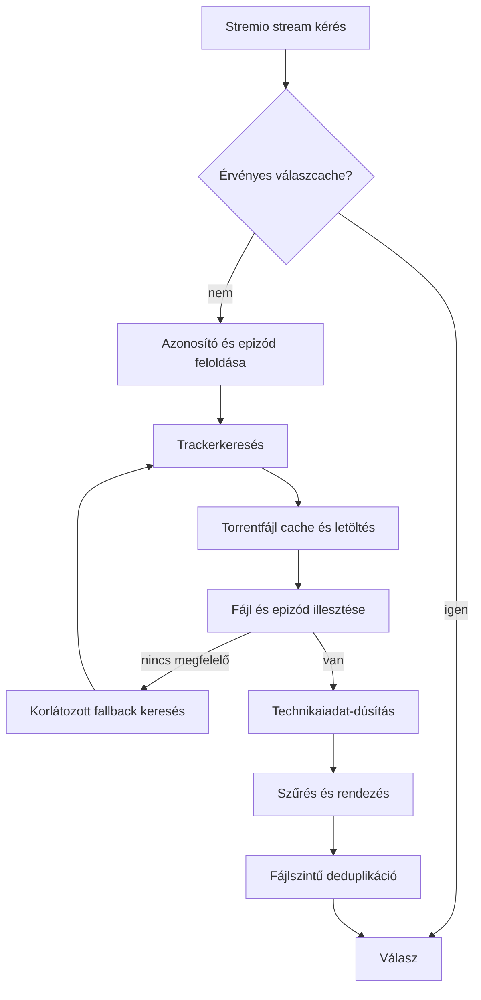

# StremHU Source: stabilitási és teljesítményjavítási implementációs terv

## 0. Státusz, hatókör és végrehajtási szabályok

- Készült: 2026-10-30.
- Vizsgált munkakönyvtár: `<REPO_ROOT>`.
- Vizsgált branch: `feature/audio-subtitle-detection`.
- Vizsgált HEAD: `7cda09c9b333e2caf8c90c6d289fa39f719cc99e`.
- Ez tervezési dokumentum. A leírt javítások még nincsenek implementálva, a tesztek és mérések nincsenek lefuttatva.
- A felhasználó jelenleg tiltja a repó módosítását. Ez a dokumentum a repón kívül készült. A terv önmagában NEM ad felhatalmazást implementációra, commitra, pushra vagy Docker-környezet törlésére.
- A megállapítások statikus forráskód-vizsgálatból származnak. A várt gyorsulás hipotézis; százalékos javulás csak mérés után állítható.

A későbbi implementáló először olvassa el az aktuális `AGENTS.md` fájlt és ezt a dokumentumot. Ellenőrizze, hogy a vizsgált kód még megfelel-e a leírásnak. A fájlokhoz megadott függvénynevek az elsődleges hivatkozások; a sorszámok idővel elavulnak. Minden alábbi relatív út a fenti repógyökérhez tartozik.

Csak külön implementációs engedély után dolgozzon a repóban. Egy feladatot egy jól körülhatárolt változtatásként végezzen el. Először reprodukálja a hibát, utána javítsa, végül ellenőrizze a szomszédos működést. Ne indítson általános átírást, függőségfrissítést vagy infrastruktúra-cserét.

### Bizonyítottsági jelölések

- **Kódhiba:** a vezérlési folyamatból közvetlenül levezethető hibás viselkedés. Futási reprodukciója még hátravan.
- **Feltételes hiba:** a kód kockázatos, de egy konkrét bemenet, megszakítás vagy párhuzamos ütemezés szükséges. A teljes hívási út elérhetőségét teszttel kell igazolni.
- **Optimalizálási hipotézis:** a többletmunka látható; a gyakorlati jelentőséget mérni kell.

### Kötelező helyi védelem

Fejlesztési teszt kizárólag a helyi Windows gépen és helyi Docker Desktopban fusson. A távoli szervert (`<REMOTE_SERVER_IP>`) ne használd ehhez. Ne olvasd ki vagy másold dokumentumba a helyi `.env` titkait. A `.env`, `docker-compose.local.yml`, `scripts/bootstrap_local.py`, `scripts/benchmark_local.py` és `AGENTS.md` nem commitolható. A tervben szándékosan nincs tényleges API-kulcs.

## 1. Rendszertérkép és fogalmak

| Elem | Szerep | Fő fájl |
|---|---|---|
| StremioService | Azonosítófeloldás, streamválasz és feliratlista összeállítása | `server/app/modules/stremio/service.py` |
| TvdbResolver | TVDB/TMDB/Kitsu/MAL/IMDb kapcsolatok és epizódleképezések | `server/app/modules/stremio/tvdb_resolver.py` |
| TorrentStreamsService | Forrásokból fájl kiválasztása, dúsítás, szűrés, rendezés és deduplikálás | `server/app/modules/torrent_streams/service.py` |
| TorrentSourceProviderService | Trackereredmények és eltárolt torrentfájlok összekapcsolása | `server/app/modules/torrent_source_provider/service.py` |
| IndexersService | Trackerek párhuzamos lekérdezése és találati cache | `server/app/modules/indexers/service.py` |
| BaseIndexerDefinition | HTTP-kliens, szemafor, lapozás és újrabejelentkezés | `server/app/modules/indexer_definitions/base_indexer_definition.py` |
| IsolatedTorrentFilesService | Torrentfájlok rövid saját adatbázis-tranzakciói | `server/app/modules/torrent_files/isolated_service.py` |
| StreamService | Torrent előkészítése, fájlellenőrzés és Range feldolgozás | `server/app/modules/stream/service.py` |
| RelayService / Torrent / File / Stream | Libtorrent, prioritások, darabok olvasása és HTTP-adatfolyam | `server/app/modules/relay/service.py`, `entities.py` |

**Torrentazonosság:** az `info_hash` a torrentet azonosítja, nem az azon belüli videofájlt. Egy fájl erős azonosítója ebben a tervben `(info_hash, file_index)`. Az indexeroldali hozzáférés azonosítója `(indexer_id, torrent_id)`; ezt nem lehet mindenhol a hash-sel helyettesíteni, mert a hitelesítés és tracker-szabályok eltérhetnek.

**Singleflight:** több azonos kérés egyetlen közös háttérmunkát vár. A várakozó HTTP-kérés és a közös háttérmunka életciklusa eltér. Egy várakozó megszakítása nem törölheti automatikusan a többiek munkáját.

**Snapshot:** önálló, változatlan adatmásolat, például egy torrent fájlonkénti letöltési állapota. Nem nyitott ORM kapcsolat és nem szálak között megosztott session.



A megvalósításnak végesre kell korlátoznia a fallback ciklust. Az ábra nem jelent korlátlan visszatérést a trackerkereséshez.

## 2. Feladatlista és függőségek

P1: helyesség vagy stabilitás; P2: jelentős terhelési/karbantarthatósági javítás; P3: kisebb optimalizálás. Ezek tervezési prioritások, nem mért incidenssúlyosságok.

| ID | Prioritás | Feladat | Függőség |
|---|---|---|---|
| M01 | P1 | Közös keresési taskok megszakításbiztonsága | önálló |
| M02 | P1 | Relay darabolvasások határideje és lezárása | önálló; M13-mal egyeztetni |
| M03 | P1 | Katalógus szűrési hiba | önálló |
| M04 | P1 | Fájlszintű deduplikáció és forráshelyesség | önálló; M05 invalidálásával együtt kiadni |
| M05 | P1 | Cache-kulcsok és invalidálás | M01 ajánlott |
| M06 | P1 | Animealiasok és epizódmetaadat-cache | önálló |
| M07 | P1 | Felirat teljessége, méretkorlát és lock | M02, M11 ajánlott |
| M08 | P2 | Keresési idő- és munkakeret | M01, M09, M10 alapjaira épül |
| M09 | P2 | Fokozatos találatfeldolgozás a top 30 helyett | M10 ajánlott |
| M10 | P2 | Torrentletöltés összevonása és ütközéstűrő mentés | M01 mintája, M12 session-szabályai |
| M11 | P1 | Range és minden kérésre érvényes fájlvalidáció | önálló |
| M12 | P2 | Sessionhatárok, célzott DB- és relay-snapshot | M01 taskélettartamával együtt tervezni |
| M13 | P2 | Relay prioritások és szálkezelés | M02 |
| M14 | P2 | Technikaiadat-dúsítás helyessége és költsége | M05, M08, M09 |
| M15 | P3 | Frontend adaptív lekérdezése | M12 mérései |
| M16 | P2 | Session cookie lejárati egység | önálló |
| M17 | P3 | Docker buildcache | önálló |
| M18 | P2 | Megfigyelhetőség és összehasonlító mérés | mérési alap először; eredmények a végén |

Ajánlott munkacsomagok: (1) M18 mérési alap; (2) M03/M06/M11/M16; (3) M01/M02/M07; (4) M04/M05; (5) M10/M12; (6) M09/M08/M14; (7) M13/M15/M17. Minden csomag után külön helyi ellenőrzés szükséges.

## 3. M01 – Közös keresési taskok megszakításbiztonsága

**Minősítés:** feltételes hiba. **Fájlok:** `stremio/service.py::get_streams`, `torrent_source_provider/service.py::find_by_imdb_id`, `find_by_query`, `find_by_torrent_id`, `find_one_by_indexer`.

### Probléma és reprodukció

Az `_ongoing_stream_tasks` és `_ongoing_tasks` ugyanazt az asyncio Taskot adja több hívónak. A közvetlen `await task` miatt A várakozó törlése a közös taskot is törölheti, ezért B várakozó sem kap eredményt. Ez akkor releváns HTTP-hiba, ha a kiszolgáló vagy middleware ténylegesen törli a request taskot; puszta socketbontásról ezt nem szabad minden környezetben automatikusan feltételezni.

### Implementációs lépések

1. Hozz létre újrahasználható, típusozható singleflight segédet, vagy alkalmazz egységes mintát a felsorolt belépési pontokon. Ne egyesíts eltérő eredménytípusokat ellenőrizetlen castokkal.
2. Mind a létrehozó, mind a csatlakozó várakozó `asyncio.shield(task)` útján várjon.
3. A regiszter eltávolítását a közös task saját befejezéséhez kösd. Egy HTTP-várakozó `finally` ága nem takaríthatja ki a még futó közös taskot.
4. Törléskor ellenőrizd az azonosságot: csak akkor `pop(key)`, ha a regiszterben még ez a task van. Régi callback ne törölhessen új taskot.
5. A közös feladat rendelkezzen saját időkerettel és megfelelő sessionélettartammal. A shield önmagában nem oldja meg ezeket.
6. Gondoskodj a kivétel lekéréséről akkor is, ha minden várakozó eltűnt. Ne keletkezzen „Task exception was never retrieved”.
7. Az első változatban a gazdátlan munka futhat a saját rövid határidejéig. Referenciaszámlált korai megszakítást csak indokolt esetben vezess be.

### Elfogadás

- A és B azonos kulccsal kér; A törlése után B eredményt kap, a szolgáltató egyszer futott.
- Külön tesztelje a létrehozó és a csatlakozó törlését.
- Minden várakozó eltűnik: a munka véges időn belül lezárul, a regiszter üres.
- Hibás feladat után új kérés új próbálkozást indít.
- Új taskot régi takarító callback nem távolít el.
- Különböző kulcsok párhuzamosan haladnak.

Referencia: a relay `get_piece_data()` már shieldet használ; annak mintája használható, de a határidő-problémáját M02 kezeli.

## 4. M02 – Relay darabolvasások véges életciklusa

**Minősítés:** feltételes hiba. **Fájl:** `relay/service.py::_fetch_piece_once`, `_fetch_piece_with_retry`, `_delete_torrent`, `process_alerts`; `main.py::lifespan`.

### Probléma

Az `_fetch_piece_once()` időkorlát nélkül vár a `_pending_piece_reads` future-jére. A shieldelt task kliensmegszakítás után is fennmaradhat. Ha a darab sosem érkezik meg, vagy a torrentet törlik, nincs biztos feloldás. A meglévő retry csak a `FileNotFoundError` egy részét kezeli; a hiányzó eseményt nem.

### Megoldás

1. Különítsd el a darabra várást és a már rendelkezésre álló darab olvasását. Lassú swarmhoz hosszabb, lemezolvasáshoz rövidebb keret kell. Az értékek konfigurálhatók legyenek, és helyi mérés alapján állítsd be őket.
2. A várakozás véges legyen akkor is, ha alert nem érkezik. A teljes retry-sorozatnak is legyen felső korlátja.
3. Torrenttörléskor a hash összes függő olvasását zárd le egy felismerhető hibával, és állítsd le a hozzájuk tartozó taskokat. Az event loopon végezd a future/task állapotmódosításait; worker szálról ütemezz vissza.
4. A későn érkező alert legyen ártalmatlan: lezárt future-re ne hívj `set_result`/`set_exception` műveletet.
5. Shutdownkor állítsd le és várd meg a taskokat. Az elvárt `CancelledError` kezelése legyen explicit, más hibát ne nyelj el.
6. Megszakítás után a feliratfogyasztó tudja megkülönböztetni a teljes és részleges tartalmat; M07 erre támaszkodik.

### Elfogadás

- Nincs peer/alert: tesztben rövid keret után lezárul; mindkét belső regiszter kiürül.
- Torrenttörlés közben várakozó kliens hibát kap, nem vár örökké.
- Egy kliens törlése nem szakítja meg a másik olvasását.
- Későn érkező alert nem okoz `InvalidStateError`-t.
- Retry nem hoz létre párhuzamos olvasásokat ugyanarra a kulcsra.

A `tests/test_relay_pending_piece_requests.py` meglévő tesztjeit bővítsd. Az egészséges HTTP stream már elküldött fejlécei után nincs mód új HTTP hibakód küldésére; itt rendezett adatfolyam-megszakítás és diagnosztika szükséges.

## 5. M03 – Katalógus médiatípus-szűrése

**Minősítés:** kódhiba. **Fájl:** `stremio/catalogs_service.py::get_catalog`.

A `filtered_sources` csak akkor váltja le az eredeti listát, ha nem üres, vagy az eredeti lista is üres. Ha minden forrást kizárt a szűrés, az eredeti összes forrás megmarad.

**Lépések:** a szűrés eredményét feltétel nélkül alkalmazd. Ha a bizonytalan típusú forrásokhoz fallback kell, azt a forrás szintjén, külön szabály határozza meg; ne a biztosan kizárt forrásokat engedd vissza.

**Tesztek:** filmkeresésre csak epizódok érkeznek → üres lista; sorozatkeresésre csak egyértelmű filmek → üres lista; vegyes listából csak megfelelő elemek maradnak; ismeretlen típus a dokumentált szabály szerint működik; eredetileg üres lista üres marad. A `tests/test_stremio_catalog_search.py` körében végezd el.

## 6. M04 – Deduplikáció és lejátszási forrás következetessége

**Minősítés:** feltételes hiba és helyességi kockázat. **Fájlok:** `torrent_streams/service.py::_deduplicate_torrent_streams`, `torrent_streams/schemas.py`, `stremio/schemas.py`.

### Pontosítás a korábbi elemzéshez

Az IMDb útvonal tipikusan egy illesztett fájlt készít torrentenként. A torrentazonosító szerinti, több videót visszaadó útvonal jelenleg nem ugyanazt a deduplikációs lépést használja. Ezért a „külön epizódok biztosan eltűnnek a jelenlegi katalógusban” állítás nem igazolt. Az önálló deduplikáló függvény hash-alapú fájlazonossága azonban túl gyenge; ezt regresszióbiztos invariánssá kell javítani.

### Megoldás

1. Erős kulcs legyen `(normalizált info_hash, file_index)`. Ha hash nincs, ne állíts bizonyított azonosságot.
2. Eltérő hash-eknél a név és méret csak hasonlóság. Alapértelmezett biztonságos működés: külön lejátszható találatok maradjanak. Ha a termék összevonást kíván, őrizd meg a forrásválasztást és jelöld a bizonytalanságot.
3. A fő találat URL-je, fájlindexe, helyben letöltött állapota, nyelve és feliratai ugyanahhoz a választott forráshoz tartozzanak. Ne csak a letöltött jelzőt másold át másik hash-ről.
4. Azonos fájl több trackerforrását külön listában lehet megőrizni. A forrásválasztásnál tartsd be az indexer teljesletöltési szabályát és a felhasználói preferenciákat.
5. A trackerenkénti seederösszeg becslés. Ne nevezd egyedi peerszámnak, és ne ígérj automatikus többtrackeres letöltést pusztán attól, hogy a felület felsorolja a forrásokat.

**Elfogadás:** azonos hash/külön fájlindex → két találat; azonos hash/azonos index → egy logikai fájl; eltérő hash/azonos név és méret → alapból két találat; a letöltöttnek jelzett találat URL-je valóban ahhoz a forráshoz vezet. Frissítsd a `test_stream_optimizations.py` azon tesztjeit, amelyek ma az eltérő hash-ek összevonását várják; a követelményváltozást dokumentáld, ne csak az assertiont írd át.

## 7. M05 – Cache-kulcsok és invalidálás

**Minősítés:** kód alapján hiányos függőségkövetés; a felhasználói hatás az invalidálási útvonalak teljes ellenőrzésével reprodukálandó. **Fájlok:** `stremio/service.py`, `indexers/service.py`, a felhasználó-, preferencia-, kizárás-, beállítás- és indexerfiók-módosító service-ek.

A streamcache kulcsa több kapcsolót tartalmaz, de nem írja le az összes szűrési/rendezési állapotot. A válasz már API-kulcsos URL-eket és letöltött állapotot is tartalmaz. A tracker-cache kulcsában az indexer neve van, fiókgeneráció nincs.

### Implementáció

1. Térképezd fel minden cache értékének függőségeit: felhasználó, API-kulcs, preferenciák, kizárások, minimum seeder, smart filter csoportosítás, app URL, trackerfiók, helyi letöltési állapot.
2. Első körben explicit invalidálás és folyamaton belüli generációszám megfelelő. Ne vezess be adatbázis-migrációt csak emiatt, ha nincs többfolyamatos igény.
3. A módosítás sikeres commitjához igazítsd az invalidálást. Sikertelen tranzakció ne eredményezzen félkész cache-állapotot.
4. In-flight feladat csak akkor publikálhat cache-be, ha a befejezéskor is érvényes a kezdéskor látott generáció. Egy régi keresés ne töltse vissza az invalidált eredményt.
5. Fiók törlése, újrabelépés vagy cseréje invalidálja a hozzá tartozó találati cache-t, különösen a hitelesítéshez kötött letöltési URL-eket.
6. Közös cache-be ne kerüljön felhasználói URL. Ha a válaszcache továbbra is kész objektumot tárol, az maradjon felhasználó- és konfigurációspecifikus; ne módosítsd helyben más kérésből.
7. Dokumentáld, hogy a folyamaton belüli cache-ek nem többworker-kompatibilis koordinációs mechanizmusok. Ne növeld egyszerűen az Uvicorn workers számát: a relay állapota és taskregiszterei is folyamatonkéntiek.

**Tesztek:** minden felsorolt beállításváltás után következő kérés új eredményt ad; API-kulcscsere után nincs régi URL; fiókcsere után nincs régi download URL; lassú régi keresés befejezése nem mérgezi vissza a cache-t; két felhasználó adata nem keveredik.

## 8. M06 – Animealiasok és epizódmetaadat-cache

**Minősítés:** kódhiba/kockázatos adatszabály. **Fájl:** `stremio/tvdb_resolver.py::_IMDB_ALIASES`, `get_episode_mappings`.

### A. Eltérő adaptációk összemosása

A lista a 2003-as Fullmetal Alchemist és a 2009-es Brotherhood sorozatot kölcsönös aliasként kezeli. Ez nem egyszerű alternatív adatbázis-bejegyzés. Távolítsd el ezt az azonossági kapcsolatot. A többi statikus párt egyenként ellenőrizd megbízható metaadat alapján; a megjegyzés önmagában nem bizonyíték. Nem ellenőrzött párt ne „javíts” új, kitalált azonosítóra.

Az alias és az epizódleképezés külön fogalom: még azonos mű eltérő sugárzási bejegyzéseinél sem feltétlenül egyeznek az epizódszámok.

### B. Cache-hit elveszíti a műfaji információt

Az `is_animation` minden hívás elején hamis, de csak Cinemeta cache-miss esetén töltődik ki. Következő epizódnál a cache-ből visszaolvasott évadszámok mellett a Kitsu fallback feltétele tévesen hamis maradhat.

**Lépések:** a sorozatszintű cache-ben együtt tárold a műfaji besorolást, évadadatokat, frissítési időt és a forrást. Legyen pozitív TTL; átmeneti hálózati hibát ne tárolj végtelen negatív eredményként. A sorozatmetaadat-betöltést sorozatazonosító szerint vond össze, mert külön epizódok ugyanazt az adatot használják. A `0` évad/epizód kezelését ellenőrizd: az `a or b` nem megfelelő, ha a nulla érvényes érték.

**Elfogadás:** különböző adaptációra nincs automatikus átirányítás; ugyanazon sorozat két epizódjánál cache-miss és cache-hit mellett azonos a műfajfüggő döntés; egyszerre kért epizódok egy közös metaadatletöltést használnak; special/season 0 nem változik önkényesen season 1-re. A meglévő TVDB/Kitsu és resolver tesztek maradjanak zöldek.

## 9. M07 – Teljes felirat, memóriakeret és lockélettartam

**Minősítés:** feltételes hiba. **Fájlok:** `stream/router.py::stream_subtitle`, `_put_cached_subtitle`, `relay/entities.py::Stream._stream_inner`, `common/keyed_lock.py`.

### Problémák

- A generátor hiba vagy kapcsolatbontás után rövidebb bájtsorozattal is befejeződhet. A fogyasztó ezt jelenleg teljes feliratként cache-elheti.
- ASS→VTT konverziónál a teljes fájl memóriába kerül, nincs az ágat védő explicit forrásméretkorlát.
- A cache bejegyzésszámot korlátoz, teljes bájtmennyiséget nem.
- A kézi locktérképből a lock akkor is eltűnhet, amikor már várakozó hívó tartozik hozzá. Ekkor új kérés másik lockot kaphat ugyanahhoz a kulcshoz.

### Lépések

1. Gyűjtés után a nyers bájtszám egyezzen a teljes forrásfájl elvárt méretével. Eltérés esetén nincs konverzió és nincs cache-beírás.
2. Az adatgyűjtés hibája/megszakítása legyen látható a feliratkezelőnek. Ne terjeszd ki vakon a videóstream hibakezelését minden fogyasztóra: a már fejlécezett videó és a még összeállítás alatt álló felirat eltérő eset.
3. Legyen forrásméret- és eredményméretkorlát, továbbá összesített cache-bájtkeret. Kezdő konfigurációhoz a meglévő 2 MiB-os nyersfelirat-küszöb vizsgálható, de ne állítsd, hogy minden valós ASS fájl belefér.
4. A cache-kulcsban a tényleges reprezentáció szerepeljen: eredeti vagy konvertált. Kerüld ugyanazon bájtok többszörös tárolását eltérő alias-kulcsokkal.
5. Használd a meglévő referenciaszámlált `KeyedLock` mintáját. A locknak a várakozókat is túl kell élnie.
6. Cache-hit előtt továbbra is hitelesíts. A közös fájlcache nem jogosultságcache.
7. A fájlnév és kódolás ne okozzon hibás fejlécet vagy csendes szövegromlást. Nem UTF-8 feliratok kezelése külön, explicit követelmény legyen, ne véletlenszerű automatikus dekódolás.

**Elfogadás:** teljes fájl egyszer töltődik; félbeszakított fájl nincs cache-ben; konverziós hiba nem tárol üres sikeres eredményt; túl nagy fájl szabályozott választ ad; cache bájtkeret nem léphető túl; három egymásra váró kérésnél sincs két párhuzamos letöltés; cache-hit sem kerüli meg az API-hitelesítést; HEAD nem indít szükségtelen tartalomletöltést.

## 10. M08 – Teljes keresési idő- és munkakeret

**Minősítés:** optimalizálási hipotézis, látható korlátlanul összegződő költséggel. **Fájlok:** `stremio/service.py::_get_streams_uncached`, `torrent_streams/service.py::find_by_imdb`, `_build_fallback_queries`, `indexers/service.py`.

A trackerkeresésekre van 12,5 másodperces korlát, de a címváltozatok egymás után új teljes ciklust indíthatnak. Egy keresési időkorlát nem jelenti a teljes kérés időkorlátját. A késői dinamikus alias fallback további keresést indíthat.

### Lépések

1. A kérés elején monotonic időből számíts abszolút deadline-t. Minden további szakasz a hátralévő időt kapja.
2. Külön korlát: fallback lekérdezések száma, vizsgált jelöltek száma, torrentletöltések száma és párhuzamossága, dúsítási keret. Legyenek központilag dokumentált paraméterek, ne szétszórt literálok.
3. Először pontos cím/évados lekérdezés; csak sikertelenség után tágítás. A teljes cím késői szerepét és a kötőjel/kettőspont levágásának hamis találatait is teszteld.
4. Ne indíts minden fallbacket egyszerre: ez a válaszidőt csökkentheti, de a trackerterhelést jelentősen növeli. Kis, mért párhuzamosság lehet későbbi döntés.
5. A deadline lejártakor már elkészült, helyes eredményt lehessen visszaadni, ha az API-szerződés ezt megengedi. Különböztesd meg az „üres találat” és „nem fejeződött be a keresés” esetet a diagnosztikában.
6. Megosztott provider task ne örökölje vakon az első HTTP-kérés személyes határidejét. Legyen saját felső korlátja; a várakozó a saját keretéig shieldelve vár. Különben egy rövid keretű kliens mindenkit korlátoz.
7. Átmeneti trackerhibákra rövid visszalépési idő vezethető be. Hitelesítési hiba, hálózati hiba és valódi nulla találat külön állapot legyen; ne cache-elj mindent üres listaként.

**Elfogadás:** üres/rossz tracker esetén is korlátos teljes idő; fallback hívásszám korlátos; nem romlik a helyes epizódok találati aránya; gyors tracker eredménye lassú másik mellett hasznosítható; a timeout nem mérgezi a tartós cache-t.

## 11. M09 – Fokozatos jelöltfeldolgozás a globális top 30 helyett

**Minősítés:** feltételes találatvesztés. **Fájl:** `torrent_source_provider/service.py::_find_by_query`; kapcsolódóan `indexers/schemas/internal.py` és az adapterek találati sémái.

A jelenlegi seeder szerinti első 30 kiválasztása az epizódellenőrzés előtt történik. A keresett rész kieshet, illetve egy tracker kiszoríthatja a többit.

### Lépések

1. Ellenőrizd, milyen előszűréshez szükséges mezők érhetők el a tracker találati sémájában. A cím nem feltétlenül jut át minden rétegen; ha bővíted a sémát, minden adaptert és tesztet frissíts.
2. Ami csak `.torrent`-ből tudható biztosan, azt ne szűrd ki találgatással. Az előszűrés a nyilvánvalóan irreleváns elemekre korlátozódjon.
3. A jelölteket kötegekben dolgozd fel; eredménytelen köteg után jöjjön a következő az M08 keretéig.
4. A trackerenkénti méltányos kvóta rangsorolási szabály legyen, ne új fix határ, amely ugyanúgy elveszíti a szükséges epizódot.
5. Katalóguskeresés és konkrét epizódkeresés eltérő megállási feltételt igényel. A provider önmagában ma nem ismeri minden fogyasztó epizódcélját; ne drótozd bele a teljes Stremio üzleti logikát. Kötegelt provider interfész vagy külön keresési koordinátor ajánlott.

**Elfogadás:** a releváns 31. jelölt elérhető, ha az első 30 nem illeszkedik; kevés találatnál nincs felesleges második köteg; egy tracker nem szorít ki minden másikat; a megállási keretek működnek.

## 12. M10 – Torrentenkénti összevonás és ütközéstűrő mentés

**Minősítés:** feltételes duplaletöltés és beszúrási verseny. **Fájlok:** `torrent_source_provider/service.py::_sync_torrent_files`, `_download_torrent_bytes`, `torrent_files/isolated_service.py::create_many`.

A lock csak a letöltés körül él. A mentés később, kötegben történik. Másik keresés a lock megszerzése után újra letöltheti ugyanazt a fájlt. A `create_many` meglévőségvizsgálata és a beszúrás nem atomi más sessionökhöz képest.

### Lépések

1. Trackerhozzáférés szerint képezz kulcsot: `(indexer_id, account_generation, torrent_id)`. A hitelesítési generáció az M05-ből jön.
2. Ugyanerre a kulcsra egyetlen közös letöltési task fusson. A várakozók M01 szerint shieldelve csatlakozzanak.
3. A kapott byte-ok ellenőrzése után a mentés kezelje a már létező kulcsot. SQLite esetén célzott, a tényleges egyedi kulcsra vonatkozó `ON CONFLICT DO NOTHING` jellegű beszúrás és utána visszaolvasás választható. Előbb ellenőrizd a modellek validátorait: bulk SQL nem kerülheti meg a szükséges hash/validáció előállítását.
4. Ne nyelj el általánosan minden IntegrityError-t; az FK-sértés és sérült adat valódi hiba.
5. A lock/singleflight és mentés határát úgy alakítsd, hogy a letöltés és a commit közötti résben se induljon új hálózati letöltés. Rövid életű készbyte-cache vagy a publikálás előtti mentés is megoldás; válassz egyet és teszteld.
6. Tartsd meg a kötegelt tranzakció előnyét, amennyire a választott szerkezet lehetővé teszi. Ne térj vissza automatikusan torrentenként hosszú írási tranzakciókra.

**Elfogadás:** két eltérő keresés közös torrentje egyszer töltődik le; két egyidejű mentés ugyanazt a sort adja vissza; egy ütközés nem veszti el az egész köteg többi elemét; érvénytelen torrent és valódi FK-hiba látható marad; rollback után újrapróbálható.

## 13. M11 – Range-feldolgozás és fájltípus-validáció

**Minősítés:** kódhiba/feltételes validációs rés. **Fájl:** `stream/service.py::_parse_range_header`, `prepare_for_stream`, `_validate_file`; `stream/router.py`.

### Range

A `split` és `int` hibái nincsenek egységesen kezelve. A fájlvégen túlnyúló utolsó bájtot jelenleg mindig elutasítja a kód. Az implementáló ellenőrizze az HTTP Range szabályokat elsődleges specifikáció alapján; ne a régi viselkedést másolja vissza.

**Elvárt teszttábla N=1000 bájtra:**

| Bemenet | Elvárt működés |
|---|---|
| nincs Range | 200, 1000 bájt |
| `bytes=0-99` | 206, 100 bájt |
| `bytes=900-` | 206, utolsó 100 bájt |
| `bytes=-100` | 206, utolsó 100 bájt |
| `bytes=900-5000` | végpont levágása 999-re |
| `bytes=1000-` | 416, nem kielégíthető tartomány |
| `bytes=abc-def`, `bytes=`, hiányzó kötőjel | szabályozott klienshiba, soha nem kezeletlen 500 |
| több tartomány | explicit dokumentált elutasítás vagy szabványos támogatás; első körben ne implementálj multipartot |

Ellenőrizd a 416 válasz `Content-Range: bytes */N` fejlécét, a nulla méretű fájlt, suffix 0-t és a HEAD válasz fejléceinek konzisztenciáját. A hibás és nem kielégíthető Range pontos státuszpolitikáját specifikáció alapján rögzítsd.

### Fájlvalidáció

A `_validate_file()` csak új torrent létrehozási ágában fut. Már relayben lévő torrentnél a fájlindex létezését a relay ellenőrzi, de a videó/felirat típusfeltétel nem ugyanott érvényesül.

**Lépések:** minden kérésnél ellenőrizd az indexet és a megengedett típust; a feliratvégpont csak feliratot fogadjon. Az általános streamvégpont meglévő kompatibilitását vizsgáld meg, mielőtt szigorítod. Lehetőleg a költséges előkészítés előtt utasítsd el a hibás bemenetet.

**Elfogadás:** új és már aktív torrent azonos szabályok szerint működik; negatív/túl nagy index és nem médiatípusú fájl nem szolgálható ki véletlenül feliratként.

## 14. M12 – Sessionhatárok és célzott állapotlekérések

**Minősítés:** optimalizálási hipotézis és feltételes konkurenciakockázat. **Fájlok:** `common/database.py`, `torrent_streams/service.py::_filter_torrent_streams`, `_sort_torrent_streams`, `torrents/service.py::get_torrents`, `torrents/repository.py`, service dependency factory-k.

### Probléma

Aszinkron kód közvetlen szinkron DB- és libtorrent-hívásokat is végez. A rendezés minden tárolt torrentet betölt; kapcsolatok lazy-loadja további queryket okozhat. Ugyanaz a request session több `to_thread` útvonalon is használható. A `check_same_thread=False` nem teszi az SQLAlchemy Sessiont párhuzamosan használhatóvá.

M01 után a közös munka túlélheti a requestet, ezért requesthez kötött sessionre és lazy ORM kapcsolatokra nem támaszkodhat.

### Lépések

1. Készíts hívási térképet: minden session létrehozási és lezárási pontja, az azt használó taskok/szálak. A szekvenciális szálváltás és a tényleges párhuzamos használat külön eset; ne állíts minden `to_thread` hívásról automatikusan versenyhelyzetet.
2. A worker függvény saját rövid sessiont nyisson és zárjon. Kifelé önálló DTO/snapshot menjen, ne lazy kapcsolatot hordozó objektum.
3. A felhasználói szűréshez szükséges adatokat egy következetes snapshotban töltsd be. Kerüld a request közben változó preferenciák keverését.
4. A helyi állapotot csak az aktuális találatok hash-eire kérd le. Ha üres a lista, ne legyen teljes táblalekérdezés.
5. Egy torrent `file_progress()` eredményét válaszonként egyszer használd fel; külön fájlok ellenőrzése ne ismételje ugyanazt a teljes listát.
6. Mérd a queryszámot és az event-loop késést, mielőtt új indexet vagy adatbázist vezetsz be. SQLite WAL már be van állítva; nem megoldás ugyanazt újra „bekapcsolni”.

**Elfogadás:** párhuzamos külön keresések nem osztoznak sessionen; request vége után a közös task nem használ lezárt sessiont; nincs DetachedInstanceError; queryszám nem nő a találatszámmal N+1 módon; SQL-módosítások rollbackje nem rontja el a másik kérés állapotát.

## 15. M13 – Relay prioritáskezelés és konfiguráció

**Minősítés:** optimalizálási hipotézis és feltételes szálverseny. **Fájlok:** `relay/service.py::priority_manager_loop`, `trigger_priority_update`, `update_settings`; `relay/entities.py::Torrent.priority_manager`, `get_deadlines`.

### Problémák

- A prioritáskezelő worker szálban olvassa az event loop által módosított streamgyűjteményeket. A `list(...)` néhány helyen csökkenti, de nem szünteti meg az állapot-inkonzisztencia lehetőségét.
- A következő hiányzó darabok keresése sok már letöltött darabot végigjárhat, majd a fájl elejére visszafordulhat.
- Aktív streamnél fix 50 kapcsolat van beégetve. Ez eltérhet a felhasználó által megadott limittől.
- Konfigurációváltáskor a tényleges handle-limit és a `_max_connections` emlékezett értéke szétcsúszhat, ha csak az egyik frissül.

### Lépések

1. A streamállapot snapshotja az event loopon készüljön; a worker csak ezt használja. Alternatíva egyetlen tulajdonosi szál, de ne vezess be blokkoló lockot az event loopon hosszú libtorrent-munka köré.
2. Korlátozd az előretekintési tartományt bájt/idő vagy darabszám szerint. A már letöltött szakaszok átlépését hatékonyan kezeld, de ne veszítsd el a következő szükséges darabot.
3. Visszaforduló előtöltés csak dokumentált céllal maradjon. Rövid HTTP Range esetén ne kérj indokolatlanul az egész fájlra előtöltést.
4. A beállított torrentkapcsolati korlát jelentését rögzítsd. Ha kemény limit, aktív stream sem lépheti túl. Az effektív és az emlékezett állapot együtt frissüljön.
5. Csak a változott deadline-okat küldd újra, amennyiben a libtorrent deadline relatív/időzítési szemantikája ezt megengedi. Ezt az alkalmazott libtorrent verzió dokumentációjával ellenőrizd; ne optimalizáld vakon.
6. A prioritásfrissítési sor koaleszkálása már létezik. Csak akkor cseréld bounded pending-set megoldásra, ha a mérés mutat sorfelhalmozódást.

**Elfogadás:** aktív stream közbeni seek, megszakítás, második néző, torrenttörlés és limitváltás nem okoz versenyhibát; darabellenőrzések száma korlátos; normál lejátszás nem lassul és az előtöltés nem okoz új pufferelést.

## 16. M14 – Technikaiadat-dúsítás célzása

**Minősítés:** helyességi kockázat és optimalizálási hipotézis. **Fájl:** `torrent_streams/service.py::_enrich_torrent_streams_with_tech_info`, `_enrich_single_stream`; adapterek `fetch_tech_info` függvényei.

Az első tíz jelölt kap dúsítást még végső rendezés előtt. A 11. releváns találat kimaradhat. Az 1,5 másodperces közös timeout miatt az eredmény a hálózat sebességétől is függ. A tech-info cache-nek nincs TTL-je, üres eredmény is megmaradhat kiszorításig.

### Lépések

1. Az olcsón ellenőrizhető feltételekkel előrangsorolj, de az ismeretlen nyelvet ne szűrd ki úgy, hogy emiatt soha ne kapjon dúsítást.
2. Válaszd külön a biztos nyelv/feliratadatot, a fájlnévből következtetettet és az ismeretlent. Ne kezeld az ismeretlent biztos hiányként.
3. Torrentenként vond össze a dúsítást; ugyanazon torrent két fájlja ne indítson két NFO-lekérést.
4. Pozitív TTL, rövidebb negatív TTL és külön hálózati hibaállapot szükséges. Az adapter által nem támogatott dúsítás külön állapot lehet.
5. A dúsítás az M08 hátralévő keretét használja. Visszaadott streamobjektumot utólagos háttértask ne módosítson.
6. A japán hangsáv és magyar felirat megőrzése elsőrendű regressziós követelmény. Egyetlen torrent NFO-ja több videónál sem feltétlenül fájlszintű bizonyíték; a dúsítás hatókörét dokumentáld.

**Elfogadás:** releváns 11. jelölt célzottan dúsítható; timeout nem állít hamis negatív tényt; sikertelen első kérés később javulhat; párhuzamos kérések egy dúsítást használnak; kimenet determinisztikus rögzített forrásadatokkal.

## 17. M15 – Frontend frissítési költség

**Minősítés:** optimalizálási hipotézis. **Fájlok:** `client/src/shared/queries/torrents.ts`, `playbacks.ts`, kapcsolódó listakomponensek és backend routerek.

A torrentlista másodpercenként teljes lekérdezést indít. Először mérd meg 10/100/1000 helyi torrentnél a payloadot és backend költséget. A React Query globális staleTime nem kapcsolja ki a refetchIntervalt.

**Lépések:** frissítés csak látható oldalon, aktív letöltésnél sűrűbben, nyugalmi állapotban ritkábban; a meglévő könyvtár alapértelmezett háttér-viselkedését ellenőrizd. A statikus torrentadatok és változó sebességállapot szétválasztható. Lapozás előtt rögzítsd a rendezést és a törlés utáni oldalkezelést. SSE csak akkor indokolt, ha az egyszerű ritkítás és snapshot nem elég.

**Elfogadás:** aktív állapot továbbra is használhatóan friss; elrejtett oldalon nincs indokolatlan forgalom; módosítás/törlés utáni invalidálás működik; nincs több párhuzamos poll ugyanarra az állapotra; hálózati és szerverhiba mellett nincs agresszív újrapróbálási ciklus.

## 18. M16 – Session cookie lejárati egység

**Minősítés:** kódhiba, az alkalmazott middleware szerződésével megerősítendő. **Fájl:** `main.py`, `SessionMiddleware(max_age=...)`.

A kifejezés `1000 * 60 * 60 * 24 * 30`. Másodperces max_age esetén ez 2 592 000 000 másodperc, nagyjából 82 év, nem 30 nap.

**Lépések:** ellenőrizd a telepített middleware max_age egységét; állítsd a termék által kívánt 30 napra (`60 * 60 * 24 * 30` másodperc). Tesztben a Set-Cookie Max-Age értékét vizsgáld, ne csak a konstans képletét. Ellenőrizd, hogy a régi cookie-k aláírásának életkor-ellenőrzése is az új határt alkalmazza-e. A Secure/SameSite beállítások megváltoztatása külön feladat, mert a helyi HTTP bootstrap kompatibilitását érinti.

## 19. M17 – Docker buildcache

**Minősítés:** optimalizálási hipotézis. **Fájl:** `Dockerfile`.

Most `COPY client ./` után fut az `npm ci`, ezért tetszőleges kliensforrás-változás invalidálhatja a függőségtelepítési réteget.

**Lépések:** először a `package.json` és tényleges lockfile másolása, utána `npm ci`, majd a kliensforrás másolása és build. Ellenőrizd, igényel-e valamely telepítési script további fájlt. A `.dockerignore` már kizárja a venvet, node_modules-t, teszteket és több helyi adatot; ezeket ne add vissza a kontextushoz.

**Elfogadás:** tiszta build működik; csak TSX módosításakor az npm-ci réteg cache-ből jön; lockfile-változáskor újratelepít; a build nem kerül meg lockfile-ellenőrzést és nem vált át `npm install`-ra.

## 20. M18 – Megfigyelhetőség, tesztelés és A/B/C mérés

### 20.1 Mérési minimum

Mérj monotonic órával, és különítsd el a következő szakaszokat: azonosítófeloldás, trackerkeresés indexerenként, torrentcache olvasás, letöltés, parse/mentés, epizódillesztés, dúsítás, szűrés/rendezés, teljes streamválasz, első videobájt, első feliratválasz.

Számlálók: trackerhívás, letöltött torrent, cache hit/miss, singleflight csatlakozás, timeout, aktív/gazdátlan task, DB queryszám, prioritási sor mérete, cache-bájtok. A health végpont jelenleg csak liveness jellegű sikert ad; külön readiness diagnosztika indokolt lehet, de ne indítson trackerhívást minden healthcheck.

Ne logolj API-kulcsot, cookie-t, jelszót, TOTP-t vagy hitelesítést tartalmazó download URL-t. Metrikacímkének ne használj korlátlan egyedi keresőszöveget, torrentazonosítót vagy felhasználóazonosítót.

### 20.2 Célzott regressziós mátrix

| Eset | Kötelező ellenőrzés |
|---|---|
| Két azonos kérés, egyik törölve | másik sikeres, egyszeres háttérmunka |
| Külön keresések közös torrenttel | egyszeres hálózati letöltés |
| Nincs peer / nincs alert | határidő után rendezett lezárás |
| Torrent törlése olvasás alatt | nincs örök future vagy késői InvalidStateError |
| Minden katalógustalálat kizárt | valóban üres lista |
| Azonos torrent két videóval | fájlok külön maradnak |
| Eltérő hash, azonos név/méret | nincs bizonyítatlan tartalmi azonosság |
| Beállítás/fiók/API-kulcs váltása | cache nem ad régi függő adatot |
| Anime következő epizódja cache-hitből | azonos műfajfüggő döntési szabály |
| Félbeszakadt felirat | nincs részleges cache-beírás |
| Releváns 31. jelölt | kereten belül megtalálható |
| Különböző Range bemenetek | helyes státusz, méret és fejléc |
| Sok tárolt, kevés érintett torrent | nincs teljes lista miatti indokolatlan költség |
| Seek + két néző + limitváltás | stabil relay és konfiguráció |

Konkurenciatesztben eseményekkel/barrierekkel irányítsd az ütemezést, ne véletlenszerű hosszú sleepre építs. A normál unit tesztek ne lépjenek ki élő trackerekre. A valódi adapterpróba külön helyi integrációs lépés.

### 20.3 Kötelező ellenőrzések implementáció után

A repó AGENTS utasítása szerinti sorrend: Ruff, basedpyright, pytest a `server/.venv` környezettel; csak ezután Docker build. PowerShellben külön parancsokkal futtasd és minden exit code-ot ellenőrizz:

```powershell
$env:HOST_IP = "<HOST_IP>"
$env:PYTHONIOENCODING = "utf-8"
Set-Location server
.venv\Scripts\python -m ruff check .
.venv\Scripts\basedpyright.exe
.venv\Scripts\python -m pytest tests
```

A HOST_IP nem lehet localhost/127.0.0.1. Frontend-változásnál a `client/package.json` szerint `npm run lint` és `npm run build`; az utóbbi a TypeScript-ellenőrzést is futtatja. A build generált fájlokat hozhat létre: ezek csak későbbi implementációs engedély mellett készülhetnek.

### 20.4 Három referencia és torzítások

| Jel | Referencia | Helyi port |
|---|---|---|
| A | `s4pp1/stremhu-source:latest` | 7073 |
| B | `stremhu-source:repo-master` | 7072 |
| C | implementált branch, `stremhu-source:local-test` | 7070 |

Használd a helyi `scripts/benchmark_local.py` szkriptet, előtte ellenőrizd, pontosan mit mér és milyen mellékhatásai vannak. A tiszta környezethez előírt `down -v` adatot töröl: csak elkülönített, újragenerálható helyi tesztvolume-okon alkalmazd, és a művelet előtt ellenőrizd a compose projektet és mountokat.

A B image a tényleges main/master állapotnak feleljen meg. Ha frissíteni kell, ideiglenes worktree használható az AGENTS szerint, de ez már repó-/filesystem-módosítás, külön implementációs felhatalmazást igényel. Ne nevezd B-t friss baseline-nak ellenőrzés nélkül.

Rögzítsd az image digesteket és commitokat: a `latest` idővel változik. A dokumentáció upstream összehasonlítási alapja az AGENTS szerint `8c99c7d`; ez nem feltétlenül azonos az A futó `latest` image-ével. A két viszonyítási alapot ne keverd össze.

Hideg tesztnél külön kezeld: folyamatcache, torrentadatbázis-cache, letöltött payload, OS fájlcache és külső trackerállapot. A volume wipe önmagában nem ürít minden cache-réteget. Meleg mérés előtt ugyanaz a felhasználó, azonosító, epizód és beállítás legyen előmelegítve.

Elsődleges mérés az AGENTS szerinti szekvenciális A/B/C. Ha engedélyezett, kiegészítő ismétléseknél váltakozó sorrenddel ellenőrizd a trackerterhelés és cache-melegedés hatását. Ne növeld kontrollálatlanul az élő trackerforgalmat. A funkciót nem támogató upstream válaszát „nem támogatott” jelöléssel hasonlítsd, ne hibátlanul gyors teljesítésként.

### 20.5 Eredményjegyzőkönyv sablon

| Metrika | A | B | C előtte | C utána | Megjegyzés |
|---|---|---|---|---|---|
| Hideg teljes válaszidő | mérendő | mérendő | mérendő | mérendő | azonos bemenet |
| Meleg teljes válaszidő | mérendő | mérendő | mérendő | mérendő | azonos cache-feltétel |
| p50 / p95 | mérendő | mérendő | mérendő | mérendő | mintaszám kötelező |
| Trackerhívások száma | mérendő | mérendő | mérendő | mérendő | típusonként |
| Torrentletöltések száma | mérendő | mérendő | mérendő | mérendő | hideg és meleg |
| Helyes streamtalálatok | mérendő | mérendő | mérendő | mérendő | epizód kézzel is ellenőrzött |
| Japán hangsáv / magyar felirat | mérendő | mérendő | mérendő | mérendő | ismeretlen külön kategória |
| RSS csúcs / taskok / DB queryk | mérendő | mérendő | mérendő | mérendő | terhelési környezet |
| Első videobájt / seek | mérendő | mérendő | mérendő | mérendő | payload cache külön |

Kevés élő mintából ne állíts stabil p95-öt. Ismételhető fake-adapteres terhelésvizsgálat sok mintára alkalmas; az élő trackerpróba a valós kompatibilitást ellenőrzi. A gyorsulás akkor elfogadható, ha nem csökken a helyes találatok száma és nem lesz rosszabb a nyelv/felirat azonosítás.

## 21. Dokumentáció, kiadás és készre jelentés

Későbbi engedélyezett implementáció esetén a branchhez tartozó `docs/feature/<branch-rövid-neve>.md` fájlt az AGENTS szerint aktualizálni kell. Tartalmazza a célokat, upstream `8c99c7d`-hez viszonyított diffmátrixot, Mermaid ábrákat, invariánsokat, teszteket és tényleges mérési eredményeket. Ez a külső terv nem helyettesíti automatikusan a branch fejlesztői dokumentációját.

Egy feladat akkor kész, ha:

1. A reprodukciós teszt a régi viselkedés hibáját értelmesen kimutatja.
2. A javítás és a kapcsolódó regressziós tesztek megfelelnek a fenti feltételeknek.
3. A kötelező linter, típusellenőrzés és teljes helyi tesztcsomag eredménye rögzített.
4. A releváns helyi Docker/kompatibilitási ellenőrzés megtörtént.
5. Teljesítményállításnál rendelkezésre áll összehasonlítható előtte/utána mérés.
6. A dokumentáció a tényleges végállapotot írja le; nincs „kész” jelölés mérés vagy teszt nélkül.
7. A diff nem tartalmaz helyi titkot, segédfájlt, véletlen generált állományt vagy független refaktort.

Minden feladat visszagörgethető külön változtatás legyen. Az új időkeretek és költségkorlátok konfigurálhatók legyenek, de a helyességi javításokat ne helyettesítsd tartósan kikapcsolt funkcióval. Commit és push csak a felhasználó által engedélyezett munkafolyamat szerint történjen.

## 22. Másik AI-nak átadható indítóutasítás

> Olvasd el ezt a tervet és a repó aktuális AGENTS.md fájlját. Először ellenőrizd, hogy van-e kifejezett engedélyed a repó módosítására; a terv készítésekor ez tiltva volt. Engedély hiányában csak olvasd és értékeld a kódot. Engedély birtokában egyetlen kijelölt Mxx feladatot implementálj. Nyisd meg a megnevezett függvényeket, ellenőrizd a terv feltételezéseit a jelenlegi kódban, készíts célzott reprodukciót, és csak a szükséges változtatást végezd el. Tartsd be az invariánsokat és a függőségeket. Ne találj ki API-t, sémamezőt, IMDb-azonosítót vagy benchmarkeredményt. Ne használd az éles szervert, és ne commitolj helyi titkot vagy segédfájlt. Futtasd a kötelező ellenőrzéseket a helyi venvvel, majd a szükséges helyi Docker-próbát. A végén írd le a változást, a teszteredményeket, a megmaradt korlátokat és a dokumentáció frissítését. Ha a kód már megoldja a feladatot, ezt bizonyítsd és ne implementálj duplán.

## 23. A terv felülvizsgálatakor beépített pontosítások

- A statikus megállapítások nincsenek futási bizonyítékként vagy mért gyorsulásként feltüntetve.
- A többfájlos hash-deduplikáció elérhetőségi korlátja külön le van írva; nincs általánosított, nem igazolt katalógushiba-állítás.
- A shield mellé saját timeout, taskhoz kötött takarítás, kivételkezelés és sessionélettartam került.
- Az invalidálás a folyamatban lévő régi keresés késői cache-beírását is kezeli.
- A top 30 helyettesítése nem feltételezi, hogy a provider már ismeri az epizódcélt vagy a találati címet.
- A részleges felirat és a már fejlécezett videóstream hibakezelése külön követelmény.
- A libtorrent deadline és HTTP Range részletei ellenőrizendő API-/specifikációs szerződésként szerepelnek, nem kitalált implementációként.
- A SQLite ütközéskezelés nem kerülheti meg a torrentmodellek validációját.
- A mérési terv megkülönbözteti az upstream forrásbaseline-t, a változó latest image-et és a különböző cache-rétegeket.
- A terv megőrzi a repómódosítási tilalmat, és nem tartalmaz valódi API-kulcsot vagy hitelesítőadatot.
